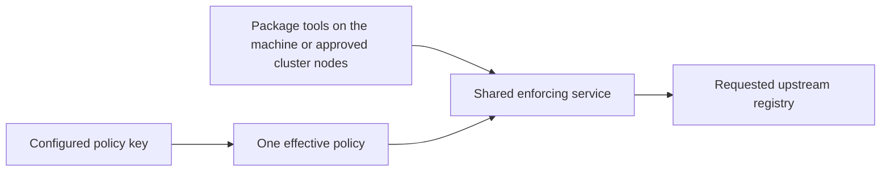

# Product: Decision log delivery

## Release amendment authority

The current target is nine families: npm, PyPI, Maven, Go modules, Cargo, NuGet, RubyGems, Conan and Docker/OCI. Clients enforce locally and download directly on Linux, macOS and Windows; the optional policy server runs on Linux only. The policy API key authenticates policy retrieval, while registry credentials remain configured in the package managers. Explicit standalone TOML operation remains available. C1006/C1008/C1009/C1013/C1015–C1018 and the [lead release scope](../package-firewall-mvp/01-product.md) govern this amendment; earlier thirteen/sixteen/seventeen-family and certificate-specific text is historical where it conflicts.

This plan owns timestamped, credential-safe per-decision delivery, optional consumer identification, counted loss and non-blocking sinks for the selected nine families. Local telemetry is not claimed tamper-proof against the host administrator.

Managed policy outage and propagation reuse management C19/C20: remembered central policy can continue during an outage, unknown keys cannot acquire policy, and reachable-server updates/revocations follow the configured interval (one minute by default). Never silently select weaker standalone TOML after a managed failure. Client/device administrators can bypass local enforcement unless existing device/network controls prevent it; this release does not add host attestation.

No new desktop GUI or account/membership workflow is required. Existing API-key, group-policy and registry administration screens are reused with revised setup text and nine-family choices; obsolete certificate-only controls are retired. Exact changed screen content, migration and CLI setup are part of the combined design before implementation. Native GitHub Actions client tests cover all three OSes, with Linux server integration and explicit Docker engine/runner limits.

RubyGems is critical and is the first added ecosystem after the shared-service foundation. CPAN is omitted (C1027); no new CPAN adapter, policy options or acceptance lane is required.

## Clarifications and decisions

| ID | Class | Status | Owning Gate | Target Gate | Question or disposition | Selected value or policy | Decision source |
|---|---|---|---|---|---|---|---|
| C1 | current-Gate decision | resolved | 1 | none | Does the firewall record which consumer asked for which package? Today it deliberately records nothing a caller supplies, which is why it can say a package was served at a given time but not to whom. Answering the headline "which machines already took it" question requires reversing that rule. | Consumer identification is an opt-in and is OFF by default. While it is off the success metric below is unreachable and the records say what was served and when, never to whom. | `## Decisions recorded here rather than left to a later gate`, first decision |
| C2 | current-Gate decision | resolved | 1 | none | When delivery cannot keep up or the destination is unreachable, does the firewall drop records, or refuse to serve rather than serve unlogged? | Drop, count and surface every dropped record. A refuse-rather-than-serve-unlogged setting is not offered in this feature (C7); it would trade availability for completeness and belongs in a plan of its own. | `## Decisions recorded here rather than left to a later gate`, second decision |
| C3 | current-Gate decision | resolved | 1 | none | May delivery slow or fail a request? | No. A developer waiting on an install never waits on a log write or a network round trip, whatever the file or the SIEM is doing. | `## Decisions recorded here rather than left to a later gate`, third decision |
| C4 | current-Gate decision | deferred | 1 | 2 | Which wire format and transport carries records to the SIEM, and how does the operator name a destination? | Not selected at Gate 1. Product requires only that records reach the operator's SIEM; the transport is an architecture choice. | Deferred to Gate 2 |
| C5 | current-Gate decision | deferred | 1 | 2 | How does the local file behave over time — size, rollover, retention — given the non-goal that this is not a storage product? | Not selected at Gate 1. Product requires only that records land in a file the operator names and that the firewall does not fill the disk silently. | Deferred to Gate 2 |
| C6 | current-Gate decision | deferred | 1 | 2 | How does any credential the SIEM destination requires reach the process without being written into the configuration file? | Not selected at Gate 1. Product requires only that a credential is never stored in the configuration file and never written to a record. | Deferred to Gate 2 |
| C7 | user clarification | resolved | 1 | none | Build the refuse-rather-than-serve-unlogged setting C2 promises in this feature, or defer it? Final verification found no gate designed it and none deferred it. | Deferred out of this feature. Records are dropped, counted and surfaced, and no setting in this feature refuses a request because its record was not delivered. The setting reverses C3 — a request would wait on, or fail because of, delivery — and that trade-off belongs in a plan of its own. | user answer, Gate 1 grilling Q1 (2026-09-22) |
| C8 | current-Gate decision | resolved | 1 | none | Does every record delivered to the file and the SIEM say *when* the decision was made? This Gate already promises it: "what was served and when", consumers "with timestamps". Final verification found the delivered records carry no time, and only the console line does. | Yes. Every record delivered to the file or the SIEM states the time of the decision. A collector's own receipt time does not count, because delivery may lag the decision. The promise was already in this Gate; this row makes it explicit so Gates 2-4 design it. | `## Problem`, `## Success metric`, `## Announcement` of this document; `evidence/slice-3.md` (sf-verification P-WHEN) |
| C1001 | user clarification | resolved | 1 | none | Which existing plans receive the Nora/Dozor ecosystem expansion? | All five: Package Firewall MVP, management server/portal, OSV intelligence, decision log delivery and rated load guard. Record every added ecosystem and artifact identity consistently in console/file/SIEM decisions, preserving timestamps, credential privacy, opt-in consumer identification and non-blocking delivery. Existing record size and field limits must be revisited in design. | user answer 2026-11-02 selecting all five plans; initial request to support every Nora format and reuse Nora/Dozor code where practical |
| C1002 | user clarification | resolved | 1 | none | Must package-manager and registry authentication compatibility be established before design? | Yes. Check every target client/registry against Probation's actual SSL/TLS and application-authentication mechanisms, separately for client-to-firewall, firewall-to-management and firewall-to-upstream connections; change the architecture where required rather than assume universal support. | user steering 2026-11-02: check whether all package managers and registries support the SSL auth currently used and whether architecture must change |
| C1003 | current-Gate decision | deferred | 1 | 2 | Which scoped policy API, client identity/enrollment, policy-source transition, transport and protocol contracts implement the selected C1006/C1008/C1009/C1015 client and policy-source outcomes? | Not selected at Gate 1. API-key authentication to the policy server and server-independent TOML operation are selected product outcomes; exact endpoints, mode switching, compatibility migration and client packaging require design; credential ownership is already selected in C1015. | Deferred to Gate 2 from C1006/C1008; user answer 2026-11-02 |
| C1004 | research fact | resolved | 1 | none | What exactly does Nora support, and what can be borrowed? | Seventeen format families, with differing proxy/hosted and policy capabilities. Nora and Dozor own code is MIT with notices to preserve; Dozor version matching is npm-only. Transport support is not proof of equivalent Probation policy or OSV coverage. | sf-research ANSWERED, [../package-firewall-mvp/evidence/research-nora-dozor-reuse.md](../package-firewall-mvp/evidence/research-nora-dozor-reuse.md), pinned Nora 7a6cd780 and Dozor 93f1f091 |
| C1005 | research fact | resolved | 1 | none | Which current authentication contract must the expansion account for? | Selected organisation registry reads and writes require a unique client certificate identifying an active member and their current group. Legacy managed routes still use Basic/bearer API keys; firewall-to-management uses its own bearer token. This describes implemented baseline behavior. C1006/C1008 replace mandatory package-client certificate identity in the target design; registry isolation and upstream authorization remain requirements. The owning publishing-proxy plan is reopened. | sf-repo-view PARTIAL structural evidence, [../package-firewall-mvp/evidence/repository-ecosystem-auth.md](../package-firewall-mvp/evidence/repository-ecosystem-auth.md); ../publishing-proxy/01-product.md C29–C35 |
| C1006 | user clarification | resolved | 1 | none | How should clients without native client-certificate support participate? | A locally installed client uses API-key authentication to the policy server. Native package managers no longer need a Probation TLS client certificate in the target design. The policy-server key stays distinct from upstream registry/publisher credentials. This replaces the certificate-forwarding-bridge proposal; C1009 selects local enforcement and direct registry traffic. | user answer, Gate 1 grilling Q2, 2026-11-02; ADR candidate |
| C1007 | research fact | resolved | 1 | none | Does every target standard client natively support the current certificate admission contract? | No universal native-client support. Cargo and Go client-certificate support remains proposed; multiple other clients or endpoint classes remain unknown. Documented certificate settings in other clients do not prove full install/publish/redirect coverage. The survey concerns the former certificate-only design; the new installed-client/API-key direction does not require native package-client mTLS. New interoperability remains unproven until its own runtime checks pass. | sf-research UNKNOWN, [../management-server/evidence/research-ecosystem-auth.md](../management-server/evidence/research-ecosystem-auth.md), 17-format primary-source matrix, 2026-11-02 |
| C1008 | user clarification | resolved | 1 | none | Must the backend remain usable without a policy server? | Yes. Preserve explicit self-hosted standalone deployment configured through TOML, without a central policy-server dependency, alongside managed operation using the local client and policy-server API key. Standalone is a selected deployment mode; this answer does not select automatic fallback after a managed authentication or network failure. | user answer, Gate 1 grilling Q2 follow-up, 2026-11-02 |
| C1009 | user clarification | resolved | 1 | none | Does the local client enforce policy and fetch directly from registries, or forward packages through a shared backend? | The installed client enforces policy locally and fetches package metadata/artifacts directly from the selected registries. No shared package-data backend is required for that managed-client path. The same enforcement engine remains usable as a standalone TOML-configured backend. API-key policy retrieval and registry credentials retain separate authority; credential custody and managed-mode bypass controls still require design. | user answer, Gate 1 grilling Q3, 2026-11-02: Enforce locally; fetch registries directly; ADR candidate |
| C1010 | research fact | resolved | 1 | none | What existing behavior supports standalone and optional managed operation? | Config.management is optional; absent management chooses TOML cooldown/OSV plus a separate blocklist file. Managed outages retain remembered central policy, not local TOML. Local API-key policy retrieval needs a scoped endpoint; a fleet token is not equivalent to a user/client policy key. Mode changes can weaken policy and need a selected trust model. PARTIAL structural evidence, not a tested new client. | sf-repo-view, [../package-firewall-mvp/evidence/local-client-policy-modes.md](../package-firewall-mvp/evidence/local-client-policy-modes.md), 2026-11-02 |
| C1011 | research fact | resolved | 1 | none | Which Nora families have public distribution sources and meaningful firewall use cases? | Sixteen have concrete public sources, including Debian/APT and RPM repositories, Terraform providers/modules, ConanCenter and the Hugging Face model hub. Go uses a public mirror over source repositories. Raw is Nora hosted generic storage without a defined ecosystem upstream. Public existence alone does not establish equivalent policy coverage. | sf-research ANSWERED plus main-agent official APT/Terraform checks, [../package-firewall-mvp/evidence/research-public-ecosystems.md](../package-firewall-mvp/evidence/research-public-ecosystems.md), 2026-11-02 |
| C1012 | user clarification | resolved | 1 | none | Should the expansion follow Nora format count blindly or check public-source firewall value? | Check every format for public distribution and a useful artifact-policy outcome before finalising scope. The user proposes omitting APT based on an absence-of-public-sources premise; C1011 corrects that premise. Final include/defer choices follow C1013, not the disproved premise. Existing npm/PyPI private-registry and publishing requirements are not removed by this research request. | user request 2026-11-02 to check APT, Terraform and other formats for public registries and firewall purpose |
| C1013 | user clarification | resolved | 1 | none | Which formats belong in this release? | C1027 amends the original ten-family Q5 selection: npm, PyPI, Maven, Go modules, Cargo, NuGet, RubyGems, Conan and Docker/OCI only. RubyGems is critical; CPAN is omitted. Terraform, Ansible Galaxy, APT, RPM, Hugging Face, Raw and unlisted Dart/Pub remain outside this release. | user Q5 selection, amended by user C1027 on2026-11-02 |
| C1015 | user clarification | resolved | 1 | none | Where are upstream registry credentials configured? | In the package managers, by the user or CI job, not on the firewall. Preserve the existing credential-bearing publishing request path and upstream authorization. The firewall does not configure or manage registry credentials. Its separate service key authenticates policy retrieval only and is never sent to registries. This applies to managed and standalone operation. | user answer, Gate 1 grilling Q6, clarified explicitly 2026-11-02: credentials are configured in package managers, not on the firewall |
| C1016 | user clarification | resolved | 1 | none | Which operating systems must the installed client support in this release? | Linux, macOS and Windows. The local enforcing client must install, run and use the selected package/container workflows on all three; existing Linux/macOS build configuration is baseline evidence, not proof of new Windows or installed-client support. Exact architecture/install/lifecycle contracts are designed under C1003. | user answer, Gate 1 grilling Q7, 2026-11-02: Linux, macOS and Windows |
| C1017 | user clarification | resolved | 1 | none | Which operating systems must host the central policy server? | Linux only. Client support remains Linux, macOS and Windows. The optional standalone TOML backend remains a separate deployment mode; Linux-only policy-server scope does not remove cross-platform client requirements. | user steering 2026-11-02: Policy server only for Linux |
| C1018 | current-Gate decision | deferred | 1 | 2 | How are the selected cross-platform verification requirements implemented in GitHub Actions? | User requires GitHub Actions testing on Windows and macOS; include native Linux client coverage and Linux-only policy-server coverage. Runner/architecture choices, native-client test matrix, Docker engine placement, fixtures, secrets isolation and release gates are design obligations; build-only or cross-compilation evidence cannot be presented as runtime client compatibility. No YAML or runner configuration selected at Gate 1. | user instruction 2026-11-02 to use GitHub Actions to test Windows and macOS; exact implementation deferred to Gate 2 |
| C1027 | user clarification | resolved | 1 | none | Is CPAN required, and how important is RubyGems? | Omit CPAN from this release. RubyGems is critical and remains required; prioritize it as the first added ecosystem after the shared-service foundation. Current target is nine families: npm, PyPI, Maven, Go modules, Cargo, NuGet, RubyGems, Conan and Docker/OCI. Preserve all other selected deployment, policy, credential and acceptance outcomes. | user answer2026-11-02: RubyGems is critical; CPAN can be omitted; amends C1013 |
| C1024 | user clarification | resolved | 1 | none | Does the public-registry focus introduce a public/private split or change existing publishing credentials? | No. Handle requested registries the same way as public registries, using the existing forwarding and configured protection/freeze behavior. Registry credentials are configured in package managers, not on the firewall. Preserve the existing credential-bearing publishing request path and upstream publishing authorization. This clarification introduces no new public/private registry mode, removes no existing authentication behavior, and does not request an authentication redesign. Continue the previously selected machine/cluster service model and policy-key separation. | user correction, 2026-11-02: handle as public; credentials are already needed for publishing; no change to previous implementation; supersedes the assistant's public-only/authentication-exclusion interpretation |
| C1022 | user clarification | resolved | 2 | none | Q11: For Kubernetes image pulls, is admission at the approved-cluster-node level sufficient, or must it distinguish individual workloads/namespaces? | Trust approved cluster nodes. Every workload on an approved node may use the common-policy service. Kubernetes permissions control who may deploy workloads and use private-registry credentials. The enforcement listener does not claim per-workload/namespace identity for node-runtime pulls. Preserve upstream credential authorization and restrict access to approved nodes through host/network controls. | user answer, Gate 2 grilling Q11, 2026-11-02; ADR candidate |
| C1021 | user clarification | resolved | 2 | none | Q10: Must package tools authenticate separately to the shared enforcement service, or is access controlled by host/cluster network restrictions? | No additional Probation login on package requests. Restrict machine deployment access to the local machine and cluster deployment access to explicitly permitted workloads through host/network controls. The organisation service key stays inside the service and authenticates only policy retrieval. Private registry credentials still authorize upstream operations separately. Every admitted caller receives the service policy selected in C1020. Exact transport, startup validation and deployment controls remain design obligations; this is not permission to expose an unrestricted proxy. | user answer, Gate 2 grilling Q10, 2026-11-02; ADR candidate |
| C1020 | user clarification | resolved | 2 | none | Q9: Does one shared enforcement service apply one policy to all callers, or can callers/workloads select different permitted group policies through it? | One policy per shared service, selected by an organisation service key attached to a group or the organisation under management C14/C15/C29. All callers of that service receive the same effective rules. The service holds its policy key and obtains updates from the policy server; caller registry credentials retain their separate authority under C1015. Individual caller/workload group-policy selection within this service is not selected. Explicit standalone operation retains its local policy authority. | user answer, Gate 2 grilling Q9, 2026-11-02 |
| C1019 | user clarification | resolved | 2 | none | Q8: Should the installed client run continuously per user, as a shared machine service, or only around an explicitly launched command? | Shared service for the whole machine. Also support a shared enforcement service per Kubernetes or other container-orchestration cluster. The service performs enforcement and fetches registries directly; the optional Linux policy server remains a separate policy authority. Per-user background service is not selected. Listener exposure, caller identity, credential isolation, runtime placement and availability require design; one logical cluster service does not select replica count or shared-storage semantics. | user answer, Gate 2 grilling Q8, 2026-11-02; ADR candidate |

## Current shared-service journey and acceptance

An operator installs one shared enforcer for the whole machine or one logical service for a Kubernetes/other orchestration cluster (C1019). The service selects one common effective policy using its configured policy key (C1020). All admitted package tools and node-runtime requests use that policy; they do not choose a different user/group policy per request or need a separate Probation login (C1021). Organisation service keys select their existing organisation/group policy. Existing personal accounts, keys, policy inheritance, administration and publishing permissions remain product capabilities; this amendment does not delete them.

Machine access is restricted to the local machine. Cluster access trusts explicitly approved nodes, including every workload on an approved node; Kubernetes permissions control workload deployment and registry-secret use (C1022). The service does not claim authenticated workload/namespace/person identity for a node-runtime pull. Registry credentials remain configured in package managers, not on the firewall; publishing uses the existing upstream authorization path (C1015/C1024).

Acceptance must demonstrate two admitted callers receiving the same selected policy without a package-request Probation login, refusal of an unapproved host/node, and service-policy changes/refusal applying to all callers under the existing outage/propagation contract. Registry credentials stay in native tool configuration and existing publishing succeeds or refuses according to upstream permissions. Native Linux/macOS/Windows and genuine node-runtime checks remain required; previous builds, mocks or certificate tests do not establish the new behavior. Exact endpoints, service configuration and network enforcement belong to combined design under C1003/C1018.

These selected outcomes govern the release. Older per-request-policy-key and client-certificate setup narratives/mockups below are historical where superseded; their retained account, policy, isolation, publishing and audit guarantees still apply. They must not be used to put the policy-server key into package-manager registry configuration.

## Problem

An operator running this firewall cannot get its record of decisions anywhere useful.

The firewall already decides, for every single request, whether a package was allowed, held, blocked or refused, and why. It already writes that decision down. But it writes it to its own console output and nowhere else. An operator who wants to keep those records, search them later, or have their security team alerted when the firewall blocks something has to capture console output themselves and build the rest.

That matters for three reasons the operator feels directly.

**They cannot answer "who needs cleaning up".** This is the sharpest one. When a package turns out to be malicious and gets blocked, the firewall stops any further copies being fetched — CI runs, container builds, fresh checkouts, new machines. It cannot reach a copy already installed somewhere. The only route from "we blocked it" to "here are the machines that already took it" is the firewall's own record of what it served before the block. Today that record exists, but it says a bad package was served at a given time without saying to whom, so the question stays unanswerable.

**They cannot prove what the firewall did.** An auditor asking "show me that this blocked package was never served after the block" needs durable records. Console output that disappears when the process restarts is not a record.

**Their security team does not find out.** Organisations run a SIEM precisely so that security-relevant events reach the people who watch for them. A supply-chain firewall that blocks a hijacked package and tells nobody outside its own console has done half its job.

## Success metric

**Time from a block taking effect to the operator holding the list of internal consumers that already received that package: from impossible today, to under five minutes.**

Measured by the operator running one query against their SIEM for the blocked package name and getting back the set of consumers that were served it, with timestamps.

**This number is reachable only when the operator has turned consumer identification on (C1), and it is off by default.** With it off, the same query returns what was served and when, but not to whom, and the five-minute target does not apply — the operator gets an audit trail rather than a clean-up list. That is a deliberate choice about data an operator should hold on purpose rather than acquire on an upgrade, and it is the one decision in this document most worth overruling if you disagree.

A second number guards the first, because a log that silently loses records is worse than no log: **no decision record is lost while the firewall is serving at its rated load, and any record that is dropped is counted and reported rather than discarded quietly.** This guard applies whether or not consumer identification is on — an operator running this purely for audit still needs to know their records are complete.

## Non-goals

- **Not a replacement for endpoint remediation.** These records tell an operator which machines to go and fix. Fixing them is outside this product entirely, and shipping logs does not change that boundary.
- **Not a log search or storage product.** The firewall delivers records to a file and to the operator's SIEM. It does not index them, query them, retain them on a schedule, or provide a UI over them.
- **Not on by default.** An operator who wants nothing but console output today must see no change in behaviour, no new network connections, and no new files on disk.
- **Not a general-purpose log pipeline.** This delivers the firewall's own decision records. It is not a place to route arbitrary application logs.
- **Not a refuse-when-unlogged mode.** No setting in this feature refuses a request because its record could not be delivered (C7).
- **Not a metrics or dashboard feature.** Counters and summaries already exist; this is about the per-decision record.

## Screens

No UI. The operator's interface is the configuration file and, afterwards, their own SIEM.

## Announcement — the blog post before the feature

The package firewall can now deliver its decision records where you actually need them: to a file on disk, and to your SIEM.

Every request the firewall handles already produces one record saying what was asked for, what was decided, and why. Until now those records went to the console and no further. From this release you can point them at a log file, or forward them to your SIEM, or both — each optional, each off unless you turn it on.

The reason this matters is the question you get asked after a supply-chain incident: *which of our machines already pulled that package before we blocked it?* The firewall cannot uninstall anything, but it knows exactly what it served and when. If you turn on consumer identification, those records will tell you who to go and fix, and your SIEM will let you ask in one query instead of reading log files by hand.

Consumer identification is off by default and always will be. The firewall was deliberately built to record nothing about who is calling it, and turning that on is a decision with a privacy cost that belongs to you, not to us. When it is off, the records still say what was served and when — just not to whom.

## Decisions recorded here rather than left to a later gate

**Consumer identification is an opt-in, and off by default.** The firewall today deliberately records nothing a caller supplies. Reversing that unlocks the headline problem above — answering "who needs cleaning up" — but it means the firewall starts keeping a record of which internal consumer asked for which package, which is exactly the kind of data an operator must choose to hold rather than acquire by accident on an upgrade. So: off by default, on when the operator says so, and stated plainly in the operator documentation including what is recorded and what it is for.

**Losing a record must be visible.** When delivery cannot keep up or the destination is unreachable, records may be dropped rather than slowing or failing the firewall's real job of serving packages. Every dropped record is counted and surfaced. The stronger guarantee — refusing a request rather than serving it unlogged — is a separate, deliberate choice with its own cost in availability. It is not part of this feature (C7).

**Delivery never slows a request.** Whatever the file or the SIEM is doing, a developer waiting on `npm install` must not wait on a log write or a network round trip.

sf-red-team: not triggered — Gate 1 has no plan to challenge

## Nora ecosystem expansion — scope amendment in progress

C1001–C1003 record the user's 2026-11-02 direction. Earlier npm/PyPI scope and measurements describe the delivered baseline. The pinned format/reuse inventory and current authentication evidence are recorded in C1004–C1005. External client authentication findings and remaining UNKNOWNs are recorded in C1007; C1006/C1008 record the selected local-client, policy-server API-key and standalone TOML direction. C1009 records the selected local-enforcement/direct-registry data path. The user now requests a public-source and firewall-value audit before finalising the format list. Design and implementation for the expansion are pending.

## Public-source scope review — 2026-11-02

Q3 / C1009 is resolved: local enforcement and direct registry downloads. C1011 records the public-source inventory; C1013 / Q5 selects the nine named package/container families for this release. APT/RPM do have public repositories and Terraform has a public provider/module registry. Proposed deferrals reflect artifact-policy and product scope, not nonexistent public sources. The full seventeen-family source table and proposed thirteen-family target are in ../package-firewall-mvp/evidence/research-public-ecosystems.md. C1015 / Q6 selects client-owned private-registry credentials; it resolves the earlier interrupted Q4 topic. Registry credentials remain in package-manager configuration; the scoped policy API remains C1003 design work.

## Selected release inventory and credential custody — 2026-11-02

C1013 resolves Q5 with nine named families: npm, PyPI, Maven, Go modules, Cargo, NuGet, RubyGems, Conan and Docker/OCI. Previous thirteen/sixteen/seventeen-format proposals are historical research, not the release target. Terraform, Galaxy, APT/RPM, model hubs and Raw hosting are out. Unlisted Dart/Pub is deferred as the narrow release default. C1015 resolves Q6 with user/CI-owned private-registry credentials; the policy server does not distribute organisation registry secrets. Keep the installed client, local enforcement/direct registry traffic, API-key policy connection and explicit TOML standalone mode selected in C1006/C1008/C1009. Expanded-format and new client/platform behavior remains unimplemented and requires revised approval/checks.

## Selected deployment and CI targets — 2026-11-02

Q7/C1016 is resolved: the installed enforcer supports Linux, macOS and Windows. C1017 limits the policy server to Linux only. C1018 carries the user's GitHub Actions testing requirement into design: native client setup/runtime/package checks on the supported OSes and Linux policy-server integration, with explicit coverage rather than treating a binary build as compatibility proof. Docker and other runner limitations must remain visible until an executable check supplies the promised coverage. No client compatibility test or CI workflow change has run yet.
