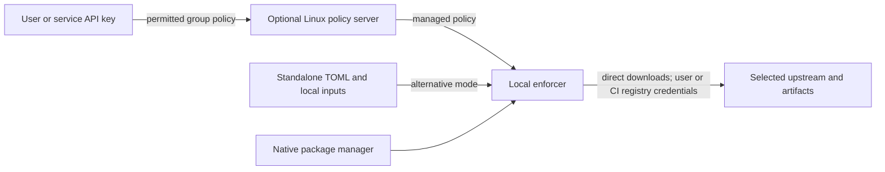

## What problem do we have?

Protect developers/CI from young or malicious dependencies across **ten release targets**, pending implementation and compatibility checks.

| Ecosystem | Language/tool |
|---|---|
| npm | Node / npm |
| PyPI | Python / pip |
| Maven | Java / Maven |
| Go modules | Go |
| Cargo | Rust |
| NuGet | .NET |
| CPAN | Perl |
| RubyGems | Ruby |
| Conan | C/C++ |
| Docker/OCI | Docker images |

## How will we solve it?

Install locally on **Linux, macOS or Windows**; keep native solvers. Optional policy server: **Linux only**.

- **Credentials:** policy keys retrieve permitted policy; registry credentials belong to users/CI locally. No server-distributed registry secrets or native-tool Probation client certificates.
- **Modes:** explicit standalone TOML needs no server. Managed outages retain known policy, exclude unknown keys and delay revocation; no silent TOML fallback. Reachable updates/revocations follow the configured interval, one minute default.
- **Protection:** eligible older versions remain available for ranges; exact versions, lockfiles and image tags/digests never change. Missing dates use durable first-seen age. Keep additive malicious-package-only OSV, enforce/diagnostic/off and permitted exceptions; absent coverage is no clean verdict. OSV outages retain producer-only service.
- **Workflows:** retain npm/Python publishing/management, registry isolation, upstream write authority and canonical npm token-packument metadata exception without artifact access. Added families: consumption/pulls only.
- **Operations:** timestamped, secret-free decisions; optional sinks and consumer identity off by default. Bounded memory, counted loss and separate shedding health preserve serving/readiness. Recheck identity bounds/load; old figures prove no new throughput.
- **Reuse/design:** eligible Nora/Dozor code/fixtures need license notices/provenance checks; no uniform policy/OSV claim. Reuse portal, no desktop GUI. Review setup, certificate-control retirement, migration, exact clients and macOS/Windows Docker/server topology in combined design.

Outside this release: APT/RPM, Terraform, Ansible Galaxy, model hubs, Raw and unlisted Dart/Pub.

## How will we confirm it is solved?

**Planned acceptance:**

| Scenario | Expected result / check |
|---|---|
| Each of ten families: native allowed, blocked and held operation | Allowed succeeds; blocked/held delivers zero artifact bytes, including warm caches; no pinned-identity substitution. |
| Native GitHub Actions on all three client OSes; Linux server integration | Setup/runtime, policy authentication/update, local credentials and protected requests pass; prove real Docker/server connectivity. |
| Expanded decisions under load/outage | Correct identities/timestamps, bounded memory, exact drop counts, measured capacity and separate shedding. |

Recommendation: approve scope; outcomes are clear enough for combined design.
Limits: local administrators can bypass enforcement/tamper with telemetry; installed/client-cache copies and alternative sources remain unprotected.
Status: all six current Gate 1 reviews are READY. This scope decision applies to **Package Firewall MVP, management server, OSV intelligence, decision log delivery, rated load guard and publishing proxy**.
The [selected workflow](/home/john/.local/share/software-factory/releases/f1f0153cb1e4866d71fd95a69aee0d468b4d75096c451526f2e7da2d26e45f26/skills-codex/sf-start/SKILL.md) requires: “Stop at each of those two decisions until the user approves.” This is scope approval; combined design is next, before implementation.
Sources: [release scope](/home/john/go/src/github.com/postfix/probation/docs/plans/package-firewall-mvp/01-product.md), [management](/home/john/go/src/github.com/postfix/probation/docs/plans/management-server/01-product.md), [OSV](/home/john/go/src/github.com/postfix/probation/docs/plans/osv-intel/01-product.md), [logs](/home/john/go/src/github.com/postfix/probation/docs/plans/decision-log-delivery/01-product.md), [load](/home/john/go/src/github.com/postfix/probation/docs/plans/rated-load-guard/01-product.md), [publishing](/home/john/go/src/github.com/postfix/probation/docs/plans/publishing-proxy/01-product.md); [reuse](/home/john/go/src/github.com/postfix/probation/docs/plans/package-firewall-mvp/evidence/research-nora-dozor-reuse.md), [native CI limits](/home/john/go/src/github.com/postfix/probation/docs/plans/package-firewall-mvp/evidence/research-native-ci.md), [scope QA](/home/john/go/src/github.com/postfix/probation/docs/plans/package-firewall-mvp/gate-1-qa.md).
Limits: new release has no runtime/CI execution yet; non-Linux real-Docker support remains unproved.
Approve Gate 1, or what should change?
