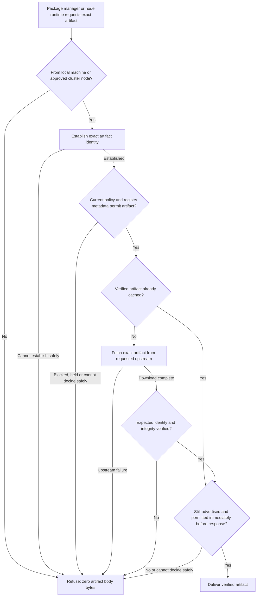

## What problem do we have?

Developers and CI need consistent protection across package downloads and container pulls. The release scope has changed; earlier approvals do not cover this nine-family amendment.

## How will we solve it?

An operator installs one shared service for the whole machine or one logical service per Kubernetes/other cluster. Package managers on the machine or the cluster node runtime use one policy through the service, which fetches directly from the requested registry.

## How will we confirm it is solved?

Planned native checks cover allowed, blocked and held requests for every family: zero refused artifact bytes, including warm cache. Two callers permitted by the machine/node access restrictions must receive the same policy without another Probation login; an unapproved host/node must be refused. Require native Linux/macOS/Windows execution, Linux policy-server integration and genuine node-runtime pulls.

Decisions:

- Include **npm, PyPI, Maven, Go modules, Cargo, NuGet, RubyGems, Conan and Docker/OCI**. **RubyGems is critical and first after the shared-service foundation; CPAN is omitted.** Added families cover consumption/pulls only.
- Restrict access to the machine or approved cluster nodes. Every workload on an approved node is trusted; this does not identify individual workloads or namespaces.
- Support Linux/macOS/Windows clients, an optional Linux policy server and explicit standalone TOML operation. Keep the service's policy key separate from upstream authority.
- Credentials stay configured in package managers. Preserve requested-registry protection/freeze, registry isolation, upstream-authorized npm/Python publishing and its canonical npm metadata exception; that exception never permits refused artifact bytes.
- Refuse disallowed exact versions, frozen locks and image requests without substitution. Offer eligible older versions where ranges permit; native solvers keep their constraints. Retain durable first-seen age and artifact-time checks.
- Preserve personal/accounts, policy inheritance/exceptions, privacy/audit, timestamped secret-free logs, opt-in consumer identity, non-blocking counted loss, bounded memory and separate shedding/readiness signals. OSV remains malicious-package-only with explicit coverage limits. Managed outages retain known policy, reject unknown keys and never select weaker TOML; connected changes propagate within the configured interval, one minute by default.

Artifact-download request flow — required behavior; the expanded service has not been implemented or verified.

For range-based resolution, Probation filters metadata and the package manager selects among eligible versions under its own constraints; an exact artifact request never substitutes another version. Known local denials are applied before metadata refresh; identity/policy checks fail if the reference is no longer advertised. Verified cache hits skip downloading and rehashing, never current policy checks. No artifact body bytes are sent before full verification and the final policy check. That check authorizes the response; later policy changes do not recall bytes already sent. Internal metadata lookup and deployment mechanisms remain combined-design work.

Recommendation: approve this scope; detailed interfaces, migration, setup screens and runtime/CI arrangements follow in combined design. Reuse safe-chain ideas and independent scenarios only; copy no AGPL code.

Context: Gate 1 across six plans. Current decisions and journeys supersede historical certificate/request-key narratives. All six saved reviews are READY for scope presentation.

Sources: [artifact verification and cache rules](/home/john/go/src/github.com/postfix/probation/SPEC.md:243), [scope and rules](/home/john/go/src/github.com/postfix/probation/docs/plans/package-firewall-mvp/01-product.md), [management](/home/john/go/src/github.com/postfix/probation/docs/plans/management-server/01-product.md), [intelligence](/home/john/go/src/github.com/postfix/probation/docs/plans/osv-intel/01-product.md), [logs](/home/john/go/src/github.com/postfix/probation/docs/plans/decision-log-delivery/01-product.md), [load](/home/john/go/src/github.com/postfix/probation/docs/plans/rated-load-guard/01-product.md), [publishing](/home/john/go/src/github.com/postfix/probation/docs/plans/publishing-proxy/01-product.md). Reviews: [firewall](/home/john/go/src/github.com/postfix/probation/docs/plans/package-firewall-mvp/gate-1-qa.md), [management](/home/john/go/src/github.com/postfix/probation/docs/plans/management-server/gate-1-qa.md), [intelligence](/home/john/go/src/github.com/postfix/probation/docs/plans/osv-intel/gate-1-qa.md), [logs](/home/john/go/src/github.com/postfix/probation/docs/plans/decision-log-delivery/gate-1-qa.md), [load](/home/john/go/src/github.com/postfix/probation/docs/plans/rated-load-guard/gate-1-qa.md), [publishing](/home/john/go/src/github.com/postfix/probation/docs/plans/publishing-proxy/gate-1-qa.md). Research: [reuse](/home/john/go/src/github.com/postfix/probation/docs/plans/package-firewall-mvp/evidence/research-safe-chain-reuse.md), [native CI limits](/home/john/go/src/github.com/postfix/probation/docs/plans/package-firewall-mvp/evidence/research-native-ci.md).

Approval is required because the RubyGems/CPAN amendment changes previously approved scope. The [sf-start skill](/home/john/.local/share/software-factory/releases/f1f0153cb1e4866d71fd95a69aee0d468b4d75096c451526f2e7da2d26e45f26/skills-codex/sf-start/SKILL.md) requires: “Stop at each of those two decisions until the user approves.”

Limits: no new builds, native-client/cluster tests or benchmarks have passed. Windows/macOS real-Docker arrangements remain unproved. Host administrators can bypass local enforcement; installed/client-cached artifacts and alternate direct sources remain outside protection. Cached policy delays outage revocations. Detailed implementation is unapproved.

Approve Gate 1, or what should change?
