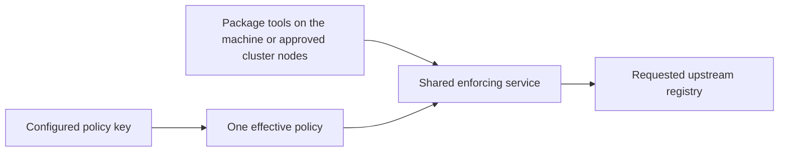

# Product: Probation management server and self-service portal

## Release amendment authority

The current target is nine families: npm, PyPI, Maven, Go modules, Cargo, NuGet, RubyGems, Conan and Docker/OCI. Clients enforce locally and download directly on Linux, macOS and Windows; the optional policy server runs on Linux only. The policy API key authenticates policy retrieval, while registry credentials remain configured in the package managers. Explicit standalone TOML operation remains available. C1006/C1008/C1009/C1013/C1015–C1018 and the [lead release scope](../package-firewall-mvp/01-product.md) govern this amendment; earlier thirteen/sixteen/seventeen-family and certificate-specific text is historical where it conflicts.

This plan owns Linux central policy/account/group/key management, local-client enrollment and existing portal content. Policy-key authentication selects only its permitted policy context. Registry credentials stay in package-manager configuration, not on the firewall. Existing inheritance, exceptions, service keys, SSO, privacy and audit controls remain.

Managed policy outage and propagation reuse management C19/C20: remembered central policy can continue during an outage, unknown keys cannot acquire policy, and reachable-server updates/revocations follow the configured interval (one minute by default). Never silently select weaker standalone TOML after a managed failure. Client/device administrators can bypass local enforcement unless existing device/network controls prevent it; this release does not add host attestation.

No new desktop GUI or account/membership workflow is required. Existing API-key, group-policy and registry administration screens are reused with revised setup text and nine-family choices; obsolete certificate-only controls are retired. Exact changed screen content, migration and CLI setup are part of the combined design before implementation. Native GitHub Actions client tests cover all three OSes, with Linux server integration and explicit Docker engine/runner limits.
RubyGems is critical and is the first added ecosystem after the shared-service foundation. CPAN is omitted (C1027); no new CPAN adapter, policy options or acceptance lane is required.

## Clarifications and decisions
| ID | Class | Status | Owning Gate | Target Gate | Question or disposition | Selected value or policy | Decision source |
|---|---|---|---|---|---|---|---|
| C1 | user clarification | resolved | Gate 1 | none | Who runs the management server and who can sign up? | Multi-tenant: one installation (one central policy server plus its firewall fleet) serves many organisations. Each organisation is sealed, with its own top-level admin, global policy, users and groups, and no organisation can see that another exists. | user answer, Gate 1 grilling Q1 and Q3, ADR candidate |
| C2 | current-Gate decision | deferred | 1 | 2 | Which scoped API retrieves the shared service policy? | The historical per-request policy-key/password proposal is superseded by C1019-C1022. The service holds one configured policy key; exact scoped retrieval/transport contracts remain C1003 design work. | Original Gate1 Q2; user Q8-Q11/C1019-C1022; C1003 deferral retained |
| C3 | user clarification | resolved | 1 | none | Who runs the enforcing service? | For the new target, C1019/C1020 select one shared service per machine or logical cluster endpoint, with one policy context per service. The Linux policy server still serves isolated organisations/accounts. The former multi-organisation fleet selecting user policy per package request is historical deployment behavior, not the new caller journey. | Original Gate1 Q2/Q3 amended by user Gate2 Q8/Q9/C1019/C1020 |
| C4 | user clarification | resolved | Gate 1 | none | Is there a role above organisation admins? | Yes, a global admin (the service operator) who can manage every organisation and every individual user. | user answer, Gate 1 grilling Q4 |
| C5 | user clarification | resolved | Gate 1 | none | When someone signs up, which organisation do they land in? | Two ways in: (1) a sign-up creates a new organisation with the signer as its admin, and others join it only by invitation; (2) an organisation can enable its company SSO, and every user who signs in through that SSO joins the organisation automatically. No auto-join by bare email domain. Narrowed by C128 and C130 (03-program-design.md, user answers, slice 5 and ABQ2): a member an admin removed is not added back by a later SSO sign-in while the removed login exists; only a new invitation brings them back. | user answer, Gate 1 grilling Q4 |
| C6 | user clarification | resolved | Gate 1 | none | Term: personal account | A separate kind of account for one person with no organisation, offered free for personal use. It has only its owner's own policy, under the global admin; it is not a one-person organisation. avoid: individual user, one-person organisation | user answer, Gate 1 grilling Q5 |
| C7 | user clarification | resolved | Gate 1 | none | Is billing part of this spec? | No. Billing is out of scope; the global admin marks an organisation active or suspended by hand. Payments come in a later feature. | user answer, Gate 1 grilling Q6 |
| C8 | user clarification | resolved | Gate 1 | none | Can a lower policy layer weaken the layer above it? | Stricter is always allowed: a lower layer may add blocks, lengthen the freeze, or turn OSV on. Looser (an exception to an upper block, OSV off, a shorter freeze) applies only where the layer above allows overrides; otherwise it is refused. | user answer, Gate 1 grilling Q7, ADR candidate |
| C9 | user clarification | resolved | Gate 1 | none | Is there a platform-wide policy above every organisation and personal account? | Yes. The global admin owns a platform policy at the top; every organisation and every personal account inherits it under C8. Chains: platform → organisation → group → user; platform → personal account. | user answer, Gate 1 grilling Q8 |
| C10 | user clarification | resolved | Gate 1 | none | Can a user belong to more than one group? | No. A user is in at most one group within their organisation; a user in no group sits directly under the organisation policy. | user answer, Gate 1 grilling Q9 |
| C11 | user clarification | resolved | Gate 1 | none | What does "allow overrides" switch on? | Three independent switches per layer, each governing the layer directly below: allow package exceptions, allow OSV off, allow a shorter freeze. | user answer, Gate 1 grilling Q10 |
| C12 | user clarification | resolved | Gate 1 | none | Does probation still run on its own, without a management server? | Yes. Managed mode is opt-in: a firewall with no management server configured behaves exactly as today (config file, blocklist, no logins). Only managed firewalls use API keys and central policy. | user answer, Gate 1 grilling Q11, ADR candidate |
| C13 | user clarification | resolved | 1 | none | Does a package request need a Probation API key? | For the new shared-service target, no: host/approved-node admission controls package access and one configured service policy applies. A missing/refused service policy blocks delivery under the selected managed/outage rules. Upstream publishing credentials remain in package managers. Historical per-request Probation-key admission is superseded. | Original Gate1 Q12 amended by user Gate2 Q10/Q11/C1021/C1022 |
| C14 | user clarification | resolved | Gate 1 | none | Who can own an API key? | People and the organisation. Each user can hold several named, revocable keys that apply their own policy. Org and group admins can also create organisation service keys, owned by the organisation and attached to a group (or directly to the organisation policy), so they survive staff changes. An organisation may run entirely on one or a few service keys, one per policy, pushed to devices by MDM (e.g. Intune): the key a device holds decides which group policy it gets. Personal accounts have user keys only. | user answer, Gate 1 grilling Q13 |
| C15 | user clarification | resolved | Gate 1 | none | Term: service key | An API key owned by an organisation rather than a person, attached to one group or to the organisation itself; every request using it gets that group's (or organisation's) policy. avoid: shared key, device key, CI key | user answer, Gate 1 grilling Q13 |
| C16 | user clarification | resolved | Gate 1 | none | Which checks can a package exception lift? | Any of them for that one package: blocklist block, freeze hold, OSV flag. Each lift needs the matching C11 switch from the layer above (exceptions for blocks, shorter freeze for freeze holds, OSV off for OSV flags). Narrowed by C106 (03-program-design.md, user answer Q57): a whole-package exception does not lift a sha256 file block. | user answer, Gate 1 grilling Q14 |
| C17 | user clarification | resolved | Gate 1 | none | What can a block or an exception point at? | Blocks: a whole package, one version, or one exact file. Exceptions: one exact version, or a whole package (every version, including future ones). Whole-package exceptions exist for companies that build and publish their own packages, e.g. so new releases of their own package are not held by the freeze. | user answer, Gate 1 grilling Q15 |
| C18 | user clarification | resolved | Gate 1 | none | Can a whole-package exception also lift OSV? | Yes, when the layer above allows OSV off (C11). Needed for OSV false positives and debugging. Accepted risk: a hijacked publish of an excepted package is not stopped by OSV. | user answer, Gate 1 grilling Q16 |
| C19 | user clarification | resolved | Gate 1 | none | What do managed firewalls do when the management server is down? | Keep serving from cache: already-cached keys and policies keep working; new keys and policy changes wait until it returns. Accepted risk: a key revoked during the outage keeps working until then. | user answer, Gate 1 grilling Q17 |
| C20 | user clarification | resolved | Gate 1 | none | How quickly must a policy change or key revocation reach every firewall? | Within 1 minute by default; the interval is configurable in the firewall's config. | user answer, Gate 1 grilling Q18 |
| C21 | user clarification | resolved | Gate 1 | none | Which kinds of company SSO must organisations be able to connect? | OIDC only in the first release (covers Microsoft Entra ID, Google Workspace, Okta). SAML is out of scope until a customer needs it. | user answer, Gate 1 grilling Q19 |
| C22 | user clarification | resolved | Gate 1 | none | What can the global admin do with the firewall fleet? | Register, monitor (version, last check-in, health) and retire firewalls, and edit each firewall's settings (upstreams, cache size, TLS, sync interval, etc.) from the portal. The firewall rewrites its config file from the central version and re-applies it. | user answer, Gate 1 grilling Q20 |
| C23 | user clarification | resolved | Gate 1 | none | Can organisations see their own download activity in the portal? | Yes, blocked and held requests only (not allowed ones): for each, the key, the package and version, and the rule and layer that caused it. Each organisation sees only its own; personal accounts see their own. | user answer, Gate 1 grilling Q21 |
| C24 | user clarification | resolved | Gate 1 | none | How are local (email and password) accounts protected? | Email verification and password reset by email for all local accounts. TOTP authenticator codes are optional for ordinary users and required for global admins and org admins. | user answer, Gate 1 grilling Q22 |
| C25 | user clarification | resolved | Gate 1 | none | Is there an audit log of who changed what? | Yes. Every change to a policy, key, membership, admin role or firewall setting is recorded with who, when, and the before and after values. Org admins see their own organisation's log; the global admin sees all. | user answer, Gate 1 grilling Q23 |
| C26 | user clarification | resolved | Gate 1 | none | How long are activity history and the audit log kept? | Configurable by the global admin; defaults are 90 days for blocked and held requests and 1 year for the audit log. | user answer, Gate 1 grilling Q24 |
| C27 | user clarification | resolved | Gate 1 | none | Who moves users between groups? | Only org admins change group membership. Group admins manage their own group's policy (and its override switches) and its service keys. An organisation can have several org admins. | user answer, Gate 1 grilling Q25 |
| C28 | user clarification | resolved | Gate 1 | none | Are free personal accounts limited? | Yes. The global admin sets a request-rate limit per account and a maximum number of keys, separately for personal accounts and for organisations. | user answer, Gate 1 grilling Q26 |
| C29 | user clarification | resolved | Gate 1 | none | Can one login belong to several places? | Yes. One login can have a personal account and belong to several organisations, switching between them. Each API key belongs to exactly one place (the personal account or one organisation), which fixes the policy for every request made with it. | user answer, Gate 1 grilling Q27 |
| C30 | user clarification | resolved | Gate 1 | none | How is a member stopped from bypassing company policy with their personal (or another place's) key? | The main control is the device: MDM-pushed, locked client config holding the organisation's service key. The service also offers a network lock: an org admin may register the organisation's office and VPN IP ranges, and the fleet then refuses any key not belonging to that organisation from those ranges. Off by default (no ranges registered). Accepted gap: off-network use without an MDM lock is not prevented. | user answer, Gate 1 grilling Q28 |
| C31 | user clarification | resolved | Gate 1 | none | Do npm and PyPI share one policy or get separate ones? | Blocks and exceptions name one selected ecosystem: npm, PyPI, Maven, Go modules, Cargo, NuGet, RubyGems, Conan or Docker/OCI. Freeze and OSV mode remain one setting per layer, applied through each format's supported policy capability; explicit coverage prevents a false universal OSV claim. This updates the former npm/PyPI-only enumeration under C1013; inheritance/override rules remain. | Original user answer Gate 1 Q29; ecosystem enumeration broadened by user C1013, 2026-11-02 |
| C32 | user clarification | resolved | Gate 1 | none | Success metric for the first release | Both: (1) a new organisation goes from sign-up to an `npm install` through the fleet under its own policy in under 10 minutes with no operator help; (2) a block or key revocation takes effect on every firewall within the configured sync interval (default 1 minute) in 99% of cases. | user answer, Gate 1 grilling Q30 |
| C33 | user clarification | resolved | Gate 1 | none | What happens when an account or organisation is deleted? | Self-service: an org admin can delete the organisation and a user can delete their personal account. Keys stop working within the sync interval; all other data is erased after a 30-day grace period during which it can be restored. The audit log follows its C26 retention. | user answer, Gate 1 grilling Q31 |
| C34 | current-Gate decision | deferred | Gate 1 | Gate 2 | How a managed firewall is connected to the management server: the config settings it needs (address, firewall credential), and the exact `.npmrc` / `pip.conf` lines that carry a user's API key. Raised by mockups fleet.html and api-keys.html; depends on C2. | | mockup review, Gate 1 |
| C35 | current-Gate decision | deferred | Gate 1 | Gate 2 | The full list of firewall settings editable from the portal (C22 names upstreams, cache size, TLS, sync interval), and whether the TLS certificate and key are uploaded through the portal or stay a file path on the firewall. Raised by mockup fleet.html. | | mockup review, Gate 1 |
| C36 | user clarification | resolved | Gate 1 | none | How are the ~40 product details raised by the mockups settled? | As one batch: a numbered list with a recommended answer each; the user replies only with changes. | user answer, Gate 1 grilling Q32 |
| C37 | user clarification | resolved | Gate 1 | none | How does a user find their company's sign-in? | Each organisation has its own sign-in link (`…/o/<org>`); the user can also type the organisation's name. | user answer, Gate 1 grilling Q33 item 1 |
| C38 | user clarification | resolved | Gate 1 | none | Does the authenticator code apply to OAuth and SSO sign-ins? | No. Only email-and-password accounts; Google, GitHub, Microsoft and company SSO enforce their own. | user answer, Gate 1 grilling Q33 item 2 |
| C39 | user clarification | resolved | Gate 1 | none | How does someone recover from a lost authenticator? | 10 backup codes shown at set-up. Without them, an org admin resets a member's authenticator; the global admin resets an org admin's or a personal account's. | user answer, Gate 1 grilling Q33 item 3 |
| C40 | user clarification | resolved | Gate 1 | none | Where are account settings? | A 9th screen, Account settings: change password, authenticator on/off, delete personal account, add a personal account or create an organisation. | user answer, Gate 1 grilling Q33 item 4 |
| C41 | user clarification | resolved | Gate 1 | none | Can a local account be used before its email is confirmed? | No. Nothing works until the email is confirmed. | user answer, Gate 1 grilling Q33 item 5 |
| C42 | user clarification | resolved | Gate 1 | none | Password rules | At least 12 characters, no composition rules, checked against a list of known leaked passwords. | user answer, Gate 1 grilling Q33 item 6 |
| C43 | user clarification | resolved | Gate 1 | none | How are invitations delivered? | By email link, expiring after 7 days. | user answer, Gate 1 grilling Q33 item 7 |
| C44 | user clarification | resolved | Gate 1 | none | Freeze range and units | Hours or days, from 0 hours to 365 days. | user answer, Gate 1 grilling Q33 item 8 |
| C45 | user clarification | resolved | Gate 1 | none | Can a layer grant an override it does not have itself? | No. A layer can only pass down permission it has; a switch it cannot grant is shown disabled. | user answer, Gate 1 grilling Q33 item 9 |
| C46 | user clarification | resolved | Gate 1 | none | Which layers must allow a user's exception to an upper-layer block? | Every layer between the block's owner and the user (follows from the previous row). | user answer, Gate 1 grilling Q33 item 10 |
| C47 | user clarification | resolved | Gate 1 | none | What happens to saved looser settings when an upper layer turns a switch off? | Kept but marked "not in effect"; turning the switch back on restores them. | user answer, Gate 1 grilling Q33 item 11 |
| C48 | user clarification | resolved | Gate 1 | none | Does the platform set separate switches for organisations and personal accounts? | No. One set of platform switches applies to both. | user answer, Gate 1 grilling Q33 item 12 |
| C49 | user clarification | resolved | Gate 1 | none | Do keys expire on their own? | No. Keys stop only when revoked, when the owner is removed, or when the organisation is deleted. | user answer, Gate 1 grilling Q33 item 13 |
| C50 | user clarification | resolved | Gate 1 | none | Can a group admin revoke service keys of their group created by someone else? | Yes, any service key attached to their group. | user answer, Gate 1 grilling Q33 item 14 |
| C51 | user clarification | resolved | Gate 1 | none | How is the key limit counted in an organisation? | Per member for their own keys, plus a separate limit on the organisation's service keys. | user answer, Gate 1 grilling Q33 item 15 |
| C52 | user clarification | resolved | Gate 1 | none | Do a removed member's keys stop working? | Yes, within the sync interval. | user answer, Gate 1 grilling Q33 item 16 |
| C53 | user clarification | resolved | Gate 1 | none | What happens when a key limit is lowered below the current count? | Existing keys keep working; no new key can be created until under the limit. | user answer, Gate 1 grilling Q33 item 17 |
| C54 | user clarification | resolved | Gate 1 | none | Who sees which activity inside an organisation? | A member sees their own keys' requests; a group admin sees the group's members and service keys; an org admin sees all of the organisation. | user answer, Gate 1 grilling Q33 item 18 |
| C55 | user clarification | resolved | Gate 1 | none | Does activity include network-lock and revoked-key refusals? | Yes, both. Requests with no key belong to no account and are not shown. | user answer, Gate 1 grilling Q33 item 19 |
| C56 | user clarification | resolved | Gate 1 | none | Does a held row show when the version leaves the freeze? | Yes. | user answer, Gate 1 grilling Q33 item 20 |
| C57 | user clarification | resolved | Gate 1 | none | What does the audit log record beyond C25? | Every change an admin can make, including SSO settings, network lock ranges, organisation delete and restore, and all global admin actions (suspension, limits, retention). | user answer, Gate 1 grilling Q33 item 21 |
| C58 | user clarification | resolved | Gate 1 | none | Can group admins see audit entries? | Yes, the entries for their own group. | user answer, Gate 1 grilling Q33 item 22 |
| C59 | user clarification | resolved | Gate 1 | none | Can a group admin run a group they are not in, or several groups? | No. A group admin is a member of the group they run, so at most one group. | user answer, Gate 1 grilling Q33 item 23 |
| C60 | user clarification | resolved | Gate 1 | none | Org admin minimum and authenticator timing | Every organisation keeps at least one org admin; the last cannot be removed. A new org admin must set up an authenticator at next sign-in before using admin features. | user answer, Gate 1 grilling Q33 item 24 |
| C61 | user clarification | resolved | Gate 1 | none | What happens when a group is deleted? | The confirmation lists the effects; the group's service keys are revoked and its members fall back to the organisation policy. | user answer, Gate 1 grilling Q33 item 25 |
| C62 | user clarification | resolved | Gate 1 | none | What happens to SSO-joined members when SSO is turned off? | They stay members and can sign in by setting a password through a reset email. | user answer, Gate 1 grilling Q33 item 26 |
| C63 | user clarification | resolved | Gate 1 | none | Who can restore a deleted organisation, and do keys come back? | Any of its org admins within the 30 days; its keys work again. | user answer, Gate 1 grilling Q33 item 27 |
| C64 | user clarification | resolved | Gate 1 | none | What does suspending an organisation do? | Its keys are refused; members can still sign in to the portal read-only, with a banner explaining the suspension. | user answer, Gate 1 grilling Q33 item 28 |
| C65 | user clarification | resolved | Gate 1 | none | What can the global admin do to a personal account? | Suspend it, delete it, revoke its keys, reset its authenticator. | user answer, Gate 1 grilling Q33 item 29 |
| C66 | user clarification | resolved | Gate 1 | none | Rate limit unit and over-limit behaviour | Requests per minute; requests over the limit are refused with a "too many requests" error. | user answer, Gate 1 grilling Q33 item 30 |
| C67 | user clarification | resolved | Gate 1 | none | Can one organisation have its own limits? | Yes. The global admin can set per-organisation limits that override the default. | user answer, Gate 1 grilling Q33 item 31 |
| C68 | user clarification | resolved | Gate 1 | none | Retention bounds | At least 7 days for either log; no maximum. | user answer, Gate 1 grilling Q33 item 32 |
| C69 | user clarification | resolved | Gate 1 | none | When is a firewall unhealthy? | After 3 missed check-ins in a row, or when it reports it cannot reach npm, PyPI or OSV. | user answer, Gate 1 grilling Q33 item 33 |
| C70 | user clarification | resolved | Gate 1 | none | Can settings be applied to several firewalls at once? | Yes, to one or to several selected firewalls. | user answer, Gate 1 grilling Q33 item 34 |
| C71 | user clarification | resolved | Gate 1 | none | What happens when new firewall settings fail to apply? | The firewall keeps running on its old settings and reports the error, shown on the fleet screen. | user answer, Gate 1 grilling Q33 item 35 |
| C72 | user clarification | resolved | Gate 1 | none | When does a retired firewall stop serving? | At its next check-in it stops serving every request. | user answer, Gate 1 grilling Q33 item 36 |
| C73 | user clarification | resolved | Gate 1 | none | Do a restored personal account's keys work again? | Yes, the same as a restored organisation (C63). | user answer, Gate 1 grilling Q34 |
| C74 | user clarification | resolved | Gate 1 | none | Approve the 9 screen mockups (sign-in, account, policy, api-keys, activity, organisation, audit-log, global-admin, fleet)? | Approved as content-only sketches; visual design comes later. | user answer, Gate 1 grilling Q35 |
| C75 | user clarification | resolved | Gate 1 | none | Term: login | One person's identity in the portal: the set of sign-in methods (Google, GitHub, Microsoft, company SSO, email and password) they have linked. A new sign-in method joins an existing login only when the person links it while already signed in; matching emails never merge logins, so a sign-in that is not linked creates a separate login. avoid: user, account, identity | user answer, Gate 1 grilling Q36 (QA question Q3), ADR candidate |
| C76 | user clarification | resolved | Gate 1 | none | Who may reset the authenticator of a login that belongs to several places? | An org admin may reset only a login that belongs to their organisation alone (no personal account, no other organisation). Every other reset is done by the global admin. Refines C39. | user answer, Gate 1 grilling Q37 (QA question Q4) |
| C77 | user clarification | resolved | Gate 1 | none | Can an org admin lock out other organisations with the network lock? | No. Every network-lock IP range an org admin registers takes effect only after the global admin approves it. The network lock is a secondary control: carrier and country-wide NAT put unrelated people behind one address, so it cannot identify a company on its own. Refines C30. | user answer, Gate 1 grilling Q38 (QA question Q2) |
| C78 | user clarification | resolved | Gate 1 | none | Is a new organisation active as soon as it signs up? | Yes, active immediately. The global admin can only suspend and re-activate it. Refines C7. | user answer, Gate 1 grilling Q39 (QA question Q1) |
| C79 | user clarification | resolved | Gate 1 | none | What can the global admin do inside an organisation? | Everything an org admin can: edit its policy, members, groups and keys, and appoint new org admins. There can be several global admins, and every organisation can have several org admins. Every change a global admin makes inside an organisation appears in that organisation's audit log, visible to its org admins. Refines C4 and C25. | user answer, Gate 1 grilling Q40 (QA question Q5) |
| C80 | user clarification | resolved | Gate 1 | none | Where do blocklists come from in managed mode? | Policy entries in the management server only; a managed firewall ignores its local blocklist file. Blocks are mostly added one at a time, to stop an attack happening now, and stay in the list. Bulk is the exception: the policy screen can import and export a blocklist file, and existing blocklist tools can push entries into the platform or organisation policy. All of it is covered by the audit log. | user answer, Gate 1 grilling Q41 (QA question Q6) |
| C81 | user clarification | resolved | Gate 1 | none | Does the policy keep OSV's "log only" mode? | Yes. The OSV setting has three values at every layer: on (block), log only (allow and record), off. Log only and off both count as loosening under the C11 "allow OSV off" switch. A log-only match shows in activity as "would have blocked". Refines C11 and C23. | user answer, Gate 1 grilling Q42 (QA question Q6) |
| C82 | user clarification | resolved | Gate 1 | none | How is success metric 1 checked? | By an automated test only: a script signs up a new organisation, creates a key and runs `npm install` through the fleet; it passes when the whole run finishes in under 10 minutes. It runs before every release. No real-customer timing in this release. Refines C32. | user answer, Gate 1 grilling Q43 (QA question Q7) |
| C83 | user clarification | resolved | Gate 1 | none | How much may managed mode slow the firewall? | With the key and policy cached, a request takes at most 1 ms longer than in standalone mode, and a managed firewall handles at least 90% of standalone's requests per second, measured with the existing benchmarks. | user answer, Gate 1 grilling Q44 (QA question Q8) |
| C84 | user clarification | resolved | Gate 1 | none | Accessibility target for the portal | WCAG 2.2 level AA. | user answer, Gate 1 grilling Q45 (QA question Q8) |
| C85 | user clarification | resolved | Gate 1 | none | Can people leave an organisation or delete their whole login themselves? | Leaving an organisation is a request an org admin must approve; membership is the organisation's business. Deleting a personal account stays self-service (C33). A login that belongs to no organisation is deleted together with its personal account, under the same 30-day restore rule. | user answer, Gate 1 grilling Q46 (QA question Q9) |
| C86 | current-Gate decision | deferred | Gate 1 | Gate 2 | Blocklist import/export file format and the push interface existing blocklist tools use (C80); whether today's blocklist file format can be reused. | | mockup review, Gate 1 |
| C87 | user clarification | resolved | Gate 1 | none | What does an org admin see after the operator refuses a network-lock range? | The range is marked "Refused by operator" with the operator's reason; the org admin can delete or resubmit it. | user answer, Gate 1 grilling Q47 item 1 |
| C88 | user clarification | resolved | Gate 1 | none | Can a person cancel their own leave request? | Yes, while it is still waiting for approval. | user answer, Gate 1 grilling Q47 item 2 |
| C89 | user clarification | resolved | Gate 1 | none | Can a linked sign-in method be removed? | Yes, while at least one other method stays linked; the last one cannot be removed (that would be deleting the login). | user answer, Gate 1 grilling Q47 item 3 |
| C90 | user clarification | resolved | Gate 1 | none | Minimum number of global admins | At least one; the last global admin cannot be removed. | user answer, Gate 1 grilling Q47 item 4 |
| C91 | user clarification | resolved | Gate 1 | none | Can two logins share one email address for email-and-password sign-in? | No. One email-and-password method per address. Signing up with an address already in use shows the usual "check your email" step without revealing that the address exists. A member cut off when SSO is turned off (C62) asks an org admin to invite their existing login. Refines C62. | user answer, Gate 1 grilling Q48 item 1 (QA question Q10) |
| C92 | user clarification | resolved | Gate 1 | none | What does a key's owner see when another organisation's network lock refuses it? | "Refused by a network lock" with the IP address, and no organisation name (C1). The Layer column shows whichever layer or refusal applies, including "none" for revoked keys. | user answer, Gate 1 grilling Q48 item 2 (QA question Q11) |
| C93 | user clarification | resolved | Gate 1 | none | How does a login with no personal account and no organisation delete itself? | Account settings offers "Delete your login" for such a login, with the same 30-day restore (C33). Refines C85. | user answer, Gate 1 grilling Q48 item 3 (QA question Q12) |
| C94 | user clarification | resolved | Gate 1 | none | How does someone restore a deleted login? | During the 30 days, signing in with any of the deleted login's old sign-in methods shows "This login was deleted on <date>" with two choices: "Restore login" brings it back; "Start a new login" erases the old login at once and creates a new one. The old email-and-password address stays reserved until the login is restored or erased. Refines C93. | user answer, Gate 1 grilling Q49 (QA question Q13) |
| C1001 | user clarification | resolved | 1 | none | Which existing plans receive the Nora/Dozor ecosystem expansion? | All five: Package Firewall MVP, management server/portal, OSV intelligence, decision log delivery and rated load guard. Extend the same identity, organisation/group/user policy, block/exception editing, API-key setup instructions, activity views, fleet configuration and health reporting to every added ecosystem. C31's npm/PyPI-only enumeration must be revised; policy inheritance and tenant isolation remain requirements. | user answer 2026-11-02 selecting all five plans; initial request to support every Nora format and reuse Nora/Dozor code where practical |
| C1002 | user clarification | resolved | 1 | none | Must package-manager and registry authentication compatibility be established before design? | Yes. Check every target client/registry against Probation's actual SSL/TLS and application-authentication mechanisms, separately for client-to-firewall, firewall-to-management and firewall-to-upstream connections; change the architecture where required rather than assume universal support. | user steering 2026-11-02: check whether all package managers and registries support the SSL auth currently used and whether architecture must change |
| C1003 | current-Gate decision | deferred | 1 | 2 | Which scoped policy API, client identity/enrollment, policy-source transition, transport and protocol contracts implement the selected C1006/C1008/C1009/C1015 client and policy-source outcomes? | Not selected at Gate 1. API-key authentication to the policy server and server-independent TOML operation are selected product outcomes; exact endpoints, mode switching, compatibility migration and client packaging require design; credential ownership is already selected in C1015. | Deferred to Gate 2 from C1006/C1008; user answer 2026-11-02 |
| C1004 | research fact | resolved | 1 | none | What exactly does Nora support, and what can be borrowed? | Seventeen format families, with differing proxy/hosted and policy capabilities. Nora and Dozor own code is MIT with notices to preserve; Dozor version matching is npm-only. Transport support is not proof of equivalent Probation policy or OSV coverage. | sf-research ANSWERED, [../package-firewall-mvp/evidence/research-nora-dozor-reuse.md](../package-firewall-mvp/evidence/research-nora-dozor-reuse.md), pinned Nora 7a6cd780 and Dozor 93f1f091 |
| C1005 | research fact | resolved | 1 | none | Which current authentication contract must the expansion account for? | Selected organisation registry reads and writes require a unique client certificate identifying an active member and their current group. Legacy managed routes still use Basic/bearer API keys; firewall-to-management uses its own bearer token. This describes implemented baseline behavior. C1006/C1008 replace mandatory package-client certificate identity in the target design; registry isolation and upstream authorization remain requirements. The owning publishing-proxy plan is reopened. | sf-repo-view PARTIAL structural evidence, [../package-firewall-mvp/evidence/repository-ecosystem-auth.md](../package-firewall-mvp/evidence/repository-ecosystem-auth.md); ../publishing-proxy/01-product.md C29–C35 |
| C1006 | user clarification | resolved | 1 | none | How should clients without native client-certificate support participate? | A locally installed client uses API-key authentication to the policy server. Native package managers no longer need a Probation TLS client certificate in the target design. The policy-server key stays distinct from upstream registry/publisher credentials. This replaces the certificate-forwarding-bridge proposal; C1009 selects local enforcement and direct registry traffic. | user answer, Gate 1 grilling Q2, 2026-11-02; ADR candidate |
| C1007 | research fact | resolved | 1 | none | Does every target standard client natively support the current certificate admission contract? | No universal native-client support. Cargo and Go client-certificate support remains proposed; multiple other clients or endpoint classes remain unknown. Documented certificate settings in other clients do not prove full install/publish/redirect coverage. The survey concerns the former certificate-only design; the new installed-client/API-key direction does not require native package-client mTLS. New interoperability remains unproven until its own runtime checks pass. | sf-research UNKNOWN, [evidence/research-ecosystem-auth.md](evidence/research-ecosystem-auth.md), 17-format primary-source matrix, 2026-11-02 |
| C1008 | user clarification | resolved | 1 | none | Must the backend remain usable without a policy server? | Yes. Preserve explicit self-hosted standalone deployment configured through TOML, without a central policy-server dependency, alongside managed operation using the local client and policy-server API key. Standalone is a selected deployment mode; this answer does not select automatic fallback after a managed authentication or network failure. | user answer, Gate 1 grilling Q2 follow-up, 2026-11-02 |
| C1009 | user clarification | resolved | 1 | none | Does the local client enforce policy and fetch directly from registries, or forward packages through a shared backend? | The installed client enforces policy locally and fetches package metadata/artifacts directly from the selected registries. No shared package-data backend is required for that managed-client path. The same enforcement engine remains usable as a standalone TOML-configured backend. API-key policy retrieval and registry credentials retain separate authority; credential custody and managed-mode bypass controls still require design. | user answer, Gate 1 grilling Q3, 2026-11-02: Enforce locally; fetch registries directly; ADR candidate |
| C1010 | research fact | resolved | 1 | none | What existing behavior supports standalone and optional managed operation? | Config.management is optional; absent management chooses TOML cooldown/OSV plus a separate blocklist file. Managed outages retain remembered central policy, not local TOML. Local API-key policy retrieval needs a scoped endpoint; a fleet token is not equivalent to a user/client policy key. Mode changes can weaken policy and need a selected trust model. PARTIAL structural evidence, not a tested new client. | sf-repo-view, [../package-firewall-mvp/evidence/local-client-policy-modes.md](../package-firewall-mvp/evidence/local-client-policy-modes.md), 2026-11-02 |
| C1011 | research fact | resolved | 1 | none | Which Nora families have public distribution sources and meaningful firewall use cases? | Sixteen have concrete public sources, including Debian/APT and RPM repositories, Terraform providers/modules, ConanCenter and the Hugging Face model hub. Go uses a public mirror over source repositories. Raw is Nora hosted generic storage without a defined ecosystem upstream. Public existence alone does not establish equivalent policy coverage. | sf-research ANSWERED plus main-agent official APT/Terraform checks, [../package-firewall-mvp/evidence/research-public-ecosystems.md](../package-firewall-mvp/evidence/research-public-ecosystems.md), 2026-11-02 |
| C1012 | user clarification | resolved | 1 | none | Should the expansion follow Nora format count blindly or check public-source firewall value? | Check every format for public distribution and a useful artifact-policy outcome before finalising scope. The user proposes omitting APT based on an absence-of-public-sources premise; C1011 corrects that premise. Final include/defer choices follow C1013, not the disproved premise. Existing npm/PyPI private-registry and publishing requirements are not removed by this research request. | user request 2026-11-02 to check APT, Terraform and other formats for public registries and firewall purpose |
| C1013 | user clarification | resolved | 1 | none | Which formats belong in this release? | C1027 amends the original ten-family Q5 selection: npm, PyPI, Maven, Go modules, Cargo, NuGet, RubyGems, Conan and Docker/OCI only. RubyGems is critical; CPAN is omitted. Terraform, Ansible Galaxy, APT, RPM, Hugging Face, Raw and unlisted Dart/Pub remain outside this release. | user Q5 selection, amended by user C1027 on2026-11-02 |
| C1015 | user clarification | resolved | 1 | none | Where are upstream registry credentials configured? | In the package managers, by the user or CI job, not on the firewall. Preserve the existing credential-bearing publishing request path and upstream authorization. The firewall does not configure or manage registry credentials. Its separate service key authenticates policy retrieval only and is never sent to registries. This applies to managed and standalone operation. | user answer, Gate 1 grilling Q6, clarified explicitly 2026-11-02: credentials are configured in package managers, not on the firewall |
| C1016 | user clarification | resolved | 1 | none | Which operating systems must the installed client support in this release? | Linux, macOS and Windows. The local enforcing client must install, run and use the selected package/container workflows on all three; existing Linux/macOS build configuration is baseline evidence, not proof of new Windows or installed-client support. Exact architecture/install/lifecycle contracts are designed under C1003. | user answer, Gate 1 grilling Q7, 2026-11-02: Linux, macOS and Windows |
| C1017 | user clarification | resolved | 1 | none | Which operating systems must host the central policy server? | Linux only. Client support remains Linux, macOS and Windows. The optional standalone TOML backend remains a separate deployment mode; Linux-only policy-server scope does not remove cross-platform client requirements. | user steering 2026-11-02: Policy server only for Linux |
| C1018 | current-Gate decision | deferred | 1 | 2 | How are the selected cross-platform verification requirements implemented in GitHub Actions? | User requires GitHub Actions testing on Windows and macOS; include native Linux client coverage and Linux-only policy-server coverage. Runner/architecture choices, native-client test matrix, Docker engine placement, fixtures, secrets isolation and release gates are design obligations; build-only or cross-compilation evidence cannot be presented as runtime client compatibility. No YAML or runner configuration selected at Gate 1. | user instruction 2026-11-02 to use GitHub Actions to test Windows and macOS; exact implementation deferred to Gate 2 |
| C1027 | user clarification | resolved | 1 | none | Is CPAN required, and how important is RubyGems? | Omit CPAN from this release. RubyGems is critical and remains required; prioritize it as the first added ecosystem after the shared-service foundation. Current target is nine families: npm, PyPI, Maven, Go modules, Cargo, NuGet, RubyGems, Conan and Docker/OCI. Preserve all other selected deployment, policy, credential and acceptance outcomes. | user answer2026-11-02: RubyGems is critical; CPAN can be omitted; amends C1013 |
| C1024 | user clarification | resolved | 1 | none | Does the public-registry focus introduce a public/private split or change existing publishing credentials? | No. Handle requested registries the same way as public registries, using the existing forwarding and configured protection/freeze behavior. Registry credentials are configured in package managers, not on the firewall. Preserve the existing credential-bearing publishing request path and upstream publishing authorization. This clarification introduces no new public/private registry mode, removes no existing authentication behavior, and does not request an authentication redesign. Continue the previously selected machine/cluster service model and policy-key separation. | user correction, 2026-11-02: handle as public; credentials are already needed for publishing; no change to previous implementation; supersedes the assistant's public-only/authentication-exclusion interpretation |
| C1022 | user clarification | resolved | 2 | none | Q11: For Kubernetes image pulls, is admission at the approved-cluster-node level sufficient, or must it distinguish individual workloads/namespaces? | Trust approved cluster nodes. Every workload on an approved node may use the common-policy service. Kubernetes permissions control who may deploy workloads and use private-registry credentials. The enforcement listener does not claim per-workload/namespace identity for node-runtime pulls. Preserve upstream credential authorization and restrict access to approved nodes through host/network controls. | user answer, Gate 2 grilling Q11, 2026-11-02; ADR candidate |
| C1021 | user clarification | resolved | 2 | none | Q10: Must package tools authenticate separately to the shared enforcement service, or is access controlled by host/cluster network restrictions? | No additional Probation login on package requests. Restrict machine deployment access to the local machine and cluster deployment access to explicitly permitted workloads through host/network controls. The organisation service key stays inside the service and authenticates only policy retrieval. Private registry credentials still authorize upstream operations separately. Every admitted caller receives the service policy selected in C1020. Exact transport, startup validation and deployment controls remain design obligations; this is not permission to expose an unrestricted proxy. | user answer, Gate 2 grilling Q10, 2026-11-02; ADR candidate |
| C1020 | user clarification | resolved | 2 | none | Q9: Does one shared enforcement service apply one policy to all callers, or can callers/workloads select different permitted group policies through it? | One policy per shared service, selected by an organisation service key attached to a group or the organisation under management C14/C15/C29. All callers of that service receive the same effective rules. The service holds its policy key and obtains updates from the policy server; caller registry credentials retain their separate authority under C1015. Individual caller/workload group-policy selection within this service is not selected. Explicit standalone operation retains its local policy authority. | user answer, Gate 2 grilling Q9, 2026-11-02 |
| C1019 | user clarification | resolved | 2 | none | Q8: Should the installed client run continuously per user, as a shared machine service, or only around an explicitly launched command? | Shared service for the whole machine. Also support a shared enforcement service per Kubernetes or other container-orchestration cluster. The service performs enforcement and fetches registries directly; the optional Linux policy server remains a separate policy authority. Per-user background service is not selected. Listener exposure, caller identity, credential isolation, runtime placement and availability require design; one logical cluster service does not select replica count or shared-storage semantics. | user answer, Gate 2 grilling Q8, 2026-11-02; ADR candidate |
## Current shared-service journey and acceptance

An operator installs one shared enforcer for the whole machine or one logical service for a Kubernetes/other orchestration cluster (C1019). The service selects one common effective policy using its configured policy key (C1020). All admitted package tools and node-runtime requests use that policy; they do not choose a different user/group policy per request or need a separate Probation login (C1021). Organisation service keys select their existing organisation/group policy. Existing personal accounts, keys, policy inheritance, administration and publishing permissions remain product capabilities; this amendment does not delete them.

Machine access is restricted to the local machine. Cluster access trusts explicitly approved nodes, including every workload on an approved node; Kubernetes permissions control workload deployment and registry-secret use (C1022). The service does not claim authenticated workload/namespace/person identity for a node-runtime pull. Registry credentials remain configured in package managers, not on the firewall; publishing uses the existing upstream authorization path (C1015/C1024).

Acceptance must demonstrate two admitted callers receiving the same selected policy without a package-request Probation login, refusal of an unapproved host/node, and service-policy changes/refusal applying to all callers under the existing outage/propagation contract. Registry credentials stay in native tool configuration and existing publishing succeeds or refuses according to upstream permissions. Native Linux/macOS/Windows and genuine node-runtime checks remain required; previous builds, mocks or certificate tests do not establish the new behavior. Exact endpoints, service configuration and network enforcement belong to combined design under C1003/C1018.

These selected outcomes govern the release. Older per-request-policy-key and client-certificate setup narratives/mockups below are historical where superseded; their retained account, policy, isolation, publishing and audit guarantees still apply. They must not be used to put the policy-server key into package-manager registry configuration.

## Problem
Probation is a firewall you run yourself, configured by one config file and one blocklist. Everyone behind a firewall gets the same policy, nobody signs in, and changing anything means editing files on each server. That works for one team on one server. It does not work when:

- many companies, or many teams in one company, need different rules: one team needs a package unblocked, another needs a longer freeze, and security wants OSV forced on for everyone;
- a developer needs an exception today and has no way to ask for one except by editing a server's files;
- an operator runs several firewalls and must keep their settings in step by hand;
- a person wants to use the firewall for their own projects without running a server at all.

The requester asked for a central management server and self-service portal where people sign in (Google, GitHub, Microsoft, company SSO, or email and password), get an API key for the firewall, and manage their own policy (blocks, exceptions, OSV on or off, freeze time) inside limits their organisation and group admins set; and where a global admin manages organisations, personal accounts, the platform policy and the firewall fleet.

## Success metric
Two checks (C32):

1. **Time to first protected install:** a new organisation goes from sign-up to a successful `npm install` through the fleet, under its own policy, in under 10 minutes with no help from the operator. Checked by an automated end-to-end test run before every release: it signs up a new organisation, creates a key and runs `npm install`; pass when the whole run finishes in under 10 minutes (C82).
2. **Change reach:** a block or a key revocation takes effect on every managed firewall within the configured sync interval (default 1 minute, C20) in 99% of cases. Measured as the time from the change being saved to the last firewall applying it, per change.

## Non-goals
- Billing, paid plans, invoices and payment (C7). A new organisation is active at once; the global admin suspends and re-activates organisations by hand (C78).
- SAML single sign-on (C21). Company SSO is OIDC only.
- A user in more than one group within one organisation (C10).
- Separate freeze or OSV settings for npm and PyPI (C31).
- Preventing a member from bypassing company policy off the company network on a device without an MDM-locked client config (C30).
- Showing allowed requests in the portal (C23). Only blocked and held requests are shown.
- Changing how a standalone (unmanaged) probation firewall behaves (C12).
- Stopping a hijacked release of a package that has a whole-package exception lifting OSV (C18, accepted risk).
- Leaving an organisation without an org admin's approval (C85).
- Measuring real customers' sign-up-to-first-install time (C82); only the automated test is checked.
- Enforcing a managed firewall's local blocklist file (C80); managed policy lives only in the management server.
- Using the network lock to identify a company on its own (C77); shared NAT makes it a secondary control.

## Announcement — the blog post before the feature
Probation applies your selected policy through one shared service on a machine or in a cluster. Configure that service's policy key once; admitted package tools use its common rules without a separate Probation login. Registry and publishing credentials stay in the package managers. The optional Linux policy server retains accounts, personal use, isolated organisations, group policy, inherited exceptions, SSO and audit history. Administrators choose the service's permitted policy context; a connected policy change or revocation propagates within the configured interval. The release protects nine package/container families, with RubyGems critical and CPAN omitted. Native deployment, setup and update checks must prove the selected behavior before delivery.

## Screens
- Sign in and sign up: [sign-in](mockups/sign-in.html)
- Policy editor, used at every layer: [policy](mockups/policy.html)
- API keys and service keys: [api-keys](mockups/api-keys.html)
- Blocked and held requests: [activity](mockups/activity.html)
- Organisation admin: [organisation](mockups/organisation.html)
- Audit log: [audit-log](mockups/audit-log.html)
- Global admin: [global-admin](mockups/global-admin.html)
- Firewall fleet: [fleet](mockups/fleet.html)
- Account settings: [account](mockups/account.html)

## Nora ecosystem expansion — scope amendment in progress

C1001–C1003 record the user's 2026-11-02 direction. Earlier npm/PyPI scope and measurements describe the delivered baseline. The pinned format/reuse inventory and current authentication evidence are recorded in C1004–C1005. External client authentication findings and remaining UNKNOWNs are recorded in C1007; C1006/C1008 record the selected local-client, policy-server API-key and standalone TOML direction. C1009 records the selected local-enforcement/direct-registry data path. The user now requests a public-source and firewall-value audit before finalising the format list. Design and implementation for the expansion are pending.

## Public-source scope review — 2026-11-02

Q3 / C1009 is resolved: local enforcement and direct registry downloads. C1011 records the public-source inventory; C1013 / Q5 selects the nine named package/container families for this release. APT/RPM do have public repositories and Terraform has a public provider/module registry. Proposed deferrals reflect artifact-policy and product scope, not nonexistent public sources. The full seventeen-family source table and proposed thirteen-family target are in ../package-firewall-mvp/evidence/research-public-ecosystems.md. C1015 / Q6 selects client-owned private-registry credentials; it resolves the earlier interrupted Q4 topic. Registry credentials remain in package-manager configuration; the scoped policy API remains C1003 design work.

## Selected release inventory and credential custody — 2026-11-02

C1013 resolves Q5 with nine named families: npm, PyPI, Maven, Go modules, Cargo, NuGet, RubyGems, Conan and Docker/OCI. Previous thirteen/sixteen/seventeen-format proposals are historical research, not the release target. Terraform, Galaxy, APT/RPM, model hubs and Raw hosting are out. Unlisted Dart/Pub is deferred as the narrow release default. C1015 resolves Q6 with user/CI-owned private-registry credentials; the policy server does not distribute organisation registry secrets. Keep the installed client, local enforcement/direct registry traffic, API-key policy connection and explicit TOML standalone mode selected in C1006/C1008/C1009. Expanded-format and new client/platform behavior remains unimplemented and requires revised approval/checks.

## Selected deployment and CI targets — 2026-11-02

Q7/C1016 is resolved: the installed enforcer supports Linux, macOS and Windows. C1017 limits the policy server to Linux only. C1018 carries the user's GitHub Actions testing requirement into design: native client setup/runtime/package checks on the supported OSes and Linux policy-server integration, with explicit coverage rather than treating a binary build as compatibility proof. Docker and other runner limitations must remain visible until an executable check supplies the promised coverage. No client compatibility test or CI workflow change has run yet.
