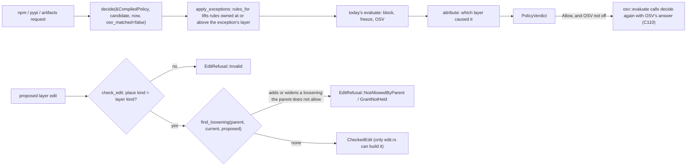

## Delivered

**What works now.** The standalone firewall gives the same answers as before. The difference is the path: every production decision now goes through one function, `policy::effective::decide`. It runs under a `CompiledPolicy` that the firewall builds at start and on each blocklist reload. A new shared crate, `probation-policy`, does two things. It merges a chain of layers (Platform, Org, Group, User, or Personal) into one `EffectivePolicy`. It also checks a layer edit and refuses any loosening that the layer above does not allow. Slices 2 and 4 build on these.

**Scenario.** A standalone firewall has `cooldown_seconds` 7 days and OSV `Enforce`. `CompiledPolicy::standalone` turns this into one Platform layer (freeze 7 days, OSV `On`), with the blocklist file snapshot and its expiry. A request for a release younger than 7 days is held, as before (T-decide-matches-standalone checks every existing policy case).



Contracts on this flow: `decide-exceptions-first` (apply_exceptions before evaluate) on `decide`; `check-edit-loosening-search-first` (find_loosening before `CheckedEdit::accepted`) on `check_edit`. The approved model (`molecule-flow.json`, `molecule-contracts.json`) is unchanged.

```rust
// New: crates/probation-policy (published crate)
/// Merges a chain, top to bottom from Platform, into one policy. A stricter value always
/// wins; a looser one counts only where every ancestor's switch allows it (C8, C11, C46, C47).
pub fn resolve(chain: &[Layer]) -> EffectivePolicy;
impl EffectivePolicy {
    /// The rules one candidate is decided under; `name` is already canonical (C16, C17, C46, C106).
    pub fn rules_for(&self, ecosystem: Ecosystem, name: &str, version: &str) -> CandidateRules;
}
/// Accepts `proposed` only if every loosening or grant it adds or widens, compared with the
/// stored `current` layer, is allowed by `parent`. Unchanged kept settings pass (C47).
pub fn check_edit(parent: &EffectivePolicy, current: &Layer, target: EditTarget, proposed: Layer)
    -> Result<CheckedEdit, EditRefusal>; // Invalid | NotAllowedByParent { what, switch } | GrantNotHeld { switch }
pub struct PolicyFingerprint(pub [u8; 32]); // SHA-256 of the canonical encoding (C103)

// New: src/policy/effective.rs (firewall)
pub struct CompiledPolicy { pub policy: EffectivePolicy, pub snapshot: Option<Arc<BlocklistSnapshot>> }
/// Decides one candidate under `compiled` and reads nothing else.
pub fn decide(compiled: &CompiledPolicy, candidate: &Candidate<'_>, now_utc_micros: i64, osv_matched: bool)
    -> PolicyVerdict; // { decision: today's Decision, layer: Option<LayerKind>, would_block: bool (C81) }
```

**Deviations from the design text.** QA (sf-verification) reports that all 8 deviations it reviewed keep the approved guarantees. The evidence now lists 10; it does not say which 2 came after that review.

| # | What differs | Why it is safe |
|---|---|---|
| 1 | `CandidateRules::layer_behind` is the private `attribute()` in `src/policy/effective.rs` | The shared crate cannot name the firewall's `Decision` and `Candidate` |
| 2 | C47 kept-but-not-in-effect values stay in `EffectivePolicy.chain`; the `rules_for` merge drops them | Stricter under an exception lift; the fingerprint includes them (C103); pinned by test C6. See S1-5 |
| 3 | Merge defaults: no unlifted value means freeze 0 and OSV Off | Standalone always sets both. See S1-2 for managed mode |
| 4 | `OsvClient` has no mode; `osv::evaluate` reads the policy's OSV setting | Enforce/Diagnostic/Off compile to On/LogOnly/Off |
| 5 | `decide` has `#[rustfmt::skip]` | Keeps the SMTC control lines verbatim |
| 6 | `Block` has no `reason` field (C119) | See S1-6 |
| 7 | The place-kind check is the first statement of `check_edit` | The `find_loosening` call line is a fixed control string |
| 8 | `check_edit` accepts narrowing a whole-package exception to an exact version for freeze and OSV, not for block | Under C106 an exact version also lifts file blocks |
| 9 | `probation-policy` has 8 tests, not 7 | The extra one is the D3 C9 `#[should_panic]` test from review |
| 10 | P-check-edit-agrees-with-resolve runs 2048 cases | At 256 cases one mutant survived one run |

## Proof

| Promise | Executed witness | Observed result |
|---|---|---|
| Shared crate merges and checks edits | `cargo test -p probation-policy`; `--doc` | `ok. 8 passed`; `ok. 1 passed` (compile_fail, E0624: `CheckedEdit` cannot be built outside edit.rs) |
| Same answers through `decide` | `cargo test --lib policy::effective::tests` | `ok. 4 passed` (T-decide-matches-standalone loops every existing policy case) |
| Existing behaviour kept | `cargo test --workspace` | 33 `test result: ok`, 0 FAILED |
| No speed regression (B-standalone-nonregression) | `cargo bench --bench warm_metadata --bench artifact_throughput -- --assert` | 9/9 `SPEC §12 … PASS`; warm denial p95 1.411 ms ≤ 2 ms; 115167 responses/s |
| Build, lint, package | clippy `-D warnings`; `cargo fmt --all --check`; `docker build .`; `cargo package --workspace --locked --allow-dirty` | clean; clean; exit 0; `probation-policy` and `probation` only, no `probation-server` |
| Coverage | `cargo llvm-cov --locked --summary-only --fail-under-lines 98` | 98.46 % lines |
| Contracts | `router molecule-check`; `router molecule-verify --slice 1` | PASS; both slice-1 contracts PASS, all 4 controls detected (exit 1 only because 10 later-slice obligations are SOURCE_PENDING) |
| Security | 4 existing analyzers + 2 new obligations | All PASS. `outbound-timeout-guard` needed a header-only refresh (count 7 to 10, from an earlier commit 01b94d7); rules byte-identical, sf-verify-cert PASS. No new findings or gaps |

TDD: every acceptance test failed first (`evidence/tdd-slice-1.md`).

**Review path.** Two rounds of rework, then all green.

| Round | Code review | Adversarial | What was fixed |
|---|---|---|---|
| 1 | SHIP, 3 minor | FIX | D1 duplicate-target re-save refused (C47); D2 `would_block` set on non-Allow (C81); D3 C9 chain shapes not checked; plus attribution tests, `check_edit` branch tests, place-kind guard |
| 2 | SHIP (all 7 resolved, 9 mutants killed) | FIX | F1 `[Platform, Org, User]` rejected (C10); G1 whole to exact narrowing refused; G3 test generators missed Personal and `[P,O,U]` |
| 3 | — | PASS | 40,000-case `rules_for` oracle: 0 loosenings, 0 over-refusals |
| QA | sf-verification: VERIFIED | | Every witness rerun, benches included; C12, C107, C110 unchanged |

## Limits

- **Nothing is committed.** The work is an uncommitted working tree on `main` (base 23e8822). `cargo package` ran with `--allow-dirty` for this reason.
- Warm denial p95 (1.411 ms) is close to its 2 ms limit. Alternating base/slice reruns showed no regression (slice 1.20/1.23 ms, base 1.43/1.42 ms), but `--assert` may fail on a busy machine.
- `.smtc/analyzers/outbound-timeout-guard.yaml` changed outside the slice file list (header only).

**Open items that need your decision later:**

- **S1-5, before slice 6.** Deviation 2 is visible in the portal. Scenario: Platform freeze is 7 days. A Group keeps a 1-day freeze, which the portal will label "not in effect" (C47). An exception lifts the upper freeze for one package. That package is now held 1 day, from the Group. Other packages are held 7 days, from Platform. So the "not in effect" value does apply here, as the stricter value. To do: record the deviation in 03-program-design.md (`EffectivePolicy.chain`, `CandidateRules`) and settle the label wording (T-portal-not-in-effect).
- **S1-6, before slice 7.** Today's blocklist records carry a `reason`. The shared `Block` has none. A lossless T-blocklist-roundtrip (C86/C119) needs a new field on `Block`, and that changes the fingerprint encoding.
- S1-1 (slice 4): `check_edit` does not check that `parent` is the chain above `target`; the server must pass the right chain, and a slice-4 test should pin it.
- S1-7 (design text): fix the drift listed above (deviations 1, 2, 7, 8) when the design is next opened.
- Accepted: S1-3 (spelling-variant rows can only over-refuse; add when slice 4 uses `save_edit`), S1-4 (`2.0` vs `2.0.0` only splits the render cache). Optional: S1-8 (README `cargo test`/`clippy` without `--workspace`).

## Next

Slice 2: a managed firewall serves each request under its own key's policy from a fake management server, and refuses missing or unknown keys (401). It uses slice 1 `decide`, `resolve` and `EffectivePolicy`. Witness: `cargo test --test managed_mode` (10 tests) and B-auth-overhead (managed overhead p95 ≤ 1 ms, throughput ≥ 90%).

One open item belongs to slice 2: **S1-2.** In managed mode, a platform layer that leaves OSV `None` fails open to Off (deviation 3). The server or platform seed should always set platform freeze and OSV, or the plan should record this default.

## Recommendation

Continue to slice 2. Slice 1 met its witness (8 crate tests instead of 7, deviation 9), and every review ended green. QA found that the deviations it reviewed keep the approved guarantees, and the contracts are unchanged. Settle S1-2 during slice 2. S1-5 and S1-6 can wait until before slices 6 and 7.

Status: Slice 1 is checked in 00-status.md with its proof line (qa VERIFIED, code-review SHIP, adversarial PASS). Next boundary: slice 2. Uncommitted working tree on `main`.

Sources: 04-slices.md (row 1, § Slice 1 interfaces, row 2, § Slice 2 interfaces); evidence/slice-1.md; evidence/tdd-slice-1.md; 00-status.md § Slices; molecule-contracts.json; crates/probation-policy/src/{lib.rs,edit.rs}; src/policy/effective.rs.

Continue to slice 2, or re-steer?
