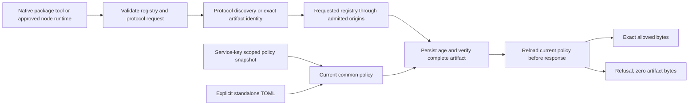

# Design & Slices: Package Firewall MVP

- Author: OKF Workspace
- Date: 2026-11-23

Migration note: this document merges `03-program-design.md` (sha256 9fd6692d8b2c135556edbd6944c26305e5d85b9c9b2279ab6834d23dc37798c0) and `04-slices.md` (sha256 ceb9e6e9ec37736d711ca7af7322fb4b77b622d77c27b56ecb66583b0ef728ac) of the Light Factory v1 plan `package-firewall-mvp-lf`, carried verbatim. Sections the 2-gate template names come from the matching source sections; every other source section is in Appendix C (program design) and Appendix D (slice plan, all prose and all tables). The `## Slice N` sections below are generated from the 04 table rows (cells verbatim) plus a Migration state line from `00-status.md` and the evidence. Slice 30 (v1 ID 31) is the only slice text written by the migration. Stable slice IDs are kept; there is no slice 22. Links to `_work/v1-archive/reviews/`, `_work/v1-archive/provenance/`, `molecule-*.json` and `gate-*-qa.md` point into `_work/v1-archive/`.

## Summary
30 slices: the 29 v1 rows plus Slice 30 (v1 ID 31, added by the migration). lf-next requires contiguous headings, so headings are numbered 1 to 30 in build order and each title carries the stable v1 ID in brackets; Dependencies and Build order use the new numbers. Mapping v1 to v2: 1-9 = 1-9; 11 = 10; 12 = 11; 13 = 12; 14 = 13; 15 = 14; 10 = 15; 16 = 16; 28 = 17; 29 = 18; 30 = 19; 17 = 20; 18 = 21; 19 = 22; 20 = 23; 21 = 24; 23 = 25; 24 = 26; 25 = 27; 26 = 28; 27 = 29; 31 = 30 (there is no v1 slice 22). Status: v1 slices 1 to 15 (baseline), 16, 28, 30, 17 to 21 and 23, 24 are complete; v1 25, 26 and 27 are complete for the Linux-executed scope only; v1 29 is a delivered spike with native lanes unverified (not complete); the one remaining slice is Slice 30 (hosted-runner execution of the authored lanes, D1 closure, fixes). The rows are a dependent chain, so no batch tranche applies (batch needs 5 to 30 independent units). First user-visible result: Slice 1 (tracer bullet), long delivered. Duration of Slice 30 depends on hosted-runner availability and the number of defects the runs reveal; no estimate is invented.

## Files
Repository root:

| File | Why it exists |
| --- | --- |
| `Cargo.toml` | The one package; `[lib]` for the injectable application, `[[bin]] package-firewall` for the CLI. Tests use the lib, never a spawned binary. |
| `Cargo.lock` | Committed: SPEC §13 delivers it, and the pre-1.0 `turso` pin is only real if it is locked. |
| `rust-toolchain.toml` | Pins the toolchain channel so `cargo build`, `cargo test`, `cargo clippy` mean the same thing for every witness on every machine. |
| `.gitignore` | Replaces the Go template (Gate 2 constraint 1): `/target`, `.smtc-cache/`, `/local`. |
| `Dockerfile` | SPEC §3 ships a container image; SPEC §13 requires clean-container startup to work. |
| `config.sample.toml`, `blocklist.sample.json` | SPEC §13 deliverables, and the fixtures `check-config` / `check-blocklist` tests run against. |
| `docs/operations.md` | The operations README. Owns OPS-01's operator-facing half: state/WAL capacity is *not* covered by `cache_max_bytes`, backup and restore of a stopped `state/`, recovery failure. |

`src/` — one directory per approved module:

| File | Why it exists |
| --- | --- |
| `src/main.rs` | clap parsing for the three commands, tracing subscriber installation, exit codes. Builds the production `AppDeps` — the only place `SystemClock`, `ReqwestTransport` and `OriginSet::production()` are named. No policy or protocol logic. |
| `src/lib.rs` | Module tree, `AppDeps`, `App::start`, `Running`. The single constructor seam TEST-01 requires. |
| `src/clock.rs` | `Clock` trait (wall micros + monotonic `Instant`), `SystemClock`, and the backward-jump detector SPEC §5 requires. A leaf so `policy` can stay clock-free. |
| `src/config.rs` | `RawConfig` (serde, unknown keys rejected) → validated `Config`. Holds every rejection rule, so `check-config` and `serve` cannot diverge. |
| `src/policy/mod.rs` | `Decision`, `Candidate`, `evaluate` — the pure rule block of SPEC §5, no I/O and no clock. Built and tested first (SPEC §13 ordering). |
| `src/policy/blocklist.rs` | `BlocklistSnapshot` parsing, whole-candidate validation, immutable lookup sets, and `PolicyHandle` (the `ArcSwap` publication point). Shared by the poller and `check-blocklist`. |
| `src/policy/digest.rs` | `HashAlgorithm`, `Digest`, hex and SRI-base64 decoding to the same digest bytes (SPEC §8), case normalisation, constant-length validation. |
| `src/store/mod.rs` | `StoreHandle`, the `StoreCommand` enum, and the single storage task owning the one `turso` connection. Every SQL statement in the crate is behind this file (Gate 2 constraint 2). |
| `src/store/schema.rs` | DDL, `SCHEMA_VERSION`, the recorded `turso` crate version, and the startup mismatch refusal. |
| `src/store/rows.rs` | Row types and their column mappings: `ProjectRow`, `ReferenceRow`, `ContentRow`, `BlocklistRow`, `ProjectRefresh`. |
| `src/store/cache.rs` | `MemoryCaches` — the three bounded LRUs with byte accounting, and the rendered-response reuse predicate. This is what keeps a warm request off the database. |
| `src/store/lock.rs` | The exclusive data-directory lock file (SPEC §10), taken before the database is opened. |
| `src/store/startup.rs` | Open, recover, verify `synchronous=FULL` and the schema row, remove temp files, clear mappings to missing files, reclaim unreferenced content, load a still-valid persisted blocklist. Separate from `mod.rs` because it is the file fault-injection tests target. |
| `src/upstream/mod.rs` | The `Transport` trait — the injected seam — plus `UpstreamError` and the counted, capped read loop both callers use. |
| `src/upstream/reqwest_transport.rs` | The production `Transport`: the two clients described above, the same-origin redirect policy, and the size-capped streaming reads. |
| `src/upstream/origins.rs` | `OriginSet`: the three fixed origins, `production()`, and the URL admission check (scheme, host, port, no credentials). |
| `src/upstream/resolver.rs` | The `reqwest::dns::Resolve` implementation that rejects loopback, private and link-local resolutions before a connection is made. The mechanism behind SPEC §11's address rule. |
| `src/npm/mod.rs` | Fetch-or-reuse of a project snapshot, decision fan-out over versions, and rendering entry points for full, abbreviated and single-version responses. |
| `src/npm/name.rs` | Route-component validation and percent-decoding for unscoped and scoped names, including npm's `%2f` form. |
| `src/npm/document.rs` | The package-document shape: `versions`, `time`, `dist-tags`, and the untouched remainder, so unknown upstream fields survive filtering unedited. |
| `src/npm/tags.rs` | The tag rules of SPEC §6 in one place, because the `latest` fallback is the one npm rule most likely to be argued about. |
| `src/npm/render.rs` | Full and abbreviated serialisation from one snapshot, tarball URL rewriting, and pruning of the publication-time map. |
| `src/pypi/mod.rs` | Fetch-or-reuse, per-file decisions, and the known-project index. |
| `src/pypi/name.rs` | PEP 503 normalisation and route validation. |
| `src/pypi/filename.rs` | Filename → (project, PEP 440 version). Owns the "cannot establish identity ⇒ exclude and log" rule. |
| `src/pypi/render.rs` | Simple API HTML and JSON from one filtered file list, with HTML escaping of filenames and attributes, and content negotiation. |
| `src/artifacts/mod.rs` | `serve_artifact` — the SPEC §9 pseudocode, including the locally-conclusive-denial-first order (PERF-01) and the final pre-response policy check (the revocation boundary). |
| `src/artifacts/reference.rs` | `ReferenceId` and its length-prefixed encoding, hex form, and parsing. |
| `src/artifacts/download.rs` | `DownloadCoordinator`: one shared fetch per reference, hashing in one pass, integrity and pin comparison, waiter ownership and cancellation (FLOW-01). |
| `src/artifacts/content.rs` | Content-cache paths, the flush → fsync → rename → dirsync → commit order (REL-01), open-file pins, capacity reservation, and approximate-LRU eviction. |
| `src/artifacts/stream.rs` | Range handling and the downstream response body with the 30 s write-idle and 15 min lifetime limits; releases pins and permits on drop. |
| `src/http/mod.rs` | The explicit router (no catch-all), layer stack, and graceful shutdown. |
| `src/http/error.rs` | `ApiError` → status, JSON body, `Retry-After`. The single place SPEC §11's failure table is encoded. |
| `src/http/npm_routes.rs`, `src/http/pypi_routes.rs`, `src/http/artifact_routes.rs`, `src/http/health.rs` | One file per endpoint group from SPEC §11; handlers validate, delegate, and map errors only. |
| `src/http/limits.rs` | `Limits`: the three semaphores and the content-byte budget; overload is refused, never queued. |
| `src/http/logging.rs` | Request IDs and the one structured decision log line SPEC §11 specifies, plus the periodic counter summary. |
| `src/tasks/mod.rs` | Spawns and owns the background loops; hands each a `CancellationToken`. |
| `src/tasks/blocklist_poller.rs` | SPEC §8's reload procedure: change detection, capped read, whole-candidate validation off the request path, revision and window rules, commit, then atomic publish. |
| `src/tasks/maintenance.rs` | Batched access-time updates, eviction passes, and the WAL checkpoint — all on the low-priority store queue, never inside an HTTP handler. |

`tests/` and `benches/`:

| File | Why it exists |
| --- | --- |
| `tests/common/mod.rs` | The harness: `TestClock` (settable, with monotonic control), `FakeRegistry` (a `Transport` implementation, plus a `wiremock` variant for the real-client tests), fixture builders, and a temp data directory. Test-only code lives here and not behind a cargo feature, so the release binary cannot contain a bypass. |
| `tests/config_validation.rs`, `tests/persistence_recovery.rs`, `tests/blocklist_snapshot.rs`, `tests/npm_metadata.rs`, `tests/pypi_metadata.rs`, `tests/artifacts_verification.rs`, `tests/artifacts_concurrency.rs`, `tests/blocklist_revocation.rs`, `tests/http_contract.rs`, `tests/origin_guard.rs` | One file per behaviour group in `## Test plan`, listed in the order the slices create them. Each file is created by the slice that can make all of its tests pass — no file mixes tests from two slices, so `cargo test --test <file>` is always a complete, honest check at the end of the slice that added it. `blocklist_snapshot.rs` (snapshot validity, rollback, expiry, restart) belongs to the metadata slices; `blocklist_revocation.rs` (blocks discovered from computed digests, and previously-issued URLs) needs `DownloadCoordinator`, `pin_computed_digests` and the `digest_generation` bump, so it belongs to the artifact slice. |
| `tests/e2e_npm.rs`, `tests/e2e_pip.rs` | Real `npm` and `pip` against a listening instance; `#[ignore]` by default because they need those clients installed, and run explicitly in the client-integration slice. |
| `benches/warm_metadata.rs`, `benches/artifact_throughput.rs`, `benches/blocklist_swap.rs` | SPEC §12's measured-and-reported targets. |

Pure-policy unit tests live in `#[cfg(test)]` modules inside `src/policy/`; everything that needs an `App` lives in `tests/`.

### Slice 30 files (v1 slice 31, added by migration)
| Action | Path | Why |
|---|---|---|
| Create | `docs/plans/package-firewall-mvp-lf-v2/evidence/slice-31.md` | per-lane results with run URLs |
| Modify | `.github/workflows/` | fixes to authored lanes that fail on hosted runners |
| Modify | `deploy/` | fixes to the service unit, installers and Kubernetes manifests revealed by the runs |
| Modify | `tests/e2e/` | fixes to harness, scenarios and native lanes revealed by the runs |
| Modify | `scripts/` | fixes to lane scripts revealed by the runs |
| Modify | `docs/operations.md` | runbook and measured bounds updated from hosted results |


### Paths owned by carried slices (extracted mechanically from each v1 Exact files cell)
| Action | Path | Why |
|---|---|---|
| Modify | `.github/workflows/` | owned by a carried slice; listed so Owned files/modules containment (G2.2) holds, historical only |
| Modify | `Cargo.lock` | owned by a carried slice; listed so Owned files/modules containment (G2.2) holds, historical only |
| Modify | `Cargo.toml` | owned by a carried slice; listed so Owned files/modules containment (G2.2) holds, historical only |
| Modify | `Dockerfile` | owned by a carried slice; listed so Owned files/modules containment (G2.2) holds, historical only |
| Modify | `README.md` | owned by a carried slice; listed so Owned files/modules containment (G2.2) holds, historical only |
| Modify | `SPEC.md` | owned by a carried slice; listed so Owned files/modules containment (G2.2) holds, historical only |
| Modify | `benches/artifact_throughput.rs` | owned by a carried slice; listed so Owned files/modules containment (G2.2) holds, historical only |
| Modify | `benches/blocklist_swap.rs` | owned by a carried slice; listed so Owned files/modules containment (G2.2) holds, historical only |
| Modify | `benches/warm_metadata.rs` | owned by a carried slice; listed so Owned files/modules containment (G2.2) holds, historical only |
| Modify | `blocklist.sample.json` | owned by a carried slice; listed so Owned files/modules containment (G2.2) holds, historical only |
| Modify | `config.sample.toml` | owned by a carried slice; listed so Owned files/modules containment (G2.2) holds, historical only |
| Modify | `crates/probation-policy/src/api.rs` | owned by a carried slice; listed so Owned files/modules containment (G2.2) holds, historical only |
| Modify | `crates/probation-policy/src/lib.rs` | owned by a carried slice; listed so Owned files/modules containment (G2.2) holds, historical only |
| Modify | `crates/probation-server` | owned by a carried slice; listed so Owned files/modules containment (G2.2) holds, historical only |
| Modify | `crates/probation-server/Cargo.toml` | owned by a carried slice; listed so Owned files/modules containment (G2.2) holds, historical only |
| Modify | `crates/probation-server/migrations/0014_ten_ecosystems.sql` | owned by a carried slice; listed so Owned files/modules containment (G2.2) holds, historical only |
| Modify | `crates/probation-server/migrations/0015_registry_osv_scope.sql` | owned by a carried slice; listed so Owned files/modules containment (G2.2) holds, historical only |
| Modify | `crates/probation-server/src/lib.rs` | owned by a carried slice; listed so Owned files/modules containment (G2.2) holds, historical only |
| Modify | `crates/probation-server/src/order_guards.rs` | owned by a carried slice; listed so Owned files/modules containment (G2.2) holds, historical only |
| Modify | `crates/probation-server/src/osv.rs` | owned by a carried slice; listed so Owned files/modules containment (G2.2) holds, historical only |
| Modify | `crates/probation-server/src/service_policy.rs` | owned by a carried slice; listed so Owned files/modules containment (G2.2) holds, historical only |
| Modify | `crates/probation-server/src/sync.rs` | owned by a carried slice; listed so Owned files/modules containment (G2.2) holds, historical only |
| Modify | `crates/probation-server/tests/osv_coverage_view.rs` | owned by a carried slice; listed so Owned files/modules containment (G2.2) holds, historical only |
| Modify | `crates/probation-server/tests/osv_lookup_api.rs` | owned by a carried slice; listed so Owned files/modules containment (G2.2) holds, historical only |
| Modify | `deploy/kubernetes/` | owned by a carried slice; listed so Owned files/modules containment (G2.2) holds, historical only |
| Modify | `deploy/probation.service` | owned by a carried slice; listed so Owned files/modules containment (G2.2) holds, historical only |
| Modify | `docs/operations.md` | owned by a carried slice; listed so Owned files/modules containment (G2.2) holds, historical only |
| Modify | `rust-toolchain.toml` | owned by a carried slice; listed so Owned files/modules containment (G2.2) holds, historical only |
| Modify | `src/artifacts/content.rs` | owned by a carried slice; listed so Owned files/modules containment (G2.2) holds, historical only |
| Modify | `src/artifacts/download.rs` | owned by a carried slice; listed so Owned files/modules containment (G2.2) holds, historical only |
| Modify | `src/artifacts/mod.rs` | owned by a carried slice; listed so Owned files/modules containment (G2.2) holds, historical only |
| Modify | `src/artifacts/reference.rs` | owned by a carried slice; listed so Owned files/modules containment (G2.2) holds, historical only |
| Modify | `src/artifacts/stream.rs` | owned by a carried slice; listed so Owned files/modules containment (G2.2) holds, historical only |
| Modify | `src/cargo_registry/` | owned by a carried slice; listed so Owned files/modules containment (G2.2) holds, historical only |
| Modify | `src/clock.rs` | owned by a carried slice; listed so Owned files/modules containment (G2.2) holds, historical only |
| Modify | `src/conan/` | owned by a carried slice; listed so Owned files/modules containment (G2.2) holds, historical only |
| Modify | `src/concurrency/mod.rs` | owned by a carried slice; listed so Owned files/modules containment (G2.2) holds, historical only |
| Modify | `src/concurrency/single_flight.rs` | owned by a carried slice; listed so Owned files/modules containment (G2.2) holds, historical only |
| Modify | `src/config.rs` | owned by a carried slice; listed so Owned files/modules containment (G2.2) holds, historical only |
| Modify | `src/go_modules/` | owned by a carried slice; listed so Owned files/modules containment (G2.2) holds, historical only |
| Modify | `src/http/artifact_routes.rs` | owned by a carried slice; listed so Owned files/modules containment (G2.2) holds, historical only |
| Modify | `src/http/credential_read.rs` | owned by a carried slice; listed so Owned files/modules containment (G2.2) holds, historical only |
| Modify | `src/http/error.rs` | owned by a carried slice; listed so Owned files/modules containment (G2.2) holds, historical only |
| Modify | `src/http/health.rs` | owned by a carried slice; listed so Owned files/modules containment (G2.2) holds, historical only |
| Modify | `src/http/limits.rs` | owned by a carried slice; listed so Owned files/modules containment (G2.2) holds, historical only |
| Modify | `src/http/logging.rs` | owned by a carried slice; listed so Owned files/modules containment (G2.2) holds, historical only |
| Modify | `src/http/mod.rs` | owned by a carried slice; listed so Owned files/modules containment (G2.2) holds, historical only |
| Modify | `src/http/npm_routes.rs` | owned by a carried slice; listed so Owned files/modules containment (G2.2) holds, historical only |
| Modify | `src/http/pypi_routes.rs` | owned by a carried slice; listed so Owned files/modules containment (G2.2) holds, historical only |
| Modify | `src/http/service_connector.rs` | owned by a carried slice; listed so Owned files/modules containment (G2.2) holds, historical only |
| Modify | `src/http/service_registry.rs` | owned by a carried slice; listed so Owned files/modules containment (G2.2) holds, historical only |
| Modify | `src/http/service_unpublish.rs` | owned by a carried slice; listed so Owned files/modules containment (G2.2) holds, historical only |
| Modify | `src/lib.rs` | owned by a carried slice; listed so Owned files/modules containment (G2.2) holds, historical only |
| Modify | `src/main.rs` | owned by a carried slice; listed so Owned files/modules containment (G2.2) holds, historical only |
| Modify | `src/managed/cache.rs` | owned by a carried slice; listed so Owned files/modules containment (G2.2) holds, historical only |
| Modify | `src/managed/mod.rs` | owned by a carried slice; listed so Owned files/modules containment (G2.2) holds, historical only |
| Modify | `src/managed/order_guards.rs` | owned by a carried slice; listed so Owned files/modules containment (G2.2) holds, historical only |
| Modify | `src/managed/publication_gate.rs` | owned by a carried slice; listed so Owned files/modules containment (G2.2) holds, historical only |
| Modify | `src/managed/report.rs` | owned by a carried slice; listed so Owned files/modules containment (G2.2) holds, historical only |
| Modify | `src/managed/service_policy.rs` | owned by a carried slice; listed so Owned files/modules containment (G2.2) holds, historical only |
| Modify | `src/managed/sync.rs` | owned by a carried slice; listed so Owned files/modules containment (G2.2) holds, historical only |
| Modify | `src/maven/` | owned by a carried slice; listed so Owned files/modules containment (G2.2) holds, historical only |
| Modify | `src/npm/document.rs` | owned by a carried slice; listed so Owned files/modules containment (G2.2) holds, historical only |
| Modify | `src/npm/mod.rs` | owned by a carried slice; listed so Owned files/modules containment (G2.2) holds, historical only |
| Modify | `src/npm/name.rs` | owned by a carried slice; listed so Owned files/modules containment (G2.2) holds, historical only |
| Modify | `src/npm/render.rs` | owned by a carried slice; listed so Owned files/modules containment (G2.2) holds, historical only |
| Modify | `src/npm/tags.rs` | owned by a carried slice; listed so Owned files/modules containment (G2.2) holds, historical only |
| Modify | `src/nuget/` | owned by a carried slice; listed so Owned files/modules containment (G2.2) holds, historical only |
| Modify | `src/oci/` | owned by a carried slice; listed so Owned files/modules containment (G2.2) holds, historical only |
| Modify | `src/osv/batcher.rs` | owned by a carried slice; listed so Owned files/modules containment (G2.2) holds, historical only |
| Modify | `src/osv/matches.rs` | owned by a carried slice; listed so Owned files/modules containment (G2.2) holds, historical only |
| Modify | `src/osv/mod.rs` | owned by a carried slice; listed so Owned files/modules containment (G2.2) holds, historical only |
| Modify | `src/policy/blocklist.rs` | owned by a carried slice; listed so Owned files/modules containment (G2.2) holds, historical only |
| Modify | `src/policy/digest.rs` | owned by a carried slice; listed so Owned files/modules containment (G2.2) holds, historical only |
| Modify | `src/policy/mod.rs` | owned by a carried slice; listed so Owned files/modules containment (G2.2) holds, historical only |
| Modify | `src/pypi/filename.rs` | owned by a carried slice; listed so Owned files/modules containment (G2.2) holds, historical only |
| Modify | `src/pypi/mod.rs` | owned by a carried slice; listed so Owned files/modules containment (G2.2) holds, historical only |
| Modify | `src/pypi/name.rs` | owned by a carried slice; listed so Owned files/modules containment (G2.2) holds, historical only |
| Modify | `src/pypi/render.rs` | owned by a carried slice; listed so Owned files/modules containment (G2.2) holds, historical only |
| Modify | `src/rubygems/` | owned by a carried slice; listed so Owned files/modules containment (G2.2) holds, historical only |
| Modify | `src/service_policy.rs` | owned by a carried slice; listed so Owned files/modules containment (G2.2) holds, historical only |
| Modify | `src/store/cache.rs` | owned by a carried slice; listed so Owned files/modules containment (G2.2) holds, historical only |
| Modify | `src/store/lock.rs` | owned by a carried slice; listed so Owned files/modules containment (G2.2) holds, historical only |
| Modify | `src/store/mod.rs` | owned by a carried slice; listed so Owned files/modules containment (G2.2) holds, historical only |
| Modify | `src/store/rows.rs` | owned by a carried slice; listed so Owned files/modules containment (G2.2) holds, historical only |
| Modify | `src/store/schema.rs` | owned by a carried slice; listed so Owned files/modules containment (G2.2) holds, historical only |
| Modify | `src/store/startup.rs` | owned by a carried slice; listed so Owned files/modules containment (G2.2) holds, historical only |
| Modify | `src/tasks/blocklist_poller.rs` | owned by a carried slice; listed so Owned files/modules containment (G2.2) holds, historical only |
| Modify | `src/tasks/maintenance.rs` | owned by a carried slice; listed so Owned files/modules containment (G2.2) holds, historical only |
| Modify | `src/tasks/mod.rs` | owned by a carried slice; listed so Owned files/modules containment (G2.2) holds, historical only |
| Modify | `src/upstream/mod.rs` | owned by a carried slice; listed so Owned files/modules containment (G2.2) holds, historical only |
| Modify | `src/upstream/origins.rs` | owned by a carried slice; listed so Owned files/modules containment (G2.2) holds, historical only |
| Modify | `src/upstream/reqwest_transport.rs` | owned by a carried slice; listed so Owned files/modules containment (G2.2) holds, historical only |
| Modify | `src/upstream/resolver.rs` | owned by a carried slice; listed so Owned files/modules containment (G2.2) holds, historical only |
| Modify | `tests/artifacts_concurrency.rs` | owned by a carried slice; listed so Owned files/modules containment (G2.2) holds, historical only |
| Modify | `tests/artifacts_verification.rs` | owned by a carried slice; listed so Owned files/modules containment (G2.2) holds, historical only |
| Modify | `tests/authorization_read_once.rs` | owned by a carried slice; listed so Owned files/modules containment (G2.2) holds, historical only |
| Modify | `tests/bench` | owned by a carried slice; listed so Owned files/modules containment (G2.2) holds, historical only |
| Modify | `tests/blocklist_reload.rs` | owned by a carried slice; listed so Owned files/modules containment (G2.2) holds, historical only |
| Modify | `tests/blocklist_revocation.rs` | owned by a carried slice; listed so Owned files/modules containment (G2.2) holds, historical only |
| Modify | `tests/blocklist_snapshot.rs` | owned by a carried slice; listed so Owned files/modules containment (G2.2) holds, historical only |
| Modify | `tests/cargo_registry.rs` | owned by a carried slice; listed so Owned files/modules containment (G2.2) holds, historical only |
| Modify | `tests/common/mod.rs` | owned by a carried slice; listed so Owned files/modules containment (G2.2) holds, historical only |
| Modify | `tests/conan_registry.rs` | owned by a carried slice; listed so Owned files/modules containment (G2.2) holds, historical only |
| Modify | `tests/config_validation.rs` | owned by a carried slice; listed so Owned files/modules containment (G2.2) holds, historical only |
| Modify | `tests/credential_bearing_reads.rs` | owned by a carried slice; listed so Owned files/modules containment (G2.2) holds, historical only |
| Modify | `tests/e2e/fixtures/fakes` | owned by a carried slice; listed so Owned files/modules containment (G2.2) holds, historical only |
| Modify | `tests/e2e/fixtures/fakes/main.mjs` | owned by a carried slice; listed so Owned files/modules containment (G2.2) holds, historical only |
| Modify | `tests/e2e/harness` | owned by a carried slice; listed so Owned files/modules containment (G2.2) holds, historical only |
| Modify | `tests/e2e/scenarios/publishing-python-service.mjs` | owned by a carried slice; listed so Owned files/modules containment (G2.2) holds, historical only |
| Modify | `tests/e2e/scenarios/service-cluster-probe.mjs` | owned by a carried slice; listed so Owned files/modules containment (G2.2) holds, historical only |
| Modify | `tests/e2e/scenarios/service-cluster.mjs` | owned by a carried slice; listed so Owned files/modules containment (G2.2) holds, historical only |
| Modify | `tests/e2e/scenarios/service-policy.mjs` | owned by a carried slice; listed so Owned files/modules containment (G2.2) holds, historical only |
| Modify | `tests/e2e_npm.rs` | owned by a carried slice; listed so Owned files/modules containment (G2.2) holds, historical only |
| Modify | `tests/e2e_pip.rs` | owned by a carried slice; listed so Owned files/modules containment (G2.2) holds, historical only |
| Modify | `tests/go_modules.rs` | owned by a carried slice; listed so Owned files/modules containment (G2.2) holds, historical only |
| Modify | `tests/http_contract.rs` | owned by a carried slice; listed so Owned files/modules containment (G2.2) holds, historical only |
| Modify | `tests/managed_delivery_authority.rs` | owned by a carried slice; listed so Owned files/modules containment (G2.2) holds, historical only |
| Modify | `tests/managed_release_wiring.rs` | owned by a carried slice; listed so Owned files/modules containment (G2.2) holds, historical only |
| Modify | `tests/maven_registry.rs` | owned by a carried slice; listed so Owned files/modules containment (G2.2) holds, historical only |
| Modify | `tests/npm_metadata.rs` | owned by a carried slice; listed so Owned files/modules containment (G2.2) holds, historical only |
| Modify | `tests/nuget_registry.rs` | owned by a carried slice; listed so Owned files/modules containment (G2.2) holds, historical only |
| Modify | `tests/oci_registry.rs` | owned by a carried slice; listed so Owned files/modules containment (G2.2) holds, historical only |
| Modify | `tests/origin_guard.rs` | owned by a carried slice; listed so Owned files/modules containment (G2.2) holds, historical only |
| Modify | `tests/osv_ecosystem_mapping.rs` | owned by a carried slice; listed so Owned files/modules containment (G2.2) holds, historical only |
| Modify | `tests/osv_managed_endpoint.rs` | owned by a carried slice; listed so Owned files/modules containment (G2.2) holds, historical only |
| Modify | `tests/osv_matches_file.rs` | owned by a carried slice; listed so Owned files/modules containment (G2.2) holds, historical only |
| Modify | `tests/persistence_content.rs` | owned by a carried slice; listed so Owned files/modules containment (G2.2) holds, historical only |
| Modify | `tests/persistence_projects.rs` | owned by a carried slice; listed so Owned files/modules containment (G2.2) holds, historical only |
| Modify | `tests/persistence_recovery.rs` | owned by a carried slice; listed so Owned files/modules containment (G2.2) holds, historical only |
| Modify | `tests/pypi_metadata.rs` | owned by a carried slice; listed so Owned files/modules containment (G2.2) holds, historical only |
| Modify | `tests/pypi_service_upload.rs` | owned by a carried slice; listed so Owned files/modules containment (G2.2) holds, historical only |
| Modify | `tests/rubygems_marshal_property.rs` | owned by a carried slice; listed so Owned files/modules containment (G2.2) holds, historical only |
| Modify | `tests/rubygems_registry.rs` | owned by a carried slice; listed so Owned files/modules containment (G2.2) holds, historical only |
| Modify | `tests/service_unpublish.rs` | owned by a carried slice; listed so Owned files/modules containment (G2.2) holds, historical only |
| Modify | `tests/tracer.rs` | owned by a carried slice; listed so Owned files/modules containment (G2.2) holds, historical only |
| Modify | `tests/warm_artifact_budget.rs` | owned by a carried slice; listed so Owned files/modules containment (G2.2) holds, historical only |

Note (G2.2): the `Owned files/modules` of the carried slices are the paths extracted mechanically from the v1 `Exact files` cells (backticked, globs turned into their directory, prose and annotations dropped; each verbatim v1 cell is kept in that slice's Implementation packet line). They are historical, since those slices are complete, and are not meant as a future write allowlist.

## Types & signatures
### `clock`

```rust
pub trait Clock: Send + Sync + 'static {
    /// UTC microseconds since the Unix epoch.
    fn now_utc_micros(&self) -> i64;
    fn now_monotonic(&self) -> std::time::Instant;
}

pub struct SystemClock;
impl Clock for SystemClock { /* .. */ }

/// Detects the backward wall-clock jump SPEC §5 requires us to react to.
pub struct JumpWatch { last_utc_micros: AtomicI64 }
impl JumpWatch {
    /// Returns true when `now` is more than `tolerance` behind the highest value seen.
    pub fn observe(&self, now_utc_micros: i64, tolerance_micros: i64) -> bool;
}
```

### `config`

```rust
pub struct Config {
    pub listen: SocketAddr,
    pub public_url: Url,
    pub data_dir: PathBuf,
    pub blocklist_file: PathBuf,
    pub cooldown_seconds: u64,          // 0 disables the age rule only
    pub metadata_ttl_seconds: u64,
    pub metadata_max_age_seconds: u64,  // 0 disables the ceiling — see SPEC rev 3 §10
    pub blocklist_poll_seconds: NonZeroU64,
    pub cache_max_bytes: NonZeroU64,
    pub memory_cache_max_bytes: NonZeroU64,
    pub max_artifact_bytes: NonZeroU64,
    pub max_metadata_bytes: NonZeroU64,
    pub max_blocklist_bytes: NonZeroU64,
    pub max_upstream_requests: NonZeroU32,
    pub max_artifact_downloads: NonZeroU32,
    pub max_active_requests: NonZeroU32,
    pub max_references_per_project: NonZeroU32,   // added at Gate 3 — see TM-1
}

impl Config {
    pub fn from_toml_str(text: &str) -> Result<Config, ConfigError>;
    pub fn load(path: &Path) -> Result<Config, ConfigError>;
}

pub enum ConfigError {
    Read { path: PathBuf, source: io::Error },
    Syntax(toml::de::Error),
    UnknownKey(String),
    MissingKey(&'static str),
    Invalid { key: &'static str, reason: String },
}
```

`Invalid` is returned for: a `public_url` carrying a path, query or fragment; a non-HTTPS `public_url`; `max_artifact_bytes > cache_max_bytes`; a relative `data_dir` or `blocklist_file`; a nonzero `metadata_max_age_seconds` below `metadata_ttl_seconds`; and any zero where a `NonZero*` type appears above. The `NonZero*` types make "zero polling intervals and zero capacity limits are invalid" a type error rather than a check someone can forget, while `cooldown_seconds`, `metadata_ttl_seconds` and `metadata_max_age_seconds` stay plain `u64` because zero is meaningful for all three.

`metadata_max_age_seconds` cannot be a `NonZeroU64` even though zero disables it, because the ceiling-below-TTL check needs both values and a type cannot express a cross-field relation. The check is therefore explicit, and it exists because a ceiling beneath the revalidation interval would expire every copy before it could ever be revalidated — a configuration that looks stricter and is in fact a self-inflicted outage.

**`max_references_per_project` (default 20 000) is a Gate 3 addition to SPEC §4's key set**, adopted from threat TM-1. A project refresh commits every reference for one project in a single transaction (REL-01 requires that), and the storage task's priority bias is checked *between* transactions — so without a count cap, one pathological upstream document delays every other store operation, including an urgent blocklist commit, for the length of that one transaction. A document exceeding the cap is rejected as `502 UpstreamInvalid` and logged with its name and reference count. This is consistent with SPEC §12's "size limits are operational limits and can reject unusually large projects; do not hide that tradeoff" — it makes an unusually large project unavailable rather than making the whole instance slow. It needs your sign-off because it adds an operator-visible configuration key the specification does not list.

### `policy`

```rust
#[derive(Clone, Copy, PartialEq, Eq, Debug)]
pub enum Ecosystem { Npm, PyPi }

#[derive(Clone, Copy, PartialEq, Eq, Hash, Debug)]
pub enum HashAlgorithm { Sha256, Sha512, Sha1 }

#[derive(Clone, PartialEq, Eq, Hash, Debug)]
pub struct Digest { pub algorithm: HashAlgorithm, pub bytes: Box<[u8]> }

impl Digest {
    pub fn parse_hex(algorithm: HashAlgorithm, hex: &str) -> Result<Digest, InvalidDigest>;
    /// npm `sha512-<base64>` / SRI entries decode to the same digest bytes (SPEC §8).
    pub fn parse_sri_entry(entry: &str) -> Result<Digest, InvalidDigest>;
    pub fn to_hex_lowercase(&self) -> String;
}

/// Where the age of a candidate comes from. `Malformed` and `Unknown` are distinct
/// because SPEC §5 denies the first and forbids serving the second before it is persisted.
#[derive(Clone, Copy, PartialEq, Eq, Debug)]
pub enum PublicationTime {
    Upstream(i64),
    FirstSeen(i64),   // already committed to storage
    Malformed,        // upstream supplied a value we could not parse
    Unknown,          // no upstream value and no committed first-seen yet
}

pub struct Candidate<'a> {
    pub ecosystem: Ecosystem,
    pub name: &'a str,              // normalised
    pub version: &'a str,           // upstream spelling
    pub publication: PublicationTime,
    pub advertised_digests: &'a [Digest],
    pub pinned_digests: &'a [Digest],
}

#[derive(Clone, Copy, PartialEq, Eq, Debug)]
pub enum Decision {
    Unavailable,                            // no valid blocklist
    Deny(DenyReason),
    Hold { eligible_at_micros: i64 },
    Allow,
}

#[derive(Clone, Copy, PartialEq, Eq, Debug)]
pub enum DenyReason {
    BlockedPackage, BlockedVersion, BlockedDigest,
    MalformedTimestamp, FutureTimestamp, NoTimestamp,
}

/// The whole of SPEC §5, in that exact order, with one `now` and one snapshot.
pub fn evaluate(
    snapshot: Option<&BlocklistSnapshot>,
    now_utc_micros: i64,
    cooldown_seconds: u64,
    candidate: &Candidate<'_>,
) -> Decision;
```

`evaluate` checks in this order and returns on the first hit: no snapshot or expired snapshot → `Unavailable`; package blocked → `Deny(BlockedPackage)`; version blocked → `Deny(BlockedVersion)`; any advertised **or pinned** digest blocked → `Deny(BlockedDigest)`; `Malformed` → `Deny(MalformedTimestamp)`; `Unknown` → `Deny(NoTimestamp)`; timestamp after `now` → `Deny(FutureTimestamp)`; `now < t + cooldown` → `Hold { t + cooldown }`; else `Allow`. Deadlines use checked arithmetic and saturate to `i64::MAX`, which stays a `Hold`.

`Deny(NoTimestamp)` is a defensive branch: every caller resolves `Unknown` into a committed `FirstSeen` before evaluating (see the call stacks). It exists so that a future caller that forgets cannot make an untimed artifact eligible, and it has its own unit test.

```rust
pub struct BlocklistSnapshot {
    pub revision: u64,
    pub generated_at_micros: i64,
    pub expires_at_micros: i64,
    pub raw: Arc<[u8]>,                     // the exact validated bytes, for persistence
    packages: HashSet<(Ecosystem, String)>,
    versions: HashMap<(Ecosystem, String), Vec<BlockedVersion>>,
    digests: HashSet<Digest>,
}

struct BlockedVersion { raw: String, canonical: String }

impl BlocklistSnapshot {
    /// Validates the entire candidate: schema version, revision, the
    /// `generated_at <= now < expires_at` and `generated_at < expires_at` window,
    /// every record, and every digest. Rejects unsupported algorithms and
    /// malformed records rather than skipping them.
    pub fn parse_and_validate(bytes: &[u8], now_utc_micros: i64) -> Result<Self, BlocklistError>;
    pub fn is_valid_at(&self, now_utc_micros: i64) -> bool;
    pub fn blocks_package(&self, e: Ecosystem, name: &str) -> bool;
    pub fn blocks_version(&self, e: Ecosystem, name: &str, version: &str) -> bool;
    pub fn blocks_digest(&self, d: &Digest) -> bool;
    pub fn entry_count(&self) -> usize;
}

pub enum BlocklistError {
    TooLarge { limit: u64 },
    Syntax(serde_json::Error),
    UnsupportedSchemaVersion(u64),
    UnsupportedAlgorithm(String),
    MalformedDigest { algorithm: String },
    MalformedRecord { index: usize, reason: String },
    Window { reason: &'static str },
    NotNewer { accepted: u64, candidate: u64 },
    ChangedWithoutRevisionBump { revision: u64 },
}

/// The publication point. `load` is the ordering point SPEC §9 names as the
/// revocation boundary: a request that loads after a publish must see it.
pub struct PolicyHandle { inner: ArcSwapOption<BlocklistSnapshot> }
impl PolicyHandle {
    pub fn load(&self) -> Option<Arc<BlocklistSnapshot>>;
    pub fn publish(&self, snapshot: Arc<BlocklistSnapshot>);
    pub fn revision(&self) -> Option<u64>;
}
```

**`versions` is a `HashMap<key, Vec<..>>`, not the flat hash set SPEC §8 describes.** SPEC §7 requires PyPI version blocks to match by parsed PEP 440 equality including equivalent spellings (`1.0`, `1.0.0`, `1.0.0.post0` questions), which a string hash set cannot do. The map keeps §8's one-hash-lookup property for the overwhelmingly common miss — no entry for that package at all — and only then compares canonical forms over the short blocked list for that one package. npm versions are compared by exact string first and by parsed `nodejs-semver` equality second.

### `store`

```rust
pub struct StoreHandle { critical: mpsc::Sender<StoreCommand>, maintenance: mpsc::Sender<StoreCommand> }

enum StoreCommand {
    GetProject { ecosystem: Ecosystem, name: String, reply: oneshot::Sender<StoreResult<Option<ProjectRow>>> },
    ListKnownProjects { ecosystem: Ecosystem, reply: oneshot::Sender<StoreResult<Vec<String>>> },
    /// Snapshot + reference upserts + new first-seen values in ONE transaction (REL-01).
    CommitProjectRefresh { refresh: Box<ProjectRefresh>, reply: oneshot::Sender<StoreResult<Generation>> },
    GetReference { id: ReferenceId, reply: oneshot::Sender<StoreResult<Option<ReferenceRow>>> },
    /// Permanent (STATE-01): written even when policy now blocks the bytes.
    PinComputedDigests { id: ReferenceId, sha256: [u8; 32], sha512: [u8; 64], size: u64,
                         reply: oneshot::Sender<StoreResult<PinOutcome>> },
    PublishContent { key: ContentKey, sha512: [u8; 64], size: u64, id: ReferenceId,
                     reply: oneshot::Sender<StoreResult<()>> },
    ClearContentKey { key: ContentKey, reply: oneshot::Sender<StoreResult<()>> },
    CommitBlocklist { snapshot: Arc<BlocklistSnapshot>, reply: oneshot::Sender<StoreResult<()>> },
    LoadBlocklist { reply: oneshot::Sender<StoreResult<Option<BlocklistRow>>> },
    // maintenance queue only:
    TouchContent { keys: Vec<(ContentKey, i64)> },
    EvictDownTo { budget_bytes: u64, reply: oneshot::Sender<StoreResult<u64>> },
    Checkpoint { reply: oneshot::Sender<StoreResult<()>> },
}

#[derive(Clone, Copy, PartialEq, Eq, Debug)]
pub enum PinOutcome { Established, MatchedExisting, Conflict }

#[derive(Clone, Copy, PartialEq, Eq, PartialOrd, Ord, Debug)]
pub struct Generation(pub u64);

impl StoreHandle {
    pub async fn get_project(&self, e: Ecosystem, name: &str) -> StoreResult<Option<ProjectRow>>;
    pub async fn commit_project_refresh(&self, r: ProjectRefresh) -> StoreResult<Generation>;
    pub async fn get_reference(&self, id: ReferenceId) -> StoreResult<Option<ReferenceRow>>;
    pub async fn pin_computed_digests(&self, id: ReferenceId, sha256: [u8; 32], sha512: [u8; 64], size: u64)
        -> StoreResult<PinOutcome>;
    pub async fn publish_content(&self, key: ContentKey, sha512: [u8; 64], size: u64, id: ReferenceId)
        -> StoreResult<()>;
    pub async fn commit_blocklist(&self, s: Arc<BlocklistSnapshot>) -> StoreResult<()>;
    pub fn touch_content(&self, keys: Vec<(ContentKey, i64)>);   // best effort, never awaited by a handler
}

pub enum StoreError { Busy, Closed, Database(turso::Error), Corrupt(String) }
pub type StoreResult<T> = Result<T, StoreError>;
```

Two queues, one task. The task uses a biased `select!` that drains `critical` before it looks at `maintenance`, which is how "give pending blocklist commits priority over ordinary queued cache maintenance, without interrupting an active transaction" is implemented: the bias is checked between transactions, never inside one. Both queues are bounded; a full `critical` queue returns `StoreError::Busy`, which maps to `503`. `StoreError::Database` and `Corrupt` set readiness false.

```rust
pub struct ProjectRefresh {
    pub ecosystem: Ecosystem,
    pub name: String,
    pub payload: Arc<[u8]>,                     // exact upstream bytes
    pub validators: UpstreamValidators,         // etag / last-modified, never forwarded downstream
    pub validated_at_micros: i64,
    pub fetched_at_micros: i64,                 // last FULL fetch; a 304 carries the stored value forward
    pub references: Vec<ReferenceUpsert>,
    pub first_seen: Vec<(ReferenceId, i64)>,    // only for references with no upstream timestamp
}

pub struct ProjectRow {
    pub ecosystem: Ecosystem, pub name: String,
    pub payload: Arc<[u8]>, pub validators: UpstreamValidators,
    pub validated_at_micros: i64,
    pub fetched_at_micros: i64,
    pub generation: Generation,
    pub digest_generation: u64,
}

pub struct ReferenceRow {
    pub id: ReferenceId,
    pub ecosystem: Ecosystem, pub name: String, pub version: String, pub filename: String,
    pub upstream_url: Url,
    pub expected: Vec<Digest>,
    pub publication_micros: Option<i64>,
    pub first_seen_micros: Option<i64>,
    pub pinned_sha256: Option<[u8; 32]>,
    pub pinned_sha512: Option<[u8; 64]>,
    pub pinned_size: Option<u64>,
    pub content_key: Option<ContentKey>,
}
```

`ReferenceRow::publication_time()` collapses those fields into `PublicationTime` with upstream winning over first-seen (SPEC §5: "If a valid upstream timestamp later appears, use it").

```rust
/// Sharded, and a hit does NOT reorder a recency list — see the note below.
pub struct MemoryCaches {
    projects: ShardedCache<(Ecosystem, String), ProjectSnapshot>,
    references: ShardedCache<ReferenceId, ReferenceRow>,
    rendered: ShardedCache<RenderKey, RenderedResponse>,
    /// Confirmed-absent upstream names, TTL = metadata_ttl (TM-4). Memory only,
    /// never persisted: a restart may re-ask upstream, which is harmless.
    absent: ShardedCache<(Ecosystem, String), AbsentMark>,
}

pub struct ShardedCache<K, V> { shards: [RwLock<Shard<K, V>>; SHARDS], budget_bytes: u64 }
const SHARDS: usize = 16;

struct Shard<K, V> { entries: HashMap<K, Entry<V>>, used_bytes: u64, hand: usize }
struct Entry<V> { value: Arc<V>, bytes: u64, referenced: AtomicBool }

impl<K: Hash + Eq, V> ShardedCache<K, V> {
    /// Warm path: shard by hash, take the READ lock, clone the `Arc`, and set
    /// `referenced` with a relaxed store. No list mutation, no write lock.
    pub fn get(&self, key: &K) -> Option<Arc<V>>;
    /// Cold path only: takes the write lock for that one shard and evicts within it.
    pub fn insert(&self, key: K, value: Arc<V>, bytes: u64);
}

#[derive(Clone, PartialEq, Eq, Hash)]
pub struct RenderKey { pub ecosystem: Ecosystem, pub name: String, pub representation: Representation }

pub struct RenderedResponse {
    pub body: Arc<[u8]>,
    pub content_type: &'static str,
    pub project_generation: Generation,
    pub blocklist_revision: u64,
    pub digest_generation: u64,
    pub deadline_utc_micros: i64,
    pub deadline_monotonic: Instant,
}

impl RenderedResponse {
    /// All five conditions of SPEC §10, plus the monotonic deadline.
    pub fn is_reusable(&self, project: Generation, revision: u64, digest_generation: u64,
                       now_utc_micros: i64, now_monotonic: Instant) -> bool;
}
```

**Why the caches are sharded and second-chance rather than strict LRU.** A strict LRU hit must move the entry to the front of a recency list, which is a *mutation*: it needs an exclusive lock, so every warm metadata request and every warm denial in the process would serialize on one mutex per cache. SPEC §12 asks for at least 1,000 warm responses/second at p95 ≤ 5 ms and a warm denial at p95 ≤ 2 ms, and a single exclusive lock on the hottest path is the wrong shape for that by construction — not a tuning problem to discover under benchmark. So a hit takes a per-shard read lock and sets an atomic `referenced` bit with a relaxed store; eviction is a second-chance (CLOCK) sweep over the shard that clears the bit and reclaims the first unreferenced entry. Recency is therefore approximate, which SPEC §10 already permits ("bounded" for memory caches, "approximate least-recently-used" for disk). Sixteen shards is a starting number, and `benches/warm_metadata.rs` is what decides whether it changes — the shard count is a tuning knob, but the lock shape is a design decision.

```rust
pub struct AbsentMark { pub observed_monotonic: Instant }
```

### `upstream`

```rust
#[async_trait]
pub trait Transport: Send + Sync + 'static {
    async fn fetch_metadata(&self, req: MetadataRequest) -> Result<MetadataResponse, UpstreamError>;
    async fn open_artifact(&self, req: ArtifactRequest) -> Result<ArtifactBody, UpstreamError>;
}

pub struct MetadataRequest {
    pub url: Url, pub accept: &'static str,
    pub validators: Option<UpstreamValidators>,
    pub max_bytes: u64,
}
pub enum MetadataResponse {
    Fresh { body: Bytes, validators: UpstreamValidators },
    NotModified { validators: UpstreamValidators },
    Missing,                                   // upstream 404 / 410
}

pub struct ArtifactRequest { pub url: Url, pub max_bytes: u64 }
pub struct ArtifactBody {
    pub declared_length: Option<u64>,
    pub stream: Pin<Box<dyn Stream<Item = Result<Bytes, UpstreamError>> + Send>>,
}

pub enum UpstreamError {
    Timeout,
    Transport(String),
    Status(u16),
    TooLarge { limit: u64 },
    RejectedUrl(UrlRejection),
    RejectedRedirect { to: Url },
    RejectedAddress { addr: IpAddr },
}

pub struct OriginSet {
    npm_metadata: Url,        // https://registry.npmjs.org
    pypi_metadata: Url,       // https://pypi.org
    pypi_artifacts: Url,      // https://files.pythonhosted.org
    allow_private_addresses: bool,
}
impl OriginSet {
    /// The only constructor `main.rs` calls. HTTPS, default ports, private addresses rejected.
    pub fn production() -> OriginSet;
    /// Tests only. Not reachable from config, CLI, or environment — TEST-01's no-bypass rule.
    pub fn for_tests(npm: Url, pypi: Url, artifacts: Url) -> OriginSet;
    pub fn admit(&self, url: &Url, kind: OriginKind) -> Result<(), UrlRejection>;
}
pub enum UrlRejection { Scheme, Host, Port, Credentials, ForeignOrigin, PathEscape }
```

`admit` runs before any request and on every redirect hop: scheme must be `https` (or `http` only when `allow_private_addresses` is set by `for_tests`), host must equal the configured origin's host, port must match, userinfo must be empty, and the path must stay under the origin's path. The `Resolve` implementation is the second gate — it rejects loopback, private and link-local answers unless `allow_private_addresses` is set. Both gates are constructor-controlled; neither reads config, an environment variable, or a flag.

**Upstream URLs are never built with `Url::join`, and never by string concatenation.** `Url::join` resolves its argument as a reference, so an untrusted segment beginning `//` or carrying a scheme can replace the host — the classic footgun, and the second `UNKNOWN` the threat model raised. Instead every upstream URL starts as a clone of the `OriginSet` origin and each name-derived segment is appended with `url::PathSegmentsMut::push`, which percent-encodes the segment and cannot escape the path. `admit` then re-validates the finished URL, so construction and admission are two independent defences rather than one. `origin_guard::a_package_name_cannot_change_the_upstream_host` asserts this for names containing `//`, `..`, `:`, a full `https://` prefix, and an encoded slash.

### `artifacts`

```rust
pub struct ReferenceId([u8; 32]);
impl ReferenceId {
    /// SHA-256 over a length-prefixed encoding of the exact reference (SPEC §9):
    /// for each part, a u32 big-endian byte length followed by the bytes, in the fixed
    /// order ecosystem tag, normalised name, upstream version, filename, upstream URL,
    /// then the count of expected digests and each (algorithm tag, digest bytes) sorted
    /// by (algorithm, bytes). A lookup key — not a content hash, not an authorization token.
    pub fn compute(r: &ArtifactReference) -> ReferenceId;
    pub fn to_hex(&self) -> String;
    pub fn parse_hex(s: &str) -> Result<ReferenceId, InvalidReferenceId>;
}

pub struct ArtifactReference {
    pub ecosystem: Ecosystem, pub name: String, pub version: String,
    pub filename: String, pub upstream_url: Url, pub expected: Vec<Digest>,
}

pub struct ContentKey([u8; 32]);   // the verified SHA-256 of the bytes

pub async fn serve_artifact(
    app: &App, id: ReferenceId, filename: &str, method: Method, range: Option<ByteRange>,
) -> Result<ArtifactResponse, ApiError>;

pub struct ArtifactResponse {
    pub status: StatusCode,                 // 200 or 206
    pub total_length: u64,
    pub range: Option<ByteRange>,
    body: Option<PinnedBody>,               // private: None for HEAD
}

/// Proof that the final policy check ran and returned `Allow`. The ONLY way to
/// obtain one is `Authorized::from_decision`, which accepts nothing else, and the
/// only way to build a response body is to hand one over. Not `Clone`, not `Copy`,
/// and it carries the snapshot revision it was granted under so a stale witness
/// cannot be smuggled across a blocklist change.
pub struct Authorized { blocklist_revision: u64, _private: () }

impl Authorized {
    pub fn from_decision(d: Decision, blocklist_revision: u64) -> Option<Authorized>;
}

impl ArtifactResponse {
    /// Consumes the witness. There is no other constructor for a response with a body.
    pub fn with_body(auth: Authorized, file: PinnedFile, range: Option<ByteRange>,
                     total_length: u64) -> ArtifactResponse;
    /// HEAD: still requires the witness, still has no body.
    pub fn head_only(auth: Authorized, total_length: u64) -> ArtifactResponse;
}

pub struct DownloadCoordinator {
    inflight: Mutex<HashMap<ReferenceId, Weak<DownloadSlot>>>,
    permits: Arc<Semaphore>,                 // max_artifact_downloads
}
pub struct DownloadSlot {
    waiters: AtomicUsize,
    publishing: AtomicBool,                  // once true, the bounded publication always finishes
    outcome: watch::Receiver<Option<Arc<Result<VerifiedContent, DownloadError>>>>,
}
impl DownloadCoordinator {
    /// Joins an in-flight download for this reference or starts the only one.
    pub async fn fetch(&self, app: &App, row: &ReferenceRow) -> Result<VerifiedContent, DownloadError>;
}
pub struct VerifiedContent { pub key: ContentKey, pub sha512: [u8; 64], pub size: u64 }
pub enum DownloadError {
    Upstream(UpstreamError),
    IntegrityMismatch { expected: Digest, computed: Digest },
    PinConflict { pinned: [u8; 32], computed: [u8; 32] },
    SizeMismatch { declared: u64, actual: u64 },
    TooLarge { limit: u64 },
    CapacityUnavailable,
    BlockedAfterDownload(DenyReason),
    Cancelled,
    Storage(StoreError),
}

/// An open, verified file that eviction may not remove while it is held.
pub struct PinnedFile { key: ContentKey, file: tokio::fs::File, size: u64, _pin: OpenPin }
pub struct ContentStore { root: PathBuf, budget: ContentBudget, open_pins: Mutex<HashMap<ContentKey, usize>> }
impl ContentStore {
    pub fn path_for(&self, key: &ContentKey) -> PathBuf;
    pub async fn open_verified(&self, key: &ContentKey, expected_size: u64) -> Result<PinnedFile, ContentError>;
    pub async fn reserve(&self, bytes: u64) -> Result<Reservation, ContentError>;
    /// flush → fsync(file) → rename → fsync(dir) → only then the caller commits the mapping (REL-01).
    pub async fn publish(&self, temp: TempDownload, key: &ContentKey) -> Result<(), ContentError>;
}
```

### `http`

```rust
pub enum ApiError {
    Held { eligible_at_micros: i64, reason: &'static str },
    Blocked { reason: &'static str },
    NotFound,
    InvalidInput(&'static str),
    UnsupportedMethod,
    UnsupportedRepresentation,
    PolicyUnavailable,          // 503, missing or expired blocklist
    CapacityExhausted,          // 503
    Overloaded,                 // 503
    StorageUnusable,            // 503
    UpstreamFailure,            // 502
    UpstreamInvalid,            // 502
    IntegrityMismatch,          // 502
    UpstreamTimeout,            // 504
}

impl ApiError {
    pub fn status(&self) -> StatusCode;
    pub fn error_code(&self) -> &'static str;   // stable machine-readable token
}

#[derive(Serialize)]
pub struct ErrorBody {
    pub error: &'static str,
    pub reason: String,
    pub request_id: String,
    #[serde(skip_serializing_if = "Option::is_none")]
    pub eligible_at: Option<String>,            // RFC 3339, cooldown only
}

pub fn router(app: Arc<App>) -> axum::Router;
```

Routes, exactly and only: `GET /npm/{package}`, `GET /npm/{package}/{version_or_tag}`, `GET /npm/-/ping`, `GET /pypi/simple/`, `GET /pypi/simple/{project}/`, `GET|HEAD /npm/artifacts/{reference_id}/{filename}`, `GET|HEAD /pypi/artifacts/{reference_id}/{filename}`, `GET /health/live`, `GET /health/ready`. Every other path is `404`, every other method on a known path is `405`. `/npm/-/ping` is registered before the `{package}` route so `-` cannot be read as a package name. The two artifact routes sit under their ecosystem root rather than at a top-level `/artifacts/` — see **Revision: artifact routing under the ecosystem root** at the end of this document for why, and for the SPEC §9 deviation it carries. Every response, including errors, carries `Cache-Control: no-store`; upstream validators are never forwarded and no downstream `304` is ever produced.

## Call stack
### Startup — `serve`

```
main::main
 └─ cli::Command::Serve
     ├─ config::Config::load(path)                               // fatal on error, exit 1
     ├─ logging::install_subscriber()
     └─ lib::App::start(AppDeps { config, clock: SystemClock,
                                  transport: ReqwestTransport::new(&config)?,
                                  origins: OriginSet::production() })
         ├─ store::lock::acquire(data_dir)                       // exclusive; fatal if held
         ├─ store::startup::open_and_recover(data_dir)
         │   ├─ turso::Builder::new_local(state/firewall.db).build().await → db.connect()
         │   ├─ PRAGMA journal_mode=WAL; PRAGMA synchronous=FULL; read both back  // mismatch ⇒ fatal
         │   ├─ schema::ensure(SCHEMA_VERSION, TURSO_CRATE_VERSION)               // mismatch ⇒ fatal, never recreate
         │   ├─ content::remove_temp_files()
         │   ├─ content::clear_mappings_for_missing_files()
         │   └─ content::reclaim_unreferenced()
         ├─ store::spawn_task(connection)                        → StoreHandle
         ├─ store::LoadBlocklist → PolicyHandle::publish(..)     // only if still valid at now
         ├─ tasks::spawn(blocklist_poller, maintenance)
         └─ http::router(app) → axum::serve(listener)            → Running { local_addr }
```

Recovery failure returns `StartupError::Recovery`, which `serve` reports and exits on; a recovery failure discovered later leaves the process alive with readiness false and every package response `503` (SPEC §10). The database is never recreated.

### npm metadata — `GET /npm/{package}`

```
http::npm_routes::package
 ├─ limits::active_permit()                                    // none ⇒ ApiError::Overloaded (503)
 ├─ logging::new_request_id()
 ├─ npm::name::PackageName::parse_route(raw)                   // invalid ⇒ 400
 ├─ negotiate_representation(headers)                          // NpmFull | NpmAbbreviated
 ├─ policy::PolicyHandle::load()                               // None or expired ⇒ 503 PolicyUnavailable
 ├─ store::cache::rendered.get(RenderKey)
 │   └─ RenderedResponse::is_reusable(gen, revision, digest_gen, now, mono) ⇒ respond (warm: zero queries)
 └─ npm::resolve_project(app, &name, representation)
     ├─ caches.absent.get(key) still within TTL ⇒ 404, no upstream call  // TM-4 negative cache
     ├─ store::cache::projects.get(key) ─or─ store.get_project(key)     // cache miss only
     ├─ effective = metadata_max_age - (hash(ProjectKey) % (metadata_max_age / 10))  // shortens only
     ├─ over_age = max_age != 0 && now - fetched_at >= effective          // SPEC rev 3 §10 ceiling
     ├─ if over_age || now - validated_at > metadata_ttl:
     │   └─ npm::refresh_coalesced(name, over_age)              // one in-flight refresh per project
     │       ├─ limits::upstream_permit()
     │       ├─ validators = if over_age { None } else { stale.validators }  // over-age ⇒ upstream cannot answer 304
     │       ├─ upstream::Transport::fetch_metadata(registry/{name}, validators, max_metadata_bytes)
     │       │   └─ over_age && (transport error | NotModified) ⇒ refuse, never serve the over-age copy
     │       │      // Missing stays 404 either way: a definitive upstream answer, not a failure to reach it
     │       │   └─ counted read loop over bytes_stream()        // over cap ⇒ 502 UpstreamInvalid
     │       │   └─ MetadataResponse::Missing ⇒ caches.absent.insert(key, now)  // TM-4, then 404
     │       ├─ npm::document::parse(bytes)                      // invalid ⇒ 502 UpstreamInvalid
     │       ├─ npm::document::references(&doc)                  // ReferenceId::compute per version
     │       │   └─ count > max_references_per_project ⇒ 502 UpstreamInvalid, logged  // TM-1
     │       ├─ for each reference with no upstream time: first_seen = now
     │       └─ store.commit_project_refresh(ProjectRefresh{..})  // ONE transaction, then new Generation
     │           └─ on StoreError ⇒ 503; the new generation is never published
     ├─ for each version: policy::evaluate(&snapshot, now, cooldown, &candidate)
     ├─ npm::tags::resolve_tags(dist_tags, eligible, ..)
     ├─ npm::render::full|abbreviated(&doc, &decisions, &public_url)
     ├─ deadline = min(validated_at + ttl, snapshot.expires_at, next_hold_eligible_at)
     ├─ store::cache::rendered.insert(RenderKey, RenderedResponse{..})
     └─ logging::decision_line(..)
```

If the project exists upstream but nothing survives filtering, the response is a policy denial (`403`), not an empty document; a genuine upstream absence is `404`. `GET /npm/{package}/{version-or-tag}` runs the identical path and then selects one version, applying the same checks — a held version is `403` with `eligible_at` and `Retry-After`.

**The maximum-age ceiling (SPEC rev 3 §10).** `fetched_at_micros` records the last FULL fetch and is the only age the ceiling reads; a `304` carries the stored value forward unchanged while `validated_at_micros` advances. Once a snapshot is over-age the refresh sends no validators at all, so upstream is given no opportunity to answer `304` — this is deliberate: asking conditionally and then rejecting a `304` would still leave the firewall dependent on upstream choosing to send a body. An over-age snapshot is never served, so a transport failure, an unreachable upstream, or a `304` answering an unconditional request all refuse the request rather than falling back to the stored copy. That refusal is the existing SPEC rule against serving expired metadata during an upstream outage, reached by a second route; it is not a new failure mode and needs no new `ApiError` variant.

**The ceiling does NOT apply to the TM-4 absent-name cache, and a first draft of this design was wrong to say it did.** `metadata_max_age_seconds` cannot be less than `metadata_ttl_seconds`, an absent mark already expires at exactly `metadata_ttl_seconds` measured on the monotonic clock (`src/npm/mod.rs:154-159`), and that expiry always rechecks upstream unconditionally with no validators and no `304` involved. The ceiling could therefore never bind on a mark before its own TTL already had, and `AbsentMark` carries only `observed_monotonic` — there is no wall-clock field for a ceiling to read. A test named for that behaviour could only ever have passed by coincidence with TM-4, which is the defect class this plan has now recorded three times. The claim and its test are removed rather than given a mechanism, because the property they described is already true and already witnessed.

**Effective ceiling, and why it is not simply the configured value.** Each project's effective ceiling is `metadata_max_age_seconds` reduced by a deterministic offset of up to one tenth of it, derived from the project's own identity — the same hash already available from `ProjectKey` — so it is stable across restarts and identical on every instance. The offset only ever SHORTENS, so the configured value stays a true maximum and the guarantee the user asked for is not weakened. It exists because snapshots fetched together share an expiry instant: a bulk seed, a restore from backup, or ordinary warm-up clustering would otherwise make every ceiling lapse at once, converting a gradual staleness lapse into one simultaneous fleet-wide refusal bounded only by `max_upstream_requests`. A deterministic offset is chosen over randomness so the trip time is reproducible in a test and identical across instances serving the same project.

Three consequences worth stating rather than discovering: an upstream outage lasting longer than the ceiling turns warm reads into refusals for every project whose ceiling lapses during it, which is the cost of the fail-closed choice; that same property is a genuine increase in attacker leverage, recorded below as TM-15-2, because an actor who can disrupt only the network path to upstream can now take warm projects offline by sustaining that disruption past one ceiling, where previously warm reads survived an upstream outage indefinitely; and the ceiling has no effect whatsoever on blocklist enforcement, which invalidates rendered responses on its own revision and never depends on upstream contact.

**TM-15-1 (staleness), mitigated.** A dishonest or compromised upstream answers `304` indefinitely to freeze this firewall's view of a project. The ceiling forces a periodic unconditional full fetch that upstream cannot answer with `304`. Verification property: no persisted snapshot's `fetched_at_micros` survives past its effective ceiling without an unconditional fetch having been attempted.

**TM-15-2 (denial of service through the fail-closed path), ACCEPTED with a named owner.** An actor able to disrupt only the network path between this firewall and the real upstream — not the firewall process — can, by sustaining that disruption past `metadata_max_age_seconds`, force every project whose ceiling lapses during the window to refuse, where before this revision warm reads survived an upstream outage indefinitely. The deterministic offset above spreads the lapse; it does not remove the exposure. This is the direct, intended cost of the user's fail-closed decision, and it is accepted rather than designed away. **Owner: operations.** `docs/operations.md` must state it plainly alongside OPS-01, together with the operator's two levers — raise `metadata_max_age_seconds`, or set it to zero to restore unbounded revalidation — and must say that setting zero reinstates exactly the unbounded-staleness exposure the ceiling exists to close. Slice 15 owns writing that section.

### PyPI metadata — `GET /pypi/simple/{project}/`

Same shape, with three differences: `pypi::name::ProjectName::normalize` runs before lookup and a non-canonical request path gets a local `301` to the canonical trailing-slash form; `pypi::filename::file_identity` establishes each file's `(project, version)` and a file whose identity cannot be established is excluded and logged rather than guessed; and `policy::evaluate` runs **per file** with that file's own upload time, so a new wheel never inherits an older sdist's age. `GET /pypi/simple/` is served from `store.list_known_projects(PyPi)` and is explicitly this instance's known set, not a PyPI mirror. An existing project with no eligible files returns a valid empty listing (pip then reports no matching distribution) — the empty-listing case differs from npm deliberately, because pip's failure message is already correct and a `403` would be worse.

### Artifact — `GET|HEAD /{ecosystem}/artifacts/{reference_id}/{filename}`

```
http::artifact_routes::serve
 ├─ limits::active_permit()
 ├─ ReferenceId::parse_hex(raw)                                  // invalid ⇒ 400
 └─ artifacts::serve_artifact(app, id, filename, method, range)
     ├─ policy::PolicyHandle::load()                             // None/expired ⇒ 503   (PERF-01: first)
     ├─ store::cache::references.get(id) ─or─ store.get_reference(id)   // None ⇒ 404
     ├─ filename must equal row.filename                          // else 404
     ├─ policy::evaluate(&snapshot, now, cooldown, &candidate_from_row)  // locally conclusive
     │   └─ Deny(BlockedPackage|BlockedVersion|BlockedDigest) ⇒ 403 WITHOUT touching upstream
     ├─ npm|pypi::ensure_fresh_project(row.ecosystem, row.name)   // refresh if TTL passed
     │   └─ reference must still be advertised by that snapshot   // else 404 (removed upstream)
     ├─ policy::evaluate(..) again, now with advertised + pinned digests
     ├─ if row.content_key.is_some():
     │   └─ content.open_verified(key, pinned_size)               // missing/size mismatch ⇒ clear mapping, fall through
     ├─ else downloads.fetch(app, &row):
     │   ├─ join the existing DownloadSlot, or:
     │   ├─ limits::download_permit() + content.reserve(max_artifact_bytes)  // unavailable ⇒ 503
     │   ├─ upstream::Transport::open_artifact(row.upstream_url)   // decoding OFF
     │   ├─ stream → temp file, SHA-256 + SHA-512 + SHA-1 in ONE pass, counted against the cap
     │   ├─ verify advertised integrity (ssri) and declared size  // mismatch ⇒ 502, temp removed
     │   ├─ store.pin_computed_digests(..)                        // PinOutcome::Conflict ⇒ 502 INTEGRITY_MISMATCH,
     │   │                                                        //   new bytes discarded, original pins retained (STATE-01)
     │   ├─ policy::evaluate(.., pinned_digests = computed)        // blocked now ⇒ pins kept, bytes discarded,
     │   │                                                        //   project digest_generation bumped ⇒ 403
     │   ├─ slot.publishing = true                                // past here the publication always completes
     │   ├─ content.publish(temp, key)                            // flush, fsync, rename, fsync dir (REL-01)
     │   └─ store.publish_content(key, sha512, size, id)          // only now is the mapping committed
     ├─ revalidate project membership if metadata expired during the download
     ├─ policy::evaluate(..) FINAL, immediately before the response is created   // the revocation boundary
     ├─ Authorized::from_decision(decision, snapshot.revision)?   // None ⇒ 403/503; no witness, no body
     └─ stream::respond(auth, PinnedFile, range, method)          // consumes the witness; 200 | 206 | 416
```

Nothing writes a body byte before the final check. A waiter that disconnects decrements `slot.waiters` and releases its own permit only; when the count reaches zero and `publishing` is still false, the download is cancelled and its temp file and reservation are removed. Once `publishing` is true the bounded publication finishes and leaves a valid cache entry. `HEAD` runs every check, including a cold verification, and returns no body. Multiple ranges are ignored and the complete verified body is returned.

### Blocklist reload

```
tasks::blocklist_poller (every blocklist_poll_seconds)
 ├─ fs::metadata(blocklist_file) → (device, inode, mtime_nanos, len)   // TM-5 change detection
 │   └─ plus an unconditional full re-read every 60 s as a backstop
 ├─ read with max_blocklist_bytes cap                              // over cap ⇒ log, keep last good
 ├─ sha256(bytes) == accepted snapshot's hash ⇒ no-op                // avoids revalidating unchanged bytes
 ├─ BlocklistSnapshot::parse_and_validate(bytes, now)              // whole candidate, off the request path
 │   ├─ revision must be strictly greater when content changed
 │   ├─ identical revision AND identical bytes ⇒ no-op
 │   ├─ changed bytes with unchanged revision ⇒ reject and log
 │   └─ window: generated_at <= now < expires_at, generated_at < expires_at
 ├─ store.commit_blocklist(snapshot)                               // critical queue, ahead of maintenance
 └─ PolicyHandle::publish(snapshot)                                // commit BEFORE publish, always
```

Change detection includes the **inode**, not just mtime and length, because SPEC §8 requires the producer to replace the file atomically — an atomic replace is a rename, so the inode always changes even when a same-second replacement happens to have identical length. That closes TM-5 for every in-contract producer. A producer that rewrites the file in place instead is out of contract, and the 60-second unconditional re-read bounds how long such a write can go unnoticed. The accepted snapshot's SHA-256 is retained so an unchanged file is never revalidated.

A rejected candidate leaves the previous snapshot in place and logs the error; it never substitutes an empty blocklist. A valid empty snapshot is accepted and means only the age rule is active. Expiry needs no poll: `PolicyHandle::load` compares `expires_at` with `now` on every request, so at expiry metadata and artifact delivery both `503` — including warm cache hits — while `/health/live` stays healthy and `/health/ready` turns unhealthy.

### Maintenance

```
tasks::maintenance
 ├─ drain batched TouchContent keys → store.touch_content(..)      // maintenance queue, never awaited by a handler
 ├─ if used_bytes > cache_max_bytes: store.evict_down_to(budget)
 │   └─ oldest access first; never an open file (open_pins consulted); mapping cleared then file removed
 └─ periodic store.checkpoint()                                    // pinned engine's supported API, outside HTTP
```

## Test plan
Pure-policy unit tests (in `src/policy/`), written and passing before anything else exists — SPEC §13's ordering:

| Test | Asserts |
| --- | --- |
| `policy::cooldown_before_at_and_after_threshold` | `now < t+cd` holds; `now == t+cd` allows; `now > t+cd` allows. The boundary is inclusive-allow. |
| `policy::zero_cooldown_disables_only_the_age_rule` | Cooldown 0 allows a just-published release but a blocked one is still denied. |
| `policy::malformed_and_future_timestamps_deny` | `Malformed` ⇒ `Deny(MalformedTimestamp)`; a timestamp after `now` ⇒ `Deny(FutureTimestamp)`. |
| `policy::unknown_timestamp_denies` | The defensive `Deny(NoTimestamp)` branch. |
| `policy::check_order_is_unavailable_deny_hold_allow` | An expired snapshot beats a block; a block beats a hold; a pinned-digest block denies a release that age would allow. |
| `policy::blocked_digest_matches_pinned_and_advertised` | A block on a digest we computed ourselves denies, even when upstream never advertised it. |
| `policy::deadline_arithmetic_is_checked` | A near-`i64::MAX` timestamp saturates to a `Hold`, never overflows into `Allow`. |
| `blocklist::pep440_equivalent_spellings_match` | A block on `1.0` denies `1.0.0`; on npm, `1.0.0` does not match `1.0`. |
| `blocklist::sri_base64_and_hex_reach_the_same_digest` | `sha512-<base64>` and the hex form compare equal. |
| `blocklist::rejects_unsupported_algorithm_and_malformed_records` | Whole-snapshot rejection, not per-record skipping. |
| `blocklist::rejects_rollback_and_changed_content_at_same_revision` | Both rejections, with the previous snapshot retained. |
| `blocklist::window_rules` | `generated_at > now`, `now >= expires_at`, and `generated_at >= expires_at` each reject. |
| `blocklist::valid_empty_snapshot_is_accepted` | Accepted, and only cooldown then applies. |

Behaviour tests, one group per SPEC §13 item:

| SPEC §13 | File | Tests |
| --- | --- | --- |
| 1 | `persistence_recovery.rs` | `first_seen_survives_restart`, `first_seen_persisted_before_it_grants_eligibility`, `upstream_timestamp_supersedes_first_seen` |
| 2 | `npm_metadata.rs` | `npm_version_precedence_matches_a_published_corpus`, `latest_falls_back_to_highest_eligible_stable_at_or_below_target`, `latest_omitted_when_no_eligible_candidate`, `eligible_tag_preserved_unchanged`, `custom_tag_on_excluded_version_is_omitted_not_guessed`, `eligible_prerelease_tag_unchanged`, `scoped_and_percent_encoded_names`, `exact_version_route_applies_same_checks`, `dependency_and_peer_fields_are_never_edited`, `excluded_versions_removed_from_time_map`, `abbreviated_derived_from_same_snapshot_as_full` |
| 3 | `pypi_metadata.rs` | `html_and_json_list_the_same_files`, `name_normalisation_and_canonical_redirect`, `requires_python_and_yanked_preserved`, `wheel_filename_identity`, `new_wheel_does_not_inherit_old_sdist_age`, `unsupported_filename_excluded_and_logged`, `html_escapes_filenames_and_attributes`, `known_project_index_lists_only_seen_projects`, `existing_project_with_no_eligible_files_returns_empty_listing` |
| 4 | `blocklist_snapshot.rs` | `package_wide_block`, `version_specific_block`, `sha256_block`, `sha512_block` |
| 4 | `blocklist_revocation.rs` | `computed_sha256_block_absent_from_npm_sha512_metadata` — needs a completed verified download, so it lands in the artifact slice, not with the rest of item 4 |
| 5 | `blocklist_revocation.rs` | `blocked_digest_disappears_from_next_metadata`, `first_download_failure_is_reported_without_a_fallback_promise` |
| 6 | `artifacts_verification.rs` | `zero_body_bytes_before_cold_verification_completes`, `truncated_download_never_becomes_a_cache_hit`, `integrity_failure_never_becomes_a_cache_hit`, `blocked_bytes_never_become_a_cache_hit` |
| 7 | `blocklist_revocation.rs` | `replacement_invalidates_rendered_metadata`, `previously_issued_url_is_refused_after_a_block`, `head_and_range_obey_the_same_policy` |
| 8 | `blocklist_snapshot.rs` | `expiry_stops_delivery_including_warm_hits`, `malformed_replacement_retains_last_good`, `rollback_rejected`, `restart_uses_last_accepted_snapshot_while_valid`, `readiness_false_at_expiry_liveness_true` |
| 9 | `artifacts_concurrency.rs` | `concurrent_cold_requests_cause_exactly_one_upstream_transfer`, `blocklist_update_during_download_denies_at_the_final_check`, `blocklist_update_during_revalidation_of_cached_content_denies` (the same evaluate → revalidate → evaluate window on the `content.open_verified` branch, with no download in flight), `overload_is_refused_not_queued`, `eviction_never_removes_an_open_file`, `crash_between_rename_and_commit_leaves_no_downloadable_temp_file` |
| 10 | `npm_metadata.rs`, `pypi_metadata.rs` | `upstream_removal_becomes_404`, `revalidation_after_ttl`, `projection_expires_at_next_hold_release`, `backward_clock_jump_recomputes_projections` |
| 11 | `artifacts_verification.rs` | `eviction_and_refetch_preserve_pins`, `pin_established_without_a_strong_advertised_digest`, `changed_bytes_for_the_same_reference_are_refused_with_502` |
| 15 | `npm_metadata.rs`, `pypi_metadata.rs` | `a_304_does_not_advance_the_full_fetch_time`, `an_over_age_snapshot_is_refetched_in_full_without_validators`, `an_over_age_snapshot_is_never_served_when_upstream_is_unreachable`, `repeated_304s_cannot_extend_age_past_the_ceiling`, `a_zero_ceiling_restores_unbounded_revalidation`, `two_projects_fetched_together_do_not_expire_together`, `the_effective_ceiling_never_exceeds_the_configured_maximum`, `a_backward_wall_clock_jump_only_delays_the_ceiling` |
| 15 | `config_validation.rs` | `a_ceiling_below_the_ttl_is_rejected`, `a_zero_ceiling_is_accepted_and_disables_the_rule`, `an_absent_ceiling_key_takes_the_default` |
| 15 | `persistence_projects.rs` | `a_full_fetch_time_survives_a_restart`, `a_304_after_a_restart_still_reads_the_stored_full_fetch_time` |
| 12 | `artifacts_concurrency.rs` | `one_waiter_cancels_others_continue`, `last_waiter_cancels_download_and_removes_temp_file`, `publication_once_started_completes`, `slow_downstream_hits_write_idle_timeout`, `response_lifetime_timeout_releases_pin_and_permit` |
| 13 | `persistence_recovery.rs` | `project_and_references_commit_atomically`, `file_sync_order_holds`, `wal_recovery_after_kill`, `transaction_rollback_leaves_no_partial_project`, `disk_full_is_a_503_not_a_policy_relaxation`, `failed_recovery_keeps_readiness_false_and_never_recreates`, `restore_requires_a_current_blocklist_before_readiness` |
| 14 | `origin_guard.rs` | `test_origins_work_through_the_constructor`, `production_origin_set_rejects_private_addresses`, `no_config_key_or_env_var_relaxes_origins`, `cross_origin_redirect_rejected`, `url_credentials_rejected`, `unexpected_port_rejected`, `client_authorization_cookies_and_proxy_credentials_are_never_forwarded` |

Each Gate 2 review finding gets its named test, as Gate 2 constraint 7 requires:

| Finding | Named test |
| --- | --- |
| STATE-01 | `artifacts_verification::eviction_and_refetch_preserve_pins` and `::changed_bytes_for_the_same_reference_are_refused_with_502` |
| REL-01 | `persistence_recovery::file_sync_order_holds` and `::project_and_references_commit_atomically` |
| FLOW-01 | `artifacts_concurrency::last_waiter_cancels_download_and_removes_temp_file` and `::slow_downstream_hits_write_idle_timeout` |
| PERF-01 | `artifacts_verification::local_block_denies_with_upstream_unreachable` (asserts the denial resolves with the transport failing every call) |
| TEST-01 | `origin_guard::no_config_key_or_env_var_relaxes_origins` |
| OPS-01 | `persistence_recovery::disk_full_is_a_503_not_a_policy_relaxation`, plus the `docs/operations.md` state-capacity section |

Threat-model mitigations get their own named tests, since none of the groups above would have caught them:

| Threat | Named test |
| --- | --- |
| TM-1 | `npm_metadata::project_exceeding_reference_cap_is_502_and_logged`, and `artifacts_concurrency::blocklist_commit_is_not_delayed_by_a_large_project_refresh` (asserts the commit lands within a bound while a max-size refresh runs) |
| TM-2 | `pypi_metadata::adversarial_multi_separator_filenames` — a corpus of names with repeated `-`/`_`/`.`, `+local` version segments, and version-like project names; each must yield either the correct identity or an exclusion, never a different version's identity |
| TM-4 | `npm_metadata::absent_name_is_cached_and_does_not_refetch`, `::absent_cache_expires_with_metadata_ttl` |
| TM-5 | `blocklist_snapshot::same_length_same_second_atomic_replacement_is_detected` (distinct contents, equal length, one poll interval), `::in_place_rewrite_is_detected_by_the_backstop_reread` |
| UNKNOWN-1 (depth) | `blocklist_snapshot::deeply_nested_blocklist_is_rejected_not_a_crash`, `npm_metadata::deeply_nested_upstream_document_is_502` |
| UNKNOWN-2 (URL) | `origin_guard::a_package_name_cannot_change_the_upstream_host` |

Protocol and contract tests: `http_contract.rs` covers the whole SPEC §11 failure table — one test per row — plus `cache_control_no_store_on_every_response`, `no_downstream_304`, `unsupported_route_405_and_406`, and `ping_route_is_not_read_as_a_package_name`. `config_validation.rs` covers every `ConfigError::Invalid` rule and asserts `check-config` and `check-blocklist` exit nonzero and write nothing.

Client integration (`#[ignore]`, run in the client slice): `e2e_npm.rs` — `npm_install_falls_back_to_an_older_eligible_release`, `npm_ci_succeeds_on_an_allowed_lockfile`, `npm_ci_fails_on_a_blocked_pin_without_rewriting_the_lockfile`, each on the current stable npm and the previous major. `e2e_pip.rs` — `pip_install_from_wheel`, `pip_install_from_sdist`, `pip_install_fails_when_nothing_eligible_remains`, on the current and previous supported pip minor. Both use fresh client caches, plus one deliberate `cache_reuse_documents_the_boundary` test.

Benchmarks report, not gate: warm metadata throughput and p95, warm denial p95, warm artifact TTFB and throughput against a local-file baseline, and blocklist activation latency for a 100,000-entry fixture.

## Least confident decisions
1. **`turso` 0.7.2 is pre-1.0 and the whole persistence design rests on it.** WAL with `synchronous=FULL`, explicit transactions, crash recovery and a supported checkpoint API are all assumed. Gate 2 already ordered a persistence-and-recovery slice second for exactly this reason; the residual risk is that the pinned release cannot do one of them and the storage design has to change shape. The containment is real (all SQL inside `src/store/`), but a forced swap would still be a multi-day change.
2. **Two `reqwest` clients instead of per-request timeout overrides.** This follows from `timeout` and `read_timeout` being builder-level, and it costs a second connection pool. Per-request overrides would keep one pool; I chose the builder form because it makes the four SPEC §11 timeouts impossible to get wrong at a call site. Worth challenging if pool duplication matters more than that.
3. **We parse Python distribution filenames ourselves.** No maintained crates.io crate does it, so SPEC §7's "maintained parser" requirement is met for versions only. This is the most likely place for a silent identity error — a filename we mis-split is a file we exclude, or worse, attribute to the wrong project. The mitigation is exclude-and-log plus a large filename corpus in tests, but a dependency would have been better.
4. **`PolicyHandle::load` as the revocation ordering point, with the type system as the enforcement.** SPEC §9 deliberately avoids a global lock, so correctness rests on each request re-loading the snapshot immediately before response creation. Requiring a non-`Clone` `Authorized` witness to construct a body is the strongest compile-time guard available without static ordering analysis — but it proves a check happened and under which revision, not that the snapshot it read was the newest one at that instant. That residual gap is inherent in SPEC §9's lock-free design, not a defect in this encoding.
5. **PyPI's empty-listing behaviour differs from npm's `403`.** An existing project with no eligible files returns a valid empty listing for pip and a policy denial for npm. Both follow SPEC §§6–7, and each gives the better client-side message, but the asymmetry will look like a bug to anyone reading only the code.
6. **`ReferenceId` includes the expected digests.** That makes changed upstream digests a new reference, which is what SPEC §5 requires — and also means a publisher-side metadata correction orphans the old reference and its first-seen time, so the corrected reference starts its cooldown again. That is the safe direction, but it is a real behaviour someone will report as a bug.
7. **Reference membership is revalidated against a refreshed project snapshot on every artifact request.** This is what SPEC §9 requires, and it makes a cold artifact request potentially wait on a metadata refresh. Under an upstream outage, a cached, verified, unblocked artifact is still refused once its metadata TTL has passed. Deliberate, and consistent with "do not serve expired metadata during an upstream outage", but it is the design's harshest availability trade.
8. **Batched access-time updates on a separate low-priority queue.** Eviction order is therefore approximate, and under sustained load the maintenance queue can starve behind critical work — which is the correct priority but means eviction may lag the cache budget. If it lags badly, cold requests start failing capacity reservation and returning `503`.

## Input surfaces
The input surfaces and parser boundaries of this feature are the nine package-registry protocols (npm, PyPI, RubyGems Marshal and gemspec data, Cargo sparse index, Go module proxy and sumdb, NuGet v3, Maven XML and checksums, Conan 2 REST, OCI manifests, tags and referrers), the blocklist file, the central OSV querybatch, the shared-service policy API, the node scripts and the installers. Their recognition and rejection contracts are the LangSec revision contracts LS-F1 to LS-F16 and the per-family clarifications (items (j) to (s)) in Appendix C, reviewed in `_work/v1-archive/reviews/gate-3/` (langsec.md returned FIX FIRST, then langsec-recheck, langsec-recheck-r2 and recheck-r3 and spec-review-r2/r3 rechecked the fixes). No `G2.4` exemption is claimed.

## Build order
1. [v1 slice 1] Tracer bullet (tracer bullet)
2. [v1 slice 2] The policy engine and the two check commands
3. [v1 slice 3] Persistence, recovery and blocklist reload
4. [v1 slice 4] The outbound boundary
5. [v1 slice 5] npm metadata, end to end
6. [v1 slice 6] PyPI metadata, end to end
7. [v1 slice 7] Artifact verification and the content cache
8. [v1 slice 8] Concurrency, cancellation, eviction and overload
9. [v1 slice 9] The HTTP contract
10. [v1 slice 11] One shared single-flight primitive, and metadata refresh coalescing on top of it
11. [v1 slice 12] Upstream conditional revalidation, both clauses of SPEC §10
12. [v1 slice 13] Metadata cache correctness and its cost
13. [v1 slice 14] Artifacts under the ecosystem root, so npm 12 installs again
14. [v1 slice 15] A bounded maximum age for cached metadata, configurable
15. [v1 slice 10] Delivery
16. [v1 slice 16] FIX-16-A current managed authority before cached or downloaded artifact release
17. [v1 slice 28] Shared service policy
18. [v1 slice 29] Early risk spike
19. [v1 slice 30] Central OSV in managed and shared-service mode
20. [v1 slice 17] Critical RubyGems protection with shared nine-family identities
21. [v1 slice 18] Cargo sparse index and verified crate downloads
22. [v1 slice 19] Go module discovery and mod/info/zip protection
23. [v1 slice 20] NuGet v3 discovery and exact nupkg/nuspec protection
24. [v1 slice 21] Maven protected resolution and exact artifacts
25. [v1 slice 23] Conan2 recipe and binary revision protection
26. [v1 slice 24] OCI tag/digest/index/blob protection with real engine witness (podman, skopeo, c
27. [v1 slice 25] Machine-wide native lifecycle and native package-tool execution on three OSes
28. [v1 slice 26] One cluster endpoint with approved-node trust and no upstream fallback
29. [v1 slice 27] Cross-plan portal, intelligence, decision and native-release acceptance
30. [v1 slice 31, added] Hosted-runner execution of the authored lanes and D1 closure

## Slice 1: [v1 slice 1] Tracer bullet
- Execution mode: code-tdd
- Migration state: COMPLETE (historical baseline, current-source match not re-verified; proofs in _work/v1-archive/provenance/sf-00-status.md)
- Behavior and requirement IDs: **Tracer bullet.** `package-firewall serve --config config.sample.toml` starts, binds the configured loopback address and answers: `GET /health/live` → `200`; `GET /health/ready` → `503`; `GET /npm/left-pad` → `503` with body `{"error":"POLICY_UNAVAILABLE","reason":…,"request_id":…}` and `Cache-Control: no-store`. Nothing is stored, nothing is fetched upstream: the refusal is the real `policy::evaluate(None, …)` returning `Unavailable`, which is the correct answer when no blocklist has been loaded. The toolchain, the dependency set and the three witness commands exist from here on.
- Dependencies: none
- Owned files/modules: `Cargo.toml` `Cargo.lock` `rust-toolchain.toml` `config.sample.toml` `src/main.rs` `src/lib.rs` `src/config.rs` `src/clock.rs` `src/policy/mod.rs` `src/http/mod.rs` `src/http/error.rs` `src/http/health.rs` `src/http/npm_routes.rs` `tests/common/mod.rs` `tests/tracer.rs`
- Implementation packet: v1 'Exact files' cell, verbatim: `Cargo.toml`, `Cargo.lock`, `rust-toolchain.toml`, `.gitignore`, `config.sample.toml`, `src/main.rs`, `src/lib.rs`, `src/config.rs`, `src/clock.rs`, `src/policy/mod.rs`, `src/http/mod.rs`, `src/http/error.rs`, `src/http/health.rs`, `src/http/npm_routes.rs`, `tests/common/mod.rs`, `tests/tracer.rs` (paths extracted mechanically into Owned files/modules above); carried from the v1 row; contracts are in the Types & signatures, Call stack and Appendix C sections of this document and in the evidence named in Migration state.
- Tests: `cargo clippy --all-targets -- -D warnings` prints no warning and exits 0; `cargo test --test tracer` reports `test result: ok.` for 4 tests — live 200, ready 503, npm 503 with the JSON error body and `Cache-Control: no-store`, unknown path 404 Prerequisites: `cargo`, `rustup`, `cmake`, `perl`, and a C compiler. The clippy component belongs to the toolchain pinned by rust-toolchain.toml and is installed with rustup component add clippy; it is already present at 0.1.96. The three build tools are required **from this slice onward and not only in slice 10**: Cargo.toml is fully pinned here (Gate 2 constraint 9), so the very first clippy run already builds reqwest's default aws-lc-rs provider, which is a C build (Gate 3 dependency note 3). All resolve on this machine — cmake 3.31.6, cc/gcc 14.2.0, perl 5.40.1 — so this is a portability fact the container and every fresh build host must honour, not a gap in the witness here.
- Demonstration: the direct witness above, run against the delivered code; real-client lanes as named in the row.
- Review: `sf-code-review`. No open dependency question: every version, feature and licence this slice writes into `Cargo.toml` is fixed by the Gate 3 dependency table and notes 3 and 4, including reqwest's exact feature list and the absence of any TLS feature. A version that will not resolve, or a licence that does not match the table, is a blocker to report — not a choice to make here.
- Delivery: local result; no publication authority beyond the user's per-session statement (migration.md).
- Rollback: not stated in the source row; revert the slice's commits on branch `slice5-native-ci`.
- Remaining stubs and limits: Temporary artifacts: The always-`Unavailable` policy arm and the health-only readiness answer; both are replaced by real rules in slice 2. `tests/common/mod.rs` starts here as a test-only harness and is never compiled into the binary. Open lane obligations for this slice are listed in Migration state and are owned by Slice 30 (v1 ID 31).

## Slice 2: [v1 slice 2] The policy engine and the two check commands
- Execution mode: code-tdd
- Migration state: COMPLETE (historical baseline, current-source match not re-verified; proofs in _work/v1-archive/provenance/sf-00-status.md)
- Behavior and requirement IDs: **The policy engine and the two check commands.** `package-firewall check-config config.sample.toml` and `check-blocklist blocklist.sample.json` exit 0 on the samples, exit non-zero with a named reason on every invalid fixture, and write nothing. `serve` loads `blocklist_file` at startup, validates the whole candidate, publishes the snapshot, and `/health/ready` answers `200` while it is valid and `503` once it expires, with `/health/live` staying `200`. The complete SPEC §5 rule order, digest handling and blocklist validation are in place and unit-tested.
- Dependencies: Slice 1
- Owned files/modules: `src/policy/mod.rs` `src/policy/blocklist.rs` `src/policy/digest.rs` `src/config.rs` `src/clock.rs` `src/main.rs` `src/lib.rs` `src/http/health.rs` `blocklist.sample.json` `config.sample.toml` `tests/common/mod.rs` `tests/config_validation.rs`
- Implementation packet: v1 'Exact files' cell, verbatim: `src/policy/mod.rs`, `src/policy/blocklist.rs`, `src/policy/digest.rs`, `src/config.rs`, `src/clock.rs`, `src/main.rs`, `src/lib.rs`, `src/http/health.rs`, `blocklist.sample.json`, `config.sample.toml`, `tests/common/mod.rs`, `tests/config_validation.rs` (paths extracted mechanically into Owned files/modules above); carried from the v1 row; contracts are in the Types & signatures, Call stack and Appendix C sections of this document and in the evidence named in Migration state.
- Tests: `cargo clippy --all-targets -- -D warnings` clean; `cargo test --lib policy` reports `ok.` for the 13 Gate 3 pure-policy and blocklist unit tests, including `cooldown_before_at_and_after_threshold`, `check_order_is_unavailable_deny_hold_allow`, `deadline_arithmetic_is_checked`, `pep440_equivalent_spellings_match`, `sri_base64_and_hex_reach_the_same_digest` and `deeply_nested_blocklist_is_rejected_not_a_crash`; `cargo test --test config_validation` reports `ok.` Prerequisites: `cargo`
- Demonstration: the direct witness above, run against the delivered code; real-client lanes as named in the row.
- Review: `sf-code-review`; `sf-adversarial-testing` against the rule order and the cooldown boundary — inclusive-allow at exactly `t+cooldown`, saturation near `i64::MAX`, zero cooldown, and a blocklist that is valid but empty.
- Delivery: local result; no publication authority beyond the user's per-session statement (migration.md).
- Rollback: not stated in the source row; revert the slice's commits on branch `slice5-native-ci`.
- Remaining stubs and limits: Temporary artifacts: Invalid-config and invalid-blocklist fixtures under `tests/fixtures/`; a `TestClock` in the harness. None ships. Open lane obligations for this slice are listed in Migration state and are owned by Slice 30 (v1 ID 31).

## Slice 3: [v1 slice 3] Persistence, recovery and blocklist reload
- Execution mode: code-tdd
- Migration state: COMPLETE (historical baseline, current-source match not re-verified; proofs in _work/v1-archive/provenance/sf-00-status.md)
- Behavior and requirement IDs: **Persistence, recovery and blocklist reload.** State survives a restart: the accepted blocklist is committed to the database *before* its snapshot is published, and a restart re-publishes it while it is still valid. Startup takes the exclusive data-directory lock, opens the database, verifies WAL and `synchronous=FULL` and the schema row, and recovers; a failed recovery leaves the process alive with readiness false and never recreates the database. The poller notices a replaced blocklist file within two intervals, including a same-second replacement of identical length.
- Dependencies: Slice 2
- Owned files/modules: `src/store/mod.rs` `src/store/schema.rs` `src/store/rows.rs` `src/store/lock.rs` `src/store/startup.rs` `src/tasks/mod.rs` `src/tasks/blocklist_poller.rs` `src/lib.rs` `tests/common/mod.rs` `tests/persistence_recovery.rs` `tests/blocklist_reload.rs`
- Implementation packet: v1 'Exact files' cell, verbatim: `src/store/mod.rs`, `src/store/schema.rs`, `src/store/rows.rs`, `src/store/lock.rs`, `src/store/startup.rs`, `src/tasks/mod.rs`, `src/tasks/blocklist_poller.rs`, `src/lib.rs`, `tests/common/mod.rs`, `tests/persistence_recovery.rs`, `tests/blocklist_reload.rs` (paths extracted mechanically into Owned files/modules above); carried from the v1 row; contracts are in the Types & signatures, Call stack and Appendix C sections of this document and in the evidence named in Migration state.
- Tests: `cargo clippy --all-targets -- -D warnings` clean; `cargo test --test persistence_recovery` reports `ok.` including `wal_recovery_after_kill`, `failed_recovery_keeps_readiness_false_and_never_recreates` and `restore_requires_a_current_blocklist_before_readiness`; `cargo test --test blocklist_reload` reports `ok.` including `restart_uses_last_accepted_snapshot_while_valid`, `malformed_replacement_retains_last_good`, `rollback_rejected`, `readiness_false_at_expiry_liveness_true`, `same_length_same_second_atomic_replacement_is_detected` and `in_place_rewrite_is_detected_by_the_backstop_reread`; and `grep -rn --include=*.rs -e 'turso::' -e 'CREATE TABLE' -e 'PRAGMA' src` lists paths under `src/store/` only (Gate 3's SQL-containment witness) Prerequisites: `cargo`, `grep`
- Demonstration: the direct witness above, run against the delivered code; real-client lanes as named in the row.
- Review: `sf-code-review`; `sf-adversarial-testing` against crash points — kill during a transaction, kill between WAL write and checkpoint, a read-only data directory, and a second process taking the lock. Named task in this slice: re-run the SMTC Rust analyzer-spec capability check now that `.rs` files exist, and record the verdict in the proof line (Gate 3 deferred, not closed). Open: whether the pinned `turso` 0.7.2 supports WAL + `synchronous=FULL`, explicit transactions, recovery and a checkpoint API — Gate 3 least confident decision 1, answered here.
- Delivery: local result; no publication authority beyond the user's per-session statement (migration.md).
- Rollback: not stated in the source row; revert the slice's commits on branch `slice5-native-ci`.
- Remaining stubs and limits: Temporary artifacts: Temp data directories via `tempfile`; a kill-and-restart helper in the harness. Open lane obligations for this slice are listed in Migration state and are owned by Slice 30 (v1 ID 31).

## Slice 4: [v1 slice 4] The outbound boundary
- Execution mode: code-tdd
- Migration state: COMPLETE (historical baseline, current-source match not re-verified; proofs in _work/v1-archive/provenance/sf-00-status.md)
- Behavior and requirement IDs: **The outbound boundary.** The application reaches an upstream registry only through the injected `Transport`, and every escape attempt is refused before a byte leaves the process: a cross-origin redirect, URL credentials, an unexpected port, a non-HTTPS scheme, a loopback/private/link-local DNS answer, and a package name containing `//`, `..`, `:`, a full `https://` prefix or an encoded slash. The production `OriginSet` cannot be relaxed by any config key, flag or environment variable; only `OriginSet::for_tests` can, and it is not reachable from the binary. `GET /npm/{package}` now performs a real upstream fetch and reports a distinguishable outcome (`404`, `502` or `504`) instead of one blanket `503`.
- Dependencies: Slice 3
- Owned files/modules: `src/upstream/mod.rs` `src/upstream/reqwest_transport.rs` `src/upstream/origins.rs` `src/upstream/resolver.rs` `src/http/npm_routes.rs` `src/lib.rs` `tests/common/mod.rs` `tests/origin_guard.rs`
- Implementation packet: v1 'Exact files' cell, verbatim: `src/upstream/mod.rs`, `src/upstream/reqwest_transport.rs`, `src/upstream/origins.rs`, `src/upstream/resolver.rs`, `src/http/npm_routes.rs`, `src/lib.rs`, `tests/common/mod.rs`, `tests/origin_guard.rs` (paths extracted mechanically into Owned files/modules above); carried from the v1 row; contracts are in the Types & signatures, Call stack and Appendix C sections of this document and in the evidence named in Migration state.
- Tests: `cargo clippy --all-targets -- -D warnings` clean; `cargo test --test origin_guard` reports `ok.` for the 8 Gate 3 tests, including `no_config_key_or_env_var_relaxes_origins`, `production_origin_set_rejects_private_addresses`, `cross_origin_redirect_rejected`, `client_authorization_cookies_and_proxy_credentials_are_never_forwarded` and `a_package_name_cannot_change_the_upstream_host` Prerequisites: `cargo` (the redirect, credential and port cases run against a local wiremock socket started by the test — a dev-dependency crate, not a program; no network access is required)
- Demonstration: the direct witness above, run against the delivered code; real-client lanes as named in the row.
- Review: `sf-code-review`; **mandatory** `sf-security-review` for TEST-01 (no release-path bypass) and outbound containment/SSRF; `sf-adversarial-testing` against the URL-construction rule — `PathSegmentsMut::push` only, never `Url::join`, never concatenation.
- Delivery: local result; no publication authority beyond the user's per-session statement (migration.md).
- Rollback: not stated in the source row; revert the slice's commits on branch `slice5-native-ci`.
- Remaining stubs and limits: Temporary artifacts: `FakeRegistry` (an in-process `Transport`) and its `wiremock` variant; both test-only. Open lane obligations for this slice are listed in Migration state and are owned by Slice 30 (v1 ID 31).

## Slice 5: [v1 slice 5] npm metadata, end to end
- Execution mode: code-tdd
- Migration state: COMPLETE (historical baseline, current-source match not re-verified; proofs in _work/v1-archive/provenance/sf-00-status.md)
- Behavior and requirement IDs: **npm metadata, end to end.** `GET /npm/{package}` returns a filtered full or abbreviated document built from one snapshot and one `now`: held and blocked versions removed, `latest` moved to the highest eligible stable release at or below the original, other tags on excluded versions dropped rather than guessed, tarball URLs rewritten to `/artifacts/{reference_id}/{filename}`, the publication-time map pruned, dependency and peer fields untouched. `GET /npm/{package}/{version-or-tag}` applies the same checks and returns `403` with `eligible_at` and `Retry-After` for a held version. A second identical request issues no database query and no upstream call.
- Dependencies: Slice 4
- Owned files/modules: `src/npm/mod.rs` `src/npm/name.rs` `src/npm/document.rs` `src/npm/tags.rs` `src/npm/render.rs` `src/store/cache.rs` `src/store/rows.rs` `src/store/mod.rs` `src/http/npm_routes.rs` `tests/common/mod.rs` `tests/npm_metadata.rs` `tests/blocklist_snapshot.rs` `tests/persistence_projects.rs`
- Implementation packet: v1 'Exact files' cell, verbatim: `src/npm/mod.rs`, `src/npm/name.rs`, `src/npm/document.rs`, `src/npm/tags.rs`, `src/npm/render.rs`, `src/store/cache.rs`, `src/store/rows.rs`, `src/store/mod.rs`, `src/http/npm_routes.rs`, `tests/common/mod.rs`, `tests/npm_metadata.rs`, `tests/blocklist_snapshot.rs`, `tests/persistence_projects.rs` (paths extracted mechanically into Owned files/modules above); carried from the v1 row; contracts are in the Types & signatures, Call stack and Appendix C sections of this document and in the evidence named in Migration state.
- Tests: `cargo clippy --all-targets -- -D warnings` clean; `cargo test --test npm_metadata` reports `ok.` including `npm_version_precedence_matches_a_published_corpus` (Gate 3 note 4: the chosen semver crate's ordering is asserted, not assumed), `latest_falls_back_to_highest_eligible_stable_at_or_below_target`, `custom_tag_on_excluded_version_is_omitted_not_guessed`, `scoped_and_percent_encoded_names`, `dependency_and_peer_fields_are_never_edited`, `project_exceeding_reference_cap_is_502_and_logged` (TM-1), `absent_name_is_cached_and_does_not_refetch` (TM-4) and `deeply_nested_upstream_document_is_502`; `cargo test --test blocklist_snapshot` reports `ok.` including `expiry_stops_delivery_including_warm_hits`; `cargo test --test persistence_projects` reports `ok.` for exactly `project_and_references_commit_atomically`, `transaction_rollback_leaves_no_partial_project`, `first_seen_persisted_before_it_grants_eligibility`, `first_seen_survives_restart` and `upstream_timestamp_supersedes_first_seen` — the last two are SPEC §5's restart rule and `01-product.md`'s "a restart does not reset the clock" row, and slice 5 is the first slice that can build them Prerequisites: `cargo`
- Demonstration: the direct witness above, run against the delivered code; real-client lanes as named in the row.
- Review: `sf-code-review`; `sf-adversarial-testing` against the tag rules and the reference cap; `sf-verification`. No open dependency question: `nodejs-semver` 5.0.0 is fixed by Gate 3 dependency note 4, which resolved the fork lineage from primary sources on 2026-09-18. What remains is empirical and is witnessed in this row rather than decided in it: `npm_version_precedence_matches_a_published_corpus` asserts that the crate's ordering matches published npm precedence, because that ordering is load-bearing for the `latest` fallback. A corpus disagreement is a blocker to report, not a crate choice to remake here.
- Delivery: local result; no publication authority beyond the user's per-session statement (migration.md).
- Rollback: not stated in the source row; revert the slice's commits on branch `slice5-native-ci`.
- Remaining stubs and limits: Temporary artifacts: A 100-version representative package fixture and an oversized-reference-count fixture, both test-only. Open lane obligations for this slice are listed in Migration state and are owned by Slice 30 (v1 ID 31).

## Slice 6: [v1 slice 6] PyPI metadata, end to end
- Execution mode: code-tdd
- Migration state: COMPLETE (historical baseline, current-source match not re-verified; proofs in _work/v1-archive/provenance/sf-00-status.md)
- Behavior and requirement IDs: **PyPI metadata, end to end.** `GET /pypi/simple/{project}/` returns a filtered file listing in HTML or JSON by content negotiation, with names normalised per PEP 503 and a local `301` to the canonical trailing-slash form. Each file is judged on its own upload time, so a new wheel added to an old release serves its own wait. A filename whose identity cannot be established is excluded and logged, never guessed. An existing project with no eligible files returns a valid empty listing. `GET /pypi/simple/` lists the projects this instance already knows.
- Dependencies: Slice 5
- Owned files/modules: `src/pypi/mod.rs` `src/pypi/name.rs` `src/pypi/filename.rs` `src/pypi/render.rs` `src/http/pypi_routes.rs` `src/store/mod.rs` `tests/common/mod.rs` `tests/pypi_metadata.rs`
- Implementation packet: v1 'Exact files' cell, verbatim: `src/pypi/mod.rs`, `src/pypi/name.rs`, `src/pypi/filename.rs`, `src/pypi/render.rs`, `src/http/pypi_routes.rs`, `src/store/mod.rs`, `tests/common/mod.rs`, `tests/pypi_metadata.rs` (paths extracted mechanically into Owned files/modules above); carried from the v1 row; contracts are in the Types & signatures, Call stack and Appendix C sections of this document and in the evidence named in Migration state.
- Tests: `cargo clippy --all-targets -- -D warnings` clean; `cargo test --test pypi_metadata` reports `ok.` including `html_and_json_list_the_same_files`, `new_wheel_does_not_inherit_old_sdist_age`, `unsupported_filename_excluded_and_logged`, `html_escapes_filenames_and_attributes`, `existing_project_with_no_eligible_files_returns_empty_listing` and `adversarial_multi_separator_filenames` (TM-2) Prerequisites: `cargo`
- Demonstration: the direct witness above, run against the delivered code; real-client lanes as named in the row.
- Review: `sf-code-review`; **mandatory** `sf-adversarial-testing` on `src/pypi/filename.rs` (TM-2: this is the hand-rolled parser Gate 3 named as the most likely silent identity error, and a misattribution escapes a version-specific block); `sf-verification`.
- Delivery: local result; no publication authority beyond the user's per-session statement (migration.md).
- Rollback: not stated in the source row; revert the slice's commits on branch `slice5-native-ci`.
- Remaining stubs and limits: Temporary artifacts: The adversarial filename corpus — repeated `-`/`_`/`.`, `+local` segments, version-like project names — test-only. Open lane obligations for this slice are listed in Migration state and are owned by Slice 30 (v1 ID 31).

## Slice 7: [v1 slice 7] Artifact verification and the content cache
- Execution mode: code-tdd
- Migration state: COMPLETE (historical baseline, current-source match not re-verified; proofs in _work/v1-archive/provenance/sf-00-status.md)
- Behavior and requirement IDs: **Artifact verification and the content cache.** `GET /artifacts/{reference_id}/{filename}` delivers bytes only after a complete verified download: stream to a temp file with content decoding off, SHA-256 + SHA-512 + SHA-1 in one pass counted against the cap, advertised integrity and declared size verified, computed digests pinned permanently, then flush → fsync → rename → fsync directory before the mapping commits. Zero body bytes reach a client before that completes. A locally conclusive block answers `403` without touching upstream. A block that arrives during the request denies at the final check, and a previously issued URL is refused from then on. `HEAD` and a single byte range obey the same policy.
- Dependencies: Slice 6
- Owned files/modules: `src/artifacts/mod.rs` `src/artifacts/reference.rs` `src/artifacts/download.rs` `src/artifacts/content.rs` `src/artifacts/stream.rs` `src/http/artifact_routes.rs` `src/http/limits.rs` `src/store/mod.rs` `src/store/rows.rs` `tests/common/mod.rs` `tests/artifacts_verification.rs` `tests/blocklist_revocation.rs` `tests/persistence_content.rs`
- Implementation packet: v1 'Exact files' cell, verbatim: `src/artifacts/mod.rs`, `src/artifacts/reference.rs`, `src/artifacts/download.rs`, `src/artifacts/content.rs`, `src/artifacts/stream.rs`, `src/http/artifact_routes.rs`, `src/http/limits.rs`, `src/store/mod.rs`, `src/store/rows.rs`, `tests/common/mod.rs`, `tests/artifacts_verification.rs`, `tests/blocklist_revocation.rs`, `tests/persistence_content.rs` (paths extracted mechanically into Owned files/modules above); carried from the v1 row; contracts are in the Types & signatures, Call stack and Appendix C sections of this document and in the evidence named in Migration state.
- Tests: `cargo clippy --all-targets -- -D warnings` clean; `cargo test --test artifacts_verification` reports `ok.` including `zero_body_bytes_before_cold_verification_completes`, `truncated_download_never_becomes_a_cache_hit`, `integrity_failure_never_becomes_a_cache_hit`, `blocked_bytes_never_become_a_cache_hit`, `eviction_and_refetch_preserve_pins`, `changed_bytes_for_the_same_reference_are_refused_with_502`, `pin_established_without_a_strong_advertised_digest` and `local_block_denies_with_upstream_unreachable` (PERF-01); `cargo test --test blocklist_revocation` reports `ok.` including `blocklist_update_during_download_denies_at_the_final_check`, `blocklist_update_during_revalidation_of_cached_content_denies`, `previously_issued_url_is_refused_after_a_block` and `computed_sha256_block_absent_from_npm_sha512_metadata`; `cargo test --test persistence_content` reports `ok.` including `file_sync_order_holds`, `crash_between_rename_and_commit_leaves_no_downloadable_temp_file` and `disk_full_is_a_503_not_a_policy_relaxation` Prerequisites: `cargo`
- Demonstration: the direct witness above, run against the delivered code; real-client lanes as named in the row.
- Review: **Mandatory** `sf-code-review` obligation on STATE-01 (a computed pin is permanent and `PinOutcome::Conflict` never overwrites); **mandatory** `sf-adversarial-testing` on REL-01 (durability and commit order); **mandatory** `sf-security-review` on the revocation boundary — the `Authorized` witness is the only way to construct a body, and Gate 3 records that no static check covers every path; `sf-verification`.
- Delivery: local result; no publication authority beyond the user's per-session statement (migration.md).
- Rollback: not stated in the source row; revert the slice's commits on branch `slice5-native-ci`.
- Remaining stubs and limits: Temporary artifacts: Harmless artifact fixtures, a truncating transport, a digest-mismatching transport, and a full-filesystem harness — all test-only. Open lane obligations for this slice are listed in Migration state and are owned by Slice 30 (v1 ID 31).

## Slice 8: [v1 slice 8] Concurrency, cancellation, eviction and overload
- Execution mode: code-tdd
- Migration state: COMPLETE (historical baseline, current-source match not re-verified; proofs in _work/v1-archive/provenance/sf-00-status.md)
- Behavior and requirement IDs: **Concurrency, cancellation, eviction and overload.** Concurrent cold requests for one reference cause exactly one upstream transfer. One waiter cancelling leaves the others running; the last waiter cancelling removes the temp file and its reservation; once publication starts it always completes. A slow downstream consumer hits the 30 s write-idle limit and a response hits the 15 min lifetime limit, each releasing its pin and permit. Eviction never removes an open file and keeps the cache within its budget; access-time updates and checkpoints run on the low-priority queue. Overload is refused with `503`, never queued.
- Dependencies: Slice 7
- Owned files/modules: `src/artifacts/download.rs` `src/artifacts/content.rs` `src/artifacts/stream.rs` `src/http/limits.rs` `src/tasks/maintenance.rs` `src/tasks/mod.rs` `src/store/mod.rs` `tests/common/mod.rs` `tests/artifacts_concurrency.rs`
- Implementation packet: v1 'Exact files' cell, verbatim: `src/artifacts/download.rs`, `src/artifacts/content.rs`, `src/artifacts/stream.rs`, `src/http/limits.rs`, `src/tasks/maintenance.rs`, `src/tasks/mod.rs`, `src/store/mod.rs`, `tests/common/mod.rs`, `tests/artifacts_concurrency.rs` (paths extracted mechanically into Owned files/modules above); carried from the v1 row; contracts are in the Types & signatures, Call stack and Appendix C sections of this document and in the evidence named in Migration state.
- Tests: `cargo clippy --all-targets -- -D warnings` clean; `cargo test --test artifacts_concurrency` reports `ok.` including `concurrent_cold_requests_cause_exactly_one_upstream_transfer`, `one_waiter_cancels_others_continue`, `last_waiter_cancels_download_and_removes_temp_file`, `publication_once_started_completes`, `slow_downstream_hits_write_idle_timeout`, `response_lifetime_timeout_releases_pin_and_permit`, `eviction_never_removes_an_open_file`, `overload_is_refused_not_queued` and `blocklist_commit_is_not_delayed_by_a_large_project_refresh` (TM-1) Prerequisites: `cargo`
- Demonstration: the direct witness above, run against the delivered code; real-client lanes as named in the row.
- Review: `sf-code-review`; **mandatory** `sf-adversarial-testing` on FLOW-01 (waiter accounting under racing cancellation, and the publishing latch); `sf-verification`.
- Delivery: local result; no publication authority beyond the user's per-session statement (migration.md).
- Rollback: not stated in the source row; revert the slice's commits on branch `slice5-native-ci`.
- Remaining stubs and limits: Temporary artifacts: A controllable slow-reader client and a stalling transport, both test-only. Open lane obligations for this slice are listed in Migration state and are owned by Slice 30 (v1 ID 31).

## Slice 9: [v1 slice 9] The HTTP contract
- Execution mode: code-tdd
- Migration state: COMPLETE (historical baseline, current-source match not re-verified; proofs in _work/v1-archive/provenance/sf-00-status.md)
- Behavior and requirement IDs: **The HTTP contract.** Every row of the SPEC §11 failure table is produced by the code and asserted: `403` held and blocked with `eligible_at` and numeric `Retry-After`, `404` unknown or removed, `400` invalid input, `405`/`406` unsupported method or representation, `503` policy unavailable / capacity / overload / storage, `502` upstream failure, invalid metadata and integrity mismatch, `504` upstream timeout. Every response, including errors, carries `Cache-Control: no-store`; no downstream `304` is ever produced and upstream validators are never forwarded. `/npm/-/ping` is never read as a package name. One structured decision line is logged per request with its request ID, plus the periodic counter summary.
- Dependencies: Slice 8
- Owned files/modules: `src/http/error.rs` `src/http/logging.rs` `src/http/mod.rs` `src/http/npm_routes.rs` `src/http/pypi_routes.rs` `src/http/artifact_routes.rs` `src/http/health.rs` `src/http/limits.rs` `tests/common/mod.rs` `tests/http_contract.rs`
- Implementation packet: v1 'Exact files' cell, verbatim: `src/http/error.rs`, `src/http/logging.rs`, `src/http/mod.rs`, `src/http/npm_routes.rs`, `src/http/pypi_routes.rs`, `src/http/artifact_routes.rs`, `src/http/health.rs`, `src/http/limits.rs`, `tests/common/mod.rs`, `tests/http_contract.rs` (paths extracted mechanically into Owned files/modules above); carried from the v1 row; contracts are in the Types & signatures, Call stack and Appendix C sections of this document and in the evidence named in Migration state.
- Tests: `cargo clippy --all-targets -- -D warnings` clean; `cargo test --test http_contract` reports `ok.` with one test per SPEC §11 failure row, plus `cache_control_no_store_on_every_response`, `no_downstream_304`, `unsupported_route_405_and_406` and `ping_route_is_not_read_as_a_package_name` Prerequisites: `cargo`
- Demonstration: the direct witness above, run against the delivered code; real-client lanes as named in the row.
- Review: `sf-code-review`; `sf-security-review` on error-body content (no upstream URL, header or path leakage beyond the specified fields) and on the never-forward rule for client credentials; `sf-verification`.
- Delivery: local result; no publication authority beyond the user's per-session statement (migration.md).
- Rollback: not stated in the source row; revert the slice's commits on branch `slice5-native-ci`.
- Remaining stubs and limits: Temporary artifacts: A log-capturing subscriber in the harness; test-only. Open lane obligations for this slice are listed in Migration state and are owned by Slice 30 (v1 ID 31).

## Slice 10: [v1 slice 11] One shared single-flight primitive, and metadata refresh coalescing on top of it
- Execution mode: code-tdd
- Migration state: COMPLETE (historical baseline, current-source match not re-verified; proofs in _work/v1-archive/provenance/sf-00-status.md)
- Behavior and requirement IDs: **One shared single-flight primitive, and metadata refresh coalescing on top of it.** Slice 8's `Resolution` guard exists because a hand-rolled latch took neither CAS branch on a panic and wedged a reference permanently; a mandatory adversarial review caught that only after the code was written. Rather than build a second bespoke latch for metadata, slice 8's mechanism is extracted into one primitive and both callers use it. Concurrent cold requests for one project then cause exactly one upstream metadata refresh — the element Gate 3 named `npm::refresh_coalesced` at `03-program-design.md:685`, which `smtc search symbol --name-pattern coalesc` shows exists nowhere — and a panic inside a metadata refresh resolves every waiter instead of wedging the project, by the same guarantee that now covers artifacts. npm and PyPI share the refresh path and are fixed together.
- Dependencies: Slice 9
- Owned files/modules: `src/concurrency/mod.rs` `src/concurrency/single_flight.rs` `src/artifacts/download.rs` `src/npm/mod.rs` `src/pypi/mod.rs` `tests/common/mod.rs` `tests/npm_metadata.rs` `tests/pypi_metadata.rs`
- Implementation packet: v1 'Exact files' cell, verbatim: `src/concurrency/mod.rs`, `src/concurrency/single_flight.rs`, `src/artifacts/download.rs`, `src/npm/mod.rs`, `src/pypi/mod.rs`, `tests/common/mod.rs`, `tests/npm_metadata.rs`, `tests/pypi_metadata.rs` (paths extracted mechanically into Owned files/modules above); carried from the v1 row; contracts are in the Types & signatures, Call stack and Appendix C sections of this document and in the evidence named in Migration state.
- Tests: `cargo clippy --all-targets -- -D warnings` clean; `cargo test --test artifacts_concurrency` reports `ok.` with all ten slice 8 tests present and passing unchanged, including `a_panic_in_the_transfer_task_does_not_wedge_the_reference` and `publication_once_started_completes` — this is the regression witness that the extraction preserved slice 8's behaviour, and a renamed or altered slice 8 test is a failed witness; `cargo test --test npm_metadata` reports `ok.` including `concurrent_cold_requests_cause_exactly_one_metadata_refresh` and `a_panic_in_a_metadata_refresh_does_not_wedge_the_project`; `cargo test --test pypi_metadata` reports `ok.` including both of those in their PyPI form; `cargo test` shows no regression Prerequisites: `cargo`
- Demonstration: the direct witness above, run against the delivered code; real-client lanes as named in the row.
- Review: `sf-code-review` on whether the extraction changed slice 8's guarantees; **mandatory** `sf-adversarial-testing` on the shared primitive under racing cancellation and panic, against BOTH callers — slice 8 proved this exact shape fails in a way a passing witness and a clean code review both missed; `sf-verification`.
- Delivery: local result; no publication authority beyond the user's per-session statement (migration.md).
- Rollback: not stated in the source row; revert the slice's commits on branch `slice5-native-ci`.
- Remaining stubs and limits: Temporary artifacts: A gated metadata transport that parks a refresh mid-flight and one that panics mid-refresh; both test-only. Open lane obligations for this slice are listed in Migration state and are owned by Slice 30 (v1 ID 31).

## Slice 11: [v1 slice 12] Upstream conditional revalidation, both clauses of SPEC §10
- Execution mode: code-tdd
- Migration state: COMPLETE (historical baseline, current-source match not re-verified; proofs in _work/v1-archive/provenance/sf-00-status.md)
- Behavior and requirement IDs: **Upstream conditional revalidation, both clauses of SPEC §10.** The firewall sends its stored validators upstream instead of refetching in full, and an upstream `304` renews freshness rather than becoming the `502 UPSTREAM_INVALID` it returns today. SPEC §10 line 306 has a second clause that this plan had not carried: the firewall still rebuilds its policy-dependent representation when required. A `304` therefore re-applies the current blocklist to the cached document, so a version blocked since the last full fetch is still excluded — without that clause a revalidated project keeps serving a version a blocklist update has already blocked. Both clauses hold for npm and PyPI. The four Gate 3 test-plan tests at `03-program-design.md:813`, named for both metadata files and existing in neither, are written here.
- Dependencies: Slice 10
- Owned files/modules: `src/upstream/mod.rs` `src/upstream/reqwest_transport.rs` `src/npm/mod.rs` `src/pypi/mod.rs` `src/store/mod.rs` `tests/common/mod.rs` `tests/npm_metadata.rs` `tests/pypi_metadata.rs`
- Implementation packet: v1 'Exact files' cell, verbatim: `src/upstream/mod.rs`, `src/upstream/reqwest_transport.rs`, `src/npm/mod.rs`, `src/pypi/mod.rs`, `src/store/mod.rs`, `tests/common/mod.rs`, `tests/npm_metadata.rs`, `tests/pypi_metadata.rs` (paths extracted mechanically into Owned files/modules above); carried from the v1 row; contracts are in the Types & signatures, Call stack and Appendix C sections of this document and in the evidence named in Migration state.
- Tests: `cargo clippy --all-targets -- -D warnings` clean; `cargo test --test npm_metadata` reports `ok.` including `an_upstream_304_renews_freshness_without_a_refetch`, `a_304_still_rebuilds_the_representation_when_the_blocklist_changed`, `upstream_removal_becomes_404`, `revalidation_after_ttl`, `projection_expires_at_next_hold_release` and `backward_clock_jump_recomputes_projections`; `cargo test --test pypi_metadata` reports `ok.` including `an_upstream_304_renews_freshness_without_a_refetch`, `a_304_still_rebuilds_the_representation_when_the_blocklist_changed` and the four Gate 3 tests in their PyPI form; `cargo test --test origin_guard` reports `ok.` unchanged, since validators are now sent on a path slice 4 guards Prerequisites: `cargo`
- Demonstration: the direct witness above, run against the delivered code; real-client lanes as named in the row.
- Review: `sf-code-review`; **mandatory** `sf-security-review` on the `304` policy-rebuild path, because a stale representation surviving a blocklist update is a blocked version being served, and on what the new upstream request headers carry; `sf-verification`.
- Delivery: local result; no publication authority beyond the user's per-session statement (migration.md).
- Rollback: not stated in the source row; revert the slice's commits on branch `slice5-native-ci`.
- Remaining stubs and limits: Temporary artifacts: A validator-aware fake registry answering `304` on a matching validator; test-only. Open lane obligations for this slice are listed in Migration state and are owned by Slice 30 (v1 ID 31).

## Slice 12: [v1 slice 13] Metadata cache correctness and its cost
- Execution mode: code-tdd
- Migration state: COMPLETE (historical baseline, current-source match not re-verified; proofs in _work/v1-archive/provenance/sf-00-status.md)
- Behavior and requirement IDs: **Metadata cache correctness and its cost.** `current_project` reuse is generation-checked rather than TTL-only, the way `RenderedResponse::is_reusable` already is, so SPEC §9's "the next resolution hides the affected artifact" holds unconditionally instead of only in the absence of a racing reader — closing the MINOR slice 7 recorded and retiring the five comments that currently state its TTL bound. The advertised reference-id set is cached, so an artifact request stops re-parsing the whole project document on every call including a warm one: the cost slice 7's security fix introduced, and the one item in this plan estimated to breach a SPEC §12 target on a large real package. Slice 8's accepted answer-then-remove window is closed here, or accepted with its reason written into the slice 13 proof line in `00-status.md`.
- Dependencies: Slice 11
- Owned files/modules: `src/npm/mod.rs` `src/pypi/mod.rs` `src/store/cache.rs` `src/artifacts/mod.rs` `src/artifacts/download.rs` `tests/npm_metadata.rs` `tests/artifacts_verification.rs` `tests/warm_artifact_budget.rs`
- Implementation packet: v1 'Exact files' cell, verbatim: `src/npm/mod.rs`, `src/pypi/mod.rs`, `src/store/cache.rs`, `src/artifacts/mod.rs`, `src/artifacts/download.rs`, `tests/npm_metadata.rs`, `tests/artifacts_verification.rs`, `tests/warm_artifact_budget.rs` (paths extracted mechanically into Owned files/modules above); carried from the v1 row; contracts are in the Types & signatures, Call stack and Appendix C sections of this document and in the evidence named in Migration state.
- Tests: `cargo clippy --all-targets -- -D warnings` clean; `cargo test --test npm_metadata` reports `ok.` including `a_computed_digest_block_hides_the_version_at_the_next_resolution_under_a_racing_reader`; `cargo test --test artifacts_verification` reports `ok.` including `a_warm_artifact_request_does_not_reparse_the_project_document`; `cargo test --test warm_artifact_budget -- --ignored` reports `ok.` for `warm_artifact_ttfb_is_within_the_spec_12_target`, a threshold-asserting test that panics when the measured time exceeds SPEC §12's target rather than printing a number for a human to read. The pre-change measurement is recorded in `00-status.md` BEFORE this slice is built, so the improvement stays checkable once the old path no longer exists Prerequisites: `cargo`
- Demonstration: the direct witness above, run against the delivered code; real-client lanes as named in the row.
- Review: `sf-code-review`; **mandatory** `sf-adversarial-testing` on the generation-checked reuse under concurrent readers, which is the exact race this row claims to close; `sf-verification`.
- Delivery: local result; no publication authority beyond the user's per-session statement (migration.md).
- Rollback: not stated in the source row; revert the slice's commits on branch `slice5-native-ci`.
- Remaining stubs and limits: Temporary artifacts: A several-thousand-version project fixture sized to the shape SPEC §12 describes; test-only. Open lane obligations for this slice are listed in Migration state and are owned by Slice 30 (v1 ID 31).

## Slice 13: [v1 slice 14] Artifacts under the ecosystem root, so npm 12 installs again
- Execution mode: code-tdd
- Migration state: COMPLETE (historical baseline, current-source match not re-verified; proofs in _work/v1-archive/provenance/sf-00-status.md)
- Behavior and requirement IDs: **Artifacts under the ecosystem root, so npm 12 installs again.** GET and HEAD on `/npm/artifacts/{reference_id}/{filename}` and on `/pypi/artifacts/{reference_id}/{filename}` replace the single `/artifacts/{reference_id}/{filename}`, so a rewritten `dist.tarball` starts with the registry path prefix npm 12's `allow-remote=none` default requires and `npm install` succeeds with no `.npmrc` override. Nothing migrates: `src/artifacts/reference.rs:43-67` hashes ecosystem, name, version, filename, upstream URL and expected digests and never the public path, so no reference id rotates, no `artifact_references` row is invalidated, and no digest pin or first-seen time moves. The handler additionally compares the URL's ecosystem segment against the reference row's own `Ecosystem` and answers `404` on mismatch — required because a reference id is a deterministic hash over public metadata and explicitly not an authorization token (SPEC §9), so without the check a valid npm reference fetched at `/pypi/artifacts/{id}/{filename}` would be served and logged as `ecosystem=pypi`. Policy is unaffected either way, since it reads the ecosystem from the stored row rather than the path; this is decision-log integrity (TM-R1), not an authorization bypass. The logged `ecosystem` is derived from the verified row, replacing `Target::of`'s first-path-segment split that today yields three ecosystem values for two ecosystems. SPEC §9 is amended to the two new forms.
- Dependencies: Slice 12
- Owned files/modules: `src/http/mod.rs` `src/http/artifact_routes.rs` `src/artifacts/mod.rs` `src/npm/render.rs` `src/pypi/mod.rs` `src/http/logging.rs` `tests/artifacts_verification.rs` `tests/http_contract.rs` `tests/npm_metadata.rs` `tests/pypi_metadata.rs` `tests/blocklist_revocation.rs` `tests/artifacts_concurrency.rs` `tests/persistence_content.rs` `tests/e2e_npm.rs` `tests/e2e_pip.rs` `docs/operations.md` `SPEC.md` `tests/common/mod.rs` `src/pypi/render.rs` `README.md`
- Implementation packet: v1 'Exact files' cell, verbatim: `src/http/mod.rs` (the single route registration at 50-53 becomes two), `src/http/artifact_routes.rs` (sole caller of `serve_artifact`, at :38; new extractor shape, stale doc comment at line 1), `src/artifacts/mod.rs` (`serve_artifact` at 59-139 takes the request's ecosystem root and rejects a mismatch; its doc comment at :58 spells the old route literally), `src/npm/render.rs` (`artifact_url` at 138-147 grows the ecosystem-root parameter, and its body pushes the literal `"artifacts"` segment at :142; its caller `rewritten_record` at :123; the prefix assertion at :240; the escape test at :271-277, whose `path_segments().count()` assertion moves from 3 to 4), `src/pypi/mod.rs` (the call at :464), `src/http/logging.rs` (`Target::of` at 174-209), `tests/artifacts_verification.rs` (literals at 571-573; positional parses at 111-112 and :569), `tests/http_contract.rs` (literals at 259, 270, 288, 598; positional parse at :267), `tests/npm_metadata.rs` (328, 334, 514), `tests/pypi_metadata.rs` (:380), `tests/blocklist_revocation.rs` (`Harness::reference` at :121), `tests/artifacts_concurrency.rs` (`Harness::reference_id` at 120-125), `tests/persistence_content.rs` (`reference` at :74), `tests/e2e_npm.rs`, `tests/e2e_pip.rs`, `docs/operations.md` (the whole subsection **npm 12 does not install through this firewall by default**, 519-554, rewritten rather than line-patched: after this slice its `.npmrc` `allow-remote=all` instruction, its "Until the service serves artifacts under the registry path prefix" framing, its "Prefer pinning clients to npm 11 until the path layout changes" recommendation and its Node v20.19.6 measurement caveat are all false, and no witness in this plan checks prose — so an under-scoped edit here leaves operators following instructions that defeat the product), `SPEC.md` (the URL form at :225 and the route-table row at :325). Three files are deliberately **absent**: `tests/common/mod.rs::artifact_path` (1076-1082) needs no edit because it derives the path from the rendered tarball URL rather than constructing it; `src/pypi/render.rs:241` is a placeholder URL in an HTML-escaping test that asserts nothing about path shape; and `README.md` contains no artifact path, `allow-remote` or npm-version text at all, verified by search on 2026-09-19. (paths extracted mechanically into Owned files/modules above); carried from the v1 row; contracts are in the Types & signatures, Call stack and Appendix C sections of this document and in the evidence named in Migration state.
- Tests: `cargo clippy --all-targets -- -D warnings` exits 0 with no warning; `cargo test` reports 0 failed across every target; `cargo test --test http_contract` reports `ok.` including `an_npm_reference_id_under_the_pypi_artifact_root_is_404` and `a_pypi_reference_id_under_the_npm_artifact_root_is_404`, **each of which asserts all three of**: the `404` status, a decision line whose `ecosystem` is the one on the reference row rather than the one in the path, and that the request was refused by the artifact handler on an ecosystem mismatch rather than by the router's unknown-route fallback. All three assertions are required together because a status-code-only test passes today for the wrong reason — neither `/npm/artifacts/…` nor `/pypi/artifacts/…` is a registered route (`src/http/mod.rs` registers only `/artifacts/{reference_id}/{filename}`), so both paths already `404` through the generic fallback and such a test could never distinguish a working ecosystem check from a route that does not exist. The same file also reports `ok.` for `the_artifact_decision_line_logs_the_ecosystem_of_the_reference_row`, which covers the matching-root success path and is the witness for replacing `Target::of`'s first-path-segment split; `cargo test --test npm_metadata` reports `ok.` including `a_package_named_artifacts_still_resolves` and `cargo test --test pypi_metadata` reports `ok.` including `a_project_named_artifacts_still_resolves` (the four-segment artifact route against two- and three-segment package routes, reasoned sound by Gate 3's Red Team against the real axum router and tested here for the first time); `cargo test --test e2e_npm -- --ignored` reports `ok.` including `npm_12_installs_without_allow_remote`, which drives npm 12.0.2 under Node v24.19.0 with no `--allow-remote` flag and no `.npmrc` override — this is the behaviour the revision exists to restore and it fails today with `npm error code EALLOWREMOTE`; `cargo test --test e2e_pip -- --ignored` reports `ok.` with pip 26.2.1 and pip 25.0.1 both driven against the post-change `/pypi/artifacts/…` route, because PyPI moves on symmetry rather than necessity and every existing pip result was gathered against a layout that will no longer exist Prerequisites: `cargo`, `npm`, `pip`, `docker`, `grep`. The pinned clients are installed out of tree at `~/.local/share/package-firewall-e2e-clients` — npm 10.9.9, npm 12.0.2, pip 25.0.1, pip 26.2.1 — overridable by the PACKAGE_FIREWALL_E2E_CLIENTS environment variable; all four are present today. The npm 12.0.2 leg runs under nvm's Node v24.19.0, not the v20.19.6 on PATH: npm 12 declares its supported node engines as caret 22.22.2, caret 24.15.0, or 26 and above, and the evidence that produced this reopen was gathered on v20.19.6 with npm warning it was unsupported. Gate 3's `--allow-remote=all` control ruled the Node mismatch out as the cause of the failure; it must not be allowed to weaken the proof of the fix, so the decisive install runs on a Node npm 12 supports.
- Demonstration: the direct witness above, run against the delivered code; real-client lanes as named in the row.
- Review: `sf-code-review`; **mandatory** `sf-security-review` on the ecosystem-match rule — a reference id is public and computable, the new URL shape asserts an ecosystem the old one did not, and this row's claim is that the assertion is verified against the stored row on every path including `HEAD` and a byte range; **mandatory** `sf-adversarial-testing` on route collision and path shape — a package or project named `artifacts`, a scoped npm name whose `/` is percent-encoded, a reference id or filename containing an encoded slash or `..`, and cross-root requests on both ecosystems and both methods; `sf-verification`. Open, and answerable only by you: this row amends `SPEC.md` at :225 and :325 to the two new forms. Declining leaves the route list an explicit dated deviation from the specification, recorded in `03-program-design.md`; the row is written to amend unless you say otherwise.
- Delivery: local result; no publication authority beyond the user's per-session statement (migration.md).
- Rollback: not stated in the source row; revert the slice's commits on branch `slice5-native-ci`.
- Remaining stubs and limits: Temporary artifacts: Fixture packages literally named `artifacts` on both ecosystems, a scratch npm 12 project tree and throwaway client caches; all test-only. Open lane obligations for this slice are listed in Migration state and are owned by Slice 30 (v1 ID 31).

## Slice 14: [v1 slice 15] A bounded maximum age for cached metadata, configurable
- Execution mode: code-tdd
- Migration state: COMPLETE (historical baseline, current-source match not re-verified; proofs in _work/v1-archive/provenance/sf-00-status.md)
- Behavior and requirement IDs: **A bounded maximum age for cached metadata, configurable.** `metadata_ttl_seconds` bounds how often the firewall checks upstream, not how old a stored copy may become, because every `304` resets `validated_at_micros`. A new `fetched_at_micros` column records the last FULL fetch and a `304` carries it forward unchanged, so `metadata_max_age_seconds` can bound a copy's real age. Once a snapshot is over-age the refresh sends no validators at all, upstream is given no chance to answer `304`, and the over-age copy is never served: an unreachable upstream refuses the request under SPEC's existing rule against serving expired metadata. Zero disables the ceiling. `SCHEMA_VERSION` moves 3 to 4, refusing an older database rather than migrating it. The ceiling covers project metadata ONLY: never content-addressed artifact bytes, and never absent-name marks, whose existing monotonic TTL already rechecks them unconditionally and always fires first because the ceiling may not be shorter than that TTL. Each project's effective ceiling is shortened by a deterministic per-project offset of up to a tenth, so projects fetched together do not expire together; the offset only ever shortens, so the configured value stays a true maximum. Both ecosystems, one mechanism.
- Dependencies: Slice 11, Slice 12, Slice 13
- Owned files/modules: `src/config.rs` `src/store/schema.rs` `src/store/rows.rs` `src/store/mod.rs` `src/npm/mod.rs` `src/pypi/mod.rs` `config.sample.toml` `docs/operations.md` `tests/common/mod.rs` `tests/npm_metadata.rs` `tests/pypi_metadata.rs` `tests/config_validation.rs` `tests/persistence_projects.rs`
- Implementation packet: v1 'Exact files' cell, verbatim: `src/config.rs`, `src/store/schema.rs`, `src/store/rows.rs`, `src/store/mod.rs`, `src/npm/mod.rs`, `src/pypi/mod.rs`, `config.sample.toml`, `docs/operations.md`, `tests/common/mod.rs`, `tests/npm_metadata.rs`, `tests/pypi_metadata.rs`, `tests/config_validation.rs`, `tests/persistence_projects.rs` (paths extracted mechanically into Owned files/modules above); carried from the v1 row; contracts are in the Types & signatures, Call stack and Appendix C sections of this document and in the evidence named in Migration state.
- Tests: `cargo clippy --all-targets -- -D warnings` clean; `cargo test --test npm_metadata` reports `ok.` including `a_304_does_not_advance_the_full_fetch_time`, `an_over_age_snapshot_is_refetched_in_full_without_validators`, `an_over_age_snapshot_is_never_served_when_upstream_is_unreachable`, `repeated_304s_cannot_extend_age_past_the_ceiling`, `a_zero_ceiling_restores_unbounded_revalidation`, `two_projects_fetched_together_do_not_expire_together`, `the_effective_ceiling_never_exceeds_the_configured_maximum` and `a_backward_wall_clock_jump_only_delays_the_ceiling`; `cargo test --test pypi_metadata` reports `ok.` including all eight in their PyPI form; `cargo test --test config_validation` reports `ok.` including `a_ceiling_below_the_ttl_is_rejected`, `a_zero_ceiling_is_accepted_and_disables_the_rule` and `an_absent_ceiling_key_takes_the_default`; `cargo test --test persistence_projects` reports `ok.` including `a_full_fetch_time_survives_a_restart` and `a_304_after_a_restart_still_reads_the_stored_full_fetch_time`; `a_304_does_not_advance_the_full_fetch_time` asserts the STORED column value directly and must fail when that field is advanced, not only when the ceiling is removed; `cargo test` shows no regression Prerequisites: `cargo`
- Demonstration: the direct witness above, run against the delivered code; real-client lanes as named in the row.
- Review: `sf-code-review`; **mandatory** `sf-security-review` on the fail-closed path, on whether any route serves an over-age snapshot, and on the schema-version refusal; **mandatory** `sf-adversarial-testing` on whether the ceiling can be defeated, on whether the per-project offset can ever LENGTHEN a ceiling past the configured maximum — a `304` that advances the stored full-fetch time leaves every visible behaviour identical until a copy ages out, so a passing suite proves little here — and on wall-clock manipulation in both directions; `sf-verification`.
- Delivery: local result; no publication authority beyond the user's per-session statement (migration.md).
- Rollback: not stated in the source row; revert the slice's commits on branch `slice5-native-ci`.
- Remaining stubs and limits: Temporary artifacts: A test transport reporting an unreachable upstream, and a clock advanced past the ceiling; both test-only. Open lane obligations for this slice are listed in Migration state and are owned by Slice 30 (v1 ID 31).

## Slice 15: [v1 slice 10] Delivery
- Execution mode: code-tdd
- Migration state: COMPLETE (historical baseline, current-source match not re-verified; proofs in _work/v1-archive/provenance/sf-00-status.md)
- Behavior and requirement IDs: **Delivery: real clients, container, operations, benchmarks.** Real `npm` and `pip` install through a listening instance: an install falls back to an older eligible release without anyone editing a requirement, `npm ci` succeeds on an allowed lockfile and fails on a blocked pin without rewriting it, and pip installs from both a wheel and an sdist and fails when nothing eligible remains. The container image builds and starts from a clean container using `config.sample.toml` and `blocklist.sample.json`; its build stage carries cmake, a C compiler and perl (reqwest 0.13's default rustls provider is aws-lc-rs, which is a C build) and its runtime stage installs ca-certificates, because certificate roots come from the platform verifier rather than a bundled root set — Gate 3 dependency note 3. `docs/operations.md` covers state and WAL capacity being outside `cache_max_bytes` (OPS-01), backup and restore of a stopped `state/`, recovery failure, and the reverse-proxy per-client rate limiting TM-3 was transferred to. Benchmarks run and their numbers are recorded against the SPEC §12 targets.
- Dependencies: Slice 9, Slice 12, Slice 13
- Owned files/modules: `Dockerfile` `docs/operations.md` `README.md` `tests/e2e_npm.rs` `tests/e2e_pip.rs` `benches/warm_metadata.rs` `benches/artifact_throughput.rs` `benches/blocklist_swap.rs` `Cargo.toml`
- Implementation packet: v1 'Exact files' cell, verbatim: `Dockerfile`, `docs/operations.md`, `README.md`, `tests/e2e_npm.rs`, `tests/e2e_pip.rs`, `benches/warm_metadata.rs`, `benches/artifact_throughput.rs`, `benches/blocklist_swap.rs`, `Cargo.toml` (paths extracted mechanically into Owned files/modules above); carried from the v1 row; contracts are in the Types & signatures, Call stack and Appendix C sections of this document and in the evidence named in Migration state.
- Tests: `cargo clippy --all-targets -- -D warnings` clean; `cargo test --test e2e_npm -- --ignored` and `cargo test --test e2e_pip -- --ignored` each report `ok.`; `docker build -t package-firewall:mvp .` succeeds and `docker run --rm package-firewall:mvp check-config /etc/package-firewall/config.toml` exits 0 from the built image; the runtime trust store is checked twice, because an empty one is a total upstream outage rather than a degraded mode (Gate 3 dependency note 3) — offline and deterministically, `docker run --rm --entrypoint sh package-firewall:mvp -c 'test -s /etc/ssl/certs/ca-certificates.crt'` exits 0; and once with outbound network, a container started with `docker run -d -p 8080:8080 package-firewall:mvp serve --config /etc/package-firewall/config.toml` answers one real request against the production npm origin with either a success or a refusal whose logged reason is **not** a TLS or certificate-verification error, proving `rustls-platform-verifier` reads the installed roots; `cargo bench` completes and its numbers are written into `docs/operations.md` beside the SPEC §12 targets. Because this row is built last, every one of its witnesses runs against final code: the benchmarks against post-slice-13 code, where their warm-artifact numbers become an acceptance rather than the pre-change baseline recorded on 2026-09-19, and the client installs against slice 14's `/npm/artifacts/…` and `/pypi/artifacts/…` routes Prerequisites: `cargo`, `npm`, `pip`, `docker` (the e2e tests are `#[ignore]` by default and are run explicitly here). **Corrected 2026-09-19:** this cell previously called `npm` 11.16.0 and `pip` 25.1.1 "the current pair". They are what this machine has on PATH, not what is current upstream — current upstream is npm 12.0.2 and pip 26.2.1, and mistaking one for the other is what hid the npm 12 failure until slice 10 was already built. Four clients are pinned by exact version and installed out of tree at `~/.local/share/package-firewall-e2e-clients`, overridable by the PACKAGE_FIREWALL_E2E_CLIENTS environment variable: npm 10.9.9 and npm 12.0.2, pip 25.0.1 and pip 26.2.1. Exact versions rather than "the previous major", because that phrase drifts and a test whose subject drifts records nothing. The npm 12.0.2 leg runs under nvm's Node v24.19.0, which satisfies the node engines npm 12 declares; the v20.19.6 on PATH does not. Two environment facts this slice must not discover late: `docker` on this machine is an alias for podman 5.4.2, so the image build must not rely on Docker-only build features, and the second trust-store check above is the plan's only step that needs outbound network — every other witness in every slice runs offline against fixtures or a local socket.
- Demonstration: the direct witness above, run against the delivered code; real-client lanes as named in the row.
- Review: `sf-code-review`; `sf-verification` against the SPEC §13 completion list. Open, and answerable only by you: the blocklist producer and the non-retroactive-revocation acceptance still have no named accountable owner (Gate 3 approval outcome). If audit traceability matters for this deployment, name them in `docs/operations.md` in this slice.
- Delivery: local result; no publication authority beyond the user's per-session statement (migration.md).
- Rollback: not stated in the source row; revert the slice's commits on branch `slice5-native-ci`.
- Remaining stubs and limits: Temporary artifacts: Harmless fixture packages published into the fake registry, throwaway client caches, and a scratch container tag. Open lane obligations for this slice are listed in Migration state and are owned by Slice 30 (v1 ID 31).

## Slice 16: [v1 slice 16] FIX-16-A current managed authority before cached or downloaded artifact release
- Execution mode: code-tdd
- Migration state: COMPLETE; _work/v1-archive/reviews/slice-16/code-review.md verdict PASS (L1, L2 non-blocking) and security-review-cs16-1.md exist, the v1 status line still said "review pending" and was not re-edited; evidence evidence/slice-16.md, tdd-slice-16.md, baseline-slice-16.md
- Behavior and requirement IDs: FIX-16-A current managed authority before cached or downloaded artifact release on the legacy and selected-registry npm/PyPI routes
- Dependencies: Slice 14
- Owned files/modules: `src/managed/publication_gate.rs` `src/managed/service_policy.rs` `src/managed/mod.rs` `src/artifacts/mod.rs` `src/artifacts/stream.rs` `src/osv/mod.rs` `src/osv/batcher.rs` `tests/managed_release_wiring.rs` `tests/managed_delivery_authority.rs` `tests/authorization_read_once.rs`
- Implementation packet: v1 'Exact files' cell, verbatim: src/managed/publication_gate.rs (PolicyPublicationGate, PreparedResponse, AuthorityReceipt and the synchronous respond_order guard, moved out of the prototype's src/managed/service_policy.rs); src/managed/service_policy.rs (re-exports the gate types); src/managed/mod.rs; src/artifacts/mod.rs; src/artifacts/stream.rs; src/osv/mod.rs (OsvCache owns the osv_generation counter and bumps it in put; refuses on the first generation change); src/osv/batcher.rs (sole production caller of put); tests/managed_release_wiring.rs; tests/managed_delivery_authority.rs; tests/authorization_read_once.rs (paths extracted mechanically into Owned files/modules above); carried from the v1 row; contracts are in the Types & signatures, Call stack and Appendix C sections of this document and in the evidence named in Migration state.
- Tests: `cargo test --test managed_delivery_authority; cargo test --test authorization_read_once; cargo test --test blocklist_revocation; cargo test --test artifacts_verification` Prerequisites: Cargo and Node; existing Docker/Compose-compatible fixture stack; native pinned clients/privileges for OS/runtime lanes
- Demonstration: the direct witness above, run against the delivered code; real-client lanes as named in the row and in evidence/slice-16.md.
- Review: code-review=SHIP; security=CLEAR; adversarial=PASS; qa=VERIFIED; FIX-16-A must pass before row28 starts
- Delivery: local result; no publication authority beyond the user's per-session statement (migration.md).
- Rollback: not stated in the source row; revert the slice's commits on branch `slice5-native-ci`.
- Remaining stubs and limits: Temporary artifacts: Controlled fixtures and isolated disk-backed state; no new service. Mandatory FIX-16-A cold/warm managed deny/refusal tests on legacy and selected routes, exact-file/registry/generation binding, unchanged-policy success, accepted-stream control, gate-level barrier, poisoned-gate and pending-writer tests, and an OSV-generation-change refusal test (C1029; refusal on the first change, no re-evaluation, revised 2026-11-18); record_would_block/OSV recording moved outside the guard. Observe red before fix; no timing-sleep proof. Open lane obligations for this slice are listed in Migration state and are owned by Slice 30 (v1 ID 31).

## Slice 17: [v1 slice 28] Shared service policy
- Execution mode: code-tdd
- Migration state: COMPLETE 2026-11-18; evidence/slice-28.md, tdd-slice-28.md; reviews code-review-r2 PASS, security-review-r2 CLEAR; E2E service-policy and publishing-python-service were NOT re-run after the final small pass; full cargo test --lib was not run at that time
- Behavior and requirement IDs: Shared service policy: scoped snapshot API, enforcer activation, durable refusal, listener peer admission and the login-free common-service route
- Dependencies: Slice 16
- Owned files/modules: `crates/probation-policy/src/api.rs` `crates/probation-server/src/service_policy.rs` `src/managed/service_policy.rs` `src/managed/cache.rs` `src/managed/order_guards.rs` `crates/probation-server/src/order_guards.rs` `src/config.rs` `src/lib.rs` `src/http/mod.rs` `src/http/health.rs` `src/npm/mod.rs` `src/pypi/mod.rs` `src/http/credential_read.rs` `src/http/service_unpublish.rs` `tests/service_unpublish.rs` `crates/probation-server/src/lib.rs` `src/managed/sync.rs` `src/store/mod.rs` `tests/e2e/fixtures/fakes/main.mjs` `tests/pypi_service_upload.rs` `tests/e2e/scenarios/service-policy.mjs` `tests/e2e/scenarios/publishing-python-service.mjs` `tests/credential_bearing_reads.rs` `src/http/service_registry.rs` `src/http/service_connector.rs` `crates/probation-server/migrations/0015_registry_osv_scope.sql` `crates/probation-server` `tests/managed_delivery_authority.rs`
- Implementation packet: v1 'Exact files' cell, verbatim: crates/probation-policy/src/api.rs; crates/probation-server/src/service_policy.rs; src/managed/service_policy.rs; src/managed/cache.rs (envelope and refusal marker); src/managed/order_guards.rs (synchronous activation_order guard); crates/probation-server/src/order_guards.rs (synchronous snapshot_order guard); src/config.rs (service_policy section and allowed_peer_cidrs validation); src/lib.rs (listener accept path and peer check); src/http/mod.rs (route admission inventory); src/http/health.rs (readiness reports policy and gate state); src/npm/mod.rs and src/pypi/mod.rs (credential-bearing read pass-through); src/http/credential_read.rs (shared detection and cache-bypass seam); src/http/service_unpublish.rs; tests/service_unpublish.rs; crates/probation-server/src/lib.rs and sync.rs (route mounting; any unrelated hunk reset); src/managed/sync.rs; src/store/mod.rs; tests/e2e/fixtures/fakes/main.mjs and pypi.mjs; tests/pypi_service_upload.rs; tests/e2e/scenarios/service-policy.mjs; tests/e2e/scenarios/publishing-python-service.mjs; tests/credential_bearing_reads.rs; src/http/service_registry.rs; src/http/service_connector.rs (proposed: the single connector for snapshot-sourced registries; resolved-address denylist, resolve-once, proxy env disabled, redirect hops, LS-F9); crates/probation-server/migrations/0015_registry_osv_scope.sql (nullable `osv_scope` column, additive, with rollback/refuse test) and the registry create/update API and portal field that set it (crates/probation-server registry routes), plus `osv_scope: Option<OsvScope>` in crates/probation-policy/src/api.rs (LS-F12); the documented operator reset command extended with `reset-revision-floor` (LS-F8); crates/probation-server revision bump in the policy-change transaction (LS-F8);  tests/managed_delivery_authority.rs (common-route cases); service-policy API/cache/HTTP/listener-admission tests (paths extracted mechanically into Owned files/modules above); carried from the v1 row; contracts are in the Types & signatures, Call stack and Appendix C sections of this document and in the evidence named in Migration state.
- Tests: `cargo test -p probation-server --test service_policy_api; cargo test --test service_policy_cache; cargo test --test shared_service; cargo test --test listener_admission; cargo test --test credential_bearing_reads; cargo test --test service_unpublish; cargo test --test pypi_service_upload; cargo test --test managed_delivery_authority; node tests/e2e/harness/run.mjs --only E2E-service-policy; node tests/e2e/harness/run.mjs --only E2E-publishing-python-service` Prerequisites: Cargo and Node; existing Docker/Compose-compatible fixture stack; native pinned clients/privileges for OS/runtime lanes
- Demonstration: the direct witness above, run against the delivered code; real-client lanes as named in the row and in evidence/slice-28.md.
- Review: code-review=SHIP; security=CLEAR; adversarial=PASS; qa=VERIFIED; common-route FIX-16-A cases must pass before rows30 and 17 start
- Delivery: local result; no publication authority beyond the user's per-session statement (migration.md).
- Rollback: not stated in the source row; revert the slice's commits on branch `slice5-native-ci`.
- Remaining stubs and limits: Temporary artifacts: Controlled fixtures and isolated disk-backed state; one org service key, no downstream login; preserve standalone and package-manager publishing credentials. Closes D3 (refusal semantics and reset), D5 (outbound denylist; descriptor naming loopback, link-local or its own listener rejected before activation), the snapshot registry model, and the R/W/X route-class table (upstream_write_without_credential_is_refused, route_inventory_equals_classified_table) and peer admission (forged X-Forwarded-For, wide-CIDR, IPv4-mapped IPv6 and route-inventory tests). D2 (C1028, no shared caching of credential-bearing reads) closes here with a test that bytes fetched under credential A are never served to a caller without it; D4 (C1029) closes in row 16. FIX-16-A cases extended to the common route. Round 2 additions: `revision_moves_with_every_digest_field`, `activation_floor_reset_by_operator_command`, `standalone_loopback_target_still_allowed`, `service_fixture_loopback_via_seam_only`, `osv_scope_migration_additive_and_reopens_old_rows`, `osv_scope_api_sets_and_clears`. Revision 2026-11-18 (LangSec): also closes LS-F3, F4 (allow-list, one case per carrier in tests/credential_bearing_reads.rs), F8, F9, F10, F15, F16, and the snapshot-side half of F1 (03-program-design.md "LangSec revision contracts"); each named LS test must be observed red first. Sources of this row's tests: LS-F1, F3, F4, F8, F9, F10, F15, F16 in 03-program-design.md. Also records the largest real compressed fixture for the delivered npm and PyPI metadata paths it touches (LS-F7; no new refusal before measured). User amendment 2026-11-18: the Host check applies to every peer including loopback (accepted: public_url host, 127.0.0.1, [::1], localhost, each with the listener port); tests `loopback_peer_host_checked`, `dns_rebinding_host_refused_on_loopback`, `local_names_accepted` in tests/listener_admission.rs. Open lane obligations for this slice are listed in Migration state and are owned by Slice 30 (v1 ID 31).

## Slice 18: [v1 slice 29] Early risk spike
- Execution mode: code-tdd
- Migration state: SPIKE DELIVERED, NATIVE LANES UNVERIFIED (v1 status [~], NOT complete): pinned native Linux, macOS, Windows and a real CRI node were blocked; evidence/spike-native-cluster.md; _work/v1-archive/reviews/slice-29/code-review.md. Remaining work is owned by Slice 30 (v1 ID 31)
- Behavior and requirement IDs: Early risk spike: native-driver seam with a Windows/macOS smoke on the delivered npm/PyPI service, and a containerd explicit-server routing probe against the row28 service
- Dependencies: Slice 17
- Owned files/modules: `tests/e2e/harness` `tests/e2e/scenarios/service-cluster-probe.mjs`
- Implementation packet: v1 'Exact files' cell, verbatim: native harness helper seam (tests/e2e/harness); tests/e2e/scenarios/service-cluster-probe.mjs; evidence/spike-native-cluster.md (paths extracted mechanically into Owned files/modules above); carried from the v1 row; contracts are in the Types & signatures, Call stack and Appendix C sections of this document and in the evidence named in Migration state.
- Tests: `node tests/e2e/harness/run.mjs --only E2E-service-native-smoke --client-host native; node tests/e2e/harness/run.mjs --only E2E-service-cluster-probe` Prerequisites: Cargo and Node; existing Docker/Compose-compatible fixture stack; native pinned clients/privileges for OS/runtime lanes
- Demonstration: the direct witness above, run against the delivered code; real-client lanes as named in the row and in evidence/slice-29.md.
- Review: qa=VERIFIED; security=CLEAR
- Delivery: local result; no publication authority beyond the user's per-session statement (migration.md).
- Rollback: not stated in the source row; revert the slice's commits on branch `slice5-native-ci`.
- Remaining stubs and limits: Temporary artifacts: Throwaway probe scenarios; the result is recorded and may reopen design if routing or Windows/macOS behavior invalidates the shared router or lifecycle design. A missing native runner fails; it never skips. Open lane obligations for this slice are listed in Migration state and are owned by Slice 30 (v1 ID 31).

## Slice 19: [v1 slice 30] Central OSV in managed and shared-service mode
- Execution mode: code-tdd
- Migration state: COMPLETE 2026-11-18; evidence/slice-30.md, tdd-slice-30.md; code-review-r2 PASS, security-review-r5 CLEAR; accepted Low residuals R4-3, R4-4, R4-5, R5-1, SEC-1
- Behavior and requirement IDs: Central OSV in managed and shared-service mode: policy-server osv.dev-compatible querybatch with one upstream client and shared cache; managed endpoints use it and make no api.osv.dev calls (C1030)
- Dependencies: Slice 17
- Owned files/modules: `crates/probation-server/src/osv.rs` `crates/probation-server/src/lib.rs` `crates/probation-server/src/sync.rs` `src/service_policy.rs` `src/managed/report.rs` `crates/probation-server/Cargo.toml` `Cargo.lock` `src/lib.rs` `src/config.rs` `src/osv/mod.rs` `src/osv/batcher.rs` `src/osv/matches.rs` `crates/probation-policy/src/lib.rs` `tests/osv_ecosystem_mapping.rs` `tests/osv_matches_file.rs` `crates/probation-server/tests/osv_lookup_api.rs` `tests/osv_managed_endpoint.rs` `tests/e2e/fixtures/fakes`
- Implementation packet: v1 'Exact files' cell, verbatim: crates/probation-server/src/osv.rs (new; upstream-URL and clock seams); crates/probation-server/src/lib.rs (route mounting); crates/probation-server/src/sync.rs and src/service_policy.rs (credential extractor for the closed set firewall-token or service-key, separate OSV rate budget); src/managed/report.rs (UpstreamHealth reached rule); crates/probation-server/Cargo.toml and Cargo.lock only if a dependency is already in the workspace; src/lib.rs (managed OSV base URL and credential); src/config.rs (derivation, no direct-OSV key in managed mode); src/osv/mod.rs and src/osv/batcher.rs (public Option-returning `osv_ecosystem`, credential header, production base URL constructor, stale matches); src/osv/matches.rs (new: persisted matched entries, atomic write, load at startup); crates/probation-policy/src/lib.rs (`Ecosystem::ALL`); tests/osv_ecosystem_mapping.rs; tests/osv_matches_file.rs; src/managed/report.rs and src/config.rs (osv_stale_match_seconds); crates/probation-server/tests/osv_lookup_api.rs; tests/osv_managed_endpoint.rs; tests/e2e/fixtures/fakes (OSV recorder only if needed) (paths extracted mechanically into Owned files/modules above); carried from the v1 row; contracts are in the Types & signatures, Call stack and Appendix C sections of this document and in the evidence named in Migration state.
- Tests: `cargo test -p probation-server --test osv_lookup_api; cargo test --test osv_ecosystem_mapping; cargo test --test osv_matches_file; cargo test --test osv_managed_endpoint (redirect, https, seam, derivation, reached-rule, degraded-marker, no-direct-fallback cases); cargo test --lib osv; cargo test --test managed_delivery_authority` Prerequisites: Cargo; existing fixture stack; fake api.osv.dev recorder
- Demonstration: the direct witness above, run against the delivered code; real-client lanes as named in the row and in evidence/slice-30.md.
- Review: code-review=SHIP; security=CLEAR; adversarial=PASS; qa=VERIFIED; must pass before row17 starts
- Delivery: local result; no publication authority beyond the user's per-session statement (migration.md).
- Rollback: not stated in the source row; revert the slice's commits on branch `slice5-native-ci`.
- Remaining stubs and limits: Temporary artifacts: Controlled fakes only; no real api.osv.dev call in tests; no new service beyond the existing policy server. Named tests in 03-program-design.md "Central OSV lookup" observed red before fix; no timing-sleep proof. Standalone behaviour and C1029 gate behaviour unchanged. Round 2: row 30 also owns the enforcer-side `osv_scope` decision in src/osv (skip Private, query Public), the upgrade order (server first, LS-F2 rollout) and the degraded-ratio alert (LS-F7). Revision 2026-11-18 (LangSec): also closes LS-F1 (OSV side), F2 (per-result degraded marker, shared crates/probation-policy/src/osv_wire.rs), F5, F6 (crates/probation-policy/src/osv_key.rs), F7 (numeric bounds, latency measurement recorded in evidence), F11, F12 (osv_scope descriptor field, additive), F14; rows 17-24 add the per-family F12 case and row 17 the F13 filter cases. Sources of this row's tests: LS-F1 (OSV side), F2, F5, F6, F7, F11, F12, F14 in 03-program-design.md. Deadlines (user decision 2026-11-18, after measuring real api.osv.dev): server 1500 ms, client default `osv_request_timeout_ms` 2000 ms, config floor 1600 ms, replacing 300/500/400; the latency measurement is recorded in 03 LS-F7 (gate satisfied). Open lane obligations for this slice are listed in Migration state and are owned by Slice 30 (v1 ID 31).

## Slice 20: [v1 slice 17] Critical RubyGems protection with shared nine-family identities
- Execution mode: code-tdd
- Migration state: COMPLETE 2026-11-19 (evidence/slice-17.md, tdd-slice-17.md; code review, security review, recheck-1 and recheck-2 CLEAN)
- Behavior and requirement IDs: Critical RubyGems protection with shared nine-family identities; adds the RubyGems OSV ecosystem mapping to the shared mapping, witnessed by the per-family case of `osv_ecosystem_mapping_per_family` in tests/osv_ecosystem_mapping.rs (mapping level only; table and assertion in 03-program-design.md; this row adds its own `Ecosystem` variant, tag, `Ecosystem::ALL` entry and mapping arm, and the case references `Ecosystem::<Variant>` directly; src/osv/batcher.rs and crates/probation-policy/src/lib.rs are writable for those lines)
- Dependencies: Slice 17, Slice 19
- Owned files/modules: `Cargo.toml` `Cargo.lock` `crates/probation-policy/src/lib.rs` `crates/probation-server/migrations/0014_ten_ecosystems.sql` `src/rubygems/` `tests/rubygems_marshal_property.rs` `tests/rubygems_registry.rs`
- Implementation packet: v1 'Exact files' cell, verbatim: Cargo.toml/Cargo.lock; crates/probation-policy/src/lib.rs and names.rs; crates/probation-server/migrations/0014_ten_ecosystems.sql (nine selected tags); src/rubygems/ (marshal.rs, inflate.rs, info.rs, serve.rs); tests/rubygems_marshal_property.rs; generic dispatch/OSV/log/portal mappings; tests/rubygems_registry.rs; E2E-rubygems (paths extracted mechanically into Owned files/modules above); carried from the v1 row; contracts are in the Types & signatures, Call stack and Appendix C sections of this document and in the evidence named in Migration state.
- Tests: `cargo test --workspace; cargo test --test rubygems_registry; node tests/e2e/harness/run.mjs --only E2E-rubygems; cargo test --test osv_ecosystem_mapping` Prerequisites: Cargo and Node; existing Docker/Compose-compatible fixture stack; native pinned clients/privileges for OS/runtime lanes
- Demonstration: the direct witness above, run against the delivered code; real-client lanes as named in the row and in evidence/slice-17.md.
- Review: code-review=SHIP; security=CLEAR; adversarial=PASS; qa=VERIFIED
- Delivery: local result; no publication authority beyond the user's per-session statement (migration.md).
- Rollback: not stated in the source row; revert the slice's commits on branch `slice5-native-ci`.
- Remaining stubs and limits: Temporary artifacts: Controlled Ruby Marshal/compact/gemspec/platform fixtures; preserve npm/pypi tags, references and data; RubyGems is required, not a transport-only or opaque-index port. Use a hand-written bounded codec (src/rubygems/marshal.rs, inflate.rs; user decision 2026-11-19, replaces the pinned marshal-rs; closure check: the proptest target tests/rubygems_marshal_property.rs plus real-corpus evidence of 84 gemspecs and 2,056,951 tuples) and real native gem/Bundler tests. Retained nodes are charged 160 B (not 64 B) and a container longer than 3 inside a tuple is refused before its children are read. Tuple-index dates for gems without a stored compact index come from rubygems.org's paged timeframe_versions API (page 30, window = longest cooldown, at most 7 days per call, up to 6 weeks, caps 2,000 pages/60,000 rows/300 s, fail closed, 60 s cache, failures 15 s, freeze over 42 days lists no unindexed tuple), replacing the literal first-seen store; OSV is not queried for unindexed tuples (gemspec and gem file stay OSV-gated); a registry without the API lists none of its unindexed tuples. Policy, blocklist and OSV key by lower-cased gem name; file ids keep client spelling. E2E-003 is rewritten after slices 28/30 (OSV timeout evidence in the fake OSV log; fleet text `Healthy` or `Healthy; OSV warning: more than 5% of OSV lookups degraded`). Standalone osv_request_timeout_ms stays 2000 ms. Also replace the server unknown-tag-to-Npm fallback with explicit refusal and prove an old server binary refuses to decode new-ecosystem rows, while an old enforcer applies LS-F3 (`activation_mixed_version_snapshot_keeps_known_denies`: known denies keep applying, the unknown registry is refused). Quick-gemspec and Marshal contract and fixtures: LS-F13 (real quick-gemspec fixture served byte-identical to a conformant client, hostile class name refused, including one placed only inside the nested Gem::Specification stream, tuple-index bounds, memory budget). Add the F12 cases `osv_skipped_for_private_registry_in_rubygems` and `osv_public_mirror_with_explicit_scope_is_queried`. Add the family's credential_bearing_read_never_enters_shared_caches case through the row28 seam (C1028). Record the family's largest real compressed fixture and inflated size in evidence and set its inflate cap per LS-F7 (no valid input refused before that). Open lane obligations for this slice are listed in Migration state and are owned by Slice 30 (v1 ID 31).

## Slice 21: [v1 slice 18] Cargo sparse index and verified crate downloads
- Execution mode: code-tdd
- Migration state: COMPLETE 2026-11-19 (evidence/slice-18.md, tdd-slice-18.md; recheck-1 CLEAN)
- Behavior and requirement IDs: Cargo sparse index and verified crate downloads; adds the Cargo OSV ecosystem mapping to the shared mapping, witnessed by the per-family case of `osv_ecosystem_mapping_per_family` in tests/osv_ecosystem_mapping.rs (mapping level only; table and assertion in 03-program-design.md; this row adds its own `Ecosystem` variant, tag, `Ecosystem::ALL` entry and mapping arm, and the case references `Ecosystem::<Variant>` directly; src/osv/batcher.rs and crates/probation-policy/src/lib.rs are writable for those lines)
- Dependencies: Slice 20
- Owned files/modules: `src/cargo_registry/` `tests/cargo_registry.rs`
- Implementation packet: v1 'Exact files' cell, verbatim: src/cargo_registry/; router; origin descriptors; tests/cargo_registry.rs; E2E-cargo (paths extracted mechanically into Owned files/modules above); carried from the v1 row; contracts are in the Types & signatures, Call stack and Appendix C sections of this document and in the evidence named in Migration state.
- Tests: `cargo test --test cargo_registry; node tests/e2e/harness/run.mjs --only E2E-cargo; cargo test --test osv_ecosystem_mapping` Prerequisites: Cargo and Node; existing Docker/Compose-compatible fixture stack; native pinned clients/privileges for OS/runtime lanes
- Demonstration: the direct witness above, run against the delivered code; real-client lanes as named in the row and in evidence/slice-18.md.
- Review: code-review=SHIP; security=CLEAR; adversarial=PASS; qa=VERIFIED
- Delivery: local result; no publication authority beyond the user's per-session statement (migration.md).
- Rollback: not stated in the source row; revert the slice's commits on branch `slice5-native-ci`.
- Remaining stubs and limits: Temporary artifacts: Controlled fixtures and isolated disk-backed state; Filter sparse candidates, preserve index checksum/features/yank data, verify archive SHA256, aliases and exact refused pins. Add the family's credential_bearing_read_never_enters_shared_caches case through the row28 seam (C1028). Add the F12 cases `osv_skipped_for_private_registry_in_cargo` and `osv_public_mirror_with_explicit_scope_is_queried` (LS-F12), and the family's path-embedded credential forms to its credential_bearing_read test (LS-F4). Record the family's largest real compressed fixture and inflated size in evidence and set its inflate cap per LS-F7 (no valid input refused before that). User-approved 2026-11-19 (03 item (k)): dates read `pubtime` and `created_at`, later wins, neither -> first-seen; Cargo LS-F4 headers Cargo-Protocol, Upgrade, HTTP2-Settings; write forwarding (publish, yank, unyank, owner) through the shared service as class W with the caller's own token (404 on standalone and managed); new wire field `RegistryDescriptor.archive_origin` (crates/probation-policy/src/api.rs, src/managed/service_policy.rs), server migration 0016 and portal route `POST /org/{org}/registries/{id}/archive-origin`; src/http/cargo_routes.rs; E2E-publishing-cargo-service; API-key auth, not certificates. Open lane obligations for this slice are listed in Migration state and are owned by Slice 30 (v1 ID 31).

## Slice 22: [v1 slice 19] Go module discovery and mod/info/zip protection
- Execution mode: code-tdd
- Migration state: COMPLETE 2026-11-19 (evidence/slice-19.md, tdd-slice-19.md; recheck-2 PASS)
- Behavior and requirement IDs: Go module discovery and mod/info/zip protection; adds the Go modules OSV ecosystem mapping to the shared mapping, witnessed by the per-family case of `osv_ecosystem_mapping_per_family` in tests/osv_ecosystem_mapping.rs (mapping level only; table and assertion in 03-program-design.md; this row adds its own `Ecosystem` variant, tag, `Ecosystem::ALL` entry and mapping arm, and the case references `Ecosystem::<Variant>` directly; src/osv/batcher.rs and crates/probation-policy/src/lib.rs are writable for those lines)
- Dependencies: Slice 20
- Owned files/modules: `src/go_modules/` `tests/go_modules.rs`
- Implementation packet: v1 'Exact files' cell, verbatim: src/go_modules/; router; origin descriptors; tests/go_modules.rs; E2E-go (paths extracted mechanically into Owned files/modules above); carried from the v1 row; contracts are in the Types & signatures, Call stack and Appendix C sections of this document and in the evidence named in Migration state.
- Tests: `cargo test --test go_modules; node tests/e2e/harness/run.mjs --only E2E-go; cargo test --test osv_ecosystem_mapping` Prerequisites: Cargo and Node; existing Docker/Compose-compatible fixture stack; native pinned clients/privileges for OS/runtime lanes
- Demonstration: the direct witness above, run against the delivered code; real-client lanes as named in the row and in evidence/slice-19.md.
- Review: code-review=SHIP; security=CLEAR; adversarial=PASS; qa=VERIFIED
- Delivery: local result; no publication authority beyond the user's per-session statement (migration.md).
- Rollback: not stated in the source row; revert the slice's commits on branch `slice5-native-ci`.
- Remaining stubs and limits: Temporary artifacts: Controlled fixtures and isolated disk-backed state; Case escaping/pseudo versions; gate mod/info before ZIP as well as ZIP; one protected GOPROXY without direct/pipe/comma fallback; separate checksum auxiliary contract. Add the family's credential_bearing_read_never_enters_shared_caches case through the row28 seam (C1028). Add the F12 cases `osv_skipped_for_private_registry_in_go` and `osv_public_mirror_with_explicit_scope_is_queried` (LS-F12), and the family's path-embedded credential forms to its credential_bearing_read test (LS-F4). Record the family's largest real compressed fixture and inflated size in evidence and set its inflate cap per LS-F7 (no valid input refused before that). User-approved 2026-11-19 (03 item (l)): the E2E scenario is E2E-go (tests/e2e/scenarios/e2e-go.mjs); the ZIP inflate cap clause is vacuous (zips are never opened); strict `!`-escape, decoded case-sensitive policy key, `.info` Time rule, TOFU digest pins for `.info`, `.mod` and `.zip`, second origin `go_artifacts_url`, sumdb forwarding to `go_sumdb_url`, revision queries with per-key, per-org, per-module and bounded tables (32 tokens/key/module/min, 64/org, 256/module, 64 modules/key), the generic re-admission layer src/http/readmit.rs (GET/HEAD, up to 3, all families), separate small-transfer pool and waiters (`.info` 256 KiB, `.mod` 16 MiB), Go-only `publication_micros` max carry-forward, store seeding of the version table, N6 (old pseudo-version 403 for one cooldown; exception entry), migration 0017 (archive_origin for Go). Accepted residuals: L6 re-admission cost, N8. Open lane obligations for this slice are listed in Migration state and are owned by Slice 30 (v1 ID 31).

## Slice 23: [v1 slice 20] NuGet v3 discovery and exact nupkg/nuspec protection
- Execution mode: code-tdd
- Migration state: COMPLETE 2026-11-19 (evidence/slice-20.md, tdd-slice-20.md; recheck-2 PASS)
- Behavior and requirement IDs: NuGet v3 discovery and exact nupkg/nuspec protection; adds the NuGet OSV ecosystem mapping to the shared mapping, witnessed by the per-family case of `osv_ecosystem_mapping_per_family` in tests/osv_ecosystem_mapping.rs (mapping level only; table and assertion in 03-program-design.md; this row adds its own `Ecosystem` variant, tag, `Ecosystem::ALL` entry and mapping arm, and the case references `Ecosystem::<Variant>` directly; src/osv/batcher.rs and crates/probation-policy/src/lib.rs are writable for those lines)
- Dependencies: Slice 20
- Owned files/modules: `src/nuget/` `tests/nuget_registry.rs`
- Implementation packet: v1 'Exact files' cell, verbatim: src/nuget/; router; origin descriptors; tests/nuget_registry.rs; E2E-nuget (paths extracted mechanically into Owned files/modules above); carried from the v1 row; contracts are in the Types & signatures, Call stack and Appendix C sections of this document and in the evidence named in Migration state.
- Tests: `cargo test --test nuget_registry; node tests/e2e/harness/run.mjs --only E2E-nuget; cargo test --test osv_ecosystem_mapping` Prerequisites: Cargo and Node; existing Docker/Compose-compatible fixture stack; native pinned clients/privileges for OS/runtime lanes
- Demonstration: the direct witness above, run against the delivered code; real-client lanes as named in the row and in evidence/slice-20.md.
- Review: code-review=SHIP; security=CLEAR; adversarial=PASS; qa=VERIFIED
- Delivery: local result; no publication authority beyond the user's per-session statement (migration.md).
- Rollback: not stated in the source row; revert the slice's commits on branch `slice5-native-ci`.
- Remaining stubs and limits: Temporary artifacts: Controlled fixtures and isolated disk-backed state; Registration pagination/service-index URLs, normalized versions, unlisted dates, checksum/pin integrity and single-source native restore. Add the family's credential_bearing_read_never_enters_shared_caches case through the row28 seam (C1028). Add the F12 cases `osv_skipped_for_private_registry_in_nuget` and `osv_public_mirror_with_explicit_scope_is_queried` (LS-F12), and the family's path-embedded credential forms to its credential_bearing_read test (LS-F4). Record the family's largest real compressed fixture and inflated size in evidence and set its inflate cap per LS-F7 (no valid input refused before that). User-approved 2026-11-19 (03 item (m)): the E2E scenarios are E2E-nuget and E2E-publishing-nuget-service; Ecosystem::NuGet tag nuget; lower-case id and NuGet version normalisation (one spelling); served service index with unserved resources dropped (gallery, staging, catalog, web templates, semver1-only registration); resource origin host-wide with optional `resource_path_prefix` (migration 0019, portal route resource-prefix) applied to index resources, vulnerability `@id` and certificate `contentUrl`; four reference rows per version judged by one decision, lazy rows for old versions capped at 5x `max_references_per_project` (503 past it), every version kept up to 200,000, registration pages re-linked at `v3/registration/{id}/page/{lower}/{upper}.json`; search/autocomplete (any `take`, 2 concurrent judgements, 504/502 fail closed, blocked ids refused before upstream); vulnerability and signature document caches and caps, certificate fingerprint check, `RepositorySignatures` https only, `VulnerabilityInfo` also over http; write forwarding (push, symbol push, unlist, relist, trailing-slash PUT routes) with the caller's own key; shared `src/http/spool.rs` for npm/PyPI/RubyGems/Cargo/NuGet (budget 2x cap, 8 places, 4 per key, idle 60 s, deadline 15 min, queue 30 s); config keys `nuget_upstream_url`, `nuget_search_url`, `nuget_publish_url`; migration 0018 (archive_origin for NuGet); back-dating residual. Accepted residuals listed in 03 item (m)13. Open lane obligations for this slice are listed in Migration state and are owned by Slice 30 (v1 ID 31).

## Slice 24: [v1 slice 21] Maven protected resolution and exact artifacts
- Execution mode: code-tdd
- Migration state: COMPLETE 2026-11-20 (evidence/slice-21.md, tdd-slice-21.md; recheck-3 PASS)
- Behavior and requirement IDs: Maven protected resolution and exact artifacts; adds the Maven OSV ecosystem mapping to the shared mapping, witnessed by the per-family case of `osv_ecosystem_mapping_per_family` in tests/osv_ecosystem_mapping.rs (mapping level only; table and assertion in 03-program-design.md; this row adds its own `Ecosystem` variant, tag, `Ecosystem::ALL` entry and mapping arm, and the case references `Ecosystem::<Variant>` directly; src/osv/batcher.rs and crates/probation-policy/src/lib.rs are writable for those lines)
- Dependencies: Slice 20
- Owned files/modules: `Cargo.toml` `Cargo.lock` `src/maven/` `tests/maven_registry.rs`
- Implementation packet: v1 'Exact files' cell, verbatim: Cargo.toml/Cargo.lock; src/maven/; router/origin descriptors; tests/maven_registry.rs; E2E-maven (paths extracted mechanically into Owned files/modules above); carried from the v1 row; contracts are in the Types & signatures, Call stack and Appendix C sections of this document and in the evidence named in Migration state.
- Tests: `cargo test --test maven_registry; node tests/e2e/harness/run.mjs --only E2E-maven; cargo test --test osv_ecosystem_mapping` Prerequisites: Cargo and Node; existing Docker/Compose-compatible fixture stack; native pinned clients/privileges for OS/runtime lanes
- Demonstration: the direct witness above, run against the delivered code; real-client lanes as named in the row and in evidence/slice-21.md.
- Review: code-review=SHIP; security=CLEAR; adversarial=PASS; qa=VERIFIED
- Delivery: local result; no publication authority beyond the user's per-session statement (migration.md).
- Rollback: not stated in the source row; revert the slice's commits on branch `slice5-native-ci`.
- Remaining stubs and limits: Temporary artifacts: Controlled POM/JAR/classifier/SNAPSHOT/metadata/checksum fixtures; native exact allow/hold/block and no alternate repository after refusal. Add the family's credential_bearing_read_never_enters_shared_caches case through the row28 seam (C1028). Add the F12 cases `osv_skipped_for_private_registry_in_maven` and `osv_public_mirror_with_explicit_scope_is_queried` (LS-F12), and the family's path-embedded credential forms to its credential_bearing_read test (LS-F4). Record the family's largest real compressed fixture and inflated size in evidence and set its inflate cap per LS-F7 (no valid input refused before that). User-approved 2026-11-19 (03 item (n)): the E2E scenarios are E2E-maven and E2E-publishing-maven-service; native lane tests/maven_native.rs (mvn 3.9.16, Java 21.0.12.1); Ecosystem::Maven tag maven, identity groupId:artifactId case-exact plus verbatim version directory, canonical paths (404 before upstream); dating by the POM's and the file's Last-Modified, first-seen fallback; metadata (artifact, plugin-group, snapshot-level) and archetype-catalog filtering with rebuilt checksums and `.asc` only when unchanged; strict bounded XML; hard per-project row bound under a per-project gate; catalog slot before refresh place; `.module` absolute URL refusal; first-download `.sha1` check; deploy PUT/DELETE (also version directories) with the caller's own Authorization and a 401 Basic challenge, `maven_publish_url` unset gives 404; keys `maven_upstream_url`, `maven_publish_url`; migration 0020 (archive_origin for Maven); optional `[service_policy] trusted_proxies`; the redesigned shared spool `src/http/spool.rs` and `src/http/limits.rs` for ALL six forwarders (npm, PyPI, RubyGems, Cargo, NuGet, Maven; owner = account or client address, per-credential count, half shares, budget 4x cap floor 64 MiB, rate floor, first-chunk, idle and body deadlines); `run_tests.py` default disk scratch; slice-20 nuget-fake fix; blocklist tables sized by `Ecosystem::ALL.len()`. Accepted residuals in 03 item (n)15. Open lane obligations for this slice are listed in Migration state and are owned by Slice 30 (v1 ID 31).

## Slice 25: [v1 slice 23] Conan2 recipe and binary revision protection
- Execution mode: code-tdd
- Migration state: COMPLETE 2026-11-20 (evidence/slice-23.md, tdd-slice-23.md; recheck-1 to recheck-5 PASS)
- Behavior and requirement IDs: Conan2 recipe and binary revision protection; adds the Conan OSV ecosystem mapping to the shared mapping, witnessed by the per-family case of `osv_ecosystem_mapping_per_family` in tests/osv_ecosystem_mapping.rs (mapping level only; table and assertion in 03-program-design.md; this row adds its own `Ecosystem` variant, tag, `Ecosystem::ALL` entry and mapping arm, and the case references `Ecosystem::<Variant>` directly; src/osv/batcher.rs and crates/probation-policy/src/lib.rs are writable for those lines); the Conan adapter queries OSV only for registries whose effective `osv_scope` is Public (ConanCenter and, by default, any custom remote; a remote the operator sets Private is never queried, LS-F12), witnessed by `conan_osv_query_follows_effective_scope` (replaces `conan_osv_query_only_for_conancenter_origin`; same private-remote-not-queried assertion with the remote set Private, plus the default-Public case) and `osv_public_mirror_with_explicit_scope_is_queried` in tests/conan_registry.rs
- Dependencies: Slice 20
- Owned files/modules: `src/conan/` `tests/conan_registry.rs`
- Implementation packet: v1 'Exact files' cell, verbatim: src/conan/; router; origin descriptors; tests/conan_registry.rs; E2E-conan (paths extracted mechanically into Owned files/modules above); carried from the v1 row; contracts are in the Types & signatures, Call stack and Appendix C sections of this document and in the evidence named in Migration state.
- Tests: `cargo test --test conan_registry; node tests/e2e/harness/run.mjs --only E2E-conan; cargo test --test osv_ecosystem_mapping` Prerequisites: Cargo and Node; existing Docker/Compose-compatible fixture stack; native pinned clients/privileges for OS/runtime lanes
- Demonstration: the direct witness above, run against the delivered code; real-client lanes as named in the row and in evidence/slice-23.md.
- Review: code-review=SHIP; security=CLEAR; adversarial=PASS; qa=VERIFIED
- Delivery: local result; no publication authority beyond the user's per-session statement (migration.md).
- Rollback: not stated in the source row; revert the slice's commits on branch `slice5-native-ci`.
- Remaining stubs and limits: Temporary artifacts: Controlled fixtures and isolated disk-backed state; Full user/channel/recipe/package revision identity; new binary on old recipe gets its own age; no latest-recipe date substitution or alternate remote. Add the family's credential_bearing_read_never_enters_shared_caches case through the row28 seam (C1028). Add the path-embedded credential forms to that test (LS-F4), and the F12 case `osv_skipped_for_private_registry_in_conan` (a custom remote with default scope IS queried, user decision 2026-11-18; only a remote set Private is skipped; the witness is `conan_osv_query_follows_effective_scope`). Record the family's largest real compressed fixture and inflated size in evidence and set its inflate cap per LS-F7 (no valid input refused before that). User-approved 2026-11-20 (03 item (o)): E2E scenarios E2E-conan and E2E-publishing-conan-service; native lane tests/conan_native.rs (Conan 2.21.0, Python 3.13.0); Ecosystem::Conan tag conan (ALL now eight), OSV ConanCenter, osv_scope Public by default for a custom remote, only a remote set Private skipped; package name `[A-Za-z0-9_][A-Za-z0-9_+.-]*` at most 200 bytes with a lower-case policy name; Conan 2 REST routes under /conan/... and /registry/conan/{id}/..., of the v1 tree only v1/ping; dating by the revision list time (recipe and package revisions own their age; time before 2000 = no date -> first-seen); revision lists, latest, searches and file lists filtered and rebuilt from allow-listed members and names only; canonical file paths up to 16 segments; blocks name+version for every user/channel and exceptions cannot be scoped to user/channel; a package revision is gated by its recipe revision; conanmanifest md5 first-download check; uploader cooldown exemption (hold only, in memory, 7 days, per process and credential digest, bounded; sticky routing for several instances); upload PUT/DELETE through the shared spool with the caller's own token, firewall keys refused, 401 Bearer challenge, managed login answered with the key, `conan_publish_url` unset gives 404; search judging without a background job (per-verdict flights, read-only, verdict table 600,000 entries 120 s, renewal rules and the drop-guard Attempt armed once judging starts, 10 minute cap, policy fingerprint in the key and end-of-search re-check incl. `Managed::reauthenticate` without rate charge), judging lanes (16 per registry, half of max_upstream_requests per process, owner cap 12), search slots (2 of 4 per registry and 8 of 16 per owner), batches of 5,000, typed decoding, big-decode permits only during decode, `x-probation-withheld`; keys `conan_upstream_url`, `conan_publish_url`; migration 0021 (archive_origin for Conan); serde_json raw_value; unknown-tag tests use `swift`. Accepted residuals in 03 item (o)16. Open lane obligations for this slice are listed in Migration state and are owned by Slice 30 (v1 ID 31).

## Slice 26: [v1 slice 24] OCI tag/digest/index/blob protection with real engine witness (podman, skopeo, c
- Execution mode: code-tdd
- Migration state: COMPLETE 2026-11-20 (evidence/slice-24.md, tdd-slice-24.md; recheck-2 PASS)
- Behavior and requirement IDs: OCI tag/digest/index/blob protection with real engine witness (podman, skopeo, containerd; the Docker Engine pin is row 25's); adds the OCI OSV ecosystem mapping to the shared mapping, witnessed by the per-family case of `osv_ecosystem_mapping_per_family` in tests/osv_ecosystem_mapping.rs (mapping level only; table and assertion in 03-program-design.md; this row adds its own `Ecosystem` variant, tag, `Ecosystem::ALL` entry and mapping arm, and the case references `Ecosystem::<Variant>` directly; src/osv/batcher.rs and crates/probation-policy/src/lib.rs are writable for those lines)
- Dependencies: Slice 20
- Owned files/modules: `src/oci/` `tests/oci_registry.rs`
- Implementation packet: v1 'Exact files' cell, verbatim: src/oci/; standard v2 routes; origin/token descriptors; tests/oci_registry.rs; E2E-oci (paths extracted mechanically into Owned files/modules above); carried from the v1 row; contracts are in the Types & signatures, Call stack and Appendix C sections of this document and in the evidence named in Migration state.
- Tests: `cargo test --test oci_registry; node tests/e2e/harness/run.mjs --only E2E-oci; cargo test --test osv_ecosystem_mapping` Prerequisites: Cargo and Node; existing Docker/Compose-compatible fixture stack; native pinned clients/privileges for OS/runtime lanes
- Demonstration: the direct witness above, run against the delivered code; real-client lanes as named in the row and in evidence/slice-24.md.
- Review: code-review=SHIP; security=CLEAR; adversarial=PASS; qa=VERIFIED
- Delivery: local result; no publication authority beyond the user's per-session statement (migration.md).
- Rollback: not stated in the source row; revert the slice's commits on branch `slice5-native-ci`.
- Remaining stubs and limits: Temporary artifacts: Controlled fixtures and isolated disk-backed state; Preserve manifest bytes/digests, gate children and direct blobs, spool and verify before delivery, tag changes, anonymous challenges and existing native credentials; a real engine pull is required (witnessed by podman 5.4.2, skopeo and containerd 2.2.0; the pinned Docker Engine 29.9.2 witness is carried by row 25's native lanes). Add the family's credential_bearing_read_never_enters_shared_caches case through the row28 seam (C1028). OSV scope does not apply (mapping None). OCI clients send Authorization on almost every request, so those reads are request-scoped (LS-F4 note); anonymous reads stay cache-eligible. Record the family's largest real compressed fixture and inflated size in evidence and set its inflate cap per LS-F7 (no valid input refused before that). User-approved 2026-11-20 (03 item (p)): Ecosystem::Oci tag oci (ALL now nine), OSV mapping None (scope never applies; `evaluate_scoped` consults the mapping); E2E scenarios E2E-oci and E2E-publishing-oci-service; native lane tests/oci_native.rs (podman 5.4.2); routes GET|HEAD /v2/... and /registry/oci/{id}/v2/... and, class W in a shared service only, POST|PUT|PATCH|DELETE of the second; manifests, indexes and blobs judged by the digest of the exact bytes (policy identity sha256, a block by digest applies in every repository and spelling, sha512 routes judged by sha256, other algorithms refused); layers verified in full before delivery with early headers for a first pull of a sha256 layer and an abort on mismatch (measured 2 GiB: first body byte 17.7 s; 60 s reverse-proxy read-timeout risk documented); dating by first-seen (children take their manifest's date once allowed; config `created` and push time are not used; residual U1); tag lists, catalog and referrers rebuilt with Link and Location rewriting, referrers paging with a loop guard, fallback index not cooled down, OCI-Subject relayed; the registry's token flow with realm confinement (own origin, per-registry `token_origin` or the built-in table; migration 0023), `/v2/token`, certificate-mode pull token `probation-pull-<expiry>.<hmac>` shape-checked only; blob redirects to the storage origin with the credential dropped; foreign layers (`urls` on `oci_foreign_layer_hosts`, no credential, digest verified, served by digest; what stays outside is documented); writes through the shared spool with a per-owner upload lane (only large bodies, six waiters per owner, no active permit while waiting, two-hour undeclared deadline at the rate floor); per-owner shares for fetch places (4 of 8) and the token table (32 per owner); repositories per registry bounded behind a process gate; HEAD becomes an upstream HEAD with a 30 s anonymous memo and a GET fallback, credentialed HEAD existence checks exempt from the cooldown in a shared service only; nosniff; keys `oci_upstream_url`, `oci_artifacts_url`, `oci_token_url`, `oci_foreign_layer_hosts`; migration 0022 (archive_origin for OCI) and 0023 (`token_origin`); the slice 29 cluster probe's two ROW24-FLIP expectations are flipped (the routed pull succeeds; the tags are removed); unknown-tag tests use `swift`. Accepted residuals in 03 item (p)18. Open lane obligations for this slice are listed in Migration state and are owned by Slice 30 (v1 ID 31).

## Slice 27: [v1 slice 25] Machine-wide native lifecycle and native package-tool execution on three OSes
- Execution mode: code-tdd
- Migration state: COMPLETE for the Linux-executed scope only (2026-11-20); lanes AUTHORED, NOT EXECUTED: Linux system scope as root, macOS launchd, macOS build and static libcrypto link, Windows SCM service and PowerShell installer, `tools`/`tools-host` on macOS and Windows, `tools-linux`, `docker-engine`, `static-link`, release attest/cosign/draft-release; owned by Slice 30 (v1 ID 31). evidence/slice-25.md, tdd-slice-25.md
- Behavior and requirement IDs: Machine-wide native lifecycle and native package-tool execution on three OSes
- Dependencies: Slice 17, Slice 18, Slice 21, Slice 22, Slice 23, Slice 24, Slice 25, Slice 26
- Owned files/modules: `src/main.rs` `deploy/probation.service` `.github/workflows/`
- Implementation packet: v1 'Exact files' cell, verbatim: src/main.rs platform stop handling; Unix-sensitive source; deploy/probation.service; macOS/Windows service setup; install/upgrade scripts; native harness helper; .github/workflows/; release packaging (paths extracted mechanically into Owned files/modules above); carried from the v1 row; contracts are in the Types & signatures, Call stack and Appendix C sections of this document and in the evidence named in Migration state.
- Tests: `cargo test --workspace; node tests/e2e/harness/run.mjs --only E2E-service-native --client-host native` Prerequisites: Cargo and Node; existing Docker/Compose-compatible fixture stack; native pinned clients/privileges for OS/runtime lanes
- Demonstration: the direct witness above, run against the delivered code; real-client lanes as named in the row and in evidence/slice-25.md.
- Review: code-review=SHIP; security=CLEAR; adversarial=PASS; qa=VERIFIED
- Delivery: local result; no publication authority beyond the user's per-session statement (migration.md).
- Rollback: not stated in the source row; revert the slice's commits on branch `slice5-native-ci`.
- Remaining stubs and limits: Temporary artifacts: Controlled fixtures and isolated disk-backed state; Linux/macOS/Windows runtime jobs; native service install/stop/restart/exit75, permissions, second owner, preserved data/config and package-manager credential entries. No destructive migration or sample overwrite. OCI (changed by slice 24, 03 item (p)17): this row carries the pinned Docker Engine 29.9.2 daemon pull against the OCI routes (the pattern of tests/oci_native.rs, which slice 24 ran with podman 5.4.2 because no Docker Engine is installed on the development host). Changed by slice 25 (03 item (q)): paths add src/lifecycle.rs, src/service_failure.rs, src/service_log.rs, src/key_acl.rs, src/osv/matches.rs, scripts/install-service.sh and .ps1, scripts/package-release.sh, scripts/install-local.sh (delegates to install-service.sh; non-destructive), tests/e2e/native/ (service-lifecycle*.mjs, docker-engine.sh, conan-requirements.txt, check_workflow.py), .github/workflows/native-service.yml, rust.yml (static-link PR job), release.yml (signing, draft release, attest, publish-release), Cargo feature static-openssl, tests lifecycle_plan, native_lifecycle, service_scripts, install_local, service_failure, service_log, key_acl. Supervision: launchd KeepAlive {SuccessfulExit: false}, ThrottleInterval 5, ExitTimeOut 45; Linux RestartSec 2; Windows reports no Stopped for exit 75 or failure with failureflag 0; second owner is the data-directory flock plus the installer's refusal; public_url https (certificate named or TLS terminator; no generated TLS material in install-service); the hardened unit has a systemd-analyze exposure ceiling of 2.0. Release gate: release, publish and images need native-service; id-token only on release and attest; release is a draft until attest, then publish-release. Provenance: gh attestation verify pinned to repo and signer-workflow and cosign keyless identity for a RELEASE-PACKAGE, else refusal unless --allow-unverified / --dev-package. Native tools: Maven and Conan have a host mode (PROBATION_NATIVE_HOST=1; hash-locked Conan requirements); the Docker Engine 29.9.2 daemon pull is the `PROBATION_OCI_ENGINE=docker` lane. HONEST STATUS: EXECUTED on the Linux development host: real systemd --user lifecycle, the real binary under signals, installer staging and containment tests, the Docker Engine 29.9.2 witness on a user-namespace daemon, Windows-gnu cross-compile and clippy. AUTHORED, NOT EXECUTED (need CI runners or root): Linux system scope as root, macOS (both targets: launchd, build, static link), Windows (SCM service, PowerShell installer, MSVC static link, key DACL reader), tools on macOS and Windows, tools-host, tools-linux, the docker-engine job, static-link, attest and cosign signing, release packaging steps, Maven host mode. Docker Desktop and systemd-in-container are NOT BUILT. Open lane obligations for this slice are listed in Migration state and are owned by Slice 30 (v1 ID 31).

## Slice 28: [v1 slice 26] One cluster endpoint with approved-node trust and no upstream fallback
- Execution mode: code-tdd
- Migration state: COMPLETE for the Linux-executed scope only (2026-11-21); D1 OPEN; lanes AUTHORED, NOT EXECUTED: D1 on a real cluster (phase A, phase B, negative control), kubectl apply and admission, ReadWriteOncePod, CRI/kubelet pull and pull-secret matching, NetworkPolicy/Cilium, multi-node, kind and cri-node CI jobs and run-kind-lane.sh, nftables.service propagation; owned by Slice 30 (v1 ID 31). evidence/slice-26.md, tdd-slice-26.md. Review rounds ended recheck-3 NOT PASS with every finding answered by the author in evidence/slice-26.md
- Behavior and requirement IDs: One cluster endpoint with approved-node trust and no upstream fallback
- Dependencies: Slice 26, Slice 27, Slice 18
- Owned files/modules: `deploy/kubernetes/` `tests/e2e/scenarios/service-cluster.mjs`
- Implementation packet: v1 'Exact files' cell, verbatim: deploy/kubernetes/; node runtime/egress setup; tests/e2e/scenarios/service-cluster.mjs; operations docs (paths extracted mechanically into Owned files/modules above); carried from the v1 row; contracts are in the Types & signatures, Call stack and Appendix C sections of this document and in the evidence named in Migration state.
- Tests: `node tests/e2e/harness/run.mjs --only E2E-service-cluster` Prerequisites: Cargo and Node; existing Docker/Compose-compatible fixture stack; native pinned clients/privileges for OS/runtime lanes
- Demonstration: the direct witness above, run against the delivered code; real-client lanes as named in the row and in evidence/slice-26.md.
- Review: code-review=SHIP; security=CLEAR; adversarial=PASS; qa=VERIFIED
- Delivery: local result; no publication authority beyond the user's per-session statement (migration.md).
- Rollback: not stated in the source row; revert the slice's commits on branch `slice5-native-ci`.
- Remaining stubs and limits: Temporary artifacts: Controlled fixtures and isolated disk-backed state; One active store owner/PVC; replacement and fencing; node DNS/TLS/egress; fresh tag/digest allow/deny with healthy origin and service down; approved/unapproved nodes; D1 mechanism built (externalTrafficPolicy Local, with the ValidatingAdmissionPolicy and node ingress rule as backstops; a pod on an unapproved node and an external host hitting a NodePort must be refused): the service's side is witnessed over real TCP, the cluster side is AUTHORED, NOT EXECUTED and D1 STAYS OPEN (03 item (r)4); cached execution boundary. OCI (changed by slice 24, 03 item (p)14 and (p)16): the ROW24-FLIP expectations of the slice 29 probe are already flipped, so the routed containerd 2.2.0 pull succeeds and the service decides the runtime's `HEAD` of the tag; this row adds the cluster guide (nodes pinned to the service; the certificate-managed OCI pull token is shape-checked, so several instances need no affinity for it) and a fresh tag/digest check that a tag is judged by the digest it names now. Slice 26 as built (03 item (r)): the workload is a Deployment, replicas 1, strategy Recreate, over a `ReadWriteOncePod` claim in pvc.yaml outside the kustomization (a StatefulSet is only an evidence note); deploy/kubernetes/ manifests (restricted namespace, tokenless ServiceAccount, hash-suffixed generated ConfigMap, NodePort Local, default-deny plus probation-ingress, PDB, ValidatingAdmissionPolicy, optional Role and Cilium policy, key-staging init container); node scripts install-node.sh, verify-node.sh, install-firewall.sh (per-registry `--registry host=id`, marker-guarded `imports`, CA pin by SSL_CERT_FILE plus an empty SSL_CERT_DIR, digest-verified preload, firewall boot unit); the shared service selects an OCI registry by `?ns=` (404 for an ambiguous host or unknown ns) and refuses a network-file-system data directory unless `allow_network_data_dir`; `.github/workflows/cluster.yml` (static, netns, kind, cri-node, e2e-service-cluster) with check_workflow.py extended; operations.md section 21. Complete for the Linux-executed scope ONLY: lanes AUTHORED, NOT EXECUTED are D1 on a real cluster, kubectl apply and admission, ReadWriteOncePod enforcement, the kubelet/CRI path and pull secrets, NetworkPolicy/Cilium, multi-node and the kind and cri-node jobs; "no upstream fallback" is shown for ctr/containerd 2.2.0 and the unprivileged crictl CRI image service only. Open lane obligations for this slice are listed in Migration state and are owned by Slice 30 (v1 ID 31).

## Slice 29: [v1 slice 27] Cross-plan portal, intelligence, decision and native-release acceptance
- Execution mode: code-tdd
- Migration state: COMPLETE for the Linux-executed scope only (2026-11-22), the last v1 slice; hosted-runner lanes AUTHORED, NOT EXECUTED / NOT MET (Lane ledger and Runbook in evidence/slice-27.md); owned by Slice 30 (v1 ID 31). evidence/slice-27.md, tdd-slice-27.md; code review SHIP WITH FIXES, security review no Critical/High, recheck-1 F1-F8 answered
- Behavior and requirement IDs: Cross-plan portal, intelligence, decision and native-release acceptance; its OSV coverage view is produced from the shared `osv_ecosystem` mapping and witnessed by `osv_coverage_view_matches_mapping` in crates/probation-server/tests/osv_coverage_view.rs
- Dependencies: Slice 20, Slice 21, Slice 22, Slice 23, Slice 24, Slice 25, Slice 26, Slice 27, Slice 28, Slice 19
- Owned files/modules: `tests/bench` `docs/operations.md` `crates/probation-server/tests/osv_coverage_view.rs`
- Implementation packet: v1 'Exact files' cell, verbatim: policy-server setup/policy/registry views; OSV identities/coverage; delivery identities/bounds; rated-load tests/bench; existing publishing scenarios; docs/operations.md; release workflow; crates/probation-server/tests/osv_coverage_view.rs (paths extracted mechanically into Owned files/modules above); carried from the v1 row; contracts are in the Types & signatures, Call stack and Appendix C sections of this document and in the evidence named in Migration state.
- Tests: `cargo clippy --workspace --all-targets -- -D warnings; cargo test --workspace; node tests/e2e/harness/run.mjs --suite release; node tests/e2e/harness/run.mjs --suite release-native --client-host native; node tests/e2e/harness/run.mjs --suite release-cluster (three runs: a native-host scenario cannot share a run with container scenarios); cargo bench; cargo bench --locked --bench transport_hot_paths -- --assert; cargo test -p probation-server --test osv_coverage_view` Prerequisites: Cargo and Node; existing Docker/Compose-compatible fixture stack; native pinned clients/privileges for OS/runtime lanes
- Demonstration: the direct witness above, run against the delivered code; real-client lanes as named in the row and in evidence/slice-27.md.
- Review: code-review=SHIP; security=CLEAR; adversarial=PASS; qa=VERIFIED
- Delivery: local result; no publication authority beyond the user's per-session statement (migration.md).
- Rollback: not stated in the source row; revert the slice's commits on branch `slice5-native-ci`.
- Remaining stubs and limits: Temporary artifacts: Controlled fixtures and isolated disk-backed state; Hosted-runner criterion, NOT MET on the development host: on each of the three operating systems the native jobs report nonzero checks per transport that has a native path (Maven and Conan have only a host mode on macOS and Windows); on Linux real-client checks ran for all nine transports, macOS and Windows executed nothing, D1 stays open; Linux policy server integration, real local-daemon Docker (Docker Engine 29.9.2, row 25), podman/skopeo (slice 24) and cluster (containerd) evidence distinct; no secret/person-identity invention; preserve existing publishing credential flow. The portal registry view shows and sets each registry's `osv_scope` (LS-F12), lists any custom-target registry with effective scope Public as 'OSV queried: names reach the shared server' and a registry on its family's fixed public host as 'OSV queried: public registry'; a Private registry as 'OSV not applicable'; an OCI registry shows 'OSV not applicable' whatever its scope (mapping None, 03 item (p)2); test `osv_coverage_view_shows_scope` in the same file and `t_registry_catalog_shows_osv_coverage_and_scope`; the add-registry form warns before the first registry that names reach the shared server by default, and every registry setter writes an audit_log row `registry.*` in the same transaction. Also: tests/cross_plan_acceptance.rs (behavioural and file-reading halves, exact witness inventory, suite exclusivity), tests/transport_rated_load.rs and benches/transport_hot_paths.rs (bounds: worst of five runs x4; release.yml test job runs the bench with --assert; OSV outage cost +23 to +25 ms per artifact request by C-S16-1, no back-off), src/service_share.rs (credential-free metadata reads only, 5 s, single flight, 32 MiB per cell / 256 MiB total; artifact requests never use it), E2E harness hardening, native-linux lane address 10.254.77.1, certificate-scale per D35 (live OCSP per admission, no cache). Complete for the Linux-executed scope ONLY (03 item (s); evidence/slice-27.md Lane ledger); every hosted-runner lane is AUTHORED, NOT EXECUTED. Fleet health shows 'Healthy; OSV warning: ...' when the OSV degraded-ratio alert fires (F3 residual; the field and view are built in slice 30, accepted here). Open lane obligations for this slice are listed in Migration state and are owned by Slice 30 (v1 ID 31).

## Slice 30: [v1 slice 31, added by migration] Execute the authored lanes on hosted runners and close D1
- Execution mode: code-tdd
- Migration state: REMAINING (added by migration, not part of the approved v1 slice list; it carries the obligations the v1 status lists as NEXT ACTION, so Gate 2 needs the user's approval of this slice, see migration.md). Nothing in this slice has been run.
- Behavior and requirement IDs: Run every AUTHORED-NOT-EXECUTED lane of slices 25, 26, 27 and 29 on hosted CI runners and record the result lane by lane. Lanes: Linux system scope as root (`service-linux`); macOS launchd lifecycle on arm64 and x86_64 (`service-macos`, macos-26 and macos-15-intel), macOS Rust build, static libcrypto link, otool smoke; Windows SCM service as NT SERVICE\Probation, PowerShell installer, ACL, reparse and key DACL checks, MSVC static link and dumpbin, service host run (`service-windows`); `tools` and `tools-host` on macOS and Windows; `tools-linux`; the `docker-engine` job (root daemon, overlay2); the `static-link` PR job; `native-clients.yml` `native` matrix on ubuntu-24.04, macos-26 and windows-2025 and `real-server` (cloudflared tunnel); release `attest`, cosign signing, draft-release publication and the release workflow itself including its bench step; cluster.yml `kind` and `cri-node` jobs and `run-kind-lane.sh`; D1 on a real cluster (phase A, phase B, negative control, 'no upstream fallback' including the kubelet path); `kubectl apply -k` and admission (PSS, VAP); ReadWriteOncePod enforcement, replacement and fence; CRI/kubelet pull and pull-secret matching; NetworkPolicy/Cilium; multi-node; systemd propagation of nftables.service restart and reload to the firewall unit; the macOS and Windows lane-address assignment; slice 29's pinned native Linux, macOS, Windows and real CRI node lanes; and a re-run of kubeconform, the node-firewall netns job and actionlint. Then fix whatever those runs reveal, and close D1 only on an executed result. Also the open items of evidence/slice-27.md "Findings that need the user or the plan's owner" (2: the two SPEC section 12 benches that failed on the Linux host; 3: shared-service npm metadata revalidation cost; 4a: the six release-suite scenarios that failed on podman-compose and need a docker compose run) and "Spec changes needed" items 1 to 6. Success criterion (currently NOT MET): all nine transports and all 3 client OSes have executed nonzero native checks, with no skipped required lane. Honesty rule: never claim a lane verified that did not run; record the run URL and result per lane; a lane that cannot run stays AUTHORED, NOT EXECUTED.
- Dependencies: Slice 18, Slice 27, Slice 28, Slice 29
- Owned files/modules: `docs/plans/package-firewall-mvp-lf-v2/evidence/slice-31.md`, `.github/workflows/`, `deploy/`, `tests/e2e/`, `scripts/`, `docs/operations.md`
- Implementation packet: inputs are the Lane ledger and Runbook in [evidence/slice-27.md](evidence/slice-27.md), [evidence/slice-25.md](evidence/slice-25.md), [evidence/slice-26.md](evidence/slice-26.md), [evidence/spike-native-cluster.md](evidence/spike-native-cluster.md) and the v1 status record in `_work/v1-archive/00-status.md`. Trigger: a `v*.*.*` tag push (release.yml, which calls native-clients.yml and native-service.yml), `workflow_dispatch` of native-service.yml and cluster.yml, and a cluster.yml run on the release commit. Mutations allowed: lane fixes in the owned paths above; any product source change needed by a revealed defect goes through its own `code-tdd` slice with red and green lines. Publication: pushing a tag or dispatching hosted workflows needs the user's explicit authorization in the session that does it; none is granted by this plan.
- Tests: per the runbook table in evidence/slice-27.md: `test` (clippy clean, `cargo test --workspace` 0 failed, `cargo bench --locked --bench transport_hot_paths -- --assert` exit 0; re-derive the bounds from five runs on the runner if the runner is slower), `e2e` (`node tests/e2e/harness/run.mjs --suite release`, JUnit no `skipped`), `native` and `native-service` (every OS job green, no `SKIPPED` in `tools-linux` and `tools-host`), `cluster` (five jobs), `docker-engine` (`DOCKER ENGINE WITNESS: version 29.9.2` in the log), `service-linux`, `service-macos` x2, `service-windows`, `tools`, `tools-host`, `attest` (produces `probation-*.sigstore.json`).
- Demonstration: the hosted run for each lane, linked by URL in evidence/slice-31.md next to the expected result from the runbook.
- Review: independent `lf-code-review` of every fix, `lf-lens-security` for the signing, attest, installer and cluster-trust surfaces; fresh review after each fix round.
- Delivery: local result; hosted runs and any tag push need the user's explicit authorization.
- Rollback: revert the fix commits; a hosted run leaves no state to roll back except a draft release, which is deleted.
- Remaining stubs and limits: NOT BUILT by earlier slices and still not built: systemd-in-container, Docker Desktop lanes. The Docker Engine witness here was a user-namespace daemon (vfs), not a systemd-managed root daemon with overlay2.

## Appendix C: Program design source record (verbatim, not already placed above)

### Program Design: Package Firewall MVP

#### Active revision — shared enforcer and nine protocol families (2026-11-02)
This section is the current combined-design draft. The earlier declarations below record the delivered npm/PyPI baseline and historical revisions; their greenfield, no-source, certificate-admission and dependency-inventory statements are not a description of the current checkout. Existing implementation is grounded in evidence/design-service-policy-api.md and evidence/design-deployment-contract.md. Repository evidence (2026-11-04): the working tree at HEAD 8d9f5e3 already holds uncommitted, unreviewed prototype source and tests written on 2026-11-03, before this design was approved: untracked src/managed/service_policy.rs (including PolicyPublicationGate), src/http/service_registry.rs, src/http/service_unpublish.rs, crates/probation-server/src/service_policy.rs, tests/managed_delivery_authority.rs, tests/shared_service.rs, tests/service_policy_cache.rs and crates/probation-server/tests/service_policy_api.rs, plus edits to src/artifacts, src/http, src/managed, src/store, config and E2E fixtures. Its author and review status are unrecorded. Treatment (a non-destructive default applied when the user declined to choose; the user may overrule it): it is a prototype to review, neither discarded nor treated as delivered. Rows 16 and 28 verify, correct and complete it, and the approved design governs. Fail-first witness: run each row's named new tests in a scratch worktree on disk at the baseline commit (never /tmp), with the row's test files copied in and the prototype's production changes absent; each must fail there by assertion, and a test that passes there is rewritten. A compile error does not count as failing first: a new seam (barrier hook, OSV generation read, poison hook, test read-hold) is first compiled as a stub that preserves today's behaviour, so the test fails on its assertion at baseline. Gate ownership: PolicyPublicationGate moves to a new src/managed/publication_gate.rs delivered by row 16. Nothing in the prototype is deleted before row review. New approval requires current QA, model/source checks and the bound design presentation.

#### Clarifications and decisions
| ID | Class | Status | Owning Gate | Target Gate | Question or disposition | Selected value or policy | Decision source |
|---|---|---|---|---|---|---|---|
| C1003 | current-Gate decision | resolved | 1 | none | Which scoped policy API, client identity/enrollment, policy-source transition, transport and protocol contracts implement C1006/C1008 for the selected C1009 local-enforcement/direct-registry data path? | Not selected at Gate 1. API-key authentication to the policy server and server-independent TOML operation are selected product outcomes; exact endpoints, mode switching, compatibility migration and client packaging require design; credential ownership is already selected in C1015. RESOLVED by the combined design (user-approved 2026-11-04): scoped GET /api/v1/policy/snapshot with an organisation service key (03-program-design.md shared-service API), no package-request login, durable refusal, standalone TOML retained; delivered by rows 16 and 28. | Deferred to Gate 2 from C1006/C1008; user answer 2026-11-02 |
| C1018 | current-Gate decision | resolved | 1 | none | How are the selected cross-platform verification requirements implemented in GitHub Actions? | User requires GitHub Actions testing on Windows and macOS; include native Linux client coverage and Linux-only policy-server coverage. Runner/architecture choices, native-client test matrix, Docker engine placement, fixtures, secrets isolation and release gates are design obligations; build-only or cross-compilation evidence cannot be presented as runtime client compatibility. No YAML or runner configuration selected at Gate 1. RESOLVED by the combined design (user-approved 2026-11-04): ordinary native Linux/macOS/Windows jobs, Desktop and cluster lanes and the pinned baseline in 03-program-design.md; early probe row 29, lifecycle row 25, cluster row 26, acceptance row 27. | user instruction 2026-11-02 to use GitHub Actions to test Windows and macOS; exact implementation deferred to Gate 2 |
| C1019 | user clarification | resolved | 2 | none | Q8: Should the installed client run continuously per user, as a shared machine service, or only around an explicitly launched command? | Shared service for the whole machine. Also support a shared enforcement service per Kubernetes or other container-orchestration cluster. The service performs enforcement and fetches registries directly; the optional Linux policy server remains a separate policy authority. Per-user background service is not selected. Listener exposure, caller identity, credential isolation, runtime placement and availability require design; one logical cluster service does not select replica count or shared-storage semantics. | user answer, Gate 2 grilling Q8, 2026-11-02; ADR candidate |
| C1020 | user clarification | resolved | 2 | none | Q9: Does one shared enforcement service apply one policy to all callers, or can callers/workloads select different permitted group policies through it? | One policy per shared service, selected by an organisation service key attached to a group or the organisation under management C14/C15/C29. All callers of that service receive the same effective rules. The service holds its policy key and obtains updates from the policy server; caller registry credentials retain their separate authority under C1015. Individual caller/workload group-policy selection within this service is not selected. Explicit standalone operation retains its local policy authority. | user answer, Gate 2 grilling Q9, 2026-11-02 |
| C1021 | user clarification | resolved | 2 | none | Q10: Must package tools authenticate separately to the shared enforcement service, or is access controlled by host/cluster network restrictions? | No additional Probation login on package requests. Restrict machine deployment access to the local machine and cluster deployment access to explicitly permitted workloads through host/network controls. The organisation service key stays inside the service and authenticates policy retrieval and, by the 2026-11-17 amendment (C1030), the read-only OSV lookup route and nothing else; a 401/403 on the OSV route is never a policy authority refusal (revised 2026-11-18, LS-F1). Private registry credentials still authorize upstream operations separately. Every admitted caller receives the service policy selected in C1020. Exact transport, startup validation and deployment controls remain design obligations; this is not permission to expose an unrestricted proxy. | user answer, Gate 2 grilling Q10, 2026-11-02; ADR candidate |
| C1022 | user clarification | resolved | 2 | none | Q11: For Kubernetes image pulls, is admission at the approved-cluster-node level sufficient, or must it distinguish individual workloads/namespaces? | Trust approved cluster nodes. Every workload on an approved node may use the common-policy service. Kubernetes permissions control who may deploy workloads and use private-registry credentials. The enforcement listener does not claim per-workload/namespace identity for node-runtime pulls. Preserve upstream credential authorization and restrict access to approved nodes through host/network controls. | user answer, Gate 2 grilling Q11, 2026-11-02; ADR candidate |
| C1023 | research fact | resolved | 2 | none | What routing and admission limits apply to containerd image pulls through the shared cluster service? | Explicit service-as-server with pull/resolve and original-registry namespace is a documented candidate. Node connectivity, credential behavior and absence of fallback have not been runtime-verified by this report. C1024 preserves existing registry/publishing credential behavior; this research does not select an authentication redesign or a public/private split. New cluster routing/no-fallback still needs runtime verification. Cached images may not reach the service, so no execution-time revocation is claimed. | sf-research UNKNOWN, evidence/research-cluster-image-routing.md, 2026-11-02 |
| C1024 | user clarification | resolved | 1 | none | Does the public-registry focus introduce a public/private split or change existing publishing credentials? | No. Handle requested registries the same way as public registries, using the existing forwarding and configured protection/freeze behavior. Registry credentials are configured in package managers, not on the firewall. Preserve the existing credential-bearing publishing request path and upstream publishing authorization. This clarification introduces no new public/private registry mode, removes no existing authentication behavior, and does not request an authentication redesign. Continue the previously selected machine/cluster service model and policy-key separation. | user correction, 2026-11-02: handle as public; credentials are already needed for publishing; no change to previous implementation; supersedes the assistant's public-only/authentication-exclusion interpretation |
| C1025 | user clarification | resolved | 2 | none | May safe-chain provide additional reuse input? | Yes: inspect AikidoSec/safe-chain for reusable logic alongside Nora/Dozor. Preserve the selected shared-service architecture and existing publishing credential path; this does not select a wrapper architecture, vendor feed or licence change. | user supplied https://github.com/AikidoSec/safe-chain on2026-11-02 |
| C1026 | research fact | resolved | 2 | none | What safe-chain logic and licence apply? | Pin c9ccceec379fc225e3c0fca0178e86ce4140aa2e. npm/PyPI metadata/direct-download/cache and URL test ideas are useful; code is AGPL-3.0-or-later/commercial. Current proposal uses independently authored scenarios/ideas, not copied source or tests. Fail-open feed/parse behavior, vendor authority and wrapper bypasses do not establish Probation guarantees. | sf-research ANSWERED, evidence/research-safe-chain-reuse.md |
| C1027 | user clarification | resolved | 1 | none | Is CPAN required, and how important is RubyGems? | Omit CPAN from this release. RubyGems is critical and remains required; prioritize it as the first added ecosystem after the shared-service foundation. Current target is nine families: npm, PyPI, Maven, Go modules, Cargo, NuGet, RubyGems, Conan and Docker/OCI. Preserve all other selected deployment, policy, credential and acceptance outcomes. | user answer2026-11-02: RubyGems is critical; CPAN can be omitted; amends C1013 |

##### Clarifications carried from architecture

C1003/C1018 are the owning design obligations. C1019–C1022 select a machine-wide/cluster service, one organisation service-key policy, no downstream Probation login and approved-node trust. C1015/C1024 settle registry credentials: configured in package managers, forwarded on the existing publishing path, no firewall credential configuration, public/private mode or credential redesign. Existing domain vocabulary suffices; this changes deployment and supported protocols rather than policy ownership.

##### Purpose and caller scenario

A developer or node runtime requests an artifact through the shared service. The service selects the deliberately configured registry, obtains its one effective policy from the optional Linux policy server (or explicit standalone TOML), filters eligible discovery candidates where applicable and either supplies the exact verified artifact or refuses it. Native solvers/lockfiles remain authoritative about requested versions. Publishing uses existing package-manager credentials and upstream authorization.



##### Owners and interface contracts

Use the existing shared policy crate, resolver, cache/store, transports, SingleFlight, artifact verification and API error mapping. Each protocol keeps its parsing/rendering inside its own module; a universal protocol plug-in framework is unnecessary. A new shared-service HTTP module owns common-policy request admission and final response handoff; it calls existing/new protocol owners. The policy-server endpoint and the enforcer's managed snapshot owner are separate modules because they own different trust/state lifetimes.

The declarations below are proposed Rust interfaces, not installed APIs. Their semantic contracts are checked by runtime/API tests and review. Supplementary SMTC dominance checks establish only their named call-order subset; same-value, successful validation, atomicity and concurrency are not inferred from those checks.

```rust
// crates/probation-server/src/service_policy.rs
// Existing service key authenticates this read-only request. No caller org/place
// selector grants authority. One transaction binds standing, chain and registries.
pub async fn snapshot(/* existing request/server dependencies */)
    -> Result<ServicePolicySnapshot, PolicyApiError>;

// Private to the server module; only successful live service-key validation
// constructs this scope. It carries the derived key/org/chain, not caller org data.
struct ServiceScope { /* existing KeyId, OrgId, ChainLink fields */ }
fn require_live_service_scope(/* authenticated key + transaction */)
    -> Result<ServiceScope, PolicyApiError>;
async fn load_policy_snapshot(scope: ServiceScope /* same transaction */)
    -> Result<ServicePolicySnapshot, PolicyApiError>;

// Shared wire ownership: probation-policy API. Reuse the exact existing policy
// layer/chain/rate types. Registry descriptors contain no upstream credentials.
pub struct ServicePolicySnapshot {
    pub version: u32,
    pub key_id: KeyId,
    pub org: OrgId,
    pub place_chain: Vec<ChainLink>,
    pub layers: Vec<PlaceLayer>,
    pub revision: u64,
    pub account: PlaceRef,
    pub rate_limit: Option<std::num::NonZeroU32>,
    pub rate_limit_source: LimitSource,
    pub registries: Vec<RegistryDescriptor>,
}
pub struct RegistryDescriptor {
    pub registry: RegistryId,
    pub ecosystem: Ecosystem,
    pub target_url: Option<String>,
    pub trusted: bool,
    pub registry_private_cidrs: Vec<String>,
    pub deletion_scopes: Vec<RegistryDeletionScope>,
    // Added 2026-11-19 (item (k)): Cargo, Go since slice 19 (item (l)8: where a redirect of its zips may land) and NuGet since slice 20 (item (m)5: where a redirect of its `.nupkg` may land) and Maven since slice 21 (item (n)13: where a redirect of a large file may land; migration 0020) and Conan since slice 23 (item (o)14: where a redirect of a `.tgz` may land; migration 0021) and OCI since slice 24 (item (p)13: where a redirect of a blob may land; migration 0022). https URL (origin and path prefix) the registry's
    // archives (`dl`) may be fetched from; absent means archives must lie under target_url.
    #[serde(default, skip_serializing_if = "Option::is_none")]
    pub archive_origin: Option<String>,
    // Added 2026-11-19 (item (m)3): NuGet registries with a target only; whole-segment path prefix every resource of the service index must lie under.
    // Absent = the whole host of the registry's origin. An older reader ignores it.
    #[serde(default, skip_serializing_if = "Option::is_none")]
    pub resource_path_prefix: Option<String>,
    // Added 2026-11-20 (item (p)7, slice 24, migration 0023): OCI registries with a target only; the one https origin (no path, no user info)
    // that may hold the registry's token service when it is not the registry's own origin. Absent = the registry's own origin and the built-in table.
    // An older reader ignores it and keeps refusing such a realm (fail closed).
    #[serde(default, skip_serializing_if = "Option::is_none")]
    pub token_origin: Option<String>,
}

// src/managed/service_policy.rs
// Owns config binding, current/remembered policy and durable refusal. Full replies
// are validated before one atomic activation. It never changes mode on an outage.
async fn activate(&self, /* received reply + configured service identity */) // crate-private; ordering anchored at the synchronous activation_order guard in src/managed/order_guards.rs
    -> Result<(), ServicePolicyError>;

// src/http/service_registry.rs
// Owns the complete response lifetime: registry binding, protocol dispatch,
// verified preparation, current-policy recheck, then response release. Credential
// forwarding remains in existing named publishing operations, not global headers.
pub async fn respond(/* App + selected registry + native request */)
    -> Result<axum::response::Response, ApiError>;
```

Snapshot route: GET /api/v1/policy/snapshot with the configured organisation service key as bearer authentication. Reject missing/malformed/unknown/revoked/wrong-kind keys with401, suspended authority with403, fetch-budget exhaustion with429, unusable storage with503. Registry model: the server returns every registry descriptor the key's organisation owns and accepts no selector; the enforcer filters to the registry IDs in its own configuration. A configured ID absent from a valid snapshot (removed or foreign) degrades only that registry (refused, readiness degraded) and never the whole snapshot or the other registries; there is no 404 row. Return a full snapshot initially: existing evidence does not show registry edits participate in the old change revision, so revision-only304 reuse is unsafe. The private ServiceScope must be consumed by the scoped load; a raw caller organisation is not an alternate argument.

The enforcer validates wire version, configured server/key binding, complete chain/layer correspondence, supported ecosystem tags, permitted registry ownership and bounds before activation. Cache envelope binds server identity, key hash, explicit mode and registry selection. Explicit authority refusal means only 401/403 received on GET /api/v1/policy/snapshot over authenticated HTTPS from the bound server identity (a 401/403 on any other route, including POST /osv/v1/querybatch, never creates or clears it: LS-F1); it is persisted before it is acted on so both primary and previous-file recovery stay refused, and it clears only by a configured-key change or the documented operator reset command. A structural validation failure (wire-version skew, server/key binding mismatch, chain/layer mismatch, bounds LS-F7, revision regression LS-F8; an unknown ecosystem tag is not structural, LS-F3) retains the last good snapshot with degraded readiness and an alert and never creates or clears a refusal; persistence failure keeps admission closed. A late reply from a prior config generation cannot activate. Transient transport/5xx retains matching remembered policy under C19/C20; cold/mismatched state cannot admit. One poll is in flight, default interval60seconds. Key rotation is an explicit config change; it cannot reuse an old key's grant.

Before responding, load current authority and policy rather than trusting the policy that prepared the request. If a policy revision changed while metadata was prepared, rebuild its filtered representation under the new revision; bound retries at two preparations, then refuse with503 rather than return stale candidates. Complete awaited preparation, OSV work and verification before final authorization. The authorization and response handoff must have a defined ordering against concurrent authority/policy publication; absence of an await alone does not establish that ordering. Reuse the verified-content path, but strengthen Authorized/final-check binding as specified by FIX-16-A below. Metadata/render caches include registry identity and policy generation. Artifact references, first-seen and pins remain owned by store; no response-builder can use an unverified download stream. HEAD/range and direct immutable URLs follow the same checks. Existing streaming responses keep the accepted non-retroactive boundary; local client/image caches remain outside network re-delivery enforcement.

##### FIX-16-A — current managed authority at artifact release (required in Slice 16)

Evidence: [artifact-flow-correctness.md](evidence/artifact-flow-correctness.md). Existing legacy managed requests retain admission-time principal.policy; a later evaluation of that snapshot does not observe a policy update or explicit authority refusal during preparation. Selected-registry routes add an outer authority recheck; preserve that protection while consolidating final release. This is required correction of the existing delivery guarantee, not an optional adapter enhancement.

Owner: the existing artifact delivery lifetime in src/artifacts/mod.rs and src/artifacts/stream.rs, with live authority supplied by the existing managed state or the proposed common-service state. Legacy npm/PyPI artifact routes, selected-registry routes and the new common-service route must converge on that final release contract. Retain admission identity as an identifier for current lookup; an admission-time policy snapshot is not current authorization. No upstream credential or publishing change belongs to this correction.

The final successful authorization must bind the exact prepared reference/content, registry, configured authority and locally published policy/config generation. An authority refusal, registry removal or denying policy publication that precedes this authorization governs the request, including a warm cache hit. Asynchronous decisions based on an earlier generation require re-evaluation or refusal; their successful result cannot be discarded or reused for another file. Publication after accepted final authorization does not retroactively cancel that accepted stream. Transient management outage keeps the existing matching remembered-policy contract and is not equivalent to an explicit refusal.

Selected combined-design contract: one short synchronous publication gate in managed policy state orders policy/config publication against final authorization and response handoff. Use a standard-library `std::sync::RwLock<()>`: activation of a policy snapshot, explicit refusal, or authority/config generation takes the write side while publishing the complete state and incrementing its generation. After all asynchronous preparation finishes, `PolicyPublicationGate::authorize_current_policy` takes the read side, verifies the exact prepared reference/content, registry and authority/config generation against the now-current state, and returns an `AuthorizedResponse` that retains the read guard. A generation mismatch releases the gate and requires re-evaluation or refusal before handoff. `release_verified_response` consumes the prepared response and guarded authorization, constructs and hands the response to the HTTP caller while the guard is held, then drops the guard. Neither method awaits or performs I/O in the critical section. A poisoned gate refuses closed. Publication ordered before final authorization governs the request; publication ordered after accepted handoff does not retroactively cancel that stream. This is the linearization point for warm and cold responses.

The source seam is `PolicyPublicationGate::publish` for complete state/generation updates, `PolicyPublicationGate::authorize_current_policy` for the exact prepared response, and `release_verified_response` for consuming its non-cloneable guarded authorization. The implementation may wrap these methods in the existing managed-state owner but must preserve this shared gate and lock ordering. The existing detached allow witness and supplementary call-order specs do not prove same-file/current-authority semantics. Bind the guard and release operations to the model and source obligations; the Slice 16 runtime matrix below and independent reviews prove the cross-thread publication behavior. This is a selected design contract, not an implementation or concurrency-proof claim.

OSV generation (C1029): the exact-file binding also includes the OSV snapshot generation; a response prepared under an older OSV generation is refused (503) before handoff. Shared-cache confidentiality (C1028): reads made with caller upstream credentials never populate or get served from the shared content/metadata cache, and refusals are not cached across credential scopes.

OSV generation contract (C1029): `OsvClient` (src/osv/mod.rs) owns a monotonically increasing `osv_generation` counter held beside its answer cache and incremented whenever a batch outcome stores an answer that changes a key's `matched` verdict. `OsvCache::put` (src/osv/mod.rs) owns the counter and is the only writer; the batcher (src/osv/batcher.rs) is the only production caller of `put`. Bump rule: the counter increments when a batch outcome stores matched=true for a key whose previous live entry was absent, expired or matched=false (the only change that can turn an allow into a deny). A response records the generation read BEFORE its OSV evaluation starts, so a verdict change that lands during or after the evaluation is always seen; `authorize_current_policy` reads the counter inside the critical section (an atomic load, no await) and a larger value refuses the request with 503 PolicyUnavailable on the first observed change; there is no re-evaluation and no second preparation for an OSV change (conservative behaviour as delivered in slice 16; user accepted it 2026-11-18, review L2/C-S16-2/C-S16-3; the client may simply retry). Ordering of store and bump: LS-F14. Test seam: the existing `AppDeps::osv_base_url` override points the batcher at a local server whose verdict the test flips, which advances the generation through the production path; no sleeps.

Credential-bearing reads (C1028, option A). Detection: a read is credential-bearing when the adapter would attach caller-supplied package-manager credentials to its upstream request decided from the request before any upstream call by the allow-list rule of LS-F4 (a request is cache-eligible only when every header, query parameter and URL part is on the explicit allow-list; anything else, including Authorization, Proxy-Authorization, Cookie and any family credential carrier, makes it credential-bearing). Handling: such a read is request-scoped; it is forwarded with the caller's credentials under the existing operation-specific, redirect-scoped rules, evaluated against policy as usual, and its bytes pass through a request-owned temporary file that is removed when the response ends (caps, directory, orphan sweep: LS-F16). It never writes the shared content cache, the rendered/metadata or project-snapshot caches, or a cached refusal, and it is never served from them. Persisted policy state keyed by identity only (first-seen time and digest pins, which hold no bytes or metadata payload) is still recorded because cooldown and pin correctness need it; it is never returned to any caller. A credential-bearing refusal is not cached for other scopes. Shared seam: row 28 delivers one detection and cache-bypass type (src/http/credential_read.rs) that every adapter must call before touching a shared cache; the shared content, metadata and snapshot caches accept a write only through a value that type cannot produce for a credential-bearing read. Each added family (rows 17-24) adds its own credential_bearing_read_never_enters_shared_caches case in its test file. The 02 wording 'package-manager credentials are preserved on reads' means preserved for forwarding, not for shared caching.

Order guards: the async `snapshot`, `activate` and `respond` operations are thin callers of small synchronous guards (`snapshot_order`, `activation_order`, `respond_order`) so the source checker can lower them; that the async code calls each guard in order remains a runtime and review obligation, not a source-check claim.

##### Central OSV lookup (C1030, row 30)

Purpose: in managed and shared-service mode no endpoint calls api.osv.dev; the policy server answers osv.dev-compatible batch queries from one upstream client and a shared cache. Caller scenario: a managed endpoint evaluates an OSV-blind Allow for npm `left-pad@1.3.0`, its `OsvClient` batches the key and POSTs the osv.dev-shaped request body to `<server>/osv/v1/querybatch` with its existing credential; the server answers from its cache or one coalesced upstream call, the endpoint stores the answer and, if the verdict newly matched, its `osv_generation` advances (C1029) and an in-flight response is refused (503) on the first generation change (D-OSV4: an unrelated new match can 503 an in-flight response; a retry succeeds).

Interface (declarations; exact Rust shape is the implementer's within these contracts):

```rust
/// crates/probation-server/src/osv.rs
/// Mounted at POST /osv/v1/querybatch. Accepts a closed set of credentials: a live firewall token (`fwt_`, with its allowed_source_cidrs) or a live service-kind key (listener allowlist admission); user-kind, revoked, wrong-kind and missing credentials get 401 before any cache read or upstream call.
/// Request and response are the osv.dev `/v1/querybatch` JSON (queries[], results[]; one result per query, in order).
/// Effects: reads/writes the shared answer cache; at most one upstream call per key in flight; bounded batch size
/// and concurrency; per-credential rate limit. Errors (envelope level only, LS-F5): 401 unauthenticated (never a policy refusal, LS-F1); 413 oversize batch; 429 over limit;
/// 400 malformed body. An upstream failure or timeout yields a result carrying the per-result `probation_degraded` marker (LS-F2) for the affected queries, never 5xx
/// for upstream trouble (fail-open C3/C14), and increments a health counter.
pub fn router(state: OsvState) -> axum::Router;
pub struct OsvState { upstream: reqwest::Client, ttl: Duration, negative_ttl: Duration, limits: OsvLimits }
```

Endpoint side (src/lib.rs, src/config.rs, src/osv/mod.rs): when `[management]` or `[service_policy]` is configured, `App::start` builds the OSV client with base URL `<server url>/osv` and a client that sends the endpoint's existing credential; otherwise the existing fixed `https://api.osv.dev` path is used. In managed and shared-service mode `App::start` builds its own dedicated OSV `reqwest::Client` (redirects disabled, https required) and ignores `AppDeps::osv_client`; the credential is attached per request inside `batcher::send`, gated by an origin check against the configured server origin. Test seams: `AppDeps::osv_base_url` (plain http, never carries a credential, for tests that need no server auth) and a test-only `AppDeps` server-origin override that replaces the derived origin so the production derivation, https rule and credential attachment still run against a loopback fake (the server's `OsvState` likewise takes an upstream-URL seam for a fake api.osv.dev, and a clock seam or tokio paused time for both caches). There is no configuration key that points a managed endpoint at api.osv.dev (a managed failure never selects direct OSV, as for policy).

Invariants: a managed endpoint makes zero requests to hosts other than its configured server for OSV; the server's only OSV egress host is api.osv.dev; the query body never selects a host; an OSV verdict never un-denies a producer-tier deny (osv-intel C1, unchanged); for a key with no retained match an unavailable server OSV route is treated by the endpoint as no-match (nothing stored) after its timeout, never a deny and never a hang; a key with a retained matched entry keeps refusing (C1031).

Tests (named, each observed red first): `managed_endpoint_sends_no_request_to_osv_dev` (fake api.osv.dev records zero hits while queries succeed through a fake server); `server_coalesces_identical_concurrent_queries` (N concurrent same-key requests, one upstream call); `server_cache_hit_makes_no_upstream_call` and TTL expiry re-asks; `osv_route_requires_authentication` (401 without credential, not an open relay); `osv_batch_limits_refuse_oversize_and_rate_limited` (413, 429); `server_upstream_failure_answers_no_match_and_counts` ; `response_shape_matches_osv_dev_golden`; `server_verdict_flip_advances_endpoint_generation` (C1029 end to end through the real server route, extends osv_verdict_flip_between_evaluation_and_final_boundary_refuses); `standalone_still_queries_osv_dev_directly` and `managed_config_has_no_direct_osv_key`; enforce/diagnostic/off regression through the server path.

Model note: _work/v1-archive/molecule-flow.json and _work/v1-archive/molecule-contracts.json model the snapshot/activate/respond order guards and are unchanged; the OSV lookup route is a single-owner request/response contract covered by the named tests above and the security row T9, not by a model PASS. This is stated as a model gap, not a proof.

Threat-model requirements for row 30 (evidence/threat-model-central-osv.md): (T9-2) the credential is attached only when the request origin equals the configured server origin, decided at construction; managed base URL must be https (only the test seam may be http and it never carries a credential); a dedicated OSV client with redirects disabled and the header marked sensitive; the URL is built by path segments, never string concatenation. (T9-3) typed request with unknown fields denied (no commit, purl or page_token; version required; a per-query defect degrades that query only, LS-F5); ecosystem allowlist (npm, PyPI, plus each later family only when its OSV mapping is delivered); per-field length and charset bounds (numbers and charsets: LS-F6, LS-F7); batch size at least the client's 256 and at most 1000, enforced by a shared constant; body cap checked before parse; upstream reads size-capped; the server re-renders its own minimal answer. (T9-4) a separate OSV budget that never shares the sync rate window; per-credential charge for cache-missing keys, not requests; a global upstream concurrency cap and an upstream 429/Retry-After circuit breaker; pre-auth failure throttle; bounded cache by entries and bytes that keeps matched entries preferentially. (T9-5) store a result only when results.len() equals queries.len(); on a 4xx for a combined batch split and retry per key so one tenant's bad key cannot fail others; failures are never cached as confirmed no-match; server no-match TTL at most the client's negative TTL (30 s); the cache is filled only from upstream, never from request bodies. (T9-6) one shared cache, not treated as a risk (a hit shows only that some user or org asked); no per-key logs, metrics or error bodies; a cancelled waiter must not fail a coalesced peer. (T9-7) in managed mode only a non-degraded 2xx counts as OSV reached (401, 403, 404, 413, 429 do not); the server marks degradation per result in the body (LS-F2; any response header is informational only and never read for a decision), never 5xx; the server batch cap is not below the client batch. (T9-8) in managed and shared-service mode the `None` base-URL arm in `App::start` is unreachable (config validation yields a URL or startup fails) and the fixed-host `OsvClient::new` has no managed caller; no key, environment variable or retry selects direct OSV on a server error.

Per-query semantics and timing (red-team 2026-11-17): an invalid, unmapped-ecosystem or over-budget key is answered with the per-result degraded marker (LS-F2); only an envelope-level defect (LS-F5) gets 4xx, so one bad key never fails the other keys of a client batch. The server ecosystem allowlist is derived from the shared `Ecosystem`/`osv_ecosystem` mapping (a test asserts equality), and each of rows 17-24 adds its family's OSV mapping as part of its own row; a family without a mapping is not advertised as OSV-covered. Timeout invariant: the server's upstream timeout plus its coalescing wait is strictly below the client's `osv_request_timeout_ms` (the server answers degraded at a 1500 ms deadline; managed-mode config validation rejects an `osv_request_timeout_ms` below 1600 ms; the shipped default is 2000 ms; user decision 2026-11-18, replacing 300/400/500 ms after measurement, see the LS-F7 measurement record), and a follower waiting on a hung leader gets a degraded `{}` at that deadline, never an unbounded wait; stacked negative TTLs bound detection delay: client no-match TTL 30 s plus server no-match TTL of at most 30 s, so a newly published malicious package is detected within about 60 s. OSV auth must not starve the sync database pool: OSV requests use a bounded concurrency separate from `/sync`.
Server-outage behaviour (C1031): matched entries are also persisted to a small file under the endpoint's data directory (written atomically when a match is stored, loaded at startup, pruned at the stale ceiling) and are exempt from LRU eviction; `OsvCache` keeps matched entries for a stale window after their TTL when the server call fails (stale-if-error); the persisted matches file holds at most 100000 entries and 16 MiB (bounds checked on load and on write), is written with owner-only mode by atomic replace, its record format, per-record skip, trailing-data and expiry-clamp rules are LS-F11, and an unreadable file or a missing or unknown header loads empty, raises a health warning and never blocks startup (test `osv_matches_file_corrupt_loads_empty_and_does_not_block_startup`); a refreshed answer replaces them; the stale window defaults to 24 hours with a floor of 1 hour and a ceiling of 7 days, applies only to matched entries, and never extends a no-match. A degraded result (per-result marker, LS-F2), a non-2xx or a failed call counts as a failed call for this rule and never replaces a matched entry with no-match; only a non-degraded 2xx can replace it. The accepted reductions are two, both bounded: a package never queried before a server outage is unchecked until the server returns, and an outage longer than the stale window (24 h default, 7 d ceiling) ends protection for matched entries until the server returns. T9 gap text: server upstream outage and policy-server outage both degrade new-key protection to no-match (C3/C14), known matches persist.
Persisted matches and stale window (QA 2026-11-17): applies to managed and shared-service mode only; standalone keeps osv-intel C7 (no persistence, empty cache on restart). Config key `osv_stale_match_seconds` in src/config.rs (managed only; default 86400, minimum 3600, maximum 604800; validated). Write-side overflow: when the file would exceed 100000 entries or 16 MiB the entries with the nearest expiry are dropped from the file (never from memory) and a health warning is raised, so the newest matches survive a restart. The health warning and the lapse of stale-window protection are reported as counters in `UpstreamHealth` (src/managed/report.rs: `osv_matches_file_degraded`, `osv_stale_matches_expired`) and travel in the existing sync report; no readiness change. Tests, in tests/osv_matches_file.rs: `osv_matches_file_corrupt_loads_empty_and_does_not_block_startup`, `osv_matches_file_mode_owner_only_and_atomic_replace`, `osv_matches_file_bounds_on_load_and_write`, `osv_matches_pruned_at_configured_stale_window` (prunes at the configured `osv_stale_match_seconds`, never beyond the 7-day maximum), `osv_matched_entries_memory_cap` (in memory matched entries are exempt from LRU eviction but capped at 100000; beyond the cap the nearest-expiry matches are dropped with the health counter), `osv_matches_survive_restart_and_eviction_during_server_outage`, `osv_stale_window_config_bounds`.
Ecosystem mapping owner (QA 2026-11-17): row 30 owns the signature change of `osv_ecosystem` (src/osv/batcher.rs) to a public `osv_ecosystem(Ecosystem) -> Option<&'static str>`, `Ecosystem::ALL` (crates/probation-policy/src/lib.rs), the OSV mapping table below as a test fixture, and tests/osv_ecosystem_mapping.rs asserting the table exactly for every member of `Ecosystem::ALL` (a family absent from ALL is not yet delivered). Each of rows 17-24 adds its own `Ecosystem` variant, tag, `Ecosystem::ALL` entry and mapping arm together (row 17 adds RubyGems; row 24 adds OCI with None). The per-family case of `osv_ecosystem_mapping_per_family` references `Ecosystem::<Variant>` directly, so it does not compile before its row (red-first); the exhaustive match makes an unmapped variant a compile error and the table makes a wrong spelling a test failure. `osv_coverage_view_matches_mapping` (row 27) lives in crates/probation-server/tests/osv_coverage_view.rs against the portal OSV coverage view that row 27 builds from the same function.
OSV ecosystem mapping table (evidence/research-osv-ecosystems.md; the test fixture in tests/osv_ecosystem_mapping.rs asserts this table exactly for every member of `Ecosystem::ALL`):

| Family | `osv_ecosystem` returns | package.name form sent |
|---|---|---|
| npm | Some("npm") | registry name, `@scope/name` for scoped |
| PyPI | Some("PyPI") | PEP 503 normalized name |
| Maven | Some("Maven") | groupId:artifactId |
| Go modules | Some("Go") | full module path |
| Cargo | Some("crates.io") | crate name |
| NuGet | Some("NuGet") | package name |
| RubyGems | Some("RubyGems") | gem name |
| Conan | Some("ConanCenter") | package name; ConanCenter and any other remote whose effective `osv_scope` is Public (the default for a custom remote, LS-F12); a remote the operator sets `Private` is not queried |
| Docker/OCI | None | not covered: OSV has no generic image ecosystem; the family is not advertised as OSV-covered and the coverage view lists OSV absent. This is not a loss: OSV protection exists today only for npm and PyPI |

Each row's case is red-first because it names `Ecosystem::<Variant>`, which does not exist before the row adds it (OCI asserts None). Conan owner (row 23): the Conan adapter queries OSV only for registries whose effective `osv_scope` is Public (ConanCenter and, by default, any custom remote; a remote set `Private` is never queried, LS-F12), witnessed red-first by `conan_osv_query_follows_effective_scope` (replaces `conan_osv_query_only_for_conancenter_origin`: the same private-remote-not-queried assertion, now with the remote set Private, plus the default-Public case) and `osv_public_mirror_with_explicit_scope_is_queried` in tests/conan_registry.rs, so a private remote's names are not sent to the server or api.osv.dev as ConanCenter names. An opt-in live canary per ecosystem (a known-vulnerable package) validates the strings against api.osv.dev; it is a manual or opt-in lane, never part of hermetic tests.
Added tests (red-team): `osv_bad_key_never_fails_batch_mates`, `osv_server_allowlist_equals_osv_ecosystem`, `osv_slow_upstream_and_coalesced_follower_answer_degraded_before_client_timeout`, `osv_saturating_load_leaves_sync_latency_within_bound`, `managed_osv_fails_open_within_timeout_when_server_down` (never-matched keys only), `osv_degraded_answer_keeps_stale_match`, `osv_matches_survive_restart_and_eviction_during_server_outage`, `managed_config_rejects_osv_timeout_below_server_deadline`, `osv_derivation_path_runs_with_server_origin_override_and_credential` (production URL derivation, https rule and credential, with `osv_base_url=None`), `osv_ecosystem_mapping_per_family` in tests/osv_ecosystem_mapping.rs (row 17-24 witness, mapping level only: `osv::osv_ecosystem(Ecosystem) -> Option<&'static str>` becomes public and returns Some(name) for a covered family and None for a family recorded as not OSV-covered; each family row asserts its own family's Some or None), `osv_server_allowlist_equals_osv_ecosystem` (row 30: the server allowlist is exactly the families for which the mapping is Some) and `osv_coverage_view_matches_mapping` (row 27: the portal's OSV coverage view is produced from that same mapping function, listing None families as OSV absent), `managed_osv_survives_server_unavailable_per_C1031` (a matched entry past its TTL still refuses while the server is down; a no-match entry past its TTL does not; a refreshed answer replaces the stale match). `managed_config_has_no_direct_osv_key` and `standalone_still_queries_osv_dev_directly` are regression guards, not red-first.

Added tests: `osv_route_requires_authentication` covers missing, user-kind, revoked and wrong-kind (401, no cache read, no upstream call) and positive firewall-token and service-key cases; `osv_credential_not_sent_on_redirect`; `osv_base_url_requires_https_in_managed_mode`; `osv_test_seam_never_carries_credential`; `osv_route_degrades_unknown_field_commit_purl_page_token_and_versionless_per_query`; `osv_route_rejects_unlisted_ecosystem`; `osv_upstream_response_is_size_capped`; `osv_flood_does_not_429_sync_routes`; `osv_garbage_keys_do_not_evict_matched`; `osv_upstream_429_opens_breaker`; `osv_misaligned_upstream_response_stores_nothing`; `osv_bad_key_in_mixed_batch_does_not_fail_other_keys`; `osv_failure_not_cached_as_confirmed_no_match`; `osv_logs_contain_no_query_keys`; `osv_cancelled_waiter_does_not_fail_coalesced_peer`; `osv_unauthorized_or_limited_marks_upstream_unreached`; `osv_server_batch_cap_not_below_client_batch`; `managed_endpoint_sends_no_request_to_osv_dev` extended with server 401, 429, 500, refused connection and timeout (no api.osv.dev call on any); a structural check that the managed arm cannot call the fixed constructor. Numeric budgets, TTLs, batch and body caps are fixed in LS-F7 (D-OSV3 resolved at design time; values marked DEFAULT - confirm await user confirmation). Accepted residuals: C3/C14 fail-open on upstream outage; a compromised policy server can forge OSV answers (same trust as policy; owner the policy-server operator).

Await placement and test seams: `RwLockReadGuard` is not `Send`, so the guard is never held across an await. `record_would_block`, OSV recording and every other awaited step complete before `authorize_current_policy` or run after the guard is dropped; the handoff section contains no await and no I/O, and no second gate acquisition is allowed inside it. Tests drive the final boundary through an injectable barrier invoked immediately before the read side is taken, supplied through the application constructor and absent from release configuration. Added tests: a poisoned gate refuses all routes and readiness reports it; a pending writer does not deadlock a following read or handoff.

Required public-HTTP regression seam: tests/managed_delivery_authority.rs through the existing request router and management update/sync interfaces, with controlled upstream barriers. Implement and observe a failing test before each corresponding production correction; use no timing sleeps as race evidence.

| Test family | Setup and change | Required observation |
|---|---|---|
| managed_cold_policy_change_refuses_before_release | Allow a cold artifact request; pause upstream, publish a deny and confirm local sync, then finish the upstream response. | Request refuses and delivers zero artifact payload bytes. |
| managed_warm_policy_change_refuses_before_release | Prewarm verified content; suspend the next request during preparation, publish/confirm deny, then resume it. | Request refuses with zero artifact payload bytes and no second artifact fetch. |
| managed_authority_refusal_refuses_before_release | Repeat both paths with an explicit key/authority refusal confirmed locally before final authorization. | Both refuse; a captured grant cannot authorize either response. |
| current_release_binding_rejects_wrong_artifact_or_generation | Exercise the final release seam with another reference/registry or obsolete authority/config generation. | Refusal or required re-evaluation; a detached allow result cannot release unrelated bytes. |
| managed_unchanged_policy_delivers_exact_bytes | Same barriers and cache states without a policy/authority change. | Both deliver the literal expected bytes; fail-always behavior is rejected. |
| policy_publication_after_authorization_keeps_accepted_stream | Publish a deny after final authorization has accepted the response. | The accepted stream completes; a subsequent request refuses. |
| osv_generation_change_refuses_before_release | Prepare a response, then advance the OSV snapshot generation to one that denies the artifact before final authorization (C1029). | Request refuses (503) on the first generation change with zero artifact payload bytes; unchanged OSV generation delivers the exact bytes. |
| osv_verdict_flip_between_evaluation_and_final_boundary_refuses | Evaluate OSV as allow, then through the AppDeps::osv_base_url fake flip the verdict and let the batcher store it before the final boundary barrier releases; repeat with the previous entry expired. | The first generation change refuses (503) with zero payload bytes (no re-evaluation, no second preparation); the unflipped control delivers the exact bytes. |
| final_boundary_barrier_drives_cross_thread_publication | Use the constructor-injected barrier placed immediately before the gate's read side; publish a deny on another thread while the request waits there, then release it. | Publication ordered before authorization governs: refusal, zero payload bytes; no sleeps. |
| poisoned_gate_refuses_all_routes_and_readiness | Poison the gate by panicking in a publisher. | Every artifact route refuses closed and readiness reports the poisoned gate. |
| pending_writer_does_not_deadlock_read_or_handoff | A test seam holds the read side; a writer thread then blocks in publish (signalled through a channel from the barrier hook placed before the lock); a second request runs authorization and handoff on another thread; the test then releases the held read side through a channel. | Writer and request both finish and the request outcome is the exact expected one (deliver or refuse per the published generation); every join is awaited through a 10 s watchdog that is only a deadlock detector, so ordering comes from channel events and not sleeps. |
| credential_bearing_read_never_enters_shared_caches | Request artifact bytes, a metadata document and a refused artifact with caller credential A, then repeat with no credential and with credential B. | The credential-less and B requests perform their own upstream request or are refused; the content cache, project snapshot, rendered cache and cached refusals hold no entry from A; the temporary file is gone; first-seen and pins hold identity only and are never returned. |
| snapshot_route_rejects_user_kind_revoked_and_foreign_keys_with_no_policy_body | Call the snapshot route with a user-kind key, a revoked key and another organisation's key. | 401 or 403 per the contract with no policy or registry data in the body; a missing scope guard would return data. |
| activation_rejects_invalid_snapshot_before_publish | Activate a snapshot with a wrong server binding, an oversized chain, an over-bound rule count and an older revision for the same binding (an unsupported ecosystem tag is covered by `activation_unknown_ecosystem_degrades_only_that_registry`, LS-F3). | The served policy and generation are unchanged, readiness is degraded, and no refusal is created or cleared. |
| respond_calls_guard_before_release_on_every_route | Run each common-service route (GET, HEAD, range) with a guard stub that records and can deny. | The guard ran before any byte was written; a deny yields zero payload bytes. |
| upstream_write_without_credential_is_refused | On the common-service listener send publish and unpublish requests without a caller credential, with a forged peer-trust header, and an administrative action request. | Writes get 401 with no upstream request; administrative routes return 404; with a valid caller credential the existing publishing behavior is unchanged. |
| route_inventory_equals_classified_table | Enumerate registered routes and methods. | Equal to the R/W/X table; any extra method or route fails. |
| langsec_revision_tests_ls_f1_to_ls_f16 | The named tests of LS-F1 to LS-F16 (section "LangSec revision contracts"), each in the file of its owning row (28: F1 snapshot side, F3, F4, F8, F9, F10, F15, F16; 30: F1 OSV side, F2, F5, F6, F7, F11, F12, F14; 17-24: F12 per family, F13). | Each observed red first at baseline, then green; every bound has an at-limit accepted and an over-limit refused case. | Rows 28 and 30 may not close with any LS case missing; the per-family cases are part of rows 17-24. |

Run policy-change/refusal cases for npm and PyPI through legacy and selected-registry entries; apply the same contract to common-service entries. Include HEAD/range parity, a cross-thread publication at the final authorization boundary and existing standalone revocation regressions. Required Slice 16 command: cargo test --test managed_delivery_authority. These are planned tests, not existing or passing checks.

Invariant disposition: deferred to slice 16: FIX-16-A current successful authority bound to the exact verified artifact; supplementary structural checks retain their narrow scope, and semantic/concurrency behavior requires these runtime controls plus independent security, adversarial and implementation verification.

##### LangSec revision contracts (LS-F1 to LS-F16, 2026-11-18)

Source: _work/v1-archive/reviews/gate-3/langsec.md findings F1-F16 (design-only review). Each LS-Fn below resolves finding Fn and supersedes any earlier wording that conflicts. Types are proposed signatures without bodies. Items marked DEFAULT - confirm are the safest default the author picked for a product or policy choice; they are listed in the changelog at the end of this file and need the user's yes or a different value. Row owners are in 04-slices.md rows 28 and 30 (and 17-24 where named). All new tests are planned, observed red first, no sleeps. Decision D-OSV4 (user answer 2026-11-18, recorded in _work/v1-archive/reviews/slice-16/code-review.md L2 and the 2026-11-18 order): the OSV generation gate refuses (503) on the first change and does not re-evaluate; the consequence is that any newly matched key, even one unrelated to the in-flight response, can 503 that response, and an immediate retry succeeds.

**LS-F1 Refusal belongs to the snapshot route only (C1021 vs C1030).** Persisted authority refusal is derived solely from a 401/403 on `GET /api/v1/policy/snapshot`. A 401/403 (or any non-2xx) on `POST /osv/v1/querybatch` marks only "OSV unreached" (T9-7), raises the OSV health counter and never calls the refusal persistence path; a 2xx on the OSV route never clears a refusal. The service key therefore authenticates policy retrieval and, by the 2026-11-17 amendment, the read-only OSV route, and nothing else; 02-architecture.md C1021 is reworded to say so. `fn record_refusal(route: PolicyRoute, status: u16)` accepts only `PolicyRoute::Snapshot`; the OSV client has no reference to the refusal store (structural). Tests (row 28/30): `osv_401_never_creates_or_clears_refusal` (an OSV 401/403 with a live snapshot leaves policy, refusal marker and readiness unchanged; a snapshot 401 still persists refusal), `snapshot_refusal_not_cleared_by_osv_2xx`.

**LS-F2 Degradation is per result, in the body.** Server answer shape (additive to osv.dev; a stock osv.dev client ignores unknown fields):
```rust
// crates/probation-policy/src/osv_wire.rs (proposed; shared by client and server)
pub struct OsvAnswer { pub results: Vec<OsvResult>, pub probation_osv: Option<OsvEnvelopeMeta> }
pub struct OsvEnvelopeMeta { pub v: u8 /* = 1 */, pub upstream_ok: bool }
pub struct OsvResult { pub vulns: Vec<OsvVulnRef> /* empty = no vulns, serialised as {} */, pub probation_degraded: bool /* omitted when false */ }
pub enum OsvOutcome { Matched, NoMatch, Degraded }
pub enum AnswerError { Oversize, NotJson, LengthMismatch, MissingEnvelopeMeta, UnsupportedVersion, DuplicateKey }
/// Whole-batch Err means unreached: nothing is stored.
pub fn parse_central_answer(body: &[u8], queries: usize) -> Result<Vec<OsvOutcome>, AnswerError>;
```
A confirmed no-match is `{}` inside an answer whose envelope meta is present and `upstream_ok` is true. A degraded query is `{"probation_degraded":true}`. In managed mode the client requires `probation_osv` (a response lacking it, e.g. from a captive portal or a stripping intermediary, is `MissingEnvelopeMeta`: unreached, nothing stored, nothing replaced). Only an `Outcome::NoMatch` from an answer with `upstream_ok == true` may be stored as a no-match or replace a matched entry (C1031); `Degraded` is never stored. The reached rule becomes: 2xx, valid envelope meta, `upstream_ok == true` (a per-query degrade caused by a bad key does not make the server unreached; a whole-batch upstream failure sets `upstream_ok=false`, and the server still returns every key it already holds, where 'held' means an unexpired entry within its TTL (matched within the server match TTL, or a no-match within its no-match TTL; an expired entry is not held), as a normal result; only the keys without a held answer are degraded. The client rule is unchanged: only an `upstream_ok == true` NoMatch may be stored or replace a match, while a Matched result is always honoured). The `osv_base_url` test seam and standalone mode keep plain osv.dev parsing with no meta requirement. The response header, if the server still sends one, is informational and never read for a decision. Edge rules: a result carrying both non-empty `vulns` and `probation_degraded:true` is `Degraded` (nothing stored); an empty `queries` array is a 2xx with `results: []` and `upstream_ok: true`; `upstream_ok` is false only when an upstream call was needed and failed (a per-query degrade caused by a bad key or an exhausted key budget leaves it true); the client rejects a server answer with duplicate JSON keys (`DuplicateKey`, unreached) and ignores unknown fields (forward compatibility); `v` above the supported value is `UnsupportedVersion` (unreached). Rollout order: server first, then endpoints; a managed endpoint against a not-yet-upgraded server sees `MissingEnvelopeMeta`, so OSV is unreached (fail-open, known matches kept, counter `osv_server_unreached`) until the server is upgraded; it degrades, it does not fail. Added tests: `osv_result_with_vulns_and_degraded_is_degraded`, `osv_empty_queries_answers_upstream_ok`, `osv_answer_duplicate_keys_unreached`, `osv_client_against_old_server_degrades_not_fails`, `osv_cache_hits_answered_when_upstream_down`. Tests: `osv_header_stripped_cannot_erase_match` (matched entry past TTL, answer with no meta, entry survives), `osv_per_result_degraded_isolated` (batch of three, middle degraded: neighbours stored, middle not), `osv_central_answer_without_meta_is_unreached`, `response_shape_matches_osv_dev_golden` (updated: golden equals osv.dev shape plus exactly the two additive fields; a stock-client parse of it passes).

**LS-F3 Unknown ecosystem tag degrades only what it names.** Structural errors (whole snapshot rejected, last good retained, no refusal change): unsupported wire `version`, binding mismatch, chain/layer correspondence mismatch, bound violation (LS-F7), revision regression (LS-F8), malformed JSON. A registry descriptor with an unknown `ecosystem` tag is kept as an unavailable registry: requests to it refuse, readiness lists that registry degraded, other registries are unaffected. A layer rule that carries an unknown ecosystem tag is skipped (it cannot apply to a family this enforcer cannot serve), the skip is counted in `UpstreamHealth.policy_rules_skipped_unknown_ecosystem` (src/managed/report.rs) and logged once per snapshot without the rule body; rules with no ecosystem, or a known one, apply unchanged and keep their precedence order. `fn classify_snapshot(raw: &[u8], binding: &ServiceBinding, active: Option<&ActiveRevision>) -> Result<ClassifiedSnapshot, SnapshotRejection>`. DEFAULT - confirm: skip-and-count rather than reject-whole (availability of new denies for known families wins over strictness; the alternative is the old whole-snapshot rejection). Tests: `activation_unknown_ecosystem_degrades_only_that_registry`, `activation_mixed_version_snapshot_keeps_known_denies` (npm/PyPI block plus a `maven2` rule and descriptor: npm block active, counter 1, other registry refused), `activation_structural_error_still_rejects_whole_snapshot`. Row 17 and T6 wording: 'explicit unknown-tag refusal' means the server stops decoding an unknown tag as Npm (explicit decode error) and the enforcer refuses only the unknown registry; an old enforcer therefore keeps applying known denies.

**LS-F4 Credential-bearing read detection is an allow-list.** `crates/probation-policy` or src/http/credential_read.rs (proposed):
```rust
pub enum ReadClass { CacheEligible(CacheToken), RequestScoped }
pub fn classify_read(parts: &RequestParts, rules: &FamilyReadRules) -> ReadClass;
```
A request is `CacheEligible` only when all of: no URL userinfo; every header name (case-insensitive, every repeated instance) is on the allow-list; every query key is on the family's query allow-list (default empty); the scheme/authority form is the ordinary one (HTTP/2 `:authority` is treated as Host, any other pseudo-header or absolute-form userinfo makes the request `RequestScoped`). Common header allow-list: Host, Accept, Accept-Encoding, Accept-Language, User-Agent, Range, If-Range, If-None-Match, If-Modified-Since, If-Match, If-Unmodified-Since, Cache-Control, Pragma, Connection. Each family adds only its known non-secret headers in `FamilyReadRules` (npm: npm-session, npm-scope, npm-command, pacote-version, pacote-req-type, pacote-pkg-id, Referer; PyPI: none; Cargo: Cargo-Protocol, Upgrade, HTTP2-Settings (real cargo sends them; an empty list was wrong); OCI: header Docker-Distribution-Api-Version and query keys `ns`, `n`, `last`, `artifactType` (measured with podman 5.4.2 and containerd 2.2.0, item (p)15; `Authorization`, Basic on a login and then Bearer, is a request-scoped credential carrier and no OCI route takes a token in its path or query); other families as their rows 17-24 enumerate). Everything else (Authorization, Proxy-Authorization, Cookie, X-NuGet-ApiKey, X-JFrog-Art-Api, any unknown header, `?token=`/`?api_key=` queries) yields `RequestScoped`: served from a request-owned file, never the shared cache. An unknown header therefore costs cache hits only, never confidentiality and never availability. DEFAULT - confirm: the initial allow-list contents above (rows 17-24 may only add entries with a stated reason). `CacheToken` stays the only value the shared caches accept (existing C1028 seam). Allow-listed header values are never forwarded upstream with credential meaning and never decide anything beyond cache eligibility; each family row lists the path-embedded credential forms of its registry (token-in-path) and adds a case for each. OCI clients send Authorization on almost every request, so OCI reads are request-scoped (no shared cache) except anonymous ones; this is a recorded performance and availability cost, not a loss of function. Tests (tests/credential_bearing_reads.rs, one per carrier): `credential_bearing_read_never_enters_shared_caches` runs for Authorization, Proxy-Authorization, Cookie, X-NuGet-ApiKey, X-JFrog-Art-Api, URL userinfo, `?token=`, repeated and mixed-case header names, an unlisted header X-Probe-Unknown (must be RequestScoped), plus the control that a header-only-allow-list request does populate the cache.

**LS-F5 Envelope versus per-query errors, one table.**

| Defect | Result |
|---|---|
| body is not JSON, top level is not an object, `queries` missing or not an array, duplicate JSON object keys at the top level or in `queries` array wrapper, body over cap (LS-F7) | 400 (413 for oversize body or count over cap); no per-key work; counts as OSV unreached |
| rate-limit bucket empty at admission | 429 (unreached) |
| unknown field in a query object, duplicate key inside a query object, missing or empty `version`, wrong value type, charset or length violation, unlisted ecosystem, `commit`/`purl`/`page_token`, key over the per-credential budget | that query only: `{"probation_degraded":true}`; batch-mates unaffected; the envelope is 2xx and `upstream_ok` is unaffected |
| duplicate identical queries within one batch | one result per query, in order; one cache lookup, one upstream key and one rate charge for the distinct key |

Parsing is two-stage: stage 1 parses the envelope with a duplicate-key-detecting deserializer and keeps each query as a raw JSON value (serde_json alone accepts duplicates); stage 2 parses each raw query separately with the same detector, so a defect there degrades only that query. A `queries` element that is not an object degrades that query. Budgets: 429 only when the per-credential bucket is empty at admission, before any key is considered; otherwise keys are charged in order and keys beyond the remaining budget are degraded (batch-mates already served stay served). Tests: `osv_route_degrades_unknown_field_commit_purl_page_token_and_versionless_per_query` (renamed from `osv_route_rejects_unknown_fields_...`) is re-specified as the per-query rows (degraded result, neighbours answered, 2xx) and `osv_envelope_defects_return_4xx` covers the first row; `osv_duplicate_object_keys` (envelope: 400; in a query: that query degraded); `osv_duplicate_queries_charged_once`; `osv_bad_key_never_fails_batch_mates` stays.

**LS-F6 One key function, charset and version spelling per family.** `pub fn osv_key(eco: Ecosystem, name: &str, version: &str) -> Result<OsvKey, OsvKeyError>` (crates/probation-policy/src/osv_key.rs, proposed, owned by row 30, next to `osv_ecosystem`) is called by the client when building a query and by the server when validating; the server never has a stricter or looser charset than the client's own producer. Bounds: ecosystem at most 32 bytes, name at most 1024 bytes, version at most 1024 bytes (the real maxima, not tighter; clarified 2026-11-18 to match `osv_key.rs`), ASCII printable only, no control characters.

| Family | Name charset and form | Version spelling sent (initial; each family row confirms with its opt-in live canary) |
|---|---|---|
| npm | `[A-Za-z0-9._~-]` with optional single leading `@scope/` | published version string, no leading `v` or `=` |
| PyPI | PEP 503 normalised `[a-z0-9-]` | PEP 440 canonical form |
| Maven | `groupId:artifactId`, each part `[A-Za-z0-9._-]`, exactly one `:`, no part empty or starting with a dot, no empty dotted group element, at most 512 bytes; the group directories of a path contain no `.` | verbatim version directory (`canonical_version` is `None`; exact match only) |
| Go | decoded module path `[A-Za-z0-9._~/-]`, never the `!`-escaped proxy form (a `!` is a key error) | semver without the leading `v`, `+incompatible` kept (confirmed by canary 2026-11-19, item (l)); a block matches a version with or without `+incompatible` |
| Cargo | crate name `[A-Za-z0-9_-]` (policy, blocklist and OSV key: lower case with `_` folded to `-`; serde spelling `Cargo`, tag `cargo`) | SemVer with build metadata dropped |
| NuGet | package id `[A-Za-z0-9._-]` | NuGet-normalised version (no trailing `.0` revision, lowercase prerelease; build metadata dropped; `1.0` = `1.0.0` = `1.0.0.0`; confirmed by canary 2026-11-19, item (m)1); id lower-cased, not `.`/`..`, no leading or trailing dot, up to 128 bytes |
| RubyGems | gem name `[A-Za-z0-9._-]` | gem version, platform suffix removed |
| Conan | package name `[A-Za-z0-9_][A-Za-z0-9_+.-]*`, at most 200 bytes (widened 2026-11-20, item (o)1: the Conan 2 client accepts upper case and `_` first; policy, blocklist and OSV key use the lower-case form; the OSV scope rule is LS-F12, not the origin) | recipe version verbatim (`canonical_version` None, exact match only) |
| OCI | repository name in the distribution spec's own grammar, lower case only, at most 255 bytes (an upper-case name is a 404 before anything is asked; `canonical_name` is verbatim, item (p)1); not OSV-covered | a tag or a digest with no canonical form (`canonical_version` None, exact match); the policy identity of a manifest or blob is its sha256 digest text (item (p)1) |

`osv_key` validates and never normalises. For npm and PyPI the accepted charset is the union of what the delivered batcher's producers can emit today (the table above describes the new families); PEP 503/440 normalisation stays in the adapter that already does it. A golden fixture of key shapes captured from the current batcher defines this, so no key that is checked today becomes unchecked. A key that fails `osv_key` is degraded (LS-F5) and counted, never silently treated as no-match. Added test: `osv_key_accepts_all_keys_current_batcher_sends`. Tests: `osv_key_valid_names_pass_for_every_family` (positive cases per family including `@scope/name`, `g:a`, an uppercase Go path, Cargo build metadata), `osv_key_rejects_escaped_go_path`, `osv_server_and_client_share_key_function` (same inputs, same verdict), plus the existing mapping table test.

**LS-F7 Numeric bounds (D-OSV3 resolved).** All DEFAULT - confirm unless noted.

| Bound | Value |
|---|---|
| OSV request body | 1 MiB (1,048,576 B), checked before parse; JSON nesting at most 8; queries per batch at most 1000 (never below the client's 256); over: 413. A maximum-size legal client batch (256 keys at 1024 B name + 1024 B version) is about 0.55 MB and can never exceed the 1 MiB cap. 1000 maximum-size keys (about 2.1 MB) get 413 for the whole envelope before any per-key work and with zero upstream calls, so the byte cap wins over the 1000-key count cap (clarified 2026-11-18, slice 30 round 2). Implemented-contract clarifications: the request body is read first under a 2 s timeout and only then is the parse permit taken (NEW-2); a blocked-source pre-check runs before any body read (NEW-1); a coalesced follower falls back to its own lookup after half of its deadline instead of waiting the full deadline on a hung leader (SEC-2); one tenant may use at most 25% of the burst and refill of the OSV budget, with 20% reserved for light tenants (SEC-5) |
| OSV per-query fields | LS-F6 (ecosystem 32 B, name 1024 B, version 1024 B, the ecosystems' real maxima, as in `crates/probation-policy/src/osv_key.rs`) |
| Server answer, per result | at most 32 vuln refs, each `id` at most 128 B and `modified` at most 40 B; more are truncated (still Matched), so 8192 B per result |
| Answer cap the endpoint accepts | `queries.len() * 8192 + 4096` bytes read cap; over: `AnswerError::Oversize`, unreached |
| Upstream (api.osv.dev) | at most 1000 queries per upstream call, 4 MiB read cap; over: that call degraded (`upstream_ok=false`) |
| Retry-After | honoured up to 30 s; larger or unparsable values are treated as 30 s; the breaker stays open at most 60 s per opening, with jitter; a single upstream-controlled value can never hold it longer |
| Server answer cache | at most 200,000 entries and 64 MiB; matched entries evicted last; server match TTL 3600 s, no-match TTL 30 s; coalescing wait and upstream timeout share the 1500 ms deadline of the timeout invariant |
| Rate and concurrency | per credential 600 cache-missing keys per minute (burst 1000); global upstream concurrency 8; pre-auth failure throttle 10 per minute per peer address |
| Persisted matches file | per record at most 2304 B (`MAX_RECORD` in src/osv/matches.rs: 1024 B name + 1024 B version + ecosystem, expiry, CRC and framing); file totals unchanged (100000 entries, 16 MiB) |
| Policy snapshot | body at most 8 MiB; chain at most 16 links; layers equal the chain length; rules at most 10,000 per layer and 100,000 per snapshot; registries at most 256; CIDR strings at most 64 per descriptor; any string field at most 2048 B; JSON nesting at most 16 |
| gzip/zlib (every accepted compressed input) | inflated size at most the family cap: RubyGems tuple indexes 128 MiB, RubyGems quick gemspec 4 MiB, any other input: no new inflated-size cap before measurement, so no valid input is refused; the existing limits of that path apply unchanged (the delivered npm and PyPI paths keep today's behaviour and gain no new refusal). Each owning row records its largest real compressed fixture and inflated size in evidence (rows 17-21, 23 and 24 for their families; row 28 for the delivered npm and PyPI metadata paths it touches, with row 27 re-checking at acceptance) and then sets that path's cap to at least 16 MiB and at least 4x the largest fixture, with a stated reason; the cap is raised, never the valid input refused. Ratio is inflated bytes divided by compressed bytes consumed so far, over concatenated gzip members, enforced at most 100:1 after the first 1 MiB inflated; trailing bytes after the last member are refused. Overrun refuses the metadata, never passes it through (valid RubyGems indexes compress about 5-10:1, not yet measured) |
| OCI (slice 24, item (p)) | manifest or index 8 MiB (largest real index 10,954 B), tag list, catalog and referrers index `max(max_metadata_bytes, 16 MiB)` and 500,000 entries (largest real tag list 85,096 B), a registry token answer 64 KiB, 20,000 descriptors per manifest, rows per repository and repositories per registry each at most five times `max_references_per_project` (the repository count behind one process gate), fetch places 8 per registry with at most 4 per owner and 2 per credential and half of `max_upstream_requests` (at most 32) per process, anonymous tokens 256 (at most 32 per owner, oldest-first eviction, never a `clear()`), realms 64, per-registry and per-credential place tables 1,024 each, row gates 1,024, manifest memo 256 entries for 60 s, existence memo 4,096 for 30 s, registered manifests 4,096 for an hour, referrers followed to 64 pages, a per-owner layer upload lane (item (p)10), an undeclared upload body at most two hours at the shared rate floor; a layer over twice `max_artifact_bytes` is a 413 on push and one over `max_artifact_bytes` cannot be pulled |
| Config | service key at most 512 B after trim (LS-F15) |

Which bound wins: the 4 MiB upstream read cap applies to the api.osv.dev response (ids only, about 100 B per result, 40x headroom for 1000 queries); the 8192 B per-result figure is a ceiling on the server's re-rendered answer, never reached from a 4 MiB upstream body. Tests: one boundary test per row, each at the limit (accepted) and one over (refused), plus `osv_result_vuln_refs_truncated_still_matched`, `osv_matches_file_record_over_the_bound_skipped`, `osv_breaker_open_bounded_with_jitter`, `osv_degraded_counters_move`, `osv_upstream_read_over_4mib_degrades_call`: `osv_body_cap_before_parse`, `osv_answer_cap_rejects_oversize_server_answer`, `osv_retry_after_is_capped`, `osv_server_cache_bounds_keep_matched`, `activation_rejects_snapshot_over_each_bound`, `gzip_ratio_and_size_cap_refuse_bomb`. Measurement gate on row 30 (satisfied, recorded 2026-11-18): real api.osv.dev `querybatch` latency measured as median / p95: 256 keys 0.655 s / 0.86 s; 64 keys 0.335 s / 0.375 s; 10 keys 0.30 s / 0.325 s; 1 key 0.25 s / 0.31 s. The 300 ms server deadline and 500 ms client default were therefore too tight (a 256-key batch would degrade in steady state). User decision 2026-11-18: server deadline 1500 ms, client default `osv_request_timeout_ms` 2000 ms, client config floor 1600 ms (client strictly above server by at least 100 ms), replacing 300/500/400. The degraded ratio is exposed as counters `osv_results_degraded` and `osv_results_total` in `UpstreamHealth`, so a steady-state fail-open is visible rather than silent. Alert and operator response (DEFAULT - confirm): when `osv_results_degraded / osv_results_total` exceeds 5% over 5 minutes the readiness detail and the portal show an OSV health warning (readiness itself is unchanged); the operator response is to check the server's upstream health, then raise the per-credential budget (config `osv_key_rate_per_minute` on the server, default 600, burst 1000) or pre-warm the cache. Server cache hits are never charged, so the limit binds only keys no endpoint has asked for recently. The row 30 measurement gate also records the expected steady-state and cold-start (CI fleet, large lockfile) cache-missing key rates against that budget. Test: `osv_degraded_ratio_alert_raised_and_cleared`.

**LS-F8 Monotonic revision.** `ActiveRevision { binding: ServiceBinding, revision: u64, policy_digest: [u8; 32] }` is persisted in the cache envelope as an additive optional field (an envelope without it loads with no floor and the first valid snapshot sets it; an older reader ignores it; no migration, a downgrade is not blocked by it). For the same server/key binding and config generation a snapshot is activated only when `revision` is greater than the active one, or equal with identical `policy_digest`. The digest covers version, key_id, org, place_chain, layers, revision and account, computed over a canonical re-serialisation of the parsed values, never over the server's JSON bytes: object keys sorted bytewise, layer order and the rule order within each layer taken as authoritative and kept, numbers as minimal decimal integers, strings as their exact UTF-8 bytes (no Unicode normalisation, so differing spellings give differing digests and nothing is normalised away), absent optional fields omitted, fixed field tags; hashed with SHA-256. A reorder of JSON keys or whitespace changes nothing, a reorder of rules changes the digest (rule order is policy). `rate_limit` and `rate_limit_source` and `registries` are excluded and apply latest-wins at an equal revision (registry edits are known not to move the revision, see "Return a full snapshot"; whether rate fields move it is not shown by existing evidence, so they are excluded rather than risk a permanent rejection). Server obligation (row 28): `revision` is bumped in the same transaction as any change to a digest field; test `revision_moves_with_every_digest_field` (each of chain, every layer rule kind, account, org membership of the key) in crates/probation-server/tests/service_policy_api.rs. If that test shows a digest field that does not bump, the field leaves the digest. An older revision, or an equal revision with a different digest, is a structural rejection (`SnapshotRejection::RevisionRegression`): last good retained, readiness degraded, alert, no refusal change. A new binding (key rotation or server change) starts without a floor. After restart the persisted revision is the floor. Floor reset (operator path, for a server restore, rollback, failover to an older replica or a server that once sent a huge revision): the documented operator reset command gains `reset-revision-floor`, which only a local operator or administrator of the enforcer host can run (the process owner or root with write access to the data directory; there is no network or snapshot-driven trigger), clears only the persisted floor (never a refusal), works when the enforcer is not running (it edits the cache envelope in the data directory directly; when an enforcer is running it also writes a `revision-floor-reset` marker file that the enforcer consumes at the start of its next poll, then clears its in-memory floor), writes an audit log line with the time, the previous floor and the invoking account, and the next valid snapshot sets the new floor; the enforcer's degraded alert text names this command. Residual accepted: a lagging replica can still serve older registries or rate fields at an equal revision. Tests: `activation_rejects_older_revision_same_binding`, `activation_equal_revision_identical_digest_is_accepted`, `activation_equal_revision_different_policy_digest_is_rejected`, `activation_equal_revision_registry_edit_is_accepted`, `activation_equal_revision_rate_change_is_accepted`, `activation_after_key_rotation_resets_floor`, `activation_floor_survives_restart`, `activation_floor_reset_by_operator_command`, `activation_envelope_without_active_revision_loads`, `digest_independent_of_json_key_order_and_whitespace`, `digest_changes_when_rule_order_changes`, `digest_distinguishes_unicode_normalisation_forms`, `reset_revision_floor_works_with_enforcer_stopped`, `reset_revision_floor_marker_consumed_by_running_enforcer`, `reset_revision_floor_requires_data_dir_write_and_is_audited`. `revision_moves_with_every_digest_field` is a gate: row 28 does not ship before it is green.

**LS-F9 Descriptor targets are checked as the address that is dialled.** One URL parser (the `url` crate already in the workspace) parses `target_url`; reject userinfo, fragment, non-http(s) schemes; canonicalise IP literals (decimal, hex, octal and short forms, trailing-dot hostnames, IPv4-mapped IPv6 such as `::ffff:127.0.0.1`, which is unwrapped to IPv4) before comparing; CIDR strings are parsed strictly and normalised. `fn check_target(url: &Url, deny: &Denylist) -> Result<(), TargetError>` runs at activation; the same `Denylist` is enforced by the connector on every resolved socket address at connect time (resolve once, connect to the checked address, no second resolution) and on every redirect hop. Scope (functionality preserved): the denylist and connector apply only to registries whose descriptor comes from the policy snapshot in shared-service mode (via src/http/service_connector.rs, row 28); standalone and legacy managed targets, including loopback fakes, are unchanged. End-to-end fixtures reach loopback fakes only through a test-support seam (feature `test-support` or cfg(test), absent from release builds) that replaces the denylist and never carries a credential. Embedded forms are unwrapped and rechecked like IPv4-mapped, repeated to a fixpoint (a mapped address inside 6to4 is unwrapped twice): IPv4-compatible `::a.b.c.d`, NAT64 `64:ff9b::/96` and local-use NAT64 `64:ff9b:1::/48`, 6to4 `2002::/16` and ISATAP (`...:5efe:a.b.c.d`); Teredo `2001::/32` is denied outright (its embedded address is obfuscated, so it is not unwrapped). The IPv4 denylist also names `0.0.0.0/8` (routes to the local host on Linux). 'Cluster control-plane ranges' means the deployment-supplied config list `control_plane_cidrs` (the kube-apiserver service address and node/kubelet ranges); cluster mode requires it to be set, other modes ignore it. Test: `denylist_embedded_forms_reach_fixpoint`. When a name resolves to several addresses all must pass. Environment proxy variables (HTTP_PROXY, HTTPS_PROXY, ALL_PROXY) are disabled for these connectors, since a proxy hop would bypass the connect-time check. Denylist: loopback (127.0.0.0/8, ::1), unspecified, link-local (169.254.0.0/16, fe80::/10), cloud metadata addresses (169.254.169.254, 169.254.170.2, fd00:ec2::254, 100.100.100.200, 192.0.0.192), the enforcer's own listener address and port, and cluster control-plane ranges. A hostname that resolves to a denied address is refused at connect (refuse the request, registry readiness degraded), not only at activation. Tests: `descriptor_rejects_userinfo_and_ip_spellings`, `descriptor_ipv4_mapped_ipv6_is_denied`, `connector_refuses_hostname_resolving_to_denied_address` (fake resolver), `connector_refuses_rebinding_between_resolutions` (second answer never used), `redirect_to_denied_address_is_refused`, `denylist_includes_extended_metadata_addresses`, `denylist_unwraps_ipv4_compatible_nat64_6to4`, `connector_all_resolved_addresses_must_pass`, `connector_ignores_proxy_environment`, `standalone_loopback_target_still_allowed`, `service_fixture_loopback_via_seam_only`.

**LS-F10 Listener admission details.** One function `fn host_matches(public_url: &Url, host: &HostInput) -> bool`: lowercase, strip one trailing dot, elide the scheme's default port, exactly one Host header (duplicates: 400), HTTP/2 `:authority` equals the Host after normalisation when both are present, an absolute-form request target must carry an authority equal to the Host (else 400) and no userinfo; an IPv6 literal Host is compared in its bracketed canonical form and an internationalised name in its lowercase ASCII (punycode) form. User amendment 2026-11-18: the Host check applies to every peer, including loopback; accepted Host values are the public_url host plus the loopback literals `127.0.0.1`, `[::1]` and the name `localhost`, each with the listener port (so a DNS-rebinding page on a loopback listener is refused). The CIDR rule is worded: prefix length must be at least 8 for IPv4 and at least 32 for IPv6. Tests: `listener_host_duplicate_headers_refused`, `listener_host_trailing_dot_and_default_port_equal`, `listener_absolute_form_authority_mismatch_refused`, `listener_http2_authority_vs_host_mismatch_refused`, `loopback_peer_host_checked`, `dns_rebinding_host_refused_on_loopback`, `local_names_accepted`, `listener_ipv6_literal_and_idn_host_equal_canonical`, `listener_cidr_prefix_floor_boundaries` (/8 and /7, /32 and /31).

**LS-F11 Persisted matches file format.** Text file `<data_dir>/osv-matches`, mode 0600, written by temp file in the same directory, fsync, rename, directory fsync. Line 1 is `probation-osv-matches v1`; each following line is a newline-terminated JSON record at most 2304 B: `{"e":"npm","n":"left-pad","v":"1.3.0","x":<expiry unix seconds>,"c":"<crc32 hex of e|n|v|x>"}`. Load: read at most 16 MiB; a missing or unknown header or an unreadable file loads empty with a health warning (never blocks startup); every other line is validated independently with `osv_key` and the wire bounds, a numeric `x` and a matching `c`; an invalid line (including trailing garbage and a final unterminated line) is skipped and counted in `osv_matches_records_skipped`, the rest load; valid records beyond 100000 are dropped, keeping the furthest expiry; expired records (`x` at or before the wall clock) are pruned; effective expiry is clamped to `now + osv_stale_match_seconds`, so a backward clock change cannot extend protection past the configured window; duplicate keys: the later line wins. `x` is an unsigned 64-bit integer (a negative, float or exponent form invalidates the record). The CRC32 detects accidental corruption only and is not an integrity or authenticity control (the file is 0600 and trusted). A forward wall-clock jump prunes matches at load; this is accepted. If a later release tightens `osv_key` charsets, old records that no longer validate are skipped and counted (upgrade test `osv_matches_file_older_records_skipped_after_charset_change`). Write overflow keeps the existing rule (nearest-expiry entries dropped from the file). `fn load_matches(bytes: &[u8], now: SystemTime, window: Duration) -> LoadedMatches`. Tests: `osv_matches_file_one_bad_record_keeps_the_rest`, `osv_matches_file_torn_last_line_skipped`, `osv_matches_file_expiry_clamped_to_stale_window`, `osv_matches_file_expired_records_pruned`, `osv_matches_file_record_revalidated_with_wire_bounds`, `osv_matches_file_unknown_header_loads_empty`; the existing corrupt-header test and mode/atomic tests stay.

**LS-F12 OSV applies only to registries that serve the public namespace.** The Conan rule is generalised. A key is sent to OSV (central server or api.osv.dev) only when its artifact resolved from a registry whose OSV scope is `Public`; for a `Private` registry the lookup is skipped, the result is Allow-without-OSV and the coverage view lists that registry "OSV not applicable". `RegistryDescriptor` gains an additive optional field `osv_scope: Option<OsvScope>` (`enum OsvScope { Public, Private }`, serde default absent). Effective scope: a registry on its family's fixed public source (the origins of the mapping table: registry.npmjs.org, pypi.org with files.pythonhosted.org, repo.maven.apache.org, proxy.golang.org, index.crates.io, api.nuget.org, rubygems.org, center2.conan.io) is `Public`; for any other `target_url` the explicit field wins; when absent it is `Public` for npm and PyPI (preserves today's managed behaviour; no protection is removed) and also `Public` for all newly added families, including custom mirrors (user decision 2026-11-18, item 11); the operator may set `Private` to opt a registry out. OCI has no OSV ecosystem (mapping None, item (p)2): scope never applies to it, no name of an image reaches an OSV server, and `evaluate_scoped` consults the mapping before it queries any family. Standalone mode is unchanged. Owners: row 28 owns the wire field (crates/probation-policy/src/api.rs), the nullable `osv_scope` column (additive migration 0015_registry_osv_scope.sql, absent value reads as the default rule, old rows reopen unchanged) and the registry create/update API and portal field that set or clear it; row 30 owns the enforcer-side decision in src/osv; row 27 shows the scope and coverage in the portal; rows 17-21 and 23 each add the per-family case. Privacy consequence (user decision 2026-11-18, item 11, confirmed): every registry whose effective scope is `Public`, including a private or internal registry on a custom target of any family, sends its package names to the shared policy server and api.osv.dev (cross-tenant cache), and an internal package whose name equals a public package can be falsely denied, until the operator sets that registry `Private`; the portal coverage view marks such registries "OSV queried: names reach the shared server" and Private ones "OSV not applicable". Tests: `osv_skipped_for_private_registry_in_<family>` (one case in each of rows 17-21 and 23; row 24 is None), `osv_scope_default_rules` (custom target of every family defaults Public), `osv_custom_mirror_default_scope_is_queried` and `osv_public_mirror_with_explicit_scope_is_queried` (rows 17-21 and 23; for Conan alongside `conan_osv_query_follows_effective_scope`), `osv_skipped_for_private_registry_in_<family>` sets the registry `Private` explicitly, `osv_private_names_never_reach_server_or_upstream` (fake records zero hits), `osv_scope_migration_additive_and_reopens_old_rows`, `osv_scope_api_sets_and_clears`, `osv_coverage_view_shows_scope`.

**LS-F13 RubyGems Marshal/gzip contract (row 17 owns).** No RubyGems function is dropped: both the tuple indexes and the quick gemspecs stay supported. (A) Tuple indexes (full, latest, prerelease; gzip Marshal arrays of `[name, Gem::Version, platform]`): the typed filter accepts nil, true, false, Integer (fixnum, bignum up to 64 bits), String with the encoding ivar, Symbol and symlink, Array, Hash, object links and the Gem::Version user-marshal; any other type tag refuses. Output is re-rendered from the typed value (never spliced) and then gzip-encoded by the proxy. Bounds: nesting depth at most 32; links refer only to already-seen indexes; inflated size 128 MiB (LS-F7); at most 20,000,000 nodes; and a memory budget in bytes: the filter streams one tuple at a time and charges only retained typed values (its string bytes plus 160 B per retained node; user decision 2026-11-19, item (j)3, was 64 B) against a 512 MiB budget (DEFAULT - confirm); over budget refuses. A container (array) longer than 3 elements inside a tuple is refused before any of its children is read. The budget also counts the Marshal symbol table and object (link) table, which live for the whole stream, and the re-rendered output buffer (or the output is streamed through a bounded 8 MiB buffer, which then counts instead). Array and hash length prefixes are never used to preallocate memory (a declared length of 2^30 in a small stream allocates nothing up front). Widen-on-corpus clause: if the real full-index corpus shows a valid tag outside the list, row 17 adds it with a stated reason (widen, never refuse a valid index). Row 17 measures the real full index and records its peak memory in evidence. (A2, user decision 2026-11-19, item (j)2: dates for tuples of gems without a stored compact index come from rubygems.org's `GET /api/v1/timeframe_versions.json` (page size 30, window = the policy's longest cooldown, at most 7 days per call, up to 6 weeks back, caps 2,000 pages, 60,000 rows and 300 s per list, fail closed, list cached 60 s, failure cached 15 s; a freeze over 42 days lists no unindexed tuple; OSV is not queried for unindexed tuples, the gemspec and gem file stay OSV-gated; a registry without that API lists none of its unindexed tuples). (B) Quick gemspecs (zlib Marshal of Gem::Specification), delivered identity-gated as today ("Quick gemspecs are zlib, identity-gated and retain permitted dependency metadata"): after the gem identity gate passes, the proxy inflates within the 4 MiB cap, runs a validating pass (it does not re-render, so no gemspec field is lost) and passes the original bytes through unchanged. The validator accepts nil, true, false, Integer, Float, String with encoding ivar, Symbol and symlink, Array, Hash, links, Time (the `Iu:Time` user-defined form) and an object or user-marshal tag only for the class allow-list Gem::Specification, Gem::Version, Gem::Requirement, Gem::Dependency and Gem::Platform (plus their ivars); Regexp is refused unless the row 17 corpus shows a real gemspec needs it, in which case the row adds it with that reason (this widens, never narrows). The Gem::Specification user-defined payload is itself a Marshal stream (its `_dump` String holds the field array). Each allow-listed class declares its payload kind: `NestedStream` (a `u:` String that is a complete Marshal stream: Gem::Specification), `InlineObject` (a `U:` payload that is an ordinary Marshal object parsed in place: Gem::Version, Gem::Requirement, Gem::Dependency, Gem::Platform as the real fixture shows) or `Binary8` (Time, an exactly 8-byte binary payload that is never parsed as a Marshal stream, plus its ivars). The validator recurses only into `NestedStream` and `InlineObject` payloads, with the same allow-list and the same node and memory budgets counted against the same 4 MiB and 64 MiB totals (never an opaque String); nesting depth is cumulative with the outer depth (the 32 limit covers outer plus nested); a nested stream must start with the Marshal 4.8 header and has its own symbol and link tables, each checked (links index only into the nested stream's own tables); a payload that is not a stream where a stream is required, or of the wrong kind for its class, refuses. Gem::Platform (`o:Gem::Platform`, and the plain-string platform form) is named up front as expected in real gemspecs; any further data-only class the real corpus needs is a recorded, reviewed addition (widen, never refuse a valid gemspec). Any other class name refuses. Bounds: depth 32, 1,000,000 nodes, 4 MiB inflated, memory budget 64 MiB (67,108,864 B) measured in retained bytes, with each retained node charged 160 B and each link-table slot without a typed value 40 B (the code constants NODE_COST and SLOT_COST in src/rubygems/marshal.rs; at most 419,430 retained nodes when no string bytes are charged; user decision 2026-11-19, item (j)3, was 64 B per node). No narrowing of RubyGems function is made by this contract; if the row 17 corpus shows a real, valid gemspec that the allow-list refuses, the row must widen the allow-list (not refuse the gemspec) and record it. The residual is that a pass-through gemspec is as trustworthy as the upstream bytes after class and bound validation. Row 17 fixtures: a real quick gemspec of a popular gem (with Gem::Requirement, Gem::Dependency and Time), a real full-index slice and a hostile corpus (unknown class `Kernel`, a disallowed class present only inside the nested Gem::Specification stream, `Gem::Installer`-style class names, deep nesting, huge string, bad link, bomb ratio). Tests (row 17): `quick_gemspec_real_fixture_served_byte_identical_to_native_client`, `quick_gemspec_hostile_class_refused`, `quick_gemspec_hostile_class_in_nested_stream_refused`, `quick_gemspec_nested_payload_counts_against_budgets`, `quick_gemspec_time_payload_not_parsed_as_stream`, `quick_gemspec_nested_depth_is_cumulative`, `quick_gemspec_nested_header_and_tables_checked`, `quick_gemspec_non_stream_payload_refused`, `marshal_filter_length_prefix_no_prealloc`, `marshal_filter_symbol_and_link_tables_count_against_budget`, `quick_gemspec_bounds_and_memory_budget`, `marshal_filter_refuses_unknown_type_tag`, `marshal_filter_depth_and_object_caps`, `marshal_filter_memory_budget_refuses`, `marshal_filter_output_is_rerendered_not_spliced`, `marshal_filter_bad_link_refused`, `gzip_ratio_and_size_cap_refuse_bomb` (shared with LS-F7). Per-family parser review of rows 17-24 beyond this stays outside the revision.

**LS-F14 `osv_generation` store and bump ordering.** The order is fixed: in `OsvCache::put`, with the cache mutex held, store the entry first, then `fetch_add(1, Release)` on the counter; the gate reads with `load(Acquire)` inside the publication read guard (the delivered gate already does, src/managed/publication_gate.rs). The bump never precedes the store, so a retry or a re-read after the bump always sees the stored match. Residual accepted: a response authorised in the instruction window between the store and the bump is ordered before the OSV publication (the same stance as publication after accepted authorisation) and its stream is not cancelled. This matches the delivered slice 16 code. Red-first mechanism: the delivered code already satisfies the order, so a plain test passes at baseline and cannot be red first. The test therefore uses a deterministic hook, `OsvCache::set_put_hook` (cfg test or feature test-support, absent from release), that runs between the store and the bump and lets the test read the cache and counter there: `osv_generation_bump_follows_store` asserts that at the hook the matched entry is already readable and the counter has not yet moved, and a mutation probe that swaps the two statements must make it fail (record the observed red in evidence; run the probe under the capped `systemd-run` scope, restoring the file in a separate command per the mutation rule).

**LS-F15 Config inputs.** `server_url`: https only, origin only (scheme, host, optional port; path empty or `/`; no userinfo, query or fragment), checked once at startup; the derived OSV base is `<origin>/osv` by path-segment append, the snapshot URL `<origin>/api/v1/policy/snapshot`. `service_key_file`: at most 512 B after trimming exactly one trailing `\n` or `\r\n`; every byte must be printable ASCII 0x21-0x7E (no spaces, control, or non-ASCII), otherwise startup fails with a message that does not echo the key; the header value is marked sensitive. Tests: `config_server_url_rejects_path_query_userinfo_fragment_and_http`, `config_service_key_rejects_control_non_ascii_and_overlong`, `config_service_key_trims_single_trailing_newline`. The timing measurement is in LS-F7.

**LS-F16 Credential-read temporary files are bounded by disk, not by a per-request cap.** Files live in a per-process subdirectory `<data_dir>/credential-reads/<pid>-<nonce>/` (mode 0700; the parent must be a real directory owned by the service user, a symlink or foreign owner refuses startup), unlinked at creation where the platform supports it. Each process holds a lock file in its subdirectory. Startup sweep: remove only subdirectories whose lock file can be acquired (an overlapping process on the same data_dir, or Windows without unlink-at-creation, keeps its live files). Credential-bearing bodies are held in the temp file and verified complete before any byte is delivered (existing verify-before-deliver), so every refusal below happens before the response starts. Limits, DEFAULT - confirm: there is no per-request cap by default (a credential-bearing read of any size that streamed before still works; no existing function is lost); `credential_temp_max_request_bytes` is an optional key, absent by default, and the documented alternative is 4 GiB (if set, a known Content-Length over it is refused up front with 413, an unknown length is refused as soon as the cap is exceeded, in both cases without `Retry-After`, because the refusal is deterministic). `credential_temp_max_total_bytes` is also an optional key, absent by default, so the effective default limit is the disk itself (no function lost); if set (positive, validated) it is per process (each process has its own subdirectory), a request that on its own exceeds it (known Content-Length, or as soon as its own bytes pass it) is refused with 413 and no `Retry-After` (deterministic), and a request that would fit alone but not beside the bytes in use is refused with 503 and `Retry-After` (transient). An ENOSPC write error refuses that request with 503 and no `Retry-After` (the operator must free space). Total usage is a gauge in the readiness detail. Accepted: a permitted peer (peer admission is the only gate for class R) can fill the optional total or the disk and cause 503 for other credential-bearing reads until the files are removed. Tests: `credential_temp_no_default_request_cap_streams_large_body`, `credential_temp_optional_request_cap_refuses_413_without_retry_after`, `credential_temp_total_cap_refuses_503_with_retry_after`, `credential_temp_single_request_over_total_refuses_413_without_retry_after`, `credential_temp_enospc_refuses_503_without_retry_after`, `credential_temp_startup_sweep_skips_locked_subdirectories`, `credential_temp_startup_sweep_removes_orphans`, `credential_temp_symlinked_parent_refused`, `credential_temp_removed_on_abort_and_on_completion`, `credential_temp_refusal_happens_before_first_body_byte`.

##### Protocol and origin contracts

Source facts and proposed port boundaries are in evidence/design-protocol-contracts.md. Port selected MIT Nora parsing/fixtures with notices; do not import its handler state/storage or weaker streaming/fallback behavior. Keep existing /registry/npm/{registry}/... and /registry/pypi/{registry}/... plus legacy paths and reference IDs. Extend the same explicit registry namespace for ordinary added HTTP protocols, preserving each native protocol's required relative paths. OCI retains standard /v2 paths: a requested namespace must resolve to a permitted configured registry; it is not an arbitrary outbound URL. A missing namespace uses only an explicitly configured default OCI registry, otherwise refuses. Exact endpoint/client config is part of the native witness, not assumed from an HTTP mock.

| Family | Canonical policy / immutable artifact identity | Discovery and age / integrity contract |
|---|---|---|
| npm | Existing name/version and selected registry; preserve reference encoding | Existing filtering/tag rules, upstream time/first-seen, SRI and final checks. Preserve C35's canonical token-packument metadata exception separately from artifacts. |
| PyPI | Existing PEP503/PEP440 identity plus individual distribution file | Existing HTML/JSON filtering, per-file age, metadata sidecars and artifact integrity. New file never inherits another file's age. |
| Maven | `groupId:artifactId` (case-exact; Central is case-sensitive) and the version directory verbatim; one path is one identity (item (n)1); a unit (a release version or one snapshot build) is dated by the `Last-Modified` of its POM (a file's own later date counts), else first-seen, never directory age or cache age | Strict bounded XML scanner (no DOCTYPE, entity or processing instruction; depth 24; ISO-8859-1 transcoded; ambiguous metadata = 502). Filter denied versions in artifact, plugin-group, snapshot-level metadata and the archetype catalog; `latest`, `release` and the snapshot pointer move; md5/sha1/sha256/sha512 rebuilt from what is served; `.asc` only when nothing was removed. Every file of a version (POM, JAR, classifier, checksum, signature, `.module`) is one unit decision; a refused unit's files are never fetched. Details: item (n). |
| Cargo sparse | Canonical crate identity with case/hyphen/underscore alias handling; exact version/archive/digest | Rewrite dl/api to selected endpoint; filter index lines without changing kept checksum/features/yank fields. Require archive SHA256=selected index cksum before delivery. Matching `pubtime` or `created_at` (real crates.io writes `pubtime`; both are read and the later wins; neither: committed first-seen time, never invented). Archives (`dl`) are admitted against the archive origin: `archive_origin` when the descriptor has one, else `target_url`. Write forwarding (publish, yank, unyank, owner) through the shared service is class W, see item (k). |
| Go | Canonical decoded module path/version; retain escaped path and artifact kind | Apply policy to mod/info/zip and latest/list candidates; preserve exact module content and Go checksum verification. Matching info.Time or first-seen (item (l)2: zero or absent Time -> first-seen, unparseable -> refuse, never earlier than first sight for a version appearing after the module's first list). `!`-escape decoded strictly, one spelling per path and version (item (l)1). `@v/list` fan-out bounded at 64 `.info` calls per request, undated versions withheld; `@latest` = the proxy's answer if allowed, else the best allowed release of the filtered list. Revision queries `@v/{rev}.info` are resolved upstream and the resolved version is gated (item (l)5). Zip redirects to the second origin `go_artifacts_url` are followed for `.zip` transfers only (item (l)4). Native setup uses one protected GOPROXY source; no comma/pipe/direct fallback. Sumdb is a separately admitted auxiliary source, not an unprotected artifact route. |
| NuGet v3 | Lowercase ID + NuGet-normalized version; exact package/nuspec filename/origin/digest | Filter flat-container and registration candidates with page/link consistency. Rewrite required service resources to protected routes; reject unconfigured resource origins. Gate nupkg/nuspec consistently. Matching registration date, with unlisted sentinel treated unknown, or first-seen. Implemented contract: see item (m) (the registration leaf's `published`; the 1900-01-01 sentinel, an absent or unparseable value and a version only the flat container lists are unknown -> committed first-seen; four files per version judged as one; registration pages re-linked to this firewall's page route; search and autocomplete filtered; vulnerability and signature documents forwarded through confined routes; unserved resources not advertised). |
| RubyGems | Name/version/platform derived from index-backed unambiguous filename; full gem identity | Filter compact/full/quick metadata consistently and preserve native encodings/checksum relationships. Gate gemspec and gem. Match date by version AND platform; otherwise first-seen (RubyGems tuple indexes: timeframe_versions dates, LS-F13 and item (j)2). Names: policy, blocklist and OSV are keyed by the lower-cased gem name, file ids keep the client's spelling. Ambiguous identity refuses instead of guessing. |
| Conan2 | Name/version/user/channel/rrev/package-id/prev/filename/origin/digest | Filter candidate/revision discovery where offered; gate every recipe/binary file. Only matching revision publication data can seed age; an old recipe timestamp never ages a new binary. Otherwise first-seen. No alternate remotes after refusal. | Implemented contract: see item (o) (policy sees the lower-case package name and the recipe version; the thing with a time is a recipe revision or a package revision, dated by the `time` of the remote's own revision list, only ever later, before 2000 or absent = first-seen; revision lists, `latest`, reference search, binary search and file lists filtered and rebuilt; every file of a revision judged as one unit, a package revision also by its recipe revision; the Conan 1 tree is not routed except `v1/ping`).
| OCI | Selected registry/repository/resolved index or manifest digest; child/blob digests remain bound | Preserve exact manifest bytes/digest, gate tag resolution and digest requests, indexes/children and direct blobs. Verify complete blobs before downstream bytes. Missing trustworthy publication date uses digest first-seen; image config build time does not establish publication time. Revalidate mutable tags. All requested tag/digest identities remain exact. Implemented contract: see item (p) (policy sees the lower-case repository (the distribution grammar) as the name and the sha256 of a manifest or blob as the version; a block by digest applies in every repository and every spelling; a tag is a name asked fresh every time; the age of a digest is its committed first-seen time, children take their manifest's date once it is allowed, a blob nobody named is judged as a direct request; manifests are hashed against the digest asked for and the registry's `Docker-Content-Digest` and served as the registry's exact bytes; layers are verified in full before delivery; tag lists, the catalog and referrers are rebuilt and every `Link` and `Location` is rewritten or refused; foreign layers (`urls`) are served by digest from allow-listed hosts only; the registry's own token flow is run for the client; writes are class W through the shared spool). |

Each family's allowed metadata/artifact/CDN/token/sumdb origins is declared in selected registry configuration or its fixed public-source descriptor and checked as parsed scheme/host/port/path identity. Metadata must not add arbitrary egress authority. Existing credential forwarding remains operation-specific and redirect-scoped; policy API keys never enter registry requests. No new firewall registry-credential settings or automatic cross-registry fallback are introduced.

Existing npm/pypi tags and IDs remain unchanged. Adding enum variants preserves old serde/tag values; server CHECK constraints require additive migrations. New identities include selected registry in new-family keys. Preserve existing reference IDs, first-seen, pins, config and content; the historical schema7 migration's invalidation is not a model for this expansion. A lifecycle-only change needs no embedded-store schema bump. Any required new state must use an additive migration with rollback/refusal tests before delivery; no silent database deletion/recreation.

##### Configuration, data and platform contract

Add one explicit service_policy TOML section with server_url (HTTPS origin only, LS-F15), service_key_file (absolute, service-readable only, content rules LS-F15) and sync_interval_seconds (positive, default60). It contains no registry credentials. It is mutually exclusive with historical management mode. With neither section, preserve existing standalone configuration/blocklist behavior. Invalid or refused managed configuration never falls back to standalone. Native upgrade preserves existing config/state/certificates and package-manager credential entries; first install creates absent defaults only.

For a non-loopback listener require existing server TLS configuration plus allowed_peer_cidrs: nonempty, parsed CIDRs, excluding0.0.0.0/0 and::/0. Check actual TCP peers before package operations, ignoring spoofed forwarding headers. Machine default remains loopback; Docker VM access uses a deliberate protected host-facing address. Reject at startup a prefix shorter than /8 (IPv4) or /32 (IPv6) (the prefix length must be at least 8, respectively at least 32), normalise IPv4-mapped IPv6 peers before matching, and validate the Host header of every peer, loopback included, against public_url plus the loopback literals 127.0.0.1, [::1] and localhost (each with the listener port) with the single normalising comparison of LS-F10. Every route carries one admission class and the route inventory test fails when the registered routes, methods or classes differ from this table. Class R (read): GET and HEAD for metadata, artifacts and health, admitted by peer allowlist alone. Class W (upstream write): the existing publish PUT/POST and unpublish DELETE routes, forwarded only with the caller's own upstream credential under C1024; a write without that credential is refused locally with 401 before any upstream call, and peer trust never authorizes a write. Class X (administrative): settings and management action routes are not registered on the shared-service listener and return 404. No other method is accepted on a common-service route. Upstream authentication failures (R28-5, evidence/tdd-slice-28.md): in shared-service mode an upstream 401 or 403 is reported on BOTH artifact and metadata routes as HTTP 401 or 403 with the code UPSTREAM_AUTHENTICATION_REQUIRED or UPSTREAM_DENIED, distinct from the policy BLOCKED code and from the local AUTHENTICATION_REQUIRED of an unauthenticated write; the messages are static, and no upstream body, detail or WWW-Authenticate header is relayed. Readiness (LS-F10 note): `/health/ready` returns its detailed JSON (policy_active, gate_poisoned, degraded_registries, policy_rules_skipped_unknown_ecosystem, credential_temp_bytes) only to admitted peers; the status code is returned to all peers. HTTP version (R28-6): the shared-service listener is HTTP/1 only, so the HTTP/2 pseudo-header branch of LS-F4 and LS-F10 is unreachable on it and is exercised at library level only. Cluster actual-peer mechanism (D1): externalTrafficPolicy Local, or an equivalent that preserves the node source address, verified by an unapproved-node pod and an external host being refused. Outbound target bounds (D5): the enforcer applies a local denylist that no descriptor value can override (loopback, link-local and metadata addresses, its own listener, cluster control-plane ranges); `registry_private_cidrs` and `target_url` can only narrow what is allowed and a descriptor naming a denylisted target is rejected before activation, and the denylist is also applied to the resolved socket address at connect time and on every redirect hop (LS-F9). Node requests have node-level trust under C1022. Unknown/unapproved peers refuse before protocol/upstream work. Native/cluster tests establish actual routing, NAT and host firewall behavior.

Use Windows-only windows-service=0.8.1 (MIT OR Apache-2.0) rather than handwritten SCM FFI. macOS LaunchDaemon and Windows SCM supervise the existing foreground/shared shutdown implementation, with45second supervisor allowances and5second restart delay. Explicit stop suppresses settings restart. Decided in slice 25 (item (q)): launchd `KeepAlive` is the dictionary `{SuccessfulExit: false}` (not boolean true, which also restarts an exit 0 stop) with `ThrottleInterval 5` and `ExitTimeOut 45`; Linux keeps `RestartSec=2` (5 s applies to macOS and Windows only); on Windows the service host reports no `Stopped` for exit 75 or a failure and the installer sets `failureflag 0`, so only that path restarts; there is no separate owner lock (second owner = data-directory flock plus the installer's refusal to take over a service of that name); `public_url` must be https, so a native install names an existing certificate or sits behind a TLS terminator and install-service never generates TLS material; the release macOS and Windows binaries link OpenSSL statically through the cargo feature `static-openssl`. Native job evidence records actual total shutdown rather than asserting the30second request drain equals process shutdown. Preserve file ACL/private-mode/directory durability behavior when replacing Unix-only code; cfg-gating away those controls is not portability.

Server migration0014 widens policy_blocks/policy_exceptions/activity/registries ecosystem constraints in place and registers in the existing migration runner. Fix unknown tag decoding to fail explicitly before adding rows. Add Maven/Go/Cargo/NuGet/RubyGems/Conan/Oci with tags maven/go/cargo/nuget/rubygems/conan/oci. Preserve Npm/PyPi serde spellings and npm/pypi tags independently. Root schema7 is unchanged; existing projects/references/cache hashing already includes registry and text ecosystem. Preserve old reference goldens and policy serialization. Upgrade tests must reopen old rows unchanged; downgrade is refused/documented instead of deleting new data.

Candidate discovery retains native ordering/solving; the proxy filters availability rather than applying npm SemVer to every family. Use pinned Nora canonicalization and native corpora for NuGet/Go/Ruby/Conan, preserving exact immutable spelling as needed. Cargo uses SemVer2 via existing locked semver1.0.28 promoted directly. Maven and Conan version identity retains native spelling; native tools decide ordering. Existing npm/PyPI rules and limits remain unchanged. New-family names use bounded protocol-specific validation; the npm214byte blanket is not applied to unrelated coordinates. Raw request/name limits and log truncation must remain separate so truncated labels never become policy/storage identity.

RubyGems is critical and is the first added protocol after the shared-service foundation (C1027). Ruby full/latest/prerelease indexes are gzip Marshal tuple arrays; compact indexes are plaintext. Use a bounded typed filter on a hand-written codec (src/rubygems/marshal.rs and inflate.rs; user decision 2026-11-19, item (j)1, replaces the pinned marshal-rs), including Gem::Version user-marshal, links and encoding ivars. Quick gemspecs are zlib, are identity-gated and retain permitted dependency metadata; no Ruby object loader or code executes on remote metadata. Global indexes may contain missing-date candidates: only committed first-seen or matching authoritative publication data can grant age eligibility; no cache-age/build-time substitute. For the RubyGems tuple indexes the authoritative publication data of an unindexed gem is the registry's paged timeframe_versions API, not a literal first-seen store (user decision 2026-11-19, item (j)2). Batch persistence by actual project without one unbounded global store transaction. Malformed/unsupported shape refuses rather than returning original unfiltered bytes.

##### Exact native test baseline and runner topology

These are fixed reproducibility pins, not a claim to be latest releases or executed compatibility. Native fixtures/build output record version strings and vendor artifacts; no unbounded latest selection is delegated to Engineering.

| Family | Selected executable baseline | Evidence / qualification |
|---|---|---|
| npm | Node24.22.1, npm11.21.1; retain existing additional npm regressions | Actual current node.Dockerfile/compose.yml pins; README's npm12 label is stale. |
| PyPI | Python3.15.1, pip26.2.2; existing Twine7.0.0 publishing | Actual current python.Dockerfile/compose.yml pins. |
| Maven | Maven3.9.16, Java21.0.12.1, dependency plugin3.8.1 | Pinned Nora fixture; controlled artifacts, no public downloads in acceptance. |
| Go | Go1.26.0 | Local executable observed; proxy/checksum behavior still needs native checks. |
| Cargo | Rust/Cargo1.96.0 | Repository toolchain/local executable; sparse/native checks required. |
| NuGet | dotnet SDK8.0.416 | Local executable observed; native v3 restore. Parser corpus Versioning6.14.0 remains an independent oracle, not an SDK claim. |
| RubyGems | Ruby3.4.11, RubyGems3.6.9 | Nora native fixture and exact upstream RubyGems schema; isolated codec probe is narrower. |
| Conan2 | Python3.13.0, Conan2.21.0 | Nora fixture's Python3.13 family fixed here to3.13.0 for test provisioning; no implicit latest. |
| OCI Linux | Docker Engine/CLI29.9.2 | Official Engine release baseline; real daemon, not the host's Podman alias. Slice 24 (item (p)17) witnessed the real-daemon requirement with podman 5.4.2 (tests/oci_native.rs), skopeo (E2E) and containerd 2.2.0 (cluster probe), because no Docker Engine is installed on the development host; the pinned Docker Engine witness is carried by the native CI lanes of row 25 and is not claimed by slice 24. |
| OCI desktop | Docker Desktop4.97.0/build244584, architecture-specific official installer | Fixed vendor artifact; record bundled CLI/server output and actual daemon-to-enforcer route. Desktop is user-provisioned and not redistributed. |
| Cluster OCI | Kubernetes1.36.5, containerd2.2.0 commit1c4457e00facac03ce1d75f7b6777a7a851e5c41 | Official compatibility pair/CRIv1; real node witness still required. |

Ordinary native jobs: Ubuntu24.04 x64, macOS26 arm64 and Windows2025 x64 execute the native application and nine package tools; existing extra architecture builds remain, without claiming unrun runtime coverage. Native Desktop jobs use provisioned macOS26 and Windows11≥23H2/WSL≥2.1.5 runners with working local Linux-container VM and an explicit Linux policy-server endpoint on a protected runner network. Linux Engine/cluster jobs have their own pinned Linux runtime. Define their labels/prerequisites in the workflow, fail a missing required runner/daemon/version rather than silently skip. Record actual OS/runtime/installer hashes/route/CA/admission and service permissions in evidence. A remote Linux daemon is a different witness.

##### Native acceptance and check ownership

Seams: native HTTP/protocol requests through App/Transport; scoped policy API; real package tools and service lifecycle. Existing npm/PyPI tests remain regression witnesses. New tests must fail before implementation and cover literal expected outcomes rather than reproduce parser logic.

| Area | Required executable witness and independent observation |
|---|---|
| Scoped policy authority | Wrong-kind/wrong-key/foreign-org/removed registry/rejected guard/mixed layers never activate; response has no registry/fleet/service secret. Key revocation and group change propagate by configured interval. |
| Cache/refusal lifetime | Cold outage refuses; known matching cache follows C19; explicit refusal survives restart/previous-file recovery; corrupted/mismatched cache cannot restore authority; late old-config reply cannot activate. |
| Every family | Native allowed download, frozen exact pin, blocked exact pin/digest and eligible older choice where the protocol/client supports a range. Zero denied artifact bytes; no lockfile rewrite/substitution. Cold/warm/restart, missing-date first-seen, integrity failures, HEAD/range/sidecars and origin traces. |
| Publishing preservation | Existing npm/Python install/publish/account/audit/token-packument scenarios with package-manager-configured credentials. Setup/upgrade never overwrites credential entries; no firewall credential config is added. |
| Platform lifecycle | Native Linux/macOS/Windows install/start/stop/restart/exit75/second owner, persistent data/permissions and denied outside-host caller. Build-only is insufficient. |
| Cluster/OCI | Pinned runtime, fresh allowed/denied tag+digest, healthy origin during denial/service outage, zero direct-origin fallback; approved/unapproved nodes; child/blob paths; state ownership on replacement; explicit native-cache boundary. |
| Logs/OSV/load | Stable nine-family identities/registry attribution, no invented person identity for common service/node, no secrets, bounded record/queue losses; supported malicious-only OSV matching, explicit unsupported coverage, native load measurements. |

Existing-source and fixture facts establish feasibility only at their stated scope. New source is planned; model checks do not prove implementation. The exact native tool pins and runtime matrix are recorded above; execution evidence remains pending. Source and runner/daemon facts retain the limits in their evidence reports. Runtime Windows/VM Docker and cluster checks remain pending rather than being relabelled as Linux or mock proof.

##### Security coverage and review boundary

The current threat model is evidence/threat-model-shared-service-r2.md (sf-threat-model MODELED, 2026-11-04, no blocking findings); evidence/threat-model-shared-service.md is superseded. Red Team (NEEDS REVISION) findings are answered in rows 16, 28, 29 and 26. Full same-key/accepted-result/derived-org and response binding are API/runtime obligations; the source order checks do not prove them. An installed detector is not coverage. No implementation is accepted before combined approval and row review.

| Threat / decision | Control | Owning row | Witness or stated gap |
|---|---|---|---|
| T1 listener admission | actual-peer CIDR check, prefix floor, IPv4-mapped normalisation, Host check, route admission classes | 28 (cluster NAT part: 26, D1) | listener_admission tests incl. forged X-Forwarded-For, wide CIDR, route-inventory equality; cluster: the service's side is witnessed over real TCP in a network namespace (row 26, tests/cluster_peer.rs), kube-proxy's side stays an open cluster fact (item (r)) |
| T2 policy API, key, descriptors | service-kind key only, server-derived organisation, dedicated policy transport, local outbound denylist (D5) | 28 | service_policy_api tests, key-never-in-registry-request, denylisted descriptor rejected before activation |
| T3 remembered policy and refusal | envelope binding, refusal persisted first, generation fencing, refusal only from authenticated bound server, validation failure keeps last good (D3) | 28 | service_policy_cache tests: restart and previous-file recovery stay refused, late prior-generation reply cannot activate |
| T4 FIX-16-A gate | PolicyPublicationGate, exact reference/registry/authority/OSV generation binding (C1029) | 16 (common route: 28) | managed_delivery_authority matrix below |
| T9 central OSV route (C1030) | authenticated route (live firewall token or live service-kind key; user-kind refused), fixed upstream host api.osv.dev, bounded batch/concurrency, per-credential rate limit, shared cache keyed by (ecosystem, name, version) only, fail-open on upstream failure; cache poisoning limited to the server's own upstream TLS answer for one TTL | 30 | osv_route_requires_authentication, osv_batch_limits_refuse_oversize_and_rate_limited, managed_endpoint_sends_no_request_to_osv_dev; gap: server upstream outage degrades protection to no-match as today (documented, C3/C14) |
| T5 shared cache vs caller credentials | no caching of credential-bearing reads (C1028, D2) | 28 | test: bytes fetched under credential A never served without it |
| T6 identity, age, migration tag | per-family canonical identity with registry in key, server-side explicit unknown-tag decode refusal (no fallback to Npm) and a per-registry refusal in the enforcer (LS-F3) | 17-24 | per-family fixtures, reopen and old-server-binary-refuses tests |
| T7 origins, redirects, parsers, fail-open | declared origin sets, hop-by-hop redirect checks, bounded typed parsers, refuse unfilterable metadata | 17-24 | per-family origin traces and hostile corpora |
| T8 cluster routing, no-fallback, node trust | explicit containerd server, egress allowlist, preloaded bootstrap, one store owner | 29 (probe), 26 | pinned-runtime run; row 26: routing, bootstrap preload and node firewall tested with containerd/ctr 2.2.0 and the CRI image service, kubelet path and a real node NOT run (item (r)) |
| D1 peer mechanism | `externalTrafficPolicy: Local` plus, as backstops, the ValidatingAdmissionPolicy (exactly one Service) and the node ingress firewall rule (item (r)) | 26 | unapproved-node pod and external NodePort refused: the service's side is EXECUTED (cluster_peer, E2E-service-cluster); on a real cluster AUTHORED, NOT EXECUTED (kind lane); D1 stays OPEN |
| D2, D4 | C1028, C1029 as above | 28, 16 | as above |
| D3, D5 | refusal semantics; outbound denylist | 28 | as above |
| Omitted four: resource exhaustion, log injection, service-key file permissions and log leakage, accepted residuals (C30, C23) | bounded semaphores, secret-excluded sinks, service-owned permissions, documented limits | 25, 27 | row 25 permissions checks, row 27 secret-exclusion checks; residuals are accepted limits, not findings |

##### Reuse decisions

Nora pin/provenance is in evidence/design-protocol-contracts.md. Safe-chain at c9ccceec379fc225e3c0fca0178e86ce4140aa2e supplies useful npm/PyPI metadata, direct-URL, conditional-cache and parser test ideas (evidence/research-safe-chain-reuse.md). It is AGPL/commercial, so current design adopts ideas and independently authored scenarios, not source/test copies or a licence change. Its wrapper architecture, fail-open age feeds, host substrings, patch exemptions and vendor feeds are not this service's guarantees/dependencies. Keep existing package-manager credential configuration and publishing behavior.

---

#### Historical delivered design
**Revision record — reopened 2026-09-18.** This gate was approved on 2026-09-17 while leaving two implementation-affecting dependency facts unresolved and delegated to the implementer: reqwest 0.13's TLS backend and feature name, and the `nodejs-semver` versus `node-semver` lineage. That was a defect in the gate. A gate resolves such a fact from pinned source, current primary documentation, or a throwaway compile probe, or it blocks; it does not hand the decision to the implementer, who executes decisions rather than making them. Slice 1's dispatch was stopped before it wrote any source, both facts are now resolved with evidence in dependency notes 3 and 4, the five previously unpinned crates are pinned below, and the gate is re-presented for approval.

Sources: `01-product.md` and `02-architecture.md` (both approved 2026-09-17), `SPEC.md` revision 2. Every file below is new — the repository at `1acede7` contains no source, so no existing declaration is changed and no existing symbol is renamed or deleted.

**Source analysis at this gate:** none is applicable. `sf-impact`, `sf-dataflow`, `sf-protocol-check` and `sf-codebase-intel` analyse declarations and paths that exist in the repository now; there are none. Every flow and ordering below is therefore recorded as *intended*, with its post-implementation check named in `## Test plan` and carried into the Gate 4 slice rows.

**Refinement of the Gate 2 module table.** Gate 2 approved eight modules. This design adds two leaves with no dependencies of their own — `clock` (the injected time source; `policy` must not read a clock, so the trait cannot live there) and `tasks` (the two background loops Gate 2 described as "background work inside the same process"). One-way dependencies are unchanged: `clock` is depended on by `store`, `npm`, `pypi`, `artifacts`, `http`, `tasks`; nothing depends on `tasks`.

#### Dependencies
One Cargo package, `package-firewall`, Apache-2.0 (matching the repository `LICENSE`). Versions below are the newest published releases as read from the crates.io API on 2026-09-17; each is written as a caret requirement and `Cargo.lock` is the real pin. Every licence is permissive and compatible with shipping under Apache-2.0 — MIT, Apache-2.0, or a dual/triple permissive choice. Observed local toolchain: `rustc`/`cargo` 1.96.0, which is what `rust-toolchain.toml` pins.

| Crate | Requirement | Licence | Job |
| --- | --- | --- | --- |
| `tokio` | `1.53.1` (features `rt-multi-thread`, `macros`, `fs`, `net`, `sync`, `time`, `signal`) | MIT | Runtime, semaphores, channels |
| `axum` | `0.8.9` | MIT | Routes, extractors, responses |
| `tower` | `0.5.3` | MIT | Layer composition |
| `tower-http` | `0.7.1` (`trace`, `limit`) | MIT | Request-ID and tracing layers |
| `reqwest` | `0.13.5` (`stream`, `gzip`, `brotli`, `zstd` — no TLS feature; see note 3) | MIT OR Apache-2.0 | Upstream HTTPS |
| `rustls` | transitive, `0.23.45` via reqwest's default `default-tls`, with the `aws-lc-rs` provider and `rustls-platform-verifier` | Apache-2.0 OR ISC OR MIT | TLS; see note 3 for the build and runtime consequences |
| `serde` | `1.0.229` (`derive`) | MIT OR Apache-2.0 | Config, upstream JSON, blocklist |
| `serde_json` | `1.0.151` | MIT OR Apache-2.0 | npm/PyPI documents |
| `toml` | `1.1.6` | MIT OR Apache-2.0 | Config file |
| `turso` | `0.7.2` — **pre-1.0** | MIT | Embedded database (engine internals in `turso_core`, same version, MIT) |
| `sha2` | `0.11.0` | MIT OR Apache-2.0 | SHA-256, SHA-512 |
| `sha1` | `0.11.0` | MIT OR Apache-2.0 | Legacy npm integrity only |
| `tracing` / `tracing-subscriber` | `0.1.44` / `0.3.23` (`json`, `env-filter`) | MIT | Structured stdout logs |
| `arc-swap` | `1.9.2` | MIT OR Apache-2.0 | Blocklist snapshot publication |
| `url` | `2.5.8` | MIT OR Apache-2.0 | Upstream and public URL handling |
| `jiff` | `0.2.37` | Unlicense OR MIT | RFC 3339 parsing, UTC microseconds |
| `nodejs-semver` | `5.0.0` | Apache-2.0 | npm version precedence and ranges (see note 4) |
| `pep440_rs` | `0.7.3` | Apache-2.0 OR BSD-2-Clause | PEP 440 parsing and equality |
| `ssri` | `9.2.0` | Apache-2.0 | npm SRI integrity fields |
| `clap` | `4.6.7` (`derive`) | MIT OR Apache-2.0 | Three commands |
| `fs4` | `1.1.0` | MIT OR Apache-2.0 | Exclusive data-directory lock, and `available_space` for the startup headroom check |
| `tempfile` | `3.27.0` | MIT OR Apache-2.0 | Temp download files, test data dirs |
| `hex` | `0.4.3` | MIT OR Apache-2.0 | Digest hex encode/decode |
| **dev** `wiremock` | `0.6.5` | MIT OR Apache-2.0 | Only where a real socket is needed; the default fake registry is an injected `Transport` |
| **dev** `criterion` | `0.8.2` | Apache-2.0 OR MIT | Benchmarks (SPEC §12) |

Five supporting crates were left unpinned in the first draft of this gate and are **now pinned here**, read from the crates.io API on 2026-09-18 and confirmed by a resolved `Cargo.lock`. Leaving them to the implementer was a defect in this gate, not a delegation: a version and licence choice is a design decision, and the implementer executes decisions rather than making them.

| Crate | Requirement | Licence | Job |
| --- | --- | --- | --- |
| `tokio-util` | `0.7.19` | MIT | `CancellationToken` for shutdown and waiter cancellation |
| `async-trait` | `0.1.92` | MIT OR Apache-2.0 | The `dyn Transport` and `dyn Clock` seams |
| `lru` | `0.18.4` | MIT | Reference implementation consulted for the bounded caches; the sharded second-chance caches in this design are ours |
| `bytes` | `1.12.1` | MIT | Shared buffers |
| `futures-util` | `0.3.34` | MIT OR Apache-2.0 | Body streaming |

Every licence above is permissive and compatible with shipping under Apache-2.0. None is load-bearing for a design decision; if any turns out to be unmaintained, the alternative is a hand-rolled equivalent in the module that needs it.

Rejected alternatives, for the record: `node-semver` 2.2.0 (same lineage as `nodejs-semver`, last published 2025-02-07 and quiet since); `time` 0.3.55 and `chrono` 0.4.45 in favour of `jiff`; `fd-lock` 4.0.4 in favour of `fs4`, because `fs4` also answers filesystem free space and the reservation path benefits from failing before a download rather than during one; `httpmock` 0.8.3 and `divan` 0.1.21 as the less common of their pairs; `pep508_rs` 0.9.2, which this MVP has no requirement-expression parsing to justify.

Five dependency notes that change code rather than taste:

1. **Python distribution filenames are parsed in this crate, not by a dependency.** Verified against crates.io: `wheel-filename` and `distribution-filename` are not published under those names; `uv-distribution-filename` 0.0.82 is exactly this functionality but its own description calls it an internal component crate of `uv`, at 0.0.x with no stability guarantee; `python-pkginfo` parses metadata *inside* an archive, not filenames. So `src/pypi/filename.rs` implements PEP 427/625 filename splitting directly and delegates only the *version* to `pep440_rs`. SPEC §7's "maintained distribution-filename parser" is therefore satisfied for the version half only; the filename half is ours, which is why it gets its own large-corpus test and the explicit "unsupported filename is excluded and logged, never guessed" rule. `uv-distribution-filename` is MIT OR Apache-2.0, so borrowing its logic is permitted if we want to.
2. **Two `reqwest::Client` instances, not one.** SPEC §11 requires connect 5 s, metadata total 30 s, artifact idle 30 s, artifact total 15 min. In reqwest's async client `timeout` (total deadline), `read_timeout` (per-read, resets) and `connect_timeout` are `ClientBuilder` settings, so one client cannot carry both the 30 s metadata deadline and the 15 min artifact deadline. `upstream` builds `metadata_client` (connect 5 s, timeout 30 s, decompression on) and `artifact_client` (connect 5 s, read_timeout 30 s, timeout 15 min, decompression off via the `no_gzip`/`no_brotli`/`no_zstd` builder calls, satisfying SPEC §9's "disable HTTP content decoding"). Two clients means two connection pools; that is accepted.

**The decompression codecs are opt-in in reqwest 0.13 and are enabled deliberately.** Verified on 2026-09-18 with `cargo add reqwest@0.13.5 --dry-run`, which lists `gzip`, `brotli`, `deflate` and `zstd` as *disabled* by default. So the metadata client's "decompression on" is only true because this design adds `gzip`, `brotli` and `zstd` to reqwest's feature list — without them the `no_*` builder calls on the artifact client would be disabling something that was never on, and the metadata path would silently transfer uncompressed bodies. `deflate` is deliberately not enabled: no upstream in scope advertises it, and every enabled codec is another decompression bomb surface behind the 64 MiB post-decompression cap. The artifact client must therefore call `no_gzip`, `no_brotli` and `no_zstd` — exactly the three that are on.
3. **reqwest 0.13's TLS is settled here, not in slice 1.** Resolved on 2026-09-18 from reqwest's own changelog (`seanmonstar/reqwest`, "v0.13.0 Breaking changes") and confirmed by a throwaway compile probe that performed a real HTTPS request with `features = ["stream"]` and nothing else — `PROBE https status = 200 OK` against `https://index.crates.io/config.json`. The facts, each one implementation-affecting:
   - **rustls is the default backend**, replacing native-tls. No TLS feature is added, and adding one is an error: `cargo add reqwest@0.13.5 --features rustls-tls` returns `error: unrecognized feature for crate reqwest: rustls-tls`, because **`rustls-tls` was renamed to `rustls`** in 0.13. The resolved graph carries `rustls 0.23.45`, `hyper-rustls 0.27.9` and `tokio-rustls 0.26.5`, with no `native-tls` or `openssl` anywhere.
   - **The rustls crypto provider defaults to `aws-lc-rs`, not `ring`** — the probe pulls `aws-lc-rs 1.18.1` and `aws-lc-sys 0.45.0`. That is a C build: the container build stage in slice 10 needs `cmake`, a C compiler and `perl`, all present on this machine. `rustls-no-provider` exists if a different provider is ever wanted; this design keeps the default and pays the build dependency rather than diverging from reqwest's tested path.
   - **Certificate roots come from `rustls-platform-verifier`**, not a bundled root set — the rustls roots features were removed in 0.13. On Linux it reads the system trust store and honours `SSL_CERT_FILE`, so the slice 10 runtime image must install `ca-certificates`; an empty trust store is a total upstream outage, not a degraded mode. `tls_certs_only(roots)` is the documented escape if a deployment ever needs its own roots.
   - `ClientBuilder::dns_resolver` with a `reqwest::dns::Resolve` implementation, `redirect::Policy::custom` with `attempt.url()`, and the three timeout setters remain the documented mechanisms this design depends on. Two further 0.13 changes are recorded because they touch call sites: `query` and `form` are now opt-in crate features — this design uses neither, building URLs with `PathSegmentsMut::push` — and the TLS builder methods were renamed with the old names soft-deprecated (`tls_backend_rustls()` over `use_rustls_tls()`).
4. **`nodejs-semver` 5.0.0 over `node-semver` 2.2.0 is now an established fact, not a judgement.** Resolved on 2026-09-18 from primary sources: `nodejs-semver`'s own README states "This project has been forked from [node-semver](https://github.com/felipesere/node-semver-rs) since September of 2023, but a lot has changed", so it is an explicit fork rather than an unrelated crate. `nodejs-semver` 5.0.0 was published 2026-06-20 with repository commits through 2026-06-21 (owner `cijiugechu`); `node-semver` 2.2.0 was published 2025-02-07 with no commits since (owner `zkat`, repository `felipesere/node-semver-rs`). Both are Apache-2.0. The maintained fork is the dependency.

   Two limitations are recorded rather than assumed away. The fork statement is one-sided — the upstream repository does not acknowledge it — and neither crate's prerelease-precedence or range-matching correctness was independently verified; no documented gap was found, which is not the same as a clean bill of health. Because npm version precedence is load-bearing for the `latest` fallback rule, this design does not rest on the crate's reputation: `npm_metadata::npm_version_precedence_matches_a_published_corpus` asserts ordering and prerelease precedence against a corpus taken from npm's own semver specification, so a divergence in the crate fails a test rather than silently mis-ordering releases.

5. **Nested-JSON stack exhaustion is handled by `serde_json`'s default recursion limit, which this crate never lifts.** Verified against serde_json's documentation: a depth limit is enforced by default, and removing it requires *both* the `unbounded_depth` crate feature and an explicit `Deserializer::disable_recursion_limit()` call. This design enables neither, so deeply nested upstream JSON or a deeply nested blocklist returns a parse error rather than overflowing the stack — a `502 UpstreamInvalid` for upstream documents, a rejected candidate for the blocklist. (serde_json's numeric default is 128; that figure is from its source rather than the documentation read here, and nothing in this design depends on the exact number.) This closes the first `UNKNOWN` the threat model raised. Byte caps alone would not have: 64 MiB is ample room for pathological depth.

Also from the reqwest API: it exposes **no** response-size cap, and decompression has no cap either. So `max_metadata_bytes` (64 MiB *after* decompression) and `max_artifact_bytes` cannot be enforced by the client — both are enforced by our own counted read loop over `bytes_stream()`, aborting the moment the running total exceeds the cap. `Response::bytes()` is never called on an upstream response anywhere in this design.

#### Invariants & spec dispositions
**Historical note (2026-09-17): SMTC analyzer specs could not be authored at that gate; a service-policy admission spec now exists in specs/service-policy-admission, and Rust support for further specs stays UNKNOWN until each is validated.** Measured in this repository on 2026-09-17: the daemon is healthy (`smtc daemon status` → running); Rust is listed as `tier: first_class` with a query pack; `.smtc/analyzers/` does not exist and `smtc spec list` reports 0 specs; `smtc freshness` reports a cached snapshot covering `file_count: 0`; `rustc`, `cargo` and `rust-analyzer` 1.96.0 are all installed. Critically, `smtc inspect matrix` grades every Rust operation family this design's invariants would need — references, call graph, dataflow, taint, protocol lifecycle, spec runs — as `ungraded`, which the matrix itself annotates as an inventory gap rather than a measured presence or absence; value-precision is the one family explicitly `unsupported` for Rust, and certificates the one explicitly `verified`. Nothing could be smoke-tested because there is no `.rs` file to test against.

Two consequences. First, `sf-spec-authoring` validates a candidate check by running it against an unsafe and a safe root, and neither root can exist before the code does — so no spec is authored now and no Gate 4 row may name `sf-verify-cert verdict <spec>` as its witness. Every disposition below is an executable test or a named review obligation. Second, the capability question is deferred, not closed: the persistence slice is the first to produce real Rust source, and re-running the capability check there is cheap. The dispositions marked "no spec authorable" below mean *not authorable yet*, and the two invariants worth authoring first if Rust spec runs prove out are named at the end of this section.

| Invariant | Disposition |
| --- | --- |
| One `now` and one blocklist snapshot per decision | one-off: `policy::evaluate` takes both as parameters, so a second read is a type-level impossibility inside the pure module. Callers are covered by `policy::check_order_is_unavailable_deny_hold_allow` and reviewed in the policy slice. |
| A computed digest pin is permanent and survives eviction (STATE-01) | one-off: Enforced by `store::pin_computed_digests` returning `PinOutcome::Conflict` rather than overwriting, witnessed by `eviction_and_refetch_preserve_pins` and `changed_bytes_for_the_same_reference_are_refused_with_502`. Load-bearing, so it is also a named `sf-code-review` obligation in its slice. |
| Content bytes are durable before their mapping commits (REL-01) | one-off: `ContentStore::publish` is the only path that renames into the cache, and `store.publish_content` is the only path that commits a mapping; ordering is witnessed by `file_sync_order_holds` and `crash_between_rename_and_commit_leaves_no_downloadable_temp_file`. Named `sf-adversarial-testing` target in the artifact slice. |
| A blocklist commits before its snapshot is published | one-off: Single call site in `tasks::blocklist_poller`; witnessed by `restart_uses_last_accepted_snapshot_while_valid`. |
| No response body byte precedes the final policy check (the revocation boundary) | deferred to slice 16: this is the one invariant a static ordering check would most have helped with. Compensating measures: `ArtifactResponse`'s `body` field is private and both constructors require an `Authorized` witness, which only `Authorized::from_decision` can mint and only from an `Allow` — so *every* call site, present or future, must have checked before it can build a body, and the witness is neither `Clone` nor `Copy`. Witnessed by `zero_body_bytes_before_cold_verification_completes`, `blocklist_update_during_download_denies_at_the_final_check`, and `blocklist_update_during_revalidation_of_cached_content_denies`; and it is a mandatory `sf-security-review` item in the artifact slice. |
| A locally conclusive denial never waits on upstream (PERF-01) | one-off: Witnessed by `local_block_denies_with_upstream_unreachable`, which fails if any upstream call is made. |
| No release path relaxes origin or private-address checks (TEST-01) | one-off: `allow_private_addresses` is settable only via `OriginSet::for_tests`; witnessed by `no_config_key_or_env_var_relaxes_origins` and by a `check-config` test asserting unknown keys are rejected. Mandatory `sf-security-review` item. |
| All SQL lives inside `store` | one-off: a one-line `grep` witness in the persistence slice (`turso::` and SQL string literals appear only under `src/store/`) plus a code-review obligation. |
| A warm request issues no database query and no upstream call | one-off: Witnessed behaviourally: the harness counts `StoreCommand`s and `Transport` calls and asserts zero across a second identical request. |
| Every artifact and metadata read is size-capped | one-off: Witnessed by `metadata_over_cap_is_502` and `artifact_over_cap_is_rejected_without_content_length`; enforced structurally by `Transport` taking `max_bytes` as a required parameter with no default. |
| FIX-16-A current successful authority bound to the exact verified artifact | deferred to slice 16: runtime matrix and independent reviews prove semantic and cross-thread behavior; the synchronous order guard is a supplementary structural check only. |
| Service-policy snapshot, activation and refusal ordering; release order on the common route | deferred to slice 28: caller presence is proved by snapshot_route_rejects_user_kind_revoked_and_foreign_keys_with_no_policy_body, activation_rejects_invalid_snapshot_before_publish and respond_calls_guard_before_release_on_every_route, plus a code-review item that each async operation calls its guard; anchored at the synchronous guards snapshot_order (crates/probation-server/src/order_guards.rs) and activation_order (src/managed/order_guards.rs); semantic guarantees are runtime obligations. |
| No api.osv.dev call from a managed or shared-service endpoint (C1030) | deferred to slice 30: runtime witness `managed_endpoint_sends_no_request_to_osv_dev` with server 401, 429, 500, refused connection and timeout; a structural check that the managed arm cannot call the fixed constructor is added in row 30 if the SMTC backend supports it, otherwise one-off: code review of `App::start` plus the failure-case test |
| The OSV credential is sent only to the configured server origin over https (C1030) | deferred to slice 30: `osv_credential_not_sent_on_redirect`, `osv_base_url_requires_https_in_managed_mode`, `osv_test_seam_never_carries_credential`; one-off: the per-request origin check in `batcher::send` is the single attachment point |
| An OSV verdict never un-denies a producer-tier deny (osv-intel C1) | existing check: `evaluate_skips_osv_when_producer_already_denies` and the OSV-blind-first order in `osv::evaluate`; deferred to slice 30: that the server path preserves the order is witnessed by the enforce/diagnostic/off regression through the server route |
| A degraded or failed OSV answer never replaces a matched entry (C1031) | deferred to slice 30: `osv_degraded_answer_keeps_stale_match` and `managed_osv_survives_server_unavailable_per_C1031` |

If the persistence slice's re-check shows Rust analyzer specs run, the revocation boundary (an ordering obligation: the final `PolicyHandle::load` precedes body construction on every path) and SQL containment (a structural pattern: `turso::` and SQL literals only under `src/store/`) are the two worth authoring first — the first because no test can cover every path, the second because it is exactly the structural shape specs are good at.

#### Threat model
##### Scope

Modelled: the planned data flows and module boundaries in this document against untrusted upstream npm/PyPI data, untrusted client route and header input, the locally-produced blocklist file, the three fixed outbound origins, the revocation boundary, and local Turso and content-cache state, as approved in `02-architecture.md` and specified in `SPEC.md` §5, §8–11. Not modelled: TLS termination, reverse-proxy and deployment access control, network policy forcing clients through the proxy, the blocklist producer's own intelligence quality, anything already in a client's own cache, and the six SPEC §15 findings, which are adopted corrections rather than open questions — three threats below survive one of those corrections rather than being closed by it. No source exists; every location cited is a planned file, type, or call stack in this document.

##### Entry points, trust boundaries, assets

- **Client HTTP entry points** (`src/http/npm_routes.rs`, `pypi_routes.rs`, `artifact_routes.rs`): route components, Accept and Range headers. Boundary: `http::*_routes` validation, before anything reaches `npm`, `pypi` or `artifacts`. Assets: local server resources (semaphores, the store queue) and the correctness of the returned decision.
- **Upstream HTTPS entry points** (`src/upstream/reqwest_transport.rs`, `npm/document.rs`, `pypi/filename.rs`, `pypi/render.rs`): package documents, Simple API JSON, artifact bytes, filenames, integrity digests — all influenceable by anyone who can publish a public package. Boundary: the `Transport` counted/capped read loop and `OriginSet::admit` inbound; `policy::evaluate` and digest verification outbound. Assets: decision correctness, integrity of delivered bytes, availability of the single storage task.
- **Blocklist file** (`src/tasks/blocklist_poller.rs`): a local JSON file from a trusted external producer. Boundary: `BlocklistSnapshot::parse_and_validate`, off the request path, before `PolicyHandle::publish`. Asset: correctness and timeliness of the decision.
- **Outbound network boundary** (`src/upstream/origins.rs`, `resolver.rs`): `admit` and the custom `Resolve` gate everything leaving the process. Asset: containment to three fixed origins; no SSRF to internal addresses.
- **Revocation boundary** (`src/artifacts/mod.rs::serve_artifact`, the final `PolicyHandle::load`): separates authorized from not-yet-authorized for a given response. Asset: decision correctness at the instant of delivery.
- **Local state** (`src/store/*`, `src/artifacts/content.rs`): the Turso database, content cache, and data-directory lock. Assets: durability of first-seen times and digest pins (STATE-01), durability of committed bytes (REL-01), availability of the storage task.

##### Retained threats

| ID | property | mechanism | asset | planned location | severity | mitigation | verification property | design evidence | tier |
| --- | --- | --- | --- | --- | --- | --- | --- | --- | --- |
| TM-1 | availability | A public npm package document can declare an extremely large number of version entries within the 64 MiB metadata cap; `commit_project_refresh` batches all reference upserts for that project into one transaction on the sole storage task, whose biased `select!` is checked between transactions and never inside one — so one pathological project blocks every other store operation, including a pending blocklist commit, for that transaction's duration. | availability of `store`; timeliness of blocklist commits for all clients | `src/store/mod.rs` (single task, biased `select!`); `src/npm/mod.rs::resolve_project` refresh path | High | Cap the reference count per project refresh independently of the byte cap; reject and log an outlier before `commit_project_refresh`. **Adopted** as `max_references_per_project`. | A store transaction's duration is bounded independently of upstream document size; a blocklist commit queued behind any single refresh is never delayed past a fixed bound. | The refresh path's "ONE transaction" and the storage task's between-transactions bias | Weak as modelled — the ordering guarantee was stated with no size cap; now mitigated. |
| TM-2 | integrity / authorization | `src/pypi/filename.rs` is a hand-rolled PEP 427/625 splitter (no maintained crate exists for this half). A filename exploiting repeated separators or `+local` version segments could be attributed to the wrong `(project, version)`; because `policy::evaluate` runs per file on that derived identity, misattribution could let a version-specific block be escaped. | correctness of version-specific denial | `src/pypi/filename.rs::file_identity`, consumed by `policy::evaluate` in the PyPI call stack | High | Exclude-and-log on any ambiguous split (already the default), plus an explicitly adversarial multi-separator corpus. **Adopted** as `pypi_metadata::adversarial_multi_separator_filenames`. | Every corpus filename yields an identity such that a version block denies exactly the correct files and never a different version's file. | Dependency note 1; least confident decision 3 | Medium — exclude-and-log and a corpus were named; adversarial coverage is now committed. |
| TM-3 | availability | An attacker requests a legitimate artifact while consuming bytes just under the 30 s idle timeout, holding a `DownloadCoordinator` slot and one of `max_artifact_downloads` permits for up to the full 15-minute lifetime; repeating this occupies every download permit. FLOW-01 bounds each slot's duration, not how many slots one actor can hold at once. | availability of artifact delivery for all clients | `src/artifacts/download.rs`, `src/artifacts/stream.rs`, `src/http/limits.rs` | Medium | Per-client concurrent-download limiting, additive to the global semaphore. **Transferred** — see Accept or transfer. | Concurrently occupied download permits attributable to one client are bounded below `max_artifact_downloads`. | Permit acquisition in the download call stack; SPEC §9 timeouts | Weak — total duration is bounded, with no per-actor fairness in this binary. |
| TM-4 | availability | Any client can request arbitrarily many distinct non-existent names; each is a cache miss triggering a real upstream fetch, bounded only in concurrency and not in total volume. Sustained, this risks the public registries rate-limiting the firewall's shared egress IP, degrading service for every user. | availability of metadata service for all users, via third-party rate limiting | `src/npm/mod.rs::resolve_project`, `src/pypi/mod.rs`, `src/http/limits.rs` | Medium | A short-TTL negative cache for confirmed-absent names. **Adopted** as `MemoryCaches::absent`, TTL = `metadata_ttl`. | Sustained requests for distinct non-existent names produce a bounded rate of outbound requests, not one per unique name. | The cache-miss path always called `fetch_metadata`; no negative cache existed in the types | Weak as modelled; now mitigated. |
| TM-5 | integrity (timeliness) | `blocklist_poller` detected change via mtime and length only. A same-second replacement of coincidentally equal length may not be re-read on the next poll, delaying an urgent block past SPEC §12's two-interval target. | timeliness of block enforcement | `src/tasks/blocklist_poller.rs` change detection | Medium | Add a stronger change signal. **Adopted** — detection now includes the inode, which an atomic replace always changes, plus a 60 s unconditional re-read backstop. | Two distinct valid blocklist contents of equal length written within the same mtime-resolution window are both observed within two polling intervals. | The poller's change-detection step; SPEC §12 | Weak as modelled; now mitigated, and strong for any producer that replaces atomically as SPEC §8 requires. |

##### Limitations

Both `UNKNOWN`s the lens returned have since been resolved and are recorded where the decision lives, not here:

- **Parser recursion depth — resolved.** `serde_json` enforces a depth limit by default and lifting it needs both the `unbounded_depth` feature and an explicit `disable_recursion_limit()` call; this design uses neither. Dependency note 5, with tests `deeply_nested_blocklist_is_rejected_not_a_crash` and `deeply_nested_upstream_document_is_502`.
- **URL construction from untrusted names — resolved.** Upstream URLs are built by cloning the origin and appending segments with `PathSegmentsMut::push`, never `Url::join` and never concatenation, with `admit` re-validating the result. Recorded under `### upstream`, with test `a_package_name_cannot_change_the_upstream_host`.

Still open, and tracked elsewhere in this document rather than by this lens: pre-1.0 `turso` transaction semantics (least confident decision 1), which is empirical and is answered by the persistence slice. `nodejs-semver` provenance is no longer open — it was resolved on 2026-09-18 and is recorded in dependency note 4. Neither is a security question.

##### Accept or transfer

- **TM-3, per-client download fairness — accepted for the MVP and transferred to the operator.** This binary has no client identity: no authentication, no accounts, and one shared policy for every consumer (SPEC §3). Per-client limiting would require inventing an identity concept the specification deliberately excludes, and the deployment model already places a reverse proxy in front of the service, which is where connection and rate limiting belong. Owner: the deploying operator, with the requirement written into `docs/operations.md` rather than left implicit. Revisit if the firewall is ever exposed beyond a trusted network.
- **TLS termination and deployment access control** — transferred to the operator's reverse proxy (SPEC §3). Owner: the deploying operator.
- **Network policy forcing clients through the firewall** — transferred to the operator (SPEC §11: "enforced use requires network policy"). Owner: the deploying operator.
- **Blocklist producer's intelligence quality** — transferred to the external producer (SPEC §8). Owner: the blocklist producer. No individual or team is named anywhere in the specification or plan; naming one is a question for the gate approval below, not something this design can decide.
- **Revocation is not retroactive** — an already-streaming response is not aborted by a later block. Accepted at the specification level (SPEC §9, to avoid a global lock around network writes). Owner: recorded in SPEC §15 as an explicit user decision with no named individual; same question as above.

**Approval outcome, 2026-09-17.** Gate 3 was approved as drafted, which settles the `max_references_per_project` addition (presentation item 5). The two ownership questions (presentation item 7) were approved **without names supplied**: the blocklist producer and the non-retroactive-revocation acceptance therefore still have no named accountable owner. Neither blocks implementation — both are accountability records, not code — so they carry forward to Gate 4 rather than reopening this gate. If audit traceability matters for this deployment, name them in `docs/operations.md` when that file is written.

#### Red Team record
`sf-red-team` was invoked (material uncertainty remained: a pre-1.0 storage engine, a hand-rolled parser, and an invariant with no static enforcement). Verdict: NEEDS REVISION on four of six angles, with F1 and F4 blocking. All five findings are resolved in this document:

| ID | Angle | Finding | Resolution |
| --- | --- | --- | --- |
| F1 (blocking) | Verifiability | The invariants section claimed the type system forced the final policy check, but the only `stream::respond` call shown took no decision parameter and no signature was declared — so the sole compile-time guard for the SPEC §9 revocation boundary did not exist where the design said it did. | Resolved: `ArtifactResponse`'s body field is private; both constructors require a non-`Clone`, non-`Copy` `Authorized` witness mintable only from an `Allow`, carrying the revision it was granted under. Declared in `## Types & signatures` and matched in the call stack. |
| F4 (blocking) | Internal contradiction | `turso` appeared as 0.7.2 in the dependency table and 0.2 in least confident decision 1 — a reader re-checking the riskiest dependency first would check the wrong release. | Resolved: 0.7.2 throughout. The stale figure was a pre-research guess the correction missed. |
| F2 | Verifiability | The evaluate → revalidate → evaluate window exists identically on the cached-content branch, but the only named test for a blocklist change landing in it was scoped by its own name to "during download". | Resolved: added `blocklist_update_during_revalidation_of_cached_content_denies`, explicitly on the `content.open_verified` branch with no download in flight. |
| F3 | Hard bar | A strict LRU hit must reorder a recency list — a mutation needing an exclusive lock — so every warm metadata request and warm denial serialized on one mutex per cache, bounding SPEC §12's warm targets by construction rather than by tuning. | Resolved: sixteen-way sharded second-chance caches; a hit takes a per-shard read lock and sets an atomic bit. Explained under `## Types & signatures`. Red Team correctly noted this severity is inferred from the types rather than measured, and SPEC §12 treats the targets as measured-and-reported — but the lock shape is a design decision, not a benchmark discovery, so it is fixed now. |
| F5 | Slice readiness | Four SPEC §13 groups mapped onto one `blocklist_lifecycle.rs`, mixing tests that pass after the pure-policy slice with tests needing `DownloadCoordinator` and `pin_computed_digests` from the much later artifact slice — so closing the metadata slice with `cargo test --test blocklist_lifecycle` would hit types that slice never builds. | Resolved: split into `blocklist_snapshot.rs` (metadata slices) and `blocklist_revocation.rs` (artifact slice), preferred over `#[ignore]` so each file is a complete honest check at the end of the slice that creates it. |

Angles the Red Team found sound, recorded so a later session does not redo them: **foundations and risk order** (the persistence-second ordering plus confining all SQL to `src/store/` is real containment for the `turso` risk; no other undisclosed load-bearing unvalidated assumption of that class), and **requirements coverage** (every row of `01-product.md`'s rules table and SPEC §2's contract has a matching mechanism, including the npm/PyPI empty-result asymmetry).

#### Post-approval corrections (recorded 2026-09-18, during slice 4)
Two statements in this approved document were found false while slice 4 implemented against
them. **Neither changes an approved decision** — both are supporting facts stated in the
rationale, and in each case the decision they were offered to support still holds, for a
better reason. This gate is therefore corrected in place rather than reopened. Slices 5-10
must read the corrected statements, not the originals.

1. **Dependency note 3 is incomplete: reqwest's `system-proxy` is a *default* feature.**
   `reqwest-0.13.5/Cargo.toml` declares `default = ["default-tls", "charset", "http2",
   "system-proxy"]`, and this design does not set `default-features = false` (it cannot,
   without also dropping `default-tls`, which is what makes rustls the backend). With
   `system-proxy` on, a `ClientBuilder` reads `HTTP_PROXY`/`HTTPS_PROXY`/`ALL_PROXY` at
   build time and routes matching requests through whatever host they name, including any
   credentials in that URL. That is a hole in **two** approved rules at once: the
   never-forward rule for client credentials, and TEST-01's "no release path relaxes origin
   checks" — an environment variable would have redirected egress. Closed in slice 4 by
   `.no_proxy()` in `base_builder`, which both clients derive from, witnessed by
   `origin_guard::no_config_key_or_env_var_relaxes_origins`.

2. **The `### upstream` claim that `PathSegmentsMut::push` "percent-encodes the segment and
   cannot escape the path" is false for `.` and `..`.** `url-2.5.8/src/path_segments.rs:246-249`
   contains `if matches!(segment, "." | "..") { continue; }` — such a segment is **silently
   dropped**: neither percent-encoded, nor rejected, nor treated as a pop. So `url_for` with a
   package name of exactly `..` returned the bare origin root and a real request left the
   process, which slice 4's own row says must be refused before a byte leaves. Closed in slice 4
   by rejecting those segments in `url_for` with `UrlRejection::PathEscape`.

   The two-independent-defences argument in `### upstream` survives, but not as written: `admit`
   cannot be the second defence against `.`/`..`, because nothing was appended and `admit` is
   right to accept the resulting URL. The refusal has to happen at construction. Note also that
   drop and pop are indistinguishable only while every configured origin sits at path `/`; they
   diverge the moment an origin carries a path prefix, so anyone adding such an origin must
   re-derive this.

#### Revision: artifact routing under the ecosystem root (reopened 2026-09-19)
**What changed.** Artifacts move from a single top-level `/artifacts/{reference_id}/{filename}`
to one route per ecosystem: `/npm/artifacts/{reference_id}/{filename}` and
`/pypi/artifacts/{reference_id}/{filename}`. The same handler, the same reference id, the same
policy order, the same revocation boundary — with one addition required by the new shape, below.

**The URL's ecosystem root is checked against the reference row (added after Red Team, 2026-09-19).**
Under the old single-rooted form a URL asserted nothing about ecosystem. Under this revision it
does, and nothing in the handler enforced that assertion: `serve_artifact(app, id, filename,
method, range)` carries no ecosystem argument, and `src/http/logging.rs::Target::of` derives the
logged `ecosystem` purely from the first path segment. Because a reference id is a deterministic
hash over public metadata and is explicitly not an authorization token (SPEC §9), any client can
compute or copy one — so a valid npm reference requested at `/pypi/artifacts/{id}/{filename}`
would be served correctly and logged as `ecosystem=pypi`. Policy itself is unaffected, since it
reads `row.reference.ecosystem` from the store rather than the path, so this is not an
authorization bypass. It is a traceability defect, and it falsifies this revision's own stated
reason for moving both ecosystems. **Rule: the artifact handler compares the URL's ecosystem
segment with the reference row's ecosystem and returns `404` on mismatch.** This matches the
treatment `filename` already gets — the server looks up the record and never trusts an arbitrary
client URL parameter. The logged ecosystem is derived from the verified row, not from the raw
path.

**Why, in one paragraph.** npm 12.0.2, the current upstream stable, refuses every install
through this firewall. `allow-remote` defaults to `none` as of npm 12
(`@npmcli/config/lib/definitions/definitions.js:247-256`), and the exemption that lets a
registry's own tarballs through (`@npmcli/arborist/lib/arborist/reify.js:988-1004`) requires
**both** `resolvedURL.origin === registry.origin` **and**
`registryPath === '/' || resolvedURL.pathname.startsWith(registryPath)`. With metadata at
`/npm/`, our rewritten `dist.tarball` matched the origin and failed the prefix, so every
tarball was classed as a remote dependency and refused with `npm error code EALLOWREMOTE`.
Moving artifacts under the ecosystem root satisfies the second half. Verified by control:
the same installs succeed against npm 12.0.2 with `--allow-remote=all`, which also rules out
the other candidate cause — npm 12 warns it does not support this machine's Node v20.19.6,
recorded here as a caveat on the surrounding behaviour, not as the explanation.

**Why not the client-side workaround.** `allow-remote=all` in `.npmrc` disables npm 12's
supply-chain control for *every* tarball dependency in a project, not only ones this proxy
serves. Telling an operator to globally disable a client supply-chain control in order to run
a supply-chain firewall defeats the product. The three narrower options were each checked and
rejected: `allow-remote=root` scopes by dependency depth, not origin, so direct dependencies
pass and transitive ones — most of a real tree — still fail (`pacote/lib/fetcher.js:477-483`);
`replace-registry-host` rewrites the effective fetch URL to a path this server does not serve,
and becomes redundant once artifacts already live under the registry prefix; and `allow-remote`
has no origin- or path-scoped form in npm's config definitions or at either call site. The
last of those is recorded as "found none", not "there is none" — npm's config resolution was
not exhaustively audited.

**Why both ecosystems move, when only npm requires it.** Only npm 12 forces the change; pip
25.0.1, 25.1.1 and 26.2.1 were all exercised against the split-prefix layout npm refuses and
none objected. Moving only npm would freeze a transient property of one client's config
default into a permanent shape difference between the two halves of this service. Both shapes
cost the same one extra parameter on the shared URL builder (`src/npm/render.rs:133-142`,
called by `src/pypi/mod.rs:464`) and the same two production call sites, so symmetry is free.
Moving both also removes a branch from the decision-log classifier rather than adding one, and
fixes a real defect: `src/http/logging.rs:175-197` splits on the first path segment, which
today yields three ecosystem values for two ecosystems (`npm`, `pypi`, `artifact`), so an
artifact request cannot be correlated with the ecosystem whose policy denied it without joining
on the reference id. SPEC §11 asks the decision line to carry `ecosystem`; under this revision
it genuinely does, for the request type that matters most.

**The name is ours, not npm's.** npm 12's check is purely
`resolvedURL.pathname.startsWith(registryPath)` — it does not care what the segment is called,
so `/npm/artifacts/…`, `/npm/-/artifacts/…` and `/npm/{package}/-/{id}/{filename}` all satisfy
it equally. `artifacts` beside npm's `-` is chosen deliberately over the alternatives:
putting our route inside `-` claims a name in npm's own API namespace, which is the whole of the
objection. An earlier draft of this section also called the `matchit` precedence it would rely on
"read but not tested"; that was wrong, and Red Team corrected it — `/npm/-/ping` is a static leaf
already beating the `/npm/-/{*rest}` catch-all in this exact running router, so the precedence is
exercised today. The rejection rests on namespace ownership alone. Mirroring npm's
`/{package}/-/{filename}` convention
would put the package name into a path that SPEC §9 says is addressed by reference id alone.

**SPEC §9 deviation, recorded rather than silent.** `SPEC.md:225` states the artifact URL form
literally, and `SPEC.md:325` repeats it in the route table. This revision changes a form the
specification writes out, so SPEC §9 is amended to the two ecosystem-rooted forms; if the
specification is not amended, this document's route list is an explicit, dated deviation from
it. That is the reason this is a gate reopen and not a slice: the change is small in code and
large in contract.

**What is not affected, and why that matters.** The reference id does not depend on the public
path — `src/artifacts/reference.rs:43-67` hashes ecosystem, name, version, filename, upstream
URL and expected digests. So no reference id rotates, no `artifact_references` row is
invalidated, and no digest pin or first-seen time moves. This is a routing-and-rendering
change, not a state migration. `public_url` handling is prefix-agnostic. The integration tests
read the artifact path out of the rendered document via `common::artifact_path` rather than
constructing it, so they follow automatically. Slices 11, 12 and 13 are unaffected: their only
`artifacts` references are source paths, not URLs.

**Route collisions, reasoned from the route table and not yet tested.** `/npm/artifacts/{id}/{filename}`
is four segments; the npm package routes are two and three, and scoped names stay two and three
because the `/` is percent-encoded, so a package literally named `artifacts` resolves to
`/npm/artifacts` and `/npm/artifacts/1.0.0` without overlapping. `{version_or_tag}` is a single
segment and cannot produce a four-segment request. On the PyPI side every project lives under
the static `simple` segment, so `/pypi/artifacts/…` is unreachable from any project path at any
arity, and a project named `artifacts` resolves to `/pypi/simple/artifacts/` as before.

**Open items for the slice that implements this.** Files to change:
`src/http/mod.rs:51` (the route), `src/npm/render.rs:133-142` (`artifact_url`, which grows an
ecosystem-root parameter and arguably belongs in a neutral module once PyPI passes its own
root), `src/http/logging.rs:193` (the `Some("artifacts")` arm, which otherwise goes dead and
lets artifact requests fall into the `npm` arm logging `package = "artifacts"` and
`version = <reference id>` — wrong fields, no error), `src/npm/render.rs:240` and
`src/pypi/render.rs:241` (unit tests asserting the literal prefix), and `docs/operations.md`.
The handler and `src/artifacts/mod.rs::serve_artifact` additionally take the request's ecosystem
root and enforce the match rule stated above.

The witness must include: an install driven by npm 12.0.2 without `--allow-remote`, since that
is the behaviour this revision exists to restore; a test that a package or project named
`artifacts` still resolves correctly on both ecosystems; a test requesting a known-npm reference
id under `/pypi/artifacts/…` and a known-PyPI reference id under `/npm/artifacts/…`, each
answering `404` and each logging an ecosystem derived from the row rather than the path; and a
pip install driven against the real post-change `/pypi/artifacts/…` route. That last one matters
because PyPI's move is justified by symmetry rather than necessity, and all existing pip evidence
was gathered against the pre-change layout — carrying it forward would be asserting compatibility
with a route that did not exist when the check ran.

**One thing this revision does not claim.** SPEC §11 already places Git, URL and alternate-index
dependencies outside registry-proxy coverage, so a project containing any of those still needs an
`allow-remote` override regardless of this change. This revision restores `allow-remote=none`
compatibility for trees whose tarballs are all firewall-resolved, and no further. `docs/operations.md`
states that limit explicitly rather than implying npm 12 works everywhere once this ships.

**Red Team on this revision (2026-09-19).** `sf-red-team` returned NEEDS REVISION with one MAJOR
and two MINORs; all three are resolved above. The MAJOR is the ecosystem-match rule: the revision
asserted that moving both ecosystems makes the decision log's `ecosystem` field genuinely
correlate with the policy outcome, while nothing checked the URL's implied ecosystem against the
reference row, so any cross-root request falsified that claim. Threat model entry TM-R1 covers it:
integrity of decision-log attribution, Medium, mitigated by rejecting on mismatch and deriving the
logged ecosystem from the verified row. The existing TM-1 through TM-5 are unaffected, because
none of them depends on URL shape. The first MINOR corrected this document's own reasoning about
`matchit` precedence. The second added the post-change pip witness. Red Team checked the collision
argument against the real axum router rather than the route table and found it sound: the npm
routes are disjoint from the four-segment artifact route by arity and literal segment, a
percent-encoded `/` in a scoped name is decoded only after route matching so it cannot collapse
four segments into two or three, PyPI's project routes are unreachable from `/pypi/artifacts/…` at
any arity, and dot or empty segments introduce no path hazard because lookup is by database-keyed
reference id rather than by path concatenation. Its stated limitations: it reviewed as a single
agent rather than spawning an independent pass, it could not run npm 12.0.2 or pip against a live
build because the implementing slice does not exist yet, and it did not verify the cited `@npmcli`
line numbers against npm 12.0.2's source, no copy of which is present in this repository.

#### Revision: bounded maximum age for cached metadata (reopened 2026-09-19)
The user decided that a cached item needs a configurable maximum age. This reopened Gate 3, and
Gate 4 behind it. The cause is slice 12's recorded tradeoff: `metadata_ttl_seconds` bounds how
often the firewall CHECKS upstream, not how old a stored copy may become, because every upstream
`304` resets `validated_at_micros`. An unchanging or dishonest upstream can therefore hold this
firewall's view of a project fixed forever. SPEC is amended to revision 3 and the change is
recorded in its §4 configuration block, its §10 persistence table, and its §10 caching rules.

Three decisions were the user's, taken before this document was written:

- **The ceiling applies to project metadata and absent-name marks only.** Verified artifact bytes
  are content-addressed — the key is the verified SHA-256 — so they cannot become stale, and an
  age ceiling over them would evict correct data and re-download it for no integrity gain. Their
  only removal reason remains capacity eviction. The blocklist already carries a self-describing
  expiry and gains no second, competing rule.
- **Over-age fails closed.** SPEC already says not to serve expired metadata during an upstream
  outage; the ceiling reaches that same rule by a second route rather than adding a softer one
  beside it. The cost is explicit: an outage longer than the ceiling turns warm reads into
  refusals as each project's ceiling lapses.
- **No other knob is exposed.** The 60 s blocklist file re-read backstop and the 30 s maintenance
  cadence stay hardcoded; they are internal cadences, not cache-entry lifetimes.

The load-bearing finding from the repository inventory that produced this design: **no field
recording a full fetch exists today.** `projects` carries exactly one timestamp,
`validated_at_micros`, and both the `200` and `304` branches set it to `now`; its own doc comment
says it is "kept only for the conditional request that revalidates this snapshot". The ceiling
therefore cannot be computed from any existing state, and `fetched_at_micros` is a new column on
`projects` — a storage-schema change carrying `SCHEMA_VERSION` from 3 to 4. That version change
refuses an older database rather than migrating it, which remains acceptable only while nothing
has shipped; the repository can prove no deployed database exists, but it cannot prove one does
not exist in the world, so this is stated as a condition rather than a fact.

Design consequences worth stating once, here, rather than rediscovering during implementation:

- A `304` carries the stored `fetched_at_micros` forward unchanged. This is the whole mechanism;
  if a `304` ever writes `now` into that column the ceiling silently stops existing, and no
  ordinary test would notice, because every visible behaviour stays identical until a copy has
  aged past the ceiling. The slice's witness must therefore assert the stored value directly and
  must fail when the field is advanced, not merely when the ceiling is removed.
- An over-age refresh sends **no validators at all**, so upstream is given no opportunity to
  answer `304`. Asking conditionally and rejecting the `304` afterwards would leave the firewall
  dependent on upstream choosing to send a body, which is exactly the dependence the ceiling
  exists to remove.
- A `304` answering that unconditional request is an upstream protocol violation and is already
  handled: slice 12 refuses it as `502 UPSTREAM_INVALID` and has an executed witness for it.
- `MetadataResponse::Missing` remains `404` whether or not the snapshot is over-age. It is a
  definitive upstream answer, not a failure to reach upstream, and conflating the two would turn
  a legitimate removal into an outage.
- The ceiling never touches blocklist enforcement, which invalidates rendered responses on its own
  revision and requires no upstream contact. Slice 12's security review established that
  independently; this revision must not be read as adding to it.

#### Revision after LangSec/slice-16 review 2026-11-18
Scope: _work/v1-archive/reviews/gate-3/langsec.md F1-F16 (all fixed in design text) and _work/v1-archive/reviews/slice-16/code-review.md L2. User order: fix all findings; update the spec to match the code for L2 (the code refuses on the first OSV generation change and that is the accepted behaviour). No source was touched. Approval state: Gate 3 (and Gate 2 wording, Gate 4 rows 16/28/30) revised, re-approval needed.

| Finding | Fix location |
|---|---|
| F1 refusal meaning 401/403 | LS-F1; "Explicit authority refusal" sentence in the activation paragraph; OSV route error line; 02-architecture.md C1021 reworded (C1021 vs C1030) |
| F2 per-result degradation | LS-F2; T9-7, per-query semantics paragraph, C1031 replace rule, server docstring edited |
| F3 unknown ecosystem tag | LS-F3; activation paragraph (structural vs non-structural); `activation_rejects_invalid_snapshot_before_publish` row |
| F4 credential read allow-list | LS-F4; Credential-bearing reads paragraph (C1028) |
| F5 envelope vs per-query | LS-F5 (table); T9-3 text; error docstring |
| F6 key charset and version spelling | LS-F6 (table, `osv_key`) |
| F7 numeric bounds | LS-F7 (table, measurement gate); D-OSV3 sentence; activation "bounds" |
| F8 monotonic revision | LS-F8 |
| F9 resolved address checks | LS-F9; D5 outbound denylist sentence |
| F10 listener details | LS-F10; listener paragraph (prefix wording) |
| F11 matches file | LS-F11; persisted-matches paragraph |
| F12 private registry exclusion | LS-F12 (new `osv_scope` descriptor field) |
| F13 RubyGems Marshal | LS-F13 (row 17 owns) |
| F14 osv_generation ordering | LS-F14; OSV generation contract paragraph |
| F15 config inputs and timing | LS-F15; LS-F7 measurement gate; Configuration paragraph |
| F16 credential temp files | LS-F16; C1028 paragraph |
| L2 / C-S16-2 / C-S16-3 | OSV generation paragraph (refuse on first change; `OsvCache::put` owns the counter), test table rows osv_generation_change_refuses_before_release and osv_verdict_flip_between_evaluation_and_final_boundary_refuses; 04-slices.md row 16 file list |

DEFAULT - confirm (author's safest choice; user to confirm or change):
1. F3: unknown ecosystem tag skips only the affected rule or registry (counted) instead of rejecting the snapshot.
2. F4: initial header and query allow-list contents; unlisted means request-scoped (cache bypass only, nothing refused).
3. F7: every numeric bound in the LS-F7 table (body 1 MiB, batch 1000, per-result 8 KiB, cache 200,000 entries and 64 MiB, TTLs, rate 600 keys per minute, upstream concurrency 8, Retry-After cap 30 s, snapshot limits, gzip 128 MiB and 100:1), plus the latency measurement gate.
4. F8: equal revision with a different policy digest is rejected; registries are excluded from the digest.
5. F12: `osv_scope` defaults: Public for npm/PyPI, fixed public sources and (user decision 2026-11-18) custom targets of new families too; the operator may set Private.
6. F16: temporary-file caps 4 GiB per request and 16 GiB total, refused with 503. SUPERSEDED by rounds 3 and 4: no per-request cap and no total cap by default (disk limit, ENOSPC 503); both caps are optional keys.
7. F6: initial version spelling per family (Go without `v`, Cargo build metadata dropped, etc.), to be confirmed per family by canary.
8. F14: the residual window between store and bump is accepted.

##### Round 2 (spec-review-r2 R2-1..R2-12 and langsec-recheck N1..N9, same date)

| Finding | Fix location |
|---|---|
| R2-1 stale C1021/F2/L2 text | 01 (C1021, C1015), 02 (C1021, C1029, C1030, Server row, decision text), 03 (C1021 row, l.131, l.149), 04 (C1021 row) reworded; stale-phrase grep clean |
| R2-2, F13, N2 quick gemspec and memory budget | LS-F13 (A tuple indexes with byte memory budget; B quick-gemspec contract, validate-and-pass-through, class allow-list, fixtures); row 17 text; no function removed |
| R2-3, F12 owner, Conan, residual | LS-F12 (owners rows 27/28/30, migration 0015, API, tests); row 23 and 03 mapping table and Conan owner text; rows 17-21 cases; row 27 and 28 file lists |
| R2-4, N1 revision | LS-F8 (digest fields, server bump obligation and test, rate fields excluded, operator `reset-revision-floor`, envelope compatibility) |
| R2-5 wording | row 17 and T6 text, LS-F3 sentence |
| R2-6 batcher keys | LS-F6 (validate never normalise, golden test) |
| R2-7, N7 denylist scope | LS-F9 (scope, test seam, embedded forms, all addresses, proxy env), row 28 file list (service_connector.rs) |
| R2-8, N3 parser edges and rollout | LS-F5 (two-stage parse, budget rule, test rename), LS-F2 (edge rules, DuplicateKey, rollout order) |
| R2-9, N8 test names, which cap wins, gzip ratio | LS-F7 |
| R2-10 red-first mechanism | LS-F14 (hook plus mutation probe; Acquire already present) |
| R2-11, N9 temp-file limit | LS-F16 (stated limit, user choice, per-process subdirectory, ENOSPC) |
| R2-12 | decision D-OSV4 in the LS intro, 03 l.131, 02 C1029 |
| N4 alert | LS-F7 (5% over 5 minutes, operator response, measurement gate) |
| N5 | LS-F4 (header values, path-embedded credentials, OCI cost) |
| N6 | LS-F11 |

New DEFAULT - confirm items in round 2: (9) F13 memory budgets (512 MiB tuple filter, 64 MiB quick gemspec) and caps (128 MiB, 4 MiB, 16 MiB other); (10) F8 rate fields and registries excluded from the digest; operator `reset-revision-floor`; (11) F12 residual: private npm/PyPI registries default Public (names reach the shared server) and custom mirrors of new families now also default Public (user decision 2026-11-18, replaces the author's Private default); (12) N4 alert threshold 5% over 5 minutes and `osv_key_rate_per_minute` default 600; (13) F16 per-request cap: superseded by round 3 (default now no cap; 4 GiB is an optional alternative). 'This removes X' items: none (item (13) and the 4 GiB ceiling are superseded by round 3: no per-request cap by default).

##### Round 3 (langsec-recheck-r2 N10-N16 and spec-review-r3 minor items, same date)

| Finding | Fix location |
|---|---|
| N10 nested Marshal in quick gemspec | LS-F13 B (recursion into `u:`/`U:` payloads, same allow-list and budgets, Gem::Platform named); tests `quick_gemspec_hostile_class_in_nested_stream_refused`, `quick_gemspec_nested_payload_counts_against_budgets`; row 17 fixture (hostile class only in nested stream) |
| LS-F13 A widen clause (spec-review-r3 minor) | LS-F13 A |
| N11 budget scope | LS-F13 A (symbol and link tables, output buffer, no length-prefix preallocation; two tests) |
| N12 digest and reset authority | LS-F8 (canonical re-serialisation; local operator or administrator only, audited; `revision_moves_with_every_digest_field` is a gate before row 28 ships) |
| N13 held answers in a failed batch | LS-F2 (server returns held matches and fresh no-matches; only keys without a held answer are degraded); test `osv_cache_hits_answered_when_upstream_down` |
| N14 denylist | LS-F9 (0.0.0.0/8, NAT64 local-use, Teredo, ISATAP, fixpoint, `control_plane_cidrs` defined) |
| N15 compressed-input caps | LS-F7 (16 MiB provisional; each row records its largest fixture; cap raised, never input refused) |
| N16 per-request cap | LS-F16 (default no per-request cap; 4 GiB optional alternative; ENOSPC 503 without Retry-After; 413 without Retry-After if the optional cap is set; total cap per process) |
| Conan private-skip test (spec-review-r3 minor) | row 23 in 04-slices.md: `osv_skipped_for_private_registry_in_conan` |

DEFAULT - confirm item (13) is replaced: no per-request cap by default (no function lost); the user may choose a cap (4 GiB alternative stated). 'This removes X' items: none.

##### Round 4 (recheck-r3, final)

| Finding | Fix location |
|---|---|
| N15 | LS-F7 gzip row (no new cap before measurement; npm/PyPI keep today's behaviour; owner row 28, re-check row 27); 04-slices.md rows 17-21, 23, 24, 28 closure text (largest compressed fixture recorded) |
| N17 | LS-F13 B (payload kinds NestedStream, InlineObject, Binary8; Time never parsed as a stream; cumulative depth; nested header and tables) and four tests |
| N18 | LS-F8 (`reset-revision-floor` works with the enforcer stopped; marker for a running one) |
| N19 | LS-F16 (total cap optional, default disk-only; single request over an optional total gets 413 without Retry-After) |
| N12, N13, N14 residuals | LS-F8 (exact bytes, no normalisation), LS-F2 ('held' means unexpired), LS-F9 (Teredo denied outright) |
| Status fixes | 00-status.md (Gate 1 line, provenance sentence, decision (4), NEXT ACTION); Round 1 list item 6 marked superseded; rows 28 and 30 name LS-F8/F9/F16 and LS-F2 as test sources |

Round 4 DEFAULT - confirm changes: item 6 (F16) now reads: no per-request and no total cap by default; both optional (4 GiB per request is the documented alternative; 16 GiB total no longer default). N15: no new compressed-input cap before measurement. 'This removes X' items: none.

##### User decisions 2026-11-18 and approval

(a) Item 11 decided by the user: custom mirrors of new families default `osv_scope = Public` (OSV-checked); the operator may set `Private` to opt out; the privacy consequence is stated in LS-F12. The only content change after the reviewed revision is this default flip; its diff locations: 03 LS-F12 (effective-scope sentence, privacy-consequence sentence, tests sentence), 03 OSV mapping table Conan row, 03 Conan owner paragraph, 03 round-1 DEFAULT item 5 and round-2 item (11), 04 rows 23 and 27 (Conan wording, coverage view text), and this section. (b) DEFAULT items 1-10, 12, and the revised 6 and 13 (no per-request cap, no total cap by default) are ACCEPTED as written and are confirmed by the user; the 'DEFAULT - confirm' labels in the text above are therefore confirmed. (c) The user approved Gates 1-4 at 01 fc9b5432, 02 8648f957, 03 35b87a1b, 04 7a15b079 with answer (a) applied; the final approved hashes are in 00-status.md.

(d) User amendment 2026-11-18 to LS-F10 and the platform contract: the Host check applies to every peer including loopback; accepted Host values are the public_url host plus `127.0.0.1`, `[::1]` and `localhost`, each with the listener port. Tests: `loopback_peer_host_checked`, `dns_rebinding_host_refused_on_loopback`, `local_names_accepted`. Recorded as a user amendment to the approved Gate 3/4 text, not a new gate re-approval.

(e) User-delegated clarification 2026-11-18 of already-approved behaviour (not a new gate): R28-5 upstream 401/403 codes on artifact and metadata routes, R28-6 HTTP/1-only note, and the /health/ready detail-to-admitted-peers-only note; all in the platform contract paragraph (Class X sentence). Test: `artifact_upstream_401_and_403_have_their_own_codes` plus its metadata-route counterpart `metadata_upstream_401_and_403_have_their_own_codes`.

(f) User decision 2026-11-18, OSV deadlines: server 1500 ms, client default 2000 ms, client floor 1600 ms (measured, LS-F7 record). Also recorded: `osv_scope` default stays Public (SEC-6, prior user decision, item 11); `osv_stale_match_seconds` stays pushable by the policy server (SEC-7); the degraded-ratio alert and counters (`osv_results_degraded`, `osv_results_total`) travel in the sync report as an additive management API field (F3, per the existing spec in LS-F7 and `UpstreamHealth`).

(g) Clarification 2026-11-18 (slice 30 code review r2 N1; text brought in line with the code, no behaviour change): `osv_key` limits are name 1024 B and version 1024 B (were 256/128), the persisted matches record bound is 2304 B (was 512 B), and the test is `osv_matches_file_record_over_the_bound_skipped` (was `..._over_512_skipped`). Touched: LS-F6 bounds sentence, LS-F7 table (per-query fields row, matches-file row), the LS-F7 test list and LS-F11. Gate approvals are otherwise untouched.

(h) Clarification 2026-11-18 (slice 30 round 2 implementer report, implemented contract, no new behaviour decision): LS-F7 request-body row records that the 1 MiB byte cap wins over the 1000-key cap for maximum-size keys (413, zero upstream calls) and that a maximum-size legal client batch of 256 is about 0.55 MB; it also records SEC-2 (follower fallback after half its deadline), SEC-5 (tenant share 25% of burst and refill, 20% reserved for light tenants), NEW-2 (body read first with a 2 s timeout, then the parse permit) and NEW-1 (blocked-source pre-check). Fleet health in row 27 shows 'Healthy; OSV warning: ...' when the degraded-ratio alert fires (F3 residual, built in slice 30).

(i) Clarification 2026-11-18 (slice 30 closeout, implemented contract, no new behaviour decision): the OSV budget has a shared floor pool of 10% of the global burst and refill, from which light tenants draw first-come (R5-1: floors are guaranteed only while the pool lasts, accepted Low residual); a per-tag lookup limit applies to the failed-tag path; a failed tag is remembered for 10 s; a `SourceRefused` outcome never locks a source out (no lockout state is created); and a `RescueGuard` returns the rescue permit on every exit path. Accepted Low residuals from security review r5: R4-3 (per-/128 source throttle), R4-4 (valid credentials can occupy the auth gate), R4-5 (rescue-permit exhaustion), R5-1 (above). SEC-1: PyPI keys over 1024 B are counted and visible but allowed (verified Warehouse limits: version at most 128 on new uploads, names unbounded in code but bounded by filename). Row 27 flag: an organisation-per-login cap (accounts.rs `add_org`).

(j) User decisions 2026-11-19 (explicit yes, slice 17 deviations; wording and contract clarifications to already approved Gate 3 text, not a new gate; no slice marked complete). Evidence: evidence/slice-17.md, evidence/rubygems-corpus.md.
1. RubyGems Marshal codec: a hand-written codec (src/rubygems/marshal.rs, src/rubygems/inflate.rs) replaces the pinned marshal-rs (git dependency, WTFPL, no object-table or node tracking). Closure check: the proptest target tests/rubygems_marshal_property.rs plus real-corpus evidence (84 gemspecs, 2,056,951 tuples). Diff location: the protocol paragraph beginning "RubyGems is critical".
2. Tuple indexes (specs, latest_specs, prerelease_specs): dates for gems without a stored compact index come from rubygems.org's paged timeframe_versions API (page size 30; window = the policy's longest cooldown; at most 7 days per call; up to 6 weeks back; caps 2,000 pages, 60,000 rows and 300 s; fail closed; 60 s cache; failures cached 15 s; a freeze over 42 days lists no unindexed tuple). It replaces the literal first-seen store, which could not install the older eligible version. OSV is not queried for unindexed tuples; the gemspec and gem file stay OSV-gated. A registry without that API lists none of its unindexed tuples.
3. Marshal memory charge: retained nodes are charged 160 B (was 64 B) because the corpus shows 64 B under-counts real memory (slots 40 B); a container longer than 3 inside a tuple is refused before its children are read. Applies to LS-F13 (A); the (B) gemspec wording (64 MiB at 64 B per node) was clarified the same day, user-approved: the 64 MiB budget stays and nodes are charged 160 B and slots 40 B, as in the code.
4. Standalone `osv_request_timeout_ms` stays 2000 ms (server deadline 1500, client 2000, managed floor 1600); this resolves the open question (2000 vs 500) in 00-status.md.
5. Recorded name handling: policy, blocklist and OSV key by the lower-cased gem name; file ids keep the client's spelling because rubygems.org files are case-exact (`/info/Rack` and `/info/rack` both 200, `/gems/Rack-3.2.8.gem` 403).
6. E2E-003 rewrite after slices 28/30: a managed firewall asks the management server, so the OSV timeout evidence is in the fake OSV log (a `delay` row and a `reset` row, all requests from the management server's address), not in the firewall log; the fleet text may be `Healthy` or `Healthy; OSV warning: more than 5% of OSV lookups degraded` (LS-F7). Strength unchanged, fail-open outcome unchanged.

Changelog 2026-11-19: added (j); edited LS-F13 (160 B charge, container rule, A2), the RubyGems protocol paragraph and the RubyGems row of the family table. Status 00-status.md and 04-slices.md row 17 updated to match.

Changelog 2026-11-19 (user-approved wording clarification, same as the earlier 2026-11-19 note): LS-F13 (B) now states the quick-gemspec memory budget as 64 MiB at 160 B per retained node and 40 B per slot (code constants), not 64 B per node; item (j)3 text updated to match. No behaviour change.

(k) User decisions 2026-11-19 (explicit yes, slice 18 follow-up; wording and contract clarifications to already approved Gate 3 and Gate 4 text, not a new gate; no slice marked complete). Evidence: evidence/slice-18.md ("Follow-up round", "Not done"), _work/v1-archive/reviews/slice-18/code-review.md and security-review.md.
1. Dates: real crates.io index lines carry `pubtime`, not `created_at`. Both are read and the later wins; neither present: the committed first-seen time, never invented. Diff location: family-table row "Cargo sparse".
2. Cargo LS-F4 header allow-list: Cargo-Protocol, Upgrade, HTTP2-Settings (the earlier empty assumption was wrong; found by a real cargo client). Diff location: LS-F4 family list.
3. Write forwarding through the shared service is class W: `cargo publish`, `yank`, `unyank`, `owner --add/--remove`, using the caller's own bare token. The owner list and `cargo search` are class R (credential optional, never cached). 401 before any lookup without a token; 413 over the size cap; name and SemVer checks before any upstream call. The API root named by the registry's `config.json` must be the registry's own origin, or crates.io for the index.crates.io source; any other host is 502 and nothing is sent. A standalone or managed firewall has no API routes: 404. Diff location: family-table row "Cargo sparse" and route classes in tests/listener_admission.rs.
4. NEW wire field `RegistryDescriptor.archive_origin: Option<String>` (serde default, skip_serializing_if none): an https URL (origin and path prefix) from which archives (`dl`) may be fetched; absent: archives must lie under `target_url`; present: under it only. Validated at activation: at most 2048 bytes, Cargo registries only, requires `target_url`, the same checks as the target plus the LS-F9 resolution check; any failure rejects the whole snapshot. The registry's read credential goes to the archive origin only if it is the registry's own origin. An older enforcer ignores the field and keeps refusing archives outside the target (fails closed). Server: migration 0016 (nullable column with a CHECK that only a Cargo registry with a target may hold one), and portal route `POST /org/{org}/registries/{id}/archive-origin` (org admin only; set or clear). Diff location: the `RegistryDescriptor` struct in the wire contracts.
5. Cargo uses API-key auth through the installed client and key route, not client certificates (C1006, C1007); package managers publish with their own tokens.
6. I2 (security review): `deps[].registry` passes through unchanged (user said no; low residual, not reachable on crates.io).
7. Identity spellings: `Ecosystem::Cargo` serde spelling `Cargo`, tag `cargo`, OSV `crates.io`, policy name key lower case with `_` folded to `-`. Diff location: OSV mapping and name tables.
8. Accepted residual (L1): at most 4 exact spellings per crate per registry, enforced by a process-local ceiling that resets on restart or at 4096 tracked crates; against a lenient private registry a client can mint up to 4 spellings per crate per process lifetime. Same ceiling as RubyGems R1.

Changelog 2026-11-19 (user decisions, item (k)): added (k); edited the RegistryDescriptor wire struct, the family-table row "Cargo sparse", the Cargo OSV-key name row, the LS-F4 family header list. Status 00-status.md and 04-slices.md row 18 updated to match.

(l) User decisions 2026-11-19 (explicit yes, slice 19 Go; wording and contract clarifications to already approved Gate 3 and Gate 4 text, not a new gate; slice 19 complete). Evidence: evidence/slice-19.md ("Spec changes needed", "Fix round", "Recheck-1 round", "Recheck-2 round"), evidence/tdd-slice-19.md, _work/v1-archive/reviews/slice-19/code-review.md, security-review.md, recheck-1.md, recheck-2.md (PASS).
1. Go `!`-escape and identity. The `!` case encoding is decoded strictly: one spelling per path and version, exact round trip, URLs and file names rebuilt (never spliced). The policy key, blocklist and OSV key are the DECODED module path, case-sensitive (`github.com/Azure/x` and `github.com/azure/x` are two modules; OSV agrees, api.osv.dev 2026-11-19); `valid_name` is `[A-Za-z0-9._~/-]`, non-empty non-dot elements, up to 1024 bytes, and a module path needs a dot in its first element (keeps `sumdb/` out of module space). Version identity is the SemVer without the leading `v`, `+incompatible` kept on the OSV key; a block written with or without `+incompatible` matches both. Canary confirmed (item 7 of the open list is closed). Diff locations: LS-F6 Go row, family-table row "Go".
2. `.info` Time rule. A version's date is the `Time` of its own `.info`, read and never invented; zero or absent Time -> committed first-seen; unparseable -> refuse. A version that appears after the first list this firewall saw for its module is dated `max(upstream Time, first-seen)` (back-dating cannot bypass a cooldown); the very first list of a module trusts upstream dates (stated limit, docs/operations.md). A pseudo-version of a module whose list was already seen is held one cooldown from its first request.
3. TOFU digest pins. `.info`, `.mod` and `.zip` go through the artifact pipeline; each is pinned by the digest of its first verified download (SPEC section 9); a later different body for the same version is refused 502. Zips are delivered exactly as sent, never opened (no inflate cap applies: the "ZIP inflate cap" clause of row 19 is vacuous; caps: list `max(max_metadata_bytes, 16 MiB)`, `.info` 256 KiB, `.mod` 16 MiB, zip `max_artifact_bytes`).
4. Origins and forwarding. A second origin `go_artifacts_url` (default `https://storage.googleapis.com/proxy-golang-org-prod`, may carry a whole-segment path prefix) is the archive origin: a zip redirect (302 from the proxy for zips of 10 MB or more) to it is followed for `.zip` transfers only; the registry credential never reaches it, and a credentialed hop never reaches another origin of the set. The checksum database is a separate auxiliary route: `GET /go/sumdb/{db}/supported|latest|lookup/{module}@{version}|tile/...` is forwarded to `go_sumdb_url` only (`{db}` must be that host, module and version checked by the identity rules, tile paths by the sumdb grammar), public registry only (a registry with its own target has none: 404), nothing cached, no credential. Config keys: `go_upstream_url`, `go_sumdb_url`, `go_artifacts_url`. GOPROXY has no write protocol: every non-read request on a Go route is refused (405/404, nothing upstream). LS-F4: Go adds no header (measured with go 1.26.0). One protected GOPROXY on the keys page (no `,direct`, no `|`).
5. Revision queries. `GET {module}/@v/{rev}.info` for a token that is not a canonical version (`@main`, `@v1`, `@<commit>`): the token is validated before any upstream call (`[A-Za-z0-9._+-]`, 1 to 128 bytes, no leading `.` or `-`, no `..`; `.mod` and `.zip` never take a revision), resolved upstream, and the RESOLVED version (canonical, its `Time` the date) goes through the ordinary gate; a held one is 403 and its `.mod` and `.zip` are never fetched. Bounds: at most 32 distinct tokens per key per module per minute (429 beyond, no upstream call), 64 per org of a module's 256 ceiling, 64 distinct modules per key per minute, and bounded tables (1024 windows, dropping expired then the oldest). In the shared service the key is the service key (the tenant).
6. Generic re-admission layer `src/http/readmit.rs`. One layer around every route, outside the shared-service gate: a GET or HEAD whose finished response the release gate refused (the managed key route's artifact receipt and the shared service's snapshot generation both mark their refusal) is admitted again from the start, at most 3 times, under the NEW principal and snapshot; the refused response is dropped before a byte leaves, so a block published meanwhile wins. All families; writes are never replayed. FIX-16-A and C1028 are untouched (the release gate itself still refuses a prepared response: `publish_after_prepare_refuses_even_if_unchanged`). Reason: a managed sync publication landing between authorisation and release made `go get` (many tiny requests, no 503 retry) fail with 503 POLICY_UNAVAILABLE.
7. Transfer pools and store. `.info` and `.mod` transfers have their own small pool of 64 places (`Limits::small_download_permit`) and their own waiter semaphore (`small_waiters`, size `max_download_waiters`; `download_waiting` sums both), in addition to `max_artifact_downloads`, so tiny files never queue behind zips and cannot take their waiter places. The store upsert carries `publication_micros` forward as `max(new, stored)` for Go only (other families keep replacing it). A list seeds the in-memory version table from the stored publication times (one query), so a request with an empty table (restart, eviction, request-scoped read) continues dating where the store left off. List fan-out: one request makes at most 64 `.info` calls (8 at a time, newest first), a version still undated is withheld; the list gate is `try_lock` (a follower serves what is dated, never waits). A request with the caller's credential reads and fills no shared table (C1028).
8. Archive origin for Go and migration. The wire field `RegistryDescriptor.archive_origin` (item (k)4) now also applies to a Go registry (value: where a redirect of its zips may land; "only a Cargo registry" becomes "only a Cargo or Go registry"; a registry without one refuses a redirect away: 502; an older enforcer ignores the field and fails closed). Migration 0017 widens the 0016 CHECK from Cargo to Cargo and Go; it is the only migration of row 19. Server: `service_policy::set_archive_origin` and the portal field for Go rows.
9. N6 behaviour (stated in docs/operations.md). A CI that pins an old pseudo-version of a module whose list the firewall has since seen can get 403 for one cooldown although go.sum pins it (the same request before the list was seen is served); an exception entry for the version is the way through.
10. Accepted residuals. L6: re-admission costs up to 3 times the work of a refused read (rate budget, upstream and OSV lookups repeated, credential-bearing reads re-download, a global generation change re-runs every tenant's in-flight reads). N8: `witness` writes one identity row per listed version (up to a third of `max_references_per_project`) for every module a read key lists, the same class as the other families. Also accepted: a private registry's credentialed reads keep no version table (a long list dates its 64 newest per request and withholds the rest); the first list of a module trusts upstream dates; the OSV and blocklist whole-lib failures at HEAD are not attributed to this slice.

Changelog 2026-11-19 (user decisions, item (l)): added (l); edited the family-table row "Go", the LS-F6 Go version row (canary confirmed) and the `archive_origin` comment. Status 00-status.md and 04-slices.md row 19 updated to match.

(m) User decisions 2026-11-19 (explicit yes, slice 20 NuGet; wording and contract clarifications to already approved Gate 3 and Gate 4 text, not a new gate; slice 20 complete). Evidence: evidence/slice-20.md ("Spec changes needed", "Fix round", "Recheck-1 round", "Recheck-2 round"), evidence/tdd-slice-20.md, _work/v1-archive/reviews/slice-20/code-review.md, security-review.md, recheck-1.md, recheck-2.md (PASS).
1. Identity. `Ecosystem::NuGet`, serde spelling `NuGet`, tag `nuget`, OSV `NuGet`, `Ecosystem::ALL` of six. One spelling: the id is lower-cased (policy key, blocklist, OSV key, project row, reference rows, every upstream URL); version is NuGet.Versioning's normal form (one to four numeric parts each an Int32, missing parts zero, release label lower-cased, build metadata dropped), the single spelling policy, blocklist, OSV and URLs use. An upper-case id, a non-normal version, an unknown file name or a query on a read route is 404 before any upstream call; a block written `Evil.Pkg` or `1.0.0.0` matches. `valid_name`: `[A-Za-z0-9._-]`, up to 128 bytes, no `.`/`..`, no leading or trailing dot. No spelling-count table (nothing multiplies). OSV canary (api.osv.dev 2026-11-19): id in any case and version with or without a zero fourth part match one advisory. Diff locations: LS-F6 NuGet row, family-table row "NuGet v3".
2. Service index and resources. Parsed strictly (JSON object, `version` 3.x, at most 512 resources). The served index points every served resource at a route here and advertises nothing else: LegacyGallery, package staging, catalog, web-page URI templates and the semver1-only registration type are not advertised (not passed through: that would hand the client a direct upstream URL). A resource on an unconfigured origin is never used; the first admitted resource of a family is used. `RepositorySignatures` is advertised over https only (the real client refuses http: NU1301); `VulnerabilityInfo` is advertised on http as well (decided by the product rule, no withholding; docs/operations.md states audit data over plain http is unauthenticated). No flat container: 502. Registry added by the public index URL is the public registry. Registration is served as one SemVer 2 view for every `RegistrationsBaseUrl` type.
3. Resource origin. Default: any path on the registry's own host (Azure Artifacts, Artifactory, GitHub Packages and BaGet lay resources out beside the index). Optional NEW wire field `RegistryDescriptor.resource_path_prefix: Option<String>` (additive, NuGet registries with a target only; whole segments of `[A-Za-z0-9._~-]`, no dot segment, no trailing slash, at most 512 bytes; failure rejects the snapshot). Server: migration 0019, `service_policy::set_resource_prefix`, portal route `POST /org/{org}/registries/{id}/resource-prefix`. The prefix is applied to every index resource, to the vulnerability file `@id` and to the certificate `contentUrl` (502, nothing fetched); the service-index cache key includes it. A shared multi-tenant feed host is trusted as one origin unless a prefix is set (stated cost).
4. Project, dates and references. Dates: the `published` of the registration leaf; the 1900-01-01 sentinel, absent or unparseable value, and a version only the flat container lists, are unknown -> committed first-seen (never a cache age or build time); two leaves keep the later. Four files per version (`.nupkg`, `.nuspec`, `readme`, `icon`) are four reference rows judged by ONE decision (pins and OSV follow the `.nupkg`). The stored project keeps EVERY version (bound 200,000); the four rows are made at refresh for the newest `max_references_per_project / 4` versions and lazily (idempotent, pins and first-seen carried) for an older version the first time one of its files is asked for, only after the policy does not Deny it, and only while the project holds fewer than `(1 + 4) x max_references_per_project` rows; past it one more old version is 503 (`Overloaded`), versions with rows and the newest keep being served. Registration pages the registry inlined stay inline; a page it only linked is re-linked to the new route `GET v3/registration/{id}/page/{lower}/{upper}.json` (class R, same admission as the registration index; reads that one page, judges only the versions it names; takes a refresh place and the 5 s shared index; at most 4,096 pages, read 4 at a time). Registry-own URLs in a leaf (`catalogEntry.@id`, catalog URLs) point at `v3/catalog/...` (404); a dependency's `registration` link is this firewall's registration of that id; `readmeUrl` on the registry's host goes to the flat-container readme route.
5. Search and autocomplete. Query keys: `q`, `id`, `skip`, `take`, `prerelease`, `semVerLevel`, `packageType`, `supportedFramework` (a repeated key keeps the first, a value over 256 bytes is dropped). `take` is any number (passed on; a non-number is 400; at most 1,000 ids returned, the search API's own ceiling), judged `SEARCH_PARALLEL` = 2 at a time (half of a registry's four refresh places) under a 60 s document deadline that fails the request with 504; a result whose project cannot be read fails the whole request (502/504); a result the registry does not have (404) or a blocked one is not shown (fail closed, never unfiltered). Results show allowed versions only, the headline `version` becomes the best allowed one, links point here; `totalHits` is the registry's. Blocked ids are refused before any upstream call (`allowed_for` before `current_project`; `?id=` autocomplete of a blocked id is 403). Refresh pool: 16 places in the process, 4 per registry (public = id 0), a wait over 30 s is 504; one refresh per project at a time (single flight); the registration index and pages are held as the registry's bytes and shared 5 s for credential-free reads (256 projects, 8 registrations).
6. Auxiliary documents and caches. `VulnerabilityInfo/6.7.0` index rewritten (`@id` -> `v3/vulnerabilities/{base|update}.json`), files served only when the registry's CURRENT index names them, from that index's origin; `RepositorySignatures/{4.7.0,5.0.0}` index rewritten (`contentUrl` -> `v3/repository-signatures/certificates/{fingerprint}.crt`), a certificate relayed only when the SHA-256 of its bytes equals the fingerprint (502 otherwise). Caches (`cached_document`, credential-free reads only, 30 s, 16 entries of at most 8 MiB); vulnerability file cap 32 MiB, certificate 256 KiB, service index 1 MiB (cache 60 s, 15 s on failure, 64 registries), documents `max(max_metadata_bytes, 16 MiB)`, `.nuspec`/readme/icon 16 MiB through the 64-place small-transfer pool, `.nupkg` `max_artifact_bytes`; every document request has a 60 s deadline. C1028: a credential-bearing read reads and fills none of these cells.
7. Write forwarding (class W, shared service only; 405 on `/nuget/` standalone or managed). `PUT api/v2/package` (`dotnet nuget push`, multipart), `PUT api/v2/symbolpackage`, `DELETE api/v2/package/{id}/{version}` (unlist) and `POST` of that URL (relist), trailing-slash PUT routes also accepted (the real client sends them), with the caller's own `X-NuGet-ApiKey` and `Authorization` to the publish endpoint the registry's own service index names (for the public registry `nuget_publish_url`); 401 before any lookup without a credential, 413 over the cap, id and version checked before any upstream call, the service key never leaves; an endpoint outside the allowed origin has no route (404). Answers are relayed only with status 200, 201, 202, 204, 400, 401, 403, 404, 409, 413, 422 or 429 (else 502), as `application/json` or `text/plain` with `X-Content-Type-Options: nosniff`.
8. Shared upload spool `src/http/spool.rs` for ALL five publish forwarders (npm, PyPI, RubyGems, Cargo, NuGet). Budget `max(2 x max_artifact_bytes, 64 MiB)` reserved progressively as bytes arrive; at most 8 spools at once (the ninth is 503, never queued) and at most 4 per key (`key_id`); an upload that finds the budget taken waits up to 30 s for bytes to be returned; a body idle for 60 s is refused, total body deadline 15 minutes; a length over the caller's cap or the budget is 413 before a place is held; an empty body (unlist/relist) takes no place. Streaming without a spool was rejected: it would drop the policy recheck after the body (FIX-16-A design).
9. Config keys `nuget_upstream_url` (default `https://api.nuget.org`), `nuget_search_url` (default `https://azuresearch-usnc.nuget.org`), `nuget_publish_url` (default `https://www.nuget.org`). `OriginKind::{NugetIndex, NugetSearch, NugetPublish}`. Fixed public OSV sources (LS-F12): api.nuget.org, azuresearch-usnc.nuget.org, azuresearch-ussc.nuget.org, www.nuget.org. Additive `Upstreams.nuget`. Archive origin (item (k)4, (l)8): now also a NuGet registry's (where a redirect of its `.nupkg` may land; only a `.nupkg` transfer follows it; without one a redirect away is 502; api.nuget.org answers directly); migration 0018 widens the CHECK to Cargo, Go and NuGet; migrations of row 20: 0018 and 0019.
10. LS-F4. Real dotnet 8.0.416 adds `X-NuGet-Client-Version` and `X-NuGet-Session-Id` (measured); `X-NuGet-ApiKey` is a request-scoped credential carrier. NuGet authenticates with the installed client's key (Basic password on the managed key route), not client certificates: the certificate script says so and writes no configuration. A registry's `target_url` is its service index (`.../v3/index.json`) or the directory holding it.
11. Real-dotnet lessons (tests/nuget_native.rs, 8.0.416): NU1301 on an http `RepositorySignatures`; `allowInsecureConnections="true"` needed for an http source; NuGetAudit reads the vulnerability index and `base` file on every restore (hot path); `dotnet restore --no-cache` is the flag. A leaf fixture is modelled from memory of api.nuget.org, not captured (no network in the lane).
12. Back-dating residual (no code; docs/operations.md). The cooldown trusts a version's `published`. nuget.org assigns it; a self-hosted feed that takes it from the publisher can be back-dated (same class as Go's first list). A block or an exception entry is the way through.
13. Accepted residuals. R-shared: in shared service mode no project metadata is kept (C1028), so the first-seen stamp of an undated version outside the newest 5,000 is carried only through its rows once a file of it is asked for (a flat-only feed with more than 5,000 undated held versions waits until then; dated registries unaffected); the page route costs two fetches and a 200,000-version flat index is a long request (504 beyond 60 s); the per-key spool share counts a key, not an address, and a stalled body holds its place up to 60 s idle / 15 minutes; a project at its row bound answers 503 for further old versions until versions drop or `max_references_per_project` is raised; search costs up to 1,000 judged projects per request; `catalogEntry` identifiers are not served; the service-index cache key including the prefix has no test of its own; no prior-release enforcer was built (wire-level compatibility only). Equivalent mutants S23, S24.
14. Decisions closed by the product rule (no withholding, no 400): the oldest versions of a 5,001+ version project are served; `take` over 100 is passed on; `VulnerabilityInfo` is advertised over http.

Changelog 2026-11-19 (user decisions, item (m)): added (m); edited the family-table row "NuGet v3", the LS-F6 NuGet row and the `RegistryDescriptor` struct (`archive_origin` comment, new `resource_path_prefix`). Status 00-status.md and 04-slices.md row 20 updated to match.

(n) User decisions 2026-11-20 (explicit yes, slice 21 Maven; wording and contract clarifications to already approved Gate 3 and Gate 4 text, not a new gate; slice 21 complete). Evidence: evidence/slice-21.md ("Spec changes needed", "Fix round", "Recheck-1 round", "Recheck-2 round", "Recheck-3 round"), evidence/tdd-slice-21.md, _work/v1-archive/reviews/slice-21/code-review.md, security-review.md, recheck-1.md, recheck-2.md, recheck-3.md (PASS).
1. Identity. `Ecosystem::Maven`, serde spelling `Maven`, tag `maven`, OSV `Maven`, `Ecosystem::ALL` of seven. Identity is `groupId:artifactId` as the layout spells it (case is identity) and the version directory verbatim (`canonical_version` is `None`, exact match). Policy key, blocklist, OSV key, reference-row project name and every upstream URL are rebuilt from the parsed identity; a path that is not exactly one canonical spelling (file not of the directory's artifact and version, dot in a group directory, empty, dot or encoded segment, a query) is 404 before any upstream call. The blocklist's per-family tables are sized by `Ecosystem::ALL.len()` (a family added to `ALL` can no longer index past them). Diff locations: LS-F6 Maven row, family-table row "Maven".
2. Units and dates. A unit is a release version or one snapshot build (`20260101.120000-3`). A unit's date is the `Last-Modified` of its POM (the anchor), committed only ever later; a new file row takes the later of its unit's date and its own `Last-Modified` (read headers-only by `Transport::probe_file`, forwarded by the upstream limiter), is judged again before it gets a row, and a held one is refused without a row. A unit without a POM date waits on the committed first-seen time (a listed version with no POM at all gets an anchor row dated by first-seen); never a cache age, build time or directory listing. A made-up file name makes no row (confirmed with a one-byte read after the unit's decision). A snapshot file belongs to the directory version for policy and to its build for age. An existing row is rewritten only when the unit's date is later than the stored one. Dating is bounded: at most 2,048 POMs per request, sixteen at a time, newest first, within the project's row room; a still-undated version is withheld (fail closed) and the next request settles more.
3. Metadata. Artifact level: only passing versions listed in the repository's order; `latest` and `release` name the newest allowed (element goes when none is left); `lastUpdated`, unknown elements and comments untouched (the filtered copy is cut from the original text, the rest passed byte for byte). A snapshot directory is listed unless a block names it. Version level (`-SNAPSHOT`): each distinct build is a unit, `snapshotVersions` entries of a withheld build are cut, the `snapshot` pointer moves to the newest remaining build, with none left the answer is the newest build's decision (403 with the hold's deadline). Plugin group: plugins whose package a block names are not listed. The document kind is the path's; a document of the wrong kind is 502. `.md5`, `.sha1`, `.sha256`, `.sha512` of metadata or the catalog are computed from what is served; a `.asc` (or its checksum) of a metadata document is relayed only when nothing was removed, else 404. Archetype catalog: archetypes whose package or version a block names are removed and an entry's own `<repository>` URL is removed (entry stays); read one at a time, with the slot taken BEFORE a refresh place; credential-free reads share the fetched catalog 5 s (one entry, at most 64 MiB); a credentialed read takes its own registry's slot plus one of four private process-wide slots and keeps nothing.
4. Strict bounded XML (LS-F7). A scanner with no tree: DOCTYPE, entity declarations, processing instructions, unknown entities, control characters, depth over 24 and malformed structure are refused (502); an ampersand in a comment is text; ISO-8859-1 documents are transcoded (at most twice the size) and served as the repository wrote them when nothing is removed; other non-UTF-8 is 502. Ambiguous metadata (repeated `latest`, `release`, `lastUpdated`, `snapshot`, `snapshotVersions`, `versions`, `plugins`; child markup in a `version`, singleton or build; `plugins` beside `versions`; prefixed element names) is 502. Caps: metadata `max(max_metadata_bytes, 16 MiB)`, catalog `max(max_metadata_bytes, 128 MiB)`, POM, module file 16 MiB, checksum or signature 1 MiB; gzip is decoded and the decoded bytes counted; entries at most 5 x `max_references_per_project` (and 500,000), archetype `<repository>` entries bounded like archetypes; hash lookups for snapshot builds and a binary search for removed ranges (no quadratic scan).
5. Row bound and tables. A project holds at most 5 x `max_references_per_project` reference rows; the bound is hard and atomic: `row_gate` (one mutex per project, bounded table) is held from the bound check to the commit (resolve, file rows and the dating of a listing recount under it); past it a fresh version's POM or one more unit's file is 503 and commits nothing, files that have rows are still served. Bounded tables: 128 artifact cells, 8 shared documents of at most 16 MiB (5 s), 256 gates; refreshes 16 in the process and 4 per registry (wait over 30 s is 504); document request deadline 120 s.
6. Files of a version. Every file (POM, JAR, classifier, `.module`, checksum, signature) is a file of its version, gated by one decision, delivered exactly and pinned on first verified download; a held unit's files are never fetched. A `.module` file (not its sidecars) is read once when its row is made and refused (403) when any `url` value is absolute (`https:`, `file:`, `//host`, backslash form); relative URLs are served. The first download is compared with the registry's `.sha1` before pinning (`verify_maven_sidecar`: any case, with or without a file name; a 403, 404 or 410 for an absent sidecar, or a missing or non-hex one, is no check; a present mismatching one blocks; any other failure fails closed).
7. Write forwarding (class W, shared service only; 405 standalone or managed). `PUT` of any layout file, checksum, signature or metadata document and `DELETE` (including an artifact or version directory, with or without a trailing slash, forwarded to the registry's directory URL) with the caller's own `Authorization` (never the service key) to the registry's own `target_url` (path included) or, for the public registry, `maven_publish_url` (no default: unset gives 404). A write with no credential is 401 with `WWW-Authenticate: Basic` before anything is read or asked; a declared body over twice the artifact cap is 413 before the registry is asked; a path that is not a layout path is 404; the answer is relayed only with a status a deploy endpoint gives, as `text/plain` with `nosniff`. Through the shared spool (item 9).
8. Routes, config, origins. `GET|HEAD /maven/{*path}`, `/registry/maven/{registry}/{*path}` (the shared-service middleware rewrites the first into the second) and, class W, `PUT|DELETE` of the latter. A registry's `target_url` is its repository root (path included). Config keys `maven_upstream_url` (default `https://repo.maven.apache.org/maven2`, an origin and a path prefix) and `maven_publish_url` (no default). `OriginKind::{MavenRepo, MavenPublish}`. Fixed public OSV sources (LS-F12): `repo.maven.apache.org`, `repo1.maven.org`. Additive `Upstreams.maven`. LS-F4: measured with mvn 3.9.16, Maven adds no header and no query key (`accept-encoding`, `cache-control`, `connection`, `host`, `pragma`, `user-agent`); `Authorization` (Basic or Bearer) is a request-scoped credential carrier and no route takes a token in a path or query. Authentication is by the installed client's key (Basic password on the managed key route), not certificates; the certificate script says so and writes no Maven configuration. No `resource_path_prefix` for Maven (there is no service index; the target is the prefix).
9. Shared spool `src/http/spool.rs` and `src/http/limits.rs` for ALL SIX forwarders (npm, PyPI, RubyGems, Cargo, NuGet, Maven); this supersedes item (m)8. All call `spool::owner_of(app, principal, headers)` (a source-scan test requires it and forbids `key_id.0`). Owner: certificate or managed mode = the caller's account (`principal.account`; the key id counts nothing); shared service mode = the client address (the peer, or, when the peer is listed in the new optional `[service_policy] trusted_proxies` (default none; commented example in config.sample.toml), the client named by the rightmost `X-Forwarded-For` entry not a listed proxy, an unreadable entry falling back to the proxy's address; the header from any other peer is never read, and one warning per process is logged when an unlisted peer sends it); an IPv6 client counts by its /64 (IPv4-mapped as IPv4). A second count is the credential presented (hash of `Authorization`, `X-NuGet-ApiKey`, `X-Api-Key`, cookies, `OTP` with the service key). Each count holds at most half of the places (4 of 8) and one owner at most half of the byte budget (taken progressively; past it the upload waits 30 s for its own bytes, then 503). Budget `max(4 x max_artifact_bytes, 64 MiB)` (so an owner's half is 2 x the cap, the body size cargo, NuGet and Maven accept); worst-case spool disk is 4 x the cap. An owner's uploads declared over a quarter of the budget take turns (`Limits::spool_turn`, wait bounded by the 30 s budget wait). Rates: floor 16 KiB/s measured from the FIRST chunk after a 20 s grace and over each 20 s window (a burst licenses no trickle); first chunk within 60 s; idle 15 s; body deadline 5 min when no length is declared, else `20 s + 2 x length / 16 KiB/s` capped at 15 min (plus the first-chunk wait); the time the server waits for the owner's own bytes shifts the clock and is not counted against the client. Honest limits (docs/operations.md): callers behind one NAT or an unlisted proxy share one address and one share; a body below the floor is cut in about 35 s; a body AT the floor holds its seat 5 to 15 minutes; a caller controlling two identities (or many addresses) can hold all 8 places and the whole budget for that long (publishes only, reads unaffected); no "slow pool" was built (with the credential unvalidated it only moves the attack). Certificate-mode closure is proved at unit level (identity and counts), not by a 201 over mTLS.
10. Migration 0020 (`0020_maven_archive_origin.sql`): the archive-origin CHECK widens from Cargo, Go and NuGet to Cargo, Go, NuGet and Maven registries (found by what it constrains, as 0017 and 0018); the only new migration of row 21. Archive origin applies to Maven (a redirect of a large file only; without one a redirect away is 502).
11. Deployment and test infrastructure. E2E scenarios E2E-maven and E2E-publishing-maven-service; native lane tests/maven_native.rs (mvn 3.9.16, Java 21.0.12.1, plugins dependency 3.8.1 and deploy 3.1.4 fetched at IMAGE BUILD time into /opt/seed-m2 through a mirror named `probation`; the stack stays offline; the lane skips loudly without the image). `tests/e2e/native/run_tests.py` defaults its scratch to a disk directory next to the repository (`NATIVE_TEST_SCRATCH` overrides; never /tmp). Slice 20's `nuget-fake.test.mjs` now prints `nuget-fake.test: ok` (the required last line). Measured on Central 2026-11-19: POM, JAR, `.sha1` and `.asc` carry `Last-Modified`; a metadata document's is its last deploy, hence the POM's date is the version's; largest metadata 66,454 bytes (1,956 versions), catalog 18,602,965 bytes (42.3:1 gzip).
12. Gradle. Not a separate scenario (none in the plan); its Maven repository protocol is this one and `.module` files are gated like any file of a version (item 6). Directory listings (HTML), `.index/` files and `maven-metadata-{id}.xml` local copies are not served.
13. LS-F12 and C1028 cases: `osv_skipped_for_private_registry_in_maven`, `osv_public_mirror_with_explicit_scope_is_queried_in_maven`, `credential_bearing_read_never_enters_shared_caches_maven` (and `..._end_to_end`); re-admission (`src/http/readmit.rs`) covers Maven with no Maven code of its own.
14. Plain behaviour not changed: conditional requests (`If-None-Match`, `If-Modified-Since`) on metadata are answered with the full document; legacy non-unique snapshots are pinned on first download (a redeploy under one name is refused as changed bytes until its pin is cleared); the plugin group's metadata hides blocked plugins only, the catalog and plugin metadata are filtered by blocks only.
15. Accepted residuals. U1: a hosted registry that lets a depositor choose the stored modification time can back-date a POM (same class as Go's first list and NuGet's `published`, item (m)12; a block or an exception entry is the way through; docs/operations.md). A mirror's `Last-Modified` may be its cache time, later than the truth, so it can only hold longer. A held newest snapshot: version-level metadata is 403 with the hold when no older build remains listed (an older build is downloadable by its exact name; the cooldown on the newest build is a decision, not a defect). Certificate-mode closure test is unit-level. Spool limits of item 9 (many identities, floor-rate bodies). No prior-release enforcer was built (wire-level compatibility only; `Upstreams.maven` additive both ways). A POM's own repositories are the client's mirror to settle (documented). The one-time unlisted `X-Forwarded-For` warning has no assertion.

Changelog 2026-11-20 (user decisions, item (n)): added (n); edited the family-table row "Maven", the LS-F6 Maven row and the `RegistryDescriptor.archive_origin` comment. Status 00-status.md and 04-slices.md row 21 updated to match.

(o) User decisions 2026-11-20 (explicit yes, slice 23 Conan 2; wording and contract clarifications to already approved Gate 3 and Gate 4 text, not a new gate; slice 23 complete). Evidence: evidence/slice-23.md ("Spec changes needed", "Fix round", "Recheck-1" to "Recheck-5" rounds and "Recheck-2 follow-up"), evidence/tdd-slice-23.md, _work/v1-archive/reviews/slice-23/code-review.md, security-review.md, recheck-1.md to recheck-5.md (recheck-5 PASS). Where an earlier round and a later one differ, the later one is the contract.
1. Identity. `Ecosystem::Conan`, serde spelling `Conan`, tag `conan`, OSV `ConanCenter`, `Ecosystem::ALL` of eight (the blocklist tables are sized by `ALL.len()`, so only its index was added). A reference is `name/version@user/channel` (`_/_` in a URL for none; user and channel both or neither). Package name `[A-Za-z0-9_][A-Za-z0-9_+.-]*`, at most 200 bytes (widened from the table's `[a-z0-9_.+-]`: the Conan 2 client accepts upper case and `_` first); the version is the recipe version verbatim (`canonical_version` None, exact match only). Policy, blocklist, OSV key and the reference rows' project name see the LOWER-CASE package name (`canonical_name(Conan)`; a remote that folds case, as an Artifactory repository can, is no way round a block); URLs and a row's `filename` (the path below `{name}/{version}/`) keep the remote's own spelling. A path that is not exactly one canonical spelling (dot or empty segment, a revision or package id off `[A-Za-z0-9_-]`, one of user and channel `_`, a query on a layout route, anything of the Conan 1 tree but `v1/ping`) is 404 before any admission or upstream call; every upstream URL is rebuilt from the parsed identity. A file name is any canonical relative path of at most 16 segments and 512 bytes (segments not empty, `.` or `..`, no control character, `\`, `?` or `#`; spaces and dot-leading segments are names).
2. OSV and `osv_scope` (LS-F12; user decision 2026-11-18 stands). ConanCenter and, by default, any custom remote are queried (effective scope Public); only a remote the operator sets `Private` is skipped. The fixed public sources are `center2.conan.io` and `center.conan.io`; the field is ignored for them. The trailing sentence of 04 row 23 ("a non-ConanCenter remote with default scope sends no OSV query") is replaced accordingly. Witnesses: `conan_osv_query_follows_effective_scope`, `osv_public_mirror_with_explicit_scope_is_queried`, unit `osv_skipped_for_private_registry_in_conan`. Row 27's coverage view shows `osv_scope` for Conan registries too.
3. Routes. `GET|HEAD /conan/{*path}` and `/registry/conan/{registry}/{*path}` (the shared-service middleware rewrites the first into the second), the Conan 2 REST tree (`v2/conans/...`, `v2/users/authenticate`, `check_credentials`) and, of the v1 tree, only `v1/ping` (the real client probes it before a first read and an upload); `v1/ping` and `v2/ping` are answered locally (200, `x-conan-server-capabilities: revisions`: no checksum deploy, complex search or matrix parameters is advertised). Class W: `PUT|DELETE` of the registry route (item 12). A registry's `target_url` is its remote root (path included); the client's remote URL is `{origin}/conan`. No `download_urls`, `upload_urls` or Conan 1 route is served, so no URL leads a client round the firewall.
4. Units and dates. A unit is a recipe revision or a package revision of one package id of one recipe revision. Its time is the `time` of the remote's own revision list (`+0000`, `+00:00`, `Z` or none; absent, unparseable or BEFORE 2000-01-01 is no date, because remotes write the epoch for "unknown"), committed on the revision's anchor row (its `conanmanifest.txt`) only ever later; a revision with none waits on the committed first-seen time. Dating costs no call beyond the list. A recipe revision and a package revision each own their age: a new binary of an old recipe is held by its own age, no recipe date ever ages a binary and no latest-recipe date substitutes for anything. A package revision is also gated by its recipe revision (lists, `latest`, file lists, files, directly or through the binary search): a binary of a held recipe revision is held whatever its own age. A file row brings its own `Last-Modified` (headers only) and the later of it and the revision's time decides.
5. Filtering. `revisions` and `latest` of a recipe or package id list only revisions that pass (age, block, OSV, pinned digest); `latest` is the newest allowed (greatest time, the remote's order on a tie) built from the list; with none left the answer is the first revision's decision (403 with the hold's deadline, or the block). A list that is not one document (not an object, `revisions` not an array, an entry without a valid `revision`, a repeated revision, a `time` that is not a string) is 502. File lists are rebuilt from NAMES only as `{"files": {name: {}}}` for names the layout can carry. Only allow-listed members are relayed: a revision list's head keeps `reference` / `packageReference` (reference-shaped value), an entry `revision` and `time`; a binary search entry keeps `settings`, `options`, `requires`, `build_requires`, `python_requires`, `conf`, `recipe_hash` and `content` as plain values (depth at most 3; a value inside a kept member is data and never drops its key; no string naming a location with `://`); anything else is dropped. Every file of a revision is gated by its revision's one decision, delivered exactly and pinned on first verified download; a held revision's files and file list are never fetched; a file the remote lacks is confirmed by a one-byte read and makes no row. Every unit a list names is confirmed when the list is read, so one expiry costs one list per revision.
6. Exceptions and blocks. A BLOCK names package and version and so applies to every user and channel (fail closed); OSV is keyed by package name. An EXCEPTION cannot be scoped to a user or channel (the shared `Exception` model, snapshot API and portal forms have no such field; giving Conan a different policy name for a variant would let a block on the base name stop matching it): an exception for `zlib 1.3.1` releases that version for every user and channel of that registry. An operator who accepts open uploads in a remote should block, not except. A user/channel-scoped exception needs a model field and is a separate spec change.
7. First-download manifest check. The first download of a file is compared with its revision's `conanmanifest.txt` (`name: md5` lines; the manifest itself, nested files, unlisted files and an absent manifest are no check; a mismatch is 502 and nothing is pinned; any other failure to read it fails closed). The manifest URL is the file's own sibling (last path segment replaced). The package id and revision text are the remote's and are not recomputed.
8. Uploader cooldown exemption. A credential that uploaded a recipe or package revision through this firewall (a 2xx answer to its `PUT`) is exempt from the HOLD (the cooldown) only, never from a block, an OSV verdict or a digest block, for the DOCUMENTS that name that revision (revision lists, `latest`, file lists, binary search), so `conan upload`'s existence checks work; file DOWNLOADS follow the normal gate. Memory is in-memory, per process, per credential digest (digest of the whole `Authorization`), per registry and unit, kept 7 days, at most 4,096 per credential and 65,536 in all (the oldest goes first, ordered structures, no scans). A restart forgets it, and a deployment of several instances needs sticky routing, or an upload's existence check meets the cooldown on another instance.
9. Search judging (no background job). `v2/conans/search?q=` and `revisions/{rrev}/search` judge EVERY result up to the document's 500,000-entry bound; there is no cap on results judged and no truncated 200. Judging is the request's own work: a verdict is made once, by whoever asks first, as one flight per verdict key (registry, origin, policy fingerprint and the reference or package id; the key is a 128-bit digest), and later requests wait for the flight; a dropped request drops its flights and a waiter makes the verdict itself. Searches are READ-ONLY: they judge without row writes and without pin reads (a revision the remote dates is judged from the project read alone; an undated one as a row made now would be, not remembered); the anchor row is written by the first list or file request after a search, which is also judged live by the file gate, so nothing is released without its rows and a digest block is enforced at delivery. Verdict table: at most 600,000 entries (about 40 MB), 120 s life; when full it loses what has expired, then its oldest tenth, never all. Renewal: a verdict is renewed (120 s from the read, at most 10 minutes from creation) only by a search that reads it while its registry's last search ended unfinished within 120 s; a finished search renews nothing, so an OSV change or a hold that ends shows within two minutes (within 10 minutes while searches keep failing). `Attempt`, a drop guard, is armed ONCE JUDGING STARTS (after the search document is read and decoded) and marks the registry unfinished for 120 s whenever the search does not reach its end (client abort, deadline, any error) and clears the mark on finish; a blocked recipe, a 404 or an invalid document arms nothing. The policy fingerprint is in the verdict key (a policy change shows at once) and the search takes it at the start and re-checks at the end (a block published mid-search wins: name/version blocks are re-applied to the answer; in service mode the re-admission layer refuses the finished response and the request runs again under the new snapshot). In the certificate-managed mode the legacy route re-authenticates the key after a search with `Managed::reauthenticate` (network lock, NO account rate charge, so a search costs one rate token) and answers the shared layer's refusal when the layer changed. A request deadline is 100 s (then 504); what was made stays for a retry.
10. Judging lanes and slots. Judging has its own lanes, never the registry's four fetch places: 16 lists at once per registry (`JUDGE_PLACES`), at most half of `max_upstream_requests` per process (16 at the default 32; a first try at 32 starved an install for 99.5 s, found by `judging_leaves_fetch_places_for_installs`), 16 ahead per search, and an OWNER-wide cap of 12 lanes across registries (`OWNER_LANES`; owner by `spool::owner_of`). Search slots: 2 of a registry's 4 and 8 of the process's 16 per owner (503 beyond; the 16 in the process is the total). One credential holds at most 2 of a registry's 4 fetch places. Searches are decoded and judged in batches of 5,000 (list units in batches of 1,000, one stored-date read per list, one commit per batch under the project's row gate); decoding is typed (`Vec<String>` for a search, a typed `PackageDoc` with `raw_value` for the binary search: serde_json gains the `raw_value` feature in Cargo.toml; no `Value` tree), a body over 256 KiB is decoded under one of 4 process-wide BIG-DECODE permits held ONLY during the decode (never across rows, OSV or flight waits); the unit table takes at most 16,384 entries and is never cleared to make room; a project holds at most five times `max_references_per_project` rows (hard and atomic under the project's row gate; one more revision or file is 503 and commits nothing). A blocked package is never asked about. Bounds of LS-F7: documents `max(max_metadata_bytes, 16 MiB)` (70 times the largest real one, 222,081 bytes for `search?q=*`), login answer and credential check 64 KiB, at most 500,000 entries per document, 1,024 shared lists (5 s, 48 MiB in all), 128 package cells.
11. Search failure semantics and the withheld header. A reference whose list is gone (404) or is not one document is WITHHELD, logged and counted in the response header `x-probation-withheld`; every other reference is served. Any other failure (the remote down, a timeout, a place wait) fails the whole search (502 or 504, retry-safe), because the verdicts cannot then be known. A depositor who writes a malformed list to a remote withholds only that reference, visibly.
12. Measured (a fake registry with injected latency, 9,000 readable references, cold, real store, policy and OSV client; standalone, 16 lanes): 0 ms 8.2 s (1,098 verdicts/s); 50 ms 37.2 s (242/s); 100 ms 65.6 s (137/s); 200 ms 504 at the 120 s harness limit with 8,840 verdicts made (74/s). Production deadline at 200 ms: attempt 1 504 at 100.0 s with 7,368 verdicts stored, attempt 2 200 after 22.3 s (122.3 s in all). Through the shared service with an owner (12 lanes): 100 ms 77.4 s in one attempt; 200 ms attempt 1 504 at 100.0 s, attempt 2 200 after 53.2 s (153.2 s in all). Memory (resident growth above the start of the request, debug build): search of 500,000 references (8.9 MB, 20,000 kept) one request 207 MiB, four at once 308 MiB (stated bound 1 GiB for four); binary search of 100,000 ids 81 MiB and of 360,000 ids 161 MiB. Every latency measured converges by retry.
13. Write forwarding (class W, shared service only; 405 standalone or managed). `PUT` of a file of a recipe or package revision and `DELETE` of a file or of a recipe, revision, packages or package-revision directory, with the caller's own `Authorization` (never the service key) to the registry's own `target_url` (path included) or, for the public registry, `conan_publish_url` (no default: ConanCenter takes no uploads, so 404). A write with no credential is 401 with `WWW-Authenticate: Bearer realm="conan"` before anything is read or asked; a declared body over twice the artifact cap is 413 before the registry is asked; a path that is not a layout path (a `PUT` of a directory, `latest`, `revisions`, `v2/users/...`, a Conan 1 route) is 404; the answer is relayed only with a status an upload endpoint gives, as `text/plain` with `nosniff`. All through the shared spool (`src/http/spool.rs`, owner by `spool::owner_of`, a source-scan test lists `conan_routes`). The forwarder refuses a firewall key (`Bearer prb_...` or a Basic password of that shape) with 403 before anything is read or spooled. The client's `X-Checksum-Sha1` header is not forwarded. A read that carries `Authorization` goes to the registry's origin with it, is request-scoped and reads and fills nothing shared (C1028); `v2/users/authenticate` and `check_credentials` are asked of the registry with the caller's credential and the answer is relayed as text. A certificate-managed firewall (the key route) answers the login itself: the key presented as the Basic password (or Bearer) comes back as the token, so the client then sends `Authorization: Bearer <key>`; the certificate script says so on stderr and writes no Conan configuration. Authentication is by the installed client's own key or token, not certificates.
14. Archive origin, migration, config, origins. Migration 0021 (`0021_conan_archive_origin.sql`) widens the archive-origin CHECK from Cargo, Go, NuGet and Maven registries to those and Conan (found by what it constrains, as 0017, 0018 and 0020); the only new migration of row 23; `RegistryDescriptor.archive_origin` text becomes "only a Cargo, Go, NuGet, Maven or Conan registry" and applies to a `.tgz` redirect only; `resource_path_prefix` stays NuGet's. Config keys `conan_upstream_url` (default `https://center2.conan.io`, an origin and an optional path prefix) and `conan_publish_url` (no default). `OriginKind::{ConanRemote, ConanPublish}`. Additive `Upstreams.conan`. The ecosystem tag `conan` has been carried since migration 0014; the server's `UnknownEcosystem` fail-closed path is unchanged. Because `conan` is now known, the unknown-tag tests (src/policy/blocklist.rs `rejects_unsupported_algorithm_and_malformed_records`, crates/probation-server/tests/ecosystem_tags.rs, and the DB test `unknown_tag_rows_are_an_explicit_decode_refusal_never_npm`, which drops the ecosystem CHECK inside its own database) use `swift`, a tag no family will ever be, so they keep working when row 24 adds `oci`; their assertions are unchanged.
15. LS-F4 and tests. Measured with conan 2.21.0 on Python 3.13.0 (the pinned client, installed at IMAGE BUILD time; the stack stays offline): a plain read sends `accept`, `accept-encoding`, `connection`, `host`, `user-agent` and `x-client-anonymous-id`; Conan adds the headers `x-client-anonymous-id` and `x-client-id` and the query keys `q` and `ignorecase` to the allow-list; `Authorization` (Basic on a login, then Bearer) is a request-scoped credential carrier and no route takes a token in its path or query. E2E scenarios E2E-conan (the real client's `install`, `search`, `list`, `graph info`) and E2E-publishing-conan-service (the real `conan upload`, a second binary and a second platform of a recipe revision in its cooldown); native lane tests/conan_native.rs (3 tests with the real client, skipping loudly without the image); tests/conan_registry.rs, conan_judging.rs, conan_service_read.rs, conan_service_write.rs; cases `credential_bearing_read_never_enters_shared_caches_conan` (and `..._end_to_end`). Re-admission (`src/http/readmit.rs`) covers Conan with no Conan code of its own. Verification of the last round: clippy -D warnings clean in both feature sets; 85 root test binaries, lib, policy, run_tests.py (28 files) pass; probation-server on Postgres 16 passes; E2E 12 of 12 on fresh images; mutation probes killed.
16. Accepted residuals (not defects; all documented in docs/operations.md). U1: a hosted remote that lets a depositor choose a revision's `time` can back-date it (same class as Go's first list, NuGet's `published` and Maven's POM time; a block or an exception entry is the way through); a mirror's time may be its cache time, later than the truth, so it can only hold longer. Two owners can together starve a third owner's judging lanes (each holds at most 12 of 16; installs are unaffected). The uploader memory is per process (item 8). Search listing staleness is bounded by the renewal cap (a verdict lives 120 s, at most 10 minutes while searches keep failing). A held newest recipe revision whose older revisions the remote no longer lists has nothing to offer (`revisions` and `latest` are 403 with the hold; an older revision is downloadable by its exact name). Duplicate JSON object keys in a remote's document: the last wins, and the served document is rebuilt. Conditional requests on documents are answered in full. The Conan 1 API and the capabilities `checksum_deploy`, `complex_search`, `matrix_params` are not served (the client falls back to plain uploads and the simple search). A client with two remotes decides for itself: the documented set-up removes ConanCenter. No prior-release enforcer was built; compatibility is witnessed at the wire level (`Upstreams.conan` is additive both ways; `Conan` is the explicit unknown-tag path of LS-F3 for an older enforcer).

Changelog 2026-11-20 (user decisions, item (o)): added (o); edited the family-table row "Conan2", the LS-F6 Conan row and the `RegistryDescriptor.archive_origin` comment. Status 00-status.md and 04-slices.md row 23 updated to match.

(p) User decisions 2026-11-20 (explicit yes, slice 24 OCI; wording and contract clarifications to already approved Gate 3 and Gate 4 text, not a new gate; slice 24 complete). Evidence: evidence/slice-24.md ("Spec changes needed" of every round: initial, "Fix round", "Recheck-1 round", "Recheck-2 round", and the U1 measurement), evidence/tdd-slice-24.md, _work/v1-archive/reviews/slice-24/code-review.md, security-review.md, recheck-1.md, recheck-2.md (recheck-2 PASS). Where an earlier round and a later one differ, the later one is the contract.
1. Identity. `Ecosystem::Oci`, serde spelling `Oci`, tag `oci`, `Ecosystem::ALL` of nine. Policy sees the repository (lower case, the distribution spec's grammar, at most 255 bytes; `canonical_name` verbatim) as the name and, as the version, the sha256 of a manifest or blob (`canonical_version` None, exact match). A block may also name a tag; it then applies to every request that names it (manifest, tag list and blob routes), checked before any registry call. A block by digest applies in every repository and every spelling (`blocked_anywhere`: the blocklist names that block exactly that digest text, each with its own exceptions); mount, upload finish, delete and a referrers entry do the same. A manifest addressed by sha512 is verified in that algorithm and judged under its sha256; a blob has a sha256 route and a sha512 route, verified in the algorithm asked for and judged by the sha256 the same pass computes (a manifest names a sha512 layer without its sha256, so such a layer is judged at manifest time only when its row already stores the sha256 pin, otherwise when its bytes have arrived). A path that is not exactly one canonical spelling (upper case, empty or dot segment, a digest algorithm other than sha256 or sha512, a query key the route does not take) is a 404 before any admission or upstream call; a digest of another algorithm inside a manifest is a 502. Every upstream URL is rebuilt from the parsed identity; a reference row's file name is `manifests/{digest}` or `blobs/{digest}`.
2. OSV (LS-F12). The mapping is `None`; scope never applies; no image name reaches an OSV server. `evaluate_scoped` now consults the mapping and never queries a family with no ecosystem (found by the tests: it had asked OSV about OCI under the default Public scope). Row 27's coverage view shows OCI as "OSV not applicable". Witness: `osv_not_applicable_to_oci` and the per-family case of `osv_ecosystem_mapping_per_family`.
3. Routes. `GET|HEAD /v2/...` and `/registry/oci/{registry}/v2/...` (the shared-service middleware rewrites the first into the second and marks the request `Direct`, so every `Link` and `Location` points back into the namespace the client used) and, class W, `POST|PUT|PATCH|DELETE` (and `GET` of an upload session) of the second only. The plain `/v2/` root in a shared service serves the one OCI registry of the snapshot (more than one: 404 until a client names one); `?ns=` is read for its shape only. The registry's root is asked as `/v2/` (not `/v2`; found by the real podman). Answers carry the registry API's own error document, `Docker-Distribution-API-Version`, `Docker-Content-Digest` and `X-Content-Type-Options: nosniff`; a manifest's served media type is only `application/vnd.oci.*`, `application/vnd.docker.*` or `application/json`, else `application/json`. A standalone or certificate-managed firewall has no write route (405 before anything is read).
4. Manifests, indexes and blobs, judged by the digest of exact bytes. The manifest's bytes are hashed in the algorithm of the digest asked for (a tag: sha256), must equal it and the registry's `Docker-Content-Digest` when sent (502 otherwise), and are served as the registry's exact bytes with its `Content-Type`. A layer is hashed in full against its digest by the verified artifact pipeline before delivery; a mismatch pins nothing and releases no complete 200. Range, HEAD and resumed pulls are served from verified bytes. Early headers: the first pull of a sha256 layer sends its status line and headers (200, the registry's `Content-Length` from its HEAD, `Docker-Content-Digest`) as soon as the policy has allowed the digest (`artifacts::preflight` is the same decision as `serve_artifact_in`); the body is the verified file, and a digest or length mismatch, a non-200 or a policy change since the preflight aborts the connection, so no unverified byte is released. A client that leaves a first pull cancels the transfer when it was the last waiter (an abort-on-drop guard; a shared transfer is not poisoned). Measured (release build, registry in process): 2 GiB layer, headers after 0.5 ms, first body byte after 17.7 s, whole body after 19.2 s, second pull first byte 0.8 ms; about 8.6 s per GiB of hashing and disk work plus the registry transfer time; 5 GiB not measured (about 44 s plus transfer by linear scaling). Risk: a reverse proxy with a 60 s read timeout can still cut a first pull whose first body byte is later than that; docs/operations.md names the setting to raise (`proxy_read_timeout`). Streaming with trailing verification was not built: a client would receive bytes that may not match their digest. A status code cannot be corrected after the headers: a policy flip between preflight and verification shows as a reset, not a 403.
5. Dating by first-seen. A registry's v2 API carries no publication time; the config's `created` and annotations are the depositor's word and release nothing (the test image says 2001 and is held), and no registry API offers a push time. The age of a manifest digest is the committed first-seen time of its row (the store, surviving restarts), so an image already on the registry waits one cooldown from first sight. Children (an index's manifests, a config, a layer) take the date of the manifest that named it once that manifest is ALLOWED (a date only ever gets later; the store keeps the later date); a blob nobody named is a direct request with its own first-seen time. A tag is only a name: every request for one asks the registry and judges the digest it names now, a moved tag is a new digest with its own age, and the old digest is still served by name. This keeps the family-table rule "image config build time does not establish publication time" and replaces the product brief's wish to date by config `created` or push time. A manifest's own row is committed on first sight; once ALLOWED, one batch commits a row for each digest it names (deduplicated, at most 20,000 descriptors) inside the repository's row gate, held from the bound check to the commit; `judge` reads an existing row and writes nothing; only children without a row count against the row bound. Residual U1: a depositor-chosen time cannot back-date anything here (nothing a depositor writes is read as a time), so the dating is only longer than necessary, in the same class as Go's first list, NuGet's `published`, Maven's POM time and Conan's revision time.
6. Lists, referrers and the catalog. Tag lists, the catalog and a referrers index are decoded into typed documents (no `Value` tree), bounded (500,000 entries, the document cap) and REBUILT: tags and repositories that are not names, and any a block names, are dropped; a referrers descriptor keeps `mediaType`, `digest`, `size`, `artifactType` and bounded annotations. Every `Link` is rewritten to the same list in the client's namespace carrying only its paging keys, or dropped (another host, another list or another relation is no link), so paging cannot lead a client around the firewall. A paged referrers list is followed server-side (same origin and list, at most 64 pages, at most 8 query pairs per link, a page that names itself is a loop and a 502) and answered as one index. The tag-schema fallback tag `sha256-<hex>` over an index of descriptors only (no config, no layer) is not cooled down (a block still refuses it); the same index under another tag, and an image under the fallback's name, are held. `OCI-Subject` of a manifest PUT answer is relayed (digest shape checked). A tag's age is not judged in a list (that would cost one manifest fetch per tag): fetching a held tag is the 403. The catalog is served as the registry serves it (Docker Hub has none) and judged only by a block's names.
7. The registry's token flow. In a shared service `GET /v2/` mirrors the registry's own state: open (200), a client that already carries a credential (200), or the challenge `Bearer realm=<this firewall>/v2/token,service=probation` even for a public registry that wants tokens (found by the real skopeo: answering "open" because an anonymous token was available made the client never present its credential and its push met an unanswered 401); a registry that takes Basic directly gets a Basic challenge. A standalone firewall answers 200 and takes its own anonymous token; a request that skips the ping is served with the firewall's own anonymous token. `GET /v2/token` is this firewall's token endpoint: a shared service asks the registry's own realm with the caller's own `Authorization` (Basic, or none) and rebuilds `{"token","access_token","expires_in"}`; scopes are `repository:{name}:{pull|push|delete|*}` and `registry:catalog:*` only (anything else is a 404); answers carry `Cache-Control: no-store`. Realm confinement: a realm is the registry's own origin, or the registry's `token_origin`, or, for a registry the built-in table knows, its token host (`registry-1.docker.io` to `auth.docker.io`, `ghcr.io`, `quay.io`, `gcr.io`, `public.ecr.aws`); any other realm is never asked and no credential goes to it. `RegistryDescriptor.token_origin` (additive, optional, https origin with no path, query, fragment or user info, OCI with a target only; migration 0023; `Principal.registry_token_origin`; validated at activation with the target's denylist; the portal field and route `/org/{org}/registries/{id}/token-origin`) names the one other host; `CertificateAdmission::Granted.token_origin` (additive, skipped when absent) carries it for certificate mode and the firewall re-validates it (anything malformed refuses the admission); a registry without a descriptor (standalone, key-managed or certificate firewall without a target) uses the new config key `oci_token_url`. The caller's Bearer token goes to the registry's origin only; a firewall key presented as the registry credential is a 403 and nothing is forwarded. A registry token is never minted or echoed in the non-shared modes: a certificate-managed, key-managed or standalone firewall answers `local_token`, its own pull-only token `probation-pull-<expiry>.<HMAC-SHA256>` (300 s; push, delete and `*` not granted; a repository the policy blocks left out; the registry is not asked at all). In certificate mode a presented `probation-pull-...` token is checked for its SHAPE only (`probation-pull-<digits>.<64 hex>`); it authorises nothing (admission is by the client certificate), so a token minted by another instance or an earlier process is accepted and no fleet secret is needed, and a malformed one is the challenge again. Authentication is by the installed client's own token, not certificates: the certificate script says so on stderr and writes no OCI configuration; the Keys page shows `docker login` and `docker pull`.
8. Blob redirects. A blob `GET` is fetched by the artifact pipeline, which follows the registry's redirect only to the storage origin (`oci_artifacts_url`; while the default registry is Docker Hub, `production.cloudfront.docker.com`, measured 2026-11-20, and `production.cloudflare.docker.com`, used before, are both admitted; or the registry's declared `archive_origin`) and drops the credential at the first hop. A client is never redirected: no storage URL reaches it. A blob `HEAD` is the registry's own answer and its redirect is never followed (a registry that answers a `HEAD` with a redirect is treated as having the blob). `Transport::fetch_oci` never follows a redirect, returns only the headers an OCI client reads, and is admitted only against the registry's own origin kinds (`OriginKind::{OciRegistry, OciArchives}`); the storage origin is not a registry.
9. Foreign layers. A manifest whose layer descriptor names `urls` is accepted when every URL is https, on the default port, without user info and on `oci_foreign_layer_hosts` (default `mcr.microsoft.com`, `*.data.mcr.microsoft.com`, `go.microsoft.com`, `download.microsoft.com`; a wildcard needs a dot before the suffix and a non-empty label; IP literals, trailing dots and `..` are refused), else the manifest is refused. `judge` checks EVERY digest the manifest names, foreign layers included, against the blocks and records the refusal. The foreign layer is served at the blob route by digest: the firewall fetches the listed URL with no credential (no ambient token off the registry's origin; the transport refuses a credential with a foreign URL), follows redirects only between listed hosts, verifies the digest and serves the verified bytes; a row keeps its listed URL. What stays outside the firewall (docs/operations.md): a client that fetches a layer's `urls` itself (skopeo and containers/image do) takes those bytes from the listed host around the firewall's verification, and the manifest cannot be rewritten because its digest is its identity.
10. Writes (class W, shared service only). `POST` (start; `digest=` monolithic; `mount=` and `from=`), `PATCH`, `PUT`, `GET` and `DELETE` of an upload session, manifest `PUT` and `DELETE`, blob `DELETE`, with the caller's own `Authorization` (never the service key) to the registry's own origin (its `target_url`, path included). A write with no credential is 401 with the challenge (scope `repository:{name}:pull,push`) before anything is read or asked (its 401 comes before its method check); a firewall key as credential is a 403; a declared body over the cap is 413 before the registry is asked; the registry segment is validated before any challenge or `Location` namespace is built. A manifest PUT or DELETE checks the repository AND its tag or digest; a blob DELETE checks the digest; an upload start or finish checks the repository, `digest=`, `mount=` and the `from` repository. The registry's answer is relayed only with a status a write endpoint gives, with `Location` rewritten into the firewall's namespace (an absolute URL of the registry's origin and prefix, or a path under it; any other is a 502), `Range`, `Docker-Upload-UUID` and `Docker-Content-Digest` filtered by shape. A body goes through the one shared spool (src/http/spool.rs; owner by `spool::owner_of`) up to `max_artifact_bytes` (what can be pulled), is forwarded with the length it turned out to have, and a layer over twice that cap is a 413. A body that declares no length gets `body_deadline`: `RATE_GRACE + cap / MIN_RATE`, at least the shared five minutes, at most two hours (the shared rate floor of 16 KiB/s still applies). Per-owner upload lane: only a body that can be big takes a lane place (a `PATCH`, or a `PUT`/`POST` that declares more than 1 MiB or declares nothing while its body is not known to be empty); an owner runs `clamp((budget / 2) / max_artifact_bytes, 1, 4)` layer uploads at once (two by default); at most six requests of an owner wait for a place, the rest get 503 at once, a wait ends after ten minutes with 503 before any byte is read (docker retries a layer upload), and a waiting request holds no active-request place. The lane keeps its `Arc`, so the owner table never evicts a lane a streaming layer holds. An owner that declares no length holds at most two lane places for up to two hours and, with every other owner and every family's uploads, at most eight spool places in total (docs/operations.md).
11. Reads that carry a credential, HEAD and existence checks. A read that carries a credential, or anything the LS-F4 allow-list does not know, is request-scoped: it reads and fills nothing shared (no manifest memo, no existence memo, no stored blob). A client's manifest HEAD becomes a registry HEAD (digest, type and size from its headers; a sha256 digest, the one asked for when a digest is asked; else a GET), judged by that digest and remembered 30 s for a caller with no credential; a GET reads and hashes the bytes; the digest a HEAD names is the registry's claim, and the GET that follows verifies the bytes. An anonymous HEAD is judged exactly like a GET (a blob HEAD runs the cold verification). A HEAD is exempt from the cooldown (a block still refuses it) only in a shared service, with the caller's own credential, to a registry that asked for a credential (its `/v2/` challenged): a push asks before it uploads a layer or tags a manifest, and without this exemption a `docker push` of an image whose base layers exist would be refused at its first existence check. A credential on a registry that asked for none exempts nothing.
12. Fairness and bounds. Fetch places of a registry (8) gain an owner dimension: at most 4 of the registry's 8 and half of the process's lane per owner (`spool::owner_of`: the account on a key route, the client address /64 in a shared service, the peer /64 for a standalone firewall); the per-credential share (2) stays as a second count. The anonymous-token table keeps at most 32 entries per owner and drops its own oldest first; every other table (realms, memos, registered manifests) drops its oldest entry when full, never `clear()`. A registry holds at most five times `max_references_per_project` repositories (a new repository is a 503; the count is one query a minute plus the repositories made since, behind one process-wide gate so simultaneous new repositories cannot overshoot), and a repository at most five times that many rows (past it the manifest is a 503 and its children commit nothing). Every document request has a 120 s deadline. The publication gate (FIX-16-A) applies to every OCI answer in a shared service (`readmit`: one publication served, a change that keeps landing a 503 after three admissions); on the certificate-managed key route the key is re-read without charging its rate again (`Managed::reauthenticate`). One OCI read costs one rate token.
13. Archive origin, migration, config, origins. Migration 0022 (`0022_oci_archive_origin.sql`) widens the archive-origin CHECK from Cargo, Go, NuGet, Maven and Conan registries to those and OCI registries (found by what it constrains, as 0017 to 0021); `RegistryDescriptor.archive_origin` text becomes "only a Cargo, Go, NuGet, Maven, Conan or OCI registry" and, for OCI, is where a blob redirect may land. Migration 0023 (item 7, `token_origin`) is the second and last migration of row 24; the ecosystem tag `oci` is carried by 0014. Config keys, all before `[management]`: `oci_upstream_url` (default `https://registry-1.docker.io`, an origin and an optional path prefix), `oci_artifacts_url` (default `https://production.cloudfront.docker.com`), `oci_token_url` (https origin with no path; joins the https-only pushed keys; names the default registry's token host when it is not its own origin) and `oci_foreign_layer_hosts` (item 9; both of these two are pushable; the sample file carries no word "proxy"). Additive `Upstreams.oci` (additive in both directions; a tracker for the OCI call reports only after the first call). The `Oci` descriptor tag is the explicit unknown-tag path of LS-F3 for an enforcer that predates it. The `Upstreams` literals gain `oci: None`; the matrices that loop npm and PyPI gain an `Oci => unreachable!` arm; unknown-tag tests use `swift`.
14. Tests and witnesses. Real engines: podman 5.4.2 (tests/oci_native.rs: a pull waits for the cooldown then succeeds through the token flow and the blob redirect; by digest; a blocked repository or tag is refused before the registry is asked; the storage host never saw a credential), skopeo (E2E, installed at image build time) and containerd 2.2.0 (cluster probe). E2E scenarios E2E-oci and E2E-publishing-oci-service (tests/e2e/fixtures/fakes/oci.mjs is a fake Docker Hub; two real tiny images; the fake's host names, including `mcr.microsoft.com`, are in make-ca.sh, the compose aliases and main.mjs; E2E-oci has a foreign-layer step). Other files: tests/oci_registry.rs, oci_service.rs, oci_transport.rs, tests/common/oci.rs, crates/probation-policy/tests/oci_names.rs, and the per-family cases of osv_ecosystem_mapping, credential_bearing_reads (`..._oci` classifier and `..._oci_end_to_end`) and listener_admission (class W rows). The slice 29 cluster probe (tests/e2e/scenarios/service-cluster-probe.mjs) had two `ROW24-FLIP` expectations, now flipped with the tags removed: the routed pull SUCCEEDS and the service decided the runtime's `HEAD` of the tag with a 200 (the probe sets the service's cooldown to 0, since it is about routing; the "service down" and "control without `server`" steps are unchanged). Baseline repair (not row 24's own): tests/authorization_read_once.rs failed at aa774dc because slice 23 recheck-5 split `Managed::authenticate` into `authenticate_charging`; the allowlist entry and anchors now name it (nothing reviewed changed). Found by the tests and fixed: the ping that answered "open" (item 7), `evaluate_scoped` asking OSV about OCI, the shared manifest memo read by a cookie or unknown-header request, `fetch_oci` pointed at the storage origin, the root asked as `/v2`, a write without a credential asking the registry for its challenge, and a PyPI upload turned into a 404 by the classifier edit.
15. LS-F4 measurements. podman and containerd read flows: `GET /v2/`, then 401, then the realm, then `GET manifests/{tag}`, then `GET blobs/...` (the 307 followed by the firewall, never by the client); containerd `HEAD manifests/{tag}?ns=docker.io` and then the same. Docker Hub 2026-11-20: a blob `GET` answers 307 to `production.cloudfront.docker.com` and a blob `HEAD` answers 200 with `Content-Length` and `docker-content-digest`; nothing is compressed on the wire; largest real inputs in LS-F7. Docker Hub rate limits an anonymous caller by the firewall's address (documented); a credentialed client is counted for its account.
16. Consequences for rows 25 to 27. Row 25 owns the pinned Docker Engine 29.9.2 daemon pull against these routes (item 17). Row 26 builds on the flipped probe (item 14) and on the fact that the certificate-managed pull token is shape-checked, so several instances behind one balancer need no affinity for OCI; the cluster guide pins nodes to the service (a client with two sources for one image is the client's choice). Row 27's coverage view shows OCI as "OSV not applicable"; the portal registry add form lists OCI and renders the archive-origin and Token origin fields for OCI rows.
17. Docker Engine witness. The family-table "real daemon" requirement is witnessed here by podman 5.4.2, skopeo and containerd 2.2.0, all real engines. No `docker` daemon was run: the host's `docker` is a podman front end and no Docker Engine is installed. The pin of Docker Engine 29.9.2 in the native-tool table stays for the native CI lanes of row 25; this slice does not claim it.
18. Accepted residuals and limits (not defects; documented in docs/operations.md). U1 above (longer than necessary, never back-datable). The first body byte of a first pull waits for the download and the hashes (item 4) and a 60 s reverse-proxy read timeout can cut it. Only sha256 and sha512 are verified. A tag list shows tags a block does not name and a held tag is a 403 when fetched. A blob's membership is the persisted row plus a live existence check (30 s for an anonymous caller, none for a credentialed one): a blob a registry removed is a 404 within 30 s, a removed manifest at once. A layer over `max_artifact_bytes` (5 GiB by default) cannot be pulled and one over twice that (10 GiB) cannot be pushed: these are the configured bounds, not an OCI limit. Conditional requests (`If-None-Match`) are answered with the full document and `Range` on a manifest is ignored. Schema 1 manifests are read and vouched for; their signature is not checked (a client verifies its own). Small slow bodies hold a spool seat each (inherited from slice 17), so one owner can use its four seats with small requests. The 4,096-entry bound of the registered-manifest memo is in the code and not witnessed by a test (mutation probe P18 survived). Foreign layers fetched by a client itself (item 9). Old binaries: no prior-release enforcer or server was built; compatibility is witnessed at the wire level (`Upstreams.oci`, `token_origin`, `archive_origin` and the admission field are additive; an older enforcer fails closed on a realm it was not told). There is no in-process mTLS fixture for a whole certificate request: the certificate route is covered at the `admit_certificate` unit, at `local_token` and the shape check as functions, and by the realm rule the other modes share. The portal's coverage view for OCI is row 27's. E2E environment note (not product): aardvark-dns kept a stale second address for a recreated stack and stalled scenarios; removing its files fixed it.

Changelog 2026-11-20 (user decisions, item (p)): added (p); edited the family-table row "OCI", the LS-F4 OCI sentence, the LS-F6 OCI row, an LS-F7 OCI row, the LS-F12 paragraph (OCI mapping None), the `RegistryDescriptor` struct (`archive_origin` comment, new `token_origin`) and the "OCI Linux" pin row. Status 00-status.md and 04-slices.md rows 24 to 27 updated to match.

(q) User decisions 2026-11-20 (explicit yes, slice 25 machine-wide native lifecycle; wording and contract clarifications to already approved Gate 3 and Gate 4 text, not a new gate; slice 25 complete for the Linux-executed scope ONLY). Evidence: evidence/slice-25.md (Lanes table, "Spec changes needed", "Fix round", "Fix round 2", "Recheck-1 round", "Recheck-2 round", "Remaining limits"), evidence/tdd-slice-25.md, _work/v1-archive/reviews/slice-25/code-review.md, security-review.md, recheck-1.md, recheck-2.md (recheck-2 PASS). Where an earlier round and a later one differ, the later one is the contract. HONESTY RULE: the macOS, Windows, system-scope-Linux-as-root and CI-job lanes are AUTHORED, NOT EXECUTED on the development host (Linux only, no PowerShell, no Apple toolchain, no MSVC, no Docker Engine package, no root systemd); nothing in this item claims them verified.
1. Stop handling (src/lifecycle.rs, src/main.rs). `serve(config, stop, ready) -> StopOutcome`; `lifecycle::exit_plan` is the one rule every supervisor shares: an operator stop (SIGTERM, SIGINT, Windows Stop, Pre-shutdown, Shutdown) exits 0 and reports `Stopped`; exit 75 (settings restart pushed by the policy server) and any startup or runtime failure are failures that the supervisor restarts, and on Windows the host ends the process WITHOUT reporting `Stopped` for them. An operator stop reports `Stopped` even when the shutdown was unclean (`StopOutcome::StoppedUnclean`: exit 1 but `Stopped`, so the supervisor does not restart an operator stop); `after_shutdown` keeps exit 75 and startup failures as failures. `lifecycle::{Control, control_to_stop, StopChannel, StopWaiter}` carry the stop reasons (a second request is ignored, StopPending is reported once, a closed channel is a stop) and are tested with a fake control channel; the SCM calls themselves (`report`) are not.
2. Windows service host and command. `probation service` (Windows only; `--log-dir`) runs `windows_service_host` on `windows-service = "=0.8.1"` (pinned Windows-only dependency; Cargo.lock gains `windows-service 0.8.1` and `widestring 1.2.1`): StartPending, Running after the listener is up, StopPending with the 45 s allowance. `PreshutdownTimeout` is set through the documented `ChangeServiceConfig2(SERVICE_CONFIG_PRESHUTDOWN_INFO)` P/Invoke, not a registry value. Death while START_PENDING is unspecified by Microsoft and expected to follow the failure path (not verifiable here).
3. Failures before the log sink (src/service_failure.rs). Exit codes 78 (configuration), 70 (internal or serve failure) and 73 (cannot create the log or data location) plus a bounded `service-failure.txt` in the log directory. DECISION: exit code plus file, NOT an Event Log entry (the SCM records the failure and the documented code; an Event Log writer was not built).
4. Operational log (src/service_log.rs). Under the SCM stdout goes nowhere, so the service-mode operational log is a size-bounded, self-rotating file sink (any platform, tested on Linux); the decision log keeps its own `log_file_path`.
5. Windows key ACL (src/key_acl.rs). `service_policy.service_key_file` is checked as private on Windows by an SDDL parser (platform independent, tested) and a `cfg(windows)` reader (`GetNamedSecurityInfoW`, owner and DACL, token user SID, `read_unaligned` of `TOKEN_USER`) used at config.rs `service_key_file`. `private_violations`: a NULL DACL (`D:NO_ACCESS_CONTROL`, or none) is refused; the owner must be SYSTEM, Administrators or an allowed SID; the service's own virtual-account SID (`service_sid`, SHA-1 of the upper-cased service name, checked against the documented `NT SERVICE\TrustedInstaller` value) is accepted at an elevated upgrade check; Administrators are always accepted. The service name comes from `PROBATION_SERVICE_NAME` (the installer sets it for its own `check-config` and in the service's registry `Environment`). The reader compiles and passes clippy for x86_64-pc-windows-gnu and was NOT run on Windows. src/key_acl.rs names the Windows module `Win32::Security::Authorization`: tests/authorization_read_once.rs carries a reviewed allowlist entry for it.
6. Portability (src/osv/matches.rs). `write_atomic` no longer uses `std::os::unix`: it uses `delivery::owner_only` (0600 on Unix, the directory's restricted ACL on Windows) and `config::sync_directory` (real fsync on Unix, the documented no-op on Windows). Nothing was cfg-gated away; the other Unix-only sites already had non-Unix arms.
7. Installer design (scripts/install-service.sh, scripts/install-service.ps1). Subcommands `install|upgrade|uninstall`; `--scope system|user`, `--root` staging (no service manager, account or ownership command runs; modes are asserted, ownership is not), `--no-staging` (required for `--root /`), `--log-namespace`, `--public-url`, `--tls-cert/--tls-key`, `--platform`, `--cosign-bundle`, `--no-verify`, `--allow-unverified`, `--dev-package` (ps1: `-PublicUrl -TlsCert -TlsKey -NoVerify -DevPackage -ConfigureTools`). (a) Containment: uninstall accepts only paths the script computes (absolute, no dot components) and only files the record says THIS install created; an identical pre-existing binary, journald or newsyslog file is never recorded or removed; a forged record deletes nothing outside; ps1 removes only the exact paths it computes, never through a reparse point. (b) Argument validation: `--service-user`, paths and URLs must match a plain alphabet (refusing is the escaping); a certificate or directory under /home, /root or /run/user is refused for a system unit, as is `--bin-dir` there. (c) Existing config, blocklist, key and directories keep content, mode and owner; `-ConfigureTools` edits only the `registry`, `audit` and `index-url` lines the installer owns. (d) Product constraint: `public_url` must be https even for a plain-HTTP loopback listener, so a native install names an existing certificate or sits behind a TLS terminator; the installer never generates TLS material (default `https://localhost:<port>`). (e) Second owner: there is no separate owner lock; it is the data-directory `flock` of `store::lock` plus the installer's refusal to take over a service of that name. (f) Upgrade rollback: the previous binary and definition are restored on ANY failure after the swap; the new binary is checked from a copy in the bin directory and the new service must stay healthy for five checks (five seconds on Linux); the ps1 does the same in try/catch and re-applies the definition. (g) Low port: a `--listen` port below 1024 on a Linux system install writes a drop-in granting exactly `CAP_NET_BIND_SERVICE`, following the port the service will use (the existing config on an upgrade, else `--listen`), removed by uninstall and when it no longer applies; a user service or macOS daemon refuses a low port. (h) Provenance: a package carrying the `RELEASE-PACKAGE` marker (written by scripts/package-release.sh, one layout for release and CI, with `SHA256SUMS`) is a release: the installer verifies `SHA256SUMS`, then `gh attestation verify` pinned with `--repo` and `--signer-workflow <repo>/.github/workflows/release.yml`, and cosign keyless `verify-blob` with the identity regexp `^https://github\.com/<repo, regexp-escaped>/\.github/workflows/release\.yml@refs/tags/.+$`, the GitHub OIDC issuer and `--bundle`; a missing gh, cosign or bundle refuses unless `--allow-unverified` / `-NoVerify`; "shipped" is decided on canonical paths (symlinks followed, `//` and `./` normalised, a `..` spelling refused earlier; ps1 `GetFullPath`). A package WITHOUT the marker is refused unless `--dev-package` / `-DevPackage` (loud WARNING, nothing written on refusal). Bundle naming is one scheme: `probation-<version>-<target>.sigstore.json`. The ps1 verifies the package before ANY directory or file is created. Provenance is therefore enforced for a marked release package on a host with gh and cosign, and soft otherwise.
8. install-local.sh. It delegates unit installation to install-service.sh (adopting a legacy unit by backup, refusing to overwrite a unit that is not this installer's) and is non-destructive: an existing credential file keeps its mode (0600 npmrc stays 0600; new ones 0644 with no credential), a user's own pip `cert =` line stays, a symlink at the npm or pip settings path is refused, every variable the exit trap reads is initialised before anything can abort, and ownership is restored on abort. It still generates TLS material (the one place that does), and has `--no-service`. The delegation and legacy-adoption path needs root and a system systemd: AUTHORED, NOT EXECUTED.
9. Linux unit (deploy/probation.service). Directives: `UMask=0077`, `StateDirectoryMode=0700`, `LogsDirectoryMode=0750`, `TimeoutStopSec=45`, `RestartSec=2` (Linux keeps 2 s; the 5 s is macOS and Windows), `Restart` on exit 75 and on crashes but not on an operator stop, `StartLimitIntervalSec=60` `StartLimitBurst=10`, an empty capability set, address families, kernel/clock/hostname/cgroup/proc protections, private devices, no namespaces, SUID/SGID and realtime restrictions, personality lock, W^X, `SystemCallFilter=@system-service` minus `@privileged @resources`. Ceiling: `systemd-analyze security` exposure at most 2.0 (measured 1.2; asserted by test). A user-scope unit keeps only what a user manager can apply (an empty capability set gives status 218/CAPABILITIES: found by running it). The full system unit with namespaces was verified with `systemd-analyze verify` only and never started (needs root).
10. launchd. KeepAlive is the dictionary `{SuccessfulExit: false}` (NOT the research's boolean `true`, which also restarts an exit 0 stop), `ThrottleInterval 5`, `ExitTimeOut 45`, `Umask 63`, `UserName _probation`, account creation with `dscl`. Logs: launchd's stdout and stderr files sit in a root-owned `<log>-launchd` directory (0755), pre-created owned by the service at 0600; a symlink at either path is refused; `newsyslog` (root) rotates only there. The upgrade health check polls `launchctl print` for `state = running` five times (captured first, no `grep -q` under pipefail; `HEALTH_SETTLE` two seconds after the kickstart). Open and unexecuted: whether `SuccessfulExit false` + `ThrottleInterval 5` behaves as designed, `dscl`, `launchctl`, `newsyslog`, and the 0644 versus archived-guide 0600/0400 plist permission question.
11. Windows layout and account. Service `Probation` runs as the virtual account `NT SERVICE\Probation`; failure actions `sc.exe failure ... restart/5000/restart/5000/restart/60000` with `failureflag 0` (only the no-`Stopped` path restarts). ProgramData: the installer CREATES the directories with a protected ACL (SYSTEM, Administrators) before writing anything; an existing directory, `config.toml`, blocklist or key is used only when Administrators or SYSTEM (or TrustedInstaller) own it, compared by owner SID not localized name, and no component is a reparse point; an existing EMPTY install directory gets its DACL replaced, a non-empty one is accepted only if every allow entry is SYSTEM, Administrators, CREATOR OWNER or the service's SID; `Test-DaclPrivate` judges the directory and everything under it. The service is registered Disabled, ACLs are applied and verified (config read-only, data and logs modify), then set Automatic; a failed install removes what it created. Files are written as BOM-less UTF-8 bytes through .NET through a temp file and refused if they are links. All unexecuted (PowerShell never parsed the script; contract asserted statically by service-lifecycle.test.mjs, 69 assertions).
12. Static OpenSSL (cargo feature `static-openssl`, OFF by default, so a developer's `cargo build` needs no archive). The OCSP code's `#[link(name = "crypto")]` becomes static under the feature: macOS from the Homebrew formula's `libcrypto.a` of the runner's architecture (plus `link(name = "z")`: with the feature on Linux the link needed libz; whether Homebrew's archive does is unverified and the attribute is harmless if not); Windows MSVC from vcpkg triplet `x64-windows-static-md` (static libraries, dynamic CRT /MD as rustc's default; enforced by check_workflow.py) with ws2_32, advapi32, crypt32, user32 and gdi32. `openssl-setup.mjs` with `OPENSSL_STATIC=1` plans it. No DLL is shipped; install-service.ps1 REFUSES a package that carries one. macOS arm64 builds on the arm runner and x86_64 on `macos-15-intel`, each against its own Homebrew libcrypto.a. Neither the macOS nor the MSVC link was ever compiled.
13. CI. `.github/workflows/native-service.yml` (`defaults.run.shell: bash`, `contents: read`, no secrets, SHA pins): jobs `service-linux` (system scope as root on ubuntu-24.04), `service-macos` (macos-26, matrix over both targets: build with the feature, package, assert `otool -L` shows no libcrypto or Homebrew path, hide the formula, run, lifecycle from the package), `service-windows` (windows-2025, installs from the packaged release build with nothing of the build on PATH; `dumpbin /dependents` fails on any import that is not Windows or the C runtime), `tools` on three OSes (pinned `setup-go`, `setup-dotnet`, `setup-ruby`, a version check; `SKIPPED` fails the job), `tools-host` on three OSes (Maven and Conan), `tools-linux`, `docker-engine`. rust.yml gains the PR job `static-link` compiling macOS arm64, macOS x86_64 and Windows MSVC with the feature. release.yml: the release matrix builds with the feature and OpenSSL setup, every package holds the installer, deploy/ and samples via scripts/package-release.sh (also a Windows zip), `native-service` gates `build` so release, publish and images wait for it; the release is a DRAFT until `attest` (`actions/attest-build-provenance` pinned by SHA) finishes, then `publish-release` publishes it (installers refuse an unattested release: fail-closed); binaries are signed with `sigstore/cosign-installer` (pinned by SHA); `id-token: write` only on the release and attest jobs (`release` also `contents: write`, `attest` `attestations: write`). Workflow `permissions` default is `contents: read`.
14. check_workflow.py. New rules: release, publish and images transitively need `native-service`; native-service.yml structure (triggers, no `pull_request_target`, permissions, no secrets, SHA pins, no hidden failures, pipefail); `id-token` only on release and attest; the bundle naming and draft-release rules; the vcpkg triplet; the hash-locked Conan file and that `tools-host` uses it with `--require-hashes`. `check_workflow.test.py`: 177 mutations, all caught (162 at first, then 171, 172, 177).
15. Docker Engine 29.9.2 lane (tests/oci_native.rs, tests/e2e/native/docker-engine.sh). `PROBATION_OCI_ENGINE=docker` runs the same OCI tests against a daemon that must be a real Docker Engine of exactly 29.9.2 (a podman front end fails by design: `this daemon is 5.4.2`), never skipping. CI shape: a ROOT daemon started through a transient systemd unit, socket group-owned by the runner's group at 0660 (never 666), classic image store set explicitly (`containerd-snapshotter=false`; the lane is calibrated on it, a containerd-store run is a different configuration and is not claimed). Witness executed here: the official static `docker-29.9.2.tgz` (sha256 9ac225999fd5e863f7694c728ef23d480616b1e5639328fa309befd4243d69eb, recorded from a download because the vendor publishes no checksum file) run as a ROOTFUL daemon inside a user namespace (`unshare --user --map-root-user --mount`, vfs driver, host network): `Docker Engine - Community`, api 1.56, `DOCKER ENGINE WITNESS: version 29.9.2`, 4 passed twice. This discharges item (p)17's open question for a real Engine daemon on a user-namespace daemon; the CI job itself (root daemon, overlay2) is NOT executed. Docker Desktop 4.97.0 stays user-provisioned (NOT BUILT).
16. Native tools. `PROBATION_NATIVE_HOST=1` in maven_native.rs and conan_native.rs selects a host-tool mode (the pinned tool is required or the lane fails loudly). Conan is installed from tests/e2e/native/conan-requirements.txt (Conan 2.21.0 and 14 dependencies, 418 sha256 hashes, `uv pip compile --universal --generate-hashes`, Python 3.13, installed `--require-hashes`); Maven 3.9.16 is verified by SHA-512 with setup-java. Conan host mode EXECUTED here (3 passed); Maven host mode NOT executed (no mvn on the host). Cargo, Go, NuGet and RubyGems native clients ran on Linux with this host's toolchains, not the pinned versions (the CI jobs pin and verify).
17. Executed on Linux: real `systemd --user` lifecycle `E2E-service-native` (install, permissions, start, second owner, stop stays stopped past the restart delay, restart on the same state, crash restart, exit-75 stand-in via a drop-in replacing `ExecStart`, upgrade, upgrade rollback against a stand-in that validates then exits 1, uninstall) plus pinned native npm and pip, under the hardened user unit; native_lifecycle (5), serve_signals (3), lifecycle_plan (4), service_failure (6), service_log (3), key_acl (11), service_scripts (33), install_local (4); lib 296 passed; clippy `-D warnings` in both feature sets and lib+bins; `x86_64-pc-windows-gnu` check and clippy; actionlint 1.7.12; `run_tests.py` 30 files hold; E2E `pr` suite 21 of 21; probation-server on Postgres 16 15 of 15. The exit-75 behavior of the real binary is asserted in-process (tests/managed_sync.rs) and in E2E-007; under launchd and the SCM it is AUTHORED, NOT EXECUTED.
18. AUTHORED, NOT EXECUTED (need CI runners or privileges; nothing claimed verified): Linux system scope as root (full sandboxed unit, `useradd`, `chown`, install-local.sh delegation and legacy-unit adoption); macOS launchd lifecycle on both targets and the macOS Rust build and static link; Windows SCM service, ACL and reparse checks, the PowerShell installer (never parsed), the MSVC static link and `dumpbin` check, key DACL reader and service host run; `tools` on macOS and Windows; `tools-host`; `tools-linux`; the `docker-engine` job; the `static-link` PR job; `attest`, cosign signing and draft-release publication; release packaging steps; Maven host mode. NOT BUILT: systemd inside a container; Docker Desktop on macOS 26 and Windows 11 + WSL; Kubernetes (row 26).
19. Accepted residuals and remaining limits (not defects; documented in docs/operations.md). Windows operational events before the sink exists leave only the exit code and `service-failure.txt` (no Event Log entry). A test of `windows_service_host`'s channel handling through the real SCM does not exist (its decision logic is tested). `--root` staging asserts modes, never ownership. On a system install `check-config` runs as the service account only when the installer runs as root, otherwise as the invoking user. A system lane run as root through `sudo -E env PATH=...` runs the native npm and pip as root on a throwaway runner. For the window between `release` and `attest` finishing a draft release has no attestation. Installers look for `probation.sigstore.json` or `--cosign-bundle` while the release publishes the versioned bundle name, so a rename step is documented. A macOS or Windows development build without the feature still needs the shared OpenSSL library. An Intel macOS runner is `macos-15-intel`. The 80-binary root sweep and the Postgres server tests were not re-run after recheck 2 (only the touched binaries).
20. Consequences for rows 26 and 27. Row 26 builds on the same installer and unit for node-local setup and on the service-name and low-port rules above. Row 27's native-release acceptance must either run the AUTHORED lanes of item 18 on CI runners or keep them marked unverified; it may not cite this slice as having verified macOS or Windows.

(r) User decisions 2026-11-21 (slice 26, one cluster endpoint, approved-node trust, no upstream fallback; wording and contract clarifications to already approved Gate 3 and Gate 4 text, not a new gate; slice 26 complete for the Linux-executed scope ONLY). Evidence: evidence/slice-26.md (initial round, Fix round, Recheck-1, Recheck-2 and Recheck-3 rounds, Lanes table, "Spec changes needed", "Remaining limits"), evidence/tdd-slice-26.md, _work/v1-archive/reviews/slice-26/code-review.md, security-review.md, recheck-1.md, recheck-2.md, recheck-3.md. Where an earlier round and a later one differ, the later one is the contract. Recheck-3 returned NOT PASS (M-1 to M-3, L-1 to L-7); the evidence records each answered and re-checked by the author, and no later review of that round exists in _work/v1-archive/reviews/slice-26/. HONESTY RULE: D1 on a real cluster, admission, ReadWriteOncePod, the CRI/kubelet path, NetworkPolicy/Cilium, multi-node and the kind and cri-node CI jobs are AUTHORED, NOT EXECUTED (development host: Linux only, no Kubernetes, no CRI node, no Docker Engine, no root); nothing here claims them verified. D1 is NOT closed.

1. Manifests (deploy/kubernetes/). Namespace with Pod Security `restricted` enforced; ServiceAccount with no token and no grants; `config.toml` turned into a hash-suffixed ConfigMap by the kustomization's `configMapGenerator` (an edited approved-node list rolls the pod; a brief outage is documented); NO Secret and no inline secret value. Workload: a Deployment, ONE replica, strategy Recreate, restricted security context, numeric user (999, the `firewall` account of the current image, not pinned by the Dockerfile), read-only root file system, digest-pinned and identical init and main images, probes; the claim is `pvc.yaml` (`ReadWriteOncePod`), deliberately OUTSIDE the kustomization so a delete or prune never touches the data (this is the approved 02-architecture.md text; the first round's StatefulSet is an evidence note only: a StatefulSet never replaces a pod of a node it cannot confirm dead, the Deployment's replacement stays Pending on the claim, which fences the same way). Service: NodePort 30443 with `externalTrafficPolicy: Local`. NetworkPolicies: default deny plus `probation-ingress` (approved node addresses on 8443 only; egress to cluster DNS and NodeLocal DNS, public https with private, link-local, shared, documentation, benchmarking, multicast and reserved ranges excepted, and the policy server; IPv6 denied). PodDisruptionBudget. ValidatingAdmissionPolicy and binding: the namespace holds exactly ONE Service, named probation, a NodePort with Local and no externalIPs. Optional: `optional/operator-role.yaml` (no `pods/exec`, `pods/portforward`, `pods/ephemeralcontainers`, no `patch`/`update` on deployments, no workload writes, `escalate`, `bind` or `impersonate`) and `optional/cilium-networkpolicy.yaml` (label based). An init container copies the service key into an in-memory volume as a 0600 file, because the service refuses a key that is not private and a kubelet with `fsGroup` leaves Secret files group-readable (known kubelet behavior, NOT observed here; the service's refusal of such a file was observed under `podman kube play`). Accepting a mounted Secret directly would change the key-privacy rule: a product decision, NOT taken.

2. Service contract changes (Rust; tests in tests/oci_service.rs, src/http/service_registry.rs, src/store/lock.rs, tests/network_filesystem.rs). The plain `/v2/` root of a shared service selects the OCI registry whose configured host equals the `?ns=` value (percent-encoded values with a port are decoded); a registry's names are its target host, and for Docker Hub (no target, or `registry-1.docker.io`, `index.docker.io`, `registry.hub.docker.com`) all Docker Hub names answer; an `ns` no registry serves is 404 and a missing `ns` with several registries is 404 (fail closed, no origin is asked); one registry no longer answers for another registry's `ns`; the single-registry 404 for another host's `ns` is intended; a per-registry `--registry` route ignores `ns`. The token realm of a plain-root client carries its `ns` (src/oci/serve.rs accepts `ns` on the token endpoint). `[config] allow_network_data_dir` (default false): the service refuses to start on a data directory on a network file system (NFS, CIFS/SMB, Ceph, GlusterFS, Lustre, 9p, AFS, FUSE) unless it is true; classification FAILS CLOSED (an unreadable mount table refuses); a `test-support` seam (`store::lock::set_filesystem_probe`) tests the wiring in `App::start`. chroot, virtiofs, 9p and WSL cases and the switch are documented (operations.md, configuration.md). No network mount existed on the host: the classifier is tested on mount-table text, the unreadable-table refusal through the seam.

3. Node scripts (deploy/kubernetes/node/). `install-node.sh`: `_default/hosts.toml` plus one `hosts.toml` per `--registry host=id` (`<endpoint>/registry/oci/<id>`); a containerd drop-in with ONE `config_path` and NO version line, using the registry section of the main file's schema; an undeterminable main-file version is refused (version 2 and version 3 tested with the real `containerd config dump` before and after; the old drop-in corrupted a v2 file, reproduced); the `imports` line inserted into the main config only after a top-level `version` line, marker-guarded, idempotent, backed up, refused when another uncommented `imports` exists; the CA pin: `hosts.toml` `ca` is ADDITIVE (reproduced: the first round's pin did not pin; 149 roots by default, 150 with the file), so the installer writes a systemd drop-in with `SSL_CERT_FILE=<service CA>` AND `SSL_CERT_DIR=<certs>/_default/roots-empty`, an empty root-owned directory it creates (the CA becomes containerd's only root; an exempt origin's CA must be added to the same file by the operator); `--preload-image ARCHIVE --image-ref REPO@sha256:...` imports into the k8s.io store, digest-verified, another digest refused and removed; refusal of unmapped or legacy registry directories (legacy `certs.d` layouts reproduced to reach the origin), foreign files, newlines and control characters; bracketed IPv6 accepted; containerd >= 2.0; `--rollback` removes only the inserted line (later edits stay), a main file the installer created, and deletes (never restores from) the backup. `verify-node.sh`: server, capabilities, tables, `skip_verify`/`override_path`, per-registry directories (legacy certificate files and directories without `hosts.toml` fail), the effective `config_path` through the real `containerd config dump` ("drop-in not imported" message), legacy mirrors, the EFFECTIVE ENVIRONMENT of the running containerd (systemd and `/proc/<pid>/environ`, last assignment wins; `--proc-dir`), the dump compared with the baseline, `--prove-pin` (a throwaway second CA against a populated certificate directory: control accepts, pinned rejects), `--service-pool --image-ref` (image in the content store), `--online`, `--check-egress` (only a refused or reset connection to a resolved address counts as closed; "cannot tell" fails), `--firewall` (both tables AND `systemctl is-active`). One private `mktemp -d` with an EXIT/INT/TERM/HUP trap holds all its scratch files. `install-firewall.sh` renders `egress.nft` and `ingress.nft` from validated arguments, checks them with `nft -c`, installs the boot unit `probation-node-firewall.service` (`PartOf`, `ReloadPropagatedFrom`, `After=nftables.service`, `Before=kubelet.service containerd.service`, `ExecReload`, `ExecStop=-`), runs `daemon-reload`, `enable`, `restart` (not `enable --now`: an unchanged active oneshot ignores a start and would keep the OLD tables after a re-render), then verifies both tables and `is-active` (exit 2 otherwise); `--root` only stages, `--load` runs the start and checks; `--rollback` reloads systemd. Egress: new outbound TCP reset except the endpoint port on the pool addresses (IPv4 and IPv6), loopback, cluster ranges and the operator's extra set; DNS (UDP and TCP 53) only to the listed resolvers (`--dns4` means every resolver, cluster and host); hostNetwork pods ARE restricted. Ingress (prerouting, before the NodePort DNAT): the NodePort only for approved source addresses, with `fib daddr type local` on all three rules (forwarded traffic untouched). A stop of nftables.service also removes the node rules (documented). `--allow-origin` exempts a whole registry host: containerd cannot scope an exemption to one repository, a dedicated registry host is the only form.

4. D1 and the no-fallback claim. D1 mechanism: `externalTrafficPolicy: Local` (the source address survives), with the ValidatingAdmissionPolicy (no second Service, no `externalIPs`) and the node ingress rule as BACKSTOPS. The service's side is witnessed over real TCP in a private network namespace (tests/cluster_peer.rs: approved admitted, unapproved refused `NETWORK_NOT_ALLOWED` on five routes, forged headers change nothing, probes answered with the pod address as Host, loopback admitted, and a source-rewriting forwarder on an approved address ADMITS the external host, the Cluster failure, while the same host direct is refused). The guide's D1 check is phase B (everything in force: an unapproved source gets a timeout or `NETWORK_NOT_ALLOWED`), phase A (the ingress layer lifted by a TEMPORARY allow-all ingress policy `phase-a-allow-ingress` for the service pod, because deleting only `probation-ingress` leaves the namespace default-deny in force; the lane restores on ANY exit through its EXIT trap) so the service decides, and a NEGATIVE CONTROL (a Cluster policy: the outsider probing the APPROVED node's NodePort is admitted), using `--resolve` to a node address and requiring the `NETWORK_NOT_ALLOWED` body. Conditions listed: balancer SNAT (never list a balancer), source-address choice and multi-homed nodes, dual-stack, hostNetwork, a pod on an approved node, hairpin, loopback and `pods/exec|portforward|ephemeralcontainers`, spoofing. The whole of this on a real cluster (kube-proxy keeping the source address, an unapproved node's pod and an external host refused at a real NodePort) is AUTHORED, NOT EXECUTED: D1 STAYS OPEN as a cluster fact, and neither 00-status.md nor any later row may say D1 is closed. "No upstream fallback" is demonstrated ONLY for the `ctr`/containerd 2.2.0 hosts-directory resolver and for the unprivileged `crictl` against the CRI plugin's IMAGE service of containerd 2.2.0 (the API the kubelet calls: only the service contacted, an unmapped registry refused with no origin connection, a service-down run with no origin connection, a control layout that reaches the origin); NOT for the kubelet path, a pod start, or the preloaded image used by a pod.

5. Private registries and key handling. A private repository is demonstrated with `ctr --user` and `crictl --creds` (the credential is exchanged at the registry's realm and never the service key); `crictl` sends no `ServerAddress`, so the kubelet's pull-secret matching (the CRI plugin matches a secret's server address against the host contacted) is NOT demonstrated and may not work. Until a credentialed CRI pull passes in the `cri-node` job, private-registry pulls through the endpoint are NOT claimed (operations.md says so).

6. Tests. tests/e2e/native/check_kubernetes.py with check_kubernetes.test.py (86 checks, 79 mutations, each asserted to produce EXACTLY its named finding set; also asserts the guide's apply order equals the lane script's, the single phase-A policy name in guide, lib and lane, and no `delete networkpolicy probation-ingress`); `--deployable` refuses the placeholder image digest; tests/cluster_peer.rs (2 tests; the real-TCP namespace test is `#[ignore]`, run by the `netns` job); tests/node_scripts.rs (24 tests, stub tools, real containerd `config dump` fixtures); tests/network_filesystem.rs (4); tests/oci_service.rs (+4); src/store/lock.rs (+4); tests/e2e/scenarios/service-cluster.mjs (`E2E-service-cluster`, with `fakeHost()` answering as systemd would after a restart so the scenario never judges the host's systemd or containerd) and `E2E-service-cluster-probe`; harness/containerd-node.mjs, harness/oci-archive.mjs; fixtures/kube-play, fixtures/node-egress (alpine pinned by digest; the kube-play host port bound to 127.0.0.1); the fake registry's second host `ghcr.io`; tests/e2e/cluster/run-kind-lane.sh and `lane-lib.sh` (a stub-tool self-test: an aborted step keeps its status, an empty run fails, `denied()` captures output before `grep` under pipefail, lifted policies are restored on any exit). Schema validity: kubeconform 0.7.0 `-strict` against Kubernetes 1.36.0 on `kustomize build deploy/kubernetes` plus pvc.yaml, `Valid: 12`. Mutation probes P1 to P76b all killed (tdd-slice-26.md).

7. CI (.github/workflows/cluster.yml, new). Jobs `static`, `netns`, `e2e-service-cluster`, `kind`, `cri-node`, validated by check_workflow.py (22 more mutations; check_workflow.test 199 bypasses all fail; actionlint clean). `static`, `netns` and `e2e-service-cluster` run commands that ran here; `kind` (kube 1.36.x, Calico with `CALICO_IPV4POOL_CIDR` 10.244.0.0/16, csi-driver-host-path with an RWOP-capable class `csi-hostpath-sc`, FAILING loudly when it is missing, a locally loaded image TAG and a readiness probe switched to the live path: digest pinning is not exercised there) and `cri-node` (installer, verifier and firewall renderer on kind's own containerd, a control pull before and the same pull after that must fail at the endpoint; no pod) are AUTHORED, NOT EXECUTED; no workflow has run. rust.yml, native-clients.yml, release.yml and native-service.yml are NOT edited; cluster.yml is pinned only by its own rules in check_workflow.py. To gate a release on it, add the jobs to release.yml's `needs` and update check_workflow.py and its test together.

8. Cluster guide (docs/operations.md section 21, rewritten; docs/configuration.md `allow_network_data_dir`; tests/e2e/README.md; CHANGELOG.md). Apply order: namespace, Secrets, claim, kustomization. First install, node replacement and upgrade (preload by digest, image GC), the dedicated-registry exemption, CNI dependence (Calico and Cilium; NodeLocal DNS allowed; IPv6 denied; egress reasons), recovery from a wedged claim under Recreate, `--deployable`, RWOP/CSI requirements, the D1 procedure of item 4, and the explicit statements that the kubelet pull-secret path and the kubelet use of a preloaded image are not demonstrated.

9. Measured timings (single runs on the shared development host, 1 s sync interval; NOT a service level): a digest block refused the tag 1.2 s after the block (1.2 to 1.3 s in all rounds) and a moved tag was pulled 29.3 to 29.8 s after the move (the 30 s memo; 29.8 s in the fix-round run, 29.4 s in the final batch). A tag is judged by the digest it names now.

10. AUTHORED, NOT EXECUTED (need a real cluster, a real CRI node, several nodes or CI runners; nothing claimed verified): D1 on a real cluster including phase A, phase B and the negative control; `kubectl apply -k` and admission (Pod Security, the ValidatingAdmissionPolicy, RBAC); `ReadWriteOncePod` enforcement, Deployment replacement and the fence, PDB drain refusal, claim retention; CRI/kubelet pod start, the kubelet's pull-secret matching and use of a preloaded image; NetworkPolicy enforcement by a CNI and Cilium `fromNodes`; multi-node (approved and unapproved nodes as real hosts, the endpoint name or balancer in front of the pool); the `kind` and `cri-node` CI jobs and run-kind-lane.sh itself (its control flow is tested with stub tools, its assertions were never run); systemd's propagation of an `nftables.service` restart or reload to the firewall unit (`PartOf`, `ReloadPropagatedFrom`; read from the unit text and systemd's documented behaviour, the netns flush-then-reload check proves only the unit's reload path); `--online` and `--check-egress` on a real node (fakes only).

11. Accepted residuals and remaining limits (not defects; documented in docs/operations.md). The image digest in deployment.yaml is a placeholder of 64 zeros on `registry.example.invalid` (`--deployable` refuses it). Documentation addresses and names (`192.0.2.11-13`, `198.51.100.10`, `probation.cluster.example`, `policy.example.org`, the domain `probation.example`) never route. Resource requests and limits (500m CPU, 1 GiB request, 4 GiB limit, 200 GiB claim, 256 MiB tmp) are starting values, NOT measured under load. The scenario's preloaded "service image" is a fixture image (the import path is the shipped one). The e2e's unapproved node is the fakes container and the approved node is the gateway: no pod, NodePort or kube-proxy. The `cluster_peer` namespace test is `#[ignore]`; only the `netns` job runs it in CI. Network-file-system refusal is not run against a real network mount. The scenario's recording proxy, the pod-smoke assertions and `render.py` were not themselves mutated. The CA pin replaces ALL system roots for containerd. Load-sensitive existing tests (oci_service, artifacts_verification, blocklist_reload, probation-server portal tests, the OSV follower test) failed under host load and passed on rerun; none involves this slice's code. The podman address-reuse flake of the e2e network is known. In the recheck-2 round the five scenarios did not pass in ONE batch (a scenario defect, fixed); the recheck-3 batch passed all five together (`5 passed, 0 failed, 0 not run`).

12. Consequences for row 27. Row 27's cross-plan acceptance must either run the AUTHORED lanes of item 10 (and item (q)18) on a cluster and CI runners or keep them marked unverified; it may not cite D1 as closed, the kubelet path as proven, or `kind`/`cri-node` as passing. T1, T8 and the D1 row above carry the same wording.

Changelog 2026-11-20 (user decisions, item (q)): added (q); edited the "Configuration, data and platform contract" supervision paragraph (launchd KeepAlive dictionary, ThrottleInterval, Linux RestartSec 2 s, Windows no-`Stopped` restart and `failureflag 0`, second owner, https public_url, unit consolidation, static OpenSSL pointer). Status 00-status.md and 04-slices.md row 25 updated to match. Slice 25 complete for the Linux-executed scope only; macOS, Windows and CI lanes are authored, not executed.

Changelog 2026-11-21 (user decisions, item (r)): added (r); edited the T1 coverage row, the T8 row and the D1 row (mechanism, backstops, service side executed, cluster side AUTHORED, NOT EXECUTED, D1 OPEN). Slice 26 complete for the Linux-executed scope only.

(s) User decisions 2026-11-22 (slice 27, cross-plan portal, intelligence, decision and native-release acceptance; the LAST slice; wording and contract clarifications to already approved Gate 3 and Gate 4 text, not a new gate; slice 27 complete for the Linux-executed scope ONLY). Evidence: evidence/slice-27.md (initial round, Fix round, Fix round 2, Fix round 3, Fix round 4 final record, Lane ledger, Runbook, "Spec changes needed", "Remaining limits"), evidence/tdd-slice-27.md, _work/v1-archive/reviews/slice-27/code-review.md, security-review.md, recheck-1.md (findings F1 to F8, each answered by the author; the owner decided F2). Where an earlier round and a later one differ, the later one is the contract. HONESTY RULE: macOS and Windows executed NOTHING; D1 and every cluster lane, the system-scope, macOS, Windows, CI-provenance and release lanes are AUTHORED, NOT EXECUTED (they need hosted runners, a real cluster or root); the criterion "all nine transports and all 3 client OSes have executed nonzero native checks" is NOT MET (Linux ran real-client checks for all nine transports). D1 is NOT closed.

1. Portal OSV coverage view and scope line (crates/probation-server/src/osv_view.rs, portal/registries.rs). The registry page lists the OSV coverage of every `Ecosystem::ALL` family, produced from the shared `osv_ecosystem` mapping (OCI absent: mapping None), and shows per registry one of THREE lines: "OSV queried: names reach the shared server" (effective scope Public on a non-fixed target), "OSV queried: public registry" (a registry on its family's fixed public host; the stored scope has no effect, and a stored Private scope there reads "(the stored Private scope has no effect on a public source)"; the earlier contract fixed only the other two lines), and "OSV not applicable" (effective scope Private, or a family with no OSV ecosystem, OCI whatever its scope). The stored `osv_scope` is preselected in the form and the Add-registry `<select>` is rendered from the coverage list (a new family cannot reach the table without reaching the form). Privacy: the Add-registry form says, before any registry exists, that package names of a registry not on its family's public source reach the shared OSV server and api.osv.dev, and the default option reads "Default (queried: package names reach the shared OSV server unless the registry is on its family's public source)". The default behaviour (Public) is NOT changed (decision of 2026-11-18 stands). Audit: `set_osv_scope`, `set_trust`, `set_archive_origin`, `set_token_origin`, `set_resource_prefix`, `set_read_credential`, `add` and `remove` each write one `audit_log` row `registry.*` (actor, org, registry, audited columns before and after; a credential is recorded only as configured or not) in the SAME transaction as the change; `registry_state` is read `FOR UPDATE` so `before` is the row the UPDATE replaces. NOT audited: the private-egress request and the deletion-scope setters. Witnesses: `osv_coverage_view_matches_mapping`, `osv_coverage_view_shows_scope` (crates/probation-server/tests/osv_coverage_view.rs), `t_registry_catalog_shows_osv_coverage_and_scope` and `t_registry_audit_before_is_the_row_the_update_replaced` (portal_places.rs, Postgres). Fleet health "Healthy; OSV warning: ..." is slice 30's, accepted unchanged.

2. Cross-plan acceptance walk (tests/cross_plan_acceptance.rs, 11 tests, with tests/common/transport_load.rs). Behavioural half over every `Ecosystem::ALL` member: stable tags and an unknown tag failing closed, OSV mapping and default scope, publication gate answers, credential-bearing reads never cache-eligible, routing on both prefixes with route classes, the shared-service contract (C1028, an unlisted peer refused, credential-less writes 401 in all eight publishing families and reaching no upstream, the admitted read answering its exact status and an unknown registry exactly 404). File-reading half: migrations present and ordered (0014 lists exactly the nine tags, no later migration redefines the check), config keys compared with the parser's source (`src/config.rs`; docs/configuration.md gained `pypi_artifacts_url`, `cargo_artifacts_url`, `go_artifacts_url`), README.md, docs/usage.md and docs/configuration.md name every family by its proper name, the write and spool witnesses of every publishing family exist, and the release suites account for every scenario. Exact witness inventory: a witness counts only if it is a `#[test]` or `#[tokio::test]` function (whole-word name, not `#[ignore]`). Suite exclusivity: no scenario is in two release suites; every E2E-publishing-* except the tunnel scenario, every per-family scenario and every `pr` scenario is in one. The file half proves a witness exists and is documented, not that it passes (the workspace tests run them). Found by running it: README.md, docs/usage.md and docs/configuration.md named only npm and PyPI.

3. Rated-load tests and benches (tests/transport_rated_load.rs debug floors; benches/transport_hot_paths.rs, `[[bench]]`). One bounds rule for both: the worst of five runs (RUNS = 5) times four (MARGIN = 4), ceilings multiplied and floors divided, each bound and its worst value written beside it and in docs/operations.md section 22; the resident-set verdict takes the largest growth of three runs. Each family's one known status is asserted (npm and Conan 200, the others the fake's 404 or 502), the npm document is the real warm document, refusals are exactly 403 and credential-less writes exactly 401. The benches run with an in-process OSV (`osv_flagging(&[])`, which is production's steady state), and the transport bench prints that OSV is OFF in its harness (F6). OSV outage cost: with OSV unreachable every artifact request costs +23 to +25 ms p95 and throughput falls to 14 to 36 percent of baseline (two lookups per request, each a 10 ms batch window, `osv_request_timeout_ms` when OSV hangs), BY CONTRACT C-S16-1 (a failed lookup is never cached, OSV never fails closed, NO back-off); `osv_mode = "off"` is the only setting that never asks. Root cause of the SPEC section 12 bench failures: b02e088 (C-S16-1) with an offline OSV client in the bench's test server, not the host and not slices 17 to 26 (bisected; the MVP commit 0f50cec measured +0.547 ms and 104.9 percent on the same host). Measured: artifact additional p95 +0.090 to +0.127 ms and 106 to 111 percent of baseline, warm metadata p95 0.084 to 0.110 ms (115,673 to 133,065 per second), warm policy denial p95 1.37 to 1.49 ms, blocklist replacement 5.01 to 5.35 s, transport bench 36 PASS lines; warm_metadata allows one database command per maintenance pass the window spans (`maintenance::INTERVAL` is `pub`). Decision pending with the owner: whether the +23 to +25 ms outage bound is acceptable or a failure back-off is wanted (it would contradict "failures cache nothing"); not changed here.

4. Release suites and release.yml wiring. Three runs, because a native-host scenario cannot share a run with container scenarios: `node tests/e2e/harness/run.mjs --suite release` (58 scenarios), `--suite release-native --client-host native` (E2E-service-native, E2E-service-native-smoke), `--suite release-cluster` (E2E-service-cluster, E2E-service-cluster-probe, needs crictl 1.34.0 and containerd). PBT-smoke is in `pr` and `release`. release.yml test job runs `cargo test --workspace --locked` and `cargo bench --locked --bench transport_hot_paths -- --assert`; both Package steps take the tag name through `env: REF_NAME`; check_workflow.py matches the exact command lines, refuses `github.event`, `github.ref_name`, `github.ref`, `github.head_ref` and `github.base_ref` inside a `run:` script, and has 206 mutations that all fail (was 199). `release.yml` enforces the first three of the four judgements; `release-cluster` is a RUNBOOK step unless wired into a `needs` chain. Maven and Conan have only a host mode on macOS and Windows (`tools-host`); `conan_native` and `maven_native` fail instead of skipping under `PROBATION_NATIVE_STRICT=1` (set by `tools-host` and `tools-linux`). The `tools-host` Maven seed step now uses the repository id `probation` (a defect found only by running the lane).

5. Shared-service metadata share (src/service_share.rs, src/npm/mod.rs, src/pypi/mod.rs; owner decision on F2). In shared-service mode a credential-free METADATA/listing read (npm packument, PyPI project) keeps one fetched project for 5 s per (family, registry, origin, project); a credential-bearing read neither reads nor fills it; the policy is judged on every read, so a publication governs the next read. ARTIFACT requests (`ensure_membership`, `package_tarball`, `ensure_fresh_project_*`; `current_project(.., metadata: bool)` passes false) NEVER read or fill the share and always revalidate the project upstream, so C1028 holds unchanged for every artifact request and an upstream takedown or yank is seen by the next download. The only relaxation: a credential-free metadata listing may show an upstream yank or new version up to 5 s late; C1028's wording for listings says so. Bounds: at most 256 cells and 256 MiB total (`CachedProject::approximate_bytes`), a per-cell cap of 32 MiB (a larger document is served and not kept; shipped `max_metadata_bytes` is 64 MiB), every `put` drops expired cells, a full table evicts the OLDEST cell and never clears; worst case memory is 256 MiB plus the documents of requests in flight (decided up from 8 MiB / 64 MiB because the largest real packuments are above 8 MiB). Single flight: the first caller of a key fetches under a per-key mutex, waiters read the cell, a failed or dropped leader leaves no cell and no flight, failures are never cached. Measured at 32 clients (npm read, release bench): p50 14.4 to 23.4 ms and 48 to 78 reads per second before, p50 0.90 to 0.93 ms and 8,388 to 10,940 per second after (credentialed, unshared, unchanged at 14 to 23 ms). `tests/managed_delivery_authority.rs` and `tests/shared_service.rs` keep their ORIGINAL assertions. Witnesses: tests/service_metadata_share.rs (9) and the `service_share` unit test, mutation probes M1 to M7 and M10 killed, M8 an equivalent mutant (`cache_token` is already None for credential-bearing reads). The policy-server URL rejects userinfo at config validation and no log line carries it (F8).

6. E2E harness hardening (tests/e2e/harness/stack.mjs, net.mjs, run.mjs; no product code). Root cause of the first-run failures of E2E-014, -009, -012 and native-linux: stale aardvark-dns records of dead podman networks (one name answered with several addresses). `down()` removes the project's containers and networks and waits until the engine lists none; `purgeStaleDns` removes a record file only if the network name starts with `probation-`, is absent from the engine's list and every enumerable graph root, has no network definition in the config directories, and the file is older than 10 minutes. `up()` retries up to 3 times only on engine and harness one-off failures (IPAM, already allocated, No route to host, netavark, aardvark, and a harness one-off step's pool timeout or reset); ECONNREFUSED, socket hang up and readiness timeouts are product-side and never retried; retries and events go to `harness-events.json` and the summary. `net.mjs` resends once only an idempotent method (GET, HEAD, OPTIONS, PUT, DELETE) that failed on a reused keep-alive socket before any answer byte; POST and PATCH are never resent. Log retention: the matrix collects every service log, the fakes' request log and the mail index into `<E2E_OUT>/logs/E2E-publishing-full-matrix-<runner>/` the moment a runner fails, `Stack.restart` keeps the replaced container's log, `E2E_MATRIX_ONLY=a,b` isolates runners. Host-speed assertions in publishing-npm-read and -npm-actions time the request inside the client probe and print status and times. E2E-015 used `maven` as its unknown ecosystem; it now uses `swift`. Test: tests/e2e/harness/stack-retry.test.mjs (6).

7. Native-linux lane address. The lane's fakes listen on `10.254.77.1` (`NATIVE_LANE_ADDR`), assigned to the loopback INTERFACE by tests/e2e/native/stack.mjs (`ip addr add` on Linux executed; `ifconfig lo0 alias` on macOS and `netsh` on Windows AUTHORED, NOT EXECUTED); each registry is approved as one exact /32; the address is an IP SAN; `client-native` has `cap_add: [NET_ADMIN]` and `pypi.org:10.254.77.1`. The production loopback denylist (LS-F9, 127.0.0.0/8, "the registry's own private CIDRs cannot unlock") is UNTOUCHED; the earlier lane (loopback registries) could never have activated against the product. A warn in `ServicePolicy::sync_once` now names the stage that refused a snapshot. `E2E-publishing-native-linux passed`: 75 checks on linux-x64.

8. Certificate-scale finding. Contract D35 (publishing-proxy 03, `live-status-before-grant`) requires a fresh nonce-bound OCSP answer on EVERY organisation-issuer admission and "Failure refuses": there is NO cache to add, and a failed ask is a 401. The 401s were the FAKE responder (`issuer.mjs` signed with a synchronous `spawnSync("openssl")` in the fakes' one thread; now at most four asynchronous children) and the probe's schedule (catch-up bursts; the pace is now a floor between two starts). Product change: a log line naming the refusal kind (`Unavailable` or `Invalid`, never the chain). Probe tolerance, stated in the scenario: only a 401 is retried once after 250 ms; the first-refusal ceiling is 0.2 percent (`ceil(limit / 500)`, at least 3); the calibrated pace must be 80 ms or better. Measured: OCSP round trip p50 37 ms, p95 236 ms with the asynchronous fake (before 305 / 535 ms); one connect timeout (5 s) in 1,439 admissions, cause not isolated (lost DNS answer or lost SYN); 10,000 organisation-issuer admissions in 239.2 s at a forced 20 ms pace, matrix pace result `{"calibratedMs":20,"floorMs":80,"probeMs":30,"sample":150}`.

9. Measured and executed (Linux host only: Debian 13, rootless podman 5.4.2, containerd/ctr 2.2.0, no root, no Kubernetes, no macOS, no Windows). clippy workspace in both feature sets and lib/bins exit 0; 89 root test binaries 1,199 passed, 0 failed; probation-policy 73; `--lib` 305 passed; probation-server on Postgres 16 245 passed; run_tests.py 31 files; `--suite release` all 58 passed on images rebuilt from the tree (two invocations; the 100 minute E2E-publishing-full-matrix 20 of 20 runners, 4,078.9 s in the final run); release-native 2 of 2; release-cluster 2 of 2; E2E-service-policy and E2E-003 re-run on the final images. Native checks on LINUX for all nine transports: npm and PyPI through pinned native npm 11.21.1 and pip 26.2.2 (E2E-service-native), RubyGems 5, Cargo 7, Go 7 plus the live proxy test, NuGet 5, Maven 3 in the image and 3 in host mode, Conan 3 in the image and 3 in host mode, OCI podman 4 and real Docker Engine 29.9.2 4 (a user-namespace daemon, vfs). Live OSV canary by hand: seven ecosystems (npm, PyPI, RubyGems, crates.io, Go, NuGet, Maven) returned advisories for a known-vulnerable package, ConanCenter returned none in ten probes, `Docker` is refused (why OCI is mapped to None). 15 mutation probes (P1 to P5, A1 to A9, B1) all killed. Backup, restore, and cleanup left no process or image of this slice.

10. AUTHORED, NOT EXECUTED (hosted runners, a real cluster or root; nothing claimed verified): every lane of the slice 25, 26 and 29 sets (system-scope Linux service as root; macOS launchd on arm64 and x86_64, macOS Rust build, static libcrypto link and `otool` smoke; Windows SCM service, PowerShell installer, ACL and reparse checks, key DACL reader, MSVC static link and `dumpbin`; `tools` on macOS and Windows; `tools-host` on macOS and Windows; `tools-linux` and `docker-engine` CI jobs; `static-link`; release `attest`, cosign signing and draft-release publication; D1 on a real cluster, `kubectl apply -k`, admission, ReadWriteOncePod, CRI/kubelet pull and pull-secret matching, NetworkPolicy/Cilium, multi-node, the `kind` and `cri-node` jobs, `run-kind-lane.sh`, nftables.service propagation; the `native-clients.yml` `native` matrix on three OSes and `real-server`; the macOS and Windows lane-address assignment). NOT RE-RUN here: kubeconform, the node-firewall netns job (no `nft`), actionlint. NOT BUILT: systemd-in-container, Docker Desktop.

11. Accepted residuals and remaining limits (not defects; documented in docs/operations.md section 22). The load figures cover admission, routing, registry resolution, the policy path and an in-process upstream; only npm (warm 100-version document) and Conan (ping) are served, so there is no per-family warm metadata figure for the other seven. The release workflow's bench step has never run on a hosted runner; its bounds are four times this host's worst run, so a runner more than four times slower in its worst run fails and its bounds must be re-derived from five runs there. A 100 minute matrix and host load make some scenarios timing-sensitive (load flakes passed unchanged on rerun: E2E-014 one E401, the mail and TLS-handshake timeouts, one `osv_follower_retries_as_its_own_leader_when_the_leader_fails`). The per-admission latency of an organisation-issued certificate against a REAL OCSP responder was not measured (the fake only). ConanCenter returned no advisory for any probe, so Conan's OSV protection is whatever OSV holds. docs/operations.md section 10 was updated to the measured figures. The host's own `pip` index is a local probation firewall (an environment note). Comparison with `docker compose` was not possible (podman-compose only).

12. Consequences. Slice 27 is the last slice: all 27 slices are implemented for the Linux-executed scope. What remains is running the AUTHORED lanes of item 10 on hosted runners using the runbook in evidence/slice-27.md; nothing there may be cited as passing, D1 may not be cited as closed, and the criterion "all nine transports and all 3 client OSes have executed nonzero native checks" is NOT MET until the macOS and Windows jobs report nonzero checks per transport that has a native path.

Changelog 2026-11-22 (user decisions, item (s)): added (s). Slice 27 complete for the Linux-executed scope only; macOS, Windows and every cluster, release and system-scope lane AUTHORED, NOT EXECUTED; D1 OPEN.

## Appendix D: Slice plan source record (verbatim, including the original tables)

### Vertical Slices: Package Firewall MVP

#### Clarifications and decisions

| ID | Class | Status | Owning Gate | Target Gate | Question or disposition | Selected value or policy | Decision source |
|---|---|---|---|---|---|---|---|
| C1003 | current-Gate decision | resolved | 1 | none | Which scoped policy API, client identity/enrollment, policy-source transition, transport and protocol contracts implement C1006/C1008 for the selected C1009 local-enforcement/direct-registry data path? | Not selected at Gate 1. API-key authentication to the policy server and server-independent TOML operation are selected product outcomes; exact endpoints, mode switching, compatibility migration and client packaging require design; credential ownership is already selected in C1015. RESOLVED by the combined design (user-approved 2026-11-04): scoped GET /api/v1/policy/snapshot with an organisation service key (03-program-design.md shared-service API), no package-request login, durable refusal, standalone TOML retained; delivered by rows 16 and 28. | Deferred to Gate 2 from C1006/C1008; user answer 2026-11-02 |
| C1018 | current-Gate decision | resolved | 1 | none | How are the selected cross-platform verification requirements implemented in GitHub Actions? | User requires GitHub Actions testing on Windows and macOS; include native Linux client coverage and Linux-only policy-server coverage. Runner/architecture choices, native-client test matrix, Docker engine placement, fixtures, secrets isolation and release gates are design obligations; build-only or cross-compilation evidence cannot be presented as runtime client compatibility. No YAML or runner configuration selected at Gate 1. RESOLVED by the combined design (user-approved 2026-11-04): ordinary native Linux/macOS/Windows jobs, Desktop and cluster lanes and the pinned baseline in 03-program-design.md; early probe row 29, lifecycle row 25, cluster row 26, acceptance row 27. | user instruction 2026-11-02 to use GitHub Actions to test Windows and macOS; exact implementation deferred to Gate 2 |
| C1019 | user clarification | resolved | 2 | none | Q8: Should the installed client run continuously per user, as a shared machine service, or only around an explicitly launched command? | Shared service for the whole machine. Also support a shared enforcement service per Kubernetes or other container-orchestration cluster. The service performs enforcement and fetches registries directly; the optional Linux policy server remains a separate policy authority. Per-user background service is not selected. Listener exposure, caller identity, credential isolation, runtime placement and availability require design; one logical cluster service does not select replica count or shared-storage semantics. | user answer, Gate 2 grilling Q8, 2026-11-02; ADR candidate |
| C1020 | user clarification | resolved | 2 | none | Q9: Does one shared enforcement service apply one policy to all callers, or can callers/workloads select different permitted group policies through it? | One policy per shared service, selected by an organisation service key attached to a group or the organisation under management C14/C15/C29. All callers of that service receive the same effective rules. The service holds its policy key and obtains updates from the policy server; caller registry credentials retain their separate authority under C1015. Individual caller/workload group-policy selection within this service is not selected. Explicit standalone operation retains its local policy authority. | user answer, Gate 2 grilling Q9, 2026-11-02 |
| C1021 | user clarification | resolved | 2 | none | Q10: Must package tools authenticate separately to the shared enforcement service, or is access controlled by host/cluster network restrictions? | No additional Probation login on package requests. Restrict machine deployment access to the local machine and cluster deployment access to explicitly permitted workloads through host/network controls. The organisation service key stays inside the service and authenticates policy retrieval and, by the 2026-11-17 amendment (C1030), the read-only OSV lookup route and nothing else; a 401/403 on the OSV route is never a policy authority refusal (revised 2026-11-18). Private registry credentials still authorize upstream operations separately. Every admitted caller receives the service policy selected in C1020. Exact transport, startup validation and deployment controls remain design obligations; this is not permission to expose an unrestricted proxy. | user answer, Gate 2 grilling Q10, 2026-11-02; ADR candidate |
| C1022 | user clarification | resolved | 2 | none | Q11: For Kubernetes image pulls, is admission at the approved-cluster-node level sufficient, or must it distinguish individual workloads/namespaces? | Trust approved cluster nodes. Every workload on an approved node may use the common-policy service. Kubernetes permissions control who may deploy workloads and use private-registry credentials. The enforcement listener does not claim per-workload/namespace identity for node-runtime pulls. Preserve upstream credential authorization and restrict access to approved nodes through host/network controls. | user answer, Gate 2 grilling Q11, 2026-11-02; ADR candidate |
| C1023 | research fact | resolved | 2 | none | What routing and admission limits apply to containerd image pulls through the shared cluster service? | Explicit service-as-server with pull/resolve and original-registry namespace is a documented candidate. Node connectivity, credential behavior and absence of fallback have not been runtime-verified by this report. C1024 preserves existing registry/publishing credential behavior; this research does not select an authentication redesign or a public/private split. New cluster routing/no-fallback still needs runtime verification. Cached images may not reach the service, so no execution-time revocation is claimed. | sf-research UNKNOWN, evidence/research-cluster-image-routing.md, 2026-11-02 |
| C1024 | user clarification | resolved | 1 | none | Does the public-registry focus introduce a public/private split or change existing publishing credentials? | No. Handle requested registries the same way as public registries, using the existing forwarding and configured protection/freeze behavior. Registry credentials are configured in package managers, not on the firewall. Preserve the existing credential-bearing publishing request path and upstream publishing authorization. This clarification introduces no new public/private registry mode, removes no existing authentication behavior, and does not request an authentication redesign. Continue the previously selected machine/cluster service model and policy-key separation. | user correction, 2026-11-02: handle as public; credentials are already needed for publishing; no change to previous implementation; supersedes the assistant's public-only/authentication-exclusion interpretation |
| C1025 | user clarification | resolved | 2 | none | May safe-chain provide additional reuse input? | Yes: inspect AikidoSec/safe-chain for reusable logic alongside Nora/Dozor. Preserve the selected shared-service architecture and existing publishing credential path; this does not select a wrapper architecture, vendor feed or licence change. | user supplied https://github.com/AikidoSec/safe-chain on2026-11-02 |
| C1026 | research fact | resolved | 2 | none | What safe-chain logic and licence apply? | Pin c9ccceec379fc225e3c0fca0178e86ce4140aa2e. npm/PyPI metadata/direct-download/cache and URL test ideas are useful; code is AGPL-3.0-or-later/commercial. Current proposal uses independently authored scenarios/ideas, not copied source or tests. Fail-open feed/parse behavior, vendor authority and wrapper bypasses do not establish Probation guarantees. | sf-research ANSWERED, evidence/research-safe-chain-reuse.md |
| C1027 | user clarification | resolved | 1 | none | Is CPAN required, and how important is RubyGems? | Omit CPAN from this release. RubyGems is critical and remains required; prioritize it as the first added ecosystem after the shared-service foundation. Current target is nine families: npm, PyPI, Maven, Go modules, Cargo, NuGet, RubyGems, Conan and Docker/OCI. Preserve all other selected deployment, policy, credential and acceptance outcomes. | user answer2026-11-02: RubyGems is critical; CPAN can be omitted; amends C1013 |

#### Active delivery proposal — shared service and nine families (2026-11-02)

This is the current unapproved combined-design slice proposal. Historical slices1–15 and their proofs remain below; they do not establish new platform/protocol behavior. Start only after combined design approval. Existing uncommitted prototype code for rows16 and28 is verified and completed, not assumed delivered (see 03-program-design.md repository evidence); its fail-first witness runs against a baseline worktree. Retain legacy version1 execution; no parallel-v2 upgrade is requested. Dependencies below permit independent engineering order but do not authorize parallel dispatch or shared-file edits.

C1027 removes the unimplemented CPAN draft row22; existing historical IDs stay stable. RubyGems plus the shared identity foundation is row17, immediately after the core service row28 (FIX-16-A is row16). Credential ownership and Q8–Q11 are settled. Preserve package-manager-configured registry credentials and existing publishing authorization. No public/private mode or firewall credential configuration is introduced. Each row delivers a caller-visible path; its tests must fail before code and include exact allow/hold/block, warm-cache/restart/origin cases from the program design.

| Slice | Outcome | Dependencies | Exact files | Direct witness | Test prerequisites | Temporary artifacts | Visible review triggers |
|---|---|---|---|---|---|---|---|
| 16 | FIX-16-A current managed authority before cached or downloaded artifact release on the legacy and selected-registry npm/PyPI routes | 15 (delivered npm/PyPI and existing policy/publishing baseline) | src/managed/publication_gate.rs (PolicyPublicationGate, PreparedResponse, AuthorityReceipt and the synchronous respond_order guard, moved out of the prototype's src/managed/service_policy.rs); src/managed/service_policy.rs (re-exports the gate types); src/managed/mod.rs; src/artifacts/mod.rs; src/artifacts/stream.rs; src/osv/mod.rs (OsvCache owns the osv_generation counter and bumps it in put; refuses on the first generation change); src/osv/batcher.rs (sole production caller of put); tests/managed_release_wiring.rs; tests/managed_delivery_authority.rs; tests/authorization_read_once.rs | `cargo test --test managed_delivery_authority; cargo test --test authorization_read_once; cargo test --test blocklist_revocation; cargo test --test artifacts_verification` | Cargo and Node; existing Docker/Compose-compatible fixture stack; native pinned clients/privileges for OS/runtime lanes | Controlled fixtures and isolated disk-backed state; no new service. Mandatory FIX-16-A cold/warm managed deny/refusal tests on legacy and selected routes, exact-file/registry/generation binding, unchanged-policy success, accepted-stream control, gate-level barrier, poisoned-gate and pending-writer tests, and an OSV-generation-change refusal test (C1029; refusal on the first change, no re-evaluation, revised 2026-11-18); record_would_block/OSV recording moved outside the guard. Observe red before fix; no timing-sleep proof. | code-review=SHIP; security=CLEAR; adversarial=PASS; qa=VERIFIED; FIX-16-A must pass before row28 starts |
| 28 | Shared service policy: scoped snapshot API, enforcer activation, durable refusal, listener peer admission and the login-free common-service route | 16 | crates/probation-policy/src/api.rs; crates/probation-server/src/service_policy.rs; src/managed/service_policy.rs; src/managed/cache.rs (envelope and refusal marker); src/managed/order_guards.rs (synchronous activation_order guard); crates/probation-server/src/order_guards.rs (synchronous snapshot_order guard); src/config.rs (service_policy section and allowed_peer_cidrs validation); src/lib.rs (listener accept path and peer check); src/http/mod.rs (route admission inventory); src/http/health.rs (readiness reports policy and gate state); src/npm/mod.rs and src/pypi/mod.rs (credential-bearing read pass-through); src/http/credential_read.rs (shared detection and cache-bypass seam); src/http/service_unpublish.rs; tests/service_unpublish.rs; crates/probation-server/src/lib.rs and sync.rs (route mounting; any unrelated hunk reset); src/managed/sync.rs; src/store/mod.rs; tests/e2e/fixtures/fakes/main.mjs and pypi.mjs; tests/pypi_service_upload.rs; tests/e2e/scenarios/service-policy.mjs; tests/e2e/scenarios/publishing-python-service.mjs; tests/credential_bearing_reads.rs; src/http/service_registry.rs; src/http/service_connector.rs (proposed: the single connector for snapshot-sourced registries; resolved-address denylist, resolve-once, proxy env disabled, redirect hops, LS-F9); crates/probation-server/migrations/0015_registry_osv_scope.sql (nullable `osv_scope` column, additive, with rollback/refuse test) and the registry create/update API and portal field that set it (crates/probation-server registry routes), plus `osv_scope: Option<OsvScope>` in crates/probation-policy/src/api.rs (LS-F12); the documented operator reset command extended with `reset-revision-floor` (LS-F8); crates/probation-server revision bump in the policy-change transaction (LS-F8);  tests/managed_delivery_authority.rs (common-route cases); service-policy API/cache/HTTP/listener-admission tests | `cargo test -p probation-server --test service_policy_api; cargo test --test service_policy_cache; cargo test --test shared_service; cargo test --test listener_admission; cargo test --test credential_bearing_reads; cargo test --test service_unpublish; cargo test --test pypi_service_upload; cargo test --test managed_delivery_authority; node tests/e2e/harness/run.mjs --only E2E-service-policy; node tests/e2e/harness/run.mjs --only E2E-publishing-python-service` | Cargo and Node; existing Docker/Compose-compatible fixture stack; native pinned clients/privileges for OS/runtime lanes | Controlled fixtures and isolated disk-backed state; one org service key, no downstream login; preserve standalone and package-manager publishing credentials. Closes D3 (refusal semantics and reset), D5 (outbound denylist; descriptor naming loopback, link-local or its own listener rejected before activation), the snapshot registry model, and the R/W/X route-class table (upstream_write_without_credential_is_refused, route_inventory_equals_classified_table) and peer admission (forged X-Forwarded-For, wide-CIDR, IPv4-mapped IPv6 and route-inventory tests). D2 (C1028, no shared caching of credential-bearing reads) closes here with a test that bytes fetched under credential A are never served to a caller without it; D4 (C1029) closes in row 16. FIX-16-A cases extended to the common route. Round 2 additions: `revision_moves_with_every_digest_field`, `activation_floor_reset_by_operator_command`, `standalone_loopback_target_still_allowed`, `service_fixture_loopback_via_seam_only`, `osv_scope_migration_additive_and_reopens_old_rows`, `osv_scope_api_sets_and_clears`. Revision 2026-11-18 (LangSec): also closes LS-F3, F4 (allow-list, one case per carrier in tests/credential_bearing_reads.rs), F8, F9, F10, F15, F16, and the snapshot-side half of F1 (03-program-design.md "LangSec revision contracts"); each named LS test must be observed red first. Sources of this row's tests: LS-F1, F3, F4, F8, F9, F10, F15, F16 in 03-program-design.md. Also records the largest real compressed fixture for the delivered npm and PyPI metadata paths it touches (LS-F7; no new refusal before measured). User amendment 2026-11-18: the Host check applies to every peer including loopback (accepted: public_url host, 127.0.0.1, [::1], localhost, each with the listener port); tests `loopback_peer_host_checked`, `dns_rebinding_host_refused_on_loopback`, `local_names_accepted` in tests/listener_admission.rs. | code-review=SHIP; security=CLEAR; adversarial=PASS; qa=VERIFIED; common-route FIX-16-A cases must pass before rows30 and 17 start |
| 29 | Early risk spike: native-driver seam with a Windows/macOS smoke on the delivered npm/PyPI service, and a containerd explicit-server routing probe against the row28 service | 28 | native harness helper seam (tests/e2e/harness); tests/e2e/scenarios/service-cluster-probe.mjs; evidence/spike-native-cluster.md | `node tests/e2e/harness/run.mjs --only E2E-service-native-smoke --client-host native; node tests/e2e/harness/run.mjs --only E2E-service-cluster-probe` | Cargo and Node; existing Docker/Compose-compatible fixture stack; native pinned clients/privileges for OS/runtime lanes | Throwaway probe scenarios; the result is recorded and may reopen design if routing or Windows/macOS behavior invalidates the shared router or lifecycle design. A missing native runner fails; it never skips. | qa=VERIFIED; security=CLEAR |
| 30 | Central OSV in managed and shared-service mode: policy-server osv.dev-compatible querybatch with one upstream client and shared cache; managed endpoints use it and make no api.osv.dev calls (C1030) | 28 | crates/probation-server/src/osv.rs (new; upstream-URL and clock seams); crates/probation-server/src/lib.rs (route mounting); crates/probation-server/src/sync.rs and src/service_policy.rs (credential extractor for the closed set firewall-token or service-key, separate OSV rate budget); src/managed/report.rs (UpstreamHealth reached rule); crates/probation-server/Cargo.toml and Cargo.lock only if a dependency is already in the workspace; src/lib.rs (managed OSV base URL and credential); src/config.rs (derivation, no direct-OSV key in managed mode); src/osv/mod.rs and src/osv/batcher.rs (public Option-returning `osv_ecosystem`, credential header, production base URL constructor, stale matches); src/osv/matches.rs (new: persisted matched entries, atomic write, load at startup); crates/probation-policy/src/lib.rs (`Ecosystem::ALL`); tests/osv_ecosystem_mapping.rs; tests/osv_matches_file.rs; src/managed/report.rs and src/config.rs (osv_stale_match_seconds); crates/probation-server/tests/osv_lookup_api.rs; tests/osv_managed_endpoint.rs; tests/e2e/fixtures/fakes (OSV recorder only if needed) | `cargo test -p probation-server --test osv_lookup_api; cargo test --test osv_ecosystem_mapping; cargo test --test osv_matches_file; cargo test --test osv_managed_endpoint (redirect, https, seam, derivation, reached-rule, degraded-marker, no-direct-fallback cases); cargo test --lib osv; cargo test --test managed_delivery_authority` | Cargo; existing fixture stack; fake api.osv.dev recorder | Controlled fakes only; no real api.osv.dev call in tests; no new service beyond the existing policy server. Named tests in 03-program-design.md "Central OSV lookup" observed red before fix; no timing-sleep proof. Standalone behaviour and C1029 gate behaviour unchanged. Round 2: row 30 also owns the enforcer-side `osv_scope` decision in src/osv (skip Private, query Public), the upgrade order (server first, LS-F2 rollout) and the degraded-ratio alert (LS-F7). Revision 2026-11-18 (LangSec): also closes LS-F1 (OSV side), F2 (per-result degraded marker, shared crates/probation-policy/src/osv_wire.rs), F5, F6 (crates/probation-policy/src/osv_key.rs), F7 (numeric bounds, latency measurement recorded in evidence), F11, F12 (osv_scope descriptor field, additive), F14; rows 17-24 add the per-family F12 case and row 17 the F13 filter cases. Sources of this row's tests: LS-F1 (OSV side), F2, F5, F6, F7, F11, F12, F14 in 03-program-design.md. Deadlines (user decision 2026-11-18, after measuring real api.osv.dev): server 1500 ms, client default `osv_request_timeout_ms` 2000 ms, config floor 1600 ms, replacing 300/500/400; the latency measurement is recorded in 03 LS-F7 (gate satisfied). | code-review=SHIP; security=CLEAR; adversarial=PASS; qa=VERIFIED; must pass before row17 starts |
| 17 | Critical RubyGems protection with shared nine-family identities; adds the RubyGems OSV ecosystem mapping to the shared mapping, witnessed by the per-family case of `osv_ecosystem_mapping_per_family` in tests/osv_ecosystem_mapping.rs (mapping level only; table and assertion in 03-program-design.md; this row adds its own `Ecosystem` variant, tag, `Ecosystem::ALL` entry and mapping arm, and the case references `Ecosystem::<Variant>` directly; src/osv/batcher.rs and crates/probation-policy/src/lib.rs are writable for those lines) | 28, 30 | Cargo.toml/Cargo.lock; crates/probation-policy/src/lib.rs and names.rs; crates/probation-server/migrations/0014_ten_ecosystems.sql (nine selected tags); src/rubygems/ (marshal.rs, inflate.rs, info.rs, serve.rs); tests/rubygems_marshal_property.rs; generic dispatch/OSV/log/portal mappings; tests/rubygems_registry.rs; E2E-rubygems | `cargo test --workspace; cargo test --test rubygems_registry; node tests/e2e/harness/run.mjs --only E2E-rubygems; cargo test --test osv_ecosystem_mapping` | Cargo and Node; existing Docker/Compose-compatible fixture stack; native pinned clients/privileges for OS/runtime lanes | Controlled Ruby Marshal/compact/gemspec/platform fixtures; preserve npm/pypi tags, references and data; RubyGems is required, not a transport-only or opaque-index port. Use a hand-written bounded codec (src/rubygems/marshal.rs, inflate.rs; user decision 2026-11-19, replaces the pinned marshal-rs; closure check: the proptest target tests/rubygems_marshal_property.rs plus real-corpus evidence of 84 gemspecs and 2,056,951 tuples) and real native gem/Bundler tests. Retained nodes are charged 160 B (not 64 B) and a container longer than 3 inside a tuple is refused before its children are read. Tuple-index dates for gems without a stored compact index come from rubygems.org's paged timeframe_versions API (page 30, window = longest cooldown, at most 7 days per call, up to 6 weeks, caps 2,000 pages/60,000 rows/300 s, fail closed, 60 s cache, failures 15 s, freeze over 42 days lists no unindexed tuple), replacing the literal first-seen store; OSV is not queried for unindexed tuples (gemspec and gem file stay OSV-gated); a registry without the API lists none of its unindexed tuples. Policy, blocklist and OSV key by lower-cased gem name; file ids keep client spelling. E2E-003 is rewritten after slices 28/30 (OSV timeout evidence in the fake OSV log; fleet text `Healthy` or `Healthy; OSV warning: more than 5% of OSV lookups degraded`). Standalone osv_request_timeout_ms stays 2000 ms. Also replace the server unknown-tag-to-Npm fallback with explicit refusal and prove an old server binary refuses to decode new-ecosystem rows, while an old enforcer applies LS-F3 (`activation_mixed_version_snapshot_keeps_known_denies`: known denies keep applying, the unknown registry is refused). Quick-gemspec and Marshal contract and fixtures: LS-F13 (real quick-gemspec fixture served byte-identical to a conformant client, hostile class name refused, including one placed only inside the nested Gem::Specification stream, tuple-index bounds, memory budget). Add the F12 cases `osv_skipped_for_private_registry_in_rubygems` and `osv_public_mirror_with_explicit_scope_is_queried`. Add the family's credential_bearing_read_never_enters_shared_caches case through the row28 seam (C1028). Record the family's largest real compressed fixture and inflated size in evidence and set its inflate cap per LS-F7 (no valid input refused before that). | code-review=SHIP; security=CLEAR; adversarial=PASS; qa=VERIFIED |
| 18 | Cargo sparse index and verified crate downloads; adds the Cargo OSV ecosystem mapping to the shared mapping, witnessed by the per-family case of `osv_ecosystem_mapping_per_family` in tests/osv_ecosystem_mapping.rs (mapping level only; table and assertion in 03-program-design.md; this row adds its own `Ecosystem` variant, tag, `Ecosystem::ALL` entry and mapping arm, and the case references `Ecosystem::<Variant>` directly; src/osv/batcher.rs and crates/probation-policy/src/lib.rs are writable for those lines) | 17 | src/cargo_registry/; router; origin descriptors; tests/cargo_registry.rs; E2E-cargo | `cargo test --test cargo_registry; node tests/e2e/harness/run.mjs --only E2E-cargo; cargo test --test osv_ecosystem_mapping` | Cargo and Node; existing Docker/Compose-compatible fixture stack; native pinned clients/privileges for OS/runtime lanes | Controlled fixtures and isolated disk-backed state; Filter sparse candidates, preserve index checksum/features/yank data, verify archive SHA256, aliases and exact refused pins. Add the family's credential_bearing_read_never_enters_shared_caches case through the row28 seam (C1028). Add the F12 cases `osv_skipped_for_private_registry_in_cargo` and `osv_public_mirror_with_explicit_scope_is_queried` (LS-F12), and the family's path-embedded credential forms to its credential_bearing_read test (LS-F4). Record the family's largest real compressed fixture and inflated size in evidence and set its inflate cap per LS-F7 (no valid input refused before that). User-approved 2026-11-19 (03 item (k)): dates read `pubtime` and `created_at`, later wins, neither -> first-seen; Cargo LS-F4 headers Cargo-Protocol, Upgrade, HTTP2-Settings; write forwarding (publish, yank, unyank, owner) through the shared service as class W with the caller's own token (404 on standalone and managed); new wire field `RegistryDescriptor.archive_origin` (crates/probation-policy/src/api.rs, src/managed/service_policy.rs), server migration 0016 and portal route `POST /org/{org}/registries/{id}/archive-origin`; src/http/cargo_routes.rs; E2E-publishing-cargo-service; API-key auth, not certificates. | code-review=SHIP; security=CLEAR; adversarial=PASS; qa=VERIFIED |
| 19 | Go module discovery and mod/info/zip protection; adds the Go modules OSV ecosystem mapping to the shared mapping, witnessed by the per-family case of `osv_ecosystem_mapping_per_family` in tests/osv_ecosystem_mapping.rs (mapping level only; table and assertion in 03-program-design.md; this row adds its own `Ecosystem` variant, tag, `Ecosystem::ALL` entry and mapping arm, and the case references `Ecosystem::<Variant>` directly; src/osv/batcher.rs and crates/probation-policy/src/lib.rs are writable for those lines) | 17 | src/go_modules/; router; origin descriptors; tests/go_modules.rs; E2E-go | `cargo test --test go_modules; node tests/e2e/harness/run.mjs --only E2E-go; cargo test --test osv_ecosystem_mapping` | Cargo and Node; existing Docker/Compose-compatible fixture stack; native pinned clients/privileges for OS/runtime lanes | Controlled fixtures and isolated disk-backed state; Case escaping/pseudo versions; gate mod/info before ZIP as well as ZIP; one protected GOPROXY without direct/pipe/comma fallback; separate checksum auxiliary contract. Add the family's credential_bearing_read_never_enters_shared_caches case through the row28 seam (C1028). Add the F12 cases `osv_skipped_for_private_registry_in_go` and `osv_public_mirror_with_explicit_scope_is_queried` (LS-F12), and the family's path-embedded credential forms to its credential_bearing_read test (LS-F4). Record the family's largest real compressed fixture and inflated size in evidence and set its inflate cap per LS-F7 (no valid input refused before that). User-approved 2026-11-19 (03 item (l)): the E2E scenario is E2E-go (tests/e2e/scenarios/e2e-go.mjs); the ZIP inflate cap clause is vacuous (zips are never opened); strict `!`-escape, decoded case-sensitive policy key, `.info` Time rule, TOFU digest pins for `.info`, `.mod` and `.zip`, second origin `go_artifacts_url`, sumdb forwarding to `go_sumdb_url`, revision queries with per-key, per-org, per-module and bounded tables (32 tokens/key/module/min, 64/org, 256/module, 64 modules/key), the generic re-admission layer src/http/readmit.rs (GET/HEAD, up to 3, all families), separate small-transfer pool and waiters (`.info` 256 KiB, `.mod` 16 MiB), Go-only `publication_micros` max carry-forward, store seeding of the version table, N6 (old pseudo-version 403 for one cooldown; exception entry), migration 0017 (archive_origin for Go). Accepted residuals: L6 re-admission cost, N8. | code-review=SHIP; security=CLEAR; adversarial=PASS; qa=VERIFIED |
| 20 | NuGet v3 discovery and exact nupkg/nuspec protection; adds the NuGet OSV ecosystem mapping to the shared mapping, witnessed by the per-family case of `osv_ecosystem_mapping_per_family` in tests/osv_ecosystem_mapping.rs (mapping level only; table and assertion in 03-program-design.md; this row adds its own `Ecosystem` variant, tag, `Ecosystem::ALL` entry and mapping arm, and the case references `Ecosystem::<Variant>` directly; src/osv/batcher.rs and crates/probation-policy/src/lib.rs are writable for those lines) | 17 | src/nuget/; router; origin descriptors; tests/nuget_registry.rs; E2E-nuget | `cargo test --test nuget_registry; node tests/e2e/harness/run.mjs --only E2E-nuget; cargo test --test osv_ecosystem_mapping` | Cargo and Node; existing Docker/Compose-compatible fixture stack; native pinned clients/privileges for OS/runtime lanes | Controlled fixtures and isolated disk-backed state; Registration pagination/service-index URLs, normalized versions, unlisted dates, checksum/pin integrity and single-source native restore. Add the family's credential_bearing_read_never_enters_shared_caches case through the row28 seam (C1028). Add the F12 cases `osv_skipped_for_private_registry_in_nuget` and `osv_public_mirror_with_explicit_scope_is_queried` (LS-F12), and the family's path-embedded credential forms to its credential_bearing_read test (LS-F4). Record the family's largest real compressed fixture and inflated size in evidence and set its inflate cap per LS-F7 (no valid input refused before that). User-approved 2026-11-19 (03 item (m)): the E2E scenarios are E2E-nuget and E2E-publishing-nuget-service; Ecosystem::NuGet tag nuget; lower-case id and NuGet version normalisation (one spelling); served service index with unserved resources dropped (gallery, staging, catalog, web templates, semver1-only registration); resource origin host-wide with optional `resource_path_prefix` (migration 0019, portal route resource-prefix) applied to index resources, vulnerability `@id` and certificate `contentUrl`; four reference rows per version judged by one decision, lazy rows for old versions capped at 5x `max_references_per_project` (503 past it), every version kept up to 200,000, registration pages re-linked at `v3/registration/{id}/page/{lower}/{upper}.json`; search/autocomplete (any `take`, 2 concurrent judgements, 504/502 fail closed, blocked ids refused before upstream); vulnerability and signature document caches and caps, certificate fingerprint check, `RepositorySignatures` https only, `VulnerabilityInfo` also over http; write forwarding (push, symbol push, unlist, relist, trailing-slash PUT routes) with the caller's own key; shared `src/http/spool.rs` for npm/PyPI/RubyGems/Cargo/NuGet (budget 2x cap, 8 places, 4 per key, idle 60 s, deadline 15 min, queue 30 s); config keys `nuget_upstream_url`, `nuget_search_url`, `nuget_publish_url`; migration 0018 (archive_origin for NuGet); back-dating residual. Accepted residuals listed in 03 item (m)13. | code-review=SHIP; security=CLEAR; adversarial=PASS; qa=VERIFIED |
| 21 | Maven protected resolution and exact artifacts; adds the Maven OSV ecosystem mapping to the shared mapping, witnessed by the per-family case of `osv_ecosystem_mapping_per_family` in tests/osv_ecosystem_mapping.rs (mapping level only; table and assertion in 03-program-design.md; this row adds its own `Ecosystem` variant, tag, `Ecosystem::ALL` entry and mapping arm, and the case references `Ecosystem::<Variant>` directly; src/osv/batcher.rs and crates/probation-policy/src/lib.rs are writable for those lines) | 17 | Cargo.toml/Cargo.lock; src/maven/; router/origin descriptors; tests/maven_registry.rs; E2E-maven | `cargo test --test maven_registry; node tests/e2e/harness/run.mjs --only E2E-maven; cargo test --test osv_ecosystem_mapping` | Cargo and Node; existing Docker/Compose-compatible fixture stack; native pinned clients/privileges for OS/runtime lanes | Controlled POM/JAR/classifier/SNAPSHOT/metadata/checksum fixtures; native exact allow/hold/block and no alternate repository after refusal. Add the family's credential_bearing_read_never_enters_shared_caches case through the row28 seam (C1028). Add the F12 cases `osv_skipped_for_private_registry_in_maven` and `osv_public_mirror_with_explicit_scope_is_queried` (LS-F12), and the family's path-embedded credential forms to its credential_bearing_read test (LS-F4). Record the family's largest real compressed fixture and inflated size in evidence and set its inflate cap per LS-F7 (no valid input refused before that). User-approved 2026-11-19 (03 item (n)): the E2E scenarios are E2E-maven and E2E-publishing-maven-service; native lane tests/maven_native.rs (mvn 3.9.16, Java 21.0.12.1); Ecosystem::Maven tag maven, identity groupId:artifactId case-exact plus verbatim version directory, canonical paths (404 before upstream); dating by the POM's and the file's Last-Modified, first-seen fallback; metadata (artifact, plugin-group, snapshot-level) and archetype-catalog filtering with rebuilt checksums and `.asc` only when unchanged; strict bounded XML; hard per-project row bound under a per-project gate; catalog slot before refresh place; `.module` absolute URL refusal; first-download `.sha1` check; deploy PUT/DELETE (also version directories) with the caller's own Authorization and a 401 Basic challenge, `maven_publish_url` unset gives 404; keys `maven_upstream_url`, `maven_publish_url`; migration 0020 (archive_origin for Maven); optional `[service_policy] trusted_proxies`; the redesigned shared spool `src/http/spool.rs` and `src/http/limits.rs` for ALL six forwarders (npm, PyPI, RubyGems, Cargo, NuGet, Maven; owner = account or client address, per-credential count, half shares, budget 4x cap floor 64 MiB, rate floor, first-chunk, idle and body deadlines); `run_tests.py` default disk scratch; slice-20 nuget-fake fix; blocklist tables sized by `Ecosystem::ALL.len()`. Accepted residuals in 03 item (n)15. | code-review=SHIP; security=CLEAR; adversarial=PASS; qa=VERIFIED |
| 23 | Conan2 recipe and binary revision protection; adds the Conan OSV ecosystem mapping to the shared mapping, witnessed by the per-family case of `osv_ecosystem_mapping_per_family` in tests/osv_ecosystem_mapping.rs (mapping level only; table and assertion in 03-program-design.md; this row adds its own `Ecosystem` variant, tag, `Ecosystem::ALL` entry and mapping arm, and the case references `Ecosystem::<Variant>` directly; src/osv/batcher.rs and crates/probation-policy/src/lib.rs are writable for those lines); the Conan adapter queries OSV only for registries whose effective `osv_scope` is Public (ConanCenter and, by default, any custom remote; a remote the operator sets Private is never queried, LS-F12), witnessed by `conan_osv_query_follows_effective_scope` (replaces `conan_osv_query_only_for_conancenter_origin`; same private-remote-not-queried assertion with the remote set Private, plus the default-Public case) and `osv_public_mirror_with_explicit_scope_is_queried` in tests/conan_registry.rs | 17 | src/conan/; router; origin descriptors; tests/conan_registry.rs; E2E-conan | `cargo test --test conan_registry; node tests/e2e/harness/run.mjs --only E2E-conan; cargo test --test osv_ecosystem_mapping` | Cargo and Node; existing Docker/Compose-compatible fixture stack; native pinned clients/privileges for OS/runtime lanes | Controlled fixtures and isolated disk-backed state; Full user/channel/recipe/package revision identity; new binary on old recipe gets its own age; no latest-recipe date substitution or alternate remote. Add the family's credential_bearing_read_never_enters_shared_caches case through the row28 seam (C1028). Add the path-embedded credential forms to that test (LS-F4), and the F12 case `osv_skipped_for_private_registry_in_conan` (a custom remote with default scope IS queried, user decision 2026-11-18; only a remote set Private is skipped; the witness is `conan_osv_query_follows_effective_scope`). Record the family's largest real compressed fixture and inflated size in evidence and set its inflate cap per LS-F7 (no valid input refused before that). User-approved 2026-11-20 (03 item (o)): E2E scenarios E2E-conan and E2E-publishing-conan-service; native lane tests/conan_native.rs (Conan 2.21.0, Python 3.13.0); Ecosystem::Conan tag conan (ALL now eight), OSV ConanCenter, osv_scope Public by default for a custom remote, only a remote set Private skipped; package name `[A-Za-z0-9_][A-Za-z0-9_+.-]*` at most 200 bytes with a lower-case policy name; Conan 2 REST routes under /conan/... and /registry/conan/{id}/..., of the v1 tree only v1/ping; dating by the revision list time (recipe and package revisions own their age; time before 2000 = no date -> first-seen); revision lists, latest, searches and file lists filtered and rebuilt from allow-listed members and names only; canonical file paths up to 16 segments; blocks name+version for every user/channel and exceptions cannot be scoped to user/channel; a package revision is gated by its recipe revision; conanmanifest md5 first-download check; uploader cooldown exemption (hold only, in memory, 7 days, per process and credential digest, bounded; sticky routing for several instances); upload PUT/DELETE through the shared spool with the caller's own token, firewall keys refused, 401 Bearer challenge, managed login answered with the key, `conan_publish_url` unset gives 404; search judging without a background job (per-verdict flights, read-only, verdict table 600,000 entries 120 s, renewal rules and the drop-guard Attempt armed once judging starts, 10 minute cap, policy fingerprint in the key and end-of-search re-check incl. `Managed::reauthenticate` without rate charge), judging lanes (16 per registry, half of max_upstream_requests per process, owner cap 12), search slots (2 of 4 per registry and 8 of 16 per owner), batches of 5,000, typed decoding, big-decode permits only during decode, `x-probation-withheld`; keys `conan_upstream_url`, `conan_publish_url`; migration 0021 (archive_origin for Conan); serde_json raw_value; unknown-tag tests use `swift`. Accepted residuals in 03 item (o)16. | code-review=SHIP; security=CLEAR; adversarial=PASS; qa=VERIFIED |
| 24 | OCI tag/digest/index/blob protection with real engine witness (podman, skopeo, containerd; the Docker Engine pin is row 25's); adds the OCI OSV ecosystem mapping to the shared mapping, witnessed by the per-family case of `osv_ecosystem_mapping_per_family` in tests/osv_ecosystem_mapping.rs (mapping level only; table and assertion in 03-program-design.md; this row adds its own `Ecosystem` variant, tag, `Ecosystem::ALL` entry and mapping arm, and the case references `Ecosystem::<Variant>` directly; src/osv/batcher.rs and crates/probation-policy/src/lib.rs are writable for those lines) | 17 | src/oci/; standard v2 routes; origin/token descriptors; tests/oci_registry.rs; E2E-oci | `cargo test --test oci_registry; node tests/e2e/harness/run.mjs --only E2E-oci; cargo test --test osv_ecosystem_mapping` | Cargo and Node; existing Docker/Compose-compatible fixture stack; native pinned clients/privileges for OS/runtime lanes | Controlled fixtures and isolated disk-backed state; Preserve manifest bytes/digests, gate children and direct blobs, spool and verify before delivery, tag changes, anonymous challenges and existing native credentials; a real engine pull is required (witnessed by podman 5.4.2, skopeo and containerd 2.2.0; the pinned Docker Engine 29.9.2 witness is carried by row 25's native lanes). Add the family's credential_bearing_read_never_enters_shared_caches case through the row28 seam (C1028). OSV scope does not apply (mapping None). OCI clients send Authorization on almost every request, so those reads are request-scoped (LS-F4 note); anonymous reads stay cache-eligible. Record the family's largest real compressed fixture and inflated size in evidence and set its inflate cap per LS-F7 (no valid input refused before that). User-approved 2026-11-20 (03 item (p)): Ecosystem::Oci tag oci (ALL now nine), OSV mapping None (scope never applies; `evaluate_scoped` consults the mapping); E2E scenarios E2E-oci and E2E-publishing-oci-service; native lane tests/oci_native.rs (podman 5.4.2); routes GET|HEAD /v2/... and /registry/oci/{id}/v2/... and, class W in a shared service only, POST|PUT|PATCH|DELETE of the second; manifests, indexes and blobs judged by the digest of the exact bytes (policy identity sha256, a block by digest applies in every repository and spelling, sha512 routes judged by sha256, other algorithms refused); layers verified in full before delivery with early headers for a first pull of a sha256 layer and an abort on mismatch (measured 2 GiB: first body byte 17.7 s; 60 s reverse-proxy read-timeout risk documented); dating by first-seen (children take their manifest's date once allowed; config `created` and push time are not used; residual U1); tag lists, catalog and referrers rebuilt with Link and Location rewriting, referrers paging with a loop guard, fallback index not cooled down, OCI-Subject relayed; the registry's token flow with realm confinement (own origin, per-registry `token_origin` or the built-in table; migration 0023), `/v2/token`, certificate-mode pull token `probation-pull-<expiry>.<hmac>` shape-checked only; blob redirects to the storage origin with the credential dropped; foreign layers (`urls` on `oci_foreign_layer_hosts`, no credential, digest verified, served by digest; what stays outside is documented); writes through the shared spool with a per-owner upload lane (only large bodies, six waiters per owner, no active permit while waiting, two-hour undeclared deadline at the rate floor); per-owner shares for fetch places (4 of 8) and the token table (32 per owner); repositories per registry bounded behind a process gate; HEAD becomes an upstream HEAD with a 30 s anonymous memo and a GET fallback, credentialed HEAD existence checks exempt from the cooldown in a shared service only; nosniff; keys `oci_upstream_url`, `oci_artifacts_url`, `oci_token_url`, `oci_foreign_layer_hosts`; migration 0022 (archive_origin for OCI) and 0023 (`token_origin`); the slice 29 cluster probe's two ROW24-FLIP expectations are flipped (the routed pull succeeds; the tags are removed); unknown-tag tests use `swift`. Accepted residuals in 03 item (p)18. | code-review=SHIP; security=CLEAR; adversarial=PASS; qa=VERIFIED |
| 25 | Machine-wide native lifecycle and native package-tool execution on three OSes | 28, 29, 18, 19, 20, 21, 23, 24 | src/main.rs platform stop handling; Unix-sensitive source; deploy/probation.service; macOS/Windows service setup; install/upgrade scripts; native harness helper; .github/workflows/; release packaging | `cargo test --workspace; node tests/e2e/harness/run.mjs --only E2E-service-native --client-host native` | Cargo and Node; existing Docker/Compose-compatible fixture stack; native pinned clients/privileges for OS/runtime lanes | Controlled fixtures and isolated disk-backed state; Linux/macOS/Windows runtime jobs; native service install/stop/restart/exit75, permissions, second owner, preserved data/config and package-manager credential entries. No destructive migration or sample overwrite. OCI (changed by slice 24, 03 item (p)17): this row carries the pinned Docker Engine 29.9.2 daemon pull against the OCI routes (the pattern of tests/oci_native.rs, which slice 24 ran with podman 5.4.2 because no Docker Engine is installed on the development host). Changed by slice 25 (03 item (q)): paths add src/lifecycle.rs, src/service_failure.rs, src/service_log.rs, src/key_acl.rs, src/osv/matches.rs, scripts/install-service.sh and .ps1, scripts/package-release.sh, scripts/install-local.sh (delegates to install-service.sh; non-destructive), tests/e2e/native/ (service-lifecycle*.mjs, docker-engine.sh, conan-requirements.txt, check_workflow.py), .github/workflows/native-service.yml, rust.yml (static-link PR job), release.yml (signing, draft release, attest, publish-release), Cargo feature static-openssl, tests lifecycle_plan, native_lifecycle, service_scripts, install_local, service_failure, service_log, key_acl. Supervision: launchd KeepAlive {SuccessfulExit: false}, ThrottleInterval 5, ExitTimeOut 45; Linux RestartSec 2; Windows reports no Stopped for exit 75 or failure with failureflag 0; second owner is the data-directory flock plus the installer's refusal; public_url https (certificate named or TLS terminator; no generated TLS material in install-service); the hardened unit has a systemd-analyze exposure ceiling of 2.0. Release gate: release, publish and images need native-service; id-token only on release and attest; release is a draft until attest, then publish-release. Provenance: gh attestation verify pinned to repo and signer-workflow and cosign keyless identity for a RELEASE-PACKAGE, else refusal unless --allow-unverified / --dev-package. Native tools: Maven and Conan have a host mode (PROBATION_NATIVE_HOST=1; hash-locked Conan requirements); the Docker Engine 29.9.2 daemon pull is the `PROBATION_OCI_ENGINE=docker` lane. HONEST STATUS: EXECUTED on the Linux development host: real systemd --user lifecycle, the real binary under signals, installer staging and containment tests, the Docker Engine 29.9.2 witness on a user-namespace daemon, Windows-gnu cross-compile and clippy. AUTHORED, NOT EXECUTED (need CI runners or root): Linux system scope as root, macOS (both targets: launchd, build, static link), Windows (SCM service, PowerShell installer, MSVC static link, key DACL reader), tools on macOS and Windows, tools-host, tools-linux, the docker-engine job, static-link, attest and cosign signing, release packaging steps, Maven host mode. Docker Desktop and systemd-in-container are NOT BUILT. | code-review=SHIP; security=CLEAR; adversarial=PASS; qa=VERIFIED |
| 26 | One cluster endpoint with approved-node trust and no upstream fallback | 24, 25, 29 | deploy/kubernetes/; node runtime/egress setup; tests/e2e/scenarios/service-cluster.mjs; operations docs | `node tests/e2e/harness/run.mjs --only E2E-service-cluster` | Cargo and Node; existing Docker/Compose-compatible fixture stack; native pinned clients/privileges for OS/runtime lanes | Controlled fixtures and isolated disk-backed state; One active store owner/PVC; replacement and fencing; node DNS/TLS/egress; fresh tag/digest allow/deny with healthy origin and service down; approved/unapproved nodes; D1 mechanism built (externalTrafficPolicy Local, with the ValidatingAdmissionPolicy and node ingress rule as backstops; a pod on an unapproved node and an external host hitting a NodePort must be refused): the service's side is witnessed over real TCP, the cluster side is AUTHORED, NOT EXECUTED and D1 STAYS OPEN (03 item (r)4); cached execution boundary. OCI (changed by slice 24, 03 item (p)14 and (p)16): the ROW24-FLIP expectations of the slice 29 probe are already flipped, so the routed containerd 2.2.0 pull succeeds and the service decides the runtime's `HEAD` of the tag; this row adds the cluster guide (nodes pinned to the service; the certificate-managed OCI pull token is shape-checked, so several instances need no affinity for it) and a fresh tag/digest check that a tag is judged by the digest it names now. Slice 26 as built (03 item (r)): the workload is a Deployment, replicas 1, strategy Recreate, over a `ReadWriteOncePod` claim in pvc.yaml outside the kustomization (a StatefulSet is only an evidence note); deploy/kubernetes/ manifests (restricted namespace, tokenless ServiceAccount, hash-suffixed generated ConfigMap, NodePort Local, default-deny plus probation-ingress, PDB, ValidatingAdmissionPolicy, optional Role and Cilium policy, key-staging init container); node scripts install-node.sh, verify-node.sh, install-firewall.sh (per-registry `--registry host=id`, marker-guarded `imports`, CA pin by SSL_CERT_FILE plus an empty SSL_CERT_DIR, digest-verified preload, firewall boot unit); the shared service selects an OCI registry by `?ns=` (404 for an ambiguous host or unknown ns) and refuses a network-file-system data directory unless `allow_network_data_dir`; `.github/workflows/cluster.yml` (static, netns, kind, cri-node, e2e-service-cluster) with check_workflow.py extended; operations.md section 21. Complete for the Linux-executed scope ONLY: lanes AUTHORED, NOT EXECUTED are D1 on a real cluster, kubectl apply and admission, ReadWriteOncePod enforcement, the kubelet/CRI path and pull secrets, NetworkPolicy/Cilium, multi-node and the kind and cri-node jobs; "no upstream fallback" is shown for ctr/containerd 2.2.0 and the unprivileged crictl CRI image service only. | code-review=SHIP; security=CLEAR; adversarial=PASS; qa=VERIFIED |
| 27 | Cross-plan portal, intelligence, decision and native-release acceptance; its OSV coverage view is produced from the shared `osv_ecosystem` mapping and witnessed by `osv_coverage_view_matches_mapping` in crates/probation-server/tests/osv_coverage_view.rs | 17, 18, 19, 20, 21, 23, 24, 25, 26, 30 | policy-server setup/policy/registry views; OSV identities/coverage; delivery identities/bounds; rated-load tests/bench; existing publishing scenarios; docs/operations.md; release workflow; crates/probation-server/tests/osv_coverage_view.rs | `cargo clippy --workspace --all-targets -- -D warnings; cargo test --workspace; node tests/e2e/harness/run.mjs --suite release; node tests/e2e/harness/run.mjs --suite release-native --client-host native; node tests/e2e/harness/run.mjs --suite release-cluster (three runs: a native-host scenario cannot share a run with container scenarios); cargo bench; cargo bench --locked --bench transport_hot_paths -- --assert; cargo test -p probation-server --test osv_coverage_view` | Cargo and Node; existing Docker/Compose-compatible fixture stack; native pinned clients/privileges for OS/runtime lanes | Controlled fixtures and isolated disk-backed state; Hosted-runner criterion, NOT MET on the development host: on each of the three operating systems the native jobs report nonzero checks per transport that has a native path (Maven and Conan have only a host mode on macOS and Windows); on Linux real-client checks ran for all nine transports, macOS and Windows executed nothing, D1 stays open; Linux policy server integration, real local-daemon Docker (Docker Engine 29.9.2, row 25), podman/skopeo (slice 24) and cluster (containerd) evidence distinct; no secret/person-identity invention; preserve existing publishing credential flow. The portal registry view shows and sets each registry's `osv_scope` (LS-F12), lists any custom-target registry with effective scope Public as 'OSV queried: names reach the shared server' and a registry on its family's fixed public host as 'OSV queried: public registry'; a Private registry as 'OSV not applicable'; an OCI registry shows 'OSV not applicable' whatever its scope (mapping None, 03 item (p)2); test `osv_coverage_view_shows_scope` in the same file and `t_registry_catalog_shows_osv_coverage_and_scope`; the add-registry form warns before the first registry that names reach the shared server by default, and every registry setter writes an audit_log row `registry.*` in the same transaction. Also: tests/cross_plan_acceptance.rs (behavioural and file-reading halves, exact witness inventory, suite exclusivity), tests/transport_rated_load.rs and benches/transport_hot_paths.rs (bounds: worst of five runs x4; release.yml test job runs the bench with --assert; OSV outage cost +23 to +25 ms per artifact request by C-S16-1, no back-off), src/service_share.rs (credential-free metadata reads only, 5 s, single flight, 32 MiB per cell / 256 MiB total; artifact requests never use it), E2E harness hardening, native-linux lane address 10.254.77.1, certificate-scale per D35 (live OCSP per admission, no cache). Complete for the Linux-executed scope ONLY (03 item (s); evidence/slice-27.md Lane ledger); every hosted-runner lane is AUTHORED, NOT EXECUTED. Fleet health shows 'Healthy; OSV warning: ...' when the OSV degraded-ratio alert fires (F3 residual; the field and view are built in slice 30, accepted here). | code-review=SHIP; security=CLEAR; adversarial=PASS; qa=VERIFIED |

Row 30 (C1030, 2026-11-17) is the server side of central OSV: it needs row 28's authenticated server and precedes rows 17-24 (row 17 depends on it) because it owns the shared OSV ecosystem mapping that each of those rows fills; rows 18-24 follow row 17. Rows 16 and 28 are unaffected because C1029 stays client-side.

All rows require fresh code review and independent verification. Rows16, 28, 29, 17–24 and26 require security and adversarial reviews for their new trust/protocol surfaces; row25 requires platform/lifecycle security and adversarial review; row27 rechecks security coverage and full acceptance. Current-source changes invalidate dependent evidence. Selected model/source obligations are checked in each delivering row and before consumers rely on them.

FIX-16-A is row16 alone; the shared service (row28) and the early native/cluster spike (row29) follow it, and row17 depends on row28. FIX-16-A is owned by its sf-implement worker rather than a later ecosystem worker. Its regression matrix and release contract are in 03-program-design.md, grounded in evidence/artifact-flow-correctness.md. The row cannot complete, and RubyGems/other adapter consumers cannot start, until fresh security, adversarial and implementation-verification reviews accept the current-authority release behavior. Final synchronization/interface and model/source correspondence remain combined-design prerequisites; a corrected diagram or call-order PASS cannot close this work.

Prototype file dispositions (rows16 and28 verify each diff against HEAD; a hunk that no row outcome or C1024 requires is reset by the reviewer or deferred with a recorded reason, and nothing is discarded unreviewed): row16 owns src/artifacts/*, src/osv/*, src/managed/mod.rs, src/http/registry_read.rs and tests/managed_delivery_authority.rs; row28 owns src/managed/service_policy.rs, src/managed/cache.rs, src/http/service_registry.rs, crates/probation-server/src/service_policy.rs and the listed tests. Publishing-path files (src/http/registry_action.rs, src/http/unpublish_reference.rs, src/store/action_leases.rs, src/upstream/reqwest_transport.rs, src/tasks/mod.rs, src/http/logging.rs, src/http/registry_routes.rs and the publishing E2E scenarios) must stay within C1024: no change to credential forwarding or publishing authorization, proved by the existing publishing regressions passing unchanged; any hunk that changes them is reset or reopens design. Store and Cargo.lock/Cargo.toml edits are owned by the row whose outcome needs them and are reviewed in that row.

The existing harness supports `node tests/e2e/harness/run.mjs --only ID` (tests/e2e/README.md); the E2E IDs above are new scenarios to implement, not existing passing checks. `--client-host native` is a proposed new native-driver mode in row25; its absence today must fail, never skip or silently use containers. Require expected scenario/client counts and zero skipped required cases in JUnit/results. Use existing fakes/stack/helpers and add the native driver at the existing client seam, rather than another harness. Linux container witnesses remain useful, but cannot stand in for native macOS/Windows. Rows17–24 reach Linux-container evidence until the full native driver lands in row25; their native lanes accrue in rows25 and 27, and row29 supplies the early seam.

Shared prerequisites are Cargo/toolchain from repository lock, Node20+ and the existing Docker/Compose-compatible E2E harness. Native lanes additionally provision the explicitly recorded package-client/runtime pins and required service-install privileges. Record those exact pins and runner topology in the current program design before QA READY; no implementer chooses unbound latest versions. Large build/run scratch stays in target/e2e or repository .scratch.

The FIX-16-A gate order obligations deliver in row16; the service-policy snapshot, activation and common-route release order obligations deliver in row28. Each protocol row independently proves its parser/identity/age/integrity/origin semantics with behavioral tests and review; the shared order check is not a semantic proof of every adapter. Source-absent work is PENDING, not verified. Full same-key/accepted-result and concurrency guarantees remain runtime obligations; no unsupported semantic source certificate is claimed.

---

#### Historical completed delivery plan

Sources: `03-program-design.md`, `02-architecture.md`, `01-product.md` (all approved 2026-09-17) and `SPEC.md` revision 2 §13. The repository holds no source at `1acede7`, so every witness below fails today for the same reason: there is no `Cargo.toml`. That is the required property — each witness is written to fail against the code as it stands.

**Revision record — reopened 2026-09-18 with Gate 3.** Slice 1 was dispatched and then stopped before it wrote any source, because Gate 3 had delegated two dependency decisions to the implementer instead of settling them. Both are now settled in the design, so slice 1's row no longer carries an open question, and two consequences of settling them landed in rows 5 and 10: an npm version-precedence corpus test, and the container build and runtime requirements that reqwest 0.13's rustls provider and platform verifier impose. The stopped dispatch's partial output was removed from the repository and kept as evidence outside it; the working tree is back to commit `1acede7`.

**Revision record — reopened 2026-09-18 to assign five unowned obligations.** Slices 5, 6 and 7 each completed with approved work that no row owned, and the count reached five: metadata-refresh coalescing and upstream conditional revalidation (both SPEC §10, both ecosystem-wide, both named in Gate 3's call stack or SPEC's own text); the four Gate 3 test-plan tests at `03-program-design.md:813` named for both metadata files and existing in neither; the per-request project-document re-parse that slice 7's security fix introduced; and slice 7's TTL-bounded listing race together with slice 8's answer-then-remove window. Each was recorded in `00-status.md` as it was found, and each was carried forward on an explicit decision to continue rather than reopen. They are now assigned: slices 11 and 12. Nothing here changes slices 1 through 10; no row is renumbered, because slice numbers appear in recorded proof lines, in `00-status.md`, and in source comments that name the owning slice, and renumbering would falsify all of them.

**Build order after the 2026-09-19 ceiling revision: 13 → 14 → 15 → 10.** Slices 9, 11 and 12 are complete. Slice 15 is built after 13 and 14 because both were approved and sized against the current schema, and inserting a schema change ahead of them would force re-sizing work that is already settled. Slice 10 stays last: it is delivery and the benchmark acceptance for everything before it.

**Superseded build order, kept because earlier proof lines cite it: 9 → 11 → 12 → 13 → 10.** Slices 11, 12 and 13 carry higher numbers than slice 10 but are built before it. Slice 10 is delivery, the container image, the operations notes and the benchmarks, and its benchmark acceptance is evidence that slice 13's performance fix worked; run against the pre-13 code it would measure the path slice 13 exists to remove. Slice 10's Dependencies cell reads `9, 13` accordingly. Slice 13 carries its own threshold-asserting warm-artifact check, and slice 10 remains the full benchmark and delivery slice. Slice 9's row is unchanged by this revision and its work continues.

**Red Team on this revision (2026-09-18, pass 3).** `sf-red-team` returned NEEDS REVISION on the first draft, which had two rows rather than three. Every finding is resolved above. The BLOCKER: the first draft's outcome text claimed upstream revalidation was fixed for both ecosystems while naming a witness only for npm — by this document's own rule, an obligation stated in prose without a witness is not assigned, so PyPI's half was unassigned inside the revision written to stop exactly that. A MAJOR that changed the work: SPEC §10 line 306 has two clauses and the first draft carried one. A `304` renews freshness AND the firewall still rebuilds its policy-dependent representation when required; without the second, a revalidated project keeps serving a version a blocklist update has already blocked. Slice 12 now names a test for it and a mandatory security review. A second MAJOR: the first draft gave slice 11 a bespoke coalescing latch. Slice 8's mandatory adversarial review had already reproduced a permanent denial of service in a hand-rolled latch that took neither CAS branch on a panic, and review process caught that only after the code existed. Slice 11 now extracts slice 8's guard into one shared primitive that both callers use, with slice 8's ten tests as the regression witness. That change, with the Red Team's sizing note, is why the revision is three rows rather than two. A third MAJOR: the first draft's benchmark witness could not be falsified once the change shipped, because the pre-change code would no longer exist to compare against. Slice 13 now uses a threshold-asserting test and records the pre-change measurement before it is built. Two MINORs, both applied: slice 10's Dependencies cell, and naming where slice 8's accepted answer-then-remove window gets its disposition. `sf-threat-model` is not installed as a separate tool in this session, so the Red Team reasoned the threat question itself and said so: the validators slice 12 sends upstream originate from upstream, are returned only to the fixed TLS-verified origins slice 4 already pins, and open no new injection or smuggling surface. The real security content of this revision is the §10 second clause above. Asked what remains unowned after the revision, the Red Team re-read SPEC §5 through §10 and found nothing beyond the five, with the stated caveat that this was a specification re-read rather than a fresh trace of every Gate 3 call-stack symbol against current source.

**Revision record — reopened 2026-09-19 for ecosystem-rooted artifact routing.** npm 12.0.2, the current upstream stable, refuses every install through this firewall: `allow-remote` defaults to `none` as of npm 12, and the exemption for a registry's own tarballs requires the tarball path to start with the registry path prefix. Metadata at `/npm/` and artifacts at `/artifacts/` matched the origin and failed the prefix, so every rewritten `dist.tarball` was classed as a remote dependency and refused with `npm error code EALLOWREMOTE`. Gate 3 was reopened, re-approved on 2026-09-19, and its **Revision: artifact routing under the ecosystem root** section (`03-program-design.md:972-1110`) holds the decision, the rejected alternatives, the SPEC §9 deviation and the TM-R1 threat entry. Gate 4 follows because no row owned the change. **New build order: 9 → 11 → 12 → 13 → 14 → 10**, superseding the order stated two paragraphs above. Slice 14 is the routing change; slice 10 stays last because it is delivery and re-runs every client and benchmark witness against final code. Slices 11, 12 and 13 are untouched by this revision — Gate 3 confirmed their only `artifacts` references are source paths, not URLs. Rows 5 and 7 are complete and are **not** rewritten: their outcome text describes the path as it was built and their recorded proof lines cite it, so slice 14 changes the code those rows delivered rather than the history of what they delivered. Row 10's cells are corrected below.

**What the impact analysis changed in this revision, and why the row is not Gate 3's file list.** `sf-impact` traced `npm::render::artifact_url` and `artifacts::serve_artifact` against the current tree and found Gate 3's own "open items" file list (`03-program-design.md:1069-1077`) materially incomplete and wrong in two places. Incomplete: it named no test file beyond two unit tests, on the stated ground that the integration tests "follow automatically" through `common::artifact_path`. That is true of exactly two call sites — the `Harness::artifact_path` wrappers in `blocklist_revocation.rs:115-118` and `artifacts_concurrency.rs:115-118`. **Seven** test files carry forced edits: four hardcode the literal `/artifacts/` prefix, and five parse the reference id positionally out of the path with `split('/').nth(2)`, which silently returns the wrong segment rather than failing once a segment is prepended. `tests/persistence_content.rs` appears in neither Gate 3's list nor a literal-prefix search, and is only reachable through the positional form. Wrong in two places: `artifact_url` is declared at `src/npm/render.rs:138-147`, not `133-142`; and `src/pypi/render.rs:241` is a placeholder URL in an HTML-escaping test that asserts nothing about path shape, so it is a false positive and row 14 does not list it. The trace's own line numbers were then found one low throughout — 137, 122 and 58 for declarations that actually begin at 138, 123 and 59 — caught by the Red Team and settled against the literal file text rather than by preferring either analysis. Every citation in row 14 is the verified number. This matters beyond bookkeeping — six consecutive slices in this plan completed with forced call-site edits outside their approved file list, every one of them a row that named files but not the call sites those files force. Row 14's `Exact files` cell is the traced union, not the design's list.

**Revision record — reopened 2026-09-19 for a bounded maximum age on cached metadata.** This reopen is a user product decision, not a defect. `metadata_ttl_seconds` bounds how often the firewall *checks* upstream, never how old a stored copy may become: every upstream `304` resets `validated_at_micros`, so an unchanging or dishonest upstream can hold this firewall's view of a project fixed forever — slice 12's own recorded tradeoff. `SPEC.md` is amended to **revision 3**: `metadata_max_age_seconds` in the §4 configuration block, the last full fetch time in the §10 project-snapshot record, the ceiling and its per-project spread in §10, its wall-clock dependence in §5, and a §16 review record matching the precedent §15 set for revision 2. Gate 3 holds the design and the threat entries at `03-program-design.md:1139` onward. Three decisions were the user's, taken against a full cache inventory: the ceiling covers project metadata only — never content-addressed artifact bytes, whose key is the verified SHA-256 and which cannot go stale, and never the blocklist, which already carries a self-describing expiry; an over-age copy **fails closed**, reaching SPEC's existing rule against serving expired metadata by a second route rather than adding a softer rule beside it; and no other knob is exposed, so the 60 s blocklist backstop and the 30 s maintenance cadence stay hardcoded. **Slice 15 is the owning row, and the build order becomes 13 → 14 → 15 → 10**, stated at the top of this document and in `00-status.md`'s checklist in that same order so the resume projection matches the prose — the failure this plan has now recorded twice. Slice 15 is built after 13 and 14 because both were approved and sized against the current schema; slice 10 stays last because it is the benchmark acceptance for everything before it. No completed row is rewritten.

**Build order.** SPEC §13 fixes the order: pure policy and fake-registry fixtures, then local Turso persistence and recovery, then npm and PyPI metadata, then artifact verification and cache, then client integration, then mixed load and restart. Gate 2 constraint 2 pins the persistence slice early because the `turso` pre-1.0 risk is empirical, and Gate 2 constraint 9 puts `Cargo.toml`, `Cargo.lock` and the witness commands themselves in slice 1. Slice 1 is the tracer bullet: the whole wire — CLI, config, router, error mapping, policy call — with almost nothing behind it.

**Typechecking.** Every slice below creates or changes typed Rust source, so every slice runs `cargo clippy --all-targets -- -D warnings`, which type-checks the whole crate including tests and benches. That command is part of every row's witness and is not repeated in prose per row.

**Analyzer specs.** Gate 3 recorded that no `.smtc/analyzers/` spec can be authored before Rust source exists, and that no Gate 4 row may therefore name `sf-verify-cert verdict <spec>` as its witness. No row does. Slice 3 is the first slice with real Rust source, and it re-runs the SMTC Rust capability check as a named task; if analyzer specs prove out there, the revocation boundary and SQL containment are the two Gate 3 named as worth authoring first, and slice 7 and slice 3 respectively are where they would land. That is a conditional follow-up recorded here, not a witness promised now.

#### Slices

| Slice | Outcome | Dependencies | Exact files | Direct witness | Test prerequisites | Temporary artifacts | Visible review triggers |
|---|---|---|---|---|---|---|---|
| 1 | **Tracer bullet.** `package-firewall serve --config config.sample.toml` starts, binds the configured loopback address and answers: `GET /health/live` → `200`; `GET /health/ready` → `503`; `GET /npm/left-pad` → `503` with body `{"error":"POLICY_UNAVAILABLE","reason":…,"request_id":…}` and `Cache-Control: no-store`. Nothing is stored, nothing is fetched upstream: the refusal is the real `policy::evaluate(None, …)` returning `Unavailable`, which is the correct answer when no blocklist has been loaded. The toolchain, the dependency set and the three witness commands exist from here on. | none | `Cargo.toml`, `Cargo.lock`, `rust-toolchain.toml`, `.gitignore`, `config.sample.toml`, `src/main.rs`, `src/lib.rs`, `src/config.rs`, `src/clock.rs`, `src/policy/mod.rs`, `src/http/mod.rs`, `src/http/error.rs`, `src/http/health.rs`, `src/http/npm_routes.rs`, `tests/common/mod.rs`, `tests/tracer.rs` | `cargo clippy --all-targets -- -D warnings` prints no warning and exits 0; `cargo test --test tracer` reports `test result: ok.` for 4 tests — live 200, ready 503, npm 503 with the JSON error body and `Cache-Control: no-store`, unknown path 404 | `cargo`, `rustup`, `cmake`, `perl`, and a C compiler. The clippy component belongs to the toolchain pinned by rust-toolchain.toml and is installed with rustup component add clippy; it is already present at 0.1.96. The three build tools are required **from this slice onward and not only in slice 10**: Cargo.toml is fully pinned here (Gate 2 constraint 9), so the very first clippy run already builds reqwest's default aws-lc-rs provider, which is a C build (Gate 3 dependency note 3). All resolve on this machine — cmake 3.31.6, cc/gcc 14.2.0, perl 5.40.1 — so this is a portability fact the container and every fresh build host must honour, not a gap in the witness here. | The always-`Unavailable` policy arm and the health-only readiness answer; both are replaced by real rules in slice 2. `tests/common/mod.rs` starts here as a test-only harness and is never compiled into the binary. | `sf-code-review`. No open dependency question: every version, feature and licence this slice writes into `Cargo.toml` is fixed by the Gate 3 dependency table and notes 3 and 4, including reqwest's exact feature list and the absence of any TLS feature. A version that will not resolve, or a licence that does not match the table, is a blocker to report — not a choice to make here. |
| 2 | **The policy engine and the two check commands.** `package-firewall check-config config.sample.toml` and `check-blocklist blocklist.sample.json` exit 0 on the samples, exit non-zero with a named reason on every invalid fixture, and write nothing. `serve` loads `blocklist_file` at startup, validates the whole candidate, publishes the snapshot, and `/health/ready` answers `200` while it is valid and `503` once it expires, with `/health/live` staying `200`. The complete SPEC §5 rule order, digest handling and blocklist validation are in place and unit-tested. | 1 | `src/policy/mod.rs`, `src/policy/blocklist.rs`, `src/policy/digest.rs`, `src/config.rs`, `src/clock.rs`, `src/main.rs`, `src/lib.rs`, `src/http/health.rs`, `blocklist.sample.json`, `config.sample.toml`, `tests/common/mod.rs`, `tests/config_validation.rs` | `cargo clippy --all-targets -- -D warnings` clean; `cargo test --lib policy` reports `ok.` for the 13 Gate 3 pure-policy and blocklist unit tests, including `cooldown_before_at_and_after_threshold`, `check_order_is_unavailable_deny_hold_allow`, `deadline_arithmetic_is_checked`, `pep440_equivalent_spellings_match`, `sri_base64_and_hex_reach_the_same_digest` and `deeply_nested_blocklist_is_rejected_not_a_crash`; `cargo test --test config_validation` reports `ok.` | `cargo` | Invalid-config and invalid-blocklist fixtures under `tests/fixtures/`; a `TestClock` in the harness. None ships. | `sf-code-review`; `sf-adversarial-testing` against the rule order and the cooldown boundary — inclusive-allow at exactly `t+cooldown`, saturation near `i64::MAX`, zero cooldown, and a blocklist that is valid but empty. |
| 3 | **Persistence, recovery and blocklist reload.** State survives a restart: the accepted blocklist is committed to the database *before* its snapshot is published, and a restart re-publishes it while it is still valid. Startup takes the exclusive data-directory lock, opens the database, verifies WAL and `synchronous=FULL` and the schema row, and recovers; a failed recovery leaves the process alive with readiness false and never recreates the database. The poller notices a replaced blocklist file within two intervals, including a same-second replacement of identical length. | 2 | `src/store/mod.rs`, `src/store/schema.rs`, `src/store/rows.rs`, `src/store/lock.rs`, `src/store/startup.rs`, `src/tasks/mod.rs`, `src/tasks/blocklist_poller.rs`, `src/lib.rs`, `tests/common/mod.rs`, `tests/persistence_recovery.rs`, `tests/blocklist_reload.rs` | `cargo clippy --all-targets -- -D warnings` clean; `cargo test --test persistence_recovery` reports `ok.` including `wal_recovery_after_kill`, `failed_recovery_keeps_readiness_false_and_never_recreates` and `restore_requires_a_current_blocklist_before_readiness`; `cargo test --test blocklist_reload` reports `ok.` including `restart_uses_last_accepted_snapshot_while_valid`, `malformed_replacement_retains_last_good`, `rollback_rejected`, `readiness_false_at_expiry_liveness_true`, `same_length_same_second_atomic_replacement_is_detected` and `in_place_rewrite_is_detected_by_the_backstop_reread`; and `grep -rn --include=*.rs -e 'turso::' -e 'CREATE TABLE' -e 'PRAGMA' src` lists paths under `src/store/` only (Gate 3's SQL-containment witness) | `cargo`, `grep` | Temp data directories via `tempfile`; a kill-and-restart helper in the harness. | `sf-code-review`; `sf-adversarial-testing` against crash points — kill during a transaction, kill between WAL write and checkpoint, a read-only data directory, and a second process taking the lock. Named task in this slice: re-run the SMTC Rust analyzer-spec capability check now that `.rs` files exist, and record the verdict in the proof line (Gate 3 deferred, not closed). Open: whether the pinned `turso` 0.7.2 supports WAL + `synchronous=FULL`, explicit transactions, recovery and a checkpoint API — Gate 3 least confident decision 1, answered here. |
| 4 | **The outbound boundary.** The application reaches an upstream registry only through the injected `Transport`, and every escape attempt is refused before a byte leaves the process: a cross-origin redirect, URL credentials, an unexpected port, a non-HTTPS scheme, a loopback/private/link-local DNS answer, and a package name containing `//`, `..`, `:`, a full `https://` prefix or an encoded slash. The production `OriginSet` cannot be relaxed by any config key, flag or environment variable; only `OriginSet::for_tests` can, and it is not reachable from the binary. `GET /npm/{package}` now performs a real upstream fetch and reports a distinguishable outcome (`404`, `502` or `504`) instead of one blanket `503`. | 3 | `src/upstream/mod.rs`, `src/upstream/reqwest_transport.rs`, `src/upstream/origins.rs`, `src/upstream/resolver.rs`, `src/http/npm_routes.rs`, `src/lib.rs`, `tests/common/mod.rs`, `tests/origin_guard.rs` | `cargo clippy --all-targets -- -D warnings` clean; `cargo test --test origin_guard` reports `ok.` for the 8 Gate 3 tests, including `no_config_key_or_env_var_relaxes_origins`, `production_origin_set_rejects_private_addresses`, `cross_origin_redirect_rejected`, `client_authorization_cookies_and_proxy_credentials_are_never_forwarded` and `a_package_name_cannot_change_the_upstream_host` | `cargo` (the redirect, credential and port cases run against a local wiremock socket started by the test — a dev-dependency crate, not a program; no network access is required) | `FakeRegistry` (an in-process `Transport`) and its `wiremock` variant; both test-only. | `sf-code-review`; **mandatory** `sf-security-review` for TEST-01 (no release-path bypass) and outbound containment/SSRF; `sf-adversarial-testing` against the URL-construction rule — `PathSegmentsMut::push` only, never `Url::join`, never concatenation. |
| 5 | **npm metadata, end to end.** `GET /npm/{package}` returns a filtered full or abbreviated document built from one snapshot and one `now`: held and blocked versions removed, `latest` moved to the highest eligible stable release at or below the original, other tags on excluded versions dropped rather than guessed, tarball URLs rewritten to `/artifacts/{reference_id}/{filename}`, the publication-time map pruned, dependency and peer fields untouched. `GET /npm/{package}/{version-or-tag}` applies the same checks and returns `403` with `eligible_at` and `Retry-After` for a held version. A second identical request issues no database query and no upstream call. | 4 | `src/npm/mod.rs`, `src/npm/name.rs`, `src/npm/document.rs`, `src/npm/tags.rs`, `src/npm/render.rs`, `src/store/cache.rs`, `src/store/rows.rs`, `src/store/mod.rs`, `src/http/npm_routes.rs`, `tests/common/mod.rs`, `tests/npm_metadata.rs`, `tests/blocklist_snapshot.rs`, `tests/persistence_projects.rs` | `cargo clippy --all-targets -- -D warnings` clean; `cargo test --test npm_metadata` reports `ok.` including `npm_version_precedence_matches_a_published_corpus` (Gate 3 note 4: the chosen semver crate's ordering is asserted, not assumed), `latest_falls_back_to_highest_eligible_stable_at_or_below_target`, `custom_tag_on_excluded_version_is_omitted_not_guessed`, `scoped_and_percent_encoded_names`, `dependency_and_peer_fields_are_never_edited`, `project_exceeding_reference_cap_is_502_and_logged` (TM-1), `absent_name_is_cached_and_does_not_refetch` (TM-4) and `deeply_nested_upstream_document_is_502`; `cargo test --test blocklist_snapshot` reports `ok.` including `expiry_stops_delivery_including_warm_hits`; `cargo test --test persistence_projects` reports `ok.` for exactly `project_and_references_commit_atomically`, `transaction_rollback_leaves_no_partial_project`, `first_seen_persisted_before_it_grants_eligibility`, `first_seen_survives_restart` and `upstream_timestamp_supersedes_first_seen` — the last two are SPEC §5's restart rule and `01-product.md`'s "a restart does not reset the clock" row, and slice 5 is the first slice that can build them | `cargo` | A 100-version representative package fixture and an oversized-reference-count fixture, both test-only. | `sf-code-review`; `sf-adversarial-testing` against the tag rules and the reference cap; `sf-verification`. No open dependency question: `nodejs-semver` 5.0.0 is fixed by Gate 3 dependency note 4, which resolved the fork lineage from primary sources on 2026-09-18. What remains is empirical and is witnessed in this row rather than decided in it: `npm_version_precedence_matches_a_published_corpus` asserts that the crate's ordering matches published npm precedence, because that ordering is load-bearing for the `latest` fallback. A corpus disagreement is a blocker to report, not a crate choice to remake here. |
| 6 | **PyPI metadata, end to end.** `GET /pypi/simple/{project}/` returns a filtered file listing in HTML or JSON by content negotiation, with names normalised per PEP 503 and a local `301` to the canonical trailing-slash form. Each file is judged on its own upload time, so a new wheel added to an old release serves its own wait. A filename whose identity cannot be established is excluded and logged, never guessed. An existing project with no eligible files returns a valid empty listing. `GET /pypi/simple/` lists the projects this instance already knows. | 5 | `src/pypi/mod.rs`, `src/pypi/name.rs`, `src/pypi/filename.rs`, `src/pypi/render.rs`, `src/http/pypi_routes.rs`, `src/store/mod.rs`, `tests/common/mod.rs`, `tests/pypi_metadata.rs` | `cargo clippy --all-targets -- -D warnings` clean; `cargo test --test pypi_metadata` reports `ok.` including `html_and_json_list_the_same_files`, `new_wheel_does_not_inherit_old_sdist_age`, `unsupported_filename_excluded_and_logged`, `html_escapes_filenames_and_attributes`, `existing_project_with_no_eligible_files_returns_empty_listing` and `adversarial_multi_separator_filenames` (TM-2) | `cargo` | The adversarial filename corpus — repeated `-`/`_`/`.`, `+local` segments, version-like project names — test-only. | `sf-code-review`; **mandatory** `sf-adversarial-testing` on `src/pypi/filename.rs` (TM-2: this is the hand-rolled parser Gate 3 named as the most likely silent identity error, and a misattribution escapes a version-specific block); `sf-verification`. |
| 7 | **Artifact verification and the content cache.** `GET /artifacts/{reference_id}/{filename}` delivers bytes only after a complete verified download: stream to a temp file with content decoding off, SHA-256 + SHA-512 + SHA-1 in one pass counted against the cap, advertised integrity and declared size verified, computed digests pinned permanently, then flush → fsync → rename → fsync directory before the mapping commits. Zero body bytes reach a client before that completes. A locally conclusive block answers `403` without touching upstream. A block that arrives during the request denies at the final check, and a previously issued URL is refused from then on. `HEAD` and a single byte range obey the same policy. | 6 | `src/artifacts/mod.rs`, `src/artifacts/reference.rs`, `src/artifacts/download.rs`, `src/artifacts/content.rs`, `src/artifacts/stream.rs`, `src/http/artifact_routes.rs`, `src/http/limits.rs`, `src/store/mod.rs`, `src/store/rows.rs`, `tests/common/mod.rs`, `tests/artifacts_verification.rs`, `tests/blocklist_revocation.rs`, `tests/persistence_content.rs` | `cargo clippy --all-targets -- -D warnings` clean; `cargo test --test artifacts_verification` reports `ok.` including `zero_body_bytes_before_cold_verification_completes`, `truncated_download_never_becomes_a_cache_hit`, `integrity_failure_never_becomes_a_cache_hit`, `blocked_bytes_never_become_a_cache_hit`, `eviction_and_refetch_preserve_pins`, `changed_bytes_for_the_same_reference_are_refused_with_502`, `pin_established_without_a_strong_advertised_digest` and `local_block_denies_with_upstream_unreachable` (PERF-01); `cargo test --test blocklist_revocation` reports `ok.` including `blocklist_update_during_download_denies_at_the_final_check`, `blocklist_update_during_revalidation_of_cached_content_denies`, `previously_issued_url_is_refused_after_a_block` and `computed_sha256_block_absent_from_npm_sha512_metadata`; `cargo test --test persistence_content` reports `ok.` including `file_sync_order_holds`, `crash_between_rename_and_commit_leaves_no_downloadable_temp_file` and `disk_full_is_a_503_not_a_policy_relaxation` | `cargo` | Harmless artifact fixtures, a truncating transport, a digest-mismatching transport, and a full-filesystem harness — all test-only. | **Mandatory** `sf-code-review` obligation on STATE-01 (a computed pin is permanent and `PinOutcome::Conflict` never overwrites); **mandatory** `sf-adversarial-testing` on REL-01 (durability and commit order); **mandatory** `sf-security-review` on the revocation boundary — the `Authorized` witness is the only way to construct a body, and Gate 3 records that no static check covers every path; `sf-verification`. |
| 8 | **Concurrency, cancellation, eviction and overload.** Concurrent cold requests for one reference cause exactly one upstream transfer. One waiter cancelling leaves the others running; the last waiter cancelling removes the temp file and its reservation; once publication starts it always completes. A slow downstream consumer hits the 30 s write-idle limit and a response hits the 15 min lifetime limit, each releasing its pin and permit. Eviction never removes an open file and keeps the cache within its budget; access-time updates and checkpoints run on the low-priority queue. Overload is refused with `503`, never queued. | 7 | `src/artifacts/download.rs`, `src/artifacts/content.rs`, `src/artifacts/stream.rs`, `src/http/limits.rs`, `src/tasks/maintenance.rs`, `src/tasks/mod.rs`, `src/store/mod.rs`, `tests/common/mod.rs`, `tests/artifacts_concurrency.rs` | `cargo clippy --all-targets -- -D warnings` clean; `cargo test --test artifacts_concurrency` reports `ok.` including `concurrent_cold_requests_cause_exactly_one_upstream_transfer`, `one_waiter_cancels_others_continue`, `last_waiter_cancels_download_and_removes_temp_file`, `publication_once_started_completes`, `slow_downstream_hits_write_idle_timeout`, `response_lifetime_timeout_releases_pin_and_permit`, `eviction_never_removes_an_open_file`, `overload_is_refused_not_queued` and `blocklist_commit_is_not_delayed_by_a_large_project_refresh` (TM-1) | `cargo` | A controllable slow-reader client and a stalling transport, both test-only. | `sf-code-review`; **mandatory** `sf-adversarial-testing` on FLOW-01 (waiter accounting under racing cancellation, and the publishing latch); `sf-verification`. |
| 9 | **The HTTP contract.** Every row of the SPEC §11 failure table is produced by the code and asserted: `403` held and blocked with `eligible_at` and numeric `Retry-After`, `404` unknown or removed, `400` invalid input, `405`/`406` unsupported method or representation, `503` policy unavailable / capacity / overload / storage, `502` upstream failure, invalid metadata and integrity mismatch, `504` upstream timeout. Every response, including errors, carries `Cache-Control: no-store`; no downstream `304` is ever produced and upstream validators are never forwarded. `/npm/-/ping` is never read as a package name. One structured decision line is logged per request with its request ID, plus the periodic counter summary. | 8 | `src/http/error.rs`, `src/http/logging.rs`, `src/http/mod.rs`, `src/http/npm_routes.rs`, `src/http/pypi_routes.rs`, `src/http/artifact_routes.rs`, `src/http/health.rs`, `src/http/limits.rs`, `tests/common/mod.rs`, `tests/http_contract.rs` | `cargo clippy --all-targets -- -D warnings` clean; `cargo test --test http_contract` reports `ok.` with one test per SPEC §11 failure row, plus `cache_control_no_store_on_every_response`, `no_downstream_304`, `unsupported_route_405_and_406` and `ping_route_is_not_read_as_a_package_name` | `cargo` | A log-capturing subscriber in the harness; test-only. | `sf-code-review`; `sf-security-review` on error-body content (no upstream URL, header or path leakage beyond the specified fields) and on the never-forward rule for client credentials; `sf-verification`. |
| 10 | **Delivery: real clients, container, operations, benchmarks.** Real `npm` and `pip` install through a listening instance: an install falls back to an older eligible release without anyone editing a requirement, `npm ci` succeeds on an allowed lockfile and fails on a blocked pin without rewriting it, and pip installs from both a wheel and an sdist and fails when nothing eligible remains. The container image builds and starts from a clean container using `config.sample.toml` and `blocklist.sample.json`; its build stage carries cmake, a C compiler and perl (reqwest 0.13's default rustls provider is aws-lc-rs, which is a C build) and its runtime stage installs ca-certificates, because certificate roots come from the platform verifier rather than a bundled root set — Gate 3 dependency note 3. `docs/operations.md` covers state and WAL capacity being outside `cache_max_bytes` (OPS-01), backup and restore of a stopped `state/`, recovery failure, and the reverse-proxy per-client rate limiting TM-3 was transferred to. Benchmarks run and their numbers are recorded against the SPEC §12 targets. | 9, 13, 14 | `Dockerfile`, `docs/operations.md`, `README.md`, `tests/e2e_npm.rs`, `tests/e2e_pip.rs`, `benches/warm_metadata.rs`, `benches/artifact_throughput.rs`, `benches/blocklist_swap.rs`, `Cargo.toml` | `cargo clippy --all-targets -- -D warnings` clean; `cargo test --test e2e_npm -- --ignored` and `cargo test --test e2e_pip -- --ignored` each report `ok.`; `docker build -t package-firewall:mvp .` succeeds and `docker run --rm package-firewall:mvp check-config /etc/package-firewall/config.toml` exits 0 from the built image; the runtime trust store is checked twice, because an empty one is a total upstream outage rather than a degraded mode (Gate 3 dependency note 3) — offline and deterministically, `docker run --rm --entrypoint sh package-firewall:mvp -c 'test -s /etc/ssl/certs/ca-certificates.crt'` exits 0; and once with outbound network, a container started with `docker run -d -p 8080:8080 package-firewall:mvp serve --config /etc/package-firewall/config.toml` answers one real request against the production npm origin with either a success or a refusal whose logged reason is **not** a TLS or certificate-verification error, proving `rustls-platform-verifier` reads the installed roots; `cargo bench` completes and its numbers are written into `docs/operations.md` beside the SPEC §12 targets. Because this row is built last, every one of its witnesses runs against final code: the benchmarks against post-slice-13 code, where their warm-artifact numbers become an acceptance rather than the pre-change baseline recorded on 2026-09-19, and the client installs against slice 14's `/npm/artifacts/…` and `/pypi/artifacts/…` routes | `cargo`, `npm`, `pip`, `docker` (the e2e tests are `#[ignore]` by default and are run explicitly here). **Corrected 2026-09-19:** this cell previously called `npm` 11.16.0 and `pip` 25.1.1 "the current pair". They are what this machine has on PATH, not what is current upstream — current upstream is npm 12.0.2 and pip 26.2.1, and mistaking one for the other is what hid the npm 12 failure until slice 10 was already built. Four clients are pinned by exact version and installed out of tree at `~/.local/share/package-firewall-e2e-clients`, overridable by the PACKAGE_FIREWALL_E2E_CLIENTS environment variable: npm 10.9.9 and npm 12.0.2, pip 25.0.1 and pip 26.2.1. Exact versions rather than "the previous major", because that phrase drifts and a test whose subject drifts records nothing. The npm 12.0.2 leg runs under nvm's Node v24.19.0, which satisfies the node engines npm 12 declares; the v20.19.6 on PATH does not. Two environment facts this slice must not discover late: `docker` on this machine is an alias for podman 5.4.2, so the image build must not rely on Docker-only build features, and the second trust-store check above is the plan's only step that needs outbound network — every other witness in every slice runs offline against fixtures or a local socket. | Harmless fixture packages published into the fake registry, throwaway client caches, and a scratch container tag. | `sf-code-review`; `sf-verification` against the SPEC §13 completion list. Open, and answerable only by you: the blocklist producer and the non-retroactive-revocation acceptance still have no named accountable owner (Gate 3 approval outcome). If audit traceability matters for this deployment, name them in `docs/operations.md` in this slice. |
| 11 | **One shared single-flight primitive, and metadata refresh coalescing on top of it.** Slice 8's `Resolution` guard exists because a hand-rolled latch took neither CAS branch on a panic and wedged a reference permanently; a mandatory adversarial review caught that only after the code was written. Rather than build a second bespoke latch for metadata, slice 8's mechanism is extracted into one primitive and both callers use it. Concurrent cold requests for one project then cause exactly one upstream metadata refresh — the element Gate 3 named `npm::refresh_coalesced` at `03-program-design.md:685`, which `smtc search symbol --name-pattern coalesc` shows exists nowhere — and a panic inside a metadata refresh resolves every waiter instead of wedging the project, by the same guarantee that now covers artifacts. npm and PyPI share the refresh path and are fixed together. | 9 | `src/concurrency/mod.rs`, `src/concurrency/single_flight.rs`, `src/artifacts/download.rs`, `src/npm/mod.rs`, `src/pypi/mod.rs`, `tests/common/mod.rs`, `tests/npm_metadata.rs`, `tests/pypi_metadata.rs` | `cargo clippy --all-targets -- -D warnings` clean; `cargo test --test artifacts_concurrency` reports `ok.` with all ten slice 8 tests present and passing unchanged, including `a_panic_in_the_transfer_task_does_not_wedge_the_reference` and `publication_once_started_completes` — this is the regression witness that the extraction preserved slice 8's behaviour, and a renamed or altered slice 8 test is a failed witness; `cargo test --test npm_metadata` reports `ok.` including `concurrent_cold_requests_cause_exactly_one_metadata_refresh` and `a_panic_in_a_metadata_refresh_does_not_wedge_the_project`; `cargo test --test pypi_metadata` reports `ok.` including both of those in their PyPI form; `cargo test` shows no regression | `cargo` | A gated metadata transport that parks a refresh mid-flight and one that panics mid-refresh; both test-only. | `sf-code-review` on whether the extraction changed slice 8's guarantees; **mandatory** `sf-adversarial-testing` on the shared primitive under racing cancellation and panic, against BOTH callers — slice 8 proved this exact shape fails in a way a passing witness and a clean code review both missed; `sf-verification`. |
| 12 | **Upstream conditional revalidation, both clauses of SPEC §10.** The firewall sends its stored validators upstream instead of refetching in full, and an upstream `304` renews freshness rather than becoming the `502 UPSTREAM_INVALID` it returns today. SPEC §10 line 306 has a second clause that this plan had not carried: the firewall still rebuilds its policy-dependent representation when required. A `304` therefore re-applies the current blocklist to the cached document, so a version blocked since the last full fetch is still excluded — without that clause a revalidated project keeps serving a version a blocklist update has already blocked. Both clauses hold for npm and PyPI. The four Gate 3 test-plan tests at `03-program-design.md:813`, named for both metadata files and existing in neither, are written here. | 11 | `src/upstream/mod.rs`, `src/upstream/reqwest_transport.rs`, `src/npm/mod.rs`, `src/pypi/mod.rs`, `src/store/mod.rs`, `tests/common/mod.rs`, `tests/npm_metadata.rs`, `tests/pypi_metadata.rs` | `cargo clippy --all-targets -- -D warnings` clean; `cargo test --test npm_metadata` reports `ok.` including `an_upstream_304_renews_freshness_without_a_refetch`, `a_304_still_rebuilds_the_representation_when_the_blocklist_changed`, `upstream_removal_becomes_404`, `revalidation_after_ttl`, `projection_expires_at_next_hold_release` and `backward_clock_jump_recomputes_projections`; `cargo test --test pypi_metadata` reports `ok.` including `an_upstream_304_renews_freshness_without_a_refetch`, `a_304_still_rebuilds_the_representation_when_the_blocklist_changed` and the four Gate 3 tests in their PyPI form; `cargo test --test origin_guard` reports `ok.` unchanged, since validators are now sent on a path slice 4 guards | `cargo` | A validator-aware fake registry answering `304` on a matching validator; test-only. | `sf-code-review`; **mandatory** `sf-security-review` on the `304` policy-rebuild path, because a stale representation surviving a blocklist update is a blocked version being served, and on what the new upstream request headers carry; `sf-verification`. |
| 13 | **Metadata cache correctness and its cost.** `current_project` reuse is generation-checked rather than TTL-only, the way `RenderedResponse::is_reusable` already is, so SPEC §9's "the next resolution hides the affected artifact" holds unconditionally instead of only in the absence of a racing reader — closing the MINOR slice 7 recorded and retiring the five comments that currently state its TTL bound. The advertised reference-id set is cached, so an artifact request stops re-parsing the whole project document on every call including a warm one: the cost slice 7's security fix introduced, and the one item in this plan estimated to breach a SPEC §12 target on a large real package. Slice 8's accepted answer-then-remove window is closed here, or accepted with its reason written into the slice 13 proof line in `00-status.md`. | 12 | `src/npm/mod.rs`, `src/pypi/mod.rs`, `src/store/cache.rs`, `src/artifacts/mod.rs`, `src/artifacts/download.rs`, `tests/npm_metadata.rs`, `tests/artifacts_verification.rs`, `tests/warm_artifact_budget.rs` | `cargo clippy --all-targets -- -D warnings` clean; `cargo test --test npm_metadata` reports `ok.` including `a_computed_digest_block_hides_the_version_at_the_next_resolution_under_a_racing_reader`; `cargo test --test artifacts_verification` reports `ok.` including `a_warm_artifact_request_does_not_reparse_the_project_document`; `cargo test --test warm_artifact_budget -- --ignored` reports `ok.` for `warm_artifact_ttfb_is_within_the_spec_12_target`, a threshold-asserting test that panics when the measured time exceeds SPEC §12's target rather than printing a number for a human to read. The pre-change measurement is recorded in `00-status.md` BEFORE this slice is built, so the improvement stays checkable once the old path no longer exists | `cargo` | A several-thousand-version project fixture sized to the shape SPEC §12 describes; test-only. | `sf-code-review`; **mandatory** `sf-adversarial-testing` on the generation-checked reuse under concurrent readers, which is the exact race this row claims to close; `sf-verification`. |
| 14 | **Artifacts under the ecosystem root, so npm 12 installs again.** GET and HEAD on `/npm/artifacts/{reference_id}/{filename}` and on `/pypi/artifacts/{reference_id}/{filename}` replace the single `/artifacts/{reference_id}/{filename}`, so a rewritten `dist.tarball` starts with the registry path prefix npm 12's `allow-remote=none` default requires and `npm install` succeeds with no `.npmrc` override. Nothing migrates: `src/artifacts/reference.rs:43-67` hashes ecosystem, name, version, filename, upstream URL and expected digests and never the public path, so no reference id rotates, no `artifact_references` row is invalidated, and no digest pin or first-seen time moves. The handler additionally compares the URL's ecosystem segment against the reference row's own `Ecosystem` and answers `404` on mismatch — required because a reference id is a deterministic hash over public metadata and explicitly not an authorization token (SPEC §9), so without the check a valid npm reference fetched at `/pypi/artifacts/{id}/{filename}` would be served and logged as `ecosystem=pypi`. Policy is unaffected either way, since it reads the ecosystem from the stored row rather than the path; this is decision-log integrity (TM-R1), not an authorization bypass. The logged `ecosystem` is derived from the verified row, replacing `Target::of`'s first-path-segment split that today yields three ecosystem values for two ecosystems. SPEC §9 is amended to the two new forms. | 13 | `src/http/mod.rs` (the single route registration at 50-53 becomes two), `src/http/artifact_routes.rs` (sole caller of `serve_artifact`, at :38; new extractor shape, stale doc comment at line 1), `src/artifacts/mod.rs` (`serve_artifact` at 59-139 takes the request's ecosystem root and rejects a mismatch; its doc comment at :58 spells the old route literally), `src/npm/render.rs` (`artifact_url` at 138-147 grows the ecosystem-root parameter, and its body pushes the literal `"artifacts"` segment at :142; its caller `rewritten_record` at :123; the prefix assertion at :240; the escape test at :271-277, whose `path_segments().count()` assertion moves from 3 to 4), `src/pypi/mod.rs` (the call at :464), `src/http/logging.rs` (`Target::of` at 174-209), `tests/artifacts_verification.rs` (literals at 571-573; positional parses at 111-112 and :569), `tests/http_contract.rs` (literals at 259, 270, 288, 598; positional parse at :267), `tests/npm_metadata.rs` (328, 334, 514), `tests/pypi_metadata.rs` (:380), `tests/blocklist_revocation.rs` (`Harness::reference` at :121), `tests/artifacts_concurrency.rs` (`Harness::reference_id` at 120-125), `tests/persistence_content.rs` (`reference` at :74), `tests/e2e_npm.rs`, `tests/e2e_pip.rs`, `docs/operations.md` (the whole subsection **npm 12 does not install through this firewall by default**, 519-554, rewritten rather than line-patched: after this slice its `.npmrc` `allow-remote=all` instruction, its "Until the service serves artifacts under the registry path prefix" framing, its "Prefer pinning clients to npm 11 until the path layout changes" recommendation and its Node v20.19.6 measurement caveat are all false, and no witness in this plan checks prose — so an under-scoped edit here leaves operators following instructions that defeat the product), `SPEC.md` (the URL form at :225 and the route-table row at :325). Three files are deliberately **absent**: `tests/common/mod.rs::artifact_path` (1076-1082) needs no edit because it derives the path from the rendered tarball URL rather than constructing it; `src/pypi/render.rs:241` is a placeholder URL in an HTML-escaping test that asserts nothing about path shape; and `README.md` contains no artifact path, `allow-remote` or npm-version text at all, verified by search on 2026-09-19. | `cargo clippy --all-targets -- -D warnings` exits 0 with no warning; `cargo test` reports 0 failed across every target; `cargo test --test http_contract` reports `ok.` including `an_npm_reference_id_under_the_pypi_artifact_root_is_404` and `a_pypi_reference_id_under_the_npm_artifact_root_is_404`, **each of which asserts all three of**: the `404` status, a decision line whose `ecosystem` is the one on the reference row rather than the one in the path, and that the request was refused by the artifact handler on an ecosystem mismatch rather than by the router's unknown-route fallback. All three assertions are required together because a status-code-only test passes today for the wrong reason — neither `/npm/artifacts/…` nor `/pypi/artifacts/…` is a registered route (`src/http/mod.rs` registers only `/artifacts/{reference_id}/{filename}`), so both paths already `404` through the generic fallback and such a test could never distinguish a working ecosystem check from a route that does not exist. The same file also reports `ok.` for `the_artifact_decision_line_logs_the_ecosystem_of_the_reference_row`, which covers the matching-root success path and is the witness for replacing `Target::of`'s first-path-segment split; `cargo test --test npm_metadata` reports `ok.` including `a_package_named_artifacts_still_resolves` and `cargo test --test pypi_metadata` reports `ok.` including `a_project_named_artifacts_still_resolves` (the four-segment artifact route against two- and three-segment package routes, reasoned sound by Gate 3's Red Team against the real axum router and tested here for the first time); `cargo test --test e2e_npm -- --ignored` reports `ok.` including `npm_12_installs_without_allow_remote`, which drives npm 12.0.2 under Node v24.19.0 with no `--allow-remote` flag and no `.npmrc` override — this is the behaviour the revision exists to restore and it fails today with `npm error code EALLOWREMOTE`; `cargo test --test e2e_pip -- --ignored` reports `ok.` with pip 26.2.1 and pip 25.0.1 both driven against the post-change `/pypi/artifacts/…` route, because PyPI moves on symmetry rather than necessity and every existing pip result was gathered against a layout that will no longer exist | `cargo`, `npm`, `pip`, `docker`, `grep`. The pinned clients are installed out of tree at `~/.local/share/package-firewall-e2e-clients` — npm 10.9.9, npm 12.0.2, pip 25.0.1, pip 26.2.1 — overridable by the PACKAGE_FIREWALL_E2E_CLIENTS environment variable; all four are present today. The npm 12.0.2 leg runs under nvm's Node v24.19.0, not the v20.19.6 on PATH: npm 12 declares its supported node engines as caret 22.22.2, caret 24.15.0, or 26 and above, and the evidence that produced this reopen was gathered on v20.19.6 with npm warning it was unsupported. Gate 3's `--allow-remote=all` control ruled the Node mismatch out as the cause of the failure; it must not be allowed to weaken the proof of the fix, so the decisive install runs on a Node npm 12 supports. | Fixture packages literally named `artifacts` on both ecosystems, a scratch npm 12 project tree and throwaway client caches; all test-only. | `sf-code-review`; **mandatory** `sf-security-review` on the ecosystem-match rule — a reference id is public and computable, the new URL shape asserts an ecosystem the old one did not, and this row's claim is that the assertion is verified against the stored row on every path including `HEAD` and a byte range; **mandatory** `sf-adversarial-testing` on route collision and path shape — a package or project named `artifacts`, a scoped npm name whose `/` is percent-encoded, a reference id or filename containing an encoded slash or `..`, and cross-root requests on both ecosystems and both methods; `sf-verification`. Open, and answerable only by you: this row amends `SPEC.md` at :225 and :325 to the two new forms. Declining leaves the route list an explicit dated deviation from the specification, recorded in `03-program-design.md`; the row is written to amend unless you say otherwise. |
| 15 | **A bounded maximum age for cached metadata, configurable.** `metadata_ttl_seconds` bounds how often the firewall checks upstream, not how old a stored copy may become, because every `304` resets `validated_at_micros`. A new `fetched_at_micros` column records the last FULL fetch and a `304` carries it forward unchanged, so `metadata_max_age_seconds` can bound a copy's real age. Once a snapshot is over-age the refresh sends no validators at all, upstream is given no chance to answer `304`, and the over-age copy is never served: an unreachable upstream refuses the request under SPEC's existing rule against serving expired metadata. Zero disables the ceiling. `SCHEMA_VERSION` moves 3 to 4, refusing an older database rather than migrating it. The ceiling covers project metadata ONLY: never content-addressed artifact bytes, and never absent-name marks, whose existing monotonic TTL already rechecks them unconditionally and always fires first because the ceiling may not be shorter than that TTL. Each project's effective ceiling is shortened by a deterministic per-project offset of up to a tenth, so projects fetched together do not expire together; the offset only ever shortens, so the configured value stays a true maximum. Both ecosystems, one mechanism. | 12, 13, 14 | `src/config.rs`, `src/store/schema.rs`, `src/store/rows.rs`, `src/store/mod.rs`, `src/npm/mod.rs`, `src/pypi/mod.rs`, `config.sample.toml`, `docs/operations.md`, `tests/common/mod.rs`, `tests/npm_metadata.rs`, `tests/pypi_metadata.rs`, `tests/config_validation.rs`, `tests/persistence_projects.rs` | `cargo clippy --all-targets -- -D warnings` clean; `cargo test --test npm_metadata` reports `ok.` including `a_304_does_not_advance_the_full_fetch_time`, `an_over_age_snapshot_is_refetched_in_full_without_validators`, `an_over_age_snapshot_is_never_served_when_upstream_is_unreachable`, `repeated_304s_cannot_extend_age_past_the_ceiling`, `a_zero_ceiling_restores_unbounded_revalidation`, `two_projects_fetched_together_do_not_expire_together`, `the_effective_ceiling_never_exceeds_the_configured_maximum` and `a_backward_wall_clock_jump_only_delays_the_ceiling`; `cargo test --test pypi_metadata` reports `ok.` including all eight in their PyPI form; `cargo test --test config_validation` reports `ok.` including `a_ceiling_below_the_ttl_is_rejected`, `a_zero_ceiling_is_accepted_and_disables_the_rule` and `an_absent_ceiling_key_takes_the_default`; `cargo test --test persistence_projects` reports `ok.` including `a_full_fetch_time_survives_a_restart` and `a_304_after_a_restart_still_reads_the_stored_full_fetch_time`; `a_304_does_not_advance_the_full_fetch_time` asserts the STORED column value directly and must fail when that field is advanced, not only when the ceiling is removed; `cargo test` shows no regression | `cargo` | A test transport reporting an unreachable upstream, and a clock advanced past the ceiling; both test-only. | `sf-code-review`; **mandatory** `sf-security-review` on the fail-closed path, on whether any route serves an over-age snapshot, and on the schema-version refusal; **mandatory** `sf-adversarial-testing` on whether the ceiling can be defeated, on whether the per-project offset can ever LENGTHEN a ceiling past the configured maximum — a `304` that advances the stored full-fetch time leaves every visible behaviour identical until a copy ages out, so a passing suite proves little here — and on wall-clock manipulation in both directions; `sf-verification`. |

#### Additions to the Gate 3 file list

Two files are added here that `03-program-design.md` does not list. Neither contradicts it.

- `tests/tracer.rs` — slice 1's witness. Gate 3's test files each belong to a later behaviour group; without this file the tracer bullet has no direct witness of its own.
- `tests/fixtures/` — the invalid config and blocklist fixtures `config_validation.rs` runs against. Gate 3 describes them in prose but names no path.

#### Refinement of the Gate 3 test-file layout

Gate 3 set the rule that a test file is created by the slice that can make *all* of its tests pass, so `cargo test --test <file>` is an honest complete check at the end of that slice. Three of its files break that rule once slices are sized, because they mix tests whose subjects are built several slices apart. They are split here on exactly Gate 3's own rule — the same correction the Red Team's F5 finding applied to `blocklist_lifecycle.rs`. No test is dropped, renamed or weakened.

| Gate 3 file | Split into | Why |
|---|---|---|
| `persistence_recovery.rs` | `persistence_recovery.rs` (slice 3) — lock, schema, WAL, recovery, readiness; `persistence_projects.rs` (slice 5) — atomic project/reference commit, rollback, and all three first-seen tests (`first_seen_survives_restart`, `first_seen_persisted_before_it_grants_eligibility`, `upstream_timestamp_supersedes_first_seen`); `persistence_content.rs` (slice 7) — file sync order, crash between rename and commit, disk full | `file_sync_order_holds` needs `ContentStore` and `project_and_references_commit_atomically` needs `ProjectRefresh`; neither exists in the persistence slice. |
| `blocklist_snapshot.rs` | `blocklist_reload.rs` (slice 3) — poller change detection, rollback, malformed replacement, restart, readiness at expiry; `blocklist_snapshot.rs` (slice 5) — package/version/sha256/sha512 blocks and `expiry_stops_delivery_including_warm_hits` | `expiry_stops_delivery_including_warm_hits` needs a warm rendered response, which exists only once npm metadata is rendered. |
| `artifacts_concurrency.rs` | `crash_between_rename_and_commit_leaves_no_downloadable_temp_file` moves to `persistence_content.rs` (slice 7); the rest stays in `artifacts_concurrency.rs` (slice 8) | It is a durability test about the publish path, not a concurrency test, and slice 7 is the first slice that can run it. |

The pure-policy and blocklist-validation unit tests stay where Gate 3 put them, in `#[cfg(test)]` modules inside `src/policy/`, and run in slice 2.

#### Red Team record

`sf-red-team` was invoked five times. Pass 3 (2026-09-18) is recorded in the revision-record paragraph near the top of this document rather than here. Passes 4 and 5 are below.

**Pass 1 (2026-09-17, pre-reopen).** Material uncertainty remained about slice sizing and ordering for a ten-slice greenfield plan, and slice readiness is the angle that already produced a blocking finding at Gate 3 (F5). Findings F1–F3 below.

**Pass 2 (2026-09-18, post-reopen).** The reopen changed this document, so pass 1 no longer covered all of it. Pass 2 was scoped to the deltas — the revision record, slices 1, 5 and 10, whether any other consequence of the two settled dependency facts belongs in a row (slice 4 in particular), whether every witness still fails against the code at `1acede7`, and whether every declared tool resolves on PATH. Findings F-A and F-B below; both non-blocking, both resolved in this document rather than accepted. Pass 2 confirmed sound, so a later session does not redo them: the revision record's factual claims match `03-program-design.md` and `00-status.md` exactly; slice 1's "no open dependency question" claim matches the Gate 3 dependency table and note 3 verbatim; slice 5's rewritten cell and corpus witness match note 4; slice 4 needs no change, because its tests run against a local `wiremock` socket rather than real TLS, so the rustls stack does not touch its row; and F1–F3 remain intact. Every declared tool resolves: cargo 1.96.0, rustup 1.29.0, cmake 3.31.6, gcc 14.2.0, perl 5.40.1, npm 11.16.0, pip 25.1.1, `grep` (ugrep 7.8.4), `docker` (podman 5.4.2). Pass 2 also reported one limitation: it did not re-verify `aws-lc-sys`'s build-time tool requirements against upstream documentation, relying on Gate 3 note 3's own statement of them.

`sf-threat-model` was **not** triggered by the pass-2 deltas. Both settled facts are implementation choices inside boundaries Gate 3 already modelled — TLS termination is explicitly out of that model's scope — and they introduce no new asset, entry point or mitigation. TM-1 to TM-5 are unchanged.

**Pass 4 (2026-09-19, the ecosystem-rooted routing revision).** Scoped to the deltas: the two new revision-record paragraphs, row 14, and row 10's three corrected cells. Verdict NEEDS REVISION, no blocking finding; two MAJORs and two MINORs, all four resolved in this document. The MAJOR that changed the work is F-C below. Angles found sound, recorded so a later session does not redo them. **Coverage:** all four witnesses Gate 3 requires at `03-program-design.md:1079-1087` are present in row 14. **File-list completeness:** every production call site was traced independently against the tree and matched row 14's list with nothing missed; the counts of four literal-prefix and five positional-parse test files were confirmed exactly, including the easy-to-miss multi-line form at `tests/artifacts_concurrency.rs:121-122`; both stated exclusions were verified correct. **Build order:** the chain 9 → 11 → 12 → 13 → 14 → 10 is acyclic and strictly forward, checked against each row's Dependencies cell. Slices 13 and 14 both touch `src/artifacts/mod.rs`, so 13 before 14 avoids rebasing 14's signature change on 13's cache rework — the order is right, not backwards. Slice 14 editing files slice 10 authored is not an ordering violation, because slice 10 stays unchecked and re-verifies them afterwards, exactly the pattern already established for slice 13. **Sizing:** row 14 is one cohesive parameter-threading change along a single call chain, not several independently shippable capabilities, so splitting it would not reduce risk — the same reasoning finding F2 applied to slice 7. **Contradiction with completed work:** the proof lines of rows 5, 7, 8 and 9 were searched for URL-shape claims and contain none; they cite file:line locations and test counts that survive a route-prefix change, so no recorded proof line becomes false. That check assumes slice 14 edits the existing assertions in those test files in place rather than adding or removing tests, which row 14 implies but does not state — recorded here as the limitation it is.

**The threat question at pass 4.** Gate 3 owns the threat model for this change and already carries TM-R1 (integrity of decision-log attribution, Medium, mitigated by rejecting on ecosystem mismatch and deriving the logged ecosystem from the verified row). Pass 4's job was to check that row 14 discharges it, and it does: the mismatch rule, its two cross-root tests and a mandatory `sf-security-review` are all named in the row. Pass 4 could not invoke `sf-threat-model` as a tool from inside its own context and reasoned the delta by hand, labelling its answer MODELED — the same limitation this document records for pass 3. That is a weaker instrument than Gate 3 used, and it is recorded rather than dressed up; it is not an UNKNOWN, because the Gate 3 threat model for this exact change is approved and on file. Its conclusion: the move creates no threat beyond TM-1 to TM-5 and TM-R1. Every artifact policy decision is keyed off the stored reference row and never off the URL's ecosystem segment, so a cross-root request cannot affect authorization; and a mismatched request collapses to a generic `404` under both the old and new shapes, so it is not a new existence oracle — the reference-id namespace was already flat across both ecosystems before this revision. The only live question was whether TM-R1's logging half is actually witnessed, which is finding F-C, now resolved. Pass 4's own limitations, recorded because they bound what its clean angles mean: it could not run the test suite or an impact trace itself, since slice 14 does not exist yet, so every conclusion rests on static reasoning against current code; its contradiction check assumes slice 14 edits the existing assertions in those test files in place rather than adding or removing tests; and its threat answer is self-review rather than independent-tool evidence.

#### Red Team findings

Pass 5 verdict: NEEDS REVISION, one blocking finding. All four are resolved in `SPEC.md` revision 3, `03-program-design.md` and this document before presentation.

| ID | Angle | Finding | Resolution |
|---|---|---|---|
| F-G (BLOCKER) | Requirements coverage | The draft applied the ceiling to the TM-4 absent-name cache as well as to project snapshots, and it cannot bind there: `metadata_max_age_seconds` may not be below `metadata_ttl_seconds`, an absent mark already expires at exactly that TTL on the **monotonic** clock and always rechecks upstream unconditionally, and `AbsentMark` carries no wall-clock field for a ceiling to read. The named test `an_over_age_absent_mark_is_rechecked_upstream` could only ever have passed by coincidence with behaviour that already existed — the same defect class this plan recorded at pass 4 and again at slice 11's verification. | Resolved: the claim and its test are **removed** rather than given a mechanism, in row 15 and at `03-program-design.md:718`, which states why the property is already true and already witnessed. Row 15's outcome text now says the ceiling covers project metadata only. |
| F-H (MAJOR) | Risk order | Fail-closed plus a single shared ceiling means correlated lapse: snapshots fetched together expire together, so a bulk seed or a restore turns an upstream outage crossing the ceiling into one simultaneous fleet-wide refusal — and it hands an actor who can disrupt only the network path a new lever, since sustaining that disruption past one ceiling now takes warm projects offline that previously survived an outage indefinitely. | Resolved two ways. A deterministic per-project offset of up to one tenth that only ever **shortens** a ceiling, so the configured value stays a true maximum while expiries desynchronise (SPEC §10, `03-program-design.md:720`, row 15's last three npm tests). And TM-15-2, recorded and **ACCEPTED with operations as its named owner** at `03-program-design.md:726`; slice 15 writes it into `docs/operations.md` beside OPS-01 with the operator's two levers and the warning that a zero ceiling reinstates exactly the exposure it closes. |
| F-I (MINOR) | Specification completeness | The ceiling is the first rule in this system to depend on the wall clock rather than the monotonic clock, and SPEC did not say so or state what a clock jump does in either direction. | Resolved: stated in SPEC §5 with both jump directions, and witnessed by row 15's `a_backward_wall_clock_jump_only_delays_the_ceiling` and its mandatory adversarial review on clock manipulation in both directions. |
| F-J (MINOR) | Traceability | SPEC revision 2 carries a §15 review record; revision 3 had none, so the amendment's rationale lived only in this plan folder. | Resolved: SPEC gained a §16 review record for revision 3, matching the precedent §15 set. |

Angles pass 5 found clean, recorded so a later session does not redo them. The one that matters most for slice 15's safety: every writer of the `projects` table was grepped, and there are exactly two — `REPLACE_PROJECT` and `BUMP_DIGEST_GENERATION`, the latter touching `digest_generation` alone. No restart path, no recovery path, no reference upsert and no eviction-and-reload can advance `fetched_at_micros`. `REPLACE_PROJECT` is an `INSERT OR REPLACE` full-row upsert, so the new column must be threaded through the same match arms that already choose payload and validators per branch — which is exactly where `a_304_does_not_advance_the_full_fetch_time` is aimed, and why that test asserts the stored column value directly. Pass 5 also ruled the 13-file row cohesive rather than splittable, the build order dependency-consistent, and the refuse-not-migrate schema framing honest and consistent with the two bumps this plan has already accepted. Stated limitation, the same one recorded for passes 3 and 4: self-review rather than an independent pass, because no isolated reviewer was available.

Pass 4 verdict: NEEDS REVISION, no blocking finding. All four findings are resolved in this document.

| ID | Angle | Finding | Resolution |
|---|---|---|---|
| F-C (MAJOR) | Witness falsifiability | The two cross-root tests were named separately from the decision-log test, leaving it unstated whether each asserts the logged ecosystem itself — which Gate 3's required-witness paragraph demands of each. The consequence is concrete and would have survived into the build: neither `/npm/artifacts/…` nor `/pypi/artifacts/…` is a registered route today, so both paths already answer `404` through the router's unknown-route fallback. A status-code-only assertion therefore passes today for the wrong reason and cannot distinguish a working ecosystem check from a route that does not exist — breaking this plan's rule that a witness fails against current code. | Resolved: row 14's witness cell now states that each of the two cross-root tests asserts all three of the `404`, the row-derived logged ecosystem, and refusal by the artifact handler rather than the unknown-route fallback, and says why all three are required together. The decision-log test is retained for the matching-root success path. |
| F-D (MAJOR) | File-list completeness | Row 14 cited `docs/operations.md` at two lines, but the whole subsection **npm 12 does not install through this firewall by default** (519-554) becomes false once this slice ships — its `.npmrc` workaround instruction, its "Until the service serves artifacts under the registry path prefix" framing and its "Prefer pinning clients to npm 11" recommendation. No witness in this plan checks prose, so an under-scoped edit leaves operators following instructions that defeat the product. | Resolved: the cell now names the whole subsection by range and title, says it is rewritten rather than line-patched, and lists the specific statements that go false. Confirmed against the file on 2026-09-19. |
| F-E (MINOR) | Citation precision | Several `file:line` citations were one low against the tree, inherited from the impact trace: `artifact_url` at 137 rather than 138, its caller at 122 rather than 123, `serve_artifact` at 58 rather than 59. Low consequence, but it undercuts the cell's own claim to be a precisely traced union. | Resolved: settled against the literal file text rather than by preferring either analysis, and every citation in row 14 is now the verified number. The check also found a forced edit neither analysis had listed — `src/artifacts/mod.rs:58` is a doc comment spelling the old route — now named in the cell. |
| F-F (MINOR) | Unjustified inclusion | `README.md` appeared in the exact-files cell with no citation, unlike every other entry, and a search found no artifact path, `allow-remote` or npm-version text in it. Over-inclusion is the safe direction but contradicts the cell's precision claim. | Resolved: verified independently and removed, with the reason recorded in the cell's deliberately-absent list. |

Pass 1 verdict: NEEDS REVISION, one blocking finding. All three are resolved or accepted in this document.

| ID | Angle | Finding | Resolution |
|---|---|---|---|
| F1 (blocking) | Requirements coverage | `first_seen_survives_restart` and `upstream_timestamp_supersedes_first_seen` — SPEC §13 group 1, SPEC §5's restart rule, and `01-product.md`'s "a restart does not reset the clock" row — appeared in no slice row. They cannot run in slice 3 (no `ProjectRefresh` yet) and slice 5's witness named only `first_seen_persisted_before_it_grants_eligibility`. A restart that silently reset a first-seen time would have passed every witness in the plan. | Resolved: slice 5's witness now names `persistence_projects.rs`'s complete test list, including both, and the split table repeats it. |
| F2 (non-blocking) | Slice sizing | Slice 7 carries three mandatory review obligations at once — STATE-01 (`sf-code-review`), REL-01 (`sf-adversarial-testing`) and the revocation boundary (`sf-security-review`) — making it the highest-risk single diff in the plan. The Red Team judged it a cohesive vertical of comparable file count to slices 3 and 5, so splitting it would cut a capability in half rather than reduce risk. | Accepted as written, with the risk recorded here: slice 7 is the slice to read the code on personally, and its three reviews are not optional. |
| F3 (non-blocking) | Verifiability | Most witness cells list test names after "including", which is non-exhaustive, so a dropped test would not be visible from the row alone. | Accepted for nine rows, where the split table carries the complete mapping; slice 5's cell is now exhaustive because that is where F1 hid. |

Pass 2 verdict: NEEDS REVISION, no blocking finding. Both findings are resolved in this document.

| ID | Angle | Finding | Resolution |
|---|---|---|---|
| F-A (non-blocking) | Dependency correctness | The reopen's purpose was to propagate every consequence of the two settled dependency facts into the slice rows, and one consequence stopped short of the slice where it first bites. `Cargo.toml` is fully pinned in slice 1, so slice 1's own `cargo clippy --all-targets` already builds reqwest's default `aws-lc-rs` provider — a C build needing cmake, a C compiler and perl. Only slice 10 recorded that requirement, four slices late, and slice 1's prerequisites named just `cargo` and `rustup`. All three tools resolve here, so no witness would have failed; the document was simply wrong about when the build toolchain starts mattering. | Resolved: slice 1's test-prerequisites cell now names cmake, a C compiler and perl, says they are required from slice 1 onward rather than only in slice 10, and gives the reason and the resolved versions. |
| F-B (non-blocking) | Verifiability | Slice 10 asserted in prose that the runtime image installs `ca-certificates` because roots come from `rustls-platform-verifier`, and Gate 3 calls an empty trust store a total upstream outage rather than a degraded mode — yet no witness anywhere in the plan exercised it. The container witness ran `check-config`, which makes no network call, and the e2e tests run against a host instance and a fake registry. The most severe failure mode the reopen itself named was unwitnessed inside the artifact it was attached to. | Resolved: slice 10's witness now checks the trust store twice — an offline deterministic check that the root bundle exists and is non-empty in the image, and one real-TLS request from the running container asserting the outcome is not a certificate-verification failure. Its prerequisites cell records that this is the plan's only step needing outbound network, and that `docker` here is podman 5.4.2. |

Angles pass 1 found sound, recorded so a later session does not redo them: **risk order** (the `turso` question is answered in slice 3, and the one structural performance risk was already fixed at Gate 3 rather than deferred to slice 10), **dependency correctness** (the exact-files chain was traced end to end; no row needs a type or file an earlier slice does not create), **witness tool resolution** (every backticked prerequisite resolves on PATH, and the `clippy` component is installed), **test-file split correctness** (the three splits cross-check against Gate 3's stated test counts), and **threat-model verification placement** (TM-1 to TM-5 are each witnessed in a slice that can build them, and TM-3 is correctly carried as an operator transfer into slice 10).

Changelog 2026-11-19 (user decisions, 03 item (j)): row 17 edited (file list, codec, memory charge, tuple-index dates, name case, E2E-003, timeout). No slice marked complete.

Changelog 2026-11-19 (user decisions, 03 item (k)): row 18 edited (dates, LS-F4 headers, write forwarding, archive_origin, migration 0016, portal route, files, E2E). No slice marked complete.

Changelog 2026-11-19 (user decisions, 03 item (l)): row 19 edited (E2E-go, inflate-cap clause, escape and identity, Time rule, pins, origins, sumdb, revision queries, re-admission layer, pools, store, migration 0017). Slice 19 complete.

Changelog 2026-11-19 (user decisions, 03 item (m)): row 20 edited (write forwarding, E2E scenarios, identity, service index, resource prefix, reference rows, search bounds, caches, spool, config keys, migrations 0018 and 0019). Slice 20 complete.

Changelog 2026-11-20 (user decisions, 03 item (n)): row 21 edited (write forwarding, archive origin, E2E scenarios, native lane, identity, dating, metadata filtering, XML bounds, row bound, catalog slot, shared spool for six forwarders, migration 0020, config keys). Slice 21 complete.

Changelog 2026-11-20 (user decisions, 03 item (o)): row 23 edited (OSV sentence replaced by the 2026-11-18 decision, write forwarding, archive origin, managed login, E2E scenarios, native lane, identity and name charset, dating, filtering, search judging, lanes and slots, config keys, migration 0021). Slice 23 complete.

Changelog 2026-11-20 (user decisions, 03 item (q)): row 25 edited (paths, supervision details, second owner, https public_url, release gate and signing, provenance, native host modes, Docker Engine lane, honest executed versus authored-not-executed status). Slice 25 complete for the Linux-executed scope only.

Changelog 2026-11-21 (user decisions, 03 item (r)): row 26 edited (D1 wording made honest: cluster side open; Deployment/Recreate/ReadWriteOncePod workload as built; manifests, node scripts, ?ns= selection, network-file-system refusal, cluster.yml, honest executed versus authored-not-executed status). Slice 26 complete for the Linux-executed scope only.

Changelog 2026-11-22 (user decisions, 03 item (s)): row 27 edited (three suite runs, release.yml bench --assert, third OSV line 'OSV queried: public registry', metadata share, audit rows, 'all 3 client OSes' made a hosted-runner criterion NOT MET on the development host, honest executed versus authored-not-executed status). Slice 27 complete for the Linux-executed scope only.


---

*Drafted with Light Factory*
