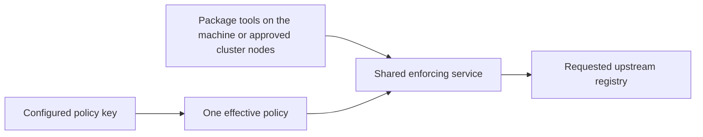

# Product: Package Firewall MVP (version 2 successor)

## Clarifications and decisions
| ID | Class | Status | Owning Gate | Target Gate | Question or disposition | Selected value or policy | Decision source |
|---|---|---|---|---|---|---|---|
| C1001 | user clarification | resolved | 1 | none | Which existing plans receive the Nora/Dozor ecosystem expansion? | All five: Package Firewall MVP, management server/portal, OSV intelligence, decision log delivery and rated load guard. Add the Nora-supported formats to protected registry downloads, including ecosystem identity, metadata and artifact policy enforcement, exact-request behavior and native-client checks. Existing npm/PyPI behavior remains a regression baseline. | user answer 2026-11-02 selecting all five plans; initial request to support every Nora format and reuse Nora/Dozor code where practical |
| C1002 | user clarification | resolved | 1 | none | Must package-manager and registry authentication compatibility be established before design? | Yes. Check every target client/registry against Probation's actual SSL/TLS and application-authentication mechanisms, separately for client-to-firewall, firewall-to-management and firewall-to-upstream connections; change the architecture where required rather than assume universal support. | user steering 2026-11-02: check whether all package managers and registries support the SSL auth currently used and whether architecture must change |
| C1003 | current-Gate decision | deferred | 1 | 2 | Which scoped policy API, client identity/enrollment, policy-source transition, transport and protocol contracts implement the selected C1006/C1008/C1009/C1015 client and policy-source outcomes? | Not selected at Gate 1. API-key authentication to the policy server and server-independent TOML operation are selected product outcomes; exact endpoints, mode switching, compatibility migration and client packaging require design; credential ownership is already selected in C1015. | Deferred to Gate 2 from C1006/C1008; user answer 2026-11-02 |
| C1004 | research fact | resolved | 1 | none | What exactly does Nora support, and what can be borrowed? | Seventeen format families, with differing proxy/hosted and policy capabilities. Nora and Dozor own code is MIT with notices to preserve; Dozor version matching is npm-only. Transport support is not proof of equivalent Probation policy or OSV coverage. | sf-research ANSWERED, [evidence/research-nora-dozor-reuse.md](../package-firewall-mvp/evidence/research-nora-dozor-reuse.md), pinned Nora 7a6cd780 and Dozor 93f1f091 |
| C1005 | research fact | resolved | 1 | none | Which current authentication contract must the expansion account for? | Selected organisation registry reads and writes require a unique client certificate identifying an active member and their current group. Legacy managed routes still use Basic/bearer API keys; firewall-to-management uses its own bearer token. This describes implemented baseline behavior. C1006/C1008 replace mandatory package-client certificate identity in the target design; registry isolation and upstream authorization remain requirements. The owning publishing-proxy plan is reopened. | sf-repo-view PARTIAL structural evidence, [evidence/repository-ecosystem-auth.md](../package-firewall-mvp/evidence/repository-ecosystem-auth.md); ../publishing-proxy/01-product.md C29–C35 |
| C1006 | user clarification | resolved | 1 | none | How should clients without native client-certificate support participate? | A locally installed client uses API-key authentication to the policy server. Native package managers no longer need a Probation TLS client certificate in the target design. The policy-server key stays distinct from upstream registry/publisher credentials. This replaces the certificate-forwarding-bridge proposal; C1009 selects local enforcement and direct registry traffic. | user answer, Gate 1 grilling Q2, 2026-11-02; ADR candidate |
| C1007 | research fact | resolved | 1 | none | Does every target standard client natively support the current certificate admission contract? | No universal native-client support. Cargo and Go client-certificate support remains proposed; multiple other clients or endpoint classes remain unknown. Documented certificate settings in other clients do not prove full install/publish/redirect coverage. The survey concerns the former certificate-only design; the new installed-client/API-key direction does not require native package-client mTLS. New interoperability remains unproven until its own runtime checks pass. | sf-research UNKNOWN, [../management-server/evidence/research-ecosystem-auth.md](../management-server/evidence/research-ecosystem-auth.md), 17-format primary-source matrix, 2026-11-02 |
| C1008 | user clarification | resolved | 1 | none | Must the backend remain usable without a policy server? | Yes. Preserve explicit self-hosted standalone deployment configured through TOML, without a central policy-server dependency, alongside managed operation using the local client and policy-server API key. Standalone is a selected deployment mode; this answer does not select automatic fallback after a managed authentication or network failure. | user answer, Gate 1 grilling Q2 follow-up, 2026-11-02 |
| C1009 | user clarification | resolved | 1 | none | Does the local client enforce policy and fetch directly from registries, or forward packages through a shared backend? | The installed client enforces policy locally and fetches package metadata/artifacts directly from the selected registries. No shared package-data backend is required for that managed-client path. The same enforcement engine remains usable as a standalone TOML-configured backend. API-key policy retrieval and registry credentials retain separate authority; credential custody and managed-mode bypass controls still require design. | user answer, Gate 1 grilling Q3, 2026-11-02: Enforce locally; fetch registries directly; ADR candidate |
| C1010 | research fact | resolved | 1 | none | What existing behavior supports standalone and optional managed operation? | Config.management is optional; absent management chooses TOML cooldown/OSV plus a separate blocklist file. Managed outages retain remembered central policy, not local TOML. Local API-key policy retrieval needs a scoped endpoint; a fleet token is not equivalent to a user/client policy key. Mode changes can weaken policy and need a selected trust model. PARTIAL structural evidence, not a tested new client. | sf-repo-view, [evidence/local-client-policy-modes.md](../package-firewall-mvp/evidence/local-client-policy-modes.md), 2026-11-02 |
| C1011 | research fact | resolved | 1 | none | Which Nora families have public distribution sources and meaningful firewall use cases? | Sixteen have concrete public sources, including Debian/APT and RPM repositories, Terraform providers/modules, ConanCenter and the Hugging Face model hub. Go uses a public mirror over source repositories. Raw is Nora hosted generic storage without a defined ecosystem upstream. Public existence alone does not establish equivalent policy coverage. | sf-research ANSWERED plus main-agent official APT/Terraform checks, [evidence/research-public-ecosystems.md](../package-firewall-mvp/evidence/research-public-ecosystems.md), 2026-11-02 |
| C1012 | user clarification | resolved | 1 | none | Should the expansion follow Nora format count blindly or check public-source firewall value? | Check every format for public distribution and a useful artifact-policy outcome before finalising scope. The user proposes omitting APT based on an absence-of-public-sources premise; C1011 corrects that premise. Final include/defer choices follow C1013, not the disproved premise. Existing npm/PyPI private-registry and publishing requirements are not removed by this research request. | user request 2026-11-02 to check APT, Terraform and other formats for public registries and firewall purpose |
| C1013 | user clarification | resolved | 1 | none | Which formats belong in this release? | C1027 amends the original ten-family Q5 selection: npm, PyPI, Maven, Go modules, Cargo, NuGet, RubyGems, Conan and Docker/OCI only. RubyGems is critical; CPAN is omitted. Terraform, Ansible Galaxy, APT, RPM, Hugging Face, Raw and unlisted Dart/Pub remain outside this release. | user Q5 selection, amended by user C1027 on2026-11-02 |
| C1027 | user clarification | resolved | 1 | none | Is CPAN required, and how important is RubyGems? | Omit CPAN from this release. RubyGems is critical and remains required; prioritize it as the first added ecosystem after the shared-service foundation. Current target is nine families: npm, PyPI, Maven, Go modules, Cargo, NuGet, RubyGems, Conan and Docker/OCI. Preserve all other selected deployment, policy, credential and acceptance outcomes. | user answer2026-11-02: RubyGems is critical; CPAN can be omitted; amends C1013 |
| C1022 | user clarification | resolved | 2 | none | Q11: For Kubernetes image pulls, is admission at the approved-cluster-node level sufficient, or must it distinguish individual workloads/namespaces? | Trust approved cluster nodes. Every workload on an approved node may use the common-policy service. Kubernetes permissions control who may deploy workloads and use private-registry credentials. The enforcement listener does not claim per-workload/namespace identity for node-runtime pulls. Preserve upstream credential authorization and restrict access to approved nodes through host/network controls. | user answer, Gate 2 grilling Q11, 2026-11-02; ADR candidate |
| C1021 | user clarification | resolved | 2 | none | Q10: Must package tools authenticate separately to the shared enforcement service, or is access controlled by host/cluster network restrictions? | No additional Probation login on package requests. Restrict machine deployment access to the local machine and cluster deployment access to explicitly permitted workloads through host/network controls. The organisation service key stays inside the service and authenticates only policy retrieval. Private registry credentials still authorize upstream operations separately. Every admitted caller receives the service policy selected in C1020. Exact transport, startup validation and deployment controls remain design obligations; this is not permission to expose an unrestricted proxy. | user answer, Gate 2 grilling Q10, 2026-11-02; ADR candidate |
| C1020 | user clarification | resolved | 2 | none | Q9: Does one shared enforcement service apply one policy to all callers, or can callers/workloads select different permitted group policies through it? | One policy per shared service, selected by an organisation service key attached to a group or the organisation under management C14/C15/C29. All callers of that service receive the same effective rules. The service holds its policy key and obtains updates from the policy server; caller registry credentials retain their separate authority under C1015. Individual caller/workload group-policy selection within this service is not selected. Explicit standalone operation retains its local policy authority. | user answer, Gate 2 grilling Q9, 2026-11-02 |
| C1019 | user clarification | resolved | 2 | none | Q8: Should the installed client run continuously per user, as a shared machine service, or only around an explicitly launched command? | Shared service for the whole machine. Also support a shared enforcement service per Kubernetes or other container-orchestration cluster. The service performs enforcement and fetches registries directly; the optional Linux policy server remains a separate policy authority. Per-user background service is not selected. Listener exposure, caller identity, credential isolation, runtime placement and availability require design; one logical cluster service does not select replica count or shared-storage semantics. | user answer, Gate 2 grilling Q8, 2026-11-02; ADR candidate |
| C1015 | user clarification | resolved | 1 | none | Where are upstream registry credentials configured? | In the package managers, by the user or CI job, not on the firewall. Preserve the existing credential-bearing publishing request path and upstream authorization. The firewall does not configure or manage registry credentials. Its separate service key authenticates policy retrieval only and is never sent to registries. This applies to managed and standalone operation. | user answer, Gate 1 grilling Q6, clarified explicitly 2026-11-02: credentials are configured in package managers, not on the firewall |
| C1016 | user clarification | resolved | 1 | none | Which operating systems must the installed client support in this release? | Linux, macOS and Windows. The local enforcing client must install, run and use the selected package/container workflows on all three; existing Linux/macOS build configuration is baseline evidence, not proof of new Windows or installed-client support. Exact architecture/install/lifecycle contracts are designed under C1003. | user answer, Gate 1 grilling Q7, 2026-11-02: Linux, macOS and Windows |
| C1017 | user clarification | resolved | 1 | none | Which operating systems must host the central policy server? | Linux only. Client support remains Linux, macOS and Windows. The optional standalone TOML backend remains a separate deployment mode; Linux-only policy-server scope does not remove cross-platform client requirements. | user steering 2026-11-02: Policy server only for Linux |
| C1018 | current-Gate decision | deferred | 1 | 2 | How are the selected cross-platform verification requirements implemented in GitHub Actions? | User requires GitHub Actions testing on Windows and macOS; include native Linux client coverage and Linux-only policy-server coverage. Runner/architecture choices, native-client test matrix, Docker engine placement, fixtures, secrets isolation and release gates are design obligations; build-only or cross-compilation evidence cannot be presented as runtime client compatibility. No YAML or runner configuration selected at Gate 1. | user instruction 2026-11-02 to use GitHub Actions to test Windows and macOS; exact implementation deferred to Gate 2 |
| C1024 | user clarification | resolved | 1 | none | Does the public-registry focus introduce a public/private split or change existing publishing credentials? | No. Handle requested registries the same way as public registries, using the existing forwarding and configured protection/freeze behavior. Registry credentials are configured in package managers, not on the firewall. Preserve the existing credential-bearing publishing request path and upstream publishing authorization. This clarification introduces no new public/private registry mode, removes no existing authentication behavior, and does not request an authentication redesign. Continue the previously selected machine/cluster service model and policy-key separation. | user correction, 2026-11-02: handle as public; credentials are already needed for publishing; no change to previous implementation; supersedes the assistant's public-only/authentication-exclusion interpretation |
| C1023 | research fact | resolved | 2 | none | What routing and admission limits apply to containerd image pulls through the shared cluster service? | Explicit service-as-server with pull/resolve and original-registry namespace is a documented candidate. Node connectivity, credential behavior and absence of fallback have not been runtime-verified by this report. C1024 preserves existing registry/publishing credential behavior; this research does not select an authentication redesign or a public/private split. New cluster routing/no-fallback still needs runtime verification. Cached images may not reach the service, so no execution-time revocation is claimed. | sf-research UNKNOWN, ../package-firewall-mvp/evidence/research-cluster-image-routing.md, 2026-11-02 |
| C1025 | user clarification | resolved | 2 | none | May safe-chain provide additional reuse input? | Yes: inspect AikidoSec/safe-chain for reusable logic alongside Nora/Dozor. Preserve the selected shared-service architecture and existing publishing credential path; this does not select a wrapper architecture, vendor feed or licence change. | user supplied https://github.com/AikidoSec/safe-chain on2026-11-02 |
| C1026 | research fact | resolved | 2 | none | What safe-chain logic and licence apply? | Pin c9ccceec379fc225e3c0fca0178e86ce4140aa2e. npm/PyPI metadata/direct-download/cache and URL test ideas are useful; code is AGPL-3.0-or-later/commercial. Current proposal uses independently authored scenarios/ideas, not copied source or tests. Fail-open feed/parse behavior, vendor authority and wrapper bypasses do not establish Probation guarantees. | sf-research ANSWERED, ../package-firewall-mvp/evidence/research-safe-chain-reuse.md |
| C1028 | user clarification | resolved | 2 | none | D2: When a caller fetches an artifact from a registry using its own package-manager credentials, may the shared cache serve those bytes to another admitted caller that has no such credentials? | No. Option A: reads made with caller credentials never populate or get served from the shared cache. Forwarding, publishing and credentials are unchanged (C1024); no public/private mode. Refusals are never cached across credential scopes. Verified in row 28 by a test that bytes obtained under credential A are never delivered to a request without an equivalent upstream authorization. | user answer 2026-11-04 (AskUserQuestion), sf-threat-model r2 T5; ADR candidate |
| C1029 | user clarification | resolved | 2 | none | D4: Must the FIX-16-A final release check also cover the OSV snapshot generation? | Yes. The final authorization binds the OSV snapshot generation as well as authority/policy generation; a response prepared under an older OSV generation is re-evaluated or refused before handoff. Implemented and tested in row 16. | user answer 2026-11-04 (AskUserQuestion), sf-threat-model r2 T4 |
| C2001 | current-Gate decision | resolved | 1 | none | Which plan owns the remaining work? | This plan owns slices 16-21 and 23-29 of the version 1 source plan. The source plan stays unchanged and is historical evidence. | sf-migrate-v2 on resume 2026-11-17 |
| C2002 | current-Gate decision | deferred | 1 | 2 | Does the delivered baseline (source slices 1-15) still match current source? | Verify the npm/PyPI baseline against current source before design approval; source-plan version 1 proofs are not version 2 publication receipts. Owner: design evidence in evidence/repository-structure.md. | sf-migrate-v2 step 1 |

## Source plan and baseline
- Source plan: `docs/plans/package-firewall-mvp` at repository commit `6c4b7fc30ab1ccda2ed61e0f8224a0c5d0ab9693`. Its Gates 1–4 were approved 2026-11-02 and 2026-11-04. Its scope, clarifications C1001–C1013 and C1015–C1029 (C1014 is not used by either plan) and decisions D2–D5 carry forward unchanged; D2 is C1028 and D4 is C1029, and D3 and D5 are defined with D1–D5 in [the source plan's second threat model](../package-firewall-mvp/evidence/threat-model-shared-service-r2.md) and its `02-architecture.md`.
- Delivered baseline: slices 1–15 of the source plan (the npm and PyPI firewall MVP, with real npm and pip installs, container image, operations README and benchmarks). Their version 1 proofs are historical (tracked as C2002). Verify the baseline against current source before design approval; version 1 proofs are not version 2 publication receipts.
- Remaining work: slices 16, 17, 18, 19, 20, 21, 23, 24, 25, 26, 27, 28, 29. The source plan has no slice 22.

## Requirement mapping
Every remaining source-plan requirement has a successor owner. Stable slice IDs are in `molecule-flow.json` `delivery.slices`.

| Source slice | Successor slice ID | Outcome |
|---|---|---|
| 16 | `fix-16-a` | Current managed authority before cached or downloaded artifact release on npm and PyPI routes |
| 28 | `service-policy` | Shared service policy API, enforcer activation, durable refusal, peer admission, login-free route |
| 29 | `spike-native-cluster` | Native-driver and containerd routing spike |
| 17 | `rubygems` | RubyGems protection with shared nine-family identities |
| 18 | `cargo` | Cargo sparse index and verified crate downloads |
| 19 | `go` | Go module protection |
| 20 | `nuget` | NuGet v3 protection |
| 21 | `maven` | Maven protected resolution |
| 23 | `conan` | Conan2 revision protection |
| 24 | `oci` | OCI tag, digest, index and blob protection |
| 25 | `native-lifecycle` | Machine-wide native lifecycle on three OSes |
| 26 | `cluster` | One cluster endpoint with approved-node trust |
| 27 | `acceptance` | Cross-plan portal, intelligence, decision and native-release acceptance |

The 54 source obligations carry over with owners `fix-16-a` (18 respond-order) and `service-policy` (36 snapshot and activation order), in `molecule-contracts.json`.

## Incorporated from the source plan
The source plan's approved product content applies to this plan unchanged and is restated below: the shared-service journey and acceptance, the success metric, and the non-goals. The source plan's product rules, domain model and cross-plan ownership sections (`docs/plans/package-firewall-mvp/01-product.md`) also carry forward by reference. Credential and privacy expectations (C1015, C1024, C1028) remain binding.

## Current shared-service journey and acceptance

An operator installs one shared enforcer for the whole machine or one logical service for a Kubernetes/other orchestration cluster (C1019). The service selects one common effective policy using its configured policy key (C1020). All admitted package tools and node-runtime requests use that policy; they do not choose a different user/group policy per request or need a separate Probation login (C1021). Organisation service keys select their existing organisation/group policy. Existing personal accounts, keys, policy inheritance, administration and publishing permissions remain product capabilities; this amendment does not delete them.

Machine access is restricted to the local machine. Cluster access trusts explicitly approved nodes, including every workload on an approved node; Kubernetes permissions control workload deployment and registry-secret use (C1022). The service does not claim authenticated workload/namespace/person identity for a node-runtime pull. Registry credentials remain configured in package managers, not on the firewall; publishing uses the existing upstream authorization path (C1015/C1024).

Acceptance must demonstrate two admitted callers receiving the same selected policy without a package-request Probation login, refusal of an unapproved host/node, and service-policy changes/refusal applying to all callers under the existing outage/propagation contract. Registry credentials stay in native tool configuration and existing publishing succeeds or refuses according to upstream permissions. Native Linux/macOS/Windows and genuine node-runtime checks remain required; previous builds, mocks or certificate tests do not establish the new behavior. Exact endpoints, service configuration and network enforcement belong to combined design under C1003/C1018.

These selected outcomes govern the release. Older per-request-policy-key and client-certificate setup narratives/mockups below are historical where superseded; their retained account, policy, isolation, publishing and audit guarantees still apply. They must not be used to put the policy-server key into package-manager registry configuration.

## Problem
Teams install packages from public registries and cannot refuse a held or blocked release before it reaches a build. Version 1 delivered this for npm and PyPI. The remaining work extends protection to the other selected registries and a shared service, and closes a gap where cached or downloaded artifacts could be released after authority was revoked.

## Success metric
The release acceptance matrix exercises the existing registry protection path and contains a real native-client allowed install/download for each of the eight package families and an allowed Docker image pull, using harmless controlled artifacts. It also exercises an exact blocked artifact and an artifact still in its configured waiting period for every family: **zero refused artifact bytes reach the native client**, including warm-cache downloads. Missing publication timestamps use the existing durable first-seen rule; the design must bind the rule to each format's immutable artifact identity.

Native GitHub Actions jobs must exercise installed-client setup, startup, policy authentication/update, existing package-manager credential handling and representative protected package requests on Linux, macOS and Windows. The Linux-only policy server keeps its own integration checks. Each selected family still needs an explicit native-client acceptance witness; native Docker-engine requirements and any platform-specific integration limits must be named and resolved in design rather than represented as a passing cross-compilation or mocked pull.

Where the protocol offers a version listing and the client permits a range, eligible older versions remain offered and the client keeps its own solver. Exact versions, frozen lockfiles and image tag/digest requests are never silently replaced, retagged or loosened to make a test succeed. Protocol-specific capabilities and absent advisory coverage are explicit; the format count does not imply identical OSV data or interchangeable metadata semantics.

Measured by: the install suite's pass count, plus the firewall's decision log for every delivered and refused file. Speed is a secondary bar, measured and reported rather than promised: a repeat request for something the firewall already knows answers in a few milliseconds.

## Non-goals
- Not proof a package is harmless. Passing the waiting period and the blocklist only means it passed those two checks.
- Does not replace package managers or their solvers. Native tools still decide compatibility and own lockfiles; Probation controls availability and artifact delivery.
- Never swaps in a different version or different bytes for an exact request. An exact request for a refused release fails.
- Does not reach packages already installed or already in a client's own cache, nor packages fetched from other indexes, Git or direct URLs, or local files.
- Does not scan package contents, run AI analysis or produce threat intelligence. It consumes configured policy/blocklist inputs and existing supported malicious-package intelligence; it does not claim absent advisory coverage is a clean verdict.
- The added formats cover protected package consumption and Docker image pulls. Existing npm/Python publishing and management workflows remain supported; new publishing/hosting capabilities for the other formats are outside this expansion.
- No generic artifact storage, OS-package management, infrastructure-module distribution or model-hosting feature is added. Existing portal/account/group policy capabilities remain; this is not a new desktop GUI.
- The policy server does not store or distribute the local client's upstream registry credentials. Registry credentials are configured in the package managers in standalone operation too, never on the firewall. API-key policy identity never substitutes for upstream publishing permission.
- Does not keep serving during an outage of the public registries by handing out stale listings.

## Announcement — the blog post before the feature
Package Firewall now protects nine package families, including Docker/OCI images, through one shared service. A held or blocked release is refused before any bytes are released, including from the cache. Installed clients on Linux, macOS and Windows use the same policy, and standalone mode without a policy server keeps working.

## Screens
No UI.
