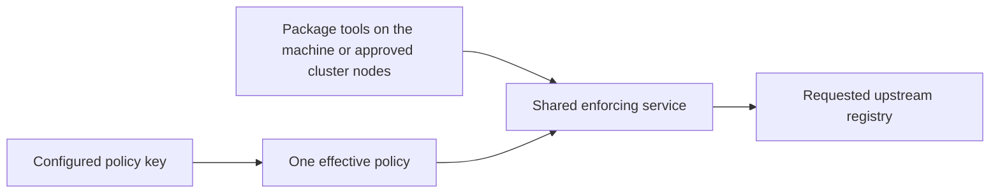
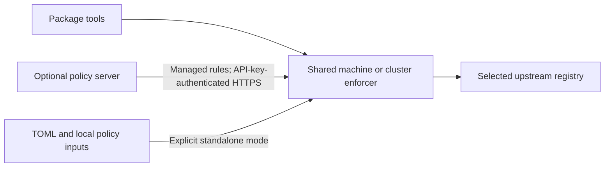
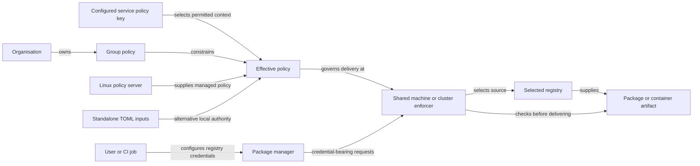

# Product: Package Firewall MVP

Source: `SPEC.md` sections 1, 2, 5–8 (product rules only), 11 (client-facing failures), 13 (completion). Everything technical in that file is deferred to Gates 2 and 3.

## Current release target

Handle requested registries using the existing public-registry forwarding and protection behavior, including the configured freeze/cooldown (C1024). Registry credentials remain configured in the package managers, not on the firewall; existing publishing requests and upstream authorization continue to work as before. This clarification introduces no public/private split or authentication redesign.

C1013 selects these nine families; this table supersedes the earlier Nora-wide expansion proposals. C1006/C1008/C1009 select a locally installed enforcer, direct upstream downloads, API-key authentication to an optional policy server, and explicit standalone TOML operation. C1015 keeps registry credentials in package-manager configuration, not on the firewall. C1016 selects Linux, macOS and Windows clients; C1017 limits the policy server to Linux; C1018 requires native GitHub Actions verification as a design obligation.

| Requested stack | Registry/protocol family |
|---|---|
| Node / npm | npm |
| Python / pip | PyPI |
| Java / Maven | Maven repositories |
| Go | Go modules |
| Rust | Cargo |
| .NET / NuGet | NuGet |
| Ruby | RubyGems |
| C/C++ / Conan | Conan |
| Docker | Docker/OCI container images |

Terraform, Ansible Galaxy, APT, RPM, Hugging Face and generic Raw hosting are outside this release. Dart/Pub is unlisted and deferred by the narrow scope default. A language name does not promise every alternative client/version for that ecosystem; design must name the supported native clients and executable acceptance matrix.

RubyGems is critical and is the first added ecosystem after the shared-service foundation. CPAN is omitted (C1027); no new CPAN adapter, policy options or acceptance lane is required.

## Clarifications and decisions

| ID | Class | Status | Owning Gate | Target Gate | Question or disposition | Selected value or policy | Decision source |
|---|---|---|---|---|---|---|---|
| C1001 | user clarification | resolved | 1 | none | Which existing plans receive the Nora/Dozor ecosystem expansion? | All five: Package Firewall MVP, management server/portal, OSV intelligence, decision log delivery and rated load guard. Add the Nora-supported formats to protected registry downloads, including ecosystem identity, metadata and artifact policy enforcement, exact-request behavior and native-client checks. Existing npm/PyPI behavior remains a regression baseline. | user answer 2026-11-02 selecting all five plans; initial request to support every Nora format and reuse Nora/Dozor code where practical |
| C1002 | user clarification | resolved | 1 | none | Must package-manager and registry authentication compatibility be established before design? | Yes. Check every target client/registry against Probation's actual SSL/TLS and application-authentication mechanisms, separately for client-to-firewall, firewall-to-management and firewall-to-upstream connections; change the architecture where required rather than assume universal support. | user steering 2026-11-02: check whether all package managers and registries support the SSL auth currently used and whether architecture must change |
| C1003 | current-Gate decision | deferred | 1 | 2 | Which scoped policy API, client identity/enrollment, policy-source transition, transport and protocol contracts implement the selected C1006/C1008/C1009/C1015 client and policy-source outcomes? | Not selected at Gate 1. API-key authentication to the policy server and server-independent TOML operation are selected product outcomes; exact endpoints, mode switching, compatibility migration and client packaging require design; credential ownership is already selected in C1015. | Deferred to Gate 2 from C1006/C1008; user answer 2026-11-02 |
| C1004 | research fact | resolved | 1 | none | What exactly does Nora support, and what can be borrowed? | Seventeen format families, with differing proxy/hosted and policy capabilities. Nora and Dozor own code is MIT with notices to preserve; Dozor version matching is npm-only. Transport support is not proof of equivalent Probation policy or OSV coverage. | sf-research ANSWERED, [evidence/research-nora-dozor-reuse.md](evidence/research-nora-dozor-reuse.md), pinned Nora 7a6cd780 and Dozor 93f1f091 |
| C1005 | research fact | resolved | 1 | none | Which current authentication contract must the expansion account for? | Selected organisation registry reads and writes require a unique client certificate identifying an active member and their current group. Legacy managed routes still use Basic/bearer API keys; firewall-to-management uses its own bearer token. This describes implemented baseline behavior. C1006/C1008 replace mandatory package-client certificate identity in the target design; registry isolation and upstream authorization remain requirements. The owning publishing-proxy plan is reopened. | sf-repo-view PARTIAL structural evidence, [evidence/repository-ecosystem-auth.md](evidence/repository-ecosystem-auth.md); ../publishing-proxy/01-product.md C29–C35 |
| C1006 | user clarification | resolved | 1 | none | How should clients without native client-certificate support participate? | A locally installed client uses API-key authentication to the policy server. Native package managers no longer need a Probation TLS client certificate in the target design. The policy-server key stays distinct from upstream registry/publisher credentials. This replaces the certificate-forwarding-bridge proposal; C1009 selects local enforcement and direct registry traffic. | user answer, Gate 1 grilling Q2, 2026-11-02; ADR candidate |
| C1007 | research fact | resolved | 1 | none | Does every target standard client natively support the current certificate admission contract? | No universal native-client support. Cargo and Go client-certificate support remains proposed; multiple other clients or endpoint classes remain unknown. Documented certificate settings in other clients do not prove full install/publish/redirect coverage. The survey concerns the former certificate-only design; the new installed-client/API-key direction does not require native package-client mTLS. New interoperability remains unproven until its own runtime checks pass. | sf-research UNKNOWN, [../management-server/evidence/research-ecosystem-auth.md](../management-server/evidence/research-ecosystem-auth.md), 17-format primary-source matrix, 2026-11-02 |
| C1008 | user clarification | resolved | 1 | none | Must the backend remain usable without a policy server? | Yes. Preserve explicit self-hosted standalone deployment configured through TOML, without a central policy-server dependency, alongside managed operation using the local client and policy-server API key. Standalone is a selected deployment mode; this answer does not select automatic fallback after a managed authentication or network failure. | user answer, Gate 1 grilling Q2 follow-up, 2026-11-02 |
| C1009 | user clarification | resolved | 1 | none | Does the local client enforce policy and fetch directly from registries, or forward packages through a shared backend? | The installed client enforces policy locally and fetches package metadata/artifacts directly from the selected registries. No shared package-data backend is required for that managed-client path. The same enforcement engine remains usable as a standalone TOML-configured backend. API-key policy retrieval and registry credentials retain separate authority; credential custody and managed-mode bypass controls still require design. | user answer, Gate 1 grilling Q3, 2026-11-02: Enforce locally; fetch registries directly; ADR candidate |
| C1010 | research fact | resolved | 1 | none | What existing behavior supports standalone and optional managed operation? | Config.management is optional; absent management chooses TOML cooldown/OSV plus a separate blocklist file. Managed outages retain remembered central policy, not local TOML. Local API-key policy retrieval needs a scoped endpoint; a fleet token is not equivalent to a user/client policy key. Mode changes can weaken policy and need a selected trust model. PARTIAL structural evidence, not a tested new client. | sf-repo-view, [evidence/local-client-policy-modes.md](evidence/local-client-policy-modes.md), 2026-11-02 |
| C1011 | research fact | resolved | 1 | none | Which Nora families have public distribution sources and meaningful firewall use cases? | Sixteen have concrete public sources, including Debian/APT and RPM repositories, Terraform providers/modules, ConanCenter and the Hugging Face model hub. Go uses a public mirror over source repositories. Raw is Nora hosted generic storage without a defined ecosystem upstream. Public existence alone does not establish equivalent policy coverage. | sf-research ANSWERED plus main-agent official APT/Terraform checks, [evidence/research-public-ecosystems.md](evidence/research-public-ecosystems.md), 2026-11-02 |
| C1012 | user clarification | resolved | 1 | none | Should the expansion follow Nora format count blindly or check public-source firewall value? | Check every format for public distribution and a useful artifact-policy outcome before finalising scope. The user proposes omitting APT based on an absence-of-public-sources premise; C1011 corrects that premise. Final include/defer choices follow C1013, not the disproved premise. Existing npm/PyPI private-registry and publishing requirements are not removed by this research request. | user request 2026-11-02 to check APT, Terraform and other formats for public registries and firewall purpose |
| C1013 | user clarification | resolved | 1 | none | Which formats belong in this release? | C1027 amends the original ten-family Q5 selection: npm, PyPI, Maven, Go modules, Cargo, NuGet, RubyGems, Conan and Docker/OCI only. RubyGems is critical; CPAN is omitted. Terraform, Ansible Galaxy, APT, RPM, Hugging Face, Raw and unlisted Dart/Pub remain outside this release. | user Q5 selection, amended by user C1027 on2026-11-02 |
| C1027 | user clarification | resolved | 1 | none | Is CPAN required, and how important is RubyGems? | Omit CPAN from this release. RubyGems is critical and remains required; prioritize it as the first added ecosystem after the shared-service foundation. Current target is nine families: npm, PyPI, Maven, Go modules, Cargo, NuGet, RubyGems, Conan and Docker/OCI. Preserve all other selected deployment, policy, credential and acceptance outcomes. | user answer2026-11-02: RubyGems is critical; CPAN can be omitted; amends C1013 |
| C1022 | user clarification | resolved | 2 | none | Q11: For Kubernetes image pulls, is admission at the approved-cluster-node level sufficient, or must it distinguish individual workloads/namespaces? | Trust approved cluster nodes. Every workload on an approved node may use the common-policy service. Kubernetes permissions control who may deploy workloads and use private-registry credentials. The enforcement listener does not claim per-workload/namespace identity for node-runtime pulls. Preserve upstream credential authorization and restrict access to approved nodes through host/network controls. | user answer, Gate 2 grilling Q11, 2026-11-02; ADR candidate |
| C1021 | user clarification | resolved | 2 | none | Q10: Must package tools authenticate separately to the shared enforcement service, or is access controlled by host/cluster network restrictions? | No additional Probation login on package requests. Restrict machine deployment access to the local machine and cluster deployment access to explicitly permitted workloads through host/network controls. The organisation service key stays inside the service and authenticates only policy retrieval. Private registry credentials still authorize upstream operations separately. Every admitted caller receives the service policy selected in C1020. Exact transport, startup validation and deployment controls remain design obligations; this is not permission to expose an unrestricted proxy. | user answer, Gate 2 grilling Q10, 2026-11-02; ADR candidate |
| C1020 | user clarification | resolved | 2 | none | Q9: Does one shared enforcement service apply one policy to all callers, or can callers/workloads select different permitted group policies through it? | One policy per shared service, selected by an organisation service key attached to a group or the organisation under management C14/C15/C29. All callers of that service receive the same effective rules. The service holds its policy key and obtains updates from the policy server; caller registry credentials retain their separate authority under C1015. Individual caller/workload group-policy selection within this service is not selected. Explicit standalone operation retains its local policy authority. | user answer, Gate 2 grilling Q9, 2026-11-02 |
| C1019 | user clarification | resolved | 2 | none | Q8: Should the installed client run continuously per user, as a shared machine service, or only around an explicitly launched command? | Shared service for the whole machine. Also support a shared enforcement service per Kubernetes or other container-orchestration cluster. The service performs enforcement and fetches registries directly; the optional Linux policy server remains a separate policy authority. Per-user background service is not selected. Listener exposure, caller identity, credential isolation, runtime placement and availability require design; one logical cluster service does not select replica count or shared-storage semantics. | user answer, Gate 2 grilling Q8, 2026-11-02; ADR candidate |
| C1015 | user clarification | resolved | 1 | none | Where are upstream registry credentials configured? | In the package managers, by the user or CI job, not on the firewall. Preserve the existing credential-bearing publishing request path and upstream authorization. The firewall does not configure or manage registry credentials. Its separate service key authenticates policy retrieval only and is never sent to registries. This applies to managed and standalone operation. | user answer, Gate 1 grilling Q6, clarified explicitly 2026-11-02: credentials are configured in package managers, not on the firewall |
| C1016 | user clarification | resolved | 1 | none | Which operating systems must the installed client support in this release? | Linux, macOS and Windows. The local enforcing client must install, run and use the selected package/container workflows on all three; existing Linux/macOS build configuration is baseline evidence, not proof of new Windows or installed-client support. Exact architecture/install/lifecycle contracts are designed under C1003. | user answer, Gate 1 grilling Q7, 2026-11-02: Linux, macOS and Windows |
| C1017 | user clarification | resolved | 1 | none | Which operating systems must host the central policy server? | Linux only. Client support remains Linux, macOS and Windows. The optional standalone TOML backend remains a separate deployment mode; Linux-only policy-server scope does not remove cross-platform client requirements. | user steering 2026-11-02: Policy server only for Linux |
| C1018 | current-Gate decision | deferred | 1 | 2 | How are the selected cross-platform verification requirements implemented in GitHub Actions? | User requires GitHub Actions testing on Windows and macOS; include native Linux client coverage and Linux-only policy-server coverage. Runner/architecture choices, native-client test matrix, Docker engine placement, fixtures, secrets isolation and release gates are design obligations; build-only or cross-compilation evidence cannot be presented as runtime client compatibility. No YAML or runner configuration selected at Gate 1. | user instruction 2026-11-02 to use GitHub Actions to test Windows and macOS; exact implementation deferred to Gate 2 |
| C1024 | user clarification | resolved | 1 | none | Does the public-registry focus introduce a public/private split or change existing publishing credentials? | No. Handle requested registries the same way as public registries, using the existing forwarding and configured protection/freeze behavior. Registry credentials are configured in package managers, not on the firewall. Preserve the existing credential-bearing publishing request path and upstream publishing authorization. This clarification introduces no new public/private registry mode, removes no existing authentication behavior, and does not request an authentication redesign. Continue the previously selected machine/cluster service model and policy-key separation. | user correction, 2026-11-02: handle as public; credentials are already needed for publishing; no change to previous implementation; supersedes the assistant's public-only/authentication-exclusion interpretation |

## Current shared-service journey and acceptance

An operator installs one shared enforcer for the whole machine or one logical service for a Kubernetes/other orchestration cluster (C1019). The service selects one common effective policy using its configured policy key (C1020). All admitted package tools and node-runtime requests use that policy; they do not choose a different user/group policy per request or need a separate Probation login (C1021). Organisation service keys select their existing organisation/group policy. Existing personal accounts, keys, policy inheritance, administration and publishing permissions remain product capabilities; this amendment does not delete them.

Machine access is restricted to the local machine. Cluster access trusts explicitly approved nodes, including every workload on an approved node; Kubernetes permissions control workload deployment and registry-secret use (C1022). The service does not claim authenticated workload/namespace/person identity for a node-runtime pull. Registry credentials remain configured in package managers, not on the firewall; publishing uses the existing upstream authorization path (C1015/C1024).

Acceptance must demonstrate two admitted callers receiving the same selected policy without a package-request Probation login, refusal of an unapproved host/node, and service-policy changes/refusal applying to all callers under the existing outage/propagation contract. Registry credentials stay in native tool configuration and existing publishing succeeds or refuses according to upstream permissions. Native Linux/macOS/Windows and genuine node-runtime checks remain required; previous builds, mocks or certificate tests do not establish the new behavior. Exact endpoints, service configuration and network enforcement belong to combined design under C1003/C1018.

These selected outcomes govern the release. Older per-request-policy-key and client-certificate setup narratives/mockups below are historical where superseded; their retained account, policy, isolation, publishing and audit guarantees still apply. They must not be used to put the policy-server key into package-manager registry configuration.

## Problem
"My developers and CI jobs install whatever was published a minute ago. When a popular package gets hijacked, we install the bad release hours before any malware feed names it. If I just refuse new releases, installs break even though last week's release would have worked fine. And when a feed finally does name a bad package, nothing stops the next machine from downloading it again."

Who has it: developers and CI jobs consuming third-party packages or container images in the nine selected families, plus operators who want the same enforcement engine as a standalone self-hosted backend. Managed installations obtain the API key's permitted policy from the central server; standalone installations use local TOML and configured policy inputs.

## Success metric
The release acceptance matrix exercises the existing registry protection path and contains a real native-client allowed install/download for each of the eight package families and an allowed Docker image pull, using harmless controlled artifacts. It also exercises an exact blocked artifact and an artifact still in its configured waiting period for every family: **zero refused artifact bytes reach the native client**, including warm-cache downloads. Missing publication timestamps use the existing durable first-seen rule; the design must bind the rule to each format's immutable artifact identity.

Native GitHub Actions jobs must exercise installed-client setup, startup, policy authentication/update, existing package-manager credential handling and representative protected package requests on Linux, macOS and Windows. The Linux-only policy server keeps its own integration checks. Each selected family still needs an explicit native-client acceptance witness; native Docker-engine requirements and any platform-specific integration limits must be named and resolved in design rather than represented as a passing cross-compilation or mocked pull.

Where the protocol offers a version listing and the client permits a range, eligible older versions remain offered and the client keeps its own solver. Exact versions, frozen lockfiles and image tag/digest requests are never silently replaced, retagged or loosened to make a test succeed. Protocol-specific capabilities and absent advisory coverage are explicit; the format count does not imply identical OSV data or interchangeable metadata semantics.

Measured by: the install suite's pass count, plus the firewall's decision log for every delivered and refused file. Speed is a secondary bar, measured and reported rather than promised: a repeat request for something the firewall already knows answers in a few milliseconds.

## Non-goals
- Not proof a package is harmless. Passing the waiting period and the blocklist only means it passed those two checks.
- Does not replace package managers or their solvers. Native tools still decide compatibility and own lockfiles; Probation controls availability and artifact delivery.
- Never swaps in a different version or different bytes for an exact request. An exact request for a refused release fails.
- Does not reach packages already installed or already in a client's own cache, nor packages fetched from other indexes, Git or direct URLs, or local files.
- Does not scan package contents, run AI analysis or produce threat intelligence. It consumes configured policy/blocklist inputs and existing supported malicious-package intelligence; it does not claim absent advisory coverage is a clean verdict.
- The added formats cover protected package consumption and Docker image pulls. Existing npm/Python publishing and management workflows remain supported; new publishing/hosting capabilities for the other formats are outside this expansion.
- No generic artifact storage, OS-package management, infrastructure-module distribution or model-hosting feature is added. Existing portal/account/group policy capabilities remain; this is not a new desktop GUI.
- The policy server does not store or distribute the local client's upstream registry credentials. Registry credentials are configured in the package managers in standalone operation too, never on the firewall. API-key policy identity never substitutes for upstream publishing permission.
- Does not keep serving during an outage of the public registries by handing out stale listings.

## Announcement — the blog post before the feature
Probation protects package downloads and Docker image pulls through a locally installed process. Your package tools keep their normal jobs; Probation applies the selected age, block and integrity rules before delivering artifacts. The client fetches directly from the selected registries. It can obtain organisation/group policy from an optional server using a policy API key, while registry credentials stay with the user or CI job. The same backend can run independently using TOML and local policy inputs. This release targets npm, PyPI, Maven, Go modules, Cargo, NuGet, RubyGems, Conan and Docker/OCI; exact requests are refused when disallowed, never silently substituted.

## Screens
No new desktop GUI. Reuse the existing CLI/configuration validation, refusal messages, health signals and decision logs. The existing management portal's client setup, policy and registry choices must reflect the selected nine families, API-key enrollment and client-owned credentials; the management and publishing plans own those screens.

## Product rules the later gates must keep
| Situation | What the user sees |
| --- | --- |
| Newest release is too young | An older acceptable release is offered instead. |
| Dependency allows a range | The client picks among the releases still offered, under its own original rules. |
| Exact release is too young or blocked | Refused, with a reason; for the waiting period, also when it becomes available. |
| Frozen lockfile names a blocked file | The download is refused; the lockfile is never rewritten. |
| Nothing acceptable is left | The install fails; requirements are never loosened. |
| A release finishes its wait | It becomes available on its own, on the next request. |
| An already-delivered file becomes blocked | Later downloads are refused, including through links handed out earlier. |
| Standalone blocklist missing or past its expiry | Standalone delivery stops until a valid list is present; an empty valid list is allowed. Managed installations use their effective central policy rather than the local blocklist file. |
| A bad replacement blocklist is dropped in | The last good one keeps working and the problem is logged. |
| Python: a new file is added to an old release | The new file serves its own wait; it does not inherit the old release's age. |
| JavaScript: the "latest" label points at a hidden release | "latest" moves to the newest acceptable stable release at or below it; other labels pointing at hidden releases are dropped, not guessed. |
| A release has no publication time | The firewall's own first sighting starts the clock, and a restart does not reset it. |
| Known malware | Refused under the applicable effective policy unless an explicitly permitted policy exception lifts that check. Age, popularity, cache state and lockfiles do not grant exceptions. |

Managed policy inheritance and exception permissions remain those of the management-server plan. The existing publishing-proxy C35 canonical npm token-packument metadata exception remains explicit; it never exempts artifact downloads or grants upstream write permission. This expansion must preserve those accepted boundaries while replacing certificate identity and shared-backend credential custody.

## Open product questions (resolved 2026-09-17: approved as drafted — name "Package Firewall"; reliability metric is the headline, speed measured and reported)
1. Product name: the specification says "Package Firewall"; the repository is named `osprey`. This document uses "Package Firewall" throughout.
2. The specification's speed targets are treated here as measured-and-reported, not as the success metric. Say so if a speed number should be the headline instead.

## Nora ecosystem expansion — scope amendment in progress

C1001–C1003 record the user's 2026-11-02 direction. Earlier npm/PyPI scope and measurements describe the delivered baseline. The pinned format/reuse inventory and current authentication evidence are recorded in C1004–C1005. External client authentication findings and remaining UNKNOWNs are recorded in C1007; C1006/C1008 record the selected local-client, policy-server API-key and standalone TOML direction. C1009 records the selected local-enforcement/direct-registry data path. The user now requests a public-source and firewall-value audit before finalising the format list. Design and implementation for the expansion are pending.

### Nora reference inventory — release target selected in C1013

Docker/OCI, Maven, npm, PyPI, Cargo, Go modules, Raw, RubyGems, Terraform providers/modules, Ansible Galaxy collections, NuGet, Pub (Dart/Flutter), Conan, CPAN, RPM, Debian/APT and Hugging Face Hub models. Helm OCI is included under OCI; Chocolatey and PowerShell Gallery are aliases under NuGet. This reference inventory follows pinned Nora source. C1013 now selects nine named package/container families for this release; this seventeen-family reference inventory does not expand that selection.

Raw is hosted-only in Nora; broader Raw behavior is unselected. Terraform source escapes, RPM/APT coordinate-policy gaps, missing upstream timestamps/digests and OSV data gaps must receive explicit dispositions before expanded protection can be promised. Existing npm/PyPI publishing, registry isolation and group-policy outcomes remain requirements. Mandatory package-client certificate identity is superseded for the new design by C1006/C1008; the owning publishing-proxy plan is reopened. Its historical certificate implementation is not the target authentication contract.

### Installed client and optional central policy — selected direction

C1006 selects an installed client and API-key authentication to the policy server. C1008 preserves a self-hosted registry backend that runs without that policy server from TOML. The package manager must not need a Probation client certificate or the policy-server API key in its registry requests. Existing upstream publishing credentials retain their own meaning and permissions.

| Mode | Policy authority | Required central policy server |
|---|---|---|
| Managed installation | Policy selected through the local client's API-key-authenticated policy-server connection; existing organisation/group policy constraints remain | Yes for enrollment and policy updates; reuse the last known policy during an outage under the existing management C19/C20 contract |
| Explicit standalone installation | Local TOML settings and configured local policy/blocklist inputs | No |

The policy server runs on Linux only; the installed client targets Linux, macOS and Windows. Existing management-server C19/C20 remain the managed-mode outage/propagation baseline: known cached policy may continue while the server is unavailable, unknown new keys cannot acquire policy, and reachable-server changes/revocations propagate within the configured interval (one minute by default). A managed outage never selects weaker standalone TOML policy. Revocation during an outage remains delayed until communication returns, as previously accepted in C19; the former certificate-specific per-request issuer checks are superseded for this API-key client model.

The current source implements TOML cooldown/OSV options plus a separate JSON blocklist, not Nora's whole TOML policy schema. C1008 preserves server-independent operation; it does not silently select a new schema or convert a managed outage into standalone mode. Those are C1003 design obligations.

### Selected local-enforcement journey — C1009 / Q3

The user-selected placement runs registry filtering and artifact checks inside the installed process, with direct registry traffic. The same engine remains usable for standalone self-hosted deployment. The product direction is selected; implementation contracts, compatibility and Gate approval remain pending.

The two policy-source arrows are alternative modes. Native tools keep their own version solving and publishing authorization; the local process would own metadata/artifact checks, cache and decision records. Moving those responsibilities to a device changes trust and credential custody: local administrators may bypass or modify local enforcement, and a local process cannot keep an upstream secret inaccessible to that host's administrator. C1009 selects local enforcement; C1015/C1024 settle package-manager credential custody and C1021/C1022 settle host/approved-node trust; technical transport controls remain design work. Device/network policy remains necessary where an organisation requires enforced use.

The selected managed journey is an operator installing the machine/cluster shared service, configuring its one policy key, and admitted package tools using that common policy without a separate Probation login. Approved cluster nodes can pull for any workload they run; Kubernetes permissions govern deployment and registry-secret use. One standalone journey is an operator deploying the backend with TOML and local policy inputs, without accounts or a policy server. Neither journey is runtime-tested for the new design.

## Cross-plan product ownership

This scope amendment reaches all five selected plans and the dependent certificate-owning publishing plan. The decisions above describe one release; they do not claim the older implementations or checks already satisfy it.

| Owner | Required release outcome |
|---|---|
| Package Firewall MVP | Protect the nine selected native package/image download paths through the local enforcer and retain explicit standalone TOML operation. |
| Management server and portal | Linux policy server; existing accounts, service keys, organisations, groups, inheritance and permitted exceptions; API-key local-client enrollment/policy updates; nine-family policy/registry choices. Registry credentials remain in each package manager's configuration. Existing API-key administration and group-policy screens are reused; certificate-only setup/provider flows are retired through the approved migration. |
| OSV intelligence | Retain existing malicious-package-only, additive intelligence and enforce/diagnostic/off behavior. Report format/data coverage explicitly. A format without a supported OSV identity/feed is not advertised as OSV-covered or malware-free. |
| Decision log delivery | Identify the selected registry, ecosystem, package/image version or digest and policy result consistently, preserving timestamps, secret exclusion, opt-in consumer identity and non-blocking counted delivery loss. |
| Rated load guard | Recheck record memory/accounting and delivery measurements for the new identities and local-client workload; retain the existing separate shedding signal and readiness meaning. Old delivery benchmarks are not new client or registry-throughput proof. |
| Transparent publishing | Preserve existing npm/Python publishing and management through the selected local registry endpoint, plus registry isolation, upstream write authorization and the explicit canonical npm metadata exception. Replace package-client certificate identity and shared-backend read-secret custody with the selected API-key/local-credential model. New write/hosting operations for other formats are outside this expansion. |

### Existing portal surfaces

The expansion reuses API-key administration, account/group policy and selected-registry administration. Their content must show the nine selected families, Linux/macOS/Windows client setup, Linux policy-server deployment and local registry-credential instructions. No desktop GUI or new account/membership flow is required. Existing account/role/SSO/retention guarantees remain. Certificate issuance, issuer-provider configuration and certificate setup downloads describe the historical baseline; their replacement setup content and migration must be shown in the design review before implementation.

### Domain model and reviewed decision sources

Existing domain language suffices: a member or service key belongs to a policy context; the effective policy governs access to artifacts from a deliberately selected registry. This revision changes where enforcement and credentials live, not the ownership of organisation/group policy or upstream publishing authority.

The managed and standalone authority paths are alternatives. The API key and upstream credentials identify different authorities and are never interchangeable. A device administrator can modify or bypass local enforcement; existing management C30 device/network controls remain the organisation's way to require use, rather than a new claim that an untrusted local administrator cannot bypass a local process. Product selections are recorded in C1006/C1008/C1009/C1013/C1015–C1018; detailed interfaces, capability mappings, failure behavior and executable per-platform/per-format checks remain combined-design work under C1003/C1018.

## Public-source scope review — 2026-11-02

Q3 / C1009 is resolved: local enforcement and direct registry downloads. C1011 records the public-source inventory; C1013 / Q5 selects the nine named package/container families for this release. APT/RPM do have public repositories and Terraform has a public provider/module registry. Proposed deferrals reflect artifact-policy and product scope, not nonexistent public sources. The full seventeen-family source table and proposed thirteen-family target are in ../package-firewall-mvp/evidence/research-public-ecosystems.md. C1015 / Q6 selects client-owned private-registry credentials; it resolves the earlier interrupted Q4 topic. Registry credentials remain in package-manager configuration; the scoped policy API remains C1003 design work.

## Selected release inventory and credential custody — 2026-11-02

C1013 resolves Q5 with nine named families: npm, PyPI, Maven, Go modules, Cargo, NuGet, RubyGems, Conan and Docker/OCI. Previous thirteen/sixteen/seventeen-format proposals are historical research, not the release target. Terraform, Galaxy, APT/RPM, model hubs and Raw hosting are out. Unlisted Dart/Pub is deferred as the narrow release default. C1015 resolves Q6 with user/CI-owned private-registry credentials; the policy server does not distribute organisation registry secrets. Keep the installed client, local enforcement/direct registry traffic, API-key policy connection and explicit TOML standalone mode selected in C1006/C1008/C1009. Expanded-format and new client/platform behavior remains unimplemented and requires revised approval/checks.

## Selected deployment and CI targets — 2026-11-02

Q7/C1016 is resolved: the installed enforcer supports Linux, macOS and Windows. C1017 limits the policy server to Linux only. C1018 carries the user's GitHub Actions testing requirement into design: native client setup/runtime/package checks on the supported OSes and Linux policy-server integration, with explicit coverage rather than treating a binary build as compatibility proof. Docker and other runner limitations must remain visible until an executable check supplies the promised coverage. No client compatibility test or CI workflow change has run yet.
