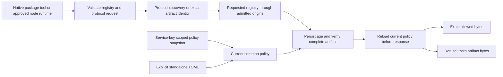

# Program Design: Package Firewall MVP

## Active revision — shared enforcer and nine protocol families (2026-11-02)

This section is the current combined-design draft. The earlier declarations below record the delivered npm/PyPI baseline and historical revisions; their greenfield, no-source, certificate-admission and dependency-inventory statements are not a description of the current checkout. Existing implementation is grounded in evidence/design-service-policy-api.md and evidence/design-deployment-contract.md. Repository evidence (2026-11-04): the working tree at HEAD 8d9f5e3 already holds uncommitted, unreviewed prototype source and tests written on 2026-11-03, before this design was approved: untracked src/managed/service_policy.rs (including PolicyPublicationGate), src/http/service_registry.rs, src/http/service_unpublish.rs, crates/probation-server/src/service_policy.rs, tests/managed_delivery_authority.rs, tests/shared_service.rs, tests/service_policy_cache.rs and crates/probation-server/tests/service_policy_api.rs, plus edits to src/artifacts, src/http, src/managed, src/store, config and E2E fixtures. Its author and review status are unrecorded. Treatment (a non-destructive default applied when the user declined to choose; the user may overrule it): it is a prototype to review, neither discarded nor treated as delivered. Rows 16 and 28 verify, correct and complete it, and the approved design governs. Fail-first witness: run each row's named new tests in a scratch worktree on disk at the baseline commit (never /tmp), with the row's test files copied in and the prototype's production changes absent; each must fail there by assertion, and a test that passes there is rewritten. A compile error does not count as failing first: a new seam (barrier hook, OSV generation read, poison hook, test read-hold) is first compiled as a stub that preserves today's behaviour, so the test fails on its assertion at baseline. Gate ownership: PolicyPublicationGate moves to a new src/managed/publication_gate.rs delivered by row 16. Nothing in the prototype is deleted before row review. New approval requires current QA, model/source checks and the bound design presentation.

## Clarifications and decisions

| ID | Class | Status | Owning Gate | Target Gate | Question or disposition | Selected value or policy | Decision source |
|---|---|---|---|---|---|---|---|
| C1003 | current-Gate decision | resolved | 1 | none | Which scoped policy API, client identity/enrollment, policy-source transition, transport and protocol contracts implement C1006/C1008 for the selected C1009 local-enforcement/direct-registry data path? | Not selected at Gate 1. API-key authentication to the policy server and server-independent TOML operation are selected product outcomes; exact endpoints, mode switching, compatibility migration and client packaging require design; credential ownership is already selected in C1015. RESOLVED by the combined design (user-approved 2026-11-04): scoped GET /api/v1/policy/snapshot with an organisation service key (03-program-design.md shared-service API), no package-request login, durable refusal, standalone TOML retained; delivered by rows 16 and 28. | Deferred to Gate 2 from C1006/C1008; user answer 2026-11-02 |
| C1018 | current-Gate decision | resolved | 1 | none | How are the selected cross-platform verification requirements implemented in GitHub Actions? | User requires GitHub Actions testing on Windows and macOS; include native Linux client coverage and Linux-only policy-server coverage. Runner/architecture choices, native-client test matrix, Docker engine placement, fixtures, secrets isolation and release gates are design obligations; build-only or cross-compilation evidence cannot be presented as runtime client compatibility. No YAML or runner configuration selected at Gate 1. RESOLVED by the combined design (user-approved 2026-11-04): ordinary native Linux/macOS/Windows jobs, Desktop and cluster lanes and the pinned baseline in 03-program-design.md; early probe row 29, lifecycle row 25, cluster row 26, acceptance row 27. | user instruction 2026-11-02 to use GitHub Actions to test Windows and macOS; exact implementation deferred to Gate 2 |
| C1019 | user clarification | resolved | 2 | none | Q8: Should the installed client run continuously per user, as a shared machine service, or only around an explicitly launched command? | Shared service for the whole machine. Also support a shared enforcement service per Kubernetes or other container-orchestration cluster. The service performs enforcement and fetches registries directly; the optional Linux policy server remains a separate policy authority. Per-user background service is not selected. Listener exposure, caller identity, credential isolation, runtime placement and availability require design; one logical cluster service does not select replica count or shared-storage semantics. | user answer, Gate 2 grilling Q8, 2026-11-02; ADR candidate |
| C1020 | user clarification | resolved | 2 | none | Q9: Does one shared enforcement service apply one policy to all callers, or can callers/workloads select different permitted group policies through it? | One policy per shared service, selected by an organisation service key attached to a group or the organisation under management C14/C15/C29. All callers of that service receive the same effective rules. The service holds its policy key and obtains updates from the policy server; caller registry credentials retain their separate authority under C1015. Individual caller/workload group-policy selection within this service is not selected. Explicit standalone operation retains its local policy authority. | user answer, Gate 2 grilling Q9, 2026-11-02 |
| C1021 | user clarification | resolved | 2 | none | Q10: Must package tools authenticate separately to the shared enforcement service, or is access controlled by host/cluster network restrictions? | No additional Probation login on package requests. Restrict machine deployment access to the local machine and cluster deployment access to explicitly permitted workloads through host/network controls. The organisation service key stays inside the service and authenticates only policy retrieval. Private registry credentials still authorize upstream operations separately. Every admitted caller receives the service policy selected in C1020. Exact transport, startup validation and deployment controls remain design obligations; this is not permission to expose an unrestricted proxy. | user answer, Gate 2 grilling Q10, 2026-11-02; ADR candidate |
| C1022 | user clarification | resolved | 2 | none | Q11: For Kubernetes image pulls, is admission at the approved-cluster-node level sufficient, or must it distinguish individual workloads/namespaces? | Trust approved cluster nodes. Every workload on an approved node may use the common-policy service. Kubernetes permissions control who may deploy workloads and use private-registry credentials. The enforcement listener does not claim per-workload/namespace identity for node-runtime pulls. Preserve upstream credential authorization and restrict access to approved nodes through host/network controls. | user answer, Gate 2 grilling Q11, 2026-11-02; ADR candidate |
| C1023 | research fact | resolved | 2 | none | What routing and admission limits apply to containerd image pulls through the shared cluster service? | Explicit service-as-server with pull/resolve and original-registry namespace is a documented candidate. Node connectivity, credential behavior and absence of fallback have not been runtime-verified by this report. C1024 preserves existing registry/publishing credential behavior; this research does not select an authentication redesign or a public/private split. New cluster routing/no-fallback still needs runtime verification. Cached images may not reach the service, so no execution-time revocation is claimed. | sf-research UNKNOWN, evidence/research-cluster-image-routing.md, 2026-11-02 |
| C1024 | user clarification | resolved | 1 | none | Does the public-registry focus introduce a public/private split or change existing publishing credentials? | No. Handle requested registries the same way as public registries, using the existing forwarding and configured protection/freeze behavior. Registry credentials are configured in package managers, not on the firewall. Preserve the existing credential-bearing publishing request path and upstream publishing authorization. This clarification introduces no new public/private registry mode, removes no existing authentication behavior, and does not request an authentication redesign. Continue the previously selected machine/cluster service model and policy-key separation. | user correction, 2026-11-02: handle as public; credentials are already needed for publishing; no change to previous implementation; supersedes the assistant's public-only/authentication-exclusion interpretation |
| C1025 | user clarification | resolved | 2 | none | May safe-chain provide additional reuse input? | Yes: inspect AikidoSec/safe-chain for reusable logic alongside Nora/Dozor. Preserve the selected shared-service architecture and existing publishing credential path; this does not select a wrapper architecture, vendor feed or licence change. | user supplied https://github.com/AikidoSec/safe-chain on2026-11-02 |
| C1026 | research fact | resolved | 2 | none | What safe-chain logic and licence apply? | Pin c9ccceec379fc225e3c0fca0178e86ce4140aa2e. npm/PyPI metadata/direct-download/cache and URL test ideas are useful; code is AGPL-3.0-or-later/commercial. Current proposal uses independently authored scenarios/ideas, not copied source or tests. Fail-open feed/parse behavior, vendor authority and wrapper bypasses do not establish Probation guarantees. | sf-research ANSWERED, evidence/research-safe-chain-reuse.md |
| C1027 | user clarification | resolved | 1 | none | Is CPAN required, and how important is RubyGems? | Omit CPAN from this release. RubyGems is critical and remains required; prioritize it as the first added ecosystem after the shared-service foundation. Current target is nine families: npm, PyPI, Maven, Go modules, Cargo, NuGet, RubyGems, Conan and Docker/OCI. Preserve all other selected deployment, policy, credential and acceptance outcomes. | user answer2026-11-02: RubyGems is critical; CPAN can be omitted; amends C1013 |

### Clarifications carried from architecture

C1003/C1018 are the owning design obligations. C1019–C1022 select a machine-wide/cluster service, one organisation service-key policy, no downstream Probation login and approved-node trust. C1015/C1024 settle registry credentials: configured in package managers, forwarded on the existing publishing path, no firewall credential configuration, public/private mode or credential redesign. Existing domain vocabulary suffices; this changes deployment and supported protocols rather than policy ownership.

### Purpose and caller scenario

A developer or node runtime requests an artifact through the shared service. The service selects the deliberately configured registry, obtains its one effective policy from the optional Linux policy server (or explicit standalone TOML), filters eligible discovery candidates where applicable and either supplies the exact verified artifact or refuses it. Native solvers/lockfiles remain authoritative about requested versions. Publishing uses existing package-manager credentials and upstream authorization.



### Owners and interface contracts

Use the existing shared policy crate, resolver, cache/store, transports, SingleFlight, artifact verification and API error mapping. Each protocol keeps its parsing/rendering inside its own module; a universal protocol plug-in framework is unnecessary. A new shared-service HTTP module owns common-policy request admission and final response handoff; it calls existing/new protocol owners. The policy-server endpoint and the enforcer's managed snapshot owner are separate modules because they own different trust/state lifetimes.

The declarations below are proposed Rust interfaces, not installed APIs. Their semantic contracts are checked by runtime/API tests and review. Supplementary SMTC dominance checks establish only their named call-order subset; same-value, successful validation, atomicity and concurrency are not inferred from those checks.

```rust
// crates/probation-server/src/service_policy.rs
// Existing service key authenticates this read-only request. No caller org/place
// selector grants authority. One transaction binds standing, chain and registries.
pub async fn snapshot(/* existing request/server dependencies */)
    -> Result<ServicePolicySnapshot, PolicyApiError>;

// Private to the server module; only successful live service-key validation
// constructs this scope. It carries the derived key/org/chain, not caller org data.
struct ServiceScope { /* existing KeyId, OrgId, ChainLink fields */ }
fn require_live_service_scope(/* authenticated key + transaction */)
    -> Result<ServiceScope, PolicyApiError>;
async fn load_policy_snapshot(scope: ServiceScope /* same transaction */)
    -> Result<ServicePolicySnapshot, PolicyApiError>;

// Shared wire ownership: probation-policy API. Reuse the exact existing policy
// layer/chain/rate types. Registry descriptors contain no upstream credentials.
pub struct ServicePolicySnapshot {
    pub version: u32,
    pub key_id: KeyId,
    pub org: OrgId,
    pub place_chain: Vec<ChainLink>,
    pub layers: Vec<PlaceLayer>,
    pub revision: u64,
    pub account: PlaceRef,
    pub rate_limit: Option<std::num::NonZeroU32>,
    pub rate_limit_source: LimitSource,
    pub registries: Vec<RegistryDescriptor>,
}
pub struct RegistryDescriptor {
    pub registry: RegistryId,
    pub ecosystem: Ecosystem,
    pub target_url: Option<String>,
    pub trusted: bool,
    pub registry_private_cidrs: Vec<String>,
    pub deletion_scopes: Vec<RegistryDeletionScope>,
}

// src/managed/service_policy.rs
// Owns config binding, current/remembered policy and durable refusal. Full replies
// are validated before one atomic activation. It never changes mode on an outage.
async fn activate(&self, /* received reply + configured service identity */) // crate-private; ordering anchored at the synchronous activation_order guard in src/managed/order_guards.rs
    -> Result<(), ServicePolicyError>;

// src/http/service_registry.rs
// Owns the complete response lifetime: registry binding, protocol dispatch,
// verified preparation, current-policy recheck, then response release. Credential
// forwarding remains in existing named publishing operations, not global headers.
pub async fn respond(/* App + selected registry + native request */)
    -> Result<axum::response::Response, ApiError>;
```

Snapshot route: GET /api/v1/policy/snapshot with the configured organisation service key as bearer authentication. Reject missing/malformed/unknown/revoked/wrong-kind keys with401, suspended authority with403, fetch-budget exhaustion with429, unusable storage with503. Registry model: the server returns every registry descriptor the key's organisation owns and accepts no selector; the enforcer filters to the registry IDs in its own configuration. A configured ID absent from a valid snapshot (removed or foreign) degrades only that registry (refused, readiness degraded) and never the whole snapshot or the other registries; there is no 404 row. Return a full snapshot initially: existing evidence does not show registry edits participate in the old change revision, so revision-only304 reuse is unsafe. The private ServiceScope must be consumed by the scoped load; a raw caller organisation is not an alternate argument.

The enforcer validates wire version, configured server/key binding, complete chain/layer correspondence, supported ecosystem tags, permitted registry ownership and bounds before activation. Cache envelope binds server identity, key hash, explicit mode and registry selection. Explicit authority refusal means only 401/403 received over authenticated HTTPS from the bound server identity; it is persisted before it is acted on so both primary and previous-file recovery stay refused, and it clears only by a configured-key change or the documented operator reset command. A validation failure (version skew, unsupported ecosystem tag, bounds) retains the last good snapshot with degraded readiness and an alert and never creates or clears a refusal; persistence failure keeps admission closed. A late reply from a prior config generation cannot activate. Transient transport/5xx retains matching remembered policy under C19/C20; cold/mismatched state cannot admit. One poll is in flight, default interval60seconds. Key rotation is an explicit config change; it cannot reuse an old key's grant.

Before responding, load current authority and policy rather than trusting the policy that prepared the request. If a policy revision changed while metadata was prepared, rebuild its filtered representation under the new revision; bound retries at two preparations, then refuse with503 rather than return stale candidates. Complete awaited preparation, OSV work and verification before final authorization. The authorization and response handoff must have a defined ordering against concurrent authority/policy publication; absence of an await alone does not establish that ordering. Reuse the verified-content path, but strengthen Authorized/final-check binding as specified by FIX-16-A below. Metadata/render caches include registry identity and policy generation. Artifact references, first-seen and pins remain owned by store; no response-builder can use an unverified download stream. HEAD/range and direct immutable URLs follow the same checks. Existing streaming responses keep the accepted non-retroactive boundary; local client/image caches remain outside network re-delivery enforcement.

### FIX-16-A — current managed authority at artifact release (required in Slice 16)

Evidence: [artifact-flow-correctness.md](evidence/artifact-flow-correctness.md). Existing legacy managed requests retain admission-time principal.policy; a later evaluation of that snapshot does not observe a policy update or explicit authority refusal during preparation. Selected-registry routes add an outer authority recheck; preserve that protection while consolidating final release. This is required correction of the existing delivery guarantee, not an optional adapter enhancement.

Owner: the existing artifact delivery lifetime in src/artifacts/mod.rs and src/artifacts/stream.rs, with live authority supplied by the existing managed state or the proposed common-service state. Legacy npm/PyPI artifact routes, selected-registry routes and the new common-service route must converge on that final release contract. Retain admission identity as an identifier for current lookup; an admission-time policy snapshot is not current authorization. No upstream credential or publishing change belongs to this correction.

The final successful authorization must bind the exact prepared reference/content, registry, configured authority and locally published policy/config generation. An authority refusal, registry removal or denying policy publication that precedes this authorization governs the request, including a warm cache hit. Asynchronous decisions based on an earlier generation require re-evaluation or refusal; their successful result cannot be discarded or reused for another file. Publication after accepted final authorization does not retroactively cancel that accepted stream. Transient management outage keeps the existing matching remembered-policy contract and is not equivalent to an explicit refusal.

Selected combined-design contract: one short synchronous publication gate in managed policy state orders policy/config publication against final authorization and response handoff. Use a standard-library `std::sync::RwLock<()>`: activation of a policy snapshot, explicit refusal, or authority/config generation takes the write side while publishing the complete state and incrementing its generation. After all asynchronous preparation finishes, `PolicyPublicationGate::authorize_current_policy` takes the read side, verifies the exact prepared reference/content, registry and authority/config generation against the now-current state, and returns an `AuthorizedResponse` that retains the read guard. A generation mismatch releases the gate and requires re-evaluation or refusal before handoff. `release_verified_response` consumes the prepared response and guarded authorization, constructs and hands the response to the HTTP caller while the guard is held, then drops the guard. Neither method awaits or performs I/O in the critical section. A poisoned gate refuses closed. Publication ordered before final authorization governs the request; publication ordered after accepted handoff does not retroactively cancel that stream. This is the linearization point for warm and cold responses.

The source seam is `PolicyPublicationGate::publish` for complete state/generation updates, `PolicyPublicationGate::authorize_current_policy` for the exact prepared response, and `release_verified_response` for consuming its non-cloneable guarded authorization. The implementation may wrap these methods in the existing managed-state owner but must preserve this shared gate and lock ordering. The existing detached allow witness and supplementary call-order specs do not prove same-file/current-authority semantics. Bind the guard and release operations to the model and source obligations; the Slice 16 runtime matrix below and independent reviews prove the cross-thread publication behavior. This is a selected design contract, not an implementation or concurrency-proof claim.

OSV generation (C1029): the exact-file binding also includes the OSV snapshot generation; a response prepared under an older OSV generation is re-evaluated or refused before handoff. Shared-cache confidentiality (C1028): reads made with caller upstream credentials never populate or get served from the shared content/metadata cache, and refusals are not cached across credential scopes.

OSV generation contract (C1029): `OsvClient` (src/osv/mod.rs) owns a monotonically increasing `osv_generation` counter held beside its answer cache and incremented whenever a batch outcome stores an answer that changes a key's `matched` verdict. The batcher (src/osv/batcher.rs) is the only writer. Bump rule: the counter increments when a batch outcome stores matched=true for a key whose previous live entry was absent, expired or matched=false (the only change that can turn an allow into a deny). A response records the generation read BEFORE its OSV evaluation starts, so a verdict change that lands during or after the evaluation is always seen; `authorize_current_policy` reads the counter inside the critical section (an atomic load, no await) and a larger value sends the request back outside the gate for re-evaluation, bounded at two preparations like policy changes, then refuses with 503 rather than release a stale allow. Test seam: the existing `AppDeps::osv_base_url` override points the batcher at a local server whose verdict the test flips, which advances the generation through the production path; no sleeps.

Credential-bearing reads (C1028, option A). Detection: a read is credential-bearing when the adapter would attach caller-supplied package-manager credentials to its upstream request (an Authorization header or the family's native credential), decided from the request before any upstream call. Handling: such a read is request-scoped; it is forwarded with the caller's credentials under the existing operation-specific, redirect-scoped rules, evaluated against policy as usual, and its bytes pass through a request-owned temporary file that is removed when the response ends. It never writes the shared content cache, the rendered/metadata or project-snapshot caches, or a cached refusal, and it is never served from them. Persisted policy state keyed by identity only (first-seen time and digest pins, which hold no bytes or metadata payload) is still recorded because cooldown and pin correctness need it; it is never returned to any caller. A credential-bearing refusal is not cached for other scopes. Shared seam: row 28 delivers one detection and cache-bypass type (src/http/credential_read.rs) that every adapter must call before touching a shared cache; the shared content, metadata and snapshot caches accept a write only through a value that type cannot produce for a credential-bearing read. Each added family (rows 17-24) adds its own credential_bearing_read_never_enters_shared_caches case in its test file. The 02 wording 'package-manager credentials are preserved on reads' means preserved for forwarding, not for shared caching.

Order guards: the async `snapshot`, `activate` and `respond` operations are thin callers of small synchronous guards (`snapshot_order`, `activation_order`, `respond_order`) so the source checker can lower them; that the async code calls each guard in order remains a runtime and review obligation, not a source-check claim.

Await placement and test seams: `RwLockReadGuard` is not `Send`, so the guard is never held across an await. `record_would_block`, OSV recording and every other awaited step complete before `authorize_current_policy` or run after the guard is dropped; the handoff section contains no await and no I/O, and no second gate acquisition is allowed inside it. Tests drive the final boundary through an injectable barrier invoked immediately before the read side is taken, supplied through the application constructor and absent from release configuration. Added tests: a poisoned gate refuses all routes and readiness reports it; a pending writer does not deadlock a following read or handoff.

Required public-HTTP regression seam: tests/managed_delivery_authority.rs through the existing request router and management update/sync interfaces, with controlled upstream barriers. Implement and observe a failing test before each corresponding production correction; use no timing sleeps as race evidence.

| Test family | Setup and change | Required observation |
|---|---|---|
| managed_cold_policy_change_refuses_before_release | Allow a cold artifact request; pause upstream, publish a deny and confirm local sync, then finish the upstream response. | Request refuses and delivers zero artifact payload bytes. |
| managed_warm_policy_change_refuses_before_release | Prewarm verified content; suspend the next request during preparation, publish/confirm deny, then resume it. | Request refuses with zero artifact payload bytes and no second artifact fetch. |
| managed_authority_refusal_refuses_before_release | Repeat both paths with an explicit key/authority refusal confirmed locally before final authorization. | Both refuse; a captured grant cannot authorize either response. |
| current_release_binding_rejects_wrong_artifact_or_generation | Exercise the final release seam with another reference/registry or obsolete authority/config generation. | Refusal or required re-evaluation; a detached allow result cannot release unrelated bytes. |
| managed_unchanged_policy_delivers_exact_bytes | Same barriers and cache states without a policy/authority change. | Both deliver the literal expected bytes; fail-always behavior is rejected. |
| policy_publication_after_authorization_keeps_accepted_stream | Publish a deny after final authorization has accepted the response. | The accepted stream completes; a subsequent request refuses. |
| osv_generation_change_refuses_before_release | Prepare a response, then advance the OSV snapshot generation to one that denies the artifact before final authorization (C1029). | Request refuses or is re-evaluated with zero artifact payload bytes; unchanged OSV generation delivers the exact bytes. |
| osv_verdict_flip_between_evaluation_and_final_boundary_refuses | Evaluate OSV as allow, then through the AppDeps::osv_base_url fake flip the verdict and let the batcher store it before the final boundary barrier releases; repeat with the previous entry expired. | Re-evaluation yields deny: refusal with zero payload bytes; a second flip inside the retry bound refuses with 503; the unflipped control delivers the exact bytes. |
| final_boundary_barrier_drives_cross_thread_publication | Use the constructor-injected barrier placed immediately before the gate's read side; publish a deny on another thread while the request waits there, then release it. | Publication ordered before authorization governs: refusal, zero payload bytes; no sleeps. |
| poisoned_gate_refuses_all_routes_and_readiness | Poison the gate by panicking in a publisher. | Every artifact route refuses closed and readiness reports the poisoned gate. |
| pending_writer_does_not_deadlock_read_or_handoff | A test seam holds the read side; a writer thread then blocks in publish (signalled through a channel from the barrier hook placed before the lock); a second request runs authorization and handoff on another thread; the test then releases the held read side through a channel. | Writer and request both finish and the request outcome is the exact expected one (deliver or refuse per the published generation); every join is awaited through a 10 s watchdog that is only a deadlock detector, so ordering comes from channel events and not sleeps. |
| credential_bearing_read_never_enters_shared_caches | Request artifact bytes, a metadata document and a refused artifact with caller credential A, then repeat with no credential and with credential B. | The credential-less and B requests perform their own upstream request or are refused; the content cache, project snapshot, rendered cache and cached refusals hold no entry from A; the temporary file is gone; first-seen and pins hold identity only and are never returned. |
| snapshot_route_rejects_user_kind_revoked_and_foreign_keys_with_no_policy_body | Call the snapshot route with a user-kind key, a revoked key and another organisation's key. | 401 or 403 per the contract with no policy or registry data in the body; a missing scope guard would return data. |
| activation_rejects_invalid_snapshot_before_publish | Activate a snapshot with an unsupported tag, a wrong server binding and an oversized chain. | The served policy and generation are unchanged, readiness is degraded, and no refusal is created or cleared. |
| respond_calls_guard_before_release_on_every_route | Run each common-service route (GET, HEAD, range) with a guard stub that records and can deny. | The guard ran before any byte was written; a deny yields zero payload bytes. |
| upstream_write_without_credential_is_refused | On the common-service listener send publish and unpublish requests without a caller credential, with a forged peer-trust header, and an administrative action request. | Writes get 401 with no upstream request; administrative routes return 404; with a valid caller credential the existing publishing behavior is unchanged. |
| route_inventory_equals_classified_table | Enumerate registered routes and methods. | Equal to the R/W/X table; any extra method or route fails. |

Run policy-change/refusal cases for npm and PyPI through legacy and selected-registry entries; apply the same contract to common-service entries. Include HEAD/range parity, a cross-thread publication at the final authorization boundary and existing standalone revocation regressions. Required Slice 16 command: cargo test --test managed_delivery_authority. These are planned tests, not existing or passing checks.

Invariant disposition: deferred to slice 16: FIX-16-A current successful authority bound to the exact verified artifact; supplementary structural checks retain their narrow scope, and semantic/concurrency behavior requires these runtime controls plus independent security, adversarial and implementation verification.

### Protocol and origin contracts

Source facts and proposed port boundaries are in evidence/design-protocol-contracts.md. Port selected MIT Nora parsing/fixtures with notices; do not import its handler state/storage or weaker streaming/fallback behavior. Keep existing /registry/npm/{registry}/... and /registry/pypi/{registry}/... plus legacy paths and reference IDs. Extend the same explicit registry namespace for ordinary added HTTP protocols, preserving each native protocol's required relative paths. OCI retains standard /v2 paths: a requested namespace must resolve to a permitted configured registry; it is not an arbitrary outbound URL. A missing namespace uses only an explicitly configured default OCI registry, otherwise refuses. Exact endpoint/client config is part of the native witness, not assumed from an HTTP mock.

| Family | Canonical policy / immutable artifact identity | Discovery and age / integrity contract |
|---|---|---|
| npm | Existing name/version and selected registry; preserve reference encoding | Existing filtering/tag rules, upstream time/first-seen, SRI and final checks. Preserve C35's canonical token-packument metadata exception separately from artifacts. |
| PyPI | Existing PEP503/PEP440 identity plus individual distribution file | Existing HTML/JSON filtering, per-file age, metadata sidecars and artifact integrity. New file never inherits another file's age. |
| Maven | Case-preserved group:artifact/version; artifact adds classifier/extension/filename/origin/digest | Parse bounded metadata XML with external entities/DTD disabled; filter denied candidate versions and rebuild metadata checksums. Gate POM/JAR/classifier and version-bearing sidecars. SNAPSHOT identity resolves timestamp/build; matching authoritative date or first-seen, never directory age. |
| Cargo sparse | Canonical crate identity with case/hyphen/underscore alias handling; exact version/archive/digest | Rewrite dl/api to selected endpoint; filter index lines without changing kept checksum/features/yank fields. Require archive SHA256=selected index cksum before delivery. Matching created_at or first-seen. |
| Go | Canonical decoded module path/version; retain escaped path and artifact kind | Apply policy to mod/info/zip and latest/list candidates; preserve exact module content and Go checksum verification. Matching info.Time or first-seen. Native setup uses one protected GOPROXY source; no comma/pipe/direct fallback. Sumdb is a separately admitted auxiliary source, not an unprotected artifact route. |
| NuGet v3 | Lowercase ID + NuGet-normalized version; exact package/nuspec filename/origin/digest | Filter flat-container and registration candidates with page/link consistency. Rewrite required service resources to protected routes; reject unconfigured resource origins. Gate nupkg/nuspec consistently. Matching registration date, with unlisted sentinel treated unknown, or first-seen. |
| RubyGems | Name/version/platform derived from index-backed unambiguous filename; full gem identity | Filter compact/full/quick metadata consistently and preserve native encodings/checksum relationships. Gate gemspec and gem. Match date by version AND platform; otherwise first-seen. Ambiguous identity refuses instead of guessing. |
| Conan2 | Name/version/user/channel/rrev/package-id/prev/filename/origin/digest | Filter candidate/revision discovery where offered; gate every recipe/binary file. Only matching revision publication data can seed age; an old recipe timestamp never ages a new binary. Otherwise first-seen. No alternate remotes after refusal. |
| OCI | Selected registry/repository/resolved index or manifest digest; child/blob digests remain bound | Preserve exact manifest bytes/digest, gate tag resolution and digest requests, indexes/children and direct blobs. Verify complete blobs before downstream bytes. Missing trustworthy publication date uses digest first-seen; image config build time does not establish publication time. Revalidate mutable tags. All requested tag/digest identities remain exact. |

Each family's allowed metadata/artifact/CDN/token/sumdb origins is declared in selected registry configuration or its fixed public-source descriptor and checked as parsed scheme/host/port/path identity. Metadata must not add arbitrary egress authority. Existing credential forwarding remains operation-specific and redirect-scoped; policy API keys never enter registry requests. No new firewall registry-credential settings or automatic cross-registry fallback are introduced.

Existing npm/pypi tags and IDs remain unchanged. Adding enum variants preserves old serde/tag values; server CHECK constraints require additive migrations. New identities include selected registry in new-family keys. Preserve existing reference IDs, first-seen, pins, config and content; the historical schema7 migration's invalidation is not a model for this expansion. A lifecycle-only change needs no embedded-store schema bump. Any required new state must use an additive migration with rollback/refusal tests before delivery; no silent database deletion/recreation.

### Configuration, data and platform contract

Add one explicit service_policy TOML section with server_url (HTTPS), service_key_file (absolute, service-readable only) and sync_interval_seconds (positive, default60). It contains no registry credentials. It is mutually exclusive with historical management mode. With neither section, preserve existing standalone configuration/blocklist behavior. Invalid or refused managed configuration never falls back to standalone. Native upgrade preserves existing config/state/certificates and package-manager credential entries; first install creates absent defaults only.

For a non-loopback listener require existing server TLS configuration plus allowed_peer_cidrs: nonempty, parsed CIDRs, excluding0.0.0.0/0 and::/0. Check actual TCP peers before package operations, ignoring spoofed forwarding headers. Machine default remains loopback; Docker VM access uses a deliberate protected host-facing address. Reject a prefix wider than /8 (IPv4) or /32 (IPv6) at startup, normalise IPv4-mapped IPv6 peers before matching, and validate the Host header against public_url. Every route carries one admission class and the route inventory test fails when the registered routes, methods or classes differ from this table. Class R (read): GET and HEAD for metadata, artifacts and health, admitted by peer allowlist alone. Class W (upstream write): the existing publish PUT/POST and unpublish DELETE routes, forwarded only with the caller's own upstream credential under C1024; a write without that credential is refused locally with 401 before any upstream call, and peer trust never authorizes a write. Class X (administrative): settings and management action routes are not registered on the shared-service listener and return 404. No other method is accepted on a common-service route. Cluster actual-peer mechanism (D1): externalTrafficPolicy Local, or an equivalent that preserves the node source address, verified by an unapproved-node pod and an external host being refused. Outbound target bounds (D5): the enforcer applies a local denylist that no descriptor value can override (loopback, link-local and metadata addresses, its own listener, cluster control-plane ranges); `registry_private_cidrs` and `target_url` can only narrow what is allowed and a descriptor naming a denylisted target is rejected before activation. Node requests have node-level trust under C1022. Unknown/unapproved peers refuse before protocol/upstream work. Native/cluster tests establish actual routing, NAT and host firewall behavior.

Use Windows-only windows-service=0.8.1 (MIT OR Apache-2.0) rather than handwritten SCM FFI. macOS LaunchDaemon and Windows SCM supervise the existing foreground/shared shutdown implementation, with45second supervisor allowances and5second restart delay. Explicit stop suppresses settings restart. Native job evidence records actual total shutdown rather than asserting the30second request drain equals process shutdown. Preserve file ACL/private-mode/directory durability behavior when replacing Unix-only code; cfg-gating away those controls is not portability.

Server migration0014 widens policy_blocks/policy_exceptions/activity/registries ecosystem constraints in place and registers in the existing migration runner. Fix unknown tag decoding to fail explicitly before adding rows. Add Maven/Go/Cargo/NuGet/RubyGems/Conan/Oci with tags maven/go/cargo/nuget/rubygems/conan/oci. Preserve Npm/PyPi serde spellings and npm/pypi tags independently. Root schema7 is unchanged; existing projects/references/cache hashing already includes registry and text ecosystem. Preserve old reference goldens and policy serialization. Upgrade tests must reopen old rows unchanged; downgrade is refused/documented instead of deleting new data.

Candidate discovery retains native ordering/solving; the proxy filters availability rather than applying npm SemVer to every family. Use pinned Nora canonicalization and native corpora for NuGet/Go/Ruby/Conan, preserving exact immutable spelling as needed. Cargo uses SemVer2 via existing locked semver1.0.28 promoted directly. Maven and Conan version identity retains native spelling; native tools decide ordering. Existing npm/PyPI rules and limits remain unchanged. New-family names use bounded protocol-specific validation; the npm214byte blanket is not applied to unrelated coordinates. Raw request/name limits and log truncation must remain separate so truncated labels never become policy/storage identity.

RubyGems is critical and is the first added protocol after the shared-service foundation (C1027). Ruby full/latest/prerelease indexes are gzip Marshal tuple arrays; compact indexes are plaintext. Use a bounded typed filter around pinned marshal-rs, including Gem::Version user-marshal, links and encoding ivars. Quick gemspecs are zlib, are identity-gated and retain permitted dependency metadata; no Ruby object loader or code executes on remote metadata. Global indexes may contain missing-date candidates: only committed first-seen or matching authoritative publication data can grant age eligibility; no cache-age/build-time substitute. Batch persistence by actual project without one unbounded global store transaction. Malformed/unsupported shape refuses rather than returning original unfiltered bytes.

### Exact native test baseline and runner topology

These are fixed reproducibility pins, not a claim to be latest releases or executed compatibility. Native fixtures/build output record version strings and vendor artifacts; no unbounded latest selection is delegated to Engineering.

| Family | Selected executable baseline | Evidence / qualification |
|---|---|---|
| npm | Node24.22.1, npm11.21.1; retain existing additional npm regressions | Actual current node.Dockerfile/compose.yml pins; README's npm12 label is stale. |
| PyPI | Python3.15.1, pip26.2.2; existing Twine7.0.0 publishing | Actual current python.Dockerfile/compose.yml pins. |
| Maven | Maven3.9.16, Java21.0.12.1, dependency plugin3.8.1 | Pinned Nora fixture; controlled artifacts, no public downloads in acceptance. |
| Go | Go1.26.0 | Local executable observed; proxy/checksum behavior still needs native checks. |
| Cargo | Rust/Cargo1.96.0 | Repository toolchain/local executable; sparse/native checks required. |
| NuGet | dotnet SDK8.0.416 | Local executable observed; native v3 restore. Parser corpus Versioning6.14.0 remains an independent oracle, not an SDK claim. |
| RubyGems | Ruby3.4.11, RubyGems3.6.9 | Nora native fixture and exact upstream RubyGems schema; isolated codec probe is narrower. |
| Conan2 | Python3.13.0, Conan2.21.0 | Nora fixture's Python3.13 family fixed here to3.13.0 for test provisioning; no implicit latest. |
| OCI Linux | Docker Engine/CLI29.9.2 | Official Engine release baseline; real daemon, not the host's Podman alias. |
| OCI desktop | Docker Desktop4.97.0/build244584, architecture-specific official installer | Fixed vendor artifact; record bundled CLI/server output and actual daemon-to-enforcer route. Desktop is user-provisioned and not redistributed. |
| Cluster OCI | Kubernetes1.36.5, containerd2.2.0 commit1c4457e00facac03ce1d75f7b6777a7a851e5c41 | Official compatibility pair/CRIv1; real node witness still required. |

Ordinary native jobs: Ubuntu24.04 x64, macOS26 arm64 and Windows2025 x64 execute the native application and nine package tools; existing extra architecture builds remain, without claiming unrun runtime coverage. Native Desktop jobs use provisioned macOS26 and Windows11≥23H2/WSL≥2.1.5 runners with working local Linux-container VM and an explicit Linux policy-server endpoint on a protected runner network. Linux Engine/cluster jobs have their own pinned Linux runtime. Define their labels/prerequisites in the workflow, fail a missing required runner/daemon/version rather than silently skip. Record actual OS/runtime/installer hashes/route/CA/admission and service permissions in evidence. A remote Linux daemon is a different witness.

### Native acceptance and check ownership

Seams: native HTTP/protocol requests through App/Transport; scoped policy API; real package tools and service lifecycle. Existing npm/PyPI tests remain regression witnesses. New tests must fail before implementation and cover literal expected outcomes rather than reproduce parser logic.

| Area | Required executable witness and independent observation |
|---|---|
| Scoped policy authority | Wrong-kind/wrong-key/foreign-org/removed registry/rejected guard/mixed layers never activate; response has no registry/fleet/service secret. Key revocation and group change propagate by configured interval. |
| Cache/refusal lifetime | Cold outage refuses; known matching cache follows C19; explicit refusal survives restart/previous-file recovery; corrupted/mismatched cache cannot restore authority; late old-config reply cannot activate. |
| Every family | Native allowed download, frozen exact pin, blocked exact pin/digest and eligible older choice where the protocol/client supports a range. Zero denied artifact bytes; no lockfile rewrite/substitution. Cold/warm/restart, missing-date first-seen, integrity failures, HEAD/range/sidecars and origin traces. |
| Publishing preservation | Existing npm/Python install/publish/account/audit/token-packument scenarios with package-manager-configured credentials. Setup/upgrade never overwrites credential entries; no firewall credential config is added. |
| Platform lifecycle | Native Linux/macOS/Windows install/start/stop/restart/exit75/second owner, persistent data/permissions and denied outside-host caller. Build-only is insufficient. |
| Cluster/OCI | Pinned runtime, fresh allowed/denied tag+digest, healthy origin during denial/service outage, zero direct-origin fallback; approved/unapproved nodes; child/blob paths; state ownership on replacement; explicit native-cache boundary. |
| Logs/OSV/load | Stable nine-family identities/registry attribution, no invented person identity for common service/node, no secrets, bounded record/queue losses; supported malicious-only OSV matching, explicit unsupported coverage, native load measurements. |

Existing-source and fixture facts establish feasibility only at their stated scope. New source is planned; model checks do not prove implementation. The exact native tool pins and runtime matrix are recorded above; execution evidence remains pending. Source and runner/daemon facts retain the limits in their evidence reports. Runtime Windows/VM Docker and cluster checks remain pending rather than being relabelled as Linux or mock proof.

### Security coverage and review boundary

The current threat model is evidence/threat-model-shared-service-r2.md (sf-threat-model MODELED, 2026-11-04, no blocking findings); evidence/threat-model-shared-service.md is superseded. Red Team (NEEDS REVISION) findings are answered in rows 16, 28, 29 and 26. Full same-key/accepted-result/derived-org and response binding are API/runtime obligations; the source order checks do not prove them. An installed detector is not coverage. No implementation is accepted before combined approval and row review.

| Threat / decision | Control | Owning row | Witness or stated gap |
|---|---|---|---|
| T1 listener admission | actual-peer CIDR check, prefix floor, IPv4-mapped normalisation, Host check, route admission classes | 28 (cluster NAT part: 26, D1) | listener_admission tests incl. forged X-Forwarded-For, wide CIDR, route-inventory equality; cluster gap until row 26 |
| T2 policy API, key, descriptors | service-kind key only, server-derived organisation, dedicated policy transport, local outbound denylist (D5) | 28 | service_policy_api tests, key-never-in-registry-request, denylisted descriptor rejected before activation |
| T3 remembered policy and refusal | envelope binding, refusal persisted first, generation fencing, refusal only from authenticated bound server, validation failure keeps last good (D3) | 28 | service_policy_cache tests: restart and previous-file recovery stay refused, late prior-generation reply cannot activate |
| T4 FIX-16-A gate | PolicyPublicationGate, exact reference/registry/authority/OSV generation binding (C1029) | 16 (common route: 28) | managed_delivery_authority matrix below |
| T5 shared cache vs caller credentials | no caching of credential-bearing reads (C1028, D2) | 28 | test: bytes fetched under credential A never served without it |
| T6 identity, age, migration tag | per-family canonical identity with registry in key, explicit unknown-tag refusal | 17-24 | per-family fixtures, reopen and old-binary-refuses tests |
| T7 origins, redirects, parsers, fail-open | declared origin sets, hop-by-hop redirect checks, bounded typed parsers, refuse unfilterable metadata | 17-24 | per-family origin traces and hostile corpora |
| T8 cluster routing, no-fallback, node trust | explicit containerd server, egress allowlist, preloaded bootstrap, one store owner | 29 (probe), 26 | pinned-runtime run; gap: routing is a documented candidate until row 29/26 (C1023) |
| D1 peer mechanism | externalTrafficPolicy Local or equivalent | 26 | unapproved-node pod and external NodePort refused |
| D2, D4 | C1028, C1029 as above | 28, 16 | as above |
| D3, D5 | refusal semantics; outbound denylist | 28 | as above |
| Omitted four: resource exhaustion, log injection, service-key file permissions and log leakage, accepted residuals (C30, C23) | bounded semaphores, secret-excluded sinks, service-owned permissions, documented limits | 25, 27 | row 25 permissions checks, row 27 secret-exclusion checks; residuals are accepted limits, not findings |

### Reuse decisions

Nora pin/provenance is in evidence/design-protocol-contracts.md. Safe-chain at c9ccceec379fc225e3c0fca0178e86ce4140aa2e supplies useful npm/PyPI metadata, direct-URL, conditional-cache and parser test ideas (evidence/research-safe-chain-reuse.md). It is AGPL/commercial, so current design adopts ideas and independently authored scenarios, not source/test copies or a licence change. Its wrapper architecture, fail-open age feeds, host substrings, patch exemptions and vendor feeds are not this service's guarantees/dependencies. Keep existing package-manager credential configuration and publishing behavior.

---

## Historical delivered design

**Revision record — reopened 2026-09-18.** This gate was approved on 2026-09-17 while leaving two implementation-affecting dependency facts unresolved and delegated to the implementer: reqwest 0.13's TLS backend and feature name, and the `nodejs-semver` versus `node-semver` lineage. That was a defect in the gate. A gate resolves such a fact from pinned source, current primary documentation, or a throwaway compile probe, or it blocks; it does not hand the decision to the implementer, who executes decisions rather than making them. Slice 1's dispatch was stopped before it wrote any source, both facts are now resolved with evidence in dependency notes 3 and 4, the five previously unpinned crates are pinned below, and the gate is re-presented for approval.

Sources: `01-product.md` and `02-architecture.md` (both approved 2026-09-17), `SPEC.md` revision 2. Every file below is new — the repository at `1acede7` contains no source, so no existing declaration is changed and no existing symbol is renamed or deleted.

**Source analysis at this gate:** none is applicable. `sf-impact`, `sf-dataflow`, `sf-protocol-check` and `sf-codebase-intel` analyse declarations and paths that exist in the repository now; there are none. Every flow and ordering below is therefore recorded as *intended*, with its post-implementation check named in `## Test plan` and carried into the Gate 4 slice rows.

**Refinement of the Gate 2 module table.** Gate 2 approved eight modules. This design adds two leaves with no dependencies of their own — `clock` (the injected time source; `policy` must not read a clock, so the trait cannot live there) and `tasks` (the two background loops Gate 2 described as "background work inside the same process"). One-way dependencies are unchanged: `clock` is depended on by `store`, `npm`, `pypi`, `artifacts`, `http`, `tasks`; nothing depends on `tasks`.

## Dependencies

One Cargo package, `package-firewall`, Apache-2.0 (matching the repository `LICENSE`). Versions below are the newest published releases as read from the crates.io API on 2026-09-17; each is written as a caret requirement and `Cargo.lock` is the real pin. Every licence is permissive and compatible with shipping under Apache-2.0 — MIT, Apache-2.0, or a dual/triple permissive choice. Observed local toolchain: `rustc`/`cargo` 1.96.0, which is what `rust-toolchain.toml` pins.

| Crate | Requirement | Licence | Job |
| --- | --- | --- | --- |
| `tokio` | `1.53.1` (features `rt-multi-thread`, `macros`, `fs`, `net`, `sync`, `time`, `signal`) | MIT | Runtime, semaphores, channels |
| `axum` | `0.8.9` | MIT | Routes, extractors, responses |
| `tower` | `0.5.3` | MIT | Layer composition |
| `tower-http` | `0.7.1` (`trace`, `limit`) | MIT | Request-ID and tracing layers |
| `reqwest` | `0.13.5` (`stream`, `gzip`, `brotli`, `zstd` — no TLS feature; see note 3) | MIT OR Apache-2.0 | Upstream HTTPS |
| `rustls` | transitive, `0.23.45` via reqwest's default `default-tls`, with the `aws-lc-rs` provider and `rustls-platform-verifier` | Apache-2.0 OR ISC OR MIT | TLS; see note 3 for the build and runtime consequences |
| `serde` | `1.0.229` (`derive`) | MIT OR Apache-2.0 | Config, upstream JSON, blocklist |
| `serde_json` | `1.0.151` | MIT OR Apache-2.0 | npm/PyPI documents |
| `toml` | `1.1.6` | MIT OR Apache-2.0 | Config file |
| `turso` | `0.7.2` — **pre-1.0** | MIT | Embedded database (engine internals in `turso_core`, same version, MIT) |
| `sha2` | `0.11.0` | MIT OR Apache-2.0 | SHA-256, SHA-512 |
| `sha1` | `0.11.0` | MIT OR Apache-2.0 | Legacy npm integrity only |
| `tracing` / `tracing-subscriber` | `0.1.44` / `0.3.23` (`json`, `env-filter`) | MIT | Structured stdout logs |
| `arc-swap` | `1.9.2` | MIT OR Apache-2.0 | Blocklist snapshot publication |
| `url` | `2.5.8` | MIT OR Apache-2.0 | Upstream and public URL handling |
| `jiff` | `0.2.37` | Unlicense OR MIT | RFC 3339 parsing, UTC microseconds |
| `nodejs-semver` | `5.0.0` | Apache-2.0 | npm version precedence and ranges (see note 4) |
| `pep440_rs` | `0.7.3` | Apache-2.0 OR BSD-2-Clause | PEP 440 parsing and equality |
| `ssri` | `9.2.0` | Apache-2.0 | npm SRI integrity fields |
| `clap` | `4.6.7` (`derive`) | MIT OR Apache-2.0 | Three commands |
| `fs4` | `1.1.0` | MIT OR Apache-2.0 | Exclusive data-directory lock, and `available_space` for the startup headroom check |
| `tempfile` | `3.27.0` | MIT OR Apache-2.0 | Temp download files, test data dirs |
| `hex` | `0.4.3` | MIT OR Apache-2.0 | Digest hex encode/decode |
| **dev** `wiremock` | `0.6.5` | MIT OR Apache-2.0 | Only where a real socket is needed; the default fake registry is an injected `Transport` |
| **dev** `criterion` | `0.8.2` | Apache-2.0 OR MIT | Benchmarks (SPEC §12) |

Five supporting crates were left unpinned in the first draft of this gate and are **now pinned here**, read from the crates.io API on 2026-09-18 and confirmed by a resolved `Cargo.lock`. Leaving them to the implementer was a defect in this gate, not a delegation: a version and licence choice is a design decision, and the implementer executes decisions rather than making them.

| Crate | Requirement | Licence | Job |
| --- | --- | --- | --- |
| `tokio-util` | `0.7.19` | MIT | `CancellationToken` for shutdown and waiter cancellation |
| `async-trait` | `0.1.92` | MIT OR Apache-2.0 | The `dyn Transport` and `dyn Clock` seams |
| `lru` | `0.18.4` | MIT | Reference implementation consulted for the bounded caches; the sharded second-chance caches in this design are ours |
| `bytes` | `1.12.1` | MIT | Shared buffers |
| `futures-util` | `0.3.34` | MIT OR Apache-2.0 | Body streaming |

Every licence above is permissive and compatible with shipping under Apache-2.0. None is load-bearing for a design decision; if any turns out to be unmaintained, the alternative is a hand-rolled equivalent in the module that needs it.

Rejected alternatives, for the record: `node-semver` 2.2.0 (same lineage as `nodejs-semver`, last published 2025-02-07 and quiet since); `time` 0.3.55 and `chrono` 0.4.45 in favour of `jiff`; `fd-lock` 4.0.4 in favour of `fs4`, because `fs4` also answers filesystem free space and the reservation path benefits from failing before a download rather than during one; `httpmock` 0.8.3 and `divan` 0.1.21 as the less common of their pairs; `pep508_rs` 0.9.2, which this MVP has no requirement-expression parsing to justify.

Five dependency notes that change code rather than taste:

1. **Python distribution filenames are parsed in this crate, not by a dependency.** Verified against crates.io: `wheel-filename` and `distribution-filename` are not published under those names; `uv-distribution-filename` 0.0.82 is exactly this functionality but its own description calls it an internal component crate of `uv`, at 0.0.x with no stability guarantee; `python-pkginfo` parses metadata *inside* an archive, not filenames. So `src/pypi/filename.rs` implements PEP 427/625 filename splitting directly and delegates only the *version* to `pep440_rs`. SPEC §7's "maintained distribution-filename parser" is therefore satisfied for the version half only; the filename half is ours, which is why it gets its own large-corpus test and the explicit "unsupported filename is excluded and logged, never guessed" rule. `uv-distribution-filename` is MIT OR Apache-2.0, so borrowing its logic is permitted if we want to.
2. **Two `reqwest::Client` instances, not one.** SPEC §11 requires connect 5 s, metadata total 30 s, artifact idle 30 s, artifact total 15 min. In reqwest's async client `timeout` (total deadline), `read_timeout` (per-read, resets) and `connect_timeout` are `ClientBuilder` settings, so one client cannot carry both the 30 s metadata deadline and the 15 min artifact deadline. `upstream` builds `metadata_client` (connect 5 s, timeout 30 s, decompression on) and `artifact_client` (connect 5 s, read_timeout 30 s, timeout 15 min, decompression off via the `no_gzip`/`no_brotli`/`no_zstd` builder calls, satisfying SPEC §9's "disable HTTP content decoding"). Two clients means two connection pools; that is accepted.

**The decompression codecs are opt-in in reqwest 0.13 and are enabled deliberately.** Verified on 2026-09-18 with `cargo add reqwest@0.13.5 --dry-run`, which lists `gzip`, `brotli`, `deflate` and `zstd` as *disabled* by default. So the metadata client's "decompression on" is only true because this design adds `gzip`, `brotli` and `zstd` to reqwest's feature list — without them the `no_*` builder calls on the artifact client would be disabling something that was never on, and the metadata path would silently transfer uncompressed bodies. `deflate` is deliberately not enabled: no upstream in scope advertises it, and every enabled codec is another decompression bomb surface behind the 64 MiB post-decompression cap. The artifact client must therefore call `no_gzip`, `no_brotli` and `no_zstd` — exactly the three that are on.
3. **reqwest 0.13's TLS is settled here, not in slice 1.** Resolved on 2026-09-18 from reqwest's own changelog (`seanmonstar/reqwest`, "v0.13.0 Breaking changes") and confirmed by a throwaway compile probe that performed a real HTTPS request with `features = ["stream"]` and nothing else — `PROBE https status = 200 OK` against `https://index.crates.io/config.json`. The facts, each one implementation-affecting:
   - **rustls is the default backend**, replacing native-tls. No TLS feature is added, and adding one is an error: `cargo add reqwest@0.13.5 --features rustls-tls` returns `error: unrecognized feature for crate reqwest: rustls-tls`, because **`rustls-tls` was renamed to `rustls`** in 0.13. The resolved graph carries `rustls 0.23.45`, `hyper-rustls 0.27.9` and `tokio-rustls 0.26.5`, with no `native-tls` or `openssl` anywhere.
   - **The rustls crypto provider defaults to `aws-lc-rs`, not `ring`** — the probe pulls `aws-lc-rs 1.18.1` and `aws-lc-sys 0.45.0`. That is a C build: the container build stage in slice 10 needs `cmake`, a C compiler and `perl`, all present on this machine. `rustls-no-provider` exists if a different provider is ever wanted; this design keeps the default and pays the build dependency rather than diverging from reqwest's tested path.
   - **Certificate roots come from `rustls-platform-verifier`**, not a bundled root set — the rustls roots features were removed in 0.13. On Linux it reads the system trust store and honours `SSL_CERT_FILE`, so the slice 10 runtime image must install `ca-certificates`; an empty trust store is a total upstream outage, not a degraded mode. `tls_certs_only(roots)` is the documented escape if a deployment ever needs its own roots.
   - `ClientBuilder::dns_resolver` with a `reqwest::dns::Resolve` implementation, `redirect::Policy::custom` with `attempt.url()`, and the three timeout setters remain the documented mechanisms this design depends on. Two further 0.13 changes are recorded because they touch call sites: `query` and `form` are now opt-in crate features — this design uses neither, building URLs with `PathSegmentsMut::push` — and the TLS builder methods were renamed with the old names soft-deprecated (`tls_backend_rustls()` over `use_rustls_tls()`).
4. **`nodejs-semver` 5.0.0 over `node-semver` 2.2.0 is now an established fact, not a judgement.** Resolved on 2026-09-18 from primary sources: `nodejs-semver`'s own README states "This project has been forked from [node-semver](https://github.com/felipesere/node-semver-rs) since September of 2023, but a lot has changed", so it is an explicit fork rather than an unrelated crate. `nodejs-semver` 5.0.0 was published 2026-06-20 with repository commits through 2026-06-21 (owner `cijiugechu`); `node-semver` 2.2.0 was published 2025-02-07 with no commits since (owner `zkat`, repository `felipesere/node-semver-rs`). Both are Apache-2.0. The maintained fork is the dependency.

   Two limitations are recorded rather than assumed away. The fork statement is one-sided — the upstream repository does not acknowledge it — and neither crate's prerelease-precedence or range-matching correctness was independently verified; no documented gap was found, which is not the same as a clean bill of health. Because npm version precedence is load-bearing for the `latest` fallback rule, this design does not rest on the crate's reputation: `npm_metadata::npm_version_precedence_matches_a_published_corpus` asserts ordering and prerelease precedence against a corpus taken from npm's own semver specification, so a divergence in the crate fails a test rather than silently mis-ordering releases.

5. **Nested-JSON stack exhaustion is handled by `serde_json`'s default recursion limit, which this crate never lifts.** Verified against serde_json's documentation: a depth limit is enforced by default, and removing it requires *both* the `unbounded_depth` crate feature and an explicit `Deserializer::disable_recursion_limit()` call. This design enables neither, so deeply nested upstream JSON or a deeply nested blocklist returns a parse error rather than overflowing the stack — a `502 UpstreamInvalid` for upstream documents, a rejected candidate for the blocklist. (serde_json's numeric default is 128; that figure is from its source rather than the documentation read here, and nothing in this design depends on the exact number.) This closes the first `UNKNOWN` the threat model raised. Byte caps alone would not have: 64 MiB is ample room for pathological depth.

Also from the reqwest API: it exposes **no** response-size cap, and decompression has no cap either. So `max_metadata_bytes` (64 MiB *after* decompression) and `max_artifact_bytes` cannot be enforced by the client — both are enforced by our own counted read loop over `bytes_stream()`, aborting the moment the running total exceeds the cap. `Response::bytes()` is never called on an upstream response anywhere in this design.

## Files

Repository root:

| File | Why it exists |
| --- | --- |
| `Cargo.toml` | The one package; `[lib]` for the injectable application, `[[bin]] package-firewall` for the CLI. Tests use the lib, never a spawned binary. |
| `Cargo.lock` | Committed: SPEC §13 delivers it, and the pre-1.0 `turso` pin is only real if it is locked. |
| `rust-toolchain.toml` | Pins the toolchain channel so `cargo build`, `cargo test`, `cargo clippy` mean the same thing for every witness on every machine. |
| `.gitignore` | Replaces the Go template (Gate 2 constraint 1): `/target`, `.smtc-cache/`, `/local`. |
| `Dockerfile` | SPEC §3 ships a container image; SPEC §13 requires clean-container startup to work. |
| `config.sample.toml`, `blocklist.sample.json` | SPEC §13 deliverables, and the fixtures `check-config` / `check-blocklist` tests run against. |
| `docs/operations.md` | The operations README. Owns OPS-01's operator-facing half: state/WAL capacity is *not* covered by `cache_max_bytes`, backup and restore of a stopped `state/`, recovery failure. |

`src/` — one directory per approved module:

| File | Why it exists |
| --- | --- |
| `src/main.rs` | clap parsing for the three commands, tracing subscriber installation, exit codes. Builds the production `AppDeps` — the only place `SystemClock`, `ReqwestTransport` and `OriginSet::production()` are named. No policy or protocol logic. |
| `src/lib.rs` | Module tree, `AppDeps`, `App::start`, `Running`. The single constructor seam TEST-01 requires. |
| `src/clock.rs` | `Clock` trait (wall micros + monotonic `Instant`), `SystemClock`, and the backward-jump detector SPEC §5 requires. A leaf so `policy` can stay clock-free. |
| `src/config.rs` | `RawConfig` (serde, unknown keys rejected) → validated `Config`. Holds every rejection rule, so `check-config` and `serve` cannot diverge. |
| `src/policy/mod.rs` | `Decision`, `Candidate`, `evaluate` — the pure rule block of SPEC §5, no I/O and no clock. Built and tested first (SPEC §13 ordering). |
| `src/policy/blocklist.rs` | `BlocklistSnapshot` parsing, whole-candidate validation, immutable lookup sets, and `PolicyHandle` (the `ArcSwap` publication point). Shared by the poller and `check-blocklist`. |
| `src/policy/digest.rs` | `HashAlgorithm`, `Digest`, hex and SRI-base64 decoding to the same digest bytes (SPEC §8), case normalisation, constant-length validation. |
| `src/store/mod.rs` | `StoreHandle`, the `StoreCommand` enum, and the single storage task owning the one `turso` connection. Every SQL statement in the crate is behind this file (Gate 2 constraint 2). |
| `src/store/schema.rs` | DDL, `SCHEMA_VERSION`, the recorded `turso` crate version, and the startup mismatch refusal. |
| `src/store/rows.rs` | Row types and their column mappings: `ProjectRow`, `ReferenceRow`, `ContentRow`, `BlocklistRow`, `ProjectRefresh`. |
| `src/store/cache.rs` | `MemoryCaches` — the three bounded LRUs with byte accounting, and the rendered-response reuse predicate. This is what keeps a warm request off the database. |
| `src/store/lock.rs` | The exclusive data-directory lock file (SPEC §10), taken before the database is opened. |
| `src/store/startup.rs` | Open, recover, verify `synchronous=FULL` and the schema row, remove temp files, clear mappings to missing files, reclaim unreferenced content, load a still-valid persisted blocklist. Separate from `mod.rs` because it is the file fault-injection tests target. |
| `src/upstream/mod.rs` | The `Transport` trait — the injected seam — plus `UpstreamError` and the counted, capped read loop both callers use. |
| `src/upstream/reqwest_transport.rs` | The production `Transport`: the two clients described above, the same-origin redirect policy, and the size-capped streaming reads. |
| `src/upstream/origins.rs` | `OriginSet`: the three fixed origins, `production()`, and the URL admission check (scheme, host, port, no credentials). |
| `src/upstream/resolver.rs` | The `reqwest::dns::Resolve` implementation that rejects loopback, private and link-local resolutions before a connection is made. The mechanism behind SPEC §11's address rule. |
| `src/npm/mod.rs` | Fetch-or-reuse of a project snapshot, decision fan-out over versions, and rendering entry points for full, abbreviated and single-version responses. |
| `src/npm/name.rs` | Route-component validation and percent-decoding for unscoped and scoped names, including npm's `%2f` form. |
| `src/npm/document.rs` | The package-document shape: `versions`, `time`, `dist-tags`, and the untouched remainder, so unknown upstream fields survive filtering unedited. |
| `src/npm/tags.rs` | The tag rules of SPEC §6 in one place, because the `latest` fallback is the one npm rule most likely to be argued about. |
| `src/npm/render.rs` | Full and abbreviated serialisation from one snapshot, tarball URL rewriting, and pruning of the publication-time map. |
| `src/pypi/mod.rs` | Fetch-or-reuse, per-file decisions, and the known-project index. |
| `src/pypi/name.rs` | PEP 503 normalisation and route validation. |
| `src/pypi/filename.rs` | Filename → (project, PEP 440 version). Owns the "cannot establish identity ⇒ exclude and log" rule. |
| `src/pypi/render.rs` | Simple API HTML and JSON from one filtered file list, with HTML escaping of filenames and attributes, and content negotiation. |
| `src/artifacts/mod.rs` | `serve_artifact` — the SPEC §9 pseudocode, including the locally-conclusive-denial-first order (PERF-01) and the final pre-response policy check (the revocation boundary). |
| `src/artifacts/reference.rs` | `ReferenceId` and its length-prefixed encoding, hex form, and parsing. |
| `src/artifacts/download.rs` | `DownloadCoordinator`: one shared fetch per reference, hashing in one pass, integrity and pin comparison, waiter ownership and cancellation (FLOW-01). |
| `src/artifacts/content.rs` | Content-cache paths, the flush → fsync → rename → dirsync → commit order (REL-01), open-file pins, capacity reservation, and approximate-LRU eviction. |
| `src/artifacts/stream.rs` | Range handling and the downstream response body with the 30 s write-idle and 15 min lifetime limits; releases pins and permits on drop. |
| `src/http/mod.rs` | The explicit router (no catch-all), layer stack, and graceful shutdown. |
| `src/http/error.rs` | `ApiError` → status, JSON body, `Retry-After`. The single place SPEC §11's failure table is encoded. |
| `src/http/npm_routes.rs`, `src/http/pypi_routes.rs`, `src/http/artifact_routes.rs`, `src/http/health.rs` | One file per endpoint group from SPEC §11; handlers validate, delegate, and map errors only. |
| `src/http/limits.rs` | `Limits`: the three semaphores and the content-byte budget; overload is refused, never queued. |
| `src/http/logging.rs` | Request IDs and the one structured decision log line SPEC §11 specifies, plus the periodic counter summary. |
| `src/tasks/mod.rs` | Spawns and owns the background loops; hands each a `CancellationToken`. |
| `src/tasks/blocklist_poller.rs` | SPEC §8's reload procedure: change detection, capped read, whole-candidate validation off the request path, revision and window rules, commit, then atomic publish. |
| `src/tasks/maintenance.rs` | Batched access-time updates, eviction passes, and the WAL checkpoint — all on the low-priority store queue, never inside an HTTP handler. |

`tests/` and `benches/`:

| File | Why it exists |
| --- | --- |
| `tests/common/mod.rs` | The harness: `TestClock` (settable, with monotonic control), `FakeRegistry` (a `Transport` implementation, plus a `wiremock` variant for the real-client tests), fixture builders, and a temp data directory. Test-only code lives here and not behind a cargo feature, so the release binary cannot contain a bypass. |
| `tests/config_validation.rs`, `tests/persistence_recovery.rs`, `tests/blocklist_snapshot.rs`, `tests/npm_metadata.rs`, `tests/pypi_metadata.rs`, `tests/artifacts_verification.rs`, `tests/artifacts_concurrency.rs`, `tests/blocklist_revocation.rs`, `tests/http_contract.rs`, `tests/origin_guard.rs` | One file per behaviour group in `## Test plan`, listed in the order the slices create them. Each file is created by the slice that can make all of its tests pass — no file mixes tests from two slices, so `cargo test --test <file>` is always a complete, honest check at the end of the slice that added it. `blocklist_snapshot.rs` (snapshot validity, rollback, expiry, restart) belongs to the metadata slices; `blocklist_revocation.rs` (blocks discovered from computed digests, and previously-issued URLs) needs `DownloadCoordinator`, `pin_computed_digests` and the `digest_generation` bump, so it belongs to the artifact slice. |
| `tests/e2e_npm.rs`, `tests/e2e_pip.rs` | Real `npm` and `pip` against a listening instance; `#[ignore]` by default because they need those clients installed, and run explicitly in the client-integration slice. |
| `benches/warm_metadata.rs`, `benches/artifact_throughput.rs`, `benches/blocklist_swap.rs` | SPEC §12's measured-and-reported targets. |

Pure-policy unit tests live in `#[cfg(test)]` modules inside `src/policy/`; everything that needs an `App` lives in `tests/`.

## Types & signatures

### `clock`

```rust
pub trait Clock: Send + Sync + 'static {
    /// UTC microseconds since the Unix epoch.
    fn now_utc_micros(&self) -> i64;
    fn now_monotonic(&self) -> std::time::Instant;
}

pub struct SystemClock;
impl Clock for SystemClock { /* .. */ }

/// Detects the backward wall-clock jump SPEC §5 requires us to react to.
pub struct JumpWatch { last_utc_micros: AtomicI64 }
impl JumpWatch {
    /// Returns true when `now` is more than `tolerance` behind the highest value seen.
    pub fn observe(&self, now_utc_micros: i64, tolerance_micros: i64) -> bool;
}
```

### `config`

```rust
pub struct Config {
    pub listen: SocketAddr,
    pub public_url: Url,
    pub data_dir: PathBuf,
    pub blocklist_file: PathBuf,
    pub cooldown_seconds: u64,          // 0 disables the age rule only
    pub metadata_ttl_seconds: u64,
    pub metadata_max_age_seconds: u64,  // 0 disables the ceiling — see SPEC rev 3 §10
    pub blocklist_poll_seconds: NonZeroU64,
    pub cache_max_bytes: NonZeroU64,
    pub memory_cache_max_bytes: NonZeroU64,
    pub max_artifact_bytes: NonZeroU64,
    pub max_metadata_bytes: NonZeroU64,
    pub max_blocklist_bytes: NonZeroU64,
    pub max_upstream_requests: NonZeroU32,
    pub max_artifact_downloads: NonZeroU32,
    pub max_active_requests: NonZeroU32,
    pub max_references_per_project: NonZeroU32,   // added at Gate 3 — see TM-1
}

impl Config {
    pub fn from_toml_str(text: &str) -> Result<Config, ConfigError>;
    pub fn load(path: &Path) -> Result<Config, ConfigError>;
}

pub enum ConfigError {
    Read { path: PathBuf, source: io::Error },
    Syntax(toml::de::Error),
    UnknownKey(String),
    MissingKey(&'static str),
    Invalid { key: &'static str, reason: String },
}
```

`Invalid` is returned for: a `public_url` carrying a path, query or fragment; a non-HTTPS `public_url`; `max_artifact_bytes > cache_max_bytes`; a relative `data_dir` or `blocklist_file`; a nonzero `metadata_max_age_seconds` below `metadata_ttl_seconds`; and any zero where a `NonZero*` type appears above. The `NonZero*` types make "zero polling intervals and zero capacity limits are invalid" a type error rather than a check someone can forget, while `cooldown_seconds`, `metadata_ttl_seconds` and `metadata_max_age_seconds` stay plain `u64` because zero is meaningful for all three.

`metadata_max_age_seconds` cannot be a `NonZeroU64` even though zero disables it, because the ceiling-below-TTL check needs both values and a type cannot express a cross-field relation. The check is therefore explicit, and it exists because a ceiling beneath the revalidation interval would expire every copy before it could ever be revalidated — a configuration that looks stricter and is in fact a self-inflicted outage.

**`max_references_per_project` (default 20 000) is a Gate 3 addition to SPEC §4's key set**, adopted from threat TM-1. A project refresh commits every reference for one project in a single transaction (REL-01 requires that), and the storage task's priority bias is checked *between* transactions — so without a count cap, one pathological upstream document delays every other store operation, including an urgent blocklist commit, for the length of that one transaction. A document exceeding the cap is rejected as `502 UpstreamInvalid` and logged with its name and reference count. This is consistent with SPEC §12's "size limits are operational limits and can reject unusually large projects; do not hide that tradeoff" — it makes an unusually large project unavailable rather than making the whole instance slow. It needs your sign-off because it adds an operator-visible configuration key the specification does not list.

### `policy`

```rust
#[derive(Clone, Copy, PartialEq, Eq, Debug)]
pub enum Ecosystem { Npm, PyPi }

#[derive(Clone, Copy, PartialEq, Eq, Hash, Debug)]
pub enum HashAlgorithm { Sha256, Sha512, Sha1 }

#[derive(Clone, PartialEq, Eq, Hash, Debug)]
pub struct Digest { pub algorithm: HashAlgorithm, pub bytes: Box<[u8]> }

impl Digest {
    pub fn parse_hex(algorithm: HashAlgorithm, hex: &str) -> Result<Digest, InvalidDigest>;
    /// npm `sha512-<base64>` / SRI entries decode to the same digest bytes (SPEC §8).
    pub fn parse_sri_entry(entry: &str) -> Result<Digest, InvalidDigest>;
    pub fn to_hex_lowercase(&self) -> String;
}

/// Where the age of a candidate comes from. `Malformed` and `Unknown` are distinct
/// because SPEC §5 denies the first and forbids serving the second before it is persisted.
#[derive(Clone, Copy, PartialEq, Eq, Debug)]
pub enum PublicationTime {
    Upstream(i64),
    FirstSeen(i64),   // already committed to storage
    Malformed,        // upstream supplied a value we could not parse
    Unknown,          // no upstream value and no committed first-seen yet
}

pub struct Candidate<'a> {
    pub ecosystem: Ecosystem,
    pub name: &'a str,              // normalised
    pub version: &'a str,           // upstream spelling
    pub publication: PublicationTime,
    pub advertised_digests: &'a [Digest],
    pub pinned_digests: &'a [Digest],
}

#[derive(Clone, Copy, PartialEq, Eq, Debug)]
pub enum Decision {
    Unavailable,                            // no valid blocklist
    Deny(DenyReason),
    Hold { eligible_at_micros: i64 },
    Allow,
}

#[derive(Clone, Copy, PartialEq, Eq, Debug)]
pub enum DenyReason {
    BlockedPackage, BlockedVersion, BlockedDigest,
    MalformedTimestamp, FutureTimestamp, NoTimestamp,
}

/// The whole of SPEC §5, in that exact order, with one `now` and one snapshot.
pub fn evaluate(
    snapshot: Option<&BlocklistSnapshot>,
    now_utc_micros: i64,
    cooldown_seconds: u64,
    candidate: &Candidate<'_>,
) -> Decision;
```

`evaluate` checks in this order and returns on the first hit: no snapshot or expired snapshot → `Unavailable`; package blocked → `Deny(BlockedPackage)`; version blocked → `Deny(BlockedVersion)`; any advertised **or pinned** digest blocked → `Deny(BlockedDigest)`; `Malformed` → `Deny(MalformedTimestamp)`; `Unknown` → `Deny(NoTimestamp)`; timestamp after `now` → `Deny(FutureTimestamp)`; `now < t + cooldown` → `Hold { t + cooldown }`; else `Allow`. Deadlines use checked arithmetic and saturate to `i64::MAX`, which stays a `Hold`.

`Deny(NoTimestamp)` is a defensive branch: every caller resolves `Unknown` into a committed `FirstSeen` before evaluating (see the call stacks). It exists so that a future caller that forgets cannot make an untimed artifact eligible, and it has its own unit test.

```rust
pub struct BlocklistSnapshot {
    pub revision: u64,
    pub generated_at_micros: i64,
    pub expires_at_micros: i64,
    pub raw: Arc<[u8]>,                     // the exact validated bytes, for persistence
    packages: HashSet<(Ecosystem, String)>,
    versions: HashMap<(Ecosystem, String), Vec<BlockedVersion>>,
    digests: HashSet<Digest>,
}

struct BlockedVersion { raw: String, canonical: String }

impl BlocklistSnapshot {
    /// Validates the entire candidate: schema version, revision, the
    /// `generated_at <= now < expires_at` and `generated_at < expires_at` window,
    /// every record, and every digest. Rejects unsupported algorithms and
    /// malformed records rather than skipping them.
    pub fn parse_and_validate(bytes: &[u8], now_utc_micros: i64) -> Result<Self, BlocklistError>;
    pub fn is_valid_at(&self, now_utc_micros: i64) -> bool;
    pub fn blocks_package(&self, e: Ecosystem, name: &str) -> bool;
    pub fn blocks_version(&self, e: Ecosystem, name: &str, version: &str) -> bool;
    pub fn blocks_digest(&self, d: &Digest) -> bool;
    pub fn entry_count(&self) -> usize;
}

pub enum BlocklistError {
    TooLarge { limit: u64 },
    Syntax(serde_json::Error),
    UnsupportedSchemaVersion(u64),
    UnsupportedAlgorithm(String),
    MalformedDigest { algorithm: String },
    MalformedRecord { index: usize, reason: String },
    Window { reason: &'static str },
    NotNewer { accepted: u64, candidate: u64 },
    ChangedWithoutRevisionBump { revision: u64 },
}

/// The publication point. `load` is the ordering point SPEC §9 names as the
/// revocation boundary: a request that loads after a publish must see it.
pub struct PolicyHandle { inner: ArcSwapOption<BlocklistSnapshot> }
impl PolicyHandle {
    pub fn load(&self) -> Option<Arc<BlocklistSnapshot>>;
    pub fn publish(&self, snapshot: Arc<BlocklistSnapshot>);
    pub fn revision(&self) -> Option<u64>;
}
```

**`versions` is a `HashMap<key, Vec<..>>`, not the flat hash set SPEC §8 describes.** SPEC §7 requires PyPI version blocks to match by parsed PEP 440 equality including equivalent spellings (`1.0`, `1.0.0`, `1.0.0.post0` questions), which a string hash set cannot do. The map keeps §8's one-hash-lookup property for the overwhelmingly common miss — no entry for that package at all — and only then compares canonical forms over the short blocked list for that one package. npm versions are compared by exact string first and by parsed `nodejs-semver` equality second.

### `store`

```rust
pub struct StoreHandle { critical: mpsc::Sender<StoreCommand>, maintenance: mpsc::Sender<StoreCommand> }

enum StoreCommand {
    GetProject { ecosystem: Ecosystem, name: String, reply: oneshot::Sender<StoreResult<Option<ProjectRow>>> },
    ListKnownProjects { ecosystem: Ecosystem, reply: oneshot::Sender<StoreResult<Vec<String>>> },
    /// Snapshot + reference upserts + new first-seen values in ONE transaction (REL-01).
    CommitProjectRefresh { refresh: Box<ProjectRefresh>, reply: oneshot::Sender<StoreResult<Generation>> },
    GetReference { id: ReferenceId, reply: oneshot::Sender<StoreResult<Option<ReferenceRow>>> },
    /// Permanent (STATE-01): written even when policy now blocks the bytes.
    PinComputedDigests { id: ReferenceId, sha256: [u8; 32], sha512: [u8; 64], size: u64,
                         reply: oneshot::Sender<StoreResult<PinOutcome>> },
    PublishContent { key: ContentKey, sha512: [u8; 64], size: u64, id: ReferenceId,
                     reply: oneshot::Sender<StoreResult<()>> },
    ClearContentKey { key: ContentKey, reply: oneshot::Sender<StoreResult<()>> },
    CommitBlocklist { snapshot: Arc<BlocklistSnapshot>, reply: oneshot::Sender<StoreResult<()>> },
    LoadBlocklist { reply: oneshot::Sender<StoreResult<Option<BlocklistRow>>> },
    // maintenance queue only:
    TouchContent { keys: Vec<(ContentKey, i64)> },
    EvictDownTo { budget_bytes: u64, reply: oneshot::Sender<StoreResult<u64>> },
    Checkpoint { reply: oneshot::Sender<StoreResult<()>> },
}

#[derive(Clone, Copy, PartialEq, Eq, Debug)]
pub enum PinOutcome { Established, MatchedExisting, Conflict }

#[derive(Clone, Copy, PartialEq, Eq, PartialOrd, Ord, Debug)]
pub struct Generation(pub u64);

impl StoreHandle {
    pub async fn get_project(&self, e: Ecosystem, name: &str) -> StoreResult<Option<ProjectRow>>;
    pub async fn commit_project_refresh(&self, r: ProjectRefresh) -> StoreResult<Generation>;
    pub async fn get_reference(&self, id: ReferenceId) -> StoreResult<Option<ReferenceRow>>;
    pub async fn pin_computed_digests(&self, id: ReferenceId, sha256: [u8; 32], sha512: [u8; 64], size: u64)
        -> StoreResult<PinOutcome>;
    pub async fn publish_content(&self, key: ContentKey, sha512: [u8; 64], size: u64, id: ReferenceId)
        -> StoreResult<()>;
    pub async fn commit_blocklist(&self, s: Arc<BlocklistSnapshot>) -> StoreResult<()>;
    pub fn touch_content(&self, keys: Vec<(ContentKey, i64)>);   // best effort, never awaited by a handler
}

pub enum StoreError { Busy, Closed, Database(turso::Error), Corrupt(String) }
pub type StoreResult<T> = Result<T, StoreError>;
```

Two queues, one task. The task uses a biased `select!` that drains `critical` before it looks at `maintenance`, which is how "give pending blocklist commits priority over ordinary queued cache maintenance, without interrupting an active transaction" is implemented: the bias is checked between transactions, never inside one. Both queues are bounded; a full `critical` queue returns `StoreError::Busy`, which maps to `503`. `StoreError::Database` and `Corrupt` set readiness false.

```rust
pub struct ProjectRefresh {
    pub ecosystem: Ecosystem,
    pub name: String,
    pub payload: Arc<[u8]>,                     // exact upstream bytes
    pub validators: UpstreamValidators,         // etag / last-modified, never forwarded downstream
    pub validated_at_micros: i64,
    pub fetched_at_micros: i64,                 // last FULL fetch; a 304 carries the stored value forward
    pub references: Vec<ReferenceUpsert>,
    pub first_seen: Vec<(ReferenceId, i64)>,    // only for references with no upstream timestamp
}

pub struct ProjectRow {
    pub ecosystem: Ecosystem, pub name: String,
    pub payload: Arc<[u8]>, pub validators: UpstreamValidators,
    pub validated_at_micros: i64,
    pub fetched_at_micros: i64,
    pub generation: Generation,
    pub digest_generation: u64,
}

pub struct ReferenceRow {
    pub id: ReferenceId,
    pub ecosystem: Ecosystem, pub name: String, pub version: String, pub filename: String,
    pub upstream_url: Url,
    pub expected: Vec<Digest>,
    pub publication_micros: Option<i64>,
    pub first_seen_micros: Option<i64>,
    pub pinned_sha256: Option<[u8; 32]>,
    pub pinned_sha512: Option<[u8; 64]>,
    pub pinned_size: Option<u64>,
    pub content_key: Option<ContentKey>,
}
```

`ReferenceRow::publication_time()` collapses those fields into `PublicationTime` with upstream winning over first-seen (SPEC §5: "If a valid upstream timestamp later appears, use it").

```rust
/// Sharded, and a hit does NOT reorder a recency list — see the note below.
pub struct MemoryCaches {
    projects: ShardedCache<(Ecosystem, String), ProjectSnapshot>,
    references: ShardedCache<ReferenceId, ReferenceRow>,
    rendered: ShardedCache<RenderKey, RenderedResponse>,
    /// Confirmed-absent upstream names, TTL = metadata_ttl (TM-4). Memory only,
    /// never persisted: a restart may re-ask upstream, which is harmless.
    absent: ShardedCache<(Ecosystem, String), AbsentMark>,
}

pub struct ShardedCache<K, V> { shards: [RwLock<Shard<K, V>>; SHARDS], budget_bytes: u64 }
const SHARDS: usize = 16;

struct Shard<K, V> { entries: HashMap<K, Entry<V>>, used_bytes: u64, hand: usize }
struct Entry<V> { value: Arc<V>, bytes: u64, referenced: AtomicBool }

impl<K: Hash + Eq, V> ShardedCache<K, V> {
    /// Warm path: shard by hash, take the READ lock, clone the `Arc`, and set
    /// `referenced` with a relaxed store. No list mutation, no write lock.
    pub fn get(&self, key: &K) -> Option<Arc<V>>;
    /// Cold path only: takes the write lock for that one shard and evicts within it.
    pub fn insert(&self, key: K, value: Arc<V>, bytes: u64);
}

#[derive(Clone, PartialEq, Eq, Hash)]
pub struct RenderKey { pub ecosystem: Ecosystem, pub name: String, pub representation: Representation }

pub struct RenderedResponse {
    pub body: Arc<[u8]>,
    pub content_type: &'static str,
    pub project_generation: Generation,
    pub blocklist_revision: u64,
    pub digest_generation: u64,
    pub deadline_utc_micros: i64,
    pub deadline_monotonic: Instant,
}

impl RenderedResponse {
    /// All five conditions of SPEC §10, plus the monotonic deadline.
    pub fn is_reusable(&self, project: Generation, revision: u64, digest_generation: u64,
                       now_utc_micros: i64, now_monotonic: Instant) -> bool;
}
```

**Why the caches are sharded and second-chance rather than strict LRU.** A strict LRU hit must move the entry to the front of a recency list, which is a *mutation*: it needs an exclusive lock, so every warm metadata request and every warm denial in the process would serialize on one mutex per cache. SPEC §12 asks for at least 1,000 warm responses/second at p95 ≤ 5 ms and a warm denial at p95 ≤ 2 ms, and a single exclusive lock on the hottest path is the wrong shape for that by construction — not a tuning problem to discover under benchmark. So a hit takes a per-shard read lock and sets an atomic `referenced` bit with a relaxed store; eviction is a second-chance (CLOCK) sweep over the shard that clears the bit and reclaims the first unreferenced entry. Recency is therefore approximate, which SPEC §10 already permits ("bounded" for memory caches, "approximate least-recently-used" for disk). Sixteen shards is a starting number, and `benches/warm_metadata.rs` is what decides whether it changes — the shard count is a tuning knob, but the lock shape is a design decision.

```rust
pub struct AbsentMark { pub observed_monotonic: Instant }
```

### `upstream`

```rust
#[async_trait]
pub trait Transport: Send + Sync + 'static {
    async fn fetch_metadata(&self, req: MetadataRequest) -> Result<MetadataResponse, UpstreamError>;
    async fn open_artifact(&self, req: ArtifactRequest) -> Result<ArtifactBody, UpstreamError>;
}

pub struct MetadataRequest {
    pub url: Url, pub accept: &'static str,
    pub validators: Option<UpstreamValidators>,
    pub max_bytes: u64,
}
pub enum MetadataResponse {
    Fresh { body: Bytes, validators: UpstreamValidators },
    NotModified { validators: UpstreamValidators },
    Missing,                                   // upstream 404 / 410
}

pub struct ArtifactRequest { pub url: Url, pub max_bytes: u64 }
pub struct ArtifactBody {
    pub declared_length: Option<u64>,
    pub stream: Pin<Box<dyn Stream<Item = Result<Bytes, UpstreamError>> + Send>>,
}

pub enum UpstreamError {
    Timeout,
    Transport(String),
    Status(u16),
    TooLarge { limit: u64 },
    RejectedUrl(UrlRejection),
    RejectedRedirect { to: Url },
    RejectedAddress { addr: IpAddr },
}

pub struct OriginSet {
    npm_metadata: Url,        // https://registry.npmjs.org
    pypi_metadata: Url,       // https://pypi.org
    pypi_artifacts: Url,      // https://files.pythonhosted.org
    allow_private_addresses: bool,
}
impl OriginSet {
    /// The only constructor `main.rs` calls. HTTPS, default ports, private addresses rejected.
    pub fn production() -> OriginSet;
    /// Tests only. Not reachable from config, CLI, or environment — TEST-01's no-bypass rule.
    pub fn for_tests(npm: Url, pypi: Url, artifacts: Url) -> OriginSet;
    pub fn admit(&self, url: &Url, kind: OriginKind) -> Result<(), UrlRejection>;
}
pub enum UrlRejection { Scheme, Host, Port, Credentials, ForeignOrigin, PathEscape }
```

`admit` runs before any request and on every redirect hop: scheme must be `https` (or `http` only when `allow_private_addresses` is set by `for_tests`), host must equal the configured origin's host, port must match, userinfo must be empty, and the path must stay under the origin's path. The `Resolve` implementation is the second gate — it rejects loopback, private and link-local answers unless `allow_private_addresses` is set. Both gates are constructor-controlled; neither reads config, an environment variable, or a flag.

**Upstream URLs are never built with `Url::join`, and never by string concatenation.** `Url::join` resolves its argument as a reference, so an untrusted segment beginning `//` or carrying a scheme can replace the host — the classic footgun, and the second `UNKNOWN` the threat model raised. Instead every upstream URL starts as a clone of the `OriginSet` origin and each name-derived segment is appended with `url::PathSegmentsMut::push`, which percent-encodes the segment and cannot escape the path. `admit` then re-validates the finished URL, so construction and admission are two independent defences rather than one. `origin_guard::a_package_name_cannot_change_the_upstream_host` asserts this for names containing `//`, `..`, `:`, a full `https://` prefix, and an encoded slash.

### `artifacts`

```rust
pub struct ReferenceId([u8; 32]);
impl ReferenceId {
    /// SHA-256 over a length-prefixed encoding of the exact reference (SPEC §9):
    /// for each part, a u32 big-endian byte length followed by the bytes, in the fixed
    /// order ecosystem tag, normalised name, upstream version, filename, upstream URL,
    /// then the count of expected digests and each (algorithm tag, digest bytes) sorted
    /// by (algorithm, bytes). A lookup key — not a content hash, not an authorization token.
    pub fn compute(r: &ArtifactReference) -> ReferenceId;
    pub fn to_hex(&self) -> String;
    pub fn parse_hex(s: &str) -> Result<ReferenceId, InvalidReferenceId>;
}

pub struct ArtifactReference {
    pub ecosystem: Ecosystem, pub name: String, pub version: String,
    pub filename: String, pub upstream_url: Url, pub expected: Vec<Digest>,
}

pub struct ContentKey([u8; 32]);   // the verified SHA-256 of the bytes

pub async fn serve_artifact(
    app: &App, id: ReferenceId, filename: &str, method: Method, range: Option<ByteRange>,
) -> Result<ArtifactResponse, ApiError>;

pub struct ArtifactResponse {
    pub status: StatusCode,                 // 200 or 206
    pub total_length: u64,
    pub range: Option<ByteRange>,
    body: Option<PinnedBody>,               // private: None for HEAD
}

/// Proof that the final policy check ran and returned `Allow`. The ONLY way to
/// obtain one is `Authorized::from_decision`, which accepts nothing else, and the
/// only way to build a response body is to hand one over. Not `Clone`, not `Copy`,
/// and it carries the snapshot revision it was granted under so a stale witness
/// cannot be smuggled across a blocklist change.
pub struct Authorized { blocklist_revision: u64, _private: () }

impl Authorized {
    pub fn from_decision(d: Decision, blocklist_revision: u64) -> Option<Authorized>;
}

impl ArtifactResponse {
    /// Consumes the witness. There is no other constructor for a response with a body.
    pub fn with_body(auth: Authorized, file: PinnedFile, range: Option<ByteRange>,
                     total_length: u64) -> ArtifactResponse;
    /// HEAD: still requires the witness, still has no body.
    pub fn head_only(auth: Authorized, total_length: u64) -> ArtifactResponse;
}

pub struct DownloadCoordinator {
    inflight: Mutex<HashMap<ReferenceId, Weak<DownloadSlot>>>,
    permits: Arc<Semaphore>,                 // max_artifact_downloads
}
pub struct DownloadSlot {
    waiters: AtomicUsize,
    publishing: AtomicBool,                  // once true, the bounded publication always finishes
    outcome: watch::Receiver<Option<Arc<Result<VerifiedContent, DownloadError>>>>,
}
impl DownloadCoordinator {
    /// Joins an in-flight download for this reference or starts the only one.
    pub async fn fetch(&self, app: &App, row: &ReferenceRow) -> Result<VerifiedContent, DownloadError>;
}
pub struct VerifiedContent { pub key: ContentKey, pub sha512: [u8; 64], pub size: u64 }
pub enum DownloadError {
    Upstream(UpstreamError),
    IntegrityMismatch { expected: Digest, computed: Digest },
    PinConflict { pinned: [u8; 32], computed: [u8; 32] },
    SizeMismatch { declared: u64, actual: u64 },
    TooLarge { limit: u64 },
    CapacityUnavailable,
    BlockedAfterDownload(DenyReason),
    Cancelled,
    Storage(StoreError),
}

/// An open, verified file that eviction may not remove while it is held.
pub struct PinnedFile { key: ContentKey, file: tokio::fs::File, size: u64, _pin: OpenPin }
pub struct ContentStore { root: PathBuf, budget: ContentBudget, open_pins: Mutex<HashMap<ContentKey, usize>> }
impl ContentStore {
    pub fn path_for(&self, key: &ContentKey) -> PathBuf;
    pub async fn open_verified(&self, key: &ContentKey, expected_size: u64) -> Result<PinnedFile, ContentError>;
    pub async fn reserve(&self, bytes: u64) -> Result<Reservation, ContentError>;
    /// flush → fsync(file) → rename → fsync(dir) → only then the caller commits the mapping (REL-01).
    pub async fn publish(&self, temp: TempDownload, key: &ContentKey) -> Result<(), ContentError>;
}
```

### `http`

```rust
pub enum ApiError {
    Held { eligible_at_micros: i64, reason: &'static str },
    Blocked { reason: &'static str },
    NotFound,
    InvalidInput(&'static str),
    UnsupportedMethod,
    UnsupportedRepresentation,
    PolicyUnavailable,          // 503, missing or expired blocklist
    CapacityExhausted,          // 503
    Overloaded,                 // 503
    StorageUnusable,            // 503
    UpstreamFailure,            // 502
    UpstreamInvalid,            // 502
    IntegrityMismatch,          // 502
    UpstreamTimeout,            // 504
}

impl ApiError {
    pub fn status(&self) -> StatusCode;
    pub fn error_code(&self) -> &'static str;   // stable machine-readable token
}

#[derive(Serialize)]
pub struct ErrorBody {
    pub error: &'static str,
    pub reason: String,
    pub request_id: String,
    #[serde(skip_serializing_if = "Option::is_none")]
    pub eligible_at: Option<String>,            // RFC 3339, cooldown only
}

pub fn router(app: Arc<App>) -> axum::Router;
```

Routes, exactly and only: `GET /npm/{package}`, `GET /npm/{package}/{version_or_tag}`, `GET /npm/-/ping`, `GET /pypi/simple/`, `GET /pypi/simple/{project}/`, `GET|HEAD /npm/artifacts/{reference_id}/{filename}`, `GET|HEAD /pypi/artifacts/{reference_id}/{filename}`, `GET /health/live`, `GET /health/ready`. Every other path is `404`, every other method on a known path is `405`. `/npm/-/ping` is registered before the `{package}` route so `-` cannot be read as a package name. The two artifact routes sit under their ecosystem root rather than at a top-level `/artifacts/` — see **Revision: artifact routing under the ecosystem root** at the end of this document for why, and for the SPEC §9 deviation it carries. Every response, including errors, carries `Cache-Control: no-store`; upstream validators are never forwarded and no downstream `304` is ever produced.

## Call stack

### Startup — `serve`

```
main::main
 └─ cli::Command::Serve
     ├─ config::Config::load(path)                               // fatal on error, exit 1
     ├─ logging::install_subscriber()
     └─ lib::App::start(AppDeps { config, clock: SystemClock,
                                  transport: ReqwestTransport::new(&config)?,
                                  origins: OriginSet::production() })
         ├─ store::lock::acquire(data_dir)                       // exclusive; fatal if held
         ├─ store::startup::open_and_recover(data_dir)
         │   ├─ turso::Builder::new_local(state/firewall.db).build().await → db.connect()
         │   ├─ PRAGMA journal_mode=WAL; PRAGMA synchronous=FULL; read both back  // mismatch ⇒ fatal
         │   ├─ schema::ensure(SCHEMA_VERSION, TURSO_CRATE_VERSION)               // mismatch ⇒ fatal, never recreate
         │   ├─ content::remove_temp_files()
         │   ├─ content::clear_mappings_for_missing_files()
         │   └─ content::reclaim_unreferenced()
         ├─ store::spawn_task(connection)                        → StoreHandle
         ├─ store::LoadBlocklist → PolicyHandle::publish(..)     // only if still valid at now
         ├─ tasks::spawn(blocklist_poller, maintenance)
         └─ http::router(app) → axum::serve(listener)            → Running { local_addr }
```

Recovery failure returns `StartupError::Recovery`, which `serve` reports and exits on; a recovery failure discovered later leaves the process alive with readiness false and every package response `503` (SPEC §10). The database is never recreated.

### npm metadata — `GET /npm/{package}`

```
http::npm_routes::package
 ├─ limits::active_permit()                                    // none ⇒ ApiError::Overloaded (503)
 ├─ logging::new_request_id()
 ├─ npm::name::PackageName::parse_route(raw)                   // invalid ⇒ 400
 ├─ negotiate_representation(headers)                          // NpmFull | NpmAbbreviated
 ├─ policy::PolicyHandle::load()                               // None or expired ⇒ 503 PolicyUnavailable
 ├─ store::cache::rendered.get(RenderKey)
 │   └─ RenderedResponse::is_reusable(gen, revision, digest_gen, now, mono) ⇒ respond (warm: zero queries)
 └─ npm::resolve_project(app, &name, representation)
     ├─ caches.absent.get(key) still within TTL ⇒ 404, no upstream call  // TM-4 negative cache
     ├─ store::cache::projects.get(key) ─or─ store.get_project(key)     // cache miss only
     ├─ effective = metadata_max_age - (hash(ProjectKey) % (metadata_max_age / 10))  // shortens only
     ├─ over_age = max_age != 0 && now - fetched_at >= effective          // SPEC rev 3 §10 ceiling
     ├─ if over_age || now - validated_at > metadata_ttl:
     │   └─ npm::refresh_coalesced(name, over_age)              // one in-flight refresh per project
     │       ├─ limits::upstream_permit()
     │       ├─ validators = if over_age { None } else { stale.validators }  // over-age ⇒ upstream cannot answer 304
     │       ├─ upstream::Transport::fetch_metadata(registry/{name}, validators, max_metadata_bytes)
     │       │   └─ over_age && (transport error | NotModified) ⇒ refuse, never serve the over-age copy
     │       │      // Missing stays 404 either way: a definitive upstream answer, not a failure to reach it
     │       │   └─ counted read loop over bytes_stream()        // over cap ⇒ 502 UpstreamInvalid
     │       │   └─ MetadataResponse::Missing ⇒ caches.absent.insert(key, now)  // TM-4, then 404
     │       ├─ npm::document::parse(bytes)                      // invalid ⇒ 502 UpstreamInvalid
     │       ├─ npm::document::references(&doc)                  // ReferenceId::compute per version
     │       │   └─ count > max_references_per_project ⇒ 502 UpstreamInvalid, logged  // TM-1
     │       ├─ for each reference with no upstream time: first_seen = now
     │       └─ store.commit_project_refresh(ProjectRefresh{..})  // ONE transaction, then new Generation
     │           └─ on StoreError ⇒ 503; the new generation is never published
     ├─ for each version: policy::evaluate(&snapshot, now, cooldown, &candidate)
     ├─ npm::tags::resolve_tags(dist_tags, eligible, ..)
     ├─ npm::render::full|abbreviated(&doc, &decisions, &public_url)
     ├─ deadline = min(validated_at + ttl, snapshot.expires_at, next_hold_eligible_at)
     ├─ store::cache::rendered.insert(RenderKey, RenderedResponse{..})
     └─ logging::decision_line(..)
```

If the project exists upstream but nothing survives filtering, the response is a policy denial (`403`), not an empty document; a genuine upstream absence is `404`. `GET /npm/{package}/{version-or-tag}` runs the identical path and then selects one version, applying the same checks — a held version is `403` with `eligible_at` and `Retry-After`.

**The maximum-age ceiling (SPEC rev 3 §10).** `fetched_at_micros` records the last FULL fetch and is the only age the ceiling reads; a `304` carries the stored value forward unchanged while `validated_at_micros` advances. Once a snapshot is over-age the refresh sends no validators at all, so upstream is given no opportunity to answer `304` — this is deliberate: asking conditionally and then rejecting a `304` would still leave the firewall dependent on upstream choosing to send a body. An over-age snapshot is never served, so a transport failure, an unreachable upstream, or a `304` answering an unconditional request all refuse the request rather than falling back to the stored copy. That refusal is the existing SPEC rule against serving expired metadata during an upstream outage, reached by a second route; it is not a new failure mode and needs no new `ApiError` variant.

**The ceiling does NOT apply to the TM-4 absent-name cache, and a first draft of this design was wrong to say it did.** `metadata_max_age_seconds` cannot be less than `metadata_ttl_seconds`, an absent mark already expires at exactly `metadata_ttl_seconds` measured on the monotonic clock (`src/npm/mod.rs:154-159`), and that expiry always rechecks upstream unconditionally with no validators and no `304` involved. The ceiling could therefore never bind on a mark before its own TTL already had, and `AbsentMark` carries only `observed_monotonic` — there is no wall-clock field for a ceiling to read. A test named for that behaviour could only ever have passed by coincidence with TM-4, which is the defect class this plan has now recorded three times. The claim and its test are removed rather than given a mechanism, because the property they described is already true and already witnessed.

**Effective ceiling, and why it is not simply the configured value.** Each project's effective ceiling is `metadata_max_age_seconds` reduced by a deterministic offset of up to one tenth of it, derived from the project's own identity — the same hash already available from `ProjectKey` — so it is stable across restarts and identical on every instance. The offset only ever SHORTENS, so the configured value stays a true maximum and the guarantee the user asked for is not weakened. It exists because snapshots fetched together share an expiry instant: a bulk seed, a restore from backup, or ordinary warm-up clustering would otherwise make every ceiling lapse at once, converting a gradual staleness lapse into one simultaneous fleet-wide refusal bounded only by `max_upstream_requests`. A deterministic offset is chosen over randomness so the trip time is reproducible in a test and identical across instances serving the same project.

Three consequences worth stating rather than discovering: an upstream outage lasting longer than the ceiling turns warm reads into refusals for every project whose ceiling lapses during it, which is the cost of the fail-closed choice; that same property is a genuine increase in attacker leverage, recorded below as TM-15-2, because an actor who can disrupt only the network path to upstream can now take warm projects offline by sustaining that disruption past one ceiling, where previously warm reads survived an upstream outage indefinitely; and the ceiling has no effect whatsoever on blocklist enforcement, which invalidates rendered responses on its own revision and never depends on upstream contact.

**TM-15-1 (staleness), mitigated.** A dishonest or compromised upstream answers `304` indefinitely to freeze this firewall's view of a project. The ceiling forces a periodic unconditional full fetch that upstream cannot answer with `304`. Verification property: no persisted snapshot's `fetched_at_micros` survives past its effective ceiling without an unconditional fetch having been attempted.

**TM-15-2 (denial of service through the fail-closed path), ACCEPTED with a named owner.** An actor able to disrupt only the network path between this firewall and the real upstream — not the firewall process — can, by sustaining that disruption past `metadata_max_age_seconds`, force every project whose ceiling lapses during the window to refuse, where before this revision warm reads survived an upstream outage indefinitely. The deterministic offset above spreads the lapse; it does not remove the exposure. This is the direct, intended cost of the user's fail-closed decision, and it is accepted rather than designed away. **Owner: operations.** `docs/operations.md` must state it plainly alongside OPS-01, together with the operator's two levers — raise `metadata_max_age_seconds`, or set it to zero to restore unbounded revalidation — and must say that setting zero reinstates exactly the unbounded-staleness exposure the ceiling exists to close. Slice 15 owns writing that section.

### PyPI metadata — `GET /pypi/simple/{project}/`

Same shape, with three differences: `pypi::name::ProjectName::normalize` runs before lookup and a non-canonical request path gets a local `301` to the canonical trailing-slash form; `pypi::filename::file_identity` establishes each file's `(project, version)` and a file whose identity cannot be established is excluded and logged rather than guessed; and `policy::evaluate` runs **per file** with that file's own upload time, so a new wheel never inherits an older sdist's age. `GET /pypi/simple/` is served from `store.list_known_projects(PyPi)` and is explicitly this instance's known set, not a PyPI mirror. An existing project with no eligible files returns a valid empty listing (pip then reports no matching distribution) — the empty-listing case differs from npm deliberately, because pip's failure message is already correct and a `403` would be worse.

### Artifact — `GET|HEAD /{ecosystem}/artifacts/{reference_id}/{filename}`

```
http::artifact_routes::serve
 ├─ limits::active_permit()
 ├─ ReferenceId::parse_hex(raw)                                  // invalid ⇒ 400
 └─ artifacts::serve_artifact(app, id, filename, method, range)
     ├─ policy::PolicyHandle::load()                             // None/expired ⇒ 503   (PERF-01: first)
     ├─ store::cache::references.get(id) ─or─ store.get_reference(id)   // None ⇒ 404
     ├─ filename must equal row.filename                          // else 404
     ├─ policy::evaluate(&snapshot, now, cooldown, &candidate_from_row)  // locally conclusive
     │   └─ Deny(BlockedPackage|BlockedVersion|BlockedDigest) ⇒ 403 WITHOUT touching upstream
     ├─ npm|pypi::ensure_fresh_project(row.ecosystem, row.name)   // refresh if TTL passed
     │   └─ reference must still be advertised by that snapshot   // else 404 (removed upstream)
     ├─ policy::evaluate(..) again, now with advertised + pinned digests
     ├─ if row.content_key.is_some():
     │   └─ content.open_verified(key, pinned_size)               // missing/size mismatch ⇒ clear mapping, fall through
     ├─ else downloads.fetch(app, &row):
     │   ├─ join the existing DownloadSlot, or:
     │   ├─ limits::download_permit() + content.reserve(max_artifact_bytes)  // unavailable ⇒ 503
     │   ├─ upstream::Transport::open_artifact(row.upstream_url)   // decoding OFF
     │   ├─ stream → temp file, SHA-256 + SHA-512 + SHA-1 in ONE pass, counted against the cap
     │   ├─ verify advertised integrity (ssri) and declared size  // mismatch ⇒ 502, temp removed
     │   ├─ store.pin_computed_digests(..)                        // PinOutcome::Conflict ⇒ 502 INTEGRITY_MISMATCH,
     │   │                                                        //   new bytes discarded, original pins retained (STATE-01)
     │   ├─ policy::evaluate(.., pinned_digests = computed)        // blocked now ⇒ pins kept, bytes discarded,
     │   │                                                        //   project digest_generation bumped ⇒ 403
     │   ├─ slot.publishing = true                                // past here the publication always completes
     │   ├─ content.publish(temp, key)                            // flush, fsync, rename, fsync dir (REL-01)
     │   └─ store.publish_content(key, sha512, size, id)          // only now is the mapping committed
     ├─ revalidate project membership if metadata expired during the download
     ├─ policy::evaluate(..) FINAL, immediately before the response is created   // the revocation boundary
     ├─ Authorized::from_decision(decision, snapshot.revision)?   // None ⇒ 403/503; no witness, no body
     └─ stream::respond(auth, PinnedFile, range, method)          // consumes the witness; 200 | 206 | 416
```

Nothing writes a body byte before the final check. A waiter that disconnects decrements `slot.waiters` and releases its own permit only; when the count reaches zero and `publishing` is still false, the download is cancelled and its temp file and reservation are removed. Once `publishing` is true the bounded publication finishes and leaves a valid cache entry. `HEAD` runs every check, including a cold verification, and returns no body. Multiple ranges are ignored and the complete verified body is returned.

### Blocklist reload

```
tasks::blocklist_poller (every blocklist_poll_seconds)
 ├─ fs::metadata(blocklist_file) → (device, inode, mtime_nanos, len)   // TM-5 change detection
 │   └─ plus an unconditional full re-read every 60 s as a backstop
 ├─ read with max_blocklist_bytes cap                              // over cap ⇒ log, keep last good
 ├─ sha256(bytes) == accepted snapshot's hash ⇒ no-op                // avoids revalidating unchanged bytes
 ├─ BlocklistSnapshot::parse_and_validate(bytes, now)              // whole candidate, off the request path
 │   ├─ revision must be strictly greater when content changed
 │   ├─ identical revision AND identical bytes ⇒ no-op
 │   ├─ changed bytes with unchanged revision ⇒ reject and log
 │   └─ window: generated_at <= now < expires_at, generated_at < expires_at
 ├─ store.commit_blocklist(snapshot)                               // critical queue, ahead of maintenance
 └─ PolicyHandle::publish(snapshot)                                // commit BEFORE publish, always
```

Change detection includes the **inode**, not just mtime and length, because SPEC §8 requires the producer to replace the file atomically — an atomic replace is a rename, so the inode always changes even when a same-second replacement happens to have identical length. That closes TM-5 for every in-contract producer. A producer that rewrites the file in place instead is out of contract, and the 60-second unconditional re-read bounds how long such a write can go unnoticed. The accepted snapshot's SHA-256 is retained so an unchanged file is never revalidated.

A rejected candidate leaves the previous snapshot in place and logs the error; it never substitutes an empty blocklist. A valid empty snapshot is accepted and means only the age rule is active. Expiry needs no poll: `PolicyHandle::load` compares `expires_at` with `now` on every request, so at expiry metadata and artifact delivery both `503` — including warm cache hits — while `/health/live` stays healthy and `/health/ready` turns unhealthy.

### Maintenance

```
tasks::maintenance
 ├─ drain batched TouchContent keys → store.touch_content(..)      // maintenance queue, never awaited by a handler
 ├─ if used_bytes > cache_max_bytes: store.evict_down_to(budget)
 │   └─ oldest access first; never an open file (open_pins consulted); mapping cleared then file removed
 └─ periodic store.checkpoint()                                    // pinned engine's supported API, outside HTTP
```

## Test plan

Pure-policy unit tests (in `src/policy/`), written and passing before anything else exists — SPEC §13's ordering:

| Test | Asserts |
| --- | --- |
| `policy::cooldown_before_at_and_after_threshold` | `now < t+cd` holds; `now == t+cd` allows; `now > t+cd` allows. The boundary is inclusive-allow. |
| `policy::zero_cooldown_disables_only_the_age_rule` | Cooldown 0 allows a just-published release but a blocked one is still denied. |
| `policy::malformed_and_future_timestamps_deny` | `Malformed` ⇒ `Deny(MalformedTimestamp)`; a timestamp after `now` ⇒ `Deny(FutureTimestamp)`. |
| `policy::unknown_timestamp_denies` | The defensive `Deny(NoTimestamp)` branch. |
| `policy::check_order_is_unavailable_deny_hold_allow` | An expired snapshot beats a block; a block beats a hold; a pinned-digest block denies a release that age would allow. |
| `policy::blocked_digest_matches_pinned_and_advertised` | A block on a digest we computed ourselves denies, even when upstream never advertised it. |
| `policy::deadline_arithmetic_is_checked` | A near-`i64::MAX` timestamp saturates to a `Hold`, never overflows into `Allow`. |
| `blocklist::pep440_equivalent_spellings_match` | A block on `1.0` denies `1.0.0`; on npm, `1.0.0` does not match `1.0`. |
| `blocklist::sri_base64_and_hex_reach_the_same_digest` | `sha512-<base64>` and the hex form compare equal. |
| `blocklist::rejects_unsupported_algorithm_and_malformed_records` | Whole-snapshot rejection, not per-record skipping. |
| `blocklist::rejects_rollback_and_changed_content_at_same_revision` | Both rejections, with the previous snapshot retained. |
| `blocklist::window_rules` | `generated_at > now`, `now >= expires_at`, and `generated_at >= expires_at` each reject. |
| `blocklist::valid_empty_snapshot_is_accepted` | Accepted, and only cooldown then applies. |

Behaviour tests, one group per SPEC §13 item:

| SPEC §13 | File | Tests |
| --- | --- | --- |
| 1 | `persistence_recovery.rs` | `first_seen_survives_restart`, `first_seen_persisted_before_it_grants_eligibility`, `upstream_timestamp_supersedes_first_seen` |
| 2 | `npm_metadata.rs` | `npm_version_precedence_matches_a_published_corpus`, `latest_falls_back_to_highest_eligible_stable_at_or_below_target`, `latest_omitted_when_no_eligible_candidate`, `eligible_tag_preserved_unchanged`, `custom_tag_on_excluded_version_is_omitted_not_guessed`, `eligible_prerelease_tag_unchanged`, `scoped_and_percent_encoded_names`, `exact_version_route_applies_same_checks`, `dependency_and_peer_fields_are_never_edited`, `excluded_versions_removed_from_time_map`, `abbreviated_derived_from_same_snapshot_as_full` |
| 3 | `pypi_metadata.rs` | `html_and_json_list_the_same_files`, `name_normalisation_and_canonical_redirect`, `requires_python_and_yanked_preserved`, `wheel_filename_identity`, `new_wheel_does_not_inherit_old_sdist_age`, `unsupported_filename_excluded_and_logged`, `html_escapes_filenames_and_attributes`, `known_project_index_lists_only_seen_projects`, `existing_project_with_no_eligible_files_returns_empty_listing` |
| 4 | `blocklist_snapshot.rs` | `package_wide_block`, `version_specific_block`, `sha256_block`, `sha512_block` |
| 4 | `blocklist_revocation.rs` | `computed_sha256_block_absent_from_npm_sha512_metadata` — needs a completed verified download, so it lands in the artifact slice, not with the rest of item 4 |
| 5 | `blocklist_revocation.rs` | `blocked_digest_disappears_from_next_metadata`, `first_download_failure_is_reported_without_a_fallback_promise` |
| 6 | `artifacts_verification.rs` | `zero_body_bytes_before_cold_verification_completes`, `truncated_download_never_becomes_a_cache_hit`, `integrity_failure_never_becomes_a_cache_hit`, `blocked_bytes_never_become_a_cache_hit` |
| 7 | `blocklist_revocation.rs` | `replacement_invalidates_rendered_metadata`, `previously_issued_url_is_refused_after_a_block`, `head_and_range_obey_the_same_policy` |
| 8 | `blocklist_snapshot.rs` | `expiry_stops_delivery_including_warm_hits`, `malformed_replacement_retains_last_good`, `rollback_rejected`, `restart_uses_last_accepted_snapshot_while_valid`, `readiness_false_at_expiry_liveness_true` |
| 9 | `artifacts_concurrency.rs` | `concurrent_cold_requests_cause_exactly_one_upstream_transfer`, `blocklist_update_during_download_denies_at_the_final_check`, `blocklist_update_during_revalidation_of_cached_content_denies` (the same evaluate → revalidate → evaluate window on the `content.open_verified` branch, with no download in flight), `overload_is_refused_not_queued`, `eviction_never_removes_an_open_file`, `crash_between_rename_and_commit_leaves_no_downloadable_temp_file` |
| 10 | `npm_metadata.rs`, `pypi_metadata.rs` | `upstream_removal_becomes_404`, `revalidation_after_ttl`, `projection_expires_at_next_hold_release`, `backward_clock_jump_recomputes_projections` |
| 11 | `artifacts_verification.rs` | `eviction_and_refetch_preserve_pins`, `pin_established_without_a_strong_advertised_digest`, `changed_bytes_for_the_same_reference_are_refused_with_502` |
| 15 | `npm_metadata.rs`, `pypi_metadata.rs` | `a_304_does_not_advance_the_full_fetch_time`, `an_over_age_snapshot_is_refetched_in_full_without_validators`, `an_over_age_snapshot_is_never_served_when_upstream_is_unreachable`, `repeated_304s_cannot_extend_age_past_the_ceiling`, `a_zero_ceiling_restores_unbounded_revalidation`, `two_projects_fetched_together_do_not_expire_together`, `the_effective_ceiling_never_exceeds_the_configured_maximum`, `a_backward_wall_clock_jump_only_delays_the_ceiling` |
| 15 | `config_validation.rs` | `a_ceiling_below_the_ttl_is_rejected`, `a_zero_ceiling_is_accepted_and_disables_the_rule`, `an_absent_ceiling_key_takes_the_default` |
| 15 | `persistence_projects.rs` | `a_full_fetch_time_survives_a_restart`, `a_304_after_a_restart_still_reads_the_stored_full_fetch_time` |
| 12 | `artifacts_concurrency.rs` | `one_waiter_cancels_others_continue`, `last_waiter_cancels_download_and_removes_temp_file`, `publication_once_started_completes`, `slow_downstream_hits_write_idle_timeout`, `response_lifetime_timeout_releases_pin_and_permit` |
| 13 | `persistence_recovery.rs` | `project_and_references_commit_atomically`, `file_sync_order_holds`, `wal_recovery_after_kill`, `transaction_rollback_leaves_no_partial_project`, `disk_full_is_a_503_not_a_policy_relaxation`, `failed_recovery_keeps_readiness_false_and_never_recreates`, `restore_requires_a_current_blocklist_before_readiness` |
| 14 | `origin_guard.rs` | `test_origins_work_through_the_constructor`, `production_origin_set_rejects_private_addresses`, `no_config_key_or_env_var_relaxes_origins`, `cross_origin_redirect_rejected`, `url_credentials_rejected`, `unexpected_port_rejected`, `client_authorization_cookies_and_proxy_credentials_are_never_forwarded` |

Each Gate 2 review finding gets its named test, as Gate 2 constraint 7 requires:

| Finding | Named test |
| --- | --- |
| STATE-01 | `artifacts_verification::eviction_and_refetch_preserve_pins` and `::changed_bytes_for_the_same_reference_are_refused_with_502` |
| REL-01 | `persistence_recovery::file_sync_order_holds` and `::project_and_references_commit_atomically` |
| FLOW-01 | `artifacts_concurrency::last_waiter_cancels_download_and_removes_temp_file` and `::slow_downstream_hits_write_idle_timeout` |
| PERF-01 | `artifacts_verification::local_block_denies_with_upstream_unreachable` (asserts the denial resolves with the transport failing every call) |
| TEST-01 | `origin_guard::no_config_key_or_env_var_relaxes_origins` |
| OPS-01 | `persistence_recovery::disk_full_is_a_503_not_a_policy_relaxation`, plus the `docs/operations.md` state-capacity section |

Threat-model mitigations get their own named tests, since none of the groups above would have caught them:

| Threat | Named test |
| --- | --- |
| TM-1 | `npm_metadata::project_exceeding_reference_cap_is_502_and_logged`, and `artifacts_concurrency::blocklist_commit_is_not_delayed_by_a_large_project_refresh` (asserts the commit lands within a bound while a max-size refresh runs) |
| TM-2 | `pypi_metadata::adversarial_multi_separator_filenames` — a corpus of names with repeated `-`/`_`/`.`, `+local` version segments, and version-like project names; each must yield either the correct identity or an exclusion, never a different version's identity |
| TM-4 | `npm_metadata::absent_name_is_cached_and_does_not_refetch`, `::absent_cache_expires_with_metadata_ttl` |
| TM-5 | `blocklist_snapshot::same_length_same_second_atomic_replacement_is_detected` (distinct contents, equal length, one poll interval), `::in_place_rewrite_is_detected_by_the_backstop_reread` |
| UNKNOWN-1 (depth) | `blocklist_snapshot::deeply_nested_blocklist_is_rejected_not_a_crash`, `npm_metadata::deeply_nested_upstream_document_is_502` |
| UNKNOWN-2 (URL) | `origin_guard::a_package_name_cannot_change_the_upstream_host` |

Protocol and contract tests: `http_contract.rs` covers the whole SPEC §11 failure table — one test per row — plus `cache_control_no_store_on_every_response`, `no_downstream_304`, `unsupported_route_405_and_406`, and `ping_route_is_not_read_as_a_package_name`. `config_validation.rs` covers every `ConfigError::Invalid` rule and asserts `check-config` and `check-blocklist` exit nonzero and write nothing.

Client integration (`#[ignore]`, run in the client slice): `e2e_npm.rs` — `npm_install_falls_back_to_an_older_eligible_release`, `npm_ci_succeeds_on_an_allowed_lockfile`, `npm_ci_fails_on_a_blocked_pin_without_rewriting_the_lockfile`, each on the current stable npm and the previous major. `e2e_pip.rs` — `pip_install_from_wheel`, `pip_install_from_sdist`, `pip_install_fails_when_nothing_eligible_remains`, on the current and previous supported pip minor. Both use fresh client caches, plus one deliberate `cache_reuse_documents_the_boundary` test.

Benchmarks report, not gate: warm metadata throughput and p95, warm denial p95, warm artifact TTFB and throughput against a local-file baseline, and blocklist activation latency for a 100,000-entry fixture.

## Invariants & spec dispositions

**Historical note (2026-09-17): SMTC analyzer specs could not be authored at that gate; a service-policy admission spec now exists in specs/service-policy-admission, and Rust support for further specs stays UNKNOWN until each is validated.** Measured in this repository on 2026-09-17: the daemon is healthy (`smtc daemon status` → running); Rust is listed as `tier: first_class` with a query pack; `.smtc/analyzers/` does not exist and `smtc spec list` reports 0 specs; `smtc freshness` reports a cached snapshot covering `file_count: 0`; `rustc`, `cargo` and `rust-analyzer` 1.96.0 are all installed. Critically, `smtc inspect matrix` grades every Rust operation family this design's invariants would need — references, call graph, dataflow, taint, protocol lifecycle, spec runs — as `ungraded`, which the matrix itself annotates as an inventory gap rather than a measured presence or absence; value-precision is the one family explicitly `unsupported` for Rust, and certificates the one explicitly `verified`. Nothing could be smoke-tested because there is no `.rs` file to test against.

Two consequences. First, `sf-spec-authoring` validates a candidate check by running it against an unsafe and a safe root, and neither root can exist before the code does — so no spec is authored now and no Gate 4 row may name `sf-verify-cert verdict <spec>` as its witness. Every disposition below is an executable test or a named review obligation. Second, the capability question is deferred, not closed: the persistence slice is the first to produce real Rust source, and re-running the capability check there is cheap. The dispositions marked "no spec authorable" below mean *not authorable yet*, and the two invariants worth authoring first if Rust spec runs prove out are named at the end of this section.

| Invariant | Disposition |
| --- | --- |
| One `now` and one blocklist snapshot per decision | one-off: `policy::evaluate` takes both as parameters, so a second read is a type-level impossibility inside the pure module. Callers are covered by `policy::check_order_is_unavailable_deny_hold_allow` and reviewed in the policy slice. |
| A computed digest pin is permanent and survives eviction (STATE-01) | one-off: Enforced by `store::pin_computed_digests` returning `PinOutcome::Conflict` rather than overwriting, witnessed by `eviction_and_refetch_preserve_pins` and `changed_bytes_for_the_same_reference_are_refused_with_502`. Load-bearing, so it is also a named `sf-code-review` obligation in its slice. |
| Content bytes are durable before their mapping commits (REL-01) | one-off: `ContentStore::publish` is the only path that renames into the cache, and `store.publish_content` is the only path that commits a mapping; ordering is witnessed by `file_sync_order_holds` and `crash_between_rename_and_commit_leaves_no_downloadable_temp_file`. Named `sf-adversarial-testing` target in the artifact slice. |
| A blocklist commits before its snapshot is published | one-off: Single call site in `tasks::blocklist_poller`; witnessed by `restart_uses_last_accepted_snapshot_while_valid`. |
| No response body byte precedes the final policy check (the revocation boundary) | deferred to slice 16: this is the one invariant a static ordering check would most have helped with. Compensating measures: `ArtifactResponse`'s `body` field is private and both constructors require an `Authorized` witness, which only `Authorized::from_decision` can mint and only from an `Allow` — so *every* call site, present or future, must have checked before it can build a body, and the witness is neither `Clone` nor `Copy`. Witnessed by `zero_body_bytes_before_cold_verification_completes`, `blocklist_update_during_download_denies_at_the_final_check`, and `blocklist_update_during_revalidation_of_cached_content_denies`; and it is a mandatory `sf-security-review` item in the artifact slice. |
| A locally conclusive denial never waits on upstream (PERF-01) | one-off: Witnessed by `local_block_denies_with_upstream_unreachable`, which fails if any upstream call is made. |
| No release path relaxes origin or private-address checks (TEST-01) | one-off: `allow_private_addresses` is settable only via `OriginSet::for_tests`; witnessed by `no_config_key_or_env_var_relaxes_origins` and by a `check-config` test asserting unknown keys are rejected. Mandatory `sf-security-review` item. |
| All SQL lives inside `store` | one-off: a one-line `grep` witness in the persistence slice (`turso::` and SQL string literals appear only under `src/store/`) plus a code-review obligation. |
| A warm request issues no database query and no upstream call | one-off: Witnessed behaviourally: the harness counts `StoreCommand`s and `Transport` calls and asserts zero across a second identical request. |
| Every artifact and metadata read is size-capped | one-off: Witnessed by `metadata_over_cap_is_502` and `artifact_over_cap_is_rejected_without_content_length`; enforced structurally by `Transport` taking `max_bytes` as a required parameter with no default. |
| FIX-16-A current successful authority bound to the exact verified artifact | deferred to slice 16: runtime matrix and independent reviews prove semantic and cross-thread behavior; the synchronous order guard is a supplementary structural check only. |
| Service-policy snapshot, activation and refusal ordering; release order on the common route | deferred to slice 28: caller presence is proved by snapshot_route_rejects_user_kind_revoked_and_foreign_keys_with_no_policy_body, activation_rejects_invalid_snapshot_before_publish and respond_calls_guard_before_release_on_every_route, plus a code-review item that each async operation calls its guard; anchored at the synchronous guards snapshot_order (crates/probation-server/src/order_guards.rs) and activation_order (src/managed/order_guards.rs); semantic guarantees are runtime obligations. |

If the persistence slice's re-check shows Rust analyzer specs run, the revocation boundary (an ordering obligation: the final `PolicyHandle::load` precedes body construction on every path) and SQL containment (a structural pattern: `turso::` and SQL literals only under `src/store/`) are the two worth authoring first — the first because no test can cover every path, the second because it is exactly the structural shape specs are good at.

## Threat model

### Scope

Modelled: the planned data flows and module boundaries in this document against untrusted upstream npm/PyPI data, untrusted client route and header input, the locally-produced blocklist file, the three fixed outbound origins, the revocation boundary, and local Turso and content-cache state, as approved in `02-architecture.md` and specified in `SPEC.md` §5, §8–11. Not modelled: TLS termination, reverse-proxy and deployment access control, network policy forcing clients through the proxy, the blocklist producer's own intelligence quality, anything already in a client's own cache, and the six SPEC §15 findings, which are adopted corrections rather than open questions — three threats below survive one of those corrections rather than being closed by it. No source exists; every location cited is a planned file, type, or call stack in this document.

### Entry points, trust boundaries, assets

- **Client HTTP entry points** (`src/http/npm_routes.rs`, `pypi_routes.rs`, `artifact_routes.rs`): route components, Accept and Range headers. Boundary: `http::*_routes` validation, before anything reaches `npm`, `pypi` or `artifacts`. Assets: local server resources (semaphores, the store queue) and the correctness of the returned decision.
- **Upstream HTTPS entry points** (`src/upstream/reqwest_transport.rs`, `npm/document.rs`, `pypi/filename.rs`, `pypi/render.rs`): package documents, Simple API JSON, artifact bytes, filenames, integrity digests — all influenceable by anyone who can publish a public package. Boundary: the `Transport` counted/capped read loop and `OriginSet::admit` inbound; `policy::evaluate` and digest verification outbound. Assets: decision correctness, integrity of delivered bytes, availability of the single storage task.
- **Blocklist file** (`src/tasks/blocklist_poller.rs`): a local JSON file from a trusted external producer. Boundary: `BlocklistSnapshot::parse_and_validate`, off the request path, before `PolicyHandle::publish`. Asset: correctness and timeliness of the decision.
- **Outbound network boundary** (`src/upstream/origins.rs`, `resolver.rs`): `admit` and the custom `Resolve` gate everything leaving the process. Asset: containment to three fixed origins; no SSRF to internal addresses.
- **Revocation boundary** (`src/artifacts/mod.rs::serve_artifact`, the final `PolicyHandle::load`): separates authorized from not-yet-authorized for a given response. Asset: decision correctness at the instant of delivery.
- **Local state** (`src/store/*`, `src/artifacts/content.rs`): the Turso database, content cache, and data-directory lock. Assets: durability of first-seen times and digest pins (STATE-01), durability of committed bytes (REL-01), availability of the storage task.

### Retained threats

| ID | property | mechanism | asset | planned location | severity | mitigation | verification property | design evidence | tier |
| --- | --- | --- | --- | --- | --- | --- | --- | --- | --- |
| TM-1 | availability | A public npm package document can declare an extremely large number of version entries within the 64 MiB metadata cap; `commit_project_refresh` batches all reference upserts for that project into one transaction on the sole storage task, whose biased `select!` is checked between transactions and never inside one — so one pathological project blocks every other store operation, including a pending blocklist commit, for that transaction's duration. | availability of `store`; timeliness of blocklist commits for all clients | `src/store/mod.rs` (single task, biased `select!`); `src/npm/mod.rs::resolve_project` refresh path | High | Cap the reference count per project refresh independently of the byte cap; reject and log an outlier before `commit_project_refresh`. **Adopted** as `max_references_per_project`. | A store transaction's duration is bounded independently of upstream document size; a blocklist commit queued behind any single refresh is never delayed past a fixed bound. | The refresh path's "ONE transaction" and the storage task's between-transactions bias | Weak as modelled — the ordering guarantee was stated with no size cap; now mitigated. |
| TM-2 | integrity / authorization | `src/pypi/filename.rs` is a hand-rolled PEP 427/625 splitter (no maintained crate exists for this half). A filename exploiting repeated separators or `+local` version segments could be attributed to the wrong `(project, version)`; because `policy::evaluate` runs per file on that derived identity, misattribution could let a version-specific block be escaped. | correctness of version-specific denial | `src/pypi/filename.rs::file_identity`, consumed by `policy::evaluate` in the PyPI call stack | High | Exclude-and-log on any ambiguous split (already the default), plus an explicitly adversarial multi-separator corpus. **Adopted** as `pypi_metadata::adversarial_multi_separator_filenames`. | Every corpus filename yields an identity such that a version block denies exactly the correct files and never a different version's file. | Dependency note 1; least confident decision 3 | Medium — exclude-and-log and a corpus were named; adversarial coverage is now committed. |
| TM-3 | availability | An attacker requests a legitimate artifact while consuming bytes just under the 30 s idle timeout, holding a `DownloadCoordinator` slot and one of `max_artifact_downloads` permits for up to the full 15-minute lifetime; repeating this occupies every download permit. FLOW-01 bounds each slot's duration, not how many slots one actor can hold at once. | availability of artifact delivery for all clients | `src/artifacts/download.rs`, `src/artifacts/stream.rs`, `src/http/limits.rs` | Medium | Per-client concurrent-download limiting, additive to the global semaphore. **Transferred** — see Accept or transfer. | Concurrently occupied download permits attributable to one client are bounded below `max_artifact_downloads`. | Permit acquisition in the download call stack; SPEC §9 timeouts | Weak — total duration is bounded, with no per-actor fairness in this binary. |
| TM-4 | availability | Any client can request arbitrarily many distinct non-existent names; each is a cache miss triggering a real upstream fetch, bounded only in concurrency and not in total volume. Sustained, this risks the public registries rate-limiting the firewall's shared egress IP, degrading service for every user. | availability of metadata service for all users, via third-party rate limiting | `src/npm/mod.rs::resolve_project`, `src/pypi/mod.rs`, `src/http/limits.rs` | Medium | A short-TTL negative cache for confirmed-absent names. **Adopted** as `MemoryCaches::absent`, TTL = `metadata_ttl`. | Sustained requests for distinct non-existent names produce a bounded rate of outbound requests, not one per unique name. | The cache-miss path always called `fetch_metadata`; no negative cache existed in the types | Weak as modelled; now mitigated. |
| TM-5 | integrity (timeliness) | `blocklist_poller` detected change via mtime and length only. A same-second replacement of coincidentally equal length may not be re-read on the next poll, delaying an urgent block past SPEC §12's two-interval target. | timeliness of block enforcement | `src/tasks/blocklist_poller.rs` change detection | Medium | Add a stronger change signal. **Adopted** — detection now includes the inode, which an atomic replace always changes, plus a 60 s unconditional re-read backstop. | Two distinct valid blocklist contents of equal length written within the same mtime-resolution window are both observed within two polling intervals. | The poller's change-detection step; SPEC §12 | Weak as modelled; now mitigated, and strong for any producer that replaces atomically as SPEC §8 requires. |

### Limitations

Both `UNKNOWN`s the lens returned have since been resolved and are recorded where the decision lives, not here:

- **Parser recursion depth — resolved.** `serde_json` enforces a depth limit by default and lifting it needs both the `unbounded_depth` feature and an explicit `disable_recursion_limit()` call; this design uses neither. Dependency note 5, with tests `deeply_nested_blocklist_is_rejected_not_a_crash` and `deeply_nested_upstream_document_is_502`.
- **URL construction from untrusted names — resolved.** Upstream URLs are built by cloning the origin and appending segments with `PathSegmentsMut::push`, never `Url::join` and never concatenation, with `admit` re-validating the result. Recorded under `### upstream`, with test `a_package_name_cannot_change_the_upstream_host`.

Still open, and tracked elsewhere in this document rather than by this lens: pre-1.0 `turso` transaction semantics (least confident decision 1), which is empirical and is answered by the persistence slice. `nodejs-semver` provenance is no longer open — it was resolved on 2026-09-18 and is recorded in dependency note 4. Neither is a security question.

### Accept or transfer

- **TM-3, per-client download fairness — accepted for the MVP and transferred to the operator.** This binary has no client identity: no authentication, no accounts, and one shared policy for every consumer (SPEC §3). Per-client limiting would require inventing an identity concept the specification deliberately excludes, and the deployment model already places a reverse proxy in front of the service, which is where connection and rate limiting belong. Owner: the deploying operator, with the requirement written into `docs/operations.md` rather than left implicit. Revisit if the firewall is ever exposed beyond a trusted network.
- **TLS termination and deployment access control** — transferred to the operator's reverse proxy (SPEC §3). Owner: the deploying operator.
- **Network policy forcing clients through the firewall** — transferred to the operator (SPEC §11: "enforced use requires network policy"). Owner: the deploying operator.
- **Blocklist producer's intelligence quality** — transferred to the external producer (SPEC §8). Owner: the blocklist producer. No individual or team is named anywhere in the specification or plan; naming one is a question for the gate approval below, not something this design can decide.
- **Revocation is not retroactive** — an already-streaming response is not aborted by a later block. Accepted at the specification level (SPEC §9, to avoid a global lock around network writes). Owner: recorded in SPEC §15 as an explicit user decision with no named individual; same question as above.

**Approval outcome, 2026-09-17.** Gate 3 was approved as drafted, which settles the `max_references_per_project` addition (presentation item 5). The two ownership questions (presentation item 7) were approved **without names supplied**: the blocklist producer and the non-retroactive-revocation acceptance therefore still have no named accountable owner. Neither blocks implementation — both are accountability records, not code — so they carry forward to Gate 4 rather than reopening this gate. If audit traceability matters for this deployment, name them in `docs/operations.md` when that file is written.

## Red Team record

`sf-red-team` was invoked (material uncertainty remained: a pre-1.0 storage engine, a hand-rolled parser, and an invariant with no static enforcement). Verdict: NEEDS REVISION on four of six angles, with F1 and F4 blocking. All five findings are resolved in this document:

| ID | Angle | Finding | Resolution |
| --- | --- | --- | --- |
| F1 (blocking) | Verifiability | The invariants section claimed the type system forced the final policy check, but the only `stream::respond` call shown took no decision parameter and no signature was declared — so the sole compile-time guard for the SPEC §9 revocation boundary did not exist where the design said it did. | Resolved: `ArtifactResponse`'s body field is private; both constructors require a non-`Clone`, non-`Copy` `Authorized` witness mintable only from an `Allow`, carrying the revision it was granted under. Declared in `## Types & signatures` and matched in the call stack. |
| F4 (blocking) | Internal contradiction | `turso` appeared as 0.7.2 in the dependency table and 0.2 in least confident decision 1 — a reader re-checking the riskiest dependency first would check the wrong release. | Resolved: 0.7.2 throughout. The stale figure was a pre-research guess the correction missed. |
| F2 | Verifiability | The evaluate → revalidate → evaluate window exists identically on the cached-content branch, but the only named test for a blocklist change landing in it was scoped by its own name to "during download". | Resolved: added `blocklist_update_during_revalidation_of_cached_content_denies`, explicitly on the `content.open_verified` branch with no download in flight. |
| F3 | Hard bar | A strict LRU hit must reorder a recency list — a mutation needing an exclusive lock — so every warm metadata request and warm denial serialized on one mutex per cache, bounding SPEC §12's warm targets by construction rather than by tuning. | Resolved: sixteen-way sharded second-chance caches; a hit takes a per-shard read lock and sets an atomic bit. Explained under `## Types & signatures`. Red Team correctly noted this severity is inferred from the types rather than measured, and SPEC §12 treats the targets as measured-and-reported — but the lock shape is a design decision, not a benchmark discovery, so it is fixed now. |
| F5 | Slice readiness | Four SPEC §13 groups mapped onto one `blocklist_lifecycle.rs`, mixing tests that pass after the pure-policy slice with tests needing `DownloadCoordinator` and `pin_computed_digests` from the much later artifact slice — so closing the metadata slice with `cargo test --test blocklist_lifecycle` would hit types that slice never builds. | Resolved: split into `blocklist_snapshot.rs` (metadata slices) and `blocklist_revocation.rs` (artifact slice), preferred over `#[ignore]` so each file is a complete honest check at the end of the slice that creates it. |

Angles the Red Team found sound, recorded so a later session does not redo them: **foundations and risk order** (the persistence-second ordering plus confining all SQL to `src/store/` is real containment for the `turso` risk; no other undisclosed load-bearing unvalidated assumption of that class), and **requirements coverage** (every row of `01-product.md`'s rules table and SPEC §2's contract has a matching mechanism, including the npm/PyPI empty-result asymmetry).

## Least confident decisions

1. **`turso` 0.7.2 is pre-1.0 and the whole persistence design rests on it.** WAL with `synchronous=FULL`, explicit transactions, crash recovery and a supported checkpoint API are all assumed. Gate 2 already ordered a persistence-and-recovery slice second for exactly this reason; the residual risk is that the pinned release cannot do one of them and the storage design has to change shape. The containment is real (all SQL inside `src/store/`), but a forced swap would still be a multi-day change.
2. **Two `reqwest` clients instead of per-request timeout overrides.** This follows from `timeout` and `read_timeout` being builder-level, and it costs a second connection pool. Per-request overrides would keep one pool; I chose the builder form because it makes the four SPEC §11 timeouts impossible to get wrong at a call site. Worth challenging if pool duplication matters more than that.
3. **We parse Python distribution filenames ourselves.** No maintained crates.io crate does it, so SPEC §7's "maintained parser" requirement is met for versions only. This is the most likely place for a silent identity error — a filename we mis-split is a file we exclude, or worse, attribute to the wrong project. The mitigation is exclude-and-log plus a large filename corpus in tests, but a dependency would have been better.
4. **`PolicyHandle::load` as the revocation ordering point, with the type system as the enforcement.** SPEC §9 deliberately avoids a global lock, so correctness rests on each request re-loading the snapshot immediately before response creation. Requiring a non-`Clone` `Authorized` witness to construct a body is the strongest compile-time guard available without static ordering analysis — but it proves a check happened and under which revision, not that the snapshot it read was the newest one at that instant. That residual gap is inherent in SPEC §9's lock-free design, not a defect in this encoding.
5. **PyPI's empty-listing behaviour differs from npm's `403`.** An existing project with no eligible files returns a valid empty listing for pip and a policy denial for npm. Both follow SPEC §§6–7, and each gives the better client-side message, but the asymmetry will look like a bug to anyone reading only the code.
6. **`ReferenceId` includes the expected digests.** That makes changed upstream digests a new reference, which is what SPEC §5 requires — and also means a publisher-side metadata correction orphans the old reference and its first-seen time, so the corrected reference starts its cooldown again. That is the safe direction, but it is a real behaviour someone will report as a bug.
7. **Reference membership is revalidated against a refreshed project snapshot on every artifact request.** This is what SPEC §9 requires, and it makes a cold artifact request potentially wait on a metadata refresh. Under an upstream outage, a cached, verified, unblocked artifact is still refused once its metadata TTL has passed. Deliberate, and consistent with "do not serve expired metadata during an upstream outage", but it is the design's harshest availability trade.
8. **Batched access-time updates on a separate low-priority queue.** Eviction order is therefore approximate, and under sustained load the maintenance queue can starve behind critical work — which is the correct priority but means eviction may lag the cache budget. If it lags badly, cold requests start failing capacity reservation and returning `503`.

## Post-approval corrections (recorded 2026-09-18, during slice 4)

Two statements in this approved document were found false while slice 4 implemented against
them. **Neither changes an approved decision** — both are supporting facts stated in the
rationale, and in each case the decision they were offered to support still holds, for a
better reason. This gate is therefore corrected in place rather than reopened. Slices 5-10
must read the corrected statements, not the originals.

1. **Dependency note 3 is incomplete: reqwest's `system-proxy` is a *default* feature.**
   `reqwest-0.13.5/Cargo.toml` declares `default = ["default-tls", "charset", "http2",
   "system-proxy"]`, and this design does not set `default-features = false` (it cannot,
   without also dropping `default-tls`, which is what makes rustls the backend). With
   `system-proxy` on, a `ClientBuilder` reads `HTTP_PROXY`/`HTTPS_PROXY`/`ALL_PROXY` at
   build time and routes matching requests through whatever host they name, including any
   credentials in that URL. That is a hole in **two** approved rules at once: the
   never-forward rule for client credentials, and TEST-01's "no release path relaxes origin
   checks" — an environment variable would have redirected egress. Closed in slice 4 by
   `.no_proxy()` in `base_builder`, which both clients derive from, witnessed by
   `origin_guard::no_config_key_or_env_var_relaxes_origins`.

2. **The `### upstream` claim that `PathSegmentsMut::push` "percent-encodes the segment and
   cannot escape the path" is false for `.` and `..`.** `url-2.5.8/src/path_segments.rs:246-249`
   contains `if matches!(segment, "." | "..") { continue; }` — such a segment is **silently
   dropped**: neither percent-encoded, nor rejected, nor treated as a pop. So `url_for` with a
   package name of exactly `..` returned the bare origin root and a real request left the
   process, which slice 4's own row says must be refused before a byte leaves. Closed in slice 4
   by rejecting those segments in `url_for` with `UrlRejection::PathEscape`.

   The two-independent-defences argument in `### upstream` survives, but not as written: `admit`
   cannot be the second defence against `.`/`..`, because nothing was appended and `admit` is
   right to accept the resulting URL. The refusal has to happen at construction. Note also that
   drop and pop are indistinguishable only while every configured origin sits at path `/`; they
   diverge the moment an origin carries a path prefix, so anyone adding such an origin must
   re-derive this.

## Revision: artifact routing under the ecosystem root (reopened 2026-09-19)

**What changed.** Artifacts move from a single top-level `/artifacts/{reference_id}/{filename}`
to one route per ecosystem: `/npm/artifacts/{reference_id}/{filename}` and
`/pypi/artifacts/{reference_id}/{filename}`. The same handler, the same reference id, the same
policy order, the same revocation boundary — with one addition required by the new shape, below.

**The URL's ecosystem root is checked against the reference row (added after Red Team, 2026-09-19).**
Under the old single-rooted form a URL asserted nothing about ecosystem. Under this revision it
does, and nothing in the handler enforced that assertion: `serve_artifact(app, id, filename,
method, range)` carries no ecosystem argument, and `src/http/logging.rs::Target::of` derives the
logged `ecosystem` purely from the first path segment. Because a reference id is a deterministic
hash over public metadata and is explicitly not an authorization token (SPEC §9), any client can
compute or copy one — so a valid npm reference requested at `/pypi/artifacts/{id}/{filename}`
would be served correctly and logged as `ecosystem=pypi`. Policy itself is unaffected, since it
reads `row.reference.ecosystem` from the store rather than the path, so this is not an
authorization bypass. It is a traceability defect, and it falsifies this revision's own stated
reason for moving both ecosystems. **Rule: the artifact handler compares the URL's ecosystem
segment with the reference row's ecosystem and returns `404` on mismatch.** This matches the
treatment `filename` already gets — the server looks up the record and never trusts an arbitrary
client URL parameter. The logged ecosystem is derived from the verified row, not from the raw
path.

**Why, in one paragraph.** npm 12.0.2, the current upstream stable, refuses every install
through this firewall. `allow-remote` defaults to `none` as of npm 12
(`@npmcli/config/lib/definitions/definitions.js:247-256`), and the exemption that lets a
registry's own tarballs through (`@npmcli/arborist/lib/arborist/reify.js:988-1004`) requires
**both** `resolvedURL.origin === registry.origin` **and**
`registryPath === '/' || resolvedURL.pathname.startsWith(registryPath)`. With metadata at
`/npm/`, our rewritten `dist.tarball` matched the origin and failed the prefix, so every
tarball was classed as a remote dependency and refused with `npm error code EALLOWREMOTE`.
Moving artifacts under the ecosystem root satisfies the second half. Verified by control:
the same installs succeed against npm 12.0.2 with `--allow-remote=all`, which also rules out
the other candidate cause — npm 12 warns it does not support this machine's Node v20.19.6,
recorded here as a caveat on the surrounding behaviour, not as the explanation.

**Why not the client-side workaround.** `allow-remote=all` in `.npmrc` disables npm 12's
supply-chain control for *every* tarball dependency in a project, not only ones this proxy
serves. Telling an operator to globally disable a client supply-chain control in order to run
a supply-chain firewall defeats the product. The three narrower options were each checked and
rejected: `allow-remote=root` scopes by dependency depth, not origin, so direct dependencies
pass and transitive ones — most of a real tree — still fail (`pacote/lib/fetcher.js:477-483`);
`replace-registry-host` rewrites the effective fetch URL to a path this server does not serve,
and becomes redundant once artifacts already live under the registry prefix; and `allow-remote`
has no origin- or path-scoped form in npm's config definitions or at either call site. The
last of those is recorded as "found none", not "there is none" — npm's config resolution was
not exhaustively audited.

**Why both ecosystems move, when only npm requires it.** Only npm 12 forces the change; pip
25.0.1, 25.1.1 and 26.2.1 were all exercised against the split-prefix layout npm refuses and
none objected. Moving only npm would freeze a transient property of one client's config
default into a permanent shape difference between the two halves of this service. Both shapes
cost the same one extra parameter on the shared URL builder (`src/npm/render.rs:133-142`,
called by `src/pypi/mod.rs:464`) and the same two production call sites, so symmetry is free.
Moving both also removes a branch from the decision-log classifier rather than adding one, and
fixes a real defect: `src/http/logging.rs:175-197` splits on the first path segment, which
today yields three ecosystem values for two ecosystems (`npm`, `pypi`, `artifact`), so an
artifact request cannot be correlated with the ecosystem whose policy denied it without joining
on the reference id. SPEC §11 asks the decision line to carry `ecosystem`; under this revision
it genuinely does, for the request type that matters most.

**The name is ours, not npm's.** npm 12's check is purely
`resolvedURL.pathname.startsWith(registryPath)` — it does not care what the segment is called,
so `/npm/artifacts/…`, `/npm/-/artifacts/…` and `/npm/{package}/-/{id}/{filename}` all satisfy
it equally. `artifacts` beside npm's `-` is chosen deliberately over the alternatives:
putting our route inside `-` claims a name in npm's own API namespace, which is the whole of the
objection. An earlier draft of this section also called the `matchit` precedence it would rely on
"read but not tested"; that was wrong, and Red Team corrected it — `/npm/-/ping` is a static leaf
already beating the `/npm/-/{*rest}` catch-all in this exact running router, so the precedence is
exercised today. The rejection rests on namespace ownership alone. Mirroring npm's
`/{package}/-/{filename}` convention
would put the package name into a path that SPEC §9 says is addressed by reference id alone.

**SPEC §9 deviation, recorded rather than silent.** `SPEC.md:225` states the artifact URL form
literally, and `SPEC.md:325` repeats it in the route table. This revision changes a form the
specification writes out, so SPEC §9 is amended to the two ecosystem-rooted forms; if the
specification is not amended, this document's route list is an explicit, dated deviation from
it. That is the reason this is a gate reopen and not a slice: the change is small in code and
large in contract.

**What is not affected, and why that matters.** The reference id does not depend on the public
path — `src/artifacts/reference.rs:43-67` hashes ecosystem, name, version, filename, upstream
URL and expected digests. So no reference id rotates, no `artifact_references` row is
invalidated, and no digest pin or first-seen time moves. This is a routing-and-rendering
change, not a state migration. `public_url` handling is prefix-agnostic. The integration tests
read the artifact path out of the rendered document via `common::artifact_path` rather than
constructing it, so they follow automatically. Slices 11, 12 and 13 are unaffected: their only
`artifacts` references are source paths, not URLs.

**Route collisions, reasoned from the route table and not yet tested.** `/npm/artifacts/{id}/{filename}`
is four segments; the npm package routes are two and three, and scoped names stay two and three
because the `/` is percent-encoded, so a package literally named `artifacts` resolves to
`/npm/artifacts` and `/npm/artifacts/1.0.0` without overlapping. `{version_or_tag}` is a single
segment and cannot produce a four-segment request. On the PyPI side every project lives under
the static `simple` segment, so `/pypi/artifacts/…` is unreachable from any project path at any
arity, and a project named `artifacts` resolves to `/pypi/simple/artifacts/` as before.

**Open items for the slice that implements this.** Files to change:
`src/http/mod.rs:51` (the route), `src/npm/render.rs:133-142` (`artifact_url`, which grows an
ecosystem-root parameter and arguably belongs in a neutral module once PyPI passes its own
root), `src/http/logging.rs:193` (the `Some("artifacts")` arm, which otherwise goes dead and
lets artifact requests fall into the `npm` arm logging `package = "artifacts"` and
`version = <reference id>` — wrong fields, no error), `src/npm/render.rs:240` and
`src/pypi/render.rs:241` (unit tests asserting the literal prefix), and `docs/operations.md`.
The handler and `src/artifacts/mod.rs::serve_artifact` additionally take the request's ecosystem
root and enforce the match rule stated above.

The witness must include: an install driven by npm 12.0.2 without `--allow-remote`, since that
is the behaviour this revision exists to restore; a test that a package or project named
`artifacts` still resolves correctly on both ecosystems; a test requesting a known-npm reference
id under `/pypi/artifacts/…` and a known-PyPI reference id under `/npm/artifacts/…`, each
answering `404` and each logging an ecosystem derived from the row rather than the path; and a
pip install driven against the real post-change `/pypi/artifacts/…` route. That last one matters
because PyPI's move is justified by symmetry rather than necessity, and all existing pip evidence
was gathered against the pre-change layout — carrying it forward would be asserting compatibility
with a route that did not exist when the check ran.

**One thing this revision does not claim.** SPEC §11 already places Git, URL and alternate-index
dependencies outside registry-proxy coverage, so a project containing any of those still needs an
`allow-remote` override regardless of this change. This revision restores `allow-remote=none`
compatibility for trees whose tarballs are all firewall-resolved, and no further. `docs/operations.md`
states that limit explicitly rather than implying npm 12 works everywhere once this ships.

**Red Team on this revision (2026-09-19).** `sf-red-team` returned NEEDS REVISION with one MAJOR
and two MINORs; all three are resolved above. The MAJOR is the ecosystem-match rule: the revision
asserted that moving both ecosystems makes the decision log's `ecosystem` field genuinely
correlate with the policy outcome, while nothing checked the URL's implied ecosystem against the
reference row, so any cross-root request falsified that claim. Threat model entry TM-R1 covers it:
integrity of decision-log attribution, Medium, mitigated by rejecting on mismatch and deriving the
logged ecosystem from the verified row. The existing TM-1 through TM-5 are unaffected, because
none of them depends on URL shape. The first MINOR corrected this document's own reasoning about
`matchit` precedence. The second added the post-change pip witness. Red Team checked the collision
argument against the real axum router rather than the route table and found it sound: the npm
routes are disjoint from the four-segment artifact route by arity and literal segment, a
percent-encoded `/` in a scoped name is decoded only after route matching so it cannot collapse
four segments into two or three, PyPI's project routes are unreachable from `/pypi/artifacts/…` at
any arity, and dot or empty segments introduce no path hazard because lookup is by database-keyed
reference id rather than by path concatenation. Its stated limitations: it reviewed as a single
agent rather than spawning an independent pass, it could not run npm 12.0.2 or pip against a live
build because the implementing slice does not exist yet, and it did not verify the cited `@npmcli`
line numbers against npm 12.0.2's source, no copy of which is present in this repository.

## Revision: bounded maximum age for cached metadata (reopened 2026-09-19)

The user decided that a cached item needs a configurable maximum age. This reopened Gate 3, and
Gate 4 behind it. The cause is slice 12's recorded tradeoff: `metadata_ttl_seconds` bounds how
often the firewall CHECKS upstream, not how old a stored copy may become, because every upstream
`304` resets `validated_at_micros`. An unchanging or dishonest upstream can therefore hold this
firewall's view of a project fixed forever. SPEC is amended to revision 3 and the change is
recorded in its §4 configuration block, its §10 persistence table, and its §10 caching rules.

Three decisions were the user's, taken before this document was written:

- **The ceiling applies to project metadata and absent-name marks only.** Verified artifact bytes
  are content-addressed — the key is the verified SHA-256 — so they cannot become stale, and an
  age ceiling over them would evict correct data and re-download it for no integrity gain. Their
  only removal reason remains capacity eviction. The blocklist already carries a self-describing
  expiry and gains no second, competing rule.
- **Over-age fails closed.** SPEC already says not to serve expired metadata during an upstream
  outage; the ceiling reaches that same rule by a second route rather than adding a softer one
  beside it. The cost is explicit: an outage longer than the ceiling turns warm reads into
  refusals as each project's ceiling lapses.
- **No other knob is exposed.** The 60 s blocklist file re-read backstop and the 30 s maintenance
  cadence stay hardcoded; they are internal cadences, not cache-entry lifetimes.

The load-bearing finding from the repository inventory that produced this design: **no field
recording a full fetch exists today.** `projects` carries exactly one timestamp,
`validated_at_micros`, and both the `200` and `304` branches set it to `now`; its own doc comment
says it is "kept only for the conditional request that revalidates this snapshot". The ceiling
therefore cannot be computed from any existing state, and `fetched_at_micros` is a new column on
`projects` — a storage-schema change carrying `SCHEMA_VERSION` from 3 to 4. That version change
refuses an older database rather than migrating it, which remains acceptable only while nothing
has shipped; the repository can prove no deployed database exists, but it cannot prove one does
not exist in the world, so this is stated as a condition rather than a fact.

Design consequences worth stating once, here, rather than rediscovering during implementation:

- A `304` carries the stored `fetched_at_micros` forward unchanged. This is the whole mechanism;
  if a `304` ever writes `now` into that column the ceiling silently stops existing, and no
  ordinary test would notice, because every visible behaviour stays identical until a copy has
  aged past the ceiling. The slice's witness must therefore assert the stored value directly and
  must fail when the field is advanced, not merely when the ceiling is removed.
- An over-age refresh sends **no validators at all**, so upstream is given no opportunity to
  answer `304`. Asking conditionally and rejecting the `304` afterwards would leave the firewall
  dependent on upstream choosing to send a body, which is exactly the dependence the ceiling
  exists to remove.
- A `304` answering that unconditional request is an upstream protocol violation and is already
  handled: slice 12 refuses it as `502 UPSTREAM_INVALID` and has an executed witness for it.
- `MetadataResponse::Missing` remains `404` whether or not the snapshot is over-age. It is a
  definitive upstream answer, not a failure to reach upstream, and conflating the two would turn
  a legitimate removal into an outage.
- The ceiling never touches blocklist enforcement, which invalidates rendered responses on its own
  revision and requires no upstream contact. Slice 12's security review established that
  independently; this revision must not be read as adding to it.
