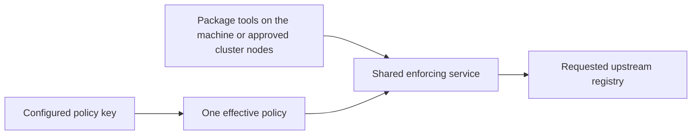

# Product: Transparent package publishing

## Release amendment authority

The current target is nine families: npm, PyPI, Maven, Go modules, Cargo, NuGet, RubyGems, Conan and Docker/OCI. Clients enforce locally and download directly on Linux, macOS and Windows; the optional policy server runs on Linux only. The policy API key authenticates policy retrieval, while registry credentials remain configured in the package managers. Explicit standalone TOML operation remains available. C1006/C1008/C1009/C1013/C1015–C1018 and the [lead release scope](../package-firewall-mvp/01-product.md) govern this amendment; earlier thirteen/sixteen/seventeen-family and certificate-specific text is historical where it conflicts.

This plan owns existing npm/Python publishing and management through the selected local registry endpoint. Preserve registry isolation, upstream write authority, exact destination/token confinement and the accepted canonical npm metadata exception. Native package-client certificates, shared-backend read secrets and certificate/provider setup flows are superseded for this target; no additional publishing/hosting protocols are added.

Managed policy outage and propagation reuse management C19/C20: remembered central policy can continue during an outage, unknown keys cannot acquire policy, and reachable-server updates/revocations follow the configured interval (one minute by default). Never silently select weaker standalone TOML after a managed failure. Client/device administrators can bypass local enforcement unless existing device/network controls prevent it; this release does not add host attestation.

No new desktop GUI or account/membership workflow is required. Existing API-key, group-policy and registry administration screens are reused with revised setup text and nine-family choices; obsolete certificate-only controls are retired. Exact changed screen content, migration and CLI setup are part of the combined design before implementation. Native GitHub Actions client tests cover all three OSes, with Linux server integration and explicit Docker engine/runner limits.

## Current scope revision — 2026-11-02

C1006/C1008 select a locally installed client, API-key authentication to an optional policy server, and standalone backend operation from TOML. C1009 selects local enforcement and direct registry traffic. Certificate-specific requirements, setup bundles, issuer/OCSP admission and certificate-only acceptance criteria below describe the delivered baseline and are superseded for the new target. Registry selection/isolation, permitted user/group policy, upstream-authorized publishing, safe audit output and credential confinement remain requirements. Migration and deployment transitions need design; recording this revision removes no code or credentials.
RubyGems is critical and is the first added ecosystem after the shared-service foundation. CPAN is omitted (C1027); no new CPAN adapter, policy options or acceptance lane is required.

## Clarifications and decisions
| ID | Class | Status | Owning Gate | Target Gate | Question or disposition | Selected value or policy | Decision source |
|---|---|---|---|---|---|---|---|
| C1 | user clarification | resolved | Gate 1 | none | Publish npm and Python packages through Probation | Both ecosystems must support publishing through Probation; user explicitly rejected bypassing it | user request, 2026-10-25 |
| C2 | user clarification | resolved | Gate 1 | none | Publish with the exact registry URL used for installs | Within an installed client, one deliberately selected local registry endpoint serves existing npm/Python installs and publishing. Different client installations need not share a network URL. Exact local URL syntax is a design choice; selected upstream identity and no silent registry fallback remain. | Original same-URL user requirement; transport placement revised by C1009, 2026-11-02 |
| C3 | user clarification | resolved | Gate 1 | none | Which registry operations are in scope? | A software development company must be able to use the full npm and PyPI registry workflows through Probation, including installs, publishing, and management operations; do not limit the fix to uploading new versions | user answer, Gate 1 grilling Q1 |
| C4 | user clarification | resolved | Gate 1 | none | Who may perform registry write operations through Probation? | The upstream npm or PyPI registry's permissions alone authorize writes through Probation; no separate Probation publishing grant | user answer, Gate 1 grilling Q2 |
| C5 | user clarification | resolved | Gate 1 | none | Which upstream registries must work behind Probation? | A company admin can configure multiple npm and Python upstream registries for the company, including company registries | user answer, Gate 1 grilling Q3 |
| C6 | user clarification | resolved | Gate 1 | none | Which registry supplies a package when names overlap? | The developer's project explicitly selects the upstream registry; Probation neither merges same-name packages nor silently falls back to another registry, for installs or publishing | user answer, Gate 1 grilling Q4 |
| C7 | user clarification | resolved | Gate 1 | none | Should newly published company packages be held before installation? | Company admin may explicitly mark a registry trusted so new packages from it install immediately; absent that setting, existing age policy applies | user answer, Gate 1 grilling Q5 |
| C8 | user clarification | resolved | Gate 1 | none | How does the company access a private registry for downloads? | Superseded for the local-client path by C1015: user/CI-owned local registry credentials, without policy-server distribution of shared read secrets. Historical baseline: Company admin configures a shared read-only connection for package downloads; individual upstream registry permissions govern publishing | user answer, Gate 1 grilling Q6 |
| C9 | user clarification | resolved | Gate 1 | none | Approve the registry administration screens | The configured, empty, error and removal mockups are approved | user answer, Gate 1 grilling Q7; presented at show-me-gate-1-ui-q7.html |
| C10 | user clarification | resolved | Gate 1 | none | Could a per-user virtual host identify the policy context? | Superseded by C29: client certificates identify users and virtual hosts are removed. | user correction, 2026-10-25 |
| C15 | user clarification | resolved | Gate 1 | none | May installs and publishing use separate URLs on one stable virtual host? | Superseded by C29: one organisation registry URL serves both. | user revision, 2026-10-25 |
| C16 | current-Gate decision | resolved | Gate 1 | none | How does an administrator remove shared install access? | Superseded by C18–C19: certificate access replaces the shared password. | C17–C19, 2026-10-25 |
| C17 | user clarification | resolved | Gate 1 | none | How do clients identify and authenticate at Probation? | Superseded for the local-client target by C1006/C1008; historical baseline: Superseded by C29: a unique client certificate identifies the user at the firewall; no per-user virtual host. The developer upstream token is used only when upstream publishing or account actions need it. | user correction, 2026-10-25 |
| C18 | user clarification | resolved | Gate 1 | none | Which client certificate model is offered? | Superseded for the local-client target by C1006/C1008; historical baseline: Superseded by C29: unique client certificates identify users; there is no shared-certificate mode. | user correction, 2026-10-25 |
| C19 | user clarification | resolved | Gate 1 | none | What identity does each certificate mode prove? | Superseded for the local-client target by C1006/C1008; historical baseline: Superseded by C29: a unique client certificate proves the user identity used to select policy. | user correction, 2026-10-25 |
| C20 | current-Gate decision | resolved | Gate 1 | none | How does certificate management work at organization scale? | Superseded for the local-client target by C1006/C1008; historical baseline: Superseded by C29–C31: unique certificates are issued through Probation self-service or the organization issuer; no shared mode or virtual-host binding remains. | user correction, 2026-10-25 |
| C21 | user clarification | resolved | Gate 1 | none | Must a company operate its own certificate authority? | Superseded for the local-client target by C1006/C1008; historical baseline: No. Probation-managed certificates serve small companies and individuals; enterprises may instead use their own certificate management. | user correction, 2026-10-25 |
| C22 | user clarification | resolved | Gate 1 | none | Are certificate source and sharing mode both configurable? | Superseded for the local-client target by C1006/C1008; historical baseline: Superseded by C29–C30: source is configurable; the Probation-issued source also has a self-service switch. Certificates are unique per client. | user correction, 2026-10-25 |
| C23 | user clarification | resolved | Gate 1 | none | Where do administrator actions on users belong? | A separate Users panel handles membership, roles, groups, user package-access disablement, and policy links. A selected user's Probation-issued certificates can be revoked there; organization-issued certificate revocation stays in the organization certificate system. Organization settings contain only provider, CA trust, and self-service controls. | user corrections, 2026-10-25 |
| C24 | user clarification | resolved | Gate 1 | none | How does Probation verify certificates from an organization's own self-signed CA? | Superseded for the local-client target by C1006/C1008; historical baseline: Organization settings accept public CA certificates as trust anchors, including self-signed roots; no private CA key or per-client upload. The firewall checks certificate chain, validity, client-authentication purpose, revocation, and the certificate's user identity against an active organization member. Failed or unavailable verification refuses the request. Exact identity field, revocation transport, and freshness are Gate 2 obligations. | user correction and RFC 5280/TLS verification model, 2026-10-25 |
| C25 | user clarification | resolved | Gate 1 | none | What does the client certificate prove? | Superseded for the local-client target by C1006/C1008; historical baseline: Superseded by C29: unique client certificates identify users; virtual hosts are removed. | user correction, 2026-10-25 |
| C26 | user clarification | resolved | Gate 1 | none | When is certificate self-service available? | Superseded for the local-client target by C1006/C1008; historical baseline: Probation-issued mode may enable or disable the signed-in self-service setup download. Organization-issued mode has no Probation self-service. Existing certificates remain valid when issuance is disabled until revoked or expired. | user re-steer and current-Gate disabled-state disposition, 2026-10-25 |
| C27 | user clarification | resolved | Gate 1 | none | Who manages policy when certificates come from the organization? | Superseded for the local-client target by C1006/C1008; historical baseline: The organization issuer issues and revokes unique client certificates. Company administrators and group administrators manage their permitted policies in Probation; users do not change those policies through self-service. | user re-steer, 2026-10-25 |
| C28 | user clarification | resolved | Gate 1 | none | What does a signed-in user download for Probation-issued access? | Superseded for the local-client target by C1006/C1008; historical baseline: A client-specific command-line setup bundle embeds that user's Probation-issued certificate and private key. Running it configures Node and Python package tools for the selected organization registry URL and TLS firewall. The bundle and installed key stay out of project files and command histories. Organization-issued mode has no Probation self-service download. | user correction, 2026-10-25 |
| C29 | user clarification | resolved | Gate 1 | none | Do virtual hosts remain necessary? | Superseded for the local-client target by C1006/C1008; historical baseline: No. Each client has a unique certificate that identifies an active user. The certificate selects that user's group and policy context at the firewall; no per-user virtual host is used. Everyone uses the selected organization registry URL for installs and publishing. Disabling a user refuses all certificates identifying that user. | user correction, 2026-10-25 |
| C30 | user clarification | resolved | Gate 1 | none | How are Probation-issued clients set up? | Superseded for the local-client target by C1006/C1008; historical baseline: When the organization enables self-service, a signed-in user downloads a client-specific command-line setup bundle containing a certificate bound to their account and its private key. Running it configures supported Node and Python package tools for the organization registry and client-certificate firewall. When self-service is disabled, no new bundles are issued; existing certificates stay valid until revoked or expired. | user corrections, 2026-10-25 |
| C31 | user clarification | resolved | Gate 1 | none | How do organization-issued certificates select policy? | Superseded for the local-client target by C1006/C1008; historical baseline: Organization-managed client certificates carry a stable user identity that Probation verifies against an active member; that member's group selects policy. Company and group administrators manage their permitted policies, users, and group assignments in Probation. The organization issuer handles certificate issuance and revocation; the self-service setup portal is unavailable. The exact identity field and mapping are Gate 2 design obligations. | user corrections, 2026-10-25 |
| C32 | user clarification | resolved | Gate 1 | none | Approve the corrected certificate settings and Users screens | Approved the presented screens showing unique user-identifying certificates, no per-user virtual hosts, organization-issued CA trust, and a separate Users panel. | user answer, 2026-10-26 |
| C33 | user clarification | resolved | Gate 1 | none | How is company SSO covered when users download setup bundles? | The release matrix includes the signed-in company SSO journey through a local fake OIDC provider to bundle download, client setup, certificate admission, and group-policy package reads, plus cross-account, removed-member, and disabled-self-service refusals. Existing SSO browser tests cover the login protocol separately; a real IdP smoke test is not yet present. | user coverage question; tests/e2e/scenarios/e2e-020-oauth-sso.mjs and tests/e2e/fixtures/fakes/oidc.mjs, 2026-10-26 |
| C34 | user clarification | resolved | Gate 1 | none | May an upstream-authorized writer see management-preflight metadata hidden by group read policy? | Yes. The selected upstream may return package metadata to the developer credential so npm management can proceed when group policy hides the package. This never grants artifact bytes or authorizes the later write by itself; C35 defines the indistinguishable npm packument-GET boundary. | user answer, 2026-10-26; ADR candidate |
| C35 | user clarification | resolved | Gate 1 | none | May a token-bearing npm packument GET reveal group-hidden metadata even without a later write? | Preserve the accepted canonical npm token-packument exception: a policy-bound local instance with an upstream developer token may return selected upstream metadata despite group read policy, even without a later write. Other reads and all artifact downloads remain group-filtered; upstream separately authorizes writes. The former native TLS client-certificate precondition is replaced by C1006/C1009 local policy identity. | Original user answer Gate 1 Q9, 2026-10-26; transport identity revised by C1006/C1009, 2026-11-02; ADR candidate |
| C36 | user clarification | resolved | Gate 1 | Gate 2 | Should selected-registry URLs remain distinct from legacy numeric npm package paths? | Yes. Selected registries use a distinct URL namespace, preserving reads of numeric package names and versions on the legacy npm path. The exact path is a design decision. | user answer, 2026-10-27 |
| C37 | user clarification | resolved | Gate 1 | Gate 2 | What audit details may a group member receive? | Audit returns a reduced, policy-safe vulnerability signal for package versions currently visible to that member. It omits group-hidden packages and versions and arbitrary upstream advisory text, links and metadata that could reveal hidden facts. | user answer, 2026-10-27 |
| C38 | user clarification | resolved | Gate 1 | none | What does Probation do for npm audit when the selected registry lacks npm 11's bulk endpoint? | Probation only proxies the selected registry's audit operation and filters the response. It does not run an advisory service or fabricate a quick request from a bulk request. If the selected registry cannot answer npm 11's bulk request, npm reports that registry error; clients that send quick requests directly still use the guarded quick route. | user clarification, 2026-10-27; [research-5](evidence/research-5.md) |
| C1006 | user clarification | resolved | 1 | none | How should clients without native client-certificate support participate? | A locally installed client uses API-key authentication to the policy server. Native package managers no longer need a Probation TLS client certificate in the target design. The policy-server key stays distinct from upstream registry/publisher credentials. This replaces the certificate-forwarding-bridge proposal; C1009 selects local enforcement and direct registry traffic. | user answer, Gate 1 grilling Q2, 2026-11-02; ADR candidate |
| C1008 | user clarification | resolved | 1 | none | Must the backend remain usable without a policy server? | Yes. Preserve explicit self-hosted standalone deployment configured through TOML, without a central policy-server dependency, alongside managed operation using the local client and policy-server API key. Standalone is a selected deployment mode; this answer does not select automatic fallback after a managed authentication or network failure. | user answer, Gate 1 grilling Q2 follow-up, 2026-11-02 |
| C1009 | user clarification | resolved | 1 | none | Does the local client enforce policy and fetch directly from registries, or forward packages through a shared backend? | The installed client enforces policy locally and fetches package metadata/artifacts directly from the selected registries. No shared package-data backend is required for that managed-client path. The same enforcement engine remains usable as a standalone TOML-configured backend. API-key policy retrieval and registry credentials retain separate authority; credential custody and managed-mode bypass controls still require design. | user answer, Gate 1 grilling Q3, 2026-11-02: Enforce locally; fetch registries directly; ADR candidate |
| C1010 | research fact | resolved | 1 | none | What existing behavior supports standalone and optional managed operation? | Config.management is optional; absent management chooses TOML cooldown/OSV plus a separate blocklist file. Managed outages retain remembered central policy, not local TOML. Local API-key policy retrieval needs a scoped endpoint; a fleet token is not equivalent to a user/client policy key. Mode changes can weaken policy and need a selected trust model. PARTIAL structural evidence, not a tested new client. | sf-repo-view, [../package-firewall-mvp/evidence/local-client-policy-modes.md](../package-firewall-mvp/evidence/local-client-policy-modes.md), 2026-11-02 |
| C1003 | current-Gate decision | deferred | 1 | 2 | Which scoped policy API, client identity/enrollment, policy-source transition, transport and protocol contracts implement the selected C1006/C1008/C1009/C1015 client and policy-source outcomes? | Not selected at Gate 1. API-key authentication to the policy server and server-independent TOML operation are selected product outcomes; exact endpoints, mode switching, compatibility migration and client packaging require design; credential ownership is already selected in C1015. | Deferred to Gate 2 from C1006/C1008; user answer 2026-11-02 |
| C1011 | research fact | resolved | 1 | none | Which Nora families have public distribution sources and meaningful firewall use cases? | Sixteen have concrete public sources, including Debian/APT and RPM repositories, Terraform providers/modules, ConanCenter and the Hugging Face model hub. Go uses a public mirror over source repositories. Raw is Nora hosted generic storage without a defined ecosystem upstream. Public existence alone does not establish equivalent policy coverage. | sf-research ANSWERED plus main-agent official APT/Terraform checks, [../package-firewall-mvp/evidence/research-public-ecosystems.md](../package-firewall-mvp/evidence/research-public-ecosystems.md), 2026-11-02 |
| C1012 | user clarification | resolved | 1 | none | Should the expansion follow Nora format count blindly or check public-source firewall value? | Check every format for public distribution and a useful artifact-policy outcome before finalising scope. The user proposes omitting APT based on an absence-of-public-sources premise; C1011 corrects that premise. Final include/defer choices follow C1013, not the disproved premise. Existing npm/PyPI private-registry and publishing requirements are not removed by this research request. | user request 2026-11-02 to check APT, Terraform and other formats for public registries and firewall purpose |
| C1013 | user clarification | resolved | 1 | none | Which formats belong in this release? | C1027 amends the original ten-family Q5 selection: npm, PyPI, Maven, Go modules, Cargo, NuGet, RubyGems, Conan and Docker/OCI only. RubyGems is critical; CPAN is omitted. Terraform, Ansible Galaxy, APT, RPM, Hugging Face, Raw and unlisted Dart/Pub remain outside this release. | user Q5 selection, amended by user C1027 on2026-11-02 |
| C1015 | user clarification | resolved | 1 | none | Where are upstream registry credentials configured? | In the package managers, by the user or CI job, not on the firewall. Preserve the existing credential-bearing publishing request path and upstream authorization. The firewall does not configure or manage registry credentials. Its separate service key authenticates policy retrieval only and is never sent to registries. This applies to managed and standalone operation. | user answer, Gate 1 grilling Q6, clarified explicitly 2026-11-02: credentials are configured in package managers, not on the firewall |
| C1016 | user clarification | resolved | 1 | none | Which operating systems must the installed client support in this release? | Linux, macOS and Windows. The local enforcing client must install, run and use the selected package/container workflows on all three; existing Linux/macOS build configuration is baseline evidence, not proof of new Windows or installed-client support. Exact architecture/install/lifecycle contracts are designed under C1003. | user answer, Gate 1 grilling Q7, 2026-11-02: Linux, macOS and Windows |
| C1017 | user clarification | resolved | 1 | none | Which operating systems must host the central policy server? | Linux only. Client support remains Linux, macOS and Windows. The optional standalone TOML backend remains a separate deployment mode; Linux-only policy-server scope does not remove cross-platform client requirements. | user steering 2026-11-02: Policy server only for Linux |
| C1018 | current-Gate decision | deferred | 1 | 2 | How are the selected cross-platform verification requirements implemented in GitHub Actions? | User requires GitHub Actions testing on Windows and macOS; include native Linux client coverage and Linux-only policy-server coverage. Runner/architecture choices, native-client test matrix, Docker engine placement, fixtures, secrets isolation and release gates are design obligations; build-only or cross-compilation evidence cannot be presented as runtime client compatibility. No YAML or runner configuration selected at Gate 1. | user instruction 2026-11-02 to use GitHub Actions to test Windows and macOS; exact implementation deferred to Gate 2 |
| C1027 | user clarification | resolved | 1 | none | Is CPAN required, and how important is RubyGems? | Omit CPAN from this release. RubyGems is critical and remains required; prioritize it as the first added ecosystem after the shared-service foundation. Current target is nine families: npm, PyPI, Maven, Go modules, Cargo, NuGet, RubyGems, Conan and Docker/OCI. Preserve all other selected deployment, policy, credential and acceptance outcomes. | user answer2026-11-02: RubyGems is critical; CPAN can be omitted; amends C1013 |
| C1024 | user clarification | resolved | 1 | none | Does the public-registry focus introduce a public/private split or change existing publishing credentials? | No. Handle requested registries the same way as public registries, using the existing forwarding and configured protection/freeze behavior. Registry credentials are configured in package managers, not on the firewall. Preserve the existing credential-bearing publishing request path and upstream publishing authorization. This clarification introduces no new public/private registry mode, removes no existing authentication behavior, and does not request an authentication redesign. Continue the previously selected machine/cluster service model and policy-key separation. | user correction, 2026-11-02: handle as public; credentials are already needed for publishing; no change to previous implementation; supersedes the assistant's public-only/authentication-exclusion interpretation |
| C1022 | user clarification | resolved | 2 | none | Q11: For Kubernetes image pulls, is admission at the approved-cluster-node level sufficient, or must it distinguish individual workloads/namespaces? | Trust approved cluster nodes. Every workload on an approved node may use the common-policy service. Kubernetes permissions control who may deploy workloads and use private-registry credentials. The enforcement listener does not claim per-workload/namespace identity for node-runtime pulls. Preserve upstream credential authorization and restrict access to approved nodes through host/network controls. | user answer, Gate 2 grilling Q11, 2026-11-02; ADR candidate |
| C1021 | user clarification | resolved | 2 | none | Q10: Must package tools authenticate separately to the shared enforcement service, or is access controlled by host/cluster network restrictions? | No additional Probation login on package requests. Restrict machine deployment access to the local machine and cluster deployment access to explicitly permitted workloads through host/network controls. The organisation service key stays inside the service and authenticates only policy retrieval. Private registry credentials still authorize upstream operations separately. Every admitted caller receives the service policy selected in C1020. Exact transport, startup validation and deployment controls remain design obligations; this is not permission to expose an unrestricted proxy. | user answer, Gate 2 grilling Q10, 2026-11-02; ADR candidate |
| C1020 | user clarification | resolved | 2 | none | Q9: Does one shared enforcement service apply one policy to all callers, or can callers/workloads select different permitted group policies through it? | One policy per shared service, selected by an organisation service key attached to a group or the organisation under management C14/C15/C29. All callers of that service receive the same effective rules. The service holds its policy key and obtains updates from the policy server; caller registry credentials retain their separate authority under C1015. Individual caller/workload group-policy selection within this service is not selected. Explicit standalone operation retains its local policy authority. | user answer, Gate 2 grilling Q9, 2026-11-02 |
| C1019 | user clarification | resolved | 2 | none | Q8: Should the installed client run continuously per user, as a shared machine service, or only around an explicitly launched command? | Shared service for the whole machine. Also support a shared enforcement service per Kubernetes or other container-orchestration cluster. The service performs enforcement and fetches registries directly; the optional Linux policy server remains a separate policy authority. Per-user background service is not selected. Listener exposure, caller identity, credential isolation, runtime placement and availability require design; one logical cluster service does not select replica count or shared-storage semantics. | user answer, Gate 2 grilling Q8, 2026-11-02; ADR candidate |
## Current shared-service journey and acceptance

An operator installs one shared enforcer for the whole machine or one logical service for a Kubernetes/other orchestration cluster (C1019). The service selects one common effective policy using its configured policy key (C1020). All admitted package tools and node-runtime requests use that policy; they do not choose a different user/group policy per request or need a separate Probation login (C1021). Organisation service keys select their existing organisation/group policy. Existing personal accounts, keys, policy inheritance, administration and publishing permissions remain product capabilities; this amendment does not delete them.

Machine access is restricted to the local machine. Cluster access trusts explicitly approved nodes, including every workload on an approved node; Kubernetes permissions control workload deployment and registry-secret use (C1022). The service does not claim authenticated workload/namespace/person identity for a node-runtime pull. Registry credentials remain configured in package managers, not on the firewall; publishing uses the existing upstream authorization path (C1015/C1024).

Acceptance must demonstrate two admitted callers receiving the same selected policy without a package-request Probation login, refusal of an unapproved host/node, and service-policy changes/refusal applying to all callers under the existing outage/propagation contract. Registry credentials stay in native tool configuration and existing publishing succeeds or refuses according to upstream permissions. Native Linux/macOS/Windows and genuine node-runtime checks remain required; previous builds, mocks or certificate tests do not establish the new behavior. Exact endpoints, service configuration and network enforcement belong to combined design under C1003/C1018.

These selected outcomes govern the release. Older per-request-policy-key and client-certificate setup narratives/mockups below are historical where superseded; their retained account, policy, isolation, publishing and audit guarantees still apply. They must not be used to put the policy-server key into package-manager registry configuration.

## Problem
Developers need one selected Probation registry URL for installs, publishing, and supported package-client management. The current install route refuses npm login and publishing and offers no Python upload. The package firewall requires a unique TLS client certificate for reads and writes. That certificate identifies the user, whose group and policy control tokenless package metadata reads, other read routes and all artifact downloads; there are no per-user virtual hosts. A canonical npm packument GET with a developer token may return the selected upstream's metadata even when group policy hides the package, including outside a completed write. The upstream separately authorizes publishing and management writes using that token. Certificate private keys and publisher tokens stay out of committed project files.

Organization settings choose Probation-issued or organization-issued certificates. In Probation-issued mode, administrators may enable or disable signed-in self-service. When enabled, a signed-in user downloads a client-specific command-line setup bundle with an account-bound certificate and private key; running it configures Node and Python package tools for the organization registry and firewall. Disabling self-service stops new downloads and issuance, while existing certificates stay valid until revoked or expired. Certificates issued to a user can be found and revoked in the separate Users panel. Disabling a user blocks all of their certificates. In organization-issued mode, administrators upload public CA trust certificates, including self-signed roots. Their own system issues and revokes unique client certificates containing a stable user identity; Probation verifies that identity against an active member and uses that member's group policy. Company and group administrators manage their permitted policies in Probation. The self-service portal is unavailable. The Users panel handles membership, roles, and groups without an organization-wide certificate list.

Companies also need several public or private registries, chosen deliberately per project, with private downloads available to their teams. For the new local-client target, C1015 replaces the former shared-backend read credential: registry credentials are configured by the user or CI job in the package managers, not on the firewall, and are separate from the policy API key. Publishing permissions remain the upstream registry's decision. Historical source and acceptance details still need migration/reconciliation through design. Selected registry URLs must leave legacy npm package paths, including numeric package names, unambiguous. Audit results must show vulnerability signals only for versions the current group may read, without arbitrary upstream details that could disclose hidden packages.
## Success metric
All representative npm and Python client actions in the [release acceptance matrix](evidence/client-operation-matrix.md) produce their expected outcome through the selected Probation registry URL: permitted actions succeed, upstream-denied actions remain denied, and certificate-protected downloads obey the certificate holder's current group policy and selected registry age policy. Numeric npm package names and versions remain reachable on the legacy path after selected registries move to a distinct path. Bulk and quick audit responses contain only reduced advisories for currently visible versions; hidden package names, hidden versions and arbitrary advisory text or links are absent. A valid certificate and developer token allow a canonical npm packument GET to return the selected upstream's metadata despite a group read denial, even when no write follows; the same token without a valid certificate gives no firewall access. An upstream-authorized npm owner whose group cannot read a package can obtain metadata and complete an upstream-permitted deprecation; tokenless metadata reads and artifact downloads of that package still refuse. Package-client registry requests for installs, npm login, publishing, and supported account actions use the same selected URL; npm web login may open an upstream sign-in page in the browser. Python package-client scope is install and upload, plus only actions the selected upstream exposes to those clients. Requests without a valid certificate, with a foreign-organization certificate, with a certificate identifying no active member, or with a revoked certificate are refused before metadata, files, or registry actions. Disabling a user blocks all their certificates on the next request. Both certificate providers pass; Probation self-service enabled permits a signed-in user to download and run a client-specific setup bundle and revoke its certificate, while disabled prevents new issuance. The SSO acceptance row proves that a company member signs in, receives only their own setup bundle, and uses its certificate under their group policy. A 10,000-client test demonstrates issuance through enabled self-service or the organization issuer and targeted revocation without manual administrator enrollment or an all-certificate list. Generated project files may contain the registry URL but no private key, client certificate or publisher token. Network egress logs show zero developer package-client connections directly to upstream registries during those workflows.
## Non-goals
Probation does not mirror upstream registry websites, provide its own vulnerability advisory service or invent actions an upstream registry does not support. It does not silently merge packages with the same name across registries or fall back to another registry when the selected one fails.
## Announcement — the blog post before the feature
Probation preserves npm/Python publishing and supported account actions through the deliberately selected registry endpoint. Credentials stay configured in package managers and the upstream decides write permissions. The shared machine/cluster enforcer uses one configured policy for admitted callers without a separate package-request Probation login. Ordinary reads and artifacts retain policy enforcement; the existing canonical token-packument metadata exception remains explicit. Registry isolation, credential confinement, reduced audit output and existing publishing behavior remain required. New publish/hosting protocols for the added families are outside this expansion.

## Screens
- Organization certificate settings: [provider, self-service, and trusted CA](mockups/certificate-mode.html) (the same screen also has a `?current=probation` state for switching back to organization-issued), [CA replacement](mockups/certificate-confirm.html), [provider switch in both directions](mockups/provider-switch-confirm.html), [validation and verification errors](mockups/certificate-settings-error.html)
- Users and groups: [user management and targeted Probation-issued certificate revocation](mockups/user-management.html), [administrator certificate revocation](mockups/user-certificate-confirm.html), [disable or remove user](mockups/user-action-confirm.html), [empty user and certificate states](mockups/user-management-empty.html)
- Signed-in client access: [command-line setup download](mockups/certificate-enroll.html), [self-revocation](mockups/certificate-self-revoke.html), [download and client errors](mockups/certificate-error.html)
- Registry list and add: [configured registries](mockups/registries.html)
- No added registries: [empty state](mockups/registries-empty.html)
- Invalid registry details: [error state](mockups/registries-error.html)
- Remove a registry: [removal confirmation](mockups/registries-remove.html)

## Local-client revision work

The other five Nora-expansion plans carry C1006/C1008/C1009 under the same IDs. Prior delivered proofs remain in evidence/resteer-local-client-baseline.md and evidence/slice-1.md through slice-5.md. Resolve the data path and policy-source semantics, then reconcile scope/acceptance before fresh QA. Changing authentication does not establish expanded format support.

## Public-source scope review — 2026-11-02

Q3 / C1009 is resolved: local enforcement and direct registry downloads. C1011 records the public-source inventory; C1013 / Q5 selects the nine named package/container families for this release. APT/RPM do have public repositories and Terraform has a public provider/module registry. Proposed deferrals reflect artifact-policy and product scope, not nonexistent public sources. The full seventeen-family source table and proposed thirteen-family target are in ../package-firewall-mvp/evidence/research-public-ecosystems.md. C1015 / Q6 selects client-owned private-registry credentials; it resolves the earlier interrupted Q4 topic. Registry credentials remain in package-manager configuration; the scoped policy API remains C1003 design work.

## Selected release inventory and credential custody — 2026-11-02

C1013 resolves Q5 with nine named families: npm, PyPI, Maven, Go modules, Cargo, NuGet, RubyGems, Conan and Docker/OCI. Previous thirteen/sixteen/seventeen-format proposals are historical research, not the release target. Terraform, Galaxy, APT/RPM, model hubs and Raw hosting are out. Unlisted Dart/Pub is deferred as the narrow release default. C1015 resolves Q6 with user/CI-owned private-registry credentials; the policy server does not distribute organisation registry secrets. Keep the installed client, local enforcement/direct registry traffic, API-key policy connection and explicit TOML standalone mode selected in C1006/C1008/C1009. Expanded-format and new client/platform behavior remains unimplemented and requires revised approval/checks.

## Selected deployment and CI targets — 2026-11-02

Q7/C1016 is resolved: the installed enforcer supports Linux, macOS and Windows. C1017 limits the policy server to Linux only. C1018 carries the user's GitHub Actions testing requirement into design: native client setup/runtime/package checks on the supported OSes and Linux policy-server integration, with explicit coverage rather than treating a binary build as compatibility proof. Docker and other runner limitations must remain visible until an executable check supplies the promised coverage. No client compatibility test or CI workflow change has run yet.
