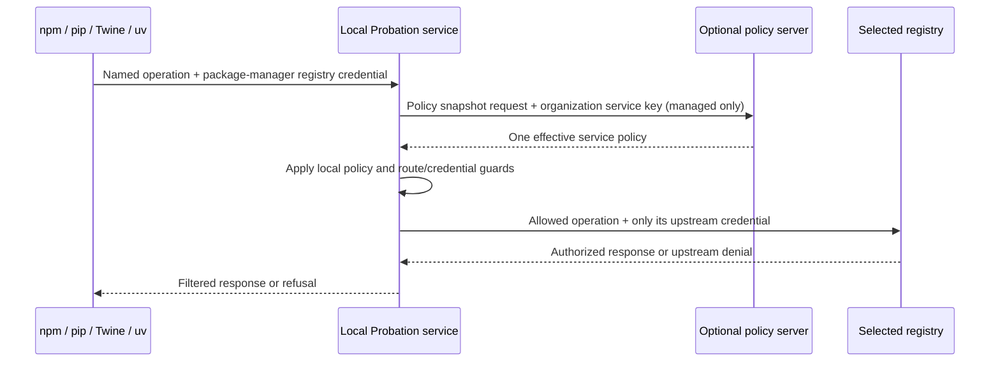

# Program Design: Transparent package publishing

## Active program design — local client path (2026-11-02)

The tables and interfaces below this section are the previously approved certificate-based implementation record. They are historical where they conflict with the active design here; their old checks are not evidence that the new path works.

### Purpose and end-to-end caller scenario

A developer configures npm or a Python package tool to use the installed Probation service and keeps the selected private/public registry credentials in that package manager. In managed mode, the service sends its organization API key in the HTTP `Authorization: Bearer <service-api-key>` header to `GET /api/v1/policy/snapshot`; in standalone mode it loads the explicitly configured TOML policy. If allowed, it sends the operation directly to the selected upstream with the relevant package-manager credential. The upstream authorizes reads, publishing and management writes. The service key never reaches the package tool or upstream. Registry credentials never identify a local caller or fetch policy.



### Caller and molecule contracts

| Owner | Public behavior | Required contract and witness |
|---|---|---|
| Local service configuration / lifecycle | Explicit managed or standalone TOML mode; validate before serving; no managed-to-standalone fallback. | Invalid or incomplete config refuses startup; outage behavior follows management C19/C20. Native start/config checks in lead Slice 25. |
| Managed policy client | Organization service key retrieves one effective policy for the shared service. It is not attached to package requests or upstream requests. | Wrong/disabled key refuses new policy; remembered central policy follows C19/C20 only; verify by service-policy API/cache checks in lead Slice 16. |
| npm/PyPI route classifier | Admit only known named operations for the selected registry. Preserve legacy paths and numeric npm package/version behavior from C36/D38. | Unknown/alternate routes refuse before upstream I/O; no fallback to another registry. |
| Read and artifact path | Apply common policy and protocol-specific package/version rules; preserve safe audit disclosure, selected-origin checks, verified-byte delivery and current-authority recheck. | Existing registry isolation and exact artifact identity remain; use FIX-16-A's cold/warm current-policy delivery matrix before accepting new adapter paths. |
| npm token-packument path | A canonical packument GET with a valid upstream developer token may return selected-upstream metadata even without a later write; the response is request-local and never shared/persisted. This exception does not grant artifact bytes or write permission. | Distinguish token present/absent and upstream allow/deny; sequential, concurrent and restart controls prove no metadata reuse. The firewall's local policy still applies as required by C35's amended local-instance boundary. |
| Publishing and account actions | Local policy permits the attempt; route-specific package-manager credentials are forwarded only to the selected upstream. The upstream remains the write authority. | npm Basic bootstrap and Bearer actions plus PyPI Basic/Bearer upload retain upstream allow/deny behavior; policy key is never forwarded. |
| npm whole-package revision DELETE | Treat `DELETE /<package>/-rev/<revision>` as a named package action. Send the developer's package-manager credential only to the selected registry; that upstream decides allow or deny. It does not use a version-tarball marker. | Selected-registry allow and deny cases preserve the upstream result; no extra-origin request. Slice 3. |
| npm direct canonical tarball DELETE | Refuse locally before outbound I/O, including when the request carries a valid developer credential. Version removal must use the advertised reference route. | Sentinel witness proves zero outbound calls. Slice 3. |
| npm version unpublish | Preserve selected-origin D41 path scopes, exact advertised URL, sealed query, redirect refusal, current scope recheck, revision-removal marker, and one-use marker before DELETE. Any extra-origin tarball URL refuses before advertising a local action URL; package-manager credentials never go to extra origins. Bind references to the local service/registry/package/version/filename, not an individual member, because C1021 selects shared-service callers without package-request identities. | A successful upstream-authorized revision PUT must remove the exact leased version; use its resulting revision or an immediate authenticated selected-upstream GET confirming absence, then commit the marker. Denied, unchanged or unverified PUTs create no marker. Cover GET fallback, marker persistence failure, and 20,000 per-service, 100,000 per-registry and 1,000,000 global quota+1 refusal. Slice 3. |
| Native workflow | Existing npm/PyPI operations run through native local service clients on Linux/macOS/Windows. Policy server integration runs on Linux. | C1018: native GitHub Actions execution is required; container/cross-compile checks do not establish OS support. |

### Proposed declarations and deciding calls

The common managed snapshot and policy activation declarations are owned by the lead plan. This plan's new common response path reuses those outputs and existing protocol handlers; its npm/PyPI credential forwarding remains in the named action/read functions, never in a global upstream client default.

```rust
// src/http/service_registry.rs — shared service entry for the selected registry URL.
// Current managed authority and local policy govern the exact prepared response.
pub async fn respond(/* app, selected registry, named package request */)
    -> Result<Response, ApiError>;

// src/http/service_unpublish.rs — the two durable checks and DELETE stay in one
// caller so no request can send between reference validation and marker consume.
pub async fn consume_service_marker_then_send(/* registry, opaque reference,
    package-manager bearer, revision */) -> Result<Response, ApiError>;
```

`respond` first classifies the selected registry and npm DELETE route, then dispatches the named operation. The direct canonical tarball DELETE branch refuses locally; whole-package revision DELETE reaches the selected-upstream action path; version-reference DELETE enters the separately guarded service-reference/marker path. `classify_direct_or_whole_package_delete` must dominate `dispatch_npm_delete_route`; the planned source control checks this order only, while Slice 3 proves route outcomes and zero-I/O refusal. Complete all asynchronous preparation before final response authorization. `PolicyPublicationGate::authorize_current_policy` then acquires the same short-lived gate used by policy/authority activation, checks the current generation and exact prepared reference/content plus immutable registry, and returns a guarded authorization. `release_verified_response` consumes that guard while handing off the exact response. A changed generation requires re-evaluation under the new policy or refusal. Both calls are synchronous and perform no I/O. Activation uses the same gate, so publication ordered before final authorization governs the response; publication ordered after accepted handoff does not retroactively cancel the stream. This contract applies to cold and warm responses. The lead Slice 16 owns the shared implementation; its cross-thread publication cases are required witnesses. The local module does not require a client certificate or interpret package-manager authorization as caller identity.

After an upstream-authorized revision PUT, `record_successful_service_removal` verifies that the exact leased version was removed and obtains the resulting revision from the PUT response. If that response omits the revision, immediately make an authenticated GET to the selected upstream and confirm the version is absent; send the package-manager developer credential only to that selected registry, never the policy API key. Then durably commit a service/registry/reference/revision-bound marker before reporting success. A denied or unchanged PUT, a response/GET that cannot confirm the exact removal, or a local verification failure creates no marker. If an accepted PUT omits the resulting revision and the immediate GET is unavailable or inconsistent, return an uncertain partial-write result and require recovery. A durable marker commit failure after confirmed removal has the same result. Keep D40's 24-hour lifetime and 2 KiB URL limit with at most 20,000 live leases per service, 100,000 per registry and 1,000,000 globally; the former per-member cap is keyed to the service store. Batch/quota failure refuses before advertising a new URL. The route-specific source spec checks verification-before-commit order only; exact version/revision binding, authenticated GET credential routing, persistence, quota atomicity and failure recovery remain Slice 3 runtime/source review obligations.

Within `consume_service_marker_then_send`, resolve the opaque reference in the local service's durable store namespace and check immutable registry/package/version/filename, exact advertised destination and current D41 approval, and require that the destination origin is the selected registry. Require the committed marker with its resulting revision and atomically consume it in one durable state transition before outbound I/O; concurrent attempts must have at most one winner. The planned deciding statements are `let reference = check_service_reference(&app, registry, reference, package, filename).await?;` followed by `let marker = consume_service_marker(&app, registry, &reference, revision).await?;` and then the outbound `send_action`. Missing, changed, expired, replayed, unapproved or extra-origin references refuse before outbound I/O. Upstream denial remains denial after the one-use marker is consumed. The package-manager credential is sent only to the selected registry; the earlier D41 extra-origin bearer option is superseded by C1015/C1024. The policy API key is never an input to this function.

The two new SMTC specs check only that the reference check and marker-consumption calls dominate the outbound action. Exact value binding, transactional atomicity, one-use behavior, and credential destination are outside that analyzer property; the slice's sentinel tests, restart/concurrency cases, and independent security/code review must prove them. These limits do not weaken the caller contract.

### Credential and identity invariants

- The old TLS client certificate authenticated the firewall client; package-manager registry credentials authorized the upstream. They were independent inputs. The active local service removes certificate-based package-request identity but retains upstream authorization.
- The organization policy API key identifies/authenticates the service to the policy server through the HTTP `Authorization` header for the policy snapshot request. Never copy it into a package-manager config, an HTTP request to a registry, redirect, log or error.
- Credentials configured in package managers stay in those managers and are forwarded only to the exact selected upstream request that requires them. A credential present on a request cannot bypass policy, change registry selection, or permit an unclassified route.
- A shared service has no individual member identity for package requests. Do not infer one from a username, registry token, source address or package name.

### Compatibility and migration

The new local path supersedes certificate/provider setup, OCSP, per-member package admission and firewall-configured shared read credentials. Keep their implementation and old proofs labeled historical until the approved delivery changes them. Preserve the existing npm/PyPI operation set, selected registry identity, upstream credential forwarding, safe audit behavior, token-packument boundary, artifact integrity and registry isolation. Migration must not silently overwrite local package-manager credentials or switch managed users to weaker standalone policy.

Detailed source owners and the limits of current source evidence are in [local-client-repository-map.md](evidence/local-client-repository-map.md). The reusable shared policy lifecycle and current-authority delivery design belong to [package-firewall-mvp/03-program-design.md](../package-firewall-mvp/03-program-design.md); this plan owns npm/PyPI publishing semantics and their caller-level regression matrix.

### Flow model and source obligations

[molecule-flow.json](molecule-flow.json) declares the managed-policy input boundary, selected npm/PyPI read, upstream-authorized npm action, request-local token-packument, safe audit, and three distinct npm DELETE paths. Whole-package revision DELETE and direct canonical tarball DELETE have their own route flow; service-scoped version-reference DELETE is modeled from the selected upstream revision PUT through exact-removal verification, durable marker commit, and guarded marker consume. Denied and unchanged PUTs retain the unmarked-reference fact; marker-commit failure is an uncertain partial write. Managed/standalone policy acquisition and the current-authority shared-service handoff are modeled in the lead plan and linked as reviewed sources here. [molecule-contracts.json](molecule-contracts.json) binds each local operation to its source seam, selected SMTC call-order check and unsafe mutation. Existing npm action, token-packument and audit source checks PASS. The planned service route and unpublish obligations target absent future source and remain PENDING during design. [Source-contract evidence](evidence/source-contract-rebind.md) records the earlier run and its limits.

### Security coverage

| Threat or required guarantee | Selected evidence/check | Remaining proof and owner |
|---|---|---|
| Policy key confused with registry credentials or leaked upstream | Distinct typed ports in the finite flow; lead policy snapshot/API contract and service response source obligations; package-manager authorization source check for npm actions. | Runtime request traces must show `Authorization: Bearer <service-api-key>` only to `/api/v1/policy/snapshot`, and package-manager credentials only to the selected registry. Lead Slice 16 and this plan's Slices 1, 3 and 4. |
| Local policy bypass or upstream denial treated as success | Local allow precedes named operation in the flow; existing publisher-auth source check PASS. | Native npm/PyPI allow, policy-deny, upstream-deny and outage cases. Lead Slice 16 and this plan's Slices 1, 3 and 4. |
| Token-private packument exposed through cache or coalescing | `canonical-token-packument` source control PASS; model requires request-local result and upstream token authorization. | Two-client sequential/concurrent/restart cache and in-flight witnesses. Slice 2. |
| Audit reveals hidden packages or arbitrary upstream advisory text | `audit-filter-before-render` source control PASS; modeled safe, malformed, over-limit and unsupported outcomes. | Byte-level filtering, bounded work, npm bulk/quick compatibility and refusal witnesses. Slice 2. |
| Unpublish reference or marker permits wrong-origin, cross-registry, changed-version, concurrent or replayed DELETE | Future ordered-call specs require reference check, successful-removal verification before marker commit, and marker consumption before send; finite flow models PUT-response revision and immediate authenticated-GET fallback. | Exact service-store/registry/package/version/filename/destination binding; durable revision marker; transactional one-use concurrency; both revision acquisition paths; per-service 20,000, per-registry 100,000 and global 1,000,000 quota+1 refusal; credential, path-prefix, DNS/peer and restart witnesses. Slice 3. The SMTC specs do not claim these semantic properties. |
| DELETE route confusion changes authorization or bypasses version marker | Active route model distinguishes whole-package revision DELETE, direct canonical tarball DELETE and version-reference DELETE. | Slice 3 proves selected-upstream allow/deny for whole-package deletion with no marker, local zero-I/O refusal for direct tarball deletion, and marker-gated reference deletion with service binding and one-winner concurrency. |
| Shared service crosses organization/registry or releases stale bytes after policy change | Lead registry identity and FIX-16-A obligations; shared publication gate orders policy activation with final response authorization/handoff. | Lead Slice 16 source/runtime checks cover current authority and cold/warm responses, generation changes and cross-thread publication; service deployment controls and cross-registry restart checks remain required. |
| Shared listener exposed beyond selected trust boundary | C1019–C1022 and lead deployment proposal; no per-user or per-workload identity claim. | Native local/cluster reachability, rejected unpermitted host/node, TLS/transport and no-fallback checks. Lead Slices 25–26. |

Review trigger: untrusted package-manager requests and upstream data, registry credentials, organization policy key, multi-tenant registry state, shared listeners and external origins all remain security-sensitive. The earlier certificate/OCSP threat model and Red Team are invalid for the new path; fresh `sf-threat-model`, `sf-red-team`, and combined design QA are required before presentation.

## Invariants & spec dispositions

- deferred to slice 1: Firewall identity at the policy server — the service API key goes only in HTTP `Authorization` to `GET /api/v1/policy/snapshot`; package-manager credentials never fetch policy or choose a group. Source absent; lead Slice 16 owns the policy client.
- existing check: Registry authorization remains upstream-owned — `evidence/source-contract-rebind.md`: upstream-publisher-auth-before-send (run-Z0bKeh). Exact destination and upstream allow/deny behavior remain slice 3/4 caller witnesses.
- deferred to slice 1: Selected-registry classification precedes protocol dispatch; source absent (`src/http/service_registry.rs` is lead-owned).
- deferred to slice 1: Current policy and authority govern the exact prepared cold or warm response at the shared publication gate; source absent. The shared implementation and cross-thread witnesses are lead Slice 16.
- existing check: Canonical token-packument authorization precedes upstream send — `evidence/source-contract-rebind.md`: canonical-token-packument (run-Z0bKeh). Request-local cache isolation and no persistence remain slice 2 runtime checks.
- existing check: Audit filtering precedes rendering — `evidence/source-contract-rebind.md`: audit-filter-before-render (run-Z0bKeh). Exact client-visible bytes, malformed/over-limit behavior and unsupported-bulk handling remain slice 2 runtime checks.
- deferred to slice 3: A successful upstream-authorized revision PUT that removes the exact leased version is verified before committing a durable marker bound to the local service, registry, reference and resulting revision; denied, unchanged or unverified PUTs create no marker. Source absent (`src/http/service_unpublish.rs`); route-specific spec checks order only.
- deferred to slice 3: If the accepted PUT response omits the resulting revision, an immediate authenticated selected-upstream GET must confirm the leased version is absent before marker commit. Source absent; both PUT-response and GET-fallback paths, including unavailable/inconsistent GET partial-write recovery, require direct witnesses.
- deferred to slice 3: Lease limits are 20,000 per service store, 100,000 per registry and 1,000,000 globally; batch/quota failure advertises no new reference. Source absent; cap+1 and unchanged-store assertions are required.
- deferred to slice 3: npm version-unpublish references bind the local service store, immutable registry, package, version, filename and exact currently approved destination; DELETE requires the matching revision marker and atomically consumes it once. Source absent (`src/http/service_unpublish.rs`).
- deferred to slice 3: Whole-package revision DELETE is a selected-registry action authorized by the upstream and does not use the version marker; source absent.
- deferred to slice 3: Direct canonical tarball DELETE is refused locally before outbound I/O; source absent.
- deferred to slice 3: Version-reference DELETE requires a committed revision marker, exact service/registry/package/version/filename/destination binding, and atomic one-use consumption before send; source absent.
- UNKNOWN: Listener reachability, managed/standalone no-fallback, protected local secrets and native runner coverage remain unproved; native and deployment witnesses are planned for after lead Slice 25 and this plan's Slice 5. The service trusts only the selected local/approved-node boundary and does not assert per-user identity.

## Repository evidence

The existing npm/PyPI entry points in `src/http/registry_routes.rs` and `src/http/pypi_routes.rs` currently use transport-owned `VerifiedPeer` certificate admission. `src/http/registry_action.rs` and `src/http/pypi_routes.rs` separately forward validated package-manager Basic/Bearer credentials to upstream actions. The focused [local client repository map](evidence/local-client-repository-map.md) records those paths and the upstream read credential path; its SMTC entry-point discovery covered only 5 of 23 paths, so it is partial and describes the delivered certificate baseline rather than the replacement service.

The proposed common request and unpublish owners are future files, `src/http/service_registry.rs` and `src/http/service_unpublish.rs`. The fresh [source-contract rebind](evidence/source-contract-rebind.md) run-Z0bKeh passes the three existing action, token-packument and audit controls; the six new-path obligations remain pending on absent future sources in slices 1 and 3. The ordered checks prove call order only, not exact values, route completeness, durable marker provenance, cache isolation or atomicity.

The lead [FIX-16-A artifact-flow evidence](../package-firewall-mvp/evidence/artifact-flow-correctness.md) and [service API design evidence](../package-firewall-mvp/evidence/design-service-policy-api.md) ground current-authority publication and scoped policy retrieval. The active [threat model](evidence/threat-model-get-fallback-credentials.md) and independent Red Team review cover marker provenance, revision GET fallback (including unverifiable-revision recovery), service-scoped lease limits and all three DELETE routes; their current receipts are recorded in Gate 4 progress. Older certificate/member-bound reports are historical. Future source, native runtime, deployment and concurrency witnesses remain unproved.

## Historical program design — certificate-based implementation

Every section below this heading, including its member-bound unpublish, certificate principal, tests and source evidence, records the delivered 2026-10-30 design. It is retained as history only; active caller contracts, service-scoped references and current-policy handoff are defined in the active section above and in the linked 02/04 documents.

### Clarifications and decisions

The following clarification rows describe the historical certificate design. Their product promises remain only where the active design above and `01-product.md` retain them; certificate preconditions and member-bound identity do not.

| ID | Class | Status | Owning Gate | Target Gate | Question or disposition | Selected value or policy | Decision source |
|---|---|---|---|---|---|---|---|
| C24 | user clarification | resolved | Gate 1 | Gate 2 | Enterprise certificate checks | Chain, validity, client-auth purpose, current revocation and active member are mandatory; verification failure refuses. | 01-product.md C24 |
| C29 | user clarification | resolved | Gate 1 | Gate 2 | One URL and identity | A unique client certificate identifies a member and current group policy; read and write package-client operations use the selected registry URL. | 01-product.md C29 |
| C30 | user clarification | resolved | Gate 1 | Gate 2 | Probation setup | Optional signed-in self-service gives the member a client-specific certificate and command-line setup bundle; disabled issuance does not revoke existing certificates. | 01-product.md C30 |
| C31 | user clarification | resolved | Gate 1 | Gate 2 | Organization-issued setup | The issuer manages issue/revocation and encodes the member's immutable UUID. Probation checks the issuer's public root and live status. | 01-product.md C31; 02-architecture.md D34-D35 |

| ID | Class | Status | Owning Gate | Target Gate | Question or disposition | Selected value or policy | Decision source |
|---|---|---|---|---|---|---|---|
| D34 | current-Gate decision | resolved | Gate 2 | none | Identity field | Exactly one URI SAN carries an organization-scoped membership UUID; it must match the selected organization's active member. | 02-architecture.md D34 |
| D35 | current-Gate decision | resolved | Gate 2 | none | Revocation freshness | Organization-issued admission verifies a fresh nonce-bound, issuer-authorized OCSP response for the presented issuer+serial on every request; the issuer responder reflects every committed revocation. Failure refuses. | 02-architecture.md D35 |
| D36 | current-Gate decision | resolved | Gate 2 | none | Transport proof | Only the TLS connection supplies peer certificate evidence. Package paths require it; browser portal paths may omit it. | 02-architecture.md D36 |
| D37 | current-Gate decision | resolved | Gate 2 | none | Private egress | HTTPS public destinations use globally routable connected IPs; private registry/status destinations require operator-approved exact host/port and CIDR per organization, checked at every DNS/redirect hop. | 02-architecture.md D37 |
| C34 | user clarification | resolved | Gate 1 | Gate 2 | Hidden management metadata | The selected upstream may return group-hidden package metadata to a developer credential; artifact bytes and later writes have separate checks. | 01-product.md C34 |
| C35 | user clarification | resolved | Gate 1 | Gate 2 | Canonical packument GET | A valid certificate and developer token permit selected-upstream metadata on any canonical npm packument GET, even without a write; tokenless and other reads remain group-filtered. | 01-product.md C35 |

| C36 | user clarification | resolved | Gate 1 | Gate 2 | Selected registry URL namespace | The selected npm and Python client bases are `/registry/npm/<id>/` and `/registry/pypi/<id>/`; legacy `/npm/...` and `/pypi/...` package paths remain disjoint. | 01-product.md C36; 02-architecture.md D38 |
| C37 | user clarification | resolved | Gate 1 | Gate 2 | Reduced audit output | A named audit read returns only validated advisory signals for group-visible package versions. It reconstructs the response in the client's bulk or quick shape and copies no arbitrary upstream advisory text or links. | 01-product.md C37; 02-architecture.md D39 |
| C38 | user clarification | resolved | Gate 1 | Gate 2 | Proxy-only audit | npm 11's bulk request goes to the selected upstream; an unsupported endpoint remains its error. A client-sent quick request uses the selected upstream quick route. No advisory service or synthetic fallback is added. | 01-product.md C38; evidence/research-5.md |
| D38 | current-Gate decision | resolved | Gate 2 | none | Route separation | Classify selected operations only under the dedicated `/registry/<ecosystem>/<id>/` prefix; legacy numeric npm package/version and tarball paths retain their existing interpretation. | 02-architecture.md D38 |
| D40 | current-Gate decision | resolved | Gate 2 | none | Version-unpublish destination | Persist only selected-upstream-advertised tarball references that pass D41 origin and path approval; resolve the member-bound reference after npm's packument PUT before forwarding the tarball DELETE with the approved credential mode. | 02-architecture.md D40; N11 |
| D41 | user clarification | resolved | Gate 2 | none | Additional deletion origins | Registry administrator approves exact HTTPS origin and segment-boundary path-prefix scopes, including noncanonical selected paths, and explicitly chooses whether bearer forwarding to an extra origin is allowed; default off. Query-bearing URLs are sealed at rest and redacted. External DELETE requires an upstream-authorized preceding revision PUT for the same member/reference. | 02-architecture.md D41; user answer 2026-10-28 |
| D39 | current-Gate decision | resolved | Gate 2 | none | Audit disclosure | Audit output is rebuilt from canonical package names, group-visible versions, validated severity, generic title and generated ID. Malformed or over-limit input/result refuses rather than claiming a clean audit. | 02-architecture.md D39 |

### Files

The paths assign slice ownership; no product-code write is authorized before design approval.

| File | Responsibility |
|---|---|
| `crates/probation-policy/src/api.rs`, `lib.rs` | Shared registry ID and certificate-admission request/result types. |
| `crates/probation-server/migrations/0007_registries.sql` | Final compatible organization-registry schema in Slice 1, including immutable member certificate UUID, provider/trust settings and per-member certificate status; Slice 2 populates catalog behavior without editing this applied migration. |
| `crates/probation-server/src/portal/organisation.rs`, `portal/users.rs`, `portal/certificates.rs`, `portal/registries.rs`, `portal/mod.rs` | Role-scoped Users, provider/CA settings, registry catalog, signed-in issue/download and targeted revocation. |
| `crates/probation-server/src/tenancy.rs`, `sync.rs`, `policy.rs` | Current membership/group/registry join, certificate status and existing place-chain policy. |
| `src/config.rs`, `lib.rs`, `http/mod.rs`, `http/registry_routes.rs` | TLS peer evidence, package route requirement, canonical authority, disjoint selected/legacy route classification and safe named audit responses. |
| `src/managed/mod.rs`, `managed/certificates.rs`, `managed/client.rs` | One per-request certificate admission; no stale-success key cache. |
| `src/http/registry_read.rs`, `audit_filter.rs`, `registry_action.rs`, `npm_routes.rs`, `pypi_routes.rs`, `artifact_routes.rs` | Guarded known reads and named same-URL actions; legacy numeric npm packages never enter selected-registry admission. |
| `src/npm/`, `src/pypi/`, `src/artifacts/`, `src/store/registry_state.rs`, other `src/store/`, `src/upstream/` | Selected-registry policy, scoped persistence/links and safe outbound transport; `apply_registry_state` checks immutable registry identity before persisted project, cache or artifact-state use. |
| `tests/e2e/` and affected unit tests | Real client, TLS, SSO, revocation, routing, state and secret witnesses. |

### Program behavior

A company administrator selects a certificate provider, configures at least one upstream registry and manages users/groups. A developer chooses one organization registry URL and installs the user-specific client certificate locally. For an npm install, TLS supplies peer evidence, admission verifies the selected organization's root, live status and active membership, then reads current group policy and selected registry. The read classifier serves filtered metadata and artifact bytes through the chosen upstream, except that a token-bearing canonical npm packument GET may return upstream metadata hidden by group policy; its artifact download stays filtered. A publish to the same URL repeats certificate admission; named action classification forwards the developer's upstream token only to that registry, preserving upstream acceptance or denial. A signed-in user may download a Probation-issued setup bundle when self-service is enabled. Revoking the certificate or disabling the user denies the next read and action.

1. `VerifiedPeer` is created only by optional client authentication at the TLS handshake, which proves leaf-key possession and retains the complete presented chain without selecting an organization root. Certificate-free portal requests still connect. The package router requires peer evidence, validates canonical authority and joins the selected `/registry/<ecosystem>/<id>/` URL registry ID to the organization. It classifies the method/path before outbound I/O; legacy `/npm/...` and `/pypi/...` reads, including numeric npm package names and versions, remain separate. Unknown and ambiguous routes refuse.
2. `admit_certificate` validates the preserved chain against the selected organization's current roots, validity, client-auth EKU and exactly one URI SAN membership UUID. Management obtains current provider roots, certificate status, active membership/group and registry in one request. For an organization-issued certificate, it requires the leaf's AIA to equal the saved issuer-status expectation, sends a unique OCSP nonce to that AIA responder and verifies the issuer-authorized signature, issuer name/key hash, presented serial, matching nonce, response validity and `good` status. The issuer must expose committed revocations through this responder before acknowledging them. It returns a principal bound to the peer, member, group, organization and registry. Missing/foreign/revoked/unknown status, disabled member and outage return refusal, with no cached success. Root rotation is checked on the next request, including existing TLS connections.
3. `serve_package_read` accepts only that principal and a classified read. On a canonical npm packument GET with a developer token, it forwards that token only to the selected upstream and may return upstream metadata even when current group policy hides the package. This includes view, install and management preflight requests regardless of whether a write follows. Upstream token denial remains denial. The packument body bypasses shared metadata caches, project persistence and in-flight coalescing; it cannot be reused by another request. Only for the `?write=true` preflight, an upstream-advertised tarball URL of at most 2 KiB at a canonical selected path or D41-approved exact origin/path scope may additionally create a 24-hour registry/member-bound action lease with its URL authenticated-encrypted and without the developer token, before advertising a local reference URL. The set of leases for a packument commits atomically under 20,000 live leases per admitted member, 100,000 per registry and 1,000,000 globally; duplicate exact references for the same member share one lease, a second member receives a separate lease, expired leases are pruned, and ordinary artifact references are untouched. This narrowly persists the destination needed for npm's later version-unpublish DELETE; failure to commit fails the packument response rather than publishing a dead link. Tokenless packuments, all other metadata/file reads, search, audit, ping and every artifact download retain current member/group policy; a token cannot unlock an alternate route or artifact bytes. Bulk and quick audit responses are rebuilt from allowed package/version matches and vetted advisory fields into their respective client shapes; hidden package/version names and arbitrary upstream text or links are excluded. Malformed or over-limit advisory data fails closed. An unsupported upstream bulk endpoint remains an error, with no fabricated quick fallback. Response bounds, selected-URL links and credential confinement apply to both paths. Each artifact request repeats admission and policy against its registry-bound reference. Trusted registry age skips only that registry's delay.
4. `forward_registry_action` accepts only the principal and a named action. Exact npm web-login start/poll may be tokenless; named legacy login uses the developer's Basic username/password to obtain a token from the selected upstream; other publish/account operations require a well-formed developer token, then upstream separately decides write permission. Packument GETs remain reads even when npm uses them as write preflights. Outbound connections require HTTPS, globally routable public peers or an operator-approved exact host/port and CIDR for a private destination. DNS answers, actual connected peers and each redirect hop are rechecked; TLS validates the hostname. Action and credential-bearing packument redirects refuse; artifact redirects strip credentials. `doneUrl` maps only a selected-origin allowed poll path back to the same Probation URL; query tokens are redacted. No route silently falls back to another registry.

For npm packument revision PUT, require identity content encoding and at most M input bytes, parse JSON under the default 128-level nesting limit, visit at most `max_references_per_project` version entries (20,000 by default) and finish parse/restore/render within the existing 30-second action deadline; at most M rendered bytes may leave for upstream. Any limit failure refuses before upstream I/O. Inspect every `versions[*].dist.tarball` in the client-controlled body before upstream I/O. For each version with a live write-preflight lease, require its submitted `dist.tarball` to equal either that lease’s selected local artifact link or its exact original upstream URL; restore the exact original upstream URL in the outgoing JSON. For a version without a lease, an ordinary upstream tarball URL passes unchanged. A local link without a matching lease or a changed URL for a leased version refuses the whole PUT before upstream I/O; never persist Probation artifact URLs at the selected upstream. This applies to deprecate and version-unpublish revision PUTs. New-package publish does not use this revision path. For npm version-unpublish DELETE, `DELETE /registry/npm/<id>/artifacts/<reference-id>/<filename>/-rev/<revision>` first checks a valid revision, a developer bearer token and the selected registry's current certificate principal. It looks up the live lease, verifies the ID, npm ecosystem, exact registry ID, admitted member, package, version and filename, and checks that its URL is HTTPS, has no userinfo or fragment, and its parsed, normalized outbound path matches either a canonical selected tarball path or a currently approved D41 exact origin and segment-boundary path scope (including exact port and allowed private CIDR). Ambiguous encoded dot/slash, backslash and empty-segment traversal paths refuse before I/O. A query is kept only inside the sealed lease and never appears in a client link or log. A missing or expired lease refuses; if npm already removed the version, this may leave the upstream with a partial unpublish requiring administrator recovery. For every version-unpublish DELETE, the lease must also carry a marker from a successful selected-upstream revision PUT that removed this version for the same member/reference; the marker binds the resulting revision from the accepted PUT response or an immediate authenticated fresh selected-upstream GET confirming the version absent, and is committed before the PUT response is returned. If that revision cannot be established or the marker commit fails after upstream acceptance, report an uncertain partial write, never success. DELETE must match that exact revision and atomically consume the marker once before outbound I/O; concurrent and replayed requests cannot send again. Otherwise DELETE refuses. A successful DELETE consumes the lease. It appends npm's validated revision to that admitted path while preserving the advertised query and sends one DELETE. The selected origin receives the developer token; an extra origin receives it only if that exact registry origin is still explicitly approved for bearer forwarding at that exact origin/path scope. Otherwise the extra origin receives no bearer; the selected upstream decides authorization. It never reconstructs the URL from the revised packument or follows a redirect. An unapproved, removed, changed or unrepresentable reference refuses before outbound I/O. The normal artifact GET/HEAD path continues to enforce current group policy and uses no developer token. Every version-unpublish DELETE uses this reference path, including canonical selected-origin tarballs. A direct canonical tarball `DELETE /registry/npm/<id>/<package>/-/<filename>/-rev/<revision>` is a separate public entry point and must refuse locally before any outbound request, even with a valid developer bearer token; it cannot fall through to generic action forwarding.
5. `issue_setup_bundle` checks the signed-in session's membership, provider and self-service switch, creates a unique certificate/key for that member, stores only public certificate status, and streams one no-store setup bundle. It writes user-local restrictive key/tool files when run, never project files or a shell command containing a secret. A different account, removed member or disabled self-service cannot obtain it. `revoke_certificate` updates current status for the selected member; disabling a member refuses all their certificates.

| Required outcome | Owner and decisive operation | Observable check |
|---|---|---|
| Valid cert reads under current group, with a canonical token-bearing npm packument exception; invalid/foreign/revoked cert or removed member gets no bytes | `admit_certificate` → `serve_package_read` | N02/N03/N08/N10/N11/X07/X08; tokenless, token-accepted, token-denied and artifact requests; two groups, two organizations and upstream call counter. |
| One selected URL for read, login and write; upstream alone permits writes | classifier → `forward_registry_action` | N05-N23/P03-P04 with request trace and denied account; legacy numeric package/version routes remain reachable. |
| Audit reveals only visible-version vulnerability signals; unsupported upstream stays unsupported | `serve_package_read` → selected upstream → filtered audit result | N04 nonempty hidden-name/text controls, malformed response refusal, real npm 11 nonempty advisory, quick client-shaped probe and bulk-404 trace. |
| Selected registry and age/persisted state never cross | registry join → `apply_registry_state` → store/read/artifact | `registry-collision-isolation` and `registry-remove-readd` model outcomes; X01/X03 plus N02 exact keys, old-reference refusal, migration/restart, same-name bytes and warm-trusted-A/untrusted-B age refusal. |
| Signed-in member obtains only own bundle; switch blocks new issuance | `issue_setup_bundle` | X09-X11 with fake SSO, cross-account and 10,000 clients. |
| No private key/token in project files or wrong upstream | setup and outbound transport | N16/P05/U01, X04/X06, logs and network trace. |

### Modules and interfaces

These declarations state caller contracts, not a commitment to private algorithms. The member/registry binding stays private so handlers cannot construct a different principal after admission.

```rust
pub struct RegistryId(pub u64); // Never reused after registry removal.
pub struct VerifiedPeer { /* TLS-owned complete chain and handshake proof of leaf-key possession */ }
pub struct RegistryPrincipal { /* organization, member, current group/policy, registry, peer */ }
pub enum AdmissionError { NoCertificate, InvalidCertificate, Revoked, UnknownMember, WrongOrganization, Unavailable }

pub async fn admit_certificate(peer: VerifiedPeer, registry: RegistryId,
    ecosystem: Ecosystem, authority: &http::uri::Authority, client_ip: IpAddr)
    -> Result<RegistryPrincipal, AdmissionError>;
pub fn classify_registry_request(ecosystem: Ecosystem, method: &Method,
    path: &str, query: Option<&str>) -> RegistryRoute;
pub async fn serve_package_read(principal: &RegistryPrincipal, request: Request<Body>)
    -> Result<Response<Body>, ApiError>;
pub async fn forward_registry_action(principal: &RegistryPrincipal, request: Request<Body>)
    -> Result<Response<Body>, ApiError>;
```

`admit_certificate` owns the whole verification lifetime: current trust root, exact SAN/member/registry join, nonce-bound issuer+serial status and active group are checked before a principal is returned. It does not accept a user-controlled certificate header or allow current-state failure to become stale success. Both consumers accept only the principal tied to the same request's peer and registry; artifacts call admission again. The classifier returns disjoint `Read`, `LoginBootstrap`, `Action` or `Refused` outcomes. Its selected prefix is disjoint from legacy npm/PyPI paths, so a numeric legacy npm package/version cannot be reinterpreted as a registry ID. Within `Read`, only a canonical npm packument GET carrying a developer token can return selected-upstream metadata despite group policy, whether or not npm later writes. This token-bearing path owns its response for one request and neither reads nor writes shared metadata cache or in-flight state. All other reads retain policy. Named audit output is reconstructed from visible package versions and validated advisory fields without copying upstream title, URL or metadata; failure to validate is an error. The upstream separately authorizes each action, and response links retain the selected URL and registry ID.

```rust
pub async fn issue_setup_bundle(session: &Session, organization: OrgId)
    -> Result<NoStoreBundle, IssueError>;
pub async fn revoke_certificate(actor: &Session, member: MemberId, serial: Serial)
    -> Result<(), RevokeError>;
pub async fn disable_member(actor: &Session, member: MemberId)
    -> Result<(), MemberError>;
pub async fn resolve_registry(organization: OrgId, registry: RegistryId,
    ecosystem: Ecosystem) -> Result<RegistrySnapshot, ResolveError>;
```

Issue requires the session to own an active membership in Probation-issued self-service mode. It returns the private key once in the bundle and stores only issuer, serial, member, expiry and revocation. Admin and self-revocation enforce existing organization/role permissions. `disable_member` updates current membership status and thereby refuses every certificate identifying that member on the next request. `resolve_registry` rejects foreign, removed and wrong-ecosystem IDs and never changes a registry's target in place. Public CA trust is organization-scoped. Issuer signing keys remain in protected server key storage; organization private CA keys are never uploaded.

The approved organization-issued settings screen has editable identity-field and issuer-status-source inputs. Save validates the identity declaration as exactly the URI SAN membership UUID field; its generic draft value cannot select another field. The status input records an expected OCSP AIA URL, never an alternate source for a leaf; activation requires a sample leaf's embedded AIA to match it, and admission repeats that equality check for every leaf before fetching status from that AIA under operator-approved egress. Its test-certificate action checks the sample leaf's UUID, AIA responder and current status against selected-organization trust before that provider can be activated.

Resource bounds retain `Config.max_artifact_bytes` (A), `Config.max_metadata_bytes` (M), 30-second write-idle and 15-minute lifetime. Upload body B = 2A + M uses checked arithmetic, backpressure and preflight content length; chunked B+1 aborts without a completed write. Audit input and output each stay within M; upstream fetches, filtered packument lookups and rendering share one 30-second total deadline with at most 1,024 distinct advisory-package visibility lookups total and 16 concurrent lookups. Exceeding any bound returns an error, never an empty clean audit. Headers cap at 64 KiB, redirects at five hops, and login start/poll at 120 requests per minute per admitted member/registry. Current network/rate controls also apply. Valid npm/Twine uploads under B must pass.

### Call stack

| Caller → operation | Value/state passed | Accepted result and failure |
|---|---|---|
| TLS → package router | transport-owned peer evidence, selected URL | Missing peer or plain HTTP refuses package route before metadata/upstream. |
| router → `classify_registry_request` → `admit_certificate` | exact method/path under `/registry/<ecosystem>/<id>/`, peer, authority, registry ID | Named selected route and current member/registry principal; legacy numeric npm package routes stay legacy; unknown, revoked, foreign and unavailable refuse. |
| read route → `serve_package_read` | same principal and request; developer credential only on canonical npm packument GET | Upstream-authorized packument metadata may be visible despite group policy for this request only; tokenless metadata, other reads and artifact bytes remain policy-filtered and cannot reuse that response. Audit returns only safe signals for visible versions, or an error on malformed/unsupported upstream data. |
| action route → `forward_registry_action` | same principal and developer credential if needed | Selected upstream acceptance/refusal; shared read credential absent. |
| signed-in portal → `issue_setup_bundle`/`revoke_certificate` → next request | session/member and current certificate status | Own no-store bundle or targeted revocation; next request refuses revoked/disabled identity. |

### Molecule model

The revised [molecule-flow.json](molecule-flow.json) covers certificate admission, selected registry read/action, token-private packument metadata, named login, unknown routes, issuance, cross-account refusal, revocation, member disablement and registry collision/remove-readd, and `serve_audit_read` success/refusal; `router molecule-check` reports PASS across sixteen flows, including a required refusal for a changed URL on a leased version. [molecule-contracts.json](molecule-contracts.json) binds twenty-one selected source checks and defect controls to delivering slices; all current structural checks and unsafe controls PASS, while direct canonical DELETE refusal and exact leased URL equality still require Slice 4 runtime and source-review witnesses. Finite model PASS is a consistency check on declared contracts, not evidence that TLS, Rust source or real clients implement them. Exact certificate/member value routing needs wrong-value runtime controls and independent source review because the installed Rust analyzer cannot prove it.

### Test plan

The [release matrix v5](evidence/client-operation-matrix.md) is the acceptance denominator. Each new scenario first fails behaviorally against pre-change product source, then passes after implementation. Pin npm 11.21.1, pip 26.2.2, Twine 7.0.0 and uv 0.13.5; record real client commands, request paths, statuses, generated-file scans and isolated client-egress logs. Probe each operation's real request shape before implementing its route. Missing/skip rows fail release acceptance.

| Interface or flow obligation | Runnable check after its slice | Assertion that detects a defect |
|---|---|---|
| `admit_certificate` binds current peer/member/group/registry and issuer status before any read or action (X02/X07/X08). | `node tests/e2e/harness/run.mjs --only E2E-publishing-certificate-npm`; `node tests/e2e/harness/run.mjs --only E2E-publishing-enterprise-registry` | Two roots and groups succeed only in their own organization; missing, expired, wrong-EKU/SAN, AIA different from saved expectation, removed/disabled, wrong-issuer/serial/nonce/replay, outage and next-request revocation each refuse with zero upstream calls. |
| `issue_setup_bundle`, `revoke_certificate` and member disable preserve own-account and next-request effects (X09-X11). | `node tests/e2e/harness/run.mjs --only E2E-publishing-certificate-npm`; `node tests/e2e/harness/run.mjs --only E2E-publishing-full-matrix` | Each X09-X11 mode outcome in the table below is asserted without skipping; 10,000 clients enroll through enabled self-service or the organization issuer, targeted revoke finds one without a full list, and that certificate refuses on its next request. |
| `serve_package_read` and `forward_registry_action` keep one URL, the canonical token-packument exception and separate write authorization (N01-N23/P01-P05/U01-U02/X07). | `node tests/e2e/harness/run.mjs --only E2E-publishing-npm-read`; `node tests/e2e/harness/run.mjs --only E2E-publishing-npm-actions`; `node tests/e2e/harness/run.mjs --only E2E-publishing-full-matrix` | Accepted token A sees a hidden and upstream-private canonical packument even without a write; tokenless/denied B never sees A-only metadata sequentially, concurrently or after restart; hidden artifact remains refused; upstream-denied write stays denied while authorized group-hidden deprecate succeeds. Every matrix row runs on the selected URL without a skip. |
| D40 version-unpublish reference resolves an old listed tarball after npm removes its version (N11). | `node tests/e2e/harness/run.mjs --only E2E-publishing-npm-actions`; `node tests/e2e/harness/run.mjs --only E2E-publishing-full-matrix` | Pinned npm 11 completes same-origin noncanonical tarball DELETE after packument PUT and a firewall restart; the upstream PUT body retains each remaining version's exact original upstream tarball URL and no Probation artifact URL; the upstream receives the exact old path plus revision under only that selected registry. Invalid/foreign/stale IDs, changed origin approval, bad filename/revision, userinfo and redirects make no outbound call; an approved extra-origin signed query is sealed, redacted and sent only to its vetted destination after a successful selected-upstream revision PUT; bearer forwarding follows the administrator's exact-origin choice; an upstream-denied DELETE remains denied. Stored leases never contain token or packument body, and token B cannot receive A-only metadata or hidden artifact bytes. Two members receiving the same reference ID retain separate member-bound action leases; B cannot consume A's lease. The 20,001st per-member, 100,001st per-registry or 1,000,001st global live lease makes a `?write=true` packument fail before any new URL is advertised, while a valid existing lease survives restart and completes within 24 hours. |
| Selected route namespace preserves legacy numeric npm package/version paths (C36/D38). | `node tests/e2e/harness/run.mjs --only E2E-publishing-npm-read`; `node tests/e2e/harness/run.mjs --only E2E-publishing-certificate-npm` | `/npm/123/1.0.0` and its legacy tarball path retain legacy behavior; selected `/registry/npm/<id>/123` reaches only that registry. The setup bundle, lockfile, artifact links and npm reads use the new selected base. Unknown selected paths refuse before upstream. |
| Audit exposes only policy-visible vulnerability signals (C37-C38/D39/N04). | `node tests/e2e/harness/run.mjs --only E2E-publishing-npm-read` | Nonempty bulk and quick upstream responses containing hidden package names, versions, arbitrary title, URL and metadata yield only visible package/version signals; a malformed range, incomplete visibility lookup, M+1 input/output or 30-second total deadline refuses rather than returning clean; the 1,025th distinct advisory-package lookup refuses with no extra upstream call or held permit, and no more than 16 visibility lookups run concurrently. A real npm 11 nonempty advisory remains detectable; upstream bulk 404 remains an npm error, with no quick request fabricated. |
| Registry-bound store/artifact and selected-origin transport preserve isolation, age decisions and secrets (X01/X03/N02/X04/X06). | `node tests/e2e/harness/run.mjs --only E2E-publishing-enterprise-registry`; `node tests/e2e/harness/run.mjs --only E2E-publishing-full-matrix` | Same-name project/cache/artifact collisions remain separate; trusted A is warmed with a too-new package, then untrusted B still refuses that version before and after restart and after A remove/re-add; the old ID/reference refuse, the replacement gets a new ID, and restart never returns another registry's bytes/reference; unapproved DNS peer/redirect receives no credential; scans find no key/token in project files, logs or responses and client egress shows zero direct upstream connections. |
| Read/action transport enforces resource bounds while valid uploads complete. | `node tests/e2e/harness/run.mjs --only E2E-publishing-npm-actions`; `node tests/e2e/harness/run.mjs --only E2E-publishing-full-matrix` | B+1 upload, M+1 response, A+1 artifact, 64 KiB+1 header, stalled response, sixth hop and 121st login stop within the named bound; a valid upload under B succeeds. |

X09–X11 have these explicit outcomes in every certificate mode; a refused bundle is the expected result where issuance is disabled, not a skipped row.

| Mode | X09 scale/revocation | X10 setup | X11 SSO/admission |
|---|---|---|---|
| Probation self-service enabled | 10,000 members enroll, selected certificate revokes. | Signed-in member downloads and runs own bundle; npm/pip/Twine/uv use selected URL. | Fake SSO signs in, own bundle succeeds, cross-account/removed-member attempts refuse; npm/pip use current group. |
| Probation self-service disabled | New issuance refuses; an existing valid certificate still reads until targeted revocation. | New bundle download refuses; an existing valid certificate and client-local setup use selected URL. | Fake SSO succeeds but bundle issuance refuses; existing certificate works only for an active member under current group. |
| Organization-issued | 10,000 members enroll through issuer, selected certificate revokes. | Portal bundle refuses; issuer-provided certificate and client-local setup use selected URL. | Fake SSO signs in but portal bundle refuses; issuer certificate identifies the active member and npm/pip use current group. |

The table's commands are runtime witnesses planned for their slices. The twenty-one selected source obligations in [molecule-contracts.json](molecule-contracts.json) encode guard-before-operation order under their named function scope; each names an unsafe mutation and expected missing-guard finding. All twenty-one currently implemented checks and their controls PASS on source, including the eight D40/D41 Slice 4 checks in evidence `run-heI8bF`. Exact identity, active-member/registry SQL predicates, token, cache, status, reference URL and egress values require runtime assertions and independent source review. The installed SMTC Rust backend could not establish the member/registry bind on a fluent SQL chain, so no source check claims that value property.

### Invariants & spec dispositions

- deferred to slice 1: TLS peer evidence precedes package admission; current certificate status, active member, group and same-organization registry are checked before grant. Source order controls, runtime wrong-peer/member/registry tests and independent SQL review establish the required behavior; source order alone does not establish exact values.
- deferred to slice 2: Enterprise status is issuer-authorized, nonce-bound to the presented issuer+serial and read-after-write fresh; `live-status-before-grant` is only an order check, with wrong-issuer/serial/nonce/replay, outage and real-issuer controls for the stronger claim.
- deferred to slice 1: Issuance checks signed-in member and self-service switch before key generation or bundle return; revocation commits before success. Source order controls and SSO/cross-account runtime checks are required.
- deferred to slice 1: Disabling a member commits before success; all certificates for that member refuse on the next request, verified by multi-certificate runtime controls.
- deferred to slice 2: Registry ID partitions project/cache/artifact identity; `registry-identity-before-state-use` checks guard order, while exact keys, old-reference refusal, migration/collision/restart and wrong-registry controls require source review and X01/X03 runtime witnesses.
- deferred to slice 3: Every named read passes certificate admission; only canonical npm packument GETs with developer tokens may reveal selected-upstream metadata despite group policy, including without a write. These response bodies bypass shared cache, project persistence and in-flight coalescing; D40 permits only exact admitted tarball destination references. Upstream denial stays denial; tokenless metadata, other reads and artifacts pass current group policy; unknown routes fail before I/O. Source order, exact-route, two-client cache-isolation and alternate-path controls are required.
- deferred to slice 3: The selected `/registry/npm/<id>/` namespace is disjoint from legacy numeric npm package/version and tarball paths. Audit bulk/quick output is rebuilt from currently visible versions and vetted advisory fields; hidden or unvalidated fields never pass through. The selected E2E needs pre-change red and post-change green numeric-route and nonempty advisory controls, real npm 11 compatibility, malformed/over-limit refusal and bulk-404 transparency. A source-order detector alone cannot prove response-content filtering; use exact runtime assertions and independent security review.
- deferred to slice 4: Publisher authorization, selected-origin transport and login bootstrap remain disjoint; wrong-secret, wrong-origin, private-peer/DNS and forged `doneUrl` controls are required. Slice 2 also exercises private registry and OCSP responder peer vetting.
- UNKNOWN: Exact validated peer/member/registry value passed through async Rust calls remains unproved until runtime evidence. The existing SMTC Rust analyzer cannot prove this same-value property; structural order PASS must not be called same-value proof.

### Threat model

Security-relevant changes include TLS peer identity, certificate issuance and private keys, organization trust roots, live issuer status, membership/group admission, read/write route isolation, token-private packument caching, audit-response disclosure, outbound credentials and persisted registry state. The canonical tarball DELETE URL is a distinct public entry point: generic action forwarding would bypass the accepted-removal marker, so classification must refuse it before upstream I/O. A revision PUT may also replace a leased version’s local tarball link with an attacker-selected ordinary URL; the lease’s exact original URL must govern the outgoing body. The earlier [threat model](evidence/threat-model.md) and [Red Team report](evidence/red-team.md) predate the direct canonical DELETE entry-point finding. The fresh [direct-route threat review](evidence/threat-model-direct-delete.md) returned MODELED for that route and the changed leased-URL case; the [independent Red Team](evidence/red-team-direct-delete.md) returned SOUND, and combined QA remains due before approval; exact revision and one-use behavior remain Slice 4 checks. Slice 3 must still prove its runtime behavior and receive fresh implementation security review.

The selected npm write surface also includes package PUT, package revision PUT and whole-package revision DELETE, plus the classified login, logout, package-settings, dist-tag, owner, access, organization/team, profile, token, star, stage and trust operations named by [N05–N23](evidence/client-operation-matrix.md) under `/-/`. That matrix is the denominator for the Slice 4 route review, including named reads adjacent to mutations. The whole-package `DELETE /registry/npm/<id>/<package>/-rev/<revision>` is a separate upstream-authorized action: it may remove a whole package, carries the developer bearer only to the selected registry, and does not use the version-tarball removal marker. The version-tarball marker applies only to the member-bound artifact-reference DELETE; the direct canonical tarball DELETE remains locally refused. Unknown catchall mutations and PATCH refuse locally. Slice 4 must exercise permitted and upstream-denied whole-package revision DELETE, verifying the selected destination and no extra-origin request, and review each N05–N23 route for selected destination, developer credential or tokenless bootstrap, upstream allow/deny and local refusal as applicable before claiming write-route coverage.

### Security coverage

| Threat/application guarantee | Selected check | Evidence and gap |
|---|---|---|
| Forged/missing/foreign/revoked certificate, stale member/group | TLS/admission/status specs plus chain/SAN, wrong-issuer/serial/nonce/replay, status-outage and real issuer controls | Slice 1 and Slice 2 admission/status order checks PASS; member/registry exact values need wrong-value runtime tests and SQL review. The fake issuer status witness passed; real issuer read-after-write consistency remains an activation prerequisite. |
| Cross-account bundle or leaked private key | issue/revoke specs, SSO and secret scans | Slice 1 issue/revoke source checks PASS; disabled-switch, SSO and secret witnesses remain delivery checks, with signing-key storage review required. |
| Read policy, canonical packument exception and one-URL write isolation | classifier/auth/policy specs, N02/N03/N08/N10/N11/X07 and alternate-path, denied-token, no-write, two-client sequential/concurrent/restart cache-isolation and artifact tests | Current classifier/admission/policy source-order controls PASS within the twenty-one current checks; exact route, member, cache and client outcomes remain runtime checks. |
| Hidden audit advisory details or route confusion across selected and legacy paths | `audit-filter-before-render` source spec/control; N04 nonempty bulk/quick disclosure, malformed/over-limit and npm 11 compatibility witnesses; numeric legacy package/version and selected-registry collision controls; fresh security review | The `audit-policy-safe` flow requires safe visible output and explicit refusal/error outcomes. Slice 3's source-order obligation and unsafe control PASS; the pinned npm 11 E2E and independent security review passed for safe returned bytes, error cases and selected/legacy routes. The source check establishes filtering before render, not exact filtered-value use or response-byte safety. |
| Registry/cache/artifact isolation | `registry-identity-before-state-use` guard-order source check, `registry-collision-isolation`/`registry-remove-readd` finite flows and X01/X03/N02 migration, age-policy and restart witnesses | Source order PASS; the Slice 2 collision, age-policy, migration and restart witness passed. Exact key/reference values still require source review. |
| Redirect/SSRF/credential leak and resource exhaustion | selected-origin source check; public/private DNS/connected-peer/redirect tests, X04/X06 and bounded-resource witnesses | Current action-origin order control PASS; exact DNS/peer, redirect, credential and resource outcomes remain runtime checks. |
| Signed tarball URL lease leaks query or crosses a member boundary | `unpublish-reference-before-send` spec/control; sealed-DB, no-query-link/log, two-member, restart, key-loss, quota+1 and expiry witnesses | Slice 4 source control and unsafe mutation PASS after [exact statement rebind](evidence/source-contract-rebind-slice4.md). Its order check cannot prove encryption, member binding or atomic quota; those remain direct store/client assertions. |
| Approved extra destination escapes its path or receives the wrong bearer | `unpublish-origin-before-delete` and `unpublish-scope-before-send` specs/unsafe controls; changed-approval, encoded traversal, DNS/peer, no-redirect, exact URL/query and bearer-mode witnesses | Both Slice 4 source controls and unsafe mutations PASS after exact statement rebind. Structural order cannot prove normalized path, actual connected peer or credential bytes; runtime checks remain due. |
| Revision PUT persists a local link or creates an unearned deletion marker | `revision-links-before-action`, `restored-revision-before-send`, `accepted-removal-before-marker` and `marker-commit-before-success` specs/unsafe controls; outgoing PUT comparison, denied/unchanged PUT, resulting-revision verification and uncertain partial-write witnesses | All four Slice 4 source controls and unsafe mutations PASS after exact statement rebind. Tests must prove exact restored URLs and marker persistence only after accepted removal. |
| Stale or replayed marker authorizes a reference DELETE | `unpublish-marker-before-send` spec/unsafe control; wrong-revision, concurrent/replay, one-use, upstream-denied and zero-outbound witnesses | The structural spec covers only the reference path; runtime and source review must prove exact revision binding and atomic consumption before outbound I/O. |
| Direct canonical tarball DELETE bypasses the marker | Pinned npm action E2E sends that exact URL with a valid bearer and asserts local refusal with zero upstream calls; fresh independent security source review checks every DELETE route | Existing reference-path spec does not cover this entry point; direct-route refusal is a separate Slice 4 witness and review requirement. |
| Whole-package revision DELETE or another classified write reaches the wrong upstream or gains local authorization | Slice 4 pinned action E2E exercises permitted and upstream-denied whole-package revision DELETE through the selected URL; route inventory source review checks every N05–N23 operation in the [client matrix](evidence/client-operation-matrix.md), including profile, star, trust and logout, plus unknown catchall and PATCH refusal | The package revision DELETE is upstream-authorized and has no version-tarball marker. Selected-origin and publisher-guard structural controls cover call order, while exact route, bearer destination, allow/deny behavior and complete dispatch require runtime and source review. |
| Changed tarball URL for a leased retained version reaches upstream PUT | Pinned action E2E changes an upstream URL on both a retained leased version and a same-origin variant, asserts refusal before PUT; ordinary unleased upstream URL passes; fresh source review checks lease lookup | Existing link-restore spec establishes ordering, not exact URL equality. Runtime comparisons and source review decide the value guarantee. |

### Least confident decisions

1. The selected organization issuer must expose committed-revocation status to every request; a real issuer integration witness is required before claiming organization-issued support.
2. npm publish/deprecate preflight uses a canonical packument GET on the one URL. With a developer token, the selected upstream may return group-hidden metadata; the later write needs separate upstream authorization and artifacts stay filtered. Before Slice 1 implementation, pinned-client probes must establish the exact request/credential shape, including an upstream that denies the shared read credential but accepts the developer token and a hidden-package deprecate case; a contradiction reopens design.
3. Client-specific mTLS configuration across npm, pip, Twine and uv is documented but must be proved with pinned clients, generated-file scans and full-path network traces.
4. Reducing advisories must preserve detection for visible installed versions in npm 11 while removing attacker-controlled fields. The selected E2E must use a nonempty advisory and observe the npm client result, not only an HTTP 200 or empty response.

### Repository evidence

[Repository structure](evidence/repository-structure.md) shows existing npm/PyPI/artifact handlers call Authorization-key `Managed::authenticate`; package-route callers must instead obtain the transport-owned certificate principal, while portal session and unrelated management-key callers retain their current entry paths. The key cache's stale-success fallback cannot serve certificate admission; current membership/group resolution and policy-layer lookup remain the reusable dependency. The process-wide `OriginSet` is a temporary Slice 1 npm source, then Slice 2 registry lookup supplies the selected origin to reads, actions and outbound peer checks. Existing `ProjectKey`, `RenderKey`, in-flight refresh, artifact-reference and link-rendering callers must carry immutable registry ID; migration invalidates ambiguous old rows while preserving compatible data across restart. Token-bearing canonical packument reads must also bypass the shared metadata cache and in-flight caller path entirely. Portal and sync callers gain provider/trust, registry and Users status operations without changing the approved SSO session and role checks. Slices 1–3 contain these caller migrations; Slice 4 adds actions through the same registry and principal. These are planned changes grounded in the linked source map, not implemented behavior.

[Structure and identity](evidence/repository-structure.md), [client certificate settings](evidence/client-certificate-support.md), [revocation research](evidence/research-4.md), [client matrix v5](evidence/client-operation-matrix.md), [npm actions](evidence/research-3.md), [Python clients](evidence/research-2.md), [SMTC same-value limitation](evidence/smtc-rust-same-value.md).
