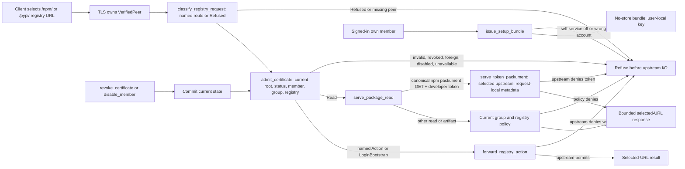

## What problem do we have?

Developers need to install, publish, and manage npm and Python packages through one selected Probation registry address. Today the install route rejects npm login and publishing, and Python upload is unavailable. Companies also need each request to use the right person's access policy without exposing their certificates, keys, or publisher tokens in project files.

## How will we solve it?

A company administrator chooses whether Probation or the organization issues each person's client certificate, manages people and groups, and configures registries. A developer installs their certificate locally and uses one chosen registry address for both reading and writing packages. Probation checks the certificate, current membership, group, and chosen registry on every request. Ordinary downloads follow group policy; the upstream registry decides whether a publishing or account change is allowed. A developer token may reveal metadata for a hidden npm package on its standard metadata request, even when no write follows; it never grants the package file or the later write.

## How will we confirm it is solved?

The pinned npm, pip, Twine, and uv clients must use that single address with a client certificate. Tests must show that allowed installs and writes work; a missing, revoked, foreign, or disabled person's certificate produces no package response or upstream request; hidden package files stay hidden; and an upstream-denied write stays denied even after its metadata was visible. Two users' metadata and two registries' packages must remain separate across concurrent requests and restarts. A signed-in person must receive only their own setup bundle, and disabling setup must stop new bundles while existing certificates still work. The full release check will also exercise the organization issuer, Python upload, 10,000 clients, secret scans, and zero direct client connections to upstream registries. The disposable client-shape probe and selected Slice 1 checks have passed; the full feature and later-slice checks have **not** passed yet.

## Decisions for approval

1. **Identity and address:** one unique client certificate identifies an active member; that member's current group controls ordinary reads. One selected organization registry URL serves reads and actions, without per-user hosts or fallback.
2. **Certificate providers:** Probation-issued certificates support optional signed-in, own-account setup and targeted revocation. Organization-issued certificates use public roots, exactly one membership UUID in a URI SAN, and the issuer's live signed status. Disabling setup stops new issue, not existing certificate validity.
3. **Revocation:** current authoritative state is checked every request; unavailable verification refuses. An already-admitted request may finish, while the next request after revoke or member disable refuses. Enterprise activation requires a real issuer read-after-write witness.
4. **Metadata exception:** a valid certificate plus developer token permits the selected upstream's response to a canonical npm packument GET, even without a later write and despite group read policy. The response remains request-local; tokenless, other reads, and artifacts remain group-filtered.
5. **Actions and secrets:** named login can begin without an upstream token; other actions require a developer credential and the upstream separately authorizes each write. Shared download credentials never authorize writes. Client private keys and tokens stay out of project files.
6. **Registry isolation:** IDs are never reused; project, cache, in-flight, and artifact state include the selected registry and ecosystem. A trusted registry skips only its own age delay. Target or ecosystem changes require removal and a new ID.
7. **Outbound safety and bounds:** HTTPS peers and redirects receive organization-specific checks; private destinations need operator-approved host, port, and address range. Upload, response, header, time, redirect, and login limits apply.
8. **Delivery order:** finish certificate-protected npm install, then enterprise certificates and registry isolation, then guarded npm reads, then npm actions, then Python and the full client matrix.

## Design evidence and affected flow

The following graph and declarations are the **proposed combined design**. Some Slice 1 source paths already exist and have structural checks, but this presentation does not claim that all declared behavior is implemented.



`VerifiedPeer` comes only from optional TLS client authentication; browser portal connections may omit it, package paths may not. The router selects an organization and immutable registry ID before admission. Admission verifies the preserved chain against that organization's **current** roots, leaf validity/client-auth purpose, exactly one URI SAN membership UUID, live status, active member/group and same-organization registry on each request. A request admitted before revocation may finish; the next request refuses. Status or management outage refuses without cached success. For organization-issued leaves, the saved status URL is only an expected AIA: save accepts only the URI SAN identity selector, activation checks a sample leaf, and every request requires matching leaf AIA plus fresh nonce, issuer+serial, signed `good` status. A real issuer must prove committed-revocation read-after-write before activation.

```rust
pub struct RegistryId(pub u64); // Never reused after registry removal.
pub struct VerifiedPeer { /* TLS-owned complete chain and handshake proof of leaf-key possession */ }
pub struct RegistryPrincipal { /* organization, member, current group/policy, registry, peer */ }
pub enum AdmissionError { NoCertificate, InvalidCertificate, Revoked, UnknownMember, WrongOrganization, Unavailable }

pub async fn admit_certificate(peer: VerifiedPeer, registry: RegistryId,
    ecosystem: Ecosystem, authority: &http::uri::Authority, client_ip: IpAddr)
    -> Result<RegistryPrincipal, AdmissionError>; // Current selected-org trust, status and member/registry join; fail closed.
pub fn classify_registry_request(ecosystem: Ecosystem, method: &Method,
    path: &str, query: Option<&str>) -> RegistryRoute; // Disjoint Read, LoginBootstrap, Action or Refused before I/O.
pub async fn serve_package_read(principal: &RegistryPrincipal, request: Request<Body>)
    -> Result<Response<Body>, ApiError>; // Current group policy except canonical token packument metadata; artifact remains filtered.
pub async fn forward_registry_action(principal: &RegistryPrincipal, request: Request<Body>)
    -> Result<Response<Body>, ApiError>; // Named action; selected upstream separately accepts or denies each write.
```

Both consumers take the same request-bound principal. Only named web-login start/poll may lack a developer token; other write/account actions require one. The shared read credential stays on authorized ordinary reads. Token-bearing canonical packument results bypass shared cache, persistence and in-flight coalescing, including when no write follows. Tokenless packuments, search/audit/ping, other metadata, and artifact GET/HEAD remain filtered; an artifact request repeats admission and reference checks. Unknown or alternate routes refuse. `apply_registry_state` partitions project, cache, in-flight and artifact identity by `(registry-id, ecosystem, package)`; target/ecosystem edits refuse, removal never reuses an ID, and ambiguous old rows invalidate safely. Trusted age skips only the selected registry's delay.

```rust
pub async fn issue_setup_bundle(session: &Session, organization: OrgId)
    -> Result<NoStoreBundle, IssueError>; // Own active member and enabled Probation self-service; key returned once.
pub async fn revoke_certificate(actor: &Session, member: MemberId, serial: Serial)
    -> Result<(), RevokeError>; // Authorized targeted revoke commits before success; next request refuses.
pub async fn disable_member(actor: &Session, member: MemberId)
    -> Result<(), MemberError>; // Current membership change blocks every certificate for that member next request.
pub async fn resolve_registry(organization: OrgId, registry: RegistryId,
    ecosystem: Ecosystem) -> Result<RegistrySnapshot, ResolveError>; // Refuse foreign, removed or wrong-ecosystem IDs.
```

Outbound registry and issuer-status connections are HTTPS. Public peers must be globally routable; private peers need an operator-approved exact host/port and organization CIDR. DNS answers, connected peer and each redirect hop are vetted and pinned with TLS hostname validation. Action and credential-bearing packument redirects refuse; artifact redirects lose credentials. `doneUrl` maps only an allowed selected-origin poll path back to the Probation URL, with query tokens redacted. The registry URL may be in project files; keys, client certificates, publisher tokens and shared read secrets stay in protected local/server storage. Bounds are `B=2A+M` upload, `M` metadata, `A` artifact, 64 KiB headers, 30-second idle/15-minute lifetime, five redirects and 120 login start/polls per admitted member/registry per minute.

### Security coverage attached to the operations

| Threat/property | Existing or planned structural spec/obligation | Evidence now; required witness |
|---|---|---|
| TM-04/TM-05: peer, current certificate, member and selected registry before grant | Slice 1 **PASS**: [`tls-peer-before-admit`](/home/john/go/src/github.com/postfix/probation/docs/plans/publishing-proxy/specs/tls-peer-before-admit.yaml), [`current-certificate-before-grant`](/home/john/go/src/github.com/postfix/probation/docs/plans/publishing-proxy/specs/current-certificate-before-grant.yaml); Slice 2 **PENDING**: [`live-status-before-grant`](/home/john/go/src/github.com/postfix/probation/docs/plans/publishing-proxy/specs/live-status-before-grant.yaml) | Structural guard order and unsafe controls only. Exact peer/UUID/registry SQL predicates need independent source review and wrong-value, cross-org, root-rotation, issuer/nonce/replay/outage and next-request controls. |
| TM-06: own setup, revoke and disable | Slice 1 **PASS**: [`self-service-before-bundle`](/home/john/go/src/github.com/postfix/probation/docs/plans/publishing-proxy/specs/self-service-before-bundle.yaml), [`certificate-revoke-before-success`](/home/john/go/src/github.com/postfix/probation/docs/plans/publishing-proxy/specs/certificate-revoke-before-success.yaml), [`member-disable-before-commit`](/home/john/go/src/github.com/postfix/probation/docs/plans/publishing-proxy/specs/member-disable-before-commit.yaml) | Member/update order only. Fake SSO, cross-account, self-service-off, commit and multi-certificate next-request witnesses. |
| TM-01/TM-02: known read, group policy and request-local token metadata | Slice 1 **PASS**: [`classify-before-dispatch`](/home/john/go/src/github.com/postfix/probation/docs/plans/publishing-proxy/specs/classify-before-dispatch.yaml), [`package-policy-before-send`](/home/john/go/src/github.com/postfix/probation/docs/plans/publishing-proxy/specs/package-policy-before-send.yaml); Slice 3 **PENDING**: [`canonical-token-packument`](/home/john/go/src/github.com/postfix/probation/docs/plans/publishing-proxy/specs/canonical-token-packument.yaml) | Exact route, accepted/denied token, hidden artifact and two-client sequential/concurrent/restart cache-isolation witnesses. |
| TM-03/TM-07: selected-origin action and publisher authority | Slice 4 **PENDING**: [`action-origin-before-send`](/home/john/go/src/github.com/postfix/probation/docs/plans/publishing-proxy/specs/action-origin-before-send.yaml), [`publisher-auth-before-send`](/home/john/go/src/github.com/postfix/probation/docs/plans/publishing-proxy/specs/publisher-auth-before-send.yaml) | Wrong-origin/DNS/redirect/secret controls; shared-read-denied preflight, allowed/denied upstream write and named tokenless login. |
| TM-05: registry state and age isolation | Slice 2 **PENDING**: [`registry-identity-before-state-use`](/home/john/go/src/github.com/postfix/probation/docs/plans/publishing-proxy/specs/registry-identity-before-state-use.yaml) | Guard order only; exact keys/references, migration/restart, same-name collision and warm trusted-A/untrusted-B age refusal. |
| TM-08: bounded traffic and availability | Existing network/rate controls apply; new response, upload, redirect and login bounds above | Slices 3–5 run B+1/M+1/A+1, oversized header, stalled response, sixth hop, 121st login and valid upload controls. |

The selected twelve specs cover the listed source operations; their PASS status proves selected structural call order under unsafe mutations, not exact Rust values, TLS provenance, SQL meaning or real-client behavior. The former `member-registry-before-grant` check was removed because the installed Rust analyzer could not prove the fluent SQL argument identity; independent review of `sync::admit_certificate` and wrong-member/registry runtime controls retain that required guarantee. The threat model is **MODELED** and Red Team is **SOUND**, both as design review evidence. Shared approved automatic model/source checks rerun per slice; proposed specs remain reviewable and changeable.

### Delivery order

| Slice | Working caller outcome | Decisive direct check and temporary limit |
|---|---|---|
| **Slice 1** | Signed-in own bundle → configured npm certificate → allowed install; missing/revoked/disabled refuses. | `E2E-publishing-certificate-npm`, group/self-service/unknown-route controls; one configured npm origin only. Seven source/control checks PASS; expanded E2E 1/1 was reported, with saved summary lagging. **No slice is complete.** |
| **Slice 2** | Enterprise certificates, several immutable registries and isolated same-name state. | `E2E-publishing-enterprise-registry`: signed status, issuer revoke next request, collision/age/restart/migration and private-peer refusals; real issuer integration required before activation. |
| **Slice 3** | Named npm reads and request-local canonical token packument exception. | `E2E-publishing-npm-read`: token A versus tokenless/denied B, no-write view, artifact and concurrent/restart isolation. |
| **Slice 4** | npm login, publish, deprecate and account actions on the same URL. | `E2E-publishing-npm-actions`: upstream allowed/denied writes, group-hidden deprecate, selected origin and secret controls. |
| **Slice 5** | pip/uv reads, Twine upload and full client matrix. | `E2E-publishing-full-matrix`: npm/Python, both providers, SSO, 10,000 clients, secret scans and zero direct client upstream connections; zero skipped rows. |

### Evidence status and remaining checks

| Property | Evidence/status | Assumptions/limits |
|---|---|---|
| Pinned-client one-URL, mTLS and credential request shapes | **Observed** disposable npm 11.21.1, pip 26.2.2, Twine 7.0.0, uv 0.13.5 probe; 34 TLS-authorized fake-registry requests; npm hidden-packument view without write, preflight and separate denied write. | Fake registry and internal client network; not Probation integration. |
| Declared certificate, registry, read/action, revocation and refusal flow | **PASS** finite model on twelve declared flows. | Operation contracts are premises, not code or full route-table proof. |
| Existing Slice 1 source checks | **PASS** seven structural specs with unsafe controls; source rebind names the actual call sites. | Exact member/registry values, route completeness, self-service switch and runtime effects require review/witness. |
| Slice 1 npm setup/install and refusals | Original red/green saved; expanded E2E 1/1 reported; clean rerun status in router says in progress. | Saved TDD summary does not enumerate every expanded assertion; Slice 1 remains incomplete. |
| Slices 2–5 source checks and client behavior | **PENDING** five absent-source specs and named E2E scenarios above. | Planned checks are not passing proof. Real issuer read-after-write, cache isolation, full matrix, resource bounds and egress remain open. |

Limits: The selected organization issuer must prove nonce-capable, issuer-authorized read-after-write OCSP before enterprise activation; operators must approve private host/port/CIDR. Model and seven source PASS results do not prove exact values or end-to-end behavior. Five later source checks and their runtime witnesses are pending.

Recommendation: Approve the corrected combined design: it preserves the approved one-URL/certificate and C34–C35 behavior, assigns each high-risk value and runtime claim to a specific slice, and has READY design QA with no findings.

Status: Gate 1 approved; Gates 2–4 reopened for this corrected source-contract design. Design QA is READY; fresh user approval is needed before Slice 1 completion. Router verification returned READY; its current result omitted `reportPath`, so the supplied [`gate-4-qa.md`](/home/john/go/src/github.com/postfix/probation/docs/plans/publishing-proxy/gate-4-qa.md) was read directly.

Sources: [`01-product.md`](/home/john/go/src/github.com/postfix/probation/docs/plans/publishing-proxy/01-product.md) C24/C29–C35; [`02-architecture.md`](/home/john/go/src/github.com/postfix/probation/docs/plans/publishing-proxy/02-architecture.md) D34–D37 and Flows; [`03-program-design.md`](/home/john/go/src/github.com/postfix/probation/docs/plans/publishing-proxy/03-program-design.md) interfaces, invariants and test plan; [`04-slices.md`](/home/john/go/src/github.com/postfix/probation/docs/plans/publishing-proxy/04-slices.md) slices 1–5; [`molecule-flow.json`](/home/john/go/src/github.com/postfix/probation/docs/plans/publishing-proxy/molecule-flow.json), [`molecule-contracts.json`](/home/john/go/src/github.com/postfix/probation/docs/plans/publishing-proxy/molecule-contracts.json); [`source-contract-rebind.md`](/home/john/go/src/github.com/postfix/probation/docs/plans/publishing-proxy/evidence/source-contract-rebind.md), [`client-shape-probe.md`](/home/john/go/src/github.com/postfix/probation/docs/plans/publishing-proxy/evidence/client-shape-probe.md), [`threat-model.md`](/home/john/go/src/github.com/postfix/probation/docs/plans/publishing-proxy/evidence/threat-model.md), [`red-team.md`](/home/john/go/src/github.com/postfix/probation/docs/plans/publishing-proxy/evidence/red-team.md), [`gate-4-qa.md`](/home/john/go/src/github.com/postfix/probation/docs/plans/publishing-proxy/gate-4-qa.md).

Approve the design, or what should change?
