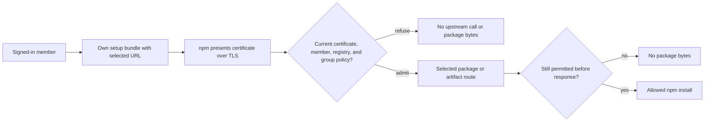

## Delivered

**Slice 1 — Probation certificate setup and npm install.** A signed-in member downloads their own setup bundle, then installs an allowed package with pinned npm through the certificate firewall. The selected registry URL is `/registry/npm/<id>/`; existing `/npm/...` package, version, and tarball URLs keep their meaning, including numeric package names. Missing, foreign, or revoked certificates, disabled or removed members, wrong routes, management outage, and a changed group policy refuse the read. Turning self-service off stops new bundles while an existing certificate can still read.



The URL change reaches the bundle, selected package/version/audit route registration, rendered artifact links, and the focused E2E scenario. The relevant route contract is:

```rust
// Selected registry identity is an explicit path segment; the legacy npm namespace stays separate.
.route("/npm/{package}/{version_or_tag}", get(npm_routes::package_version))
.route("/registry/npm/{registry}/{package}/{version}", get(registry_routes::version))
.route("/registry/npm/{registry}/artifacts/{reference_id}/{filename}",
       get(registry_routes::artifact).head(registry_routes::artifact))

// A decoded @scope/name is already one package; only an unencoded @scope needs the next segment.
if package.starts_with('@') && !package.contains('/') { /* join scope and package */ }
```

`registry_read::admit` requires certificate evidence and one active request permit; `registry_read::recheck` repeats current admission and policy before bytes without another rate charge. Signatures stayed unchanged in this URL revalidation. Slice 1 uses one configured npm registry.

## Proof

| Promise | Executed witness → observed result | Scope and limit |
|---|---|---|
| Distinct selected URL and legacy numeric URLs | Focused E2E first failed at `setup bundle selects the distinct npm registry namespace` on unchanged product source (0 passed, 1 failed); after the route change it passed (1 passed, 0 failed, 0 not run). | Real pinned npm install through fake SSO, TLS gateway, issuer, and origin; checked `/npm/123/1.0.0`, its legacy tarball, and selected `/registry/npm/<id>/123`. |
| Encoded scoped version and selected artifact | Focused E2E first returned HTTP 400 `INVALID_INPUT` for `/registry/npm/<id>/@e2e%2Fscoped/1.0.0`; after the one-condition parser fix it passed. | Checked selected artifact link and readable tarball; blocked scoped version returned 403. |
| Certificate boundary on selected routes | Final E2E passed independently twice: **1 passed, 0 failed, 0 not run** each time. | Package, encoded scoped version, and artifact each returned 401 for missing, foreign, and revoked certificates: nine refusals with no increase in fake upstream requests. |
| Build, model, and source controls | `cargo check --workspace` PASS; `router molecule-check` PASS; all seven due Slice 1 structural obligations and mutation controls PASS. | Source verifier overall PENDING only because three Slice 3/4 source files are absent; structural checks do not prove exact URL values. |
| Independent reviews | Code **SHIP**; security **CLEAR** for the bounded Slice 1 certificate-route gap; adversarial **PASS**; implementation QA **VERIFIED**. | Security review used admission inspection and the nine-request matrix; generic SMTC missing-guards analysis was Stub/Lossy, not clean proof. |

The selected URL and scoped-version fixes have behavioral red-to-green witnesses. The final nine-request matrix was added as a test-only check after the source fix. The earlier policy-change negative control and exact `POLICY_UNAVAILABLE` check remain recorded in the TDD evidence.

The final focused command was `test -f tests/e2e/scenarios/publishing-certificate-npm.mjs && TMPDIR="$PWD/.scratch/tmp" node tests/e2e/harness/run.mjs --only E2E-publishing-certificate-npm`. The new certificate-route matrix covers selected package, scoped version, and artifact reads; the seven approved source controls were rerun without a changed spec. No new Slice 1 security finding remains in the final reviews.

## Limits

The full Rust suite remains incomplete in this revalidation: its test Postgres timed out at `tests/common/mod.rs:108`. SMTC compile verification was also incomplete (`lsp_not_quiescent`), while `cargo check --workspace` passed. The source verifier's three pending checks belong to absent Slice 3/4 sources. The Slice 1 scenario uses a fake issuer and origin and one configured registry. Safe audit filtering and npm actions belong to later slices. Under approved C38, unsupported npm 11 bulk audit returns the selected upstream's error; Probation adds no audit server or bulk-to-quick translation.

## Next

**Slice 2 — enterprise certificates and registry isolation:** add organization CA trust and authenticated live status, several selected registries, and registry-isolated package and artifact state across restart. This removes the one-registry limit.

## Recommendation

Continue to Slice 2: the completed caller journey, selected URL compatibility, certificate refusals, and due controls passed their focused witnesses and independent reviews. The remaining limits are assigned to later slices or are explicitly unproved above.

Context: Gates 1–4 approved; Slice 1 complete; Slice 2 is the current boundary.

Sources: [Slice plan](/home/john/go/src/github.com/postfix/probation/docs/plans/publishing-proxy/04-slices.md) · [Slice 1 evidence](/home/john/go/src/github.com/postfix/probation/docs/plans/publishing-proxy/evidence/slice-1.md) · [red/green record](/home/john/go/src/github.com/postfix/probation/docs/plans/publishing-proxy/evidence/tdd-slice-1.md) · [status](/home/john/go/src/github.com/postfix/probation/docs/plans/publishing-proxy/00-status.md) · [route source](/home/john/go/src/github.com/postfix/probation/src/http/mod.rs:59) · [scoped parser](/home/john/go/src/github.com/postfix/probation/src/http/registry_routes.rs:66).

Continue to slice 2, or re-steer?
