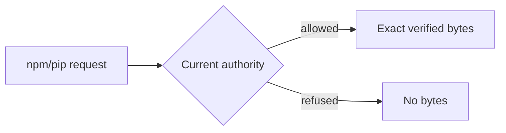

## Delivered

Approval recorded. Slice 1 is complete.

npm/pip now read through one shared policy without package-request login. Registry credentials stay separate from the policy API key. Remembered managed policy survives ordinary outages; refusal survives restart; neither falls back to standalone.



New [service entry point](/home/john/go/src/github.com/postfix/probation/src/http/service_registry.rs):

```rust
// Admits shared-policy reads and guards final handoff; unsafe requests refuse.
pub async fn respond(
    State(app): State<Arc<App>>, // Service configuration and authority.
    request: Request, // Selected or legacy package request.
    next: Next, // Existing registry handlers.
) -> Result<Response, ApiError> // Authorized response or refusal.
```

Already accepted streams can finish.

## Proof

| Property | Executed evidence | Limit |
|---|---|---|
| Integration | `cargo test --workspace`: 782 passed, 0 failed; `cargo check --workspace`: PASS | 21 ignored |
| Real npm/pip | `E2E-service-policy`: 1 passed, 0 skipped | Observed scenarios |
| Source ordering | 3 due + 3 existing checks; imported foundation 54: PASS | 3 Slice 3 checks pending |

Code SHIP; security CLEAR; adversarial PASS; independent verification VERIFIED. Four defects have behavioral RED→GREEN evidence.

## Limits

Global formal security proof remains unproved; some added acceptance controls lack chronological RED.

## Next

Slice 2: safe npm audit and token-packument behavior.

## Recommendation

Continue: required Slice 1 checks passed. Gates approved; completion recorded.

Sources: [delivery](/home/john/go/src/github.com/postfix/probation/docs/plans/publishing-proxy/evidence/slice-1.md), [verification](/home/john/go/src/github.com/postfix/probation/docs/plans/publishing-proxy/evidence/slice-1-verification.md), [status](/home/john/go/src/github.com/postfix/probation/docs/plans/publishing-proxy/00-status.md), [plan](/home/john/go/src/github.com/postfix/probation/docs/plans/publishing-proxy/04-slices.md).

Limits: audit/publishing, broader ecosystems and native OS acceptance remain later; 21 workspace tests were ignored. Checks were not rerun for this summary.

Type "next" to continue to slice 2, or re-steer?
