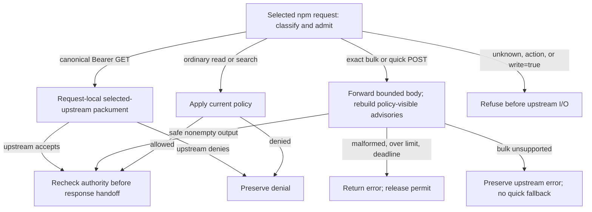

## Delivered

**Slice 2 is complete:** npm canonical token metadata and safe bulk/quick audit now work through the local shared service. An upstream-authorized Bearer request can read a policy-hidden canonical packument; denied and anonymous requests cannot reuse that metadata. Ordinary reads, legacy aliases, Basic reads and artifacts retain policy filtering.



`src/http/service_registry.rs` now preserves the bounded audit body and opens only the exact audit POST routes and selected GET search. `src/http/registry_routes.rs` checks the original `/registry/npm/<id>/` URI before applying the Bearer exception. Existing handler signatures, audit-filter and token-parser contracts are unchanged; no new dependency was added.

```rust
// Existing request: method/query select the operation; headers carry this
// request's registry credential; name identifies the requested npm package.
pub struct TokenPackumentRequest<'a> {
    pub method: &'a Method,             // Requested HTTP method.
    pub query: Option<&'a str>,         // Optional query; service refuses write=true here.
    pub headers: &'a HeaderMap,         // This request's upstream authorization.
    pub name: &'a PackageName,          // Parsed npm package name.
}
// Existing src/http/token_packument.rs operation: fetch selected-upstream
// metadata for one request, without shared metadata persistence/coalescing.
// Canonical/token checks precede sending; refusal/upstream errors propagate.
pub async fn serve_token_packument(
    app: &App,                         // Shared service dependencies.
    principal: &Principal,             // Admitted current registry/policy context.
    registry: u64,                     // Selected registry ID.
    request: TokenPackumentRequest<'_>, // Per-request method, credential and package.
) -> Result<npm::Rendered, ApiError>;   // Bounded rendered metadata or refusal/error.
```

The source-check blocker came from a strengthened attribution stage shipped from an uncommitted Factory change: legacy selector compatibility and declaration source closure were missing. The repair preserves the caller filter and intraprocedural dominance checks, hashes direct Rust declaration/module closure, rejects ambiguous bindings and rechecks closure after analysis. Complete selected-operation attribution and detecting unsafe controls remain required; unrelated unresolved calls are disclosed. Approved project specs/model and product source were unchanged by this tooling repair. No introducing Git commit is established.

## Proof

The initial behavioral RED was **HTTP 403 where accepted hidden metadata required 200**; the final rebuilt-image GREEN3 passes. Two intermediate fixture failures were corrected by awaiting policy activation and distinguishing a missing artifact's metadata lookup from unknown-route I/O; product/image bytes stayed unchanged during that diagnosis.

| Promise / property | Executed witness and observed result | Scope / evidence limit |
|---|---|---|
| Canonical token boundary and isolation, C35 | `node tests/e2e/harness/run.mjs --only E2E-publishing-npm-read --skip-build`: **1 passed, 0 failed, 0 skipped**; accepted/denied/anonymous, sequential/concurrent/restart and artifact refusal | Exact GREEN3 images and five-file subject in [slice-2.md](evidence/slice-2.md); concurrent probes do not force overlapping cold requests |
| Safe audit, C37/C38; bounds and recovery | Same GREEN3: nonempty gzip bulk/quick, safe fields, npm 11.21.1 advisory, malformed/over-limit refusal, bulk 404 with no invented quick request, 30-second deadline and sole-permit recovery | Body length/encoding plus inspected direct assignment; no independent byte-for-byte body witness or other npm-version claim |
| Compiler and regression baseline | `cargo check --workspace` PASS; `cargo test --test shared_service`: **4/0/0**; `cargo test --workspace`: **782 passed, 0 failed, 21 ignored** | Ignored native-client/resource/timing tests are not passing runtime evidence |
| Declared model and current source order | Installed `molecule-check` PASS; `molecule-verify --slice 2`, `run-9PMQUc`: **6 production PASS, 6 unsafe controls detected, 0 UNKNOWN**, **3 future Slice 3 PENDING** | Structural selected call-order assurance; selectedUnresolved=0, globalUnresolved=152; exact values/isolation use separate runtime/manual witnesses |
| Repair and installed tooling | Independent repair review SHIP; full mandatory Factory suite PASS; drift **299 entries, 0 drifted** | Installed release `7e8fca647076e63b75952e8850dc78c21a23861bafb9ac4ce8e6a9fdbc51cb83`; emergency provider evaluation matrix skipped |
| Independent acceptance | Product code **SHIP**, adversarial **PASS**, bounded security **CLEAR**, implementation verification **VERIFIED**; five product/test hashes and 27 installed archive bindings checked | Bounded reviews; optional adversarial strengthening controls are not observed defects |

Security coverage: existing `specs/canonical-token-packument.yaml` (`canonical-token-packument`) and `specs/audit-filter-before-render.yaml` (`audit-filter-before-render`) retain their checks and detecting controls. The unchanged current classification, response-release and publisher checks also pass in the six-check baseline. The [security recheck](evidence/slice-2-security-recheck.md) closes selected route authority, selected-origin credential isolation, safe audit disclosure and bounded permit lifetime by manual source review plus GREEN3; it grants no global formal clearance. No open scoped finding remains.

## Limits

Global formal security analysis remains **UNKNOWN**; source-order PASS does not prove whole-program safety, arbitrary Rust resolution, exact values or concurrency. Rust analyzer diagnostics remained unavailable; Cargo supplied the compiler check. Twenty-one tests remain ignored. Native Linux/macOS/Windows acceptance and full-matrix migration remain later work. The historical certificate-era evidence is not acceptance for this path.

## Next

Slice 3 delivers npm publishing and named management with selected-upstream credentials, plus service-scoped version unpublish: distinct DELETE routes, verified removal markers, one-use consumption, destination confinement, restart/concurrency and quota witnesses. Publishing/account actions and `?write=true` remain closed at this completed Slice 2 boundary.

## Recommendation

Continue to Slice 3: approved Slice 2 behavior, current required checks and independent reviews are complete. The remaining three source obligations belong to absent future Slice 3 sources.

Status: Transparent package publishing; Slice 2 — safe npm audit and token-packument behavior. Router records Slice 2 done with code SHIP, adversarial PASS, security CLEAR and qa VERIFIED; presentation boundary 2. No Slice 3 completion is claimed.

Proof line: E2E 1 passed/0 failed/0 skipped; workspace 782 passed/0 failed/21 ignored; compiler/model PASS; installed source 6 PASS and 6 unsafe controls, zero UNKNOWN, 3 future Slice 3 PENDING; tooling fullsuite PASS, drift 299/0; evidence/slice-2.md and slice-2-verification.md VERIFIED.

Sources: [Slice 2 evidence](evidence/slice-2.md), [verification](evidence/slice-2-verification.md), [code review](evidence/slice-2-code-review.md), [adversarial review](evidence/slice-2-adversarial.md), [security recheck](evidence/slice-2-security-recheck.md), [verifier review](evidence/slice-2-verifier-review.md), [active design](03-program-design.md), [active slice order](04-slices.md).

Type "next" to continue to slice 3, or re-steer?
