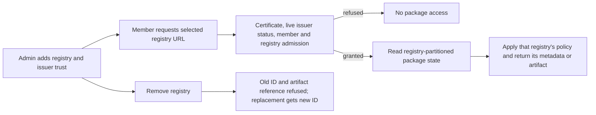

## Delivered

An organization admin can configure several npm registries and enterprise certificate trust. A member with a valid organization-issued certificate can install through the selected `/registry/npm/<id>/` URL. Each request checks current issuer status and membership; a revoked certificate, unavailable status source, or certificate from another organization is refused. The same package name can resolve to different metadata and artifact bytes in two registries, including after restart.

The affected caller flow is:



Changed contracts, with implementation signatures:

```rust
// A current management answer, certificate status and the selected registry
// determine the principal for this request; failures refuse admission.
pub async fn admit_certificate(&self, peer: &VerifiedPeer, registry: RegistryId,
    socket: IpAddr, headers: &HeaderMap, charge_rate: bool)
    -> Result<Principal, Refusal>;

// `live-status-before-grant`: only a current signed Good response grants access.
pub async fn resolve_enterprise_certificate(peer: &EnterprisePeer<'_>)
    -> Result<(), EnterpriseRefusal>;

// `registry-identity-before-state-use`: validate the selected namespace and
// artifact reference before reading persisted project state.
pub async fn apply_registry_state(store: &StoreHandle, registry: u64,
    package: &str, reference: Option<&ReferenceRow>)
    -> StoreResult<Option<ProjectRow>>;

// The registry ID joins ecosystem and name in the cache identity.
impl ProjectKey {
    pub fn in_registry(registry_id: u64, ecosystem: Ecosystem,
        name: impl Into<String>) -> ProjectKey;
}
```

The admin catalog/add/remove routes and `ReferenceId::compute_in_registry` bind registry IDs to configuration and artifact references. Registry target and ecosystem edits are refused; remove and re-add creates a new ID. The existing Slice 1 certificate and npm read signatures remain in use.

## Proof

| Promise | Executed witness and observed result | Scope |
|---|---|---|
| Distinct selected URLs work | The old `/npm/{id}/` scenario failed with `selected roots answered: A=401, B=401`; the updated selected E2E passed **1/1 twice** on `/registry/npm/{id}/`. | Two registries, returned artifact URLs and bytes, restart, old ID/reference refusal, replacement ID and second firewall. |
| Enterprise status refuses unsafe access | The selected E2E passed good-to-revoked, wrong issuer/serial/nonce/replay, outage, root rotation, live session/member/role changes and private destination checks. | Fake signed issuer; real issuer read-after-write remains required. |
| Build, model and source controls | `cargo check --workspace` and `router molecule-check` passed. `router molecule-verify --slice 2` passed all **nine due** source obligations; three future obligations were pending because their Slice 3/4 sources are absent. | The two Slice 2 structural specs prove guard order; runtime and source review support exact values, isolation and restart. |
| Independent review | Code **SHIP**; security **CLEAR**; adversarial **PASS**; implementation QA **VERIFIED**. | Broad analyzer inventories were Stub/Lossy and were not used as proof of absence. |

Exact selected witness: `test -f tests/e2e/scenarios/publishing-enterprise-registry.mjs && TMPDIR="$PWD/.scratch/tmp" node tests/e2e/harness/run.mjs --only E2E-publishing-enterprise-registry` → **1 passed, 0 failed, 0 not run**. The Slice 2 `specs/live-status-before-grant.yaml` and `specs/registry-identity-before-state-use.yaml` controls passed for guard order, including their unsafe controls. Unchanged approved source checks also passed for all nine obligations due through Slice 2.

The historical full Rust suite passed **748 tests, 0 failed, 21 ignored** before the final portal race fix. The rebuilt-image selected E2E and workspace compilation passed after that fix; the full suite was not rerun for the later test-only URL migration.

## Limits

A real selected enterprise issuer must demonstrate committed-revocation read-after-write status before production activation. Three source checks belong to Slices 3 and 4. The selected E2E uses disposable registries and a fake issuer.

## Next

Slice 3 adds guarded npm reads, the approved token-bearing canonical packument exception and reduced, group-safe bulk and quick audit advisories. Probation remains a proxy: an unsupported npm 11 bulk audit returns the selected upstream registry's error. No audit server or synthetic fallback is planned.

## Recommendation

Continue to Slice 3. Slice 2's selected URL, certificate and registry-isolation behavior passed its direct witness and independent reviews; the real-issuer condition is an operational prerequisite for production activation.

Status: Slice 2 complete; Slice 3 is the current boundary.

Sources: `04-slices.md` Slice 2/3; `evidence/slice-2.md` direct witness, revalidation and reviews; `evidence/tdd-slice-2.md` red/green controls; `00-status.md` completion proof; `src/managed/mod.rs`, `src/managed/enterprise_certificate.rs`, `src/store/registry_state.rs`, `src/store/cache.rs`, `src/artifacts/reference.rs`, and `tests/e2e/scenarios/publishing-enterprise-registry.mjs`.

Continue to slice 3, or re-steer?
