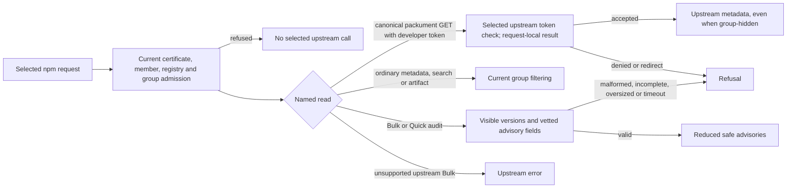

## Delivered

Slice 3 completes guarded npm reads on the selected `/registry/npm/<id>/` URL. A certificate-bearing client can install, view, search, fetch artifacts, use whoami/ping, and request Bulk or Quick audit through the selected registry. The legacy `/npm/123/1.0.0` and numeric tarball routes keep their earlier meaning; unknown selected routes refuse before upstream access.

| Changed route/operation | Delivered contract |
|---|---|
| `classify_registry_request`, `serve_package_read` | Named selected npm reads use the distinct URL. A canonical packument GET with a developer token can return upstream-authorized hidden metadata, including `npm view` without a write. Its result bypasses shared cache, persistence and in-flight reuse. Tokenless metadata and artifact GET/HEAD stay group-filtered. Credential-bearing redirects refuse. |
| `src/http/audit_filter.rs::filter_audit_response` | Bulk and Quick results are rebuilt from canonical names, currently visible exact versions, validated severity, generic title and generated ID. Upstream title, URL and metadata are omitted. Invalid, incomplete and over-limit data fail rather than reporting clean. Work shares a 30-second deadline, at most 1,024 distinct visibility lookups and 16 concurrent lookups. Unsupported Bulk remains the selected upstream's error; direct Quick remains available. |

## Proof

| Promise | Executed witness and result | Scope/limit |
|---|---|---|
| Token-private metadata cannot cross clients; ordinary reads remain filtered | Focused npm 11.21.1 E2E passed sequential, concurrent and restart token A/none/denied cases, hidden artifact refusal, two certificate providers, search, and no direct client upstream egress. A pre-fix same-origin redirect sent the token twice; the final route sent it once and returned 502. | Fake selected registries and isolated E2E networks. |
| Audit reports visible facts without false clean | Pre-fix Bulk/Quick returned hidden names and title/URL/metadata; pre-fix mixed Quick returned 200 for a nonempty vulnerability. Both behavioral reds became green. The final focused E2E passed **1/1**, 0 failed, 0 skipped, including real npm 11 visible advisory detection, Bulk 404 transparency, direct Quick, malformed and 1,025-name refusal, M+1 input/output and 30-second timeout with permit release. | Added bound and admission controls had no separate pre-fix red. |
| Read admission and structural order | Both audit POST routes returned 401 with no certificate, foreign organization certificate and revoked enterprise certificate, without selected upstream calls. `cargo check --workspace` and `router molecule-check` passed. All ten due source obligations and unsafe mutation controls passed; `audit-filter-before-render` was kept unchanged. | Source checks establish call order, while E2E and review establish selected values and bytes. Overall source verification is PENDING only for two absent Slice 4 action sources. |
| Independent review | Code **SHIP**, security **CLEAR**, adversarial **PASS**, implementation verification **VERIFIED**. | SMTC Rust diagnostics and generic guard graph were incomplete; `cargo check` and route-level controls supplied the relevant checks. |

## Limits

This is the approved proxy-only audit behavior: npm 11 receives an error if its selected registry does not support Bulk; Probation does not fabricate a Quick fallback. A real organization issuer must still prove its committed-revocation freshness before activation. npm actions remain Slice 4 work.

## Next

Slice 4 adds npm login, publishing and package/account administration on the same selected URL. Each write needs the selected upstream's own authorization.

## Recommendation

Continue to Slice 4: the focused read witness, due source checks and independent reviews passed, with the listed operational and analyzer limits visible.

Status: Slice 3 complete; Slice 4 is the current delivery boundary.

Sources: [Slice plan](04-slices.md#slice-3-interfaces), [Slice 3 evidence](evidence/slice-3.md), [red/green record](evidence/tdd-slice-3.md).

Continue to slice 4, or re-steer?
