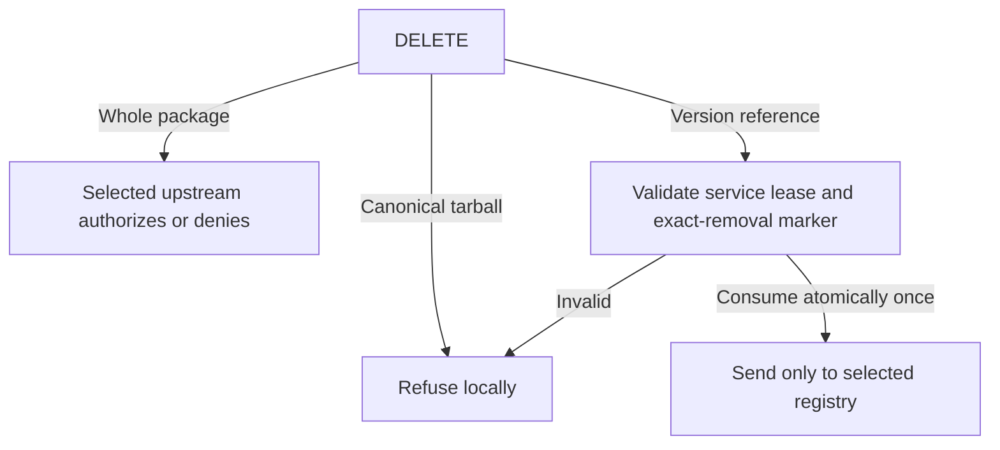

## Delivered

**Slice 3 is complete.** Yes—the remaining blockers were SF defects: Factory receiver/lexical checks and SMTC call-order checks. Repairs are installed; product code stayed frozen and approved guarantees unchanged.

A developer can publish, deprecate, and remove npm content through the selected registry URL. Package-manager credentials go only to that selected registry. The scoped package request `@scope%2fexample`, which had returned 404, now resolves and returns 200 in the native npm check.

The DELETE target determines the outcome. Removing a whole package leaves the authorization decision to the selected upstream. A direct canonical tarball removal is refused locally. Removing a version reference requires a valid lease for this service and an exact accepted-removal marker; the marker is consumed once before the request is sent. Invalid or already spent authority does not reach the upstream.

The product's scoped-name correction was complete before final verification. The remaining failed checks came from SF's receiver attribution and SMTC's call-order analysis. Those tooling repairs passed their scoped safe and unsafe controls; the approved product guarantees did not change.

The request path is:



Scoped-name fix; unchanged signature in `src/http/service_registry.rs`:

```rust
// Decode once; invalid names: NotFound.
fn parse_uri_package(
    raw: &str, // URI name.
) -> Result<crate::npm::PackageName, ApiError> // Valid name/error.
```

## Proof

| Promise | Executed result | Limit |
|---|---|---|
| Scoped npm actions | Native npm PASS; prior `@scope%2fexample` 404 becomes 200 | Linux lane |
| Runtime safety | Workspace 786 passed/0 failed/22 ignored; actual quotas separately PASS; fresh compiler + 8 HTTP tests PASS | Finite cases |
| Guard ordering | Installed 9 source checks + 9 detecting controls PASS | Structural |
| Tool repair | Factory full suite PASS; drift 299/0; four installed SMTC pairs PASS | Scoped |

The native npm check exercises the corrected scoped request; the workspace and quota checks exercise runtime behavior. The nine installed source obligations and nine detecting controls check guard placement and their unsafe counterparts. These are scoped structural results, so the independent code, security, adversarial, and QA reviews still carry the broader acceptance decision: code **SHIP**, security **CLEAR**, adversarial **PASS**, QA **VERIFIED**.

## Limits

Partial writes can remain uncertain; failed sends spend markers. Assumptions: trusted storage/upstream responses.

## Next

Slice 4: PyPI publishing and uv workflows; unstarted.

## Recommendation

Continue: required guarantees verified.

Status: Slices 1–3 complete; awaiting continuation.

Sources: [Current evidence](/home/john/go/src/github.com/postfix/probation/docs/plans/publishing-proxy/evidence/slice-3.md), [Final verification](/home/john/go/src/github.com/postfix/probation/docs/plans/publishing-proxy/evidence/slice-3-verification.md).

Provider evaluation matrix unrun; broader SMTC failures and missing historical RED remain. No whole-tool green claim.

Type "next" to continue to slice 4, or re-steer?
