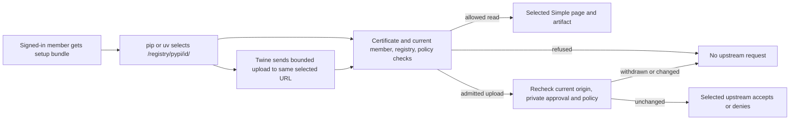

## Delivered

The selected Probation registry now supports Python installs with pip and uv, and wheel or source uploads with Twine. A signed-in member can run a user-local setup bundle for the same selected Python URL used by their project. Reads still follow the certificate holder's current group policy; the selected upstream alone accepts or denies an upload. The legacy `/pypi/...` path remains separate.

The shared admission, read and action contract signatures remain as approved; Slice 5 connects them to selected PyPI routes. The deciding changed operation is `src/http/pypi_routes.rs::selected_upload`: it accepts the selected registry, certificate-backed request and multipart body, then rechecks the registry origin, current private CIDR approvals and policy after streaming, before the upstream POST. A changed approval returns 503 with no upstream POST. Python setup writes client credentials to user-local settings; project-file scans check that keys and publisher tokens stay out of generated files. Legacy routing and npm behavior retain their approved contracts.

## Proof

| Promise | Executed witness and observed result | Scope |
| --- | --- | --- |
| Python and uv work through the selected URL across certificate modes | `test -f tests/e2e/scenarios/publishing-full-matrix.mjs && node tests/e2e/harness/run.mjs --only E2E-publishing-full-matrix` passed: 19/19 real runners, 41 rows × 3 modes = 123/123 observed, zero missing; JUnit 1 passed, 0 failed, 0 skipped. It includes pinned pip, Twine, uv and earlier npm operations, fake SSO, group refusals, secret scans and no observed direct package-client upstream connection. | Client execution against isolated fake services; not a production issuer or registry. |
| Scale and revocation work for both providers | X09 admitted 10,000 distinct successful TLS certificate fingerprints per provider from the isolated client; duplicate-certificate negative control, targeted oldest-leaf revocation, disabled issuance and cross-organization refusal passed. | Pinned client and fake issuer. |
| Withdrawn private destination cannot receive a paused upload | Before the fix, releasing a held multipart body after approval withdrawal returned 200 and upstream POSTs rose 1→2. After the CIDR recheck, it returned 503 and POSTs stayed 1→1; retained approval still returned 200. | Focused live streaming regression. |
| Current source satisfies declared controls | `cargo check --workspace --offline`, finite `molecule-check`, and 21/21 `molecule-verify --slice 5` checks passed at `run-yl1wct`; independent code, security, adversarial and implementation reviews returned SHIP, CLEAR, PASS and VERIFIED. | Compiler, finite model and structural source checks have their own limited scope; they do not replace the client witness. |

## Limits

The full Rust workspace suite has no PASS: an unchanged logging test hung after SIGTERM while its child waited in DNS resolution. The exact hostname and whether DNS is its sole cause are unproved. Organization-issued activation still requires the approved real issuer read-after-write revocation integration witness; the release matrix uses a fake issuer.

## Next

Slice 5 completes the approved delivery order. The decision is whether to complete Transparent package publishing with these recorded limits or re-steer the plan.

## Recommendation

Complete the feature: the exact final client matrix, focused private-approval race, current-source controls and independent reviews meet Slice 5's acceptance scope. Keep the Rust-suite and real-issuer limits visible for operational follow-up.

Status: Slice 5 verified complete; presentation boundary 5; 35-path final manifest and status SHA-256 `0eee769c10c3d58119bdab6cc63d7712a8cde88a3b3b88695b2adc684a1e5ea2`.

Sources: `04-slices.md` Slice 5; `03-program-design.md` route and certificate contracts; `01-product.md` success metric; `evidence/slice-5.md` final acceptance, race, manifest and reviews; `evidence/tdd-slice-5.md` red/green witnesses; router Slice 5 completion proof.

Complete the feature, or re-steer?

## Post-presentation correction — 2026-10-30

The Limits and Recommendation above record what was presented at the approval boundary; their Rust-suite and issuer-test statements are superseded. After starting the disposable test PostgreSQL service and correcting the authorization scan's exact allowlist for the reviewed PyPI upload route, the complete Rust workspace suite passed **762 tests, 0 failed, 21 ignored**. The formerly hung logging test passed in both focused and full-suite runs. A fresh containerized OpenSSL issuer scenario passed **1/1**: signed OCSP status changed from good to revoked after the issuer's on-disk revocation commit, activated the organization provider, and refused a revoked live certificate on the next request. This is a local issuer simulation; each actual organization activation still runs its own required good-to-revoked check against its configured issuer. Details and logs are in `evidence/slice-5.md`.
