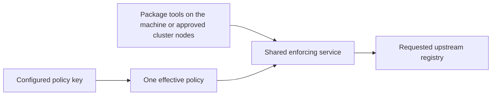

# Product: Rated load guard

## Release amendment authority

The current target is nine families: npm, PyPI, Maven, Go modules, Cargo, NuGet, RubyGems, Conan and Docker/OCI. Clients enforce locally and download directly on Linux, macOS and Windows; the optional policy server runs on Linux only. The policy API key authenticates policy retrieval, while registry credentials remain configured in the package managers. Explicit standalone TOML operation remains available. C1006/C1008/C1009/C1013/C1015–C1018 and the [lead release scope](../package-firewall-mvp/01-product.md) govern this amendment; earlier thirteen/sixteen/seventeen-family and certificate-specific text is historical where it conflicts.

This plan owns bounded delivery memory, counted shedding, separate shedding health, and measurements against named workload/platforms. Recheck bounds for the new identities/platforms. Existing delivery-pipeline measurements do not prove new registry or full-client throughput.

Managed policy outage and propagation reuse management C19/C20: remembered central policy can continue during an outage, unknown keys cannot acquire policy, and reachable-server updates/revocations follow the configured interval (one minute by default). Never silently select weaker standalone TOML after a managed failure. Client/device administrators can bypass local enforcement unless existing device/network controls prevent it; this release does not add host attestation.

No new desktop GUI or account/membership workflow is required. Existing API-key, group-policy and registry administration screens are reused with revised setup text and nine-family choices; obsolete certificate-only controls are retired. Exact changed screen content, migration and CLI setup are part of the combined design before implementation. Native GitHub Actions client tests cover all three OSes, with Linux server integration and explicit Docker engine/runner limits.

RubyGems is critical and is the first added ecosystem after the shared-service foundation. CPAN is omitted (C1027); no new CPAN adapter, policy options or acceptance lane is required.

## Clarifications and decisions

| ID | Class | Status | Owning Gate | Target Gate | Question or disposition | Selected value or policy | Decision source |
|---|---|---|---|---|---|---|---|
| C1 | user clarification | resolved | 1 | none | What does "rated load" mean to an operator: a throughput number the firewall promises, headroom the operator can observe, or a measurement they re-run on their own hardware? | A measured ceiling. The project publishes a rated-load figure on named reference hardware, and a repeatable benchmark in the repository proves no decision record is lost below it. Rejected: reporting queue headroom only (promises the operator nothing), and a documented procedure each operator runs themselves (makes every operator discover the same number). | user answer, Gate 1 grilling Q1 |
| C2 | user clarification | resolved | 1 | none | Does the rated-load figure describe the whole firewall serving requests, or the decision-record delivery pipeline? | The delivery pipeline: decision records per second offered to the sinks, with none lost. It measures the promise itself instead of a stubbed upstream registry's speed, and because the firewall emits exactly one decision record per request, an operator reads the figure as requests per second. | user answer, Gate 1 grilling Q2 |
| C3 | user clarification | resolved | 1 | none | What does the benchmark do when the measured ceiling is below the published figure — fail a run that gates merges, or report a number a human reads? | Gate on a deliberately low floor. The published figure comes from a quiet reference machine; the automated check asserts only a fraction of it, so a real collapse fails the run while ordinary CI noise does not. The floor is a second published number, separate from the rated figure. Rejected: gating on the full figure (fails on other people's builds), and reporting only (a regression sits unnoticed). | user answer, Gate 1 grilling Q3, ADR candidate |
| C4 | user clarification | resolved | 1 | none | Does this feature change how the firewall behaves under load, or only measure and publish what it already does? | Both. The feature measures and publishes the rated figure and the CI floor, **and** gives the operator a configuration key for delivery queue capacity, so an operator running above the rated load can trade memory for headroom instead of losing records. The default keeps today's behaviour exactly, so an operator who sets nothing sees no change. | user answer, Gate 1 grilling Q4 |
| C5 | current-Gate decision | deferred | 1 | 2 | The name of the queue-capacity configuration key, where it sits among the existing `log_*` / `siem_*` keys, and whether one key covers both sinks or each sink gets its own. | Not selected at Gate 1: a naming and placement choice, not a product outcome. Product requires only that an operator can raise delivery queue capacity by configuration, that the key is expressed as memory (C6), and that leaving it unset uses the stated larger memory-budget default selected in C12, while serving behavior and drop-and-count remain unchanged. | Deferred to Gate 2, Gate 1 grilling Q4 |
| C6 | user clarification | resolved | 1 | none | What does the operator write in that key: a number of records, or an amount of memory? | An amount of memory, the same shape as the existing `cache_max_bytes` / `memory_cache_max_bytes` keys. It bounds the resource that actually hurts a host, rather than a count whose memory cost varies with package-name length. The operator documentation must therefore state how many seconds of collector downtime a budget buys at the rated load, since the operator cannot derive it from the budget alone. | user answer, Gate 1 grilling Q6 |
| C7 | user clarification | resolved | 1 | none | When the queue reaches its budget, what does the firewall do? | Keep dropping and counting, exactly as today — package serving is never slowed or failed — and additionally make the shedding state visible on a health signal, so an operator sees it without reading logs. Rejected: making the request wait for queue space, which reverses the approved promise that delivery never slows a request and would let a wedged collector throttle package traffic. | user answer, Gate 1 grilling Q7 |
| C8 | user clarification | resolved | 1 | none | Which health signal carries "records are being shed", given that a failing readiness probe removes the firewall from service? | A separate signal. `/health/ready` keeps its current meaning and stays green while records are shed, so an overloaded firewall is never pulled out of the serving pool because of log loss. The shedding state is reported on its own surface for an operator to alert on. Rejected: failing readiness (stops package traffic to protect log records, which inverts the priority), and logs plus counters only (the user chose visibility in C7). | user answer, Gate 1 grilling Q8, ADR candidate |
| C9 | current-Gate decision | deferred | 1 | 2 | The shape of that separate signal and what it is called. The options are a new endpoint, a counter or metrics surface, or a response body added to an existing health route — noting that `/health/ready` returns a bare status code with no body today (`src/http/health.rs`), so "a field on the readiness body" would mean introducing one. | Not selected at Gate 1: an interface choice. Product requires only that an operator can see and alert on "records are being shed" without reading log records, and that `/health/ready` keeps its current meaning and stays green while shedding (C8). | Deferred to Gate 2, Gate 1 grilling Q8 |
| C11 | current-Gate decision | deferred | 1 | 2 | The CI floor's value: what fraction of the rated figure it asserts, and whether it is expressed as a fraction or as its own absolute number. | Not selected at Gate 1: it depends on the measured spread between the reference machine and the CI runner, which this feature produces. Product requires only that the floor is published beside the rated figure, that it is low enough not to fail on ordinary CI noise, and that a collapse of the delivery pipeline fails the run (C3). | Deferred to Gate 2, Gate 1 grilling Q3 |
| C12 | user clarification | resolved | 1 | none | The Success metric promised outage tolerance in minutes at the default, but today's default is a fixed 4096 records per sink (`src/delivery/mod.rs:37`), which at the Problem section's own 200 requests per second is about 20 seconds. Publish the real number at the unchanged default, or raise the default? | Raise it modestly to a stated default memory budget, and publish whatever tolerance that budget actually yields, in the unit it comes out as. The unset default becomes a memory budget expressed the same way as the new key (C6), so the default and the key mean one thing rather than two units. This supersedes the literal reading of C4: the default queue capacity does change. What does not change is serving behaviour, the drop-and-count rule, and every other shipped default. | user answer, Gate 1 grilling Q11, ADR candidate |
| C13 | current-Gate decision | deferred | 1 | 2 | The default memory budget's value, and whether it is one budget per sink or one shared. | Not selected at Gate 1: it trades host memory against tolerance and needs the measured record size this feature produces. Product requires that it be materially longer than today's roughly 20 seconds at the rated load, that its memory cost be bounded and stated per sink, and that the operator documentation publish the tolerance it yields (C6, C10). | Deferred to Gate 2, Gate 1 grilling Q11 |
| C10 | user clarification | resolved | 1 | none | Which number decides whether this feature succeeded? | Both numbers, with throughput as the headline: the rated figure (zero records lost at N records per second, sustained), and the outage tolerance derived from it and the default budget (at the rated load, a default deployment survives a collector outage of M minutes without losing a record). The promise being closed is about loss at rated load, so the figure leads; the operator sizing a budget needs the minutes. | user answer, Gate 1 grilling Q10 |
| C1001 | user clarification | resolved | 1 | none | Which existing plans receive the Nora/Dozor ecosystem expansion? | All five: Package Firewall MVP, management server/portal, OSV intelligence, decision log delivery and rated load guard. Recheck delivery-memory accounting, record-size bounds, queue shedding and published rated-load evidence against the added ecosystem identities. Existing published measurements remain historical results for their measured workload until representative new workloads are tested. | user answer 2026-11-02 selecting all five plans; initial request to support every Nora format and reuse Nora/Dozor code where practical |
| C1002 | user clarification | resolved | 1 | none | Must package-manager and registry authentication compatibility be established before design? | Yes. Check every target client/registry against Probation's actual SSL/TLS and application-authentication mechanisms, separately for client-to-firewall, firewall-to-management and firewall-to-upstream connections; change the architecture where required rather than assume universal support. | user steering 2026-11-02: check whether all package managers and registries support the SSL auth currently used and whether architecture must change |
| C1003 | current-Gate decision | deferred | 1 | 2 | Which scoped policy API, client identity/enrollment, policy-source transition, transport and protocol contracts implement the selected C1006/C1008/C1009/C1015 client and policy-source outcomes? | Not selected at Gate 1. API-key authentication to the policy server and server-independent TOML operation are selected product outcomes; exact endpoints, mode switching, compatibility migration and client packaging require design; credential ownership is already selected in C1015. | Deferred to Gate 2 from C1006/C1008; user answer 2026-11-02 |
| C1004 | research fact | resolved | 1 | none | What exactly does Nora support, and what can be borrowed? | Seventeen format families, with differing proxy/hosted and policy capabilities. Nora and Dozor own code is MIT with notices to preserve; Dozor version matching is npm-only. Transport support is not proof of equivalent Probation policy or OSV coverage. | sf-research ANSWERED, [../package-firewall-mvp/evidence/research-nora-dozor-reuse.md](../package-firewall-mvp/evidence/research-nora-dozor-reuse.md), pinned Nora 7a6cd780 and Dozor 93f1f091 |
| C1005 | research fact | resolved | 1 | none | Which current authentication contract must the expansion account for? | Selected organisation registry reads and writes require a unique client certificate identifying an active member and their current group. Legacy managed routes still use Basic/bearer API keys; firewall-to-management uses its own bearer token. This describes implemented baseline behavior. C1006/C1008 replace mandatory package-client certificate identity in the target design; registry isolation and upstream authorization remain requirements. The owning publishing-proxy plan is reopened. | sf-repo-view PARTIAL structural evidence, [../package-firewall-mvp/evidence/repository-ecosystem-auth.md](../package-firewall-mvp/evidence/repository-ecosystem-auth.md); ../publishing-proxy/01-product.md C29–C35 |
| C1006 | user clarification | resolved | 1 | none | How should clients without native client-certificate support participate? | A locally installed client uses API-key authentication to the policy server. Native package managers no longer need a Probation TLS client certificate in the target design. The policy-server key stays distinct from upstream registry/publisher credentials. This replaces the certificate-forwarding-bridge proposal; C1009 selects local enforcement and direct registry traffic. | user answer, Gate 1 grilling Q2, 2026-11-02; ADR candidate |
| C1007 | research fact | resolved | 1 | none | Does every target standard client natively support the current certificate admission contract? | No universal native-client support. Cargo and Go client-certificate support remains proposed; multiple other clients or endpoint classes remain unknown. Documented certificate settings in other clients do not prove full install/publish/redirect coverage. The survey concerns the former certificate-only design; the new installed-client/API-key direction does not require native package-client mTLS. New interoperability remains unproven until its own runtime checks pass. | sf-research UNKNOWN, [../management-server/evidence/research-ecosystem-auth.md](../management-server/evidence/research-ecosystem-auth.md), 17-format primary-source matrix, 2026-11-02 |
| C1008 | user clarification | resolved | 1 | none | Must the backend remain usable without a policy server? | Yes. Preserve explicit self-hosted standalone deployment configured through TOML, without a central policy-server dependency, alongside managed operation using the local client and policy-server API key. Standalone is a selected deployment mode; this answer does not select automatic fallback after a managed authentication or network failure. | user answer, Gate 1 grilling Q2 follow-up, 2026-11-02 |
| C1009 | user clarification | resolved | 1 | none | Does the local client enforce policy and fetch directly from registries, or forward packages through a shared backend? | The installed client enforces policy locally and fetches package metadata/artifacts directly from the selected registries. No shared package-data backend is required for that managed-client path. The same enforcement engine remains usable as a standalone TOML-configured backend. API-key policy retrieval and registry credentials retain separate authority; credential custody and managed-mode bypass controls still require design. | user answer, Gate 1 grilling Q3, 2026-11-02: Enforce locally; fetch registries directly; ADR candidate |
| C1010 | research fact | resolved | 1 | none | What existing behavior supports standalone and optional managed operation? | Config.management is optional; absent management chooses TOML cooldown/OSV plus a separate blocklist file. Managed outages retain remembered central policy, not local TOML. Local API-key policy retrieval needs a scoped endpoint; a fleet token is not equivalent to a user/client policy key. Mode changes can weaken policy and need a selected trust model. PARTIAL structural evidence, not a tested new client. | sf-repo-view, [../package-firewall-mvp/evidence/local-client-policy-modes.md](../package-firewall-mvp/evidence/local-client-policy-modes.md), 2026-11-02 |
| C1011 | research fact | resolved | 1 | none | Which Nora families have public distribution sources and meaningful firewall use cases? | Sixteen have concrete public sources, including Debian/APT and RPM repositories, Terraform providers/modules, ConanCenter and the Hugging Face model hub. Go uses a public mirror over source repositories. Raw is Nora hosted generic storage without a defined ecosystem upstream. Public existence alone does not establish equivalent policy coverage. | sf-research ANSWERED plus main-agent official APT/Terraform checks, [../package-firewall-mvp/evidence/research-public-ecosystems.md](../package-firewall-mvp/evidence/research-public-ecosystems.md), 2026-11-02 |
| C1012 | user clarification | resolved | 1 | none | Should the expansion follow Nora format count blindly or check public-source firewall value? | Check every format for public distribution and a useful artifact-policy outcome before finalising scope. The user proposes omitting APT based on an absence-of-public-sources premise; C1011 corrects that premise. Final include/defer choices follow C1013, not the disproved premise. Existing npm/PyPI private-registry and publishing requirements are not removed by this research request. | user request 2026-11-02 to check APT, Terraform and other formats for public registries and firewall purpose |
| C1013 | user clarification | resolved | 1 | none | Which formats belong in this release? | C1027 amends the original ten-family Q5 selection: npm, PyPI, Maven, Go modules, Cargo, NuGet, RubyGems, Conan and Docker/OCI only. RubyGems is critical; CPAN is omitted. Terraform, Ansible Galaxy, APT, RPM, Hugging Face, Raw and unlisted Dart/Pub remain outside this release. | user Q5 selection, amended by user C1027 on2026-11-02 |
| C1015 | user clarification | resolved | 1 | none | Where are upstream registry credentials configured? | In the package managers, by the user or CI job, not on the firewall. Preserve the existing credential-bearing publishing request path and upstream authorization. The firewall does not configure or manage registry credentials. Its separate service key authenticates policy retrieval only and is never sent to registries. This applies to managed and standalone operation. | user answer, Gate 1 grilling Q6, clarified explicitly 2026-11-02: credentials are configured in package managers, not on the firewall |
| C1016 | user clarification | resolved | 1 | none | Which operating systems must the installed client support in this release? | Linux, macOS and Windows. The local enforcing client must install, run and use the selected package/container workflows on all three; existing Linux/macOS build configuration is baseline evidence, not proof of new Windows or installed-client support. Exact architecture/install/lifecycle contracts are designed under C1003. | user answer, Gate 1 grilling Q7, 2026-11-02: Linux, macOS and Windows |
| C1017 | user clarification | resolved | 1 | none | Which operating systems must host the central policy server? | Linux only. Client support remains Linux, macOS and Windows. The optional standalone TOML backend remains a separate deployment mode; Linux-only policy-server scope does not remove cross-platform client requirements. | user steering 2026-11-02: Policy server only for Linux |
| C1018 | current-Gate decision | deferred | 1 | 2 | How are the selected cross-platform verification requirements implemented in GitHub Actions? | User requires GitHub Actions testing on Windows and macOS; include native Linux client coverage and Linux-only policy-server coverage. Runner/architecture choices, native-client test matrix, Docker engine placement, fixtures, secrets isolation and release gates are design obligations; build-only or cross-compilation evidence cannot be presented as runtime client compatibility. No YAML or runner configuration selected at Gate 1. | user instruction 2026-11-02 to use GitHub Actions to test Windows and macOS; exact implementation deferred to Gate 2 |
| C1027 | user clarification | resolved | 1 | none | Is CPAN required, and how important is RubyGems? | Omit CPAN from this release. RubyGems is critical and remains required; prioritize it as the first added ecosystem after the shared-service foundation. Current target is nine families: npm, PyPI, Maven, Go modules, Cargo, NuGet, RubyGems, Conan and Docker/OCI. Preserve all other selected deployment, policy, credential and acceptance outcomes. | user answer2026-11-02: RubyGems is critical; CPAN can be omitted; amends C1013 |
| C1024 | user clarification | resolved | 1 | none | Does the public-registry focus introduce a public/private split or change existing publishing credentials? | No. Handle requested registries the same way as public registries, using the existing forwarding and configured protection/freeze behavior. Registry credentials are configured in package managers, not on the firewall. Preserve the existing credential-bearing publishing request path and upstream publishing authorization. This clarification introduces no new public/private registry mode, removes no existing authentication behavior, and does not request an authentication redesign. Continue the previously selected machine/cluster service model and policy-key separation. | user correction, 2026-11-02: handle as public; credentials are already needed for publishing; no change to previous implementation; supersedes the assistant's public-only/authentication-exclusion interpretation |
| C1022 | user clarification | resolved | 2 | none | Q11: For Kubernetes image pulls, is admission at the approved-cluster-node level sufficient, or must it distinguish individual workloads/namespaces? | Trust approved cluster nodes. Every workload on an approved node may use the common-policy service. Kubernetes permissions control who may deploy workloads and use private-registry credentials. The enforcement listener does not claim per-workload/namespace identity for node-runtime pulls. Preserve upstream credential authorization and restrict access to approved nodes through host/network controls. | user answer, Gate 2 grilling Q11, 2026-11-02; ADR candidate |
| C1021 | user clarification | resolved | 2 | none | Q10: Must package tools authenticate separately to the shared enforcement service, or is access controlled by host/cluster network restrictions? | No additional Probation login on package requests. Restrict machine deployment access to the local machine and cluster deployment access to explicitly permitted workloads through host/network controls. The organisation service key stays inside the service and authenticates only policy retrieval. Private registry credentials still authorize upstream operations separately. Every admitted caller receives the service policy selected in C1020. Exact transport, startup validation and deployment controls remain design obligations; this is not permission to expose an unrestricted proxy. | user answer, Gate 2 grilling Q10, 2026-11-02; ADR candidate |
| C1020 | user clarification | resolved | 2 | none | Q9: Does one shared enforcement service apply one policy to all callers, or can callers/workloads select different permitted group policies through it? | One policy per shared service, selected by an organisation service key attached to a group or the organisation under management C14/C15/C29. All callers of that service receive the same effective rules. The service holds its policy key and obtains updates from the policy server; caller registry credentials retain their separate authority under C1015. Individual caller/workload group-policy selection within this service is not selected. Explicit standalone operation retains its local policy authority. | user answer, Gate 2 grilling Q9, 2026-11-02 |
| C1019 | user clarification | resolved | 2 | none | Q8: Should the installed client run continuously per user, as a shared machine service, or only around an explicitly launched command? | Shared service for the whole machine. Also support a shared enforcement service per Kubernetes or other container-orchestration cluster. The service performs enforcement and fetches registries directly; the optional Linux policy server remains a separate policy authority. Per-user background service is not selected. Listener exposure, caller identity, credential isolation, runtime placement and availability require design; one logical cluster service does not select replica count or shared-storage semantics. | user answer, Gate 2 grilling Q8, 2026-11-02; ADR candidate |

## Current shared-service journey and acceptance

An operator installs one shared enforcer for the whole machine or one logical service for a Kubernetes/other orchestration cluster (C1019). The service selects one common effective policy using its configured policy key (C1020). All admitted package tools and node-runtime requests use that policy; they do not choose a different user/group policy per request or need a separate Probation login (C1021). Organisation service keys select their existing organisation/group policy. Existing personal accounts, keys, policy inheritance, administration and publishing permissions remain product capabilities; this amendment does not delete them.

Machine access is restricted to the local machine. Cluster access trusts explicitly approved nodes, including every workload on an approved node; Kubernetes permissions control workload deployment and registry-secret use (C1022). The service does not claim authenticated workload/namespace/person identity for a node-runtime pull. Registry credentials remain configured in package managers, not on the firewall; publishing uses the existing upstream authorization path (C1015/C1024).

Acceptance must demonstrate two admitted callers receiving the same selected policy without a package-request Probation login, refusal of an unapproved host/node, and service-policy changes/refusal applying to all callers under the existing outage/propagation contract. Registry credentials stay in native tool configuration and existing publishing succeeds or refuses according to upstream permissions. Native Linux/macOS/Windows and genuine node-runtime checks remain required; previous builds, mocks or certificate tests do not establish the new behavior. Exact endpoints, service configuration and network enforcement belong to combined design under C1003/C1018.

These selected outcomes govern the release. Older per-request-policy-key and client-certificate setup narratives/mockups below are historical where superseded; their retained account, policy, isolation, publishing and audit guarantees still apply. They must not be used to put the policy-server key into package-manager registry configuration.

## Problem

An operator was told the firewall does not lose decision records while it is serving at its
rated load. Nobody ever said what the rated load is. There is no figure in the documentation,
none in the configuration, and no test that ever ran one. So an operator who depends on those
records — for an audit trail, or to find which machines took a package before it was blocked —
has no way to know whether their traffic is inside the promise or outside it, and no lever to
pull if it is outside.

Two things follow from that. First, the operator cannot size a deployment: they do not know
whether 200 requests a second is comfortable or already shedding records. Second, when their
collector goes down for maintenance, they cannot tell whether the firewall will hold the
records until it returns or start dropping them after a few seconds. Today the firewall holds a
fixed amount and the operator cannot change it.

This feature answers both questions with published numbers, proves them with a benchmark
anybody can re-run, and gives the operator a knob to buy more headroom when their traffic
exceeds what the default holds.

## Success metric

**Headline: the rated figure.** Zero decision records lost at N records per second, sustained
for ten minutes, on named reference hardware. N is what this feature measures and publishes;
because the firewall emits exactly one decision record per request, an operator reads it as
requests per second (C2, C10).

**Derived: outage tolerance.** At the rated load, a default deployment survives a collector
outage of M without losing a record, published in whatever unit M actually comes out as —
seconds or minutes, not rounded up to the friendlier one. M follows from N and the default
memory budget, and it is the number an operator uses to size that budget (C6, C10, C12).
Today's fixed 4096 records per sink yields roughly 20 seconds at 200 records per second; the
default becomes a stated memory budget that is materially longer than that (C12, C13).

Both numbers are published in the operator documentation. A third, deliberately lower number —
the CI floor — is asserted automatically on every run, so a collapse fails the build while
ordinary CI noise does not (C3).

Measured by: the repeatable benchmark this feature adds, reporting records offered, records
delivered, records dropped, and the achieved rate. Success is zero drops at N, and a drop count
that matches the deficit exactly whenever the rate is pushed past it.

## Non-goals

- **Making the firewall faster.** This measures and documents what it already does, and adds a
  capacity knob. Performance work is a different plan.
- **Removing record loss entirely.** Sustained overload will always outrun a bounded queue.
  Loss stays counted and reported (C7); the feature makes the ceiling known and adjustable.
- **Slowing or failing package requests to protect records.** Explicitly rejected at C7: a
  wedged collector must never throttle package traffic.
- **Taking the firewall out of service when it sheds records.** Readiness keeps its current
  meaning and stays green (C8).
- **Load-testing the whole firewall.** The figure covers the delivery pipeline, not upstream
  registry fetches or artifact downloads (C2).
- **Changing serving behaviour.** An operator who sets nothing sees exactly today's serving
  behaviour: the same responses, the same latency, the same drop-and-count rule (C4, C7). Two
  things do change without configuration, both additive: the default queue capacity becomes a
  stated memory budget larger than today's fixed 4096 records (C12), and the shedding signal
  reports state while changing no decision the firewall makes (C8).

## Announcement — the blog post before the feature

The package firewall has always promised not to lose decision records while it is serving at
its rated load. Starting with this release, we say what the rated load actually is: a measured
figure on reference hardware, published alongside how long a default deployment can survive a
collector outage before records start dropping. The benchmark that produces the number ships in
the repository, so you can run it on your own hardware and get your own figure.

If your traffic runs above what the default holds, you can now give record delivery a larger
memory budget and buy the headroom you need. If records are ever shed anyway, the firewall says
so on a dedicated signal you can alert on — while continuing to serve packages normally, and
while staying in your load balancer's pool. Losing log records is a problem; it is never a
reason to stop serving packages.

## Screens

No UI.

sf-red-team: not triggered — Gate 1 has no plan to challenge.

## Nora ecosystem expansion — scope amendment in progress

C1001–C1003 record the user's 2026-11-02 direction. Earlier npm/PyPI scope and measurements describe the delivered baseline. The pinned format/reuse inventory and current authentication evidence are recorded in C1004–C1005. External client authentication findings and remaining UNKNOWNs are recorded in C1007; C1006/C1008 record the selected local-client, policy-server API-key and standalone TOML direction. C1009 records the selected local-enforcement/direct-registry data path. The user now requests a public-source and firewall-value audit before finalising the format list. Design and implementation for the expansion are pending.

## Public-source scope review — 2026-11-02

Q3 / C1009 is resolved: local enforcement and direct registry downloads. C1011 records the public-source inventory; C1013 / Q5 selects the nine named package/container families for this release. APT/RPM do have public repositories and Terraform has a public provider/module registry. Proposed deferrals reflect artifact-policy and product scope, not nonexistent public sources. The full seventeen-family source table and proposed thirteen-family target are in ../package-firewall-mvp/evidence/research-public-ecosystems.md. C1015 / Q6 selects client-owned private-registry credentials; it resolves the earlier interrupted Q4 topic. Registry credentials remain in package-manager configuration; the scoped policy API remains C1003 design work.

## Selected release inventory and credential custody — 2026-11-02

C1013 resolves Q5 with nine named families: npm, PyPI, Maven, Go modules, Cargo, NuGet, RubyGems, Conan and Docker/OCI. Previous thirteen/sixteen/seventeen-format proposals are historical research, not the release target. Terraform, Galaxy, APT/RPM, model hubs and Raw hosting are out. Unlisted Dart/Pub is deferred as the narrow release default. C1015 resolves Q6 with user/CI-owned private-registry credentials; the policy server does not distribute organisation registry secrets. Keep the installed client, local enforcement/direct registry traffic, API-key policy connection and explicit TOML standalone mode selected in C1006/C1008/C1009. Expanded-format and new client/platform behavior remains unimplemented and requires revised approval/checks.

## Selected deployment and CI targets — 2026-11-02

Q7/C1016 is resolved: the installed enforcer supports Linux, macOS and Windows. C1017 limits the policy server to Linux only. C1018 carries the user's GitHub Actions testing requirement into design: native client setup/runtime/package checks on the supported OSes and Linux policy-server integration, with explicit coverage rather than treating a binary build as compatibility proof. Docker and other runner limitations must remain visible until an executable check supplies the promised coverage. No client compatibility test or CI workflow change has run yet.
